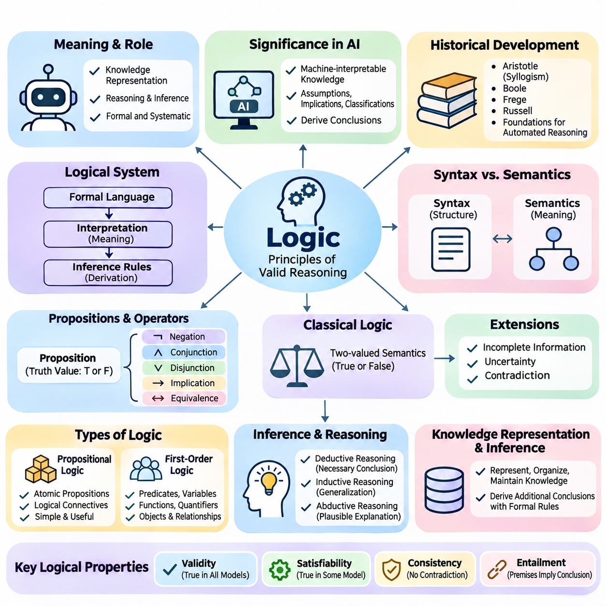
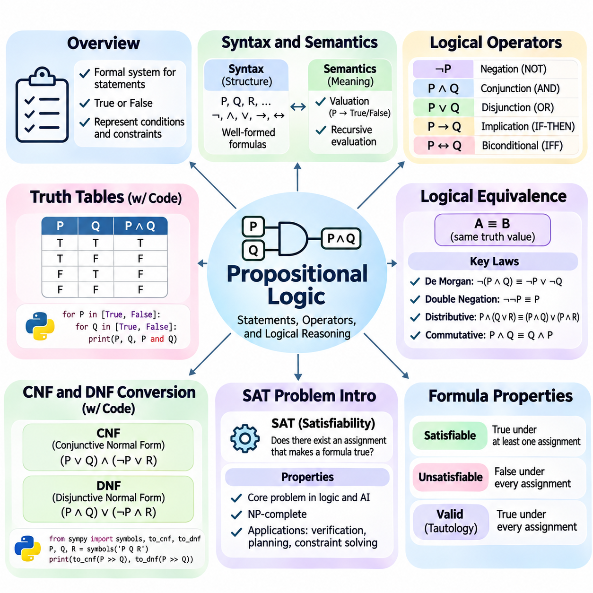
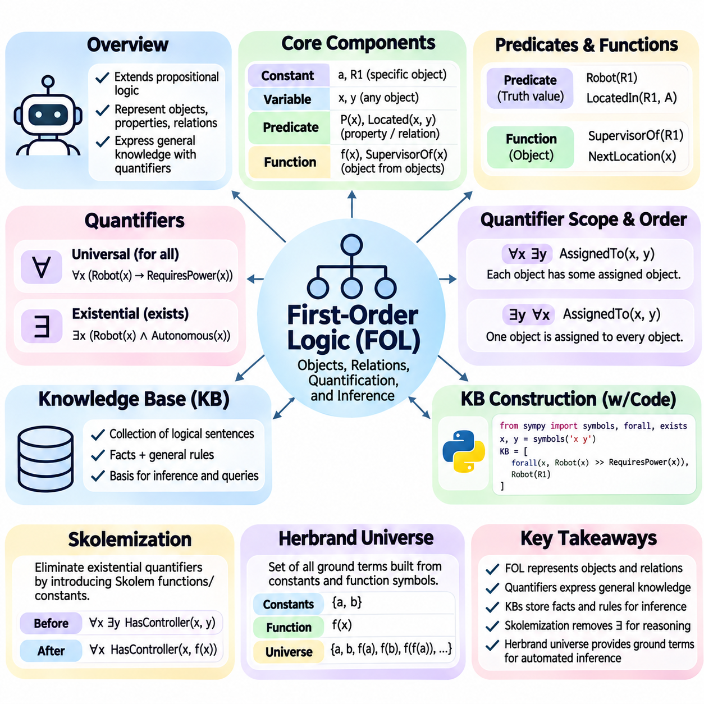
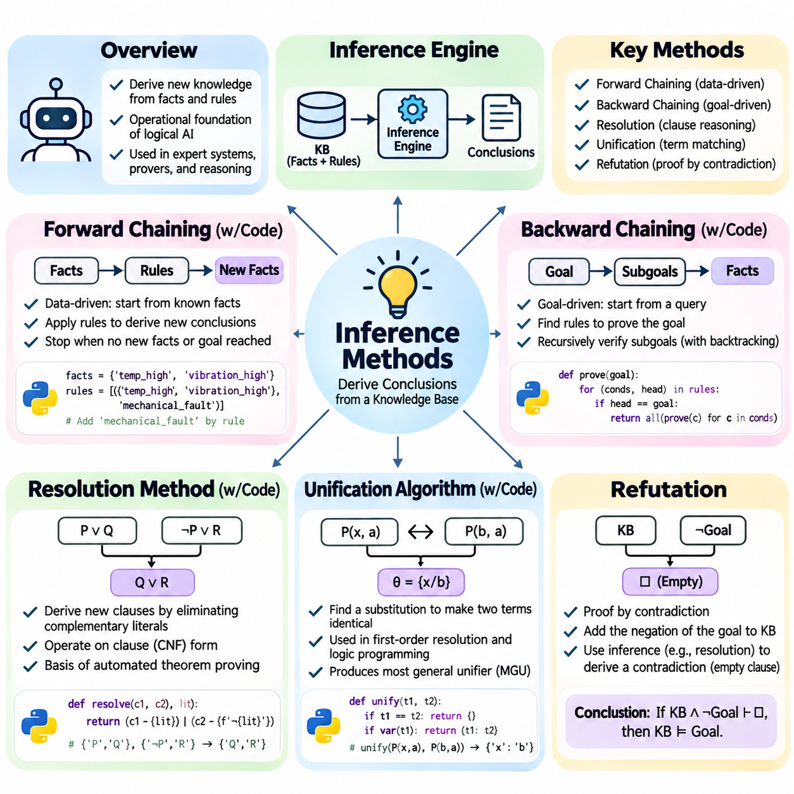
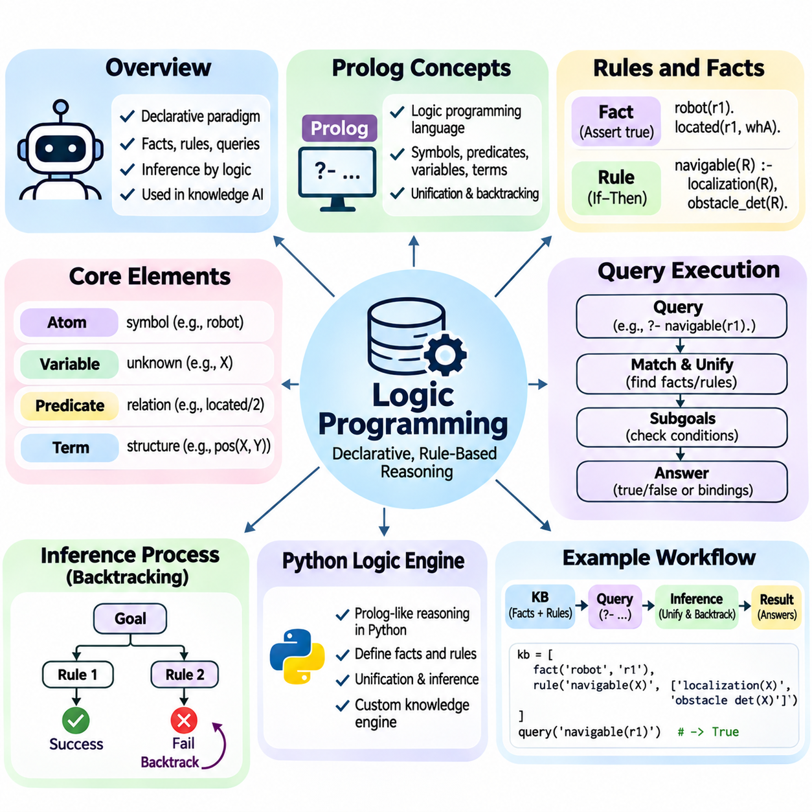
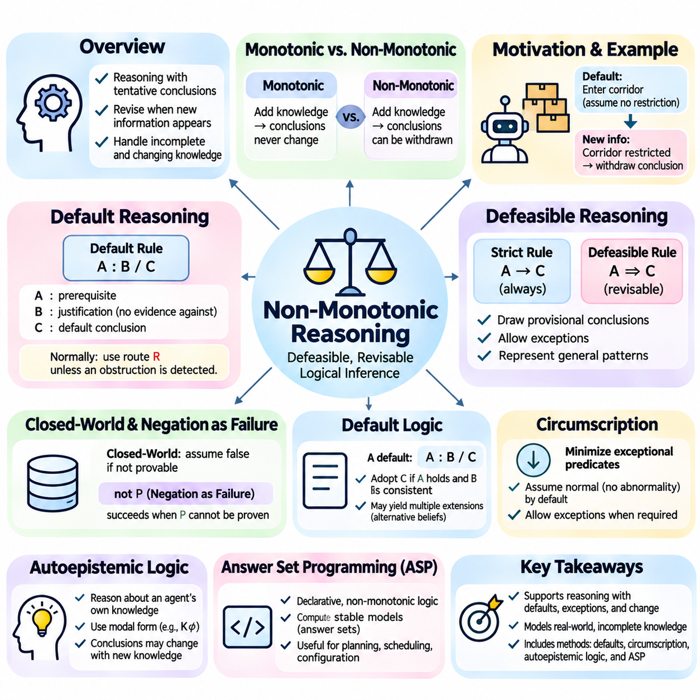
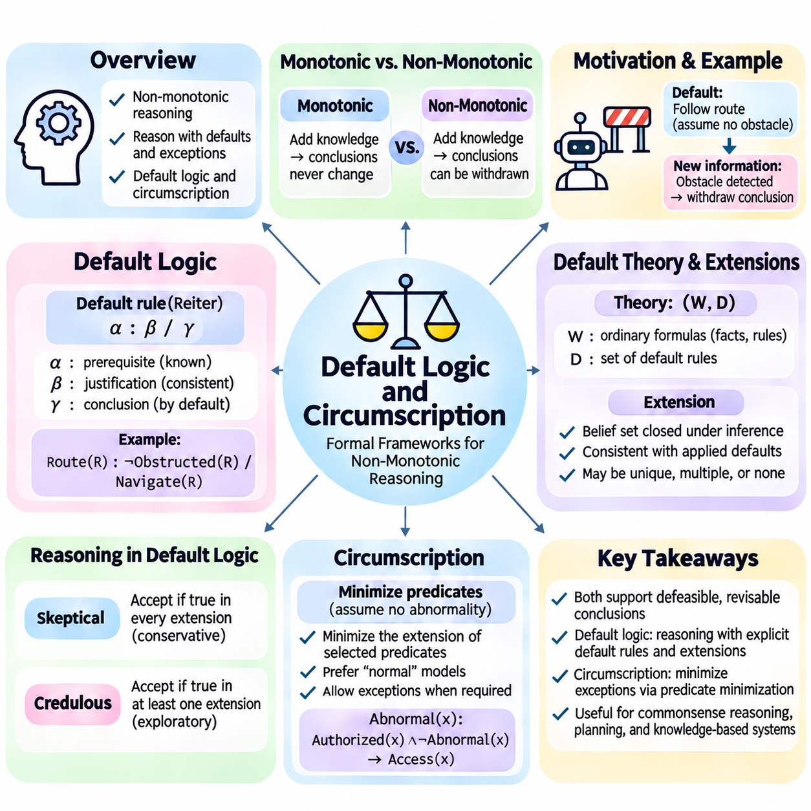
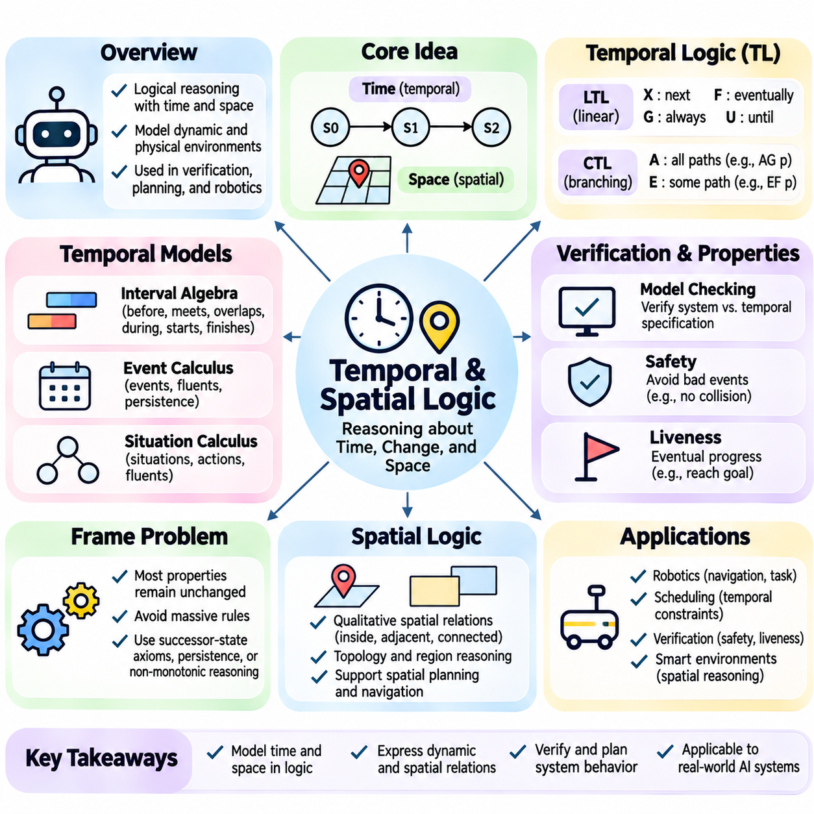
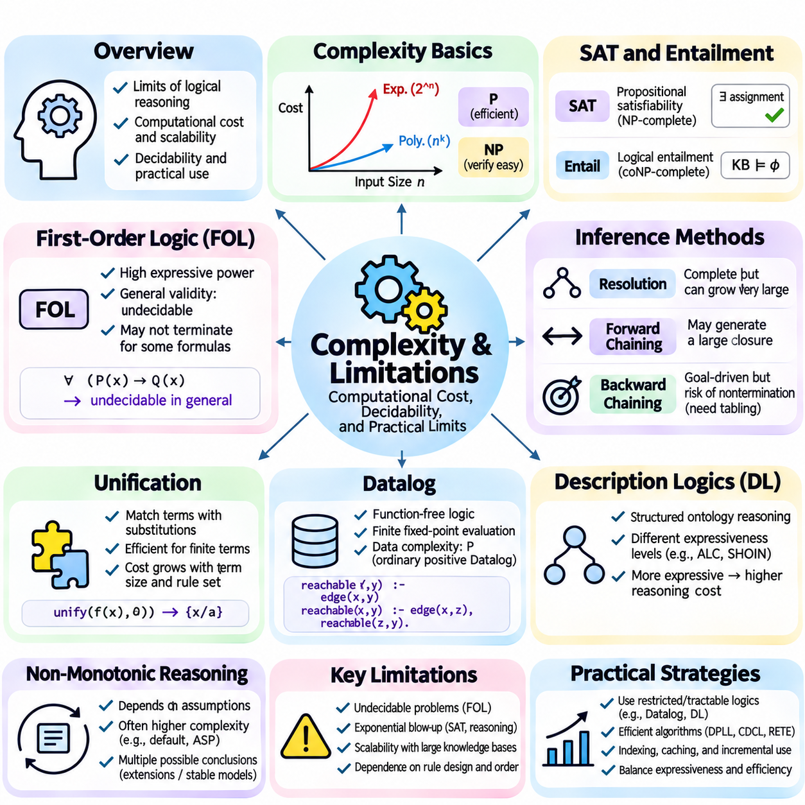
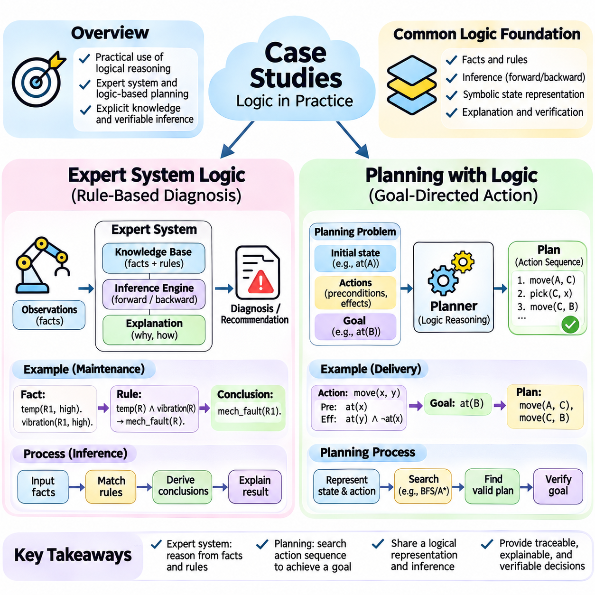

**Volume 02. Knowledge Representation**

# 01. Logic and Inference

## 01.01 Introduction to Logic

{width="7.268055555555556in" height="7.268055555555556in"}

Logic is a foundational discipline concerned with the principles of valid reasoning, the representation of knowledge, and the systematic evaluation of conclusions. In artificial intelligence, logic provides a formal language for expressing facts, relationships, constraints, and rules. It enables computational systems to manipulate symbolic information and derive conclusions according to explicitly defined principles rather than relying exclusively on numerical patterns.

The significance of logic in artificial intelligence originates from the need to represent knowledge in a form that machines can interpret and process consistently. Human reasoning frequently involves assumptions, implications, classifications, and relationships between concepts. Logical representation transforms these elements into structured expressions, allowing artificial intelligence systems to examine whether particular conclusions follow from available information.

Classical logic developed through philosophical investigations into argumentation, truth, and mathematical reasoning. Aristotle established influential principles of syllogistic reasoning, while later developments introduced mathematical symbolism and formal logical systems. Contributions from George Boole, Gottlob Frege, Bertrand Russell, and other scholars established foundations that eventually supported automated reasoning, formal verification, and symbolic artificial intelligence.

A logical system generally consists of a formal language, an interpretation of that language, and rules governing valid inference. The formal language specifies how meaningful expressions can be constructed, while interpretation determines their truth conditions. Inference rules describe how conclusions may be derived from premises. Together, these components establish a systematic framework for representing knowledge and performing reasoning operations.

The distinction between syntax and semantics is essential for understanding logical systems. Syntax defines the grammatical structure of logical expressions, including symbols, operators, and formation rules. Semantics assigns meaning to those expressions through interpretations or models. An expression may be syntactically valid without being true under a particular interpretation, making the separation between structure and meaning fundamental.

Logical propositions are statements that can be assigned truth values under a specified interpretation. For example, the statement that a robot is located in a warehouse may be true or false depending on the actual environment. Logical operators allow propositions to be combined into more complex expressions. Negation, conjunction, disjunction, implication, and equivalence provide the basic mechanisms for describing relationships between statements.

An important characteristic of classical logic is its reliance on precise truth conditions. Under classical two-valued semantics, every proposition is assigned either true or false within an interpretation. This assumption supports rigorous deduction and mathematical analysis. However, practical artificial intelligence systems frequently encounter incomplete, uncertain, or contradictory information, motivating extensions beyond conventional two-valued logical frameworks.

Propositional logic represents knowledge through atomic propositions and logical connectives. It provides a relatively simple framework for evaluating compound statements and determining whether conclusions follow from premises. Although propositional logic cannot directly express relationships involving arbitrary objects or quantified variables, its mathematical simplicity makes it valuable for automated reasoning, satisfiability solving, and formal verification.

First-order logic extends propositional logic by introducing predicates, variables, functions, and quantifiers. These constructs enable the representation of objects, properties, and relationships within a domain. For example, a knowledge base can express that every autonomous robot requires a control system and that a particular mobile platform is an autonomous robot. Logical inference can then establish that the platform requires a control system.

Quantification provides a powerful mechanism for expressing general and existential knowledge. Universal quantification describes properties that apply to every element of a specified domain, while existential quantification expresses the existence of at least one element satisfying a condition. These mechanisms allow artificial intelligence systems to represent general principles without explicitly enumerating every possible object or individual.

Knowledge representation and logical inference are closely connected but serve different purposes. Knowledge representation determines how information about a domain is encoded, organized, and maintained. Logical inference determines which additional statements can be derived from that information. A knowledge base stores explicit assertions, while an inference mechanism uses formal rules to produce conclusions that may not have been directly recorded.

Deductive reasoning derives conclusions that necessarily follow from premises when the inference rules are valid. If all premises are true and the reasoning process is logically sound, the conclusion must also be true. This property distinguishes deduction from inductive reasoning, which generalizes from observations, and abductive reasoning, which seeks plausible explanations for observed evidence without guaranteeing their correctness.

The concepts of validity, satisfiability, consistency, and entailment provide essential criteria for evaluating logical knowledge. Validity concerns expressions that hold under every interpretation, while satisfiability concerns whether an expression is true under at least one interpretation. Consistency indicates that a set of statements can be satisfied together. Entailment establishes whether a conclusion follows logically from a collection of premises.

Soundness and completeness describe important properties of formal inference systems. A sound inference procedure derives only conclusions that are logically entailed by its premises. A complete procedure can derive every conclusion that follows logically within the specified formal system. These properties establish the relationship between syntactic proof procedures and semantic consequences, providing theoretical foundations for trustworthy automated reasoning.

Automated inference transforms logical knowledge into computationally derived conclusions. An inference engine examines facts and rules, identifies applicable logical relationships, and applies inference procedures to generate additional knowledge. Depending on the representation and reasoning strategy, the engine may use rule application, logical resolution, theorem proving, or satisfiability checking to determine whether a requested conclusion is supported.

Logical reasoning also provides the foundation for rule-based expert systems. Such systems encode domain knowledge as explicit conditions and consequences, allowing decisions to be explained through identifiable reasoning steps. In industrial maintenance, for example, a rule may connect abnormal vibration measurements and elevated motor temperature to a possible equipment fault, supporting structured diagnosis and subsequent verification.

Logic plays an important role in planning and autonomous decision-making. A planning system can represent environmental conditions, available actions, preconditions, and expected effects using symbolic expressions. Logical reasoning determines whether an action is applicable and whether a sequence of actions satisfies specified goals. This approach is especially useful when operational constraints and safety requirements must be explicitly represented.

In robotics, logical representations can complement perception, localization, and motion planning. A mobile robot may use learned models to recognize objects while applying logical rules to determine whether an object can be transported, whether a restricted area may be entered, or whether a task prerequisite has been satisfied. The combination supports decisions that depend on both observed environmental conditions and symbolic operational knowledge.

Logical systems are particularly valuable when transparency and traceability are important. Because conclusions can be associated with explicit premises and inference steps, developers can inspect how particular decisions were produced. This characteristic supports debugging, knowledge validation, regulatory analysis, and formal verification. Nevertheless, explainability depends on the quality of the representation and the availability of interpretable reasoning traces.

Despite these advantages, classical logic has practical limitations. Real environments contain ambiguous observations, missing information, changing conditions, and conflicting evidence. Traditional deductive systems do not automatically assign probabilities or confidence levels to uncertain statements. Moreover, computational complexity can become substantial as the number of objects, relationships, and possible interpretations increases.

The distinction between monotonic and non-monotonic reasoning becomes important when knowledge changes. In monotonic logic, adding premises does not invalidate conclusions that were previously entailed. Non-monotonic reasoning permits conclusions to be revised when new information becomes available. This capability is valuable in dynamic environments where default assumptions must be reconsidered as additional observations or exceptions are discovered.

Logical knowledge representation also connects naturally with ontologies and knowledge graphs. Ontologies define conceptual categories, properties, and relationships, while knowledge graphs organize entities and their connections. Logical axioms can provide formal semantics for these structures and support consistency checking, classification, and knowledge inference. Such integration enables complex information systems to reason across structured domain knowledge.

Modern artificial intelligence increasingly combines symbolic logic with statistical learning. Neural networks are effective at extracting patterns from large datasets, while logical systems provide mechanisms for expressing explicit constraints and structured relationships. Neuro-symbolic approaches seek to integrate these capabilities, enabling learned representations to interact with formal knowledge and supporting reasoning processes that combine perception with symbolic abstraction.

Large language models introduce additional opportunities for combining natural language understanding with logical inference. A language model may translate user requirements into structured expressions, retrieve relevant knowledge, or propose candidate reasoning steps. External symbolic engines can then verify logical consistency or evaluate formal consequences. Such architectures can improve reliability when generated statements are subjected to independent logical validation.

The engineering value of logic ultimately depends on selecting representations and inference mechanisms appropriate to the problem. Propositional logic may be sufficient for finite Boolean constraints, while first-order logic supports richer relational knowledge. Specialized logical systems address temporal relationships, defaults, actions, and other domain requirements. Understanding these distinctions establishes the foundation for constructing reliable knowledge-based artificial intelligence systems.

Logic should therefore be understood not merely as a collection of mathematical operators, but as a general framework for structuring knowledge and controlling reasoning. Its concepts establish a bridge between human-readable rules and machine-executable inference procedures. By mastering logical syntax, semantics, validity, and deduction, developers acquire essential foundations for ontologies, knowledge graphs, expert systems, automated planning, and neuro-symbolic intelligence.

Propositional logic is a formal system for representing statements and determining their logical relationships through precise rules. Each proposition expresses a declarative statement that is either true or false under a particular interpretation. By combining propositions with logical operators, artificial intelligence systems can represent conditions, constraints, and dependencies in a form suitable for automated reasoning and computational verification.

The syntax of propositional logic defines how valid expressions are constructed from atomic propositions, logical connectives, and parentheses. Atomic propositions are commonly represented by symbols such as P, Q, and R. More complex formulas are formed through negation, conjunction, disjunction, implication, and biconditional operators. These formation rules ensure that every well-formed formula has a recognizable grammatical structure.

Logical connectives determine how individual propositions contribute to compound expressions. Negation reverses a truth value, conjunction requires both operands to be true, and disjunction requires at least one operand to be true. Material implication is false only when its antecedent is true and its consequent is false. Biconditional equivalence holds when both operands have identical truth values under the same interpretation.

Parentheses establish the intended grouping of logical expressions and prevent ambiguity during evaluation. For example, P ∧ (Q ∨ R) differs from (P ∧ Q) ∨ R because the expressions impose different conditions on their constituent propositions. Operator precedence conventions can reduce the need for parentheses, but explicit grouping is generally preferable in software implementations where readability and correctness are important.

The semantics of propositional logic assigns truth values to atomic propositions and evaluates compound formulas according to the meanings of their operators. A valuation maps each proposition to either true or false. Once these assignments are established, the truth value of any compound formula can be calculated recursively. This compositional interpretation provides the mathematical basis for automated logical evaluation.

A logical formula may be satisfiable, unsatisfiable, or valid depending on its behavior across possible valuations. A satisfiable formula evaluates to true under at least one assignment, whereas an unsatisfiable formula is false under every assignment. A valid formula is true under every assignment. These classifications provide essential foundations for logical verification, constraint solving, and automated theorem proving.

Truth tables offer a systematic method for evaluating propositional formulas under every possible assignment of truth values. For a formula containing n distinct atomic propositions, a complete truth table contains 2\^n assignments. Each row represents one possible interpretation, while additional columns record intermediate and final evaluations. This exhaustive method makes logical relationships explicit and mathematically verifiable.

Consider a system containing propositions that represent whether a robot is powered, whether its safety controller is active, and whether movement is permitted. A truth table can enumerate every combination of these conditions and evaluate a movement authorization rule. Such analysis helps engineers identify configurations in which an authorization expression behaves differently from its intended safety requirements.

Truth tables also provide a practical method for distinguishing tautologies, contradictions, and contingent formulas. A tautology evaluates to true in every row, while a contradiction evaluates to false in every row. A contingent formula is true for some assignments and false for others. These distinctions help determine whether a rule expresses an unconditional principle, an impossible condition, or a context-dependent requirement.

Programmatic truth-table generation typically involves identifying all atomic propositions, enumerating their Boolean assignments, and evaluating the expression for each assignment. Python implementations can use Boolean operations, recursive expression trees, or symbolic logic libraries. Although exhaustive enumeration is straightforward, its exponential growth limits scalability when formulas contain many independent variables.

Logical equivalence describes the relationship between two formulas that produce identical truth values under every possible assignment. If formulas A and B are logically equivalent, either may replace the other without changing the meaning of the surrounding expression. This property enables logical simplification, optimization, and transformation while preserving the original conditions represented by a knowledge base.

Several equivalence laws provide the foundation for manipulating propositional formulas. De Morgan\'s laws transform negated conjunctions into disjunctions of negated operands and vice versa. Double negation eliminates paired negation operators, while distributive laws reorganize conjunctions and disjunctions. Commutative, associative, absorption, and idempotent laws further support systematic simplification of Boolean expressions.

Implication elimination is particularly important because material implication can be expressed using negation and disjunction. The formula P → Q is logically equivalent to ¬P ∨ Q. Similarly, a biconditional can be represented as the conjunction of two implications. These transformations allow complex expressions to be rewritten using a smaller collection of operators without changing their truth conditions.

Logical equivalence should be distinguished from logical entailment. Equivalence requires two formulas to have identical truth values under every interpretation, whereas entailment requires every interpretation satisfying the premises to satisfy the conclusion. Two formulas can therefore participate in an entailment relationship without being equivalent. This distinction is fundamental when evaluating inference rules and knowledge-base consequences.

Normal forms provide standardized representations that simplify logical manipulation and computational processing. Conjunctive Normal Form, or CNF, expresses a formula as a conjunction of clauses, where each clause is a disjunction of literals. A literal is an atomic proposition or its negation. CNF is particularly important because many satisfiability algorithms and automated reasoning procedures operate on clause-based representations.

Disjunctive Normal Form, or DNF, represents a formula as a disjunction of terms, where each term is a conjunction of literals. DNF emphasizes alternative combinations of conditions sufficient to satisfy an expression. This representation is useful in Boolean function analysis, rule interpretation, and certain decision procedures. Both CNF and DNF can represent arbitrary propositional Boolean functions.

Converting a formula into CNF generally involves eliminating biconditional and implication operators, moving negations inward, and distributing disjunction over conjunction. Negations are pushed toward atomic propositions using De Morgan\'s laws and double-negation elimination. The resulting expression is organized into clauses connected by conjunctions, producing a standardized structure suitable for satisfiability analysis.

DNF conversion follows a related process but distributes conjunction over disjunction to construct a disjunction of conjunctive terms. For example, P ∧ (Q ∨ R) can be transformed into (P ∧ Q) ∨ (P ∧ R). The original and transformed expressions are logically equivalent. However, repeated distribution can significantly increase formula size, making efficient transformation strategies important.

Canonical CNF and DNF representations can also be constructed directly from truth tables. Canonical DNF combines minterms corresponding to assignments that make the formula true, while canonical CNF combines maxterms corresponding to assignments that make it false. Although these methods are systematic, the resulting expressions may become exponentially large as the number of propositions increases.

Practical CNF conversion must consider the distinction between logical equivalence and equisatisfiability. Direct distribution preserves equivalence but may produce substantial expression growth. The Tseitin transformation introduces auxiliary variables to construct a CNF formula whose satisfiability matches the original expression. This technique often produces a representation with size linear in the input formula, supporting efficient solver integration.

The Boolean Satisfiability Problem, commonly called SAT, asks whether there exists an assignment of truth values that makes a propositional formula true. If such an assignment exists, the formula is satisfiable, and the assignment serves as a satisfying model. Otherwise, the formula is unsatisfiable. SAT provides a general computational framework for expressing and solving many discrete decision problems.

SAT was historically significant in computational complexity theory because it became the first problem proven NP-complete. This classification means that SAT belongs to NP and that every problem in NP can be reduced to it in polynomial time. Although no polynomial-time algorithm is known for general SAT, specialized algorithms and carefully engineered solvers can efficiently handle many large practical instances.

Early SAT-solving methods relied on systematic search and logical simplification. The Davis--Putnam--Logemann--Loveland algorithm, known as DPLL, combines branching decisions with unit propagation and backtracking. Unit propagation derives forced assignments from clauses containing only one unassigned literal. When a contradiction is detected, the solver revises earlier decisions and explores alternative assignments.

Modern SAT solvers commonly employ Conflict-Driven Clause Learning, or CDCL, to improve search efficiency. CDCL analyzes conflicts, learns clauses that prevent repeated exploration of incompatible assignments, and performs non-chronological backtracking. Additional techniques, including variable selection heuristics, watched literals, restarts, and clause database management, contribute to strong practical performance.

SAT modeling transforms application requirements into Boolean variables and logical constraints. In scheduling, variables may represent whether particular tasks occupy designated time slots. In hardware verification, they may represent circuit signals and expected behaviors. In robotics, Boolean constraints can express discrete action permissions, resource availability, and mutually exclusive operational states within a planning model.

A practical SAT workflow begins by defining the decision variables and encoding all relevant constraints. The resulting formula is converted into CNF and submitted to a solver. A satisfiable result provides a candidate assignment that can be interpreted as a solution, while an unsatisfiable result indicates that no assignment satisfies all encoded constraints. Correct interpretation depends on the completeness and accuracy of the original model.

Propositional logic establishes a direct connection between symbolic knowledge representation and executable computational reasoning. Syntax and semantics define meaningful formulas, truth tables establish their behavior, equivalence supports transformations, normal forms standardize expressions, and SAT algorithms determine satisfiability. Together, these mechanisms provide essential foundations for inference engines, formal verification, automated planning, and knowledge-based artificial intelligence.

## 01.02 Propositional Logic

{width="7.268055555555556in" height="7.268055555555556in"}

Propositional logic is a formal system for representing statements and determining their logical relationships through precise rules. Each proposition expresses a declarative statement that is either true or false under a particular interpretation. By combining propositions with logical operators, artificial intelligence systems can represent conditions, constraints, and dependencies in a form suitable for automated reasoning and computational verification.

The syntax of propositional logic defines how valid expressions are constructed from atomic propositions, logical connectives, and parentheses. Atomic propositions are commonly represented by symbols such as P, Q, and R. More complex formulas are formed through negation, conjunction, disjunction, implication, and biconditional operators. These formation rules ensure that every well-formed formula has a recognizable grammatical structure.

Logical connectives determine how individual propositions contribute to compound expressions. Negation reverses a truth value, conjunction requires both operands to be true, and disjunction requires at least one operand to be true. Material implication is false only when its antecedent is true and its consequent is false. Biconditional equivalence holds when both operands have identical truth values under the same interpretation.

Parentheses establish the intended grouping of logical expressions and prevent ambiguity during evaluation. For example, P ∧ (Q ∨ R) differs from (P ∧ Q) ∨ R because the expressions impose different conditions on their constituent propositions. Operator precedence conventions can reduce the need for parentheses, but explicit grouping is generally preferable in software implementations where readability and correctness are important.

The semantics of propositional logic assigns truth values to atomic propositions and evaluates compound formulas according to the meanings of their operators. A valuation maps each proposition to either true or false. Once these assignments are established, the truth value of any compound formula can be calculated recursively. This compositional interpretation provides the mathematical basis for automated logical evaluation.

A logical formula may be satisfiable, unsatisfiable, or valid depending on its behavior across possible valuations. A satisfiable formula evaluates to true under at least one assignment, whereas an unsatisfiable formula is false under every assignment. A valid formula is true under every assignment. These classifications provide essential foundations for logical verification, constraint solving, and automated theorem proving.

Truth tables offer a systematic method for evaluating propositional formulas under every possible assignment of truth values. For a formula containing n distinct atomic propositions, a complete truth table contains 2\^n assignments. Each row represents one possible interpretation, while additional columns record intermediate and final evaluations. This exhaustive method makes logical relationships explicit and mathematically verifiable.

Consider a system containing propositions that represent whether a robot is powered, whether its safety controller is active, and whether movement is permitted. A truth table can enumerate every combination of these conditions and evaluate a movement authorization rule. Such analysis helps engineers identify configurations in which an authorization expression behaves differently from its intended safety requirements.

Truth tables also provide a practical method for distinguishing tautologies, contradictions, and contingent formulas. A tautology evaluates to true in every row, while a contradiction evaluates to false in every row. A contingent formula is true for some assignments and false for others. These distinctions help determine whether a rule expresses an unconditional principle, an impossible condition, or a context-dependent requirement.

Programmatic truth-table generation typically involves identifying all atomic propositions, enumerating their Boolean assignments, and evaluating the expression for each assignment. Python implementations can use Boolean operations, recursive expression trees, or symbolic logic libraries. Although exhaustive enumeration is straightforward, its exponential growth limits scalability when formulas contain many independent variables.

Logical equivalence describes the relationship between two formulas that produce identical truth values under every possible assignment. If formulas A and B are logically equivalent, either may replace the other without changing the meaning of the surrounding expression. This property enables logical simplification, optimization, and transformation while preserving the original conditions represented by a knowledge base.

Several equivalence laws provide the foundation for manipulating propositional formulas. De Morgan\'s laws transform negated conjunctions into disjunctions of negated operands and vice versa. Double negation eliminates paired negation operators, while distributive laws reorganize conjunctions and disjunctions. Commutative, associative, absorption, and idempotent laws further support systematic simplification of Boolean expressions.

Implication elimination is particularly important because material implication can be expressed using negation and disjunction. The formula P → Q is logically equivalent to ¬P ∨ Q. Similarly, a biconditional can be represented as the conjunction of two implications. These transformations allow complex expressions to be rewritten using a smaller collection of operators without changing their truth conditions.

Logical equivalence should be distinguished from logical entailment. Equivalence requires two formulas to have identical truth values under every interpretation, whereas entailment requires every interpretation satisfying the premises to satisfy the conclusion. Two formulas can therefore participate in an entailment relationship without being equivalent. This distinction is fundamental when evaluating inference rules and knowledge-base consequences.

Normal forms provide standardized representations that simplify logical manipulation and computational processing. Conjunctive Normal Form, or CNF, expresses a formula as a conjunction of clauses, where each clause is a disjunction of literals. A literal is an atomic proposition or its negation. CNF is particularly important because many satisfiability algorithms and automated reasoning procedures operate on clause-based representations.

Disjunctive Normal Form, or DNF, represents a formula as a disjunction of terms, where each term is a conjunction of literals. DNF emphasizes alternative combinations of conditions sufficient to satisfy an expression. This representation is useful in Boolean function analysis, rule interpretation, and certain decision procedures. Both CNF and DNF can represent arbitrary propositional Boolean functions.

Converting a formula into CNF generally involves eliminating biconditional and implication operators, moving negations inward, and distributing disjunction over conjunction. Negations are pushed toward atomic propositions using De Morgan\'s laws and double-negation elimination. The resulting expression is organized into clauses connected by conjunctions, producing a standardized structure suitable for satisfiability analysis.

DNF conversion follows a related process but distributes conjunction over disjunction to construct a disjunction of conjunctive terms. For example, P ∧ (Q ∨ R) can be transformed into (P ∧ Q) ∨ (P ∧ R). The original and transformed expressions are logically equivalent. However, repeated distribution can significantly increase formula size, making efficient transformation strategies important.

Canonical CNF and DNF representations can also be constructed directly from truth tables. Canonical DNF combines minterms corresponding to assignments that make the formula true, while canonical CNF combines maxterms corresponding to assignments that make it false. Although these methods are systematic, the resulting expressions may become exponentially large as the number of propositions increases.

Practical CNF conversion must consider the distinction between logical equivalence and equisatisfiability. Direct distribution preserves equivalence but may produce substantial expression growth. The Tseitin transformation introduces auxiliary variables to construct a CNF formula whose satisfiability matches the original expression. This technique often produces a representation with size linear in the input formula, supporting efficient solver integration.

The Boolean Satisfiability Problem, commonly called SAT, asks whether there exists an assignment of truth values that makes a propositional formula true. If such an assignment exists, the formula is satisfiable, and the assignment serves as a satisfying model. Otherwise, the formula is unsatisfiable. SAT provides a general computational framework for expressing and solving many discrete decision problems.

SAT was historically significant in computational complexity theory because it became the first problem proven NP-complete. This classification means that SAT belongs to NP and that every problem in NP can be reduced to it in polynomial time. Although no polynomial-time algorithm is known for general SAT, specialized algorithms and carefully engineered solvers can efficiently handle many large practical instances.

Early SAT-solving methods relied on systematic search and logical simplification. The Davis--Putnam--Logemann--Loveland algorithm, known as DPLL, combines branching decisions with unit propagation and backtracking. Unit propagation derives forced assignments from clauses containing only one unassigned literal. When a contradiction is detected, the solver revises earlier decisions and explores alternative assignments.

Modern SAT solvers commonly employ Conflict-Driven Clause Learning, or CDCL, to improve search efficiency. CDCL analyzes conflicts, learns clauses that prevent repeated exploration of incompatible assignments, and performs non-chronological backtracking. Additional techniques, including variable selection heuristics, watched literals, restarts, and clause database management, contribute to strong practical performance.

SAT modeling transforms application requirements into Boolean variables and logical constraints. In scheduling, variables may represent whether particular tasks occupy designated time slots. In hardware verification, they may represent circuit signals and expected behaviors. In robotics, Boolean constraints can express discrete action permissions, resource availability, and mutually exclusive operational states within a planning model.

A practical SAT workflow begins by defining the decision variables and encoding all relevant constraints. The resulting formula is converted into CNF and submitted to a solver. A satisfiable result provides a candidate assignment that can be interpreted as a solution, while an unsatisfiable result indicates that no assignment satisfies all encoded constraints. Correct interpretation depends on the completeness and accuracy of the original model.

Propositional logic establishes a direct connection between symbolic knowledge representation and executable computational reasoning. Syntax and semantics define meaningful formulas, truth tables establish their behavior, equivalence supports transformations, normal forms standardize expressions, and SAT algorithms determine satisfiability. Together, these mechanisms provide essential foundations for inference engines, formal verification, automated planning, and knowledge-based artificial intelligence.

## 01.03 First Order Logic FOL

{width="7.268055555555556in" height="7.268055555555556in"}

First-order logic, commonly abbreviated as FOL, extends propositional logic by representing objects, properties, relationships, and quantified statements within a formal language. Unlike propositional logic, which treats statements as indivisible units, FOL exposes their internal structure. This capability enables artificial intelligence systems to express general knowledge about entities and derive conclusions involving relationships among them.

The expressive power of FOL originates from its use of constants, variables, predicates, functions, and quantifiers. Constants identify particular objects within a domain, while variables represent objects whose identities may vary. Predicates describe properties or relationships, and functions map objects to other objects. Quantifiers specify whether logical statements apply universally or to at least one object within the domain.

Predicates are fundamental components of relational knowledge representation. A unary predicate describes a property of one object, while binary and higher-arity predicates express relationships involving multiple objects. For example, Robot(R1) states that R1 is a robot, whereas LocatedIn(R1, WarehouseA) expresses its location. Predicate arguments provide the structure necessary for reasoning about individual entities and their interactions.

Functions differ from predicates because they denote objects rather than truth-valued relationships. A function such as SupervisorOf(R1) identifies an object associated with robot R1, while a predicate such as Authorized(R1) expresses a statement that may be true or false. Functions may be nested to represent complex relationships, but unrestricted nesting can generate infinitely many syntactically distinct terms.

Universal quantification expresses statements that apply to every object in a domain. The expression ∀x (Robot(x) → RequiresPower(x)) states that every robot requires power. Existential quantification expresses the existence of at least one object satisfying a condition. For example, ∃x (Robot(x) ∧ Autonomous(x)) asserts that at least one autonomous robot exists within the interpreted domain.

The scope of a quantifier determines which portions of a formula are governed by its variable binding. A variable occurrence is bound when it falls within the scope of an appropriate quantifier; otherwise, it is free. Sentences without free variables can be evaluated as true or false under an interpretation. Correct variable binding is essential because changing quantifier scope can fundamentally alter a statement\'s meaning.

Quantifier ordering is particularly important when expressing dependencies between objects. The statement ∀x ∃y AssignedTo(x,y) means that every object has some assigned counterpart, potentially different for each object. In contrast, ∃y ∀x AssignedTo(x,y) requires one particular object to be assigned to every object. These formulas are generally not equivalent and represent substantially different constraints.

The semantics of FOL relies on a domain of discourse and an interpretation assigning meanings to symbols. Constants denote domain elements, predicates denote relations over the domain, and functions denote mappings between domain elements. Quantified formulas are evaluated by considering variable assignments over the domain. This semantic framework connects symbolic expressions to the objects and relationships they represent.

A knowledge base is a structured collection of logical sentences describing facts, relationships, and general rules. In FOL, knowledge bases may contain ground facts involving specific objects and universally quantified implications describing domain-wide principles. For example, a robotics knowledge base might record that R1 is autonomous and that every autonomous robot requires a navigation system.

Knowledge base construction begins by identifying the domain, relevant entities, important relationships, and reasoning requirements. Designers then establish a vocabulary of constants, predicates, and functions with consistent meanings. Clear naming conventions and explicit modeling assumptions help prevent ambiguity. The resulting representation should support the intended queries without introducing unnecessary logical complexity.

A practical construction process translates natural-language requirements into formal sentences. The statement that every mobile robot has a controller may be represented as ∀x (MobileRobot(x) → ∃y (Controller(y) ∧ HasController(x,y))). This formula captures both the classification of mobile robots and the existence of associated controllers, demonstrating how quantified relationships support structured knowledge modeling.

Knowledge bases must also distinguish explicitly asserted facts from conclusions derived through inference. A statement such as MobileRobot(R1) may be stored directly, while RequiresNavigation(R1) may follow from a general rule. This separation enables traceable reasoning and reduces redundant assertions. However, derived conclusions remain dependent on the correctness of the premises and inference procedures.

FOL knowledge bases generally operate under an open-world interpretation unless additional assumptions are introduced. The absence of a fact does not automatically establish its negation. If a knowledge base does not state that a robot has a camera, the system cannot conclude that it lacks one. Closed-world reasoning instead treats certain unrecorded facts as false, which requires an explicit modeling convention.

Consistency is a critical requirement in knowledge base engineering. Contradictory assertions can undermine classical logical reasoning because an inconsistent theory entails every formula under standard semantics. Developers therefore need mechanisms for checking incompatible constraints, validating domain assumptions, and managing conflicting information. Modular knowledge organization and automated consistency testing improve maintainability.

Python implementations of FOL knowledge bases commonly represent terms and formulas through symbolic expression trees. Constants, variables, predicates, and quantifiers can be modeled as structured objects, while rules are stored as logical expressions. Query processing may involve substitution, unification, and inference procedures. Libraries can simplify symbolic manipulation, although their supported logical fragments and reasoning capabilities differ.

Skolemization is a transformation technique used in automated theorem proving to eliminate existential quantifiers by introducing new symbols. An existentially quantified variable is replaced with a fresh constant when it has no universally quantified dependencies, or with a fresh function when its value may depend on universally quantified variables. This transformation is central to preparing formulas for resolution-based reasoning.

Consider the formula ∃x Robot(x), which asserts that at least one robot exists. Skolemization replaces the existential variable with a fresh constant, producing Robot(c), where c is a newly introduced Skolem constant. The transformed formula does not preserve logical equivalence in the original vocabulary, but it preserves satisfiability when the fresh symbol is interpreted appropriately.

When existential variables depend on universal variables, Skolem functions capture those dependencies. The formula ∀x ∃y Controls(y,x) states that every object has some controller. Skolemization produces ∀x Controls(f(x),x), where f is a new function assigning a controller to each object. The function does not imply uniqueness of controllers; it selects one witness for each universally quantified object.

A standard Skolemization procedure first eliminates implications, moves negations inward, and standardizes bound variables apart. Quantifiers may then be organized into prenex form before existential variables are replaced with fresh Skolem symbols. Universal quantifiers can subsequently be omitted by convention when constructing clauses. The resulting representation supports automated resolution while preserving the satisfiability of the original formula.

The distinction between satisfiability preservation and logical equivalence is essential when applying Skolemization. Skolemized formulas introduce symbols that were absent from the original language, so they are not generally equivalent as formulas over the expanded vocabulary. Nevertheless, the original formula is satisfiable exactly when its Skolemized counterpart is satisfiable, making the transformation suitable for refutation-based theorem proving.

The Herbrand universe provides a syntactic foundation for automated reasoning in first-order logic. It consists of all ground terms that can be constructed from the constants and function symbols in a logical language. A ground term contains no variables. If the language contains no constants, a fresh constant is introduced to ensure that the Herbrand universe is nonempty.

For a language containing constants a and b without function symbols, the Herbrand universe contains only a and b. If a unary function f is also available, the universe includes a, b, f(a), f(b), f(f(a)), and increasingly nested terms. Consequently, even a language with finitely many symbols can generate an infinite Herbrand universe when function symbols permit unrestricted nesting.

The Herbrand base is the set of all ground atomic formulas constructed from predicate symbols and terms in the Herbrand universe. For example, a unary predicate Robot and ground terms a and f(a) generate atoms such as Robot(a) and Robot(f(a)). A Herbrand interpretation assigns truth values to ground atoms, providing a structured connection between first-order formulas and propositional reasoning.

Herbrand\'s theorem establishes an important relationship between first-order satisfiability and ground instances of formulas. For suitable clausal representations, unsatisfiability can be demonstrated through a finite unsatisfiable collection of ground instances. This principle supports automated theorem proving by connecting quantified reasoning to propositional satisfiability, although the search for relevant ground instances may be computationally expensive.

Grounding transforms quantified formulas into instances involving specific ground terms. In finite domains, grounding can sometimes produce a manageable propositional representation suitable for SAT solving. However, function symbols may create infinitely many possible ground terms, making exhaustive grounding impractical. Automated reasoning systems therefore employ selective instantiation, unification, and search strategies to control computational complexity.

First-order logic provides a rigorous foundation for representing relational knowledge and deriving conclusions from general principles. Predicates, functions, and quantifiers define expressive symbolic structures, while knowledge bases organize domain assertions. Skolemization prepares quantified formulas for automated inference, and Herbrand constructions connect first-order reasoning with ground logical representations. Together, these concepts support expert systems, ontologies, knowledge graphs, and symbolic AI.

## 01.04 Inference Methods

{width="7.268055555555556in" height="7.268055555555556in"}

Inference methods provide the computational mechanisms through which artificial intelligence systems derive new knowledge from existing facts and logical rules. While knowledge representation defines how information is expressed, inference determines which conclusions logically follow from that information. These methods form the operational foundation of expert systems, automated theorem provers, logic programming environments, and knowledge-based decision systems.

An inference engine operates on a knowledge base containing assertions, relationships, and rules. Its primary responsibility is to identify applicable logical principles and derive conclusions that are justified by the available premises. Different inference strategies organize this process differently, emphasizing either the systematic expansion of known facts or the targeted verification of specific goals.

Forward chaining is a data-driven inference strategy that begins with known facts and repeatedly applies rules to generate additional conclusions. When the premises of a rule are satisfied, its conclusion can be added to the knowledge base. This process continues until no additional conclusions can be derived, a specified goal is reached, or an operational stopping condition is satisfied.

Consider a robotic maintenance system containing facts that a motor temperature is elevated and vibration exceeds an acceptable threshold. A rule may state that these conditions indicate a possible mechanical fault. Forward chaining identifies the matching conditions and derives the corresponding diagnostic conclusion. Additional rules may then recommend inspection or restrict equipment operation according to established maintenance policies.

Forward chaining is particularly effective when incoming observations must trigger multiple possible conclusions. Monitoring systems, industrial automation platforms, and rule-based alert engines often use this approach because new facts can activate relevant rules without requiring an explicitly defined query. However, unrestricted rule activation may generate conclusions unrelated to the immediate operational objective.

A basic forward-chaining implementation maintains a collection of known facts and repeatedly evaluates rules against that collection. Each rule contains conditions and a conclusion, and newly derived facts are inserted only when they are not already present. Efficient implementations avoid repeatedly examining unaffected rules by tracking changes, indexing predicates, or using pattern-matching networks such as the RETE algorithm.

Backward chaining is a goal-driven inference strategy that begins with a desired conclusion and searches for rules capable of establishing it. Instead of deriving every possible consequence of known facts, the system identifies the premises required to prove a specific goal. These premises become subgoals that are recursively evaluated against existing facts or additional rules.

For example, a maintenance assistant may receive a query asking whether a particular robot requires inspection. Backward chaining searches for rules whose conclusions establish inspection requirements. If a relevant rule depends on abnormal vibration and excessive temperature, the system attempts to verify those conditions. The original query succeeds when the necessary subgoals are established.

Backward chaining is useful when the number of possible conclusions is large but only a limited set of questions must be answered. Diagnostic systems, logic programming languages, and interactive expert systems frequently employ this approach. Its efficiency depends on rule organization, goal selection, and search control, particularly when recursive dependencies or multiple alternative proofs are present.

A backward-chaining engine commonly maintains a goal stack or recursive proof procedure. Each unresolved goal is matched against available facts and rule conclusions. Successful matches generate substitutions and additional subgoals, while unsuccessful branches require backtracking. Practical implementations must address cyclic dependencies, repeated subgoals, and termination conditions to prevent uncontrolled recursion.

Forward and backward chaining are complementary approaches rather than universally competing algorithms. Forward chaining is appropriate when facts arrive continuously and many consequences are relevant, whereas backward chaining is effective when reasoning is driven by specific questions. Hybrid systems may derive frequently needed conclusions proactively while reserving goal-directed inference for expensive or infrequently requested queries.

Resolution is a general inference method that derives new clauses by eliminating complementary literals from existing clauses. It operates on formulas represented in conjunctive normal form, where knowledge is expressed as a conjunction of disjunctive clauses. Resolution provides a systematic foundation for automated theorem proving and is particularly important in refutation-based logical reasoning.

In propositional logic, the clauses P ∨ Q and ¬P ∨ R can be resolved to produce Q ∨ R. The complementary literals P and ¬P are eliminated because their opposing truth requirements constrain the remaining alternatives. The resulting clause, called a resolvent, is logically entailed by the original clauses and can be incorporated into subsequent reasoning steps.

Resolution-based reasoning generally requires formulas to be transformed into clause form before inference begins. Implications are eliminated, negations are moved inward, and logical expressions are converted into conjunctive normal form. In first-order logic, additional transformations include variable standardization, Skolemization, and removal of implicit universal quantifiers from the resulting clauses.

First-order resolution extends propositional resolution by allowing complementary literals to match through variable substitution. For example, the clauses ¬Robot(x) ∨ RequiresPower(x) and Robot(R1) can produce RequiresPower(R1). The substitution assigning R1 to x makes the relevant literals complementary. This mechanism enables general rules to operate on specific entities without explicitly enumerating every possible instance.

Unification is the algorithmic process of finding substitutions that make two symbolic expressions identical. It is essential for first-order inference because predicates may contain variables, constants, and nested function terms. A successful unification identifies compatible variable assignments, allowing general logical patterns to match concrete facts or other quantified expressions.

Consider the expressions LocatedIn(x, WarehouseA) and LocatedIn(R1, y). They can be unified by assigning x to R1 and y to WarehouseA. The resulting substitution makes both expressions identical. If corresponding constants disagree or function structures are incompatible, unification fails because no permissible substitution can reconcile the expressions.

The most general unifier, commonly abbreviated as MGU, is a substitution that unifies two expressions without imposing unnecessary restrictions. Other unifiers can be obtained by applying additional substitutions to an MGU. Using most general unifiers preserves flexibility during inference and prevents premature commitments that could eliminate otherwise valid reasoning paths.

A standard unification algorithm recursively compares the structures of two terms. Identical constants unify immediately, while compatible compound terms require their function symbols and argument structures to match. Variables may be replaced with terms when the substitution is consistent. An occurs check prevents a variable from being substituted with a term containing that same variable.

The occurs check is important because substitutions such as x = f(x) cannot produce a finite first-order term under standard term semantics. Omitting this check may improve performance in certain logic programming implementations, but it changes the behavior of unification and can permit cyclic term structures. Correct implementation therefore depends on the intended logical semantics and representation model.

Python implementations of unification commonly represent expressions as recursive data structures containing symbols and argument lists. The algorithm maintains a substitution mapping and updates it as corresponding terms are compared. Successful execution returns a consistent substitution, while incompatible structures produce failure. Unit tests should include nested functions, repeated variables, conflicting constants, and occurs-check cases.

Refutation is a proof strategy that establishes a conclusion by demonstrating that its negation is inconsistent with the available premises. To prove a statement G from a knowledge base K, the system considers K together with ¬G. If this combined set is unsatisfiable, then G logically follows from K. This approach is widely used in automated theorem proving.

Resolution refutation applies the resolution rule repeatedly to clauses derived from the knowledge base and the negated goal. A successful proof eventually produces the empty clause, representing a contradiction. The empty clause demonstrates that the premises and negated conclusion cannot all be satisfied simultaneously, thereby establishing the original entailment relationship.

For example, suppose a knowledge base contains Robot(R1) and the rule that every robot requires power. To prove RequiresPower(R1), the system adds ¬RequiresPower(R1) to the knowledge base. Resolution combines the general rule with Robot(R1) to derive RequiresPower(R1), which contradicts the negated goal and produces the empty clause.

Refutation depends on the soundness of the inference rules and the correct transformation of logical formulas. Resolution is refutation-complete for first-order logic when combined with appropriate unification and clause transformations. However, proof search may fail to terminate when no contradiction exists, reflecting the general undecidability of first-order logical validity.

Search strategies significantly influence the practical efficiency of resolution-based theorem proving. Unit preference prioritizes clauses containing a single literal, while set-of-support strategies restrict resolution to clauses connected with the negated goal. Subsumption removes clauses made redundant by more general clauses. These techniques reduce unnecessary derivations without changing the underlying logical justification.

The choice of inference method depends on the structure of the knowledge base, the expected query patterns, and computational constraints. Forward chaining supports continuous rule activation, backward chaining focuses on requested conclusions, resolution provides general theorem-proving capabilities, and unification enables variable-based matching. Refutation establishes conclusions through contradiction and supplies a rigorous foundation for proof verification.

In practical artificial intelligence architectures, inference methods are often combined with knowledge graphs, ontologies, databases, and learned models. Symbolic inference can enforce explicit constraints, validate relationships, and produce traceable conclusions, while statistical components supply observations or candidate facts. Reliable integration requires careful handling of uncertainty, inconsistent information, computational complexity, and the distinction between asserted and inferred knowledge.

## 01.05 Logic Programming

{width="7.268055555555556in" height="7.268055555555556in"}

Logic programming is a declarative programming paradigm in which computational problems are expressed through facts, rules, and logical relationships rather than explicit sequences of instructions. Programs describe what conditions must hold, while an inference engine determines how to satisfy them. This approach connects formal logic with executable computation and provides a foundation for knowledge-based artificial intelligence.

The theoretical foundation of logic programming originates from first-order logic, particularly restricted forms of logical clauses known as Horn clauses. A Horn clause contains at most one positive literal and can represent a fact, a conditional rule, or a goal. These structures enable efficient inference mechanisms while preserving a meaningful relationship between logical statements and computational execution.

Prolog, derived from Programming in Logic, is one of the most established logic programming languages. It represents knowledge using symbolic terms, predicates, facts, and rules. Instead of defining a conventional control flow, developers specify relationships that should hold within a domain. The Prolog execution engine attempts to satisfy queries by applying unification, goal reduction, and systematic backtracking.

Prolog programs commonly use atoms, numbers, variables, and compound terms to represent information. Atoms identify symbolic entities, while variables represent values that may be determined during inference. Compound terms combine a functor with arguments to express structured relationships. Lists and recursively defined structures support more complex representations, including sequences, hierarchical objects, and symbolic expressions.

A predicate defines a relationship among its arguments, and its arity specifies the number of arguments it accepts. For example, located_in(robot1, warehouse_a) represents a relationship between a robot and a location. A predicate such as operational(robot1) expresses a property of a single entity. Predicates with the same name but different arities are treated as distinct predicate indicators in Prolog.

Facts represent statements accepted as true within the program\'s logical model. A robotics knowledge base might contain facts describing which robots exist, where they operate, and which sensors they possess. These facts provide the initial information against which queries are evaluated. Under Prolog\'s typical closed-world operational behavior, a query may fail when the program cannot establish the requested relationship.

Rules describe logical dependencies between conclusions and their supporting conditions. A rule consists of a head representing the conclusion and a body containing the conditions required to establish it. In Prolog, the operator :- separates the head from the body. A rule can express that a robot is eligible for navigation when its localization system and obstacle detection capabilities are available.

The distinction between facts and rules is essential for maintaining a structured knowledge base. Facts encode directly asserted information, whereas rules define relationships through which additional conclusions may be inferred. Separating these components improves maintainability and allows changes in operational policy without rewriting every individual assertion. However, rule correctness depends on consistent predicate definitions and valid assumptions.

Variables enable rules to generalize across multiple entities without enumerating every possible combination. A rule describing sensor availability can apply to any robot satisfying the required conditions. During query execution, variables are instantiated through substitutions that make expressions compatible. This mechanism allows compact programs to represent large collections of relationships and derive answers for previously unspecified objects.

Recursive rules are a distinctive feature of logic programming because they allow relationships to be defined in terms of themselves. A reachability predicate, for example, may establish that one location is reachable from another when a direct connection exists or an intermediate reachable location can be identified. Recursive definitions support graph traversal, hierarchical reasoning, dependency analysis, and symbolic planning.

Recursion must be designed carefully because logical correctness does not automatically guarantee operational termination. A poorly ordered recursive rule may repeatedly generate the same subgoal or enter an infinite search path. Prolog\'s execution strategy makes rule ordering and goal ordering significant. Techniques such as accumulators, tabling, and explicit termination conditions can improve execution behavior.

Query execution begins when a user or application submits a goal to the logic programming engine. The engine searches for facts or rule heads that can match the requested predicate. When a rule matches, its body becomes a collection of subgoals that must be satisfied. Successful evaluation produces a logical answer, potentially including substitutions for variables appearing in the original query.

Unification is the central matching operation used during Prolog query execution. It determines whether two terms can become identical through consistent variable substitutions. For example, a query requesting the location of robot1 may unify with a stored fact containing that robot identifier and a location variable. The resulting substitution provides the requested location without requiring explicit procedural search instructions.

Prolog traditionally uses a left-to-right selection of subgoals and depth-first exploration of matching clauses. When a selected alternative fails, the engine backtracks to an earlier choice point and attempts another possibility. This process allows a single query to produce multiple solutions. However, depth-first search may become trapped in infinite branches even when valid solutions exist elsewhere.

Backtracking provides a systematic mechanism for exploring alternative logical solutions. A query involving several possible robots may initially return one matching entity and subsequently discover additional entities when execution resumes. Variable bindings established along an unsuccessful branch are undone before another alternative is explored. This behavior supports relational queries without requiring developers to manually implement nested search loops.

Prolog also includes operational constructs that influence logical execution. The cut operator, represented by an exclamation mark, can prevent backtracking across selected choice points. Although cuts may improve efficiency or enforce intended procedural behavior, they can also change which solutions remain accessible. Their use requires careful consideration because excessive procedural control may undermine declarative clarity.

Negation in traditional Prolog is commonly implemented through negation as failure rather than classical logical negation. A negated goal succeeds when the engine cannot prove the corresponding positive goal. This interpretation depends on operational assumptions and is particularly sensitive to incomplete knowledge and uninstantiated variables. It should not be confused with proving that a proposition is explicitly false.

Practical Prolog systems may provide arithmetic evaluation, database updates, constraint handling, and external interfaces. Arithmetic expressions generally require explicit evaluation rather than ordinary symbolic unification. Constraint Logic Programming extends relational reasoning with specialized constraint domains, allowing systems to solve problems involving integers, finite domains, or other mathematical relationships.

Python can implement logic programming concepts through a dedicated inference engine or an existing symbolic reasoning library. A basic Python logic engine typically contains representations for constants, variables, compound terms, facts, rules, and queries. Its execution mechanism performs matching, substitution, and recursive goal evaluation. This architecture allows logic-based reasoning to integrate with conventional application components.

The internal representation of a Python logic engine should distinguish variable identities from symbolic constants. Predicates may be stored as structured objects containing names and argument sequences, while rules contain a conclusion and supporting premises. A substitution environment maintains variable bindings established during inference. Consistent data structures simplify unification, rule application, and debugging.

A Python unification procedure recursively compares two terms and updates a substitution mapping when compatible assignments are found. Matching constants must agree, while compound expressions require compatible predicate or function symbols and corresponding arguments. Variable substitutions must remain consistent across repeated occurrences. An occurs check may be included when finite first-order term semantics are required.

Backward chaining is a natural execution strategy for a compact Python logic engine. The engine receives a goal, searches for matching facts and rule conclusions, and recursively evaluates the premises of applicable rules. Alternative matches can be explored through generators or explicit backtracking structures. Each successful proof returns a substitution environment representing one possible answer.

Rule variables must be renamed apart whenever a rule is reused during inference. Without variable standardization, bindings from separate rule applications may interfere with one another and produce incorrect results. Fresh variable identities preserve the independence of each logical invocation. This requirement becomes particularly important when recursive rules or multiple nested queries use the same symbolic variable names.

A practical Python implementation should also consider duplicate conclusions, cyclic dependencies, and computational resource limits. Memoization or tabling can store previously evaluated subgoals and reduce repeated reasoning. Depth limits and execution budgets can prevent uncontrolled recursion, although they may also make reasoning incomplete. Reliable implementations should distinguish genuine logical failure from resource exhaustion.

Testing a logic programming engine requires more than checking successful queries. Validation should include incompatible terms, repeated variables, multiple solutions, recursive relationships, contradictory facts, and queries with no derivable answers. Developers should also verify that substitutions remain isolated across search branches. These tests help identify errors in unification, backtracking, variable scoping, and rule evaluation.

Logic programming is especially valuable for applications involving explicit relationships, explainable decisions, and symbolic constraints. Expert systems can encode diagnostic knowledge, knowledge graphs can support relational queries, and robotic task planners can evaluate symbolic prerequisites. Python-based engines provide flexible integration, while Prolog offers mature language constructs and established execution mechanisms for declarative reasoning.

The effectiveness of logic programming depends on balancing expressive power, computational efficiency, and operational predictability. Facts and rules provide transparent knowledge structures, unification enables generalized matching, and query execution transforms declarative descriptions into derived answers. Understanding Prolog concepts and Python inference-engine design establishes a practical foundation for symbolic reasoning within larger artificial intelligence systems.

## 01.06 Non Monotonic Reasoning

{width="7.268055555555556in" height="7.268055555555556in"}

Non-monotonic reasoning is a form of logical inference in which previously accepted conclusions may be withdrawn when additional information becomes available. Unlike classical monotonic logic, where adding premises cannot invalidate an established consequence, non-monotonic systems support belief revision. This capability enables artificial intelligence to reason with incomplete knowledge, changing environments, and assumptions that may later prove incorrect.

The distinction between monotonic and non-monotonic reasoning concerns how conclusions respond to expanding knowledge. In monotonic logic, if a conclusion follows from a knowledge base, it continues to follow after additional premises are introduced. Non-monotonic reasoning permits conclusions based on provisional assumptions to be revised. This behavior resembles everyday reasoning, where new evidence frequently changes earlier judgments.

Consider a system that assumes delivery robots can enter a warehouse corridor unless access restrictions are recorded. Initially, the absence of a restriction supports a provisional conclusion that entry is permitted. When a new rule identifies the corridor as temporarily restricted, the previous conclusion must be withdrawn. Non-monotonic reasoning provides a formal mechanism for handling this change without treating the original assumption as permanently valid.

Incomplete information is a primary motivation for non-monotonic reasoning. Real-world systems rarely possess exhaustive knowledge about every object, event, and relationship. They must often make decisions using available evidence while recognizing that missing information does not necessarily indicate permanent truth or falsehood. Non-monotonic frameworks allow systems to adopt tentative conclusions and revise them when relevant facts emerge.

Default reasoning is a major approach to non-monotonic inference. A default rule expresses a conclusion that normally holds unless evidence indicates an exception. For example, a robot may normally use its assigned navigation route unless an obstruction is detected. The rule supports efficient decision-making under ordinary conditions while allowing the conclusion to change when exceptional circumstances are established.

Default rules differ from strict logical implications because their conclusions are defeasible. A strict rule establishes a consequence whenever its premises hold, whereas a defeasible rule can be overridden by additional information. This distinction allows knowledge bases to represent general patterns without claiming that they apply universally. It is particularly useful for operational policies, commonsense knowledge, and context-dependent decisions.

Defeasible reasoning formalizes the process of drawing conclusions that remain open to revision. A system may conclude that equipment is operational because recent diagnostics are normal, but later withdraw that conclusion after receiving a critical fault report. Defeasible inference distinguishes provisional support from logically unavoidable consequences, enabling systems to accommodate exceptions without abandoning structured reasoning.

Closed-world reasoning is another important mechanism associated with non-monotonic logic. Under the closed-world assumption, facts that cannot be established from a designated knowledge base may be treated as false. This approach is common in databases and logic programming, where explicitly recorded information defines the operational scope of knowledge. However, its reliability depends on whether the relevant information is sufficiently complete.

Negation as failure implements a practical form of closed-world reasoning. In logic programming, a negated goal may succeed when the corresponding positive goal cannot be proven. For example, a system may classify a robot as unassigned when no assignment can be derived. Such a conclusion reflects failure to establish an assignment rather than independent evidence that no assignment exists, making the distinction important.

Default logic provides a formal framework for reasoning with assumptions that are accepted when their justifications remain consistent. A default rule contains a prerequisite, a justification, and a conclusion. When the prerequisite holds and the justification is not contradicted by the resulting belief set, the conclusion may be adopted. Different compatible sets of defaults can produce multiple extensions representing alternative interpretations.

Circumscription approaches non-monotonic reasoning by minimizing the extension of selected predicates while preserving specified facts and constraints. It formalizes the idea that certain properties or abnormalities should be assumed absent unless required by available knowledge. By minimizing exceptional conditions, circumscription supports conclusions based on normal situations while permitting revisions when additional exceptions become necessary.

Autoepistemic logic models reasoning about an agent\'s own knowledge or beliefs. It introduces modal expressions that distinguish propositions from statements about whether those propositions are believed. This framework can represent assumptions based on the absence of known contradictory information. Its non-monotonic behavior arises because acquiring new knowledge may invalidate conclusions previously supported by an agent\'s limited epistemic state.

Answer Set Programming, commonly abbreviated as ASP, is a declarative programming approach grounded in non-monotonic logic. Programs contain rules and constraints interpreted through stable model semantics. Rather than producing a single procedural execution trace, an ASP solver computes answer sets representing consistent solutions. This approach is useful for planning, scheduling, configuration, and combinatorial reasoning with exceptions.

Stable model semantics gives precise meaning to programs containing default negation and recursive dependencies. A candidate interpretation is evaluated against a transformed version of the program, and only interpretations satisfying the required stability conditions are accepted. This mechanism prevents arbitrary unsupported conclusions and provides a mathematical foundation for answer set computation.

Belief revision concerns the rational modification of a knowledge base when new information conflicts with existing beliefs. A revision process should incorporate reliable evidence while preserving as much relevant prior knowledge as possible. The AGM framework, named after Alchourrón, Gärdenfors, and Makinson, establishes influential principles for belief change, including expansion, contraction, and revision.

Belief revision differs from belief update because the two processes address different kinds of change. Revision typically incorporates new information about a world assumed to be unchanged, while update represents changes in the world itself. A robot discovering that a corridor was already blocked illustrates revision, whereas a corridor becoming blocked after a door closes illustrates update.

Exception handling is central to non-monotonic knowledge representation. General rules may apply to broad categories, while more specific rules override them in exceptional cases. For example, mobile robots may normally operate during scheduled hours, but maintenance robots may receive special authorization outside those hours. Priority relationships among rules help determine which conclusions should prevail when competing defaults apply.

Conflicting defaults introduce additional challenges because several individually reasonable assumptions may support incompatible conclusions. A system must determine whether one rule has greater specificity, authority, or contextual relevance. Some frameworks impose explicit priorities, while others permit multiple alternative belief sets. The selected semantics determines whether conclusions are skeptical, accepted in every extension, or credulous, accepted in at least one.

Temporal changes further complicate non-monotonic inference because previously valid conclusions may expire as environmental conditions evolve. A robot may be considered available until a battery warning, maintenance event, or task assignment changes its status. Temporal representations, event tracking, and rule invalidation mechanisms help maintain conclusions that reflect current conditions rather than outdated observations.

Truth maintenance systems support non-monotonic reasoning by recording dependencies between assumptions and derived conclusions. When a supporting assumption is withdrawn, the system identifies conclusions that may no longer be justified. Justification-based and assumption-based truth maintenance architectures provide different mechanisms for managing dependencies, alternatives, and consistency across evolving knowledge states.

Non-monotonic reasoning is particularly relevant to robotics, autonomous agents, and industrial artificial intelligence. These systems operate with partial observations, uncertain operational states, and changing environmental constraints. Symbolic rules can encode default behaviors, exceptional permissions, and safety restrictions. However, provisional conclusions must be distinguished from verified safety conditions before they influence physical actions.

Engineering non-monotonic inference systems requires careful attention to rule priorities, conflicting assumptions, and computational complexity. Some reasoning frameworks involve difficult combinatorial searches, especially when many alternative belief sets exist. Efficient implementations may use incremental reasoning, dependency tracking, specialized solvers, and selective reevaluation to reduce unnecessary computation when knowledge changes.

The evaluation of non-monotonic systems should examine both logical correctness and adaptation to changing information. Test cases should include missing facts, newly discovered exceptions, conflicting defaults, withdrawn assumptions, and repeated updates. Developers must verify that unsupported conclusions are removed when their justifications disappear and that unrelated valid conclusions remain available.

Non-monotonic reasoning complements classical deduction by supporting conclusions that are useful but revisable. Default logic, circumscription, defeasible reasoning, answer set programming, and belief revision provide different mechanisms for managing incomplete and evolving knowledge. Together, these approaches enable artificial intelligence systems to represent exceptions, reconsider assumptions, and maintain context-sensitive conclusions in dynamic environments.

## 01.07 Default Logic and Circumscription

{width="7.268055555555556in" height="7.268055555555556in"}

Default logic and circumscription are formal approaches to non-monotonic reasoning that enable artificial intelligence systems to draw plausible conclusions from incomplete knowledge. Unlike classical logic, where conclusions remain valid when additional premises are introduced, these frameworks permit assumptions to be withdrawn when exceptions become known. They provide mathematical foundations for commonsense reasoning, knowledge representation, and adaptive decision-making.

Default logic was introduced by Raymond Reiter to formalize reasoning based on assumptions that normally hold but may admit exceptions. Its central idea is that a conclusion can be accepted when its prerequisite is established and its justification remains consistent with available beliefs. This approach separates strict logical consequences from provisional conclusions, allowing knowledge bases to represent typical situations without asserting universal certainty.

A default rule consists of three components: a prerequisite, a justification, and a consequent. It is commonly represented as α : β / γ, where α is the prerequisite, β is the justification, and γ is the conclusion. The rule permits γ to be inferred when α is established and assuming β does not conflict with the relevant belief set. Multiple justifications can also be included in more general formulations.

Consider a warehouse robot that normally follows its assigned route unless an obstruction is detected. The prerequisite may establish that the robot has an assigned route, while the justification requires consistency with the assumption that the route is unobstructed. The conclusion permits normal navigation. If new information establishes an obstruction, the default conclusion may no longer be supported.

Default rules differ from ordinary implications because their applicability depends on the consistency of assumptions rather than solely on the truth of their prerequisites. A classical implication remains applicable whenever its antecedent holds, while a default may be blocked by contradictory evidence. This distinction allows artificial intelligence systems to encode general operational expectations together with exceptional circumstances.

A default theory consists of a set of ordinary logical formulas and a collection of default rules. The formulas represent established knowledge, while the defaults describe conclusions that may be adopted under suitable conditions. Reasoning involves identifying belief sets that are deductively closed and compatible with the defaults applied. Such belief sets are called extensions of the default theory.

An extension represents a coherent interpretation of a default theory under a particular selection of applicable assumptions. Some default theories possess a unique extension, while others admit multiple extensions or none. Multiple extensions arise when different compatible assumptions lead to alternative conclusions. This behavior reflects the possibility that incomplete knowledge supports more than one reasonable interpretation.

For example, two competing defaults may independently suggest that a mobile robot should prioritize either energy conservation or task urgency. If their conclusions are incompatible and neither default has established priority, the theory may support alternative extensions. The system must then distinguish conclusions accepted across every extension from conclusions supported by only selected extensions.

Skeptical reasoning accepts a conclusion only when it appears in every extension of the default theory. Credulous reasoning accepts a conclusion when it appears in at least one extension. Skeptical inference is more conservative because it avoids conclusions that depend on unresolved alternatives. Credulous inference is useful for exploring possible explanations, candidate plans, and alternative interpretations.

The computational complexity of default logic depends on the structure of its rules and the reasoning task being performed. Determining whether extensions exist or whether particular conclusions are supported can require substantial combinatorial search. Practical systems therefore benefit from restricted rule languages, dependency analysis, priority mechanisms, and specialized inference procedures that reduce unnecessary exploration.

Circumscription, introduced by John McCarthy, provides another formal foundation for non-monotonic reasoning. Rather than applying explicit default rules, circumscription minimizes the extension of selected predicates while preserving specified logical constraints. Its underlying principle is that certain properties, particularly abnormalities or exceptions, should be assumed absent unless their existence is required by available knowledge.

A circumscription model begins with a logical theory and identifies predicates whose extensions should be minimized. The resulting semantics prefers models in which these predicates apply to as few entities as possible, subject to the original theory. This preference allows the system to derive conclusions that would not follow from unrestricted classical models, while preserving consistency with explicitly stated facts.

Consider a rule stating that a robot can enter a corridor when access is authorized and no abnormal restriction applies. A predicate such as AbnormalAccess(x) may represent exceptional access conditions. Circumscription minimizes the entities satisfying this predicate, allowing ordinary authorized access to proceed by default. When a restriction is explicitly established, the exceptional condition must be represented.

Predicate minimization does not simply mean treating every unknown statement as false. Circumscription selectively minimizes designated predicates while allowing other predicates to remain fixed or vary according to the chosen formulation. The distinction is essential because minimizing unrelated properties could produce unintended conclusions. Correct modeling requires careful identification of abnormalities and preservation constraints.

First-order circumscription is commonly expressed through a second-order formula that states no alternative interpretation may satisfy the original theory while assigning a strictly smaller extension to the minimized predicate. This formulation captures minimality as a logical condition rather than an informal preference. Although mathematically expressive, second-order reasoning can introduce significant computational difficulties.

Parallel circumscription minimizes several predicates simultaneously, whereas prioritized circumscription assigns different minimization priorities to selected predicates. Priorities are useful when exceptions have different operational significance. For example, safety-related abnormalities may require stronger treatment than scheduling exceptions, although the precise ordering must reflect the intended domain semantics.

Default logic and circumscription share the objective of deriving reasonable conclusions without requiring exhaustive information. However, they differ in their formal mechanisms. Default logic explicitly represents assumptions through prerequisites and justifications, while circumscription expresses normality through model minimization. Both can produce non-monotonic conclusions, but their semantics and computational properties are not interchangeable.

The choice between these approaches depends on how domain knowledge is naturally expressed. Default logic is suitable when assumptions and their exceptions can be described as explicit conditional rules. Circumscription is attractive when normal behavior can be characterized by minimizing exceptional predicates. Hybrid knowledge systems may combine these ideas with rule priorities, temporal conditions, and other non-monotonic mechanisms.

Knowledge base design must distinguish strict facts, defeasible assumptions, and exceptional conditions. Strict facts should not be withdrawn merely because a default becomes inapplicable, while default conclusions must retain traceable justifications. Explicit provenance helps identify why a conclusion was accepted and which new observations could invalidate it. This distinction supports transparent and maintainable reasoning systems.

Dynamic environments introduce additional challenges because defaults may change as observations arrive. A robot initially considered operational may later report a battery fault or localization failure. The reasoning system must withdraw unsupported operational conclusions and reevaluate dependent rules. Incremental inference and truth maintenance mechanisms can reduce the cost of recomputing conclusions after each knowledge update.

In robotic planning, default logic can represent ordinary task assumptions, while circumscription can model the absence of exceptional operating conditions. A planner may assume that designated pathways remain accessible unless new evidence indicates otherwise. However, such assumptions must not replace mandatory safety verification. Physical actions require explicit checks when incorrect defaults could create unacceptable risks.

Industrial expert systems can use default reasoning to represent typical equipment behavior and exceptional maintenance requirements. Circumscription can express the expectation that abnormal conditions are limited to those justified by evidence. These approaches help manage incomplete diagnostic information, but their conclusions depend on accurate rules, reliable observations, and appropriate treatment of conflicting evidence.

Evaluating default logic and circumscription requires testing both ordinary situations and exceptional cases. Tests should verify that expected defaults apply when justified, disappear when contradicted, and do not override strict constraints. Multiple-extension scenarios, conflicting assumptions, and unintended predicate minimization deserve particular attention. Explanation traces should identify the assumptions supporting each conclusion.

Default logic and circumscription extend symbolic artificial intelligence beyond the limitations of purely monotonic deduction. Default logic provides structured rules for provisional assumptions, while circumscription formalizes preferences for models with minimal exceptions. Together, they support adaptive knowledge representation, exception-aware inference, and rational decision-making in environments where information remains incomplete and subject to change.

## 01.08 Temporal and Spatial Logic

{width="7.268055555555556in" height="7.268055555555556in"}

Temporal and spatial logic extend classical logical reasoning by introducing formal representations of time, location, movement, and relationships between entities. Traditional propositional and first-order logic describe facts and dependencies but do not inherently express how conditions evolve over time or how objects relate geometrically. Temporal and spatial frameworks enable artificial intelligence systems to reason about dynamic environments and physical interactions.

Temporal logic provides a formal language for expressing propositions whose truth values depend on time. Instead of evaluating a statement only in a static interpretation, temporal reasoning considers sequences of states or events. A robot may be operational at one moment, unavailable during maintenance, and operational again afterward. Temporal logic captures these changes and supports reasoning about ordering, persistence, and future obligations.

Linear Temporal Logic, commonly abbreviated as LTL, interprets temporal formulas over linear sequences of states. Its operators include next, eventually, always, and until, commonly represented by X, F, G, and U. These operators describe how propositions must hold across a sequence. For example, G(safe) requires safety to hold at every state, while F(goal) requires the goal to become true at some future state.

The until operator expresses dependencies between continuing conditions and eventual events. A formula such as p U q requires p to remain true until q becomes true, with q eventually occurring. This is useful for specifying that a robot must maintain a restricted operating mode until authorization is received. Such specifications describe temporal requirements without prescribing the implementation of the controller.

Computation Tree Logic, or CTL, evaluates temporal properties over branching structures representing alternative future behaviors. It combines path quantifiers with temporal operators. The universal quantifier A refers to all possible paths, while the existential quantifier E refers to at least one path. Expressions such as AG(safe) and EF(goal) distinguish guaranteed safety from the existence of a reachable goal state.

LTL and CTL represent different perspectives on system behavior. LTL evaluates properties along execution sequences, whereas CTL explicitly distinguishes alternative computational paths. Their expressive capabilities are not identical, and selecting a suitable formalism depends on the verification objective. Both are widely used in model checking, where system models are examined against formal behavioral requirements.

Model checking is an automated verification technique that determines whether a transition system satisfies a temporal logic specification. The system is represented through states, transitions, and propositions describing relevant conditions. A model checker explores reachable behavior and identifies violations of specified properties. When verification fails, a counterexample trace may demonstrate how an undesirable state can occur.

Safety properties express that undesirable events must never occur, while liveness properties require desirable progress to remain possible or eventually happen. In robotics, safety may require avoiding collisions, whereas liveness may require eventual task completion. These properties are conceptually distinct because preventing harmful behavior does not automatically guarantee that a system continues making useful progress.

Temporal reasoning also includes interval-based representations rather than only discrete state sequences. Allen\'s interval algebra defines qualitative relationships between time intervals, including before, meets, overlaps, during, starts, finishes, and equals, together with their inverse relations. These relationships allow systems to reason about activities whose durations and relative timing matter more than exact timestamps.

For example, an industrial scheduling system may require equipment inspection to finish before production begins, while battery charging may overlap with another maintenance activity. Interval relations represent these requirements without requiring every event to have a predetermined numerical duration. Constraint propagation can identify inconsistent schedules and infer additional temporal relationships.

Event calculus provides another framework for reasoning about actions and changing conditions. It represents events that initiate or terminate properties called fluents, which may persist between events. A robot\'s availability may become true after maintenance completion and false after a critical fault. Event calculus supports explicit reasoning about persistence and the consequences of actions over time.

Situation calculus represents dynamic worlds through situations, actions, and fluents whose values depend on the current situation. An action transforms one situation into another, enabling reasoning about action sequences and their effects. This framework is relevant to automated planning because it connects logical descriptions of actions with the states that result from executing them.

The frame problem is a central challenge in temporal reasoning because most properties remain unchanged when an action occurs. Explicitly describing every unaffected property would make knowledge bases unnecessarily large. Approaches such as successor-state axioms, event calculus persistence rules, and non-monotonic reasoning help represent what changes while preserving what normally remains stable.

Spatial logic addresses relationships involving position, direction, connectivity, distance, and geometric structure. Unlike purely numerical coordinate representations, qualitative spatial reasoning describes relationships such as inside, adjacent to, connected to, or separated from. These descriptions are useful when precise measurements are unavailable or unnecessary for a particular reasoning task.

Topological relationships describe how spatial regions interact independently of exact distances or shapes. The Region Connection Calculus, particularly RCC-8, distinguishes eight fundamental relationships between regions, including disconnection, external connection, overlap, equality, and forms of containment. These relations support reasoning about maps, rooms, restricted areas, and physical workspaces.

Directional spatial reasoning describes relative orientation through relationships such as north of, left of, behind, or above. These relations depend on the selected reference frame, which may be global, object-centered, or observer-centered. A robot interpreting a command to move behind a vehicle must identify the appropriate orientation reference before converting the relationship into a physical target.

Metric spatial reasoning incorporates quantitative properties such as distance, angle, position, and geometric constraints. Coordinate systems and geometric models support precise navigation and manipulation. Qualitative and metric reasoning can complement one another: qualitative relationships organize high-level decisions, while numerical calculations determine feasible trajectories, clearances, and physical configurations.

Spatial constraint networks represent objects or regions as variables connected by spatial relations. Reasoning algorithms propagate constraints to eliminate inconsistent combinations and infer additional relationships. For example, if one room is inside a building and a robot is inside that room, containment relationships can support conclusions about the robot\'s broader location, subject to the chosen spatial semantics.

Combining temporal and spatial logic enables reasoning about entities whose positions and relationships change over time. A robot may occupy a loading zone during one interval and enter a restricted corridor during another. Spatiotemporal representations capture both location and timing, allowing systems to evaluate access permissions, collision risks, resource occupancy, and coordinated movements.

Spatiotemporal logic can express requirements such as preventing two robots from occupying a hazardous region simultaneously or ensuring that a vehicle eventually reaches a destination without entering prohibited areas. Such properties combine temporal operators with spatial predicates. Their interpretation depends on how continuous movement, discrete transitions, uncertainty, and geometric boundaries are represented.

Practical implementations must address computational complexity, incomplete observations, and uncertainty in physical measurements. Temporal models may suffer from state-space explosion, while spatial reasoning can become expensive as geometric detail increases. Abstraction, hierarchical representations, incremental updates, and specialized constraint solvers help balance expressive power with computational feasibility.

Temporal and spatial logic are particularly valuable in autonomous robotics, industrial automation, geographic information systems, and intelligent transportation. They provide formal mechanisms for representing when events occur, where entities exist, and how relationships evolve. Integrated with planning, perception, and verification systems, these logical frameworks support explainable decisions and more reliable operation in dynamic physical environments.

## 01.09 Complexity and Limitations

{width="7.268055555555556in" height="7.268055555555556in"}

The complexity and limitations of logical reasoning determine whether knowledge-based artificial intelligence systems can operate efficiently, reliably, and at practical scale. Although formal logic provides precise semantics and mathematically justified inference, computational requirements can increase rapidly as knowledge bases become larger. Understanding these constraints is essential when selecting representation languages, inference algorithms, and system architectures.

Computational complexity describes how the resources required to solve a problem grow with its input size. In logical reasoning, important resources include execution time, memory consumption, and the number of inference operations. Complexity analysis distinguishes problems that can be solved efficiently from those requiring potentially exponential computation. It also clarifies why logically expressive systems may become impractical for large applications.

Propositional satisfiability, commonly called SAT, is a foundational problem in computational logic. It asks whether a truth assignment exists that satisfies a given propositional formula. SAT is NP-complete, meaning that proposed solutions can be verified in polynomial time, while no polynomial-time algorithm is known for solving every instance. Modern SAT solvers nevertheless handle many large practical problems efficiently.

The difficulty of SAT depends strongly on formula structure rather than variable count alone. Structured industrial instances may contain exploitable regularities, while smaller adversarial instances can require extensive search. Algorithms such as DPLL and conflict-driven clause learning reduce unnecessary exploration through propagation, branching heuristics, and learned constraints. Their practical efficiency does not eliminate worst-case complexity.

Logical entailment in propositional logic asks whether a conclusion follows from every interpretation satisfying the premises. This problem is coNP-complete in general, reflecting its close relationship with satisfiability. A common method tests whether the premises combined with the negated conclusion are unsatisfiable. Although this transformation supports automated proof procedures, difficult instances may still require substantial computation.

First-order logic introduces variables, quantifiers, predicates, and potentially infinite domains, greatly increasing expressive power. General first-order validity is undecidable, meaning no algorithm can always terminate and correctly determine validity for every possible formula. Complete proof procedures can eventually establish valid formulas, but they may continue indefinitely when a formula is not valid.

The distinction between decidability and computational complexity is fundamental. A decidable problem has an algorithm that terminates with a correct answer for every permitted input, although the required resources may be enormous. An undecidable problem lacks such a general algorithm. Restricting logical languages or knowledge structures can restore decidability and sometimes provide useful computational guarantees.

Resolution-based theorem proving illustrates the relationship between logical completeness and practical limitations. Resolution is refutation-complete for first-order logic when appropriate clause transformations and unification are applied. However, unrestricted resolution can generate large numbers of intermediate clauses. Redundant derivations, recursive terms, and poorly selected inference steps may cause severe search-space expansion.

Unification is generally efficient for ordinary finite first-order terms, but repeated matching across extensive rule collections can become expensive. The overall cost depends on term structure, indexing, substitution management, and the number of candidate clauses. Efficient implementations use predicate indexing, shared representations, and careful variable handling to reduce matching overhead without changing the intended logical semantics.

Forward chaining can generate a large closure of inferred facts when many rules interact. Even if individual rule applications are inexpensive, repeated joins across predicates may create substantial computational workloads. Database-inspired techniques, incremental evaluation, and RETE-style matching networks reduce redundant operations. The effectiveness of these methods depends on rule structure, data distribution, and update frequency.

Backward chaining limits reasoning to goals relevant to a query, but it introduces other operational challenges. Recursive dependencies may cause repeated subgoal evaluation or nontermination under depth-first search. Rule ordering and goal selection strongly influence performance. Tabling can reuse previously computed answers and improve termination behavior for suitable logic programs, although it requires additional memory.

Datalog provides a restricted logic programming framework with useful decidability properties. Function-free Datalog over a finite active domain supports finite fixed-point evaluation. For ordinary positive Datalog, data complexity is polynomial, while combined complexity can be much higher when programs are also part of the input. These distinctions matter when evaluating rule engines intended for large databases.

Description logics balance expressive knowledge representation with computationally manageable reasoning. Different description logic fragments support different combinations of concepts, roles, and restrictions. More expressive fragments may require significantly greater computational resources for classification and consistency checking. Ontology engineering therefore involves selecting the least expressive language that satisfies application requirements.

Non-monotonic reasoning introduces additional complexity because conclusions depend on assumptions, exceptions, and alternative interpretations. Default logic and answer set programming may require searching across multiple compatible belief sets or stable models. Conflicting defaults and recursive negation can increase reasoning difficulty. Practical implementations often employ restricted rule forms, specialized solvers, and explicit priority policies.

Knowledge base consistency is another limitation of classical logical systems. Under standard classical semantics, an inconsistent premise set entails every formula through the principle of explosion. Consequently, contradictory information can make unrestricted deduction uninformative. Consistency checking, provenance tracking, paraconsistent logic, and controlled conflict resolution provide different approaches to managing contradictory knowledge.

The open-world and closed-world assumptions also influence reasoning behavior. Under the open-world assumption, missing information does not establish falsity. Under a closed-world interpretation, unprovable statements may be treated as false within a designated scope. Neither assumption is universally appropriate. Incorrectly selecting one can produce misleading conclusions, especially when databases contain incomplete or delayed observations.

Uncertainty presents a major limitation for purely symbolic reasoning. Classical logical statements normally distinguish truth from falsity but do not directly represent confidence, measurement noise, or probabilistic dependence. Real-world sensors produce imperfect observations, and learned models may provide uncertain predictions. Probabilistic logic, fuzzy logic, and hybrid neuro-symbolic methods extend symbolic frameworks to address selected forms of uncertainty.

Knowledge acquisition and maintenance can be more expensive than executing inference itself. Experts must define predicates, construct rules, resolve terminology, and validate assumptions. Large knowledge bases may contain duplicated concepts, outdated facts, or conflicting policies. Ontology alignment, automated extraction, version control, and systematic validation help reduce these problems but cannot eliminate the need for domain expertise.

The frame problem highlights difficulties in representing dynamic environments. A reasoning system must determine which properties change after an action and which remain unchanged. Explicitly encoding every unaffected property creates excessive modeling overhead. Successor-state axioms, event calculus, and non-monotonic persistence assumptions provide alternatives, but each requires carefully defined action semantics and exception handling.

Temporal and spatial reasoning introduce further computational challenges. Temporal model checking may encounter state-space explosion as concurrent components and state variables increase. Spatial constraint reasoning can become difficult when many geometric or qualitative relationships interact. Abstraction, symbolic state representations, bounded verification, and hierarchical decomposition help manage these costs.

Scalability also depends on system-level engineering rather than logical algorithms alone. Knowledge storage, indexing, caching, parallel execution, and distributed query processing influence practical performance. Incremental reasoning avoids recomputing unchanged conclusions, while selective materialization stores frequently requested results. These optimizations must preserve consistency between asserted facts, inferred conclusions, and changing data sources.

Explainability is a strength of symbolic reasoning, but generating understandable explanations remains challenging. A formal proof may contain hundreds of inference steps that are mathematically valid yet difficult for operators to interpret. Explanation systems must identify relevant premises, simplify proof dependencies, and distinguish direct evidence from derived assumptions. Excessive simplification can conceal important qualifications.

Reliable deployment requires explicit operational limits and validation procedures. Systems should monitor inference latency, memory usage, proof depth, rule activation counts, and unresolved queries. Timeouts must be distinguished from logical failure because incomplete searches cannot justify negative conclusions. Safety-critical applications should use verified constraints and independent safeguards rather than relying solely on unrestricted inference.

The practical value of logic-based artificial intelligence emerges from matching reasoning capabilities to application requirements. Propositional solvers, Datalog engines, description logic reasoners, and first-order theorem provers offer different tradeoffs between expressiveness, decidability, and efficiency. Hybrid architectures can combine symbolic constraints with statistical models while retaining clear boundaries between verified facts and uncertain predictions.

Understanding complexity and limitations is therefore essential to responsible knowledge-based system design. Formal logic provides rigorous representation and inference, but expressiveness does not guarantee computational feasibility, completeness of knowledge, or operational reliability. Effective architectures employ restricted languages, optimized algorithms, consistency controls, and continuous evaluation to deliver dependable reasoning under real-world constraints.

## 01.10 Case Studies

{width="7.268055555555556in" height="7.268055555555556in"}

Case studies in logic and inference demonstrate how formal knowledge representation can support practical artificial intelligence applications. Expert systems and logic-based planning provide complementary examples of symbolic reasoning. Expert systems derive conclusions from domain-specific facts and rules, while planning systems construct sequences of actions that satisfy logical goals. Both approaches emphasize explicit knowledge, traceable inference, and verifiable decision processes.

An expert system is a knowledge-based application designed to reproduce selected reasoning capabilities of human specialists within a defined domain. Its architecture typically separates a knowledge base, an inference engine, and an interaction interface. The knowledge base stores facts and rules, while the inference engine determines which conclusions follow from available evidence. This separation allows domain knowledge to evolve independently of the reasoning mechanism.

Consider an industrial robot maintenance expert system responsible for identifying potential equipment faults. Its knowledge base contains facts describing motor temperature, vibration, battery voltage, communication status, and sensor availability. Diagnostic rules connect combinations of observations with possible fault conditions. The system evaluates incoming measurements and produces explanations or recommendations based on the rules whose conditions are satisfied.

A representative rule may state that excessive motor temperature combined with abnormal vibration indicates a possible mechanical fault. Another rule may associate unstable voltage with power supply problems. These rules encode domain expertise as explicit logical relationships rather than hidden numerical parameters. Their conclusions should be interpreted according to the evidence available and the reliability of the underlying diagnostic assumptions.

Forward chaining provides a natural execution strategy when an expert system continuously receives sensor observations. New measurements are converted into symbolic facts and inserted into the working memory. Applicable rules are activated, generating diagnostic conclusions and potentially triggering additional rules. This process continues until no further conclusions can be derived or a defined operational stopping condition is reached.

Backward chaining is useful when a maintenance engineer asks whether a particular component requires inspection. The inference engine begins with the requested conclusion and identifies rules capable of establishing it. Each rule introduces supporting conditions that must be verified against available facts. This goal-directed approach reduces unnecessary reasoning when the system must answer specific diagnostic questions rather than evaluate every possible fault.

A practical expert system must distinguish directly observed facts from inferred conclusions. A sensor reading may establish that temperature exceeds a threshold, while a diagnostic rule may infer a possible cooling failure. These statements have different evidential status. Recording their origins and dependencies allows operators to understand which measurements support each conclusion and which assumptions remain unverified.

Conflicting evidence introduces important challenges for rule-based diagnosis. One rule may suggest a mechanical fault, while another indicates that abnormal vibration results from an external disturbance. A robust system should avoid treating every rule conclusion as equally certain. Rule priorities, exception handling, confidence annotations, or additional verification procedures can help distinguish competing explanations.

Explanation facilities are essential when expert systems support operational decisions. A useful explanation identifies the triggering facts, applicable rules, intermediate conclusions, and final recommendation. For example, a maintenance report may connect abnormal vibration and elevated temperature to a proposed inspection. Such traceability supports troubleshooting, knowledge validation, and accountability, although a valid rule trace does not guarantee that its premises are accurate.

Implementing an expert system in Python can begin with structured representations of facts and conditional rules. An inference engine evaluates rule conditions against working memory and inserts newly established conclusions. Predicate indexing and incremental evaluation can improve efficiency as the rule collection grows. Tests should verify rule activation, conflict handling, termination, and the prevention of duplicate conclusions.

Expert system evaluation requires both logical and operational measurements. Logical correctness concerns whether conclusions follow from the encoded rules, while diagnostic effectiveness concerns whether those rules accurately describe real equipment behavior. Evaluation datasets should contain normal conditions, known faults, ambiguous observations, and exceptional cases. False alarms, missed faults, explanation quality, and response latency provide useful performance indicators.

Logic-based planning applies symbolic reasoning to determine which actions can transform an initial state into a desired goal state. Instead of diagnosing existing conditions, a planner searches for a valid sequence of state-changing operations. Each action is described through logical preconditions and effects. Planning therefore connects knowledge representation with decision-making, action selection, and goal achievement.

A classical planning problem typically contains an initial state, a set of available actions, and a goal description. The initial state specifies facts assumed to hold before execution. Actions define conditions required for applicability and changes produced by execution. The goal describes the desired final conditions. A solution is an action sequence whose execution from the initial state establishes the goal.

Consider a warehouse robot assigned to transport a package from a storage area to a loading station. The initial state describes the robot\'s location, the package location, and whether the robot carries an object. The goal requires the package to reach the loading station. The planner must determine whether navigation, pickup, transportation, and delivery actions can achieve the required conditions.

STRIPS-style action representations describe operations using preconditions, add effects, and delete effects. A pickup action may require the robot and package to occupy the same location and the robot\'s gripper to be empty. Its effects establish that the robot carries the package while removing the fact that the package remains at its previous location. This representation makes state transitions explicit.

Logical preconditions prevent actions from being selected when required conditions are absent. A delivery action cannot be applied unless the robot carries the designated package and occupies an appropriate delivery location. Such constraints eliminate invalid plans before physical execution. However, classical planning usually assumes that the modeled action effects are reliable, making execution monitoring necessary in uncertain environments.

Forward state-space planning begins with the initial state and explores applicable actions until a goal state is reached. Each successor state results from applying an action\'s effects to the current state. Search algorithms such as breadth-first search, uniform-cost search, and A\\\* can explore the resulting state graph. Heuristics estimate remaining effort and help prioritize promising action sequences.

Backward planning begins with the desired goal and identifies actions capable of establishing its required conditions. The preconditions of selected actions become new subgoals that must be achieved. This regression-based reasoning can reduce irrelevant exploration when only a limited number of actions contribute to the goal. Correct regression must account for actions that establish required facts without invalidating other goal conditions.

Planning graphs provide another method for organizing reachable propositions and actions across successive levels. They record potential action applicability and mutual exclusions between incompatible choices. Graphplan-style reasoning uses these structures to identify feasible plans or demonstrate that certain combinations cannot occur together. Planning graphs also provide information for constructing search heuristics.

Logic programming can implement planning through recursive rules describing reachability and valid state transitions. A predicate may express that a goal is achievable from a state when an applicable action leads to another state from which the goal is reachable. Prolog supports this formulation through unification and backtracking, while Python implementations can combine symbolic action models with explicit search procedures.

Planning with logic becomes more challenging when resources, time, and concurrent actions must be considered. Two robots may require the same charging station, or a delivery must finish before a scheduled deadline. Temporal constraints, resource availability, and action dependencies extend classical planning beyond simple state transitions. Constraint-based planning and scheduling methods help represent these additional requirements.

Real-world planning also requires responses to unexpected events. A robot may discover that a planned corridor is blocked or that a package has been moved. The original plan may no longer be executable, requiring state updates and replanning. Non-monotonic reasoning can withdraw outdated assumptions, while execution monitoring determines whether observed outcomes match predicted action effects.

An integrated architecture can combine expert system logic with symbolic planning. Diagnostic rules determine equipment readiness, while planning rules select actions consistent with operational constraints. If a fault is detected, the expert system can establish a restriction that prevents the planner from selecting unsafe operations. This integration links condition assessment, logical inference, and action generation within a common knowledge framework.

These case studies illustrate both the strengths and limitations of symbolic artificial intelligence. Expert systems provide transparent diagnostic reasoning, while logic-based planning generates explainable action sequences. Their reliability depends on accurate knowledge, valid assumptions, efficient inference, and continuous verification. Combining explicit logical models with observation-driven updates enables practical systems to adapt decisions while preserving traceability.
