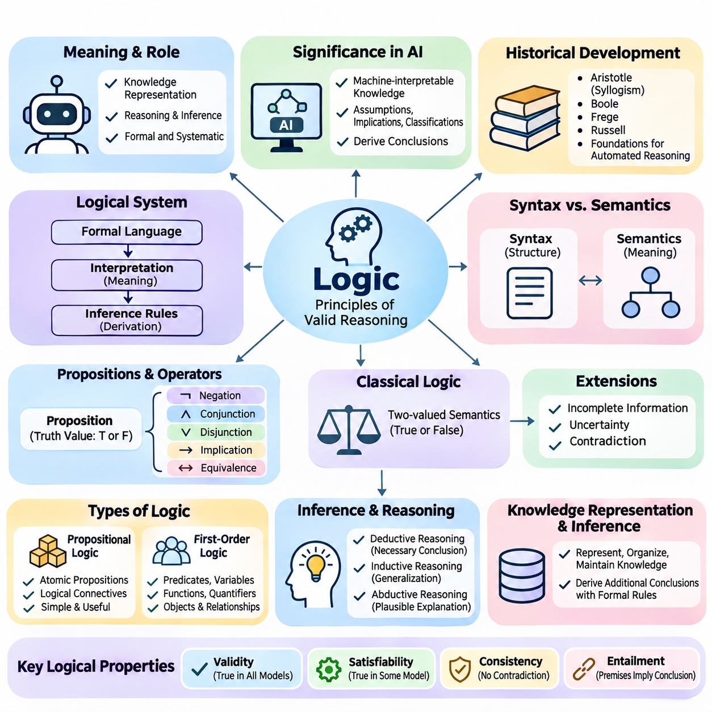
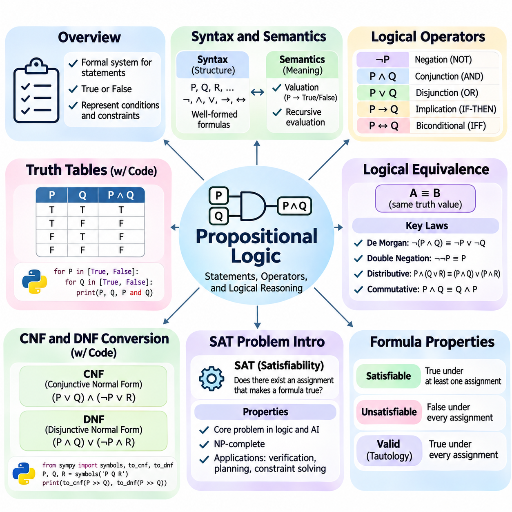
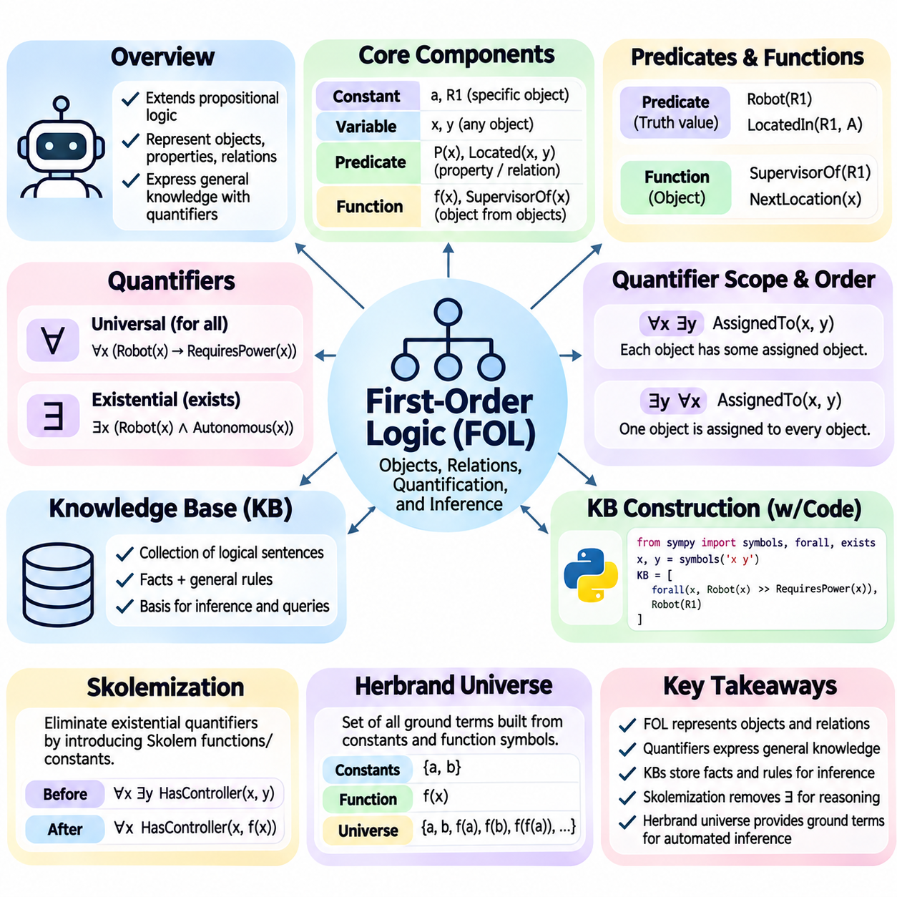
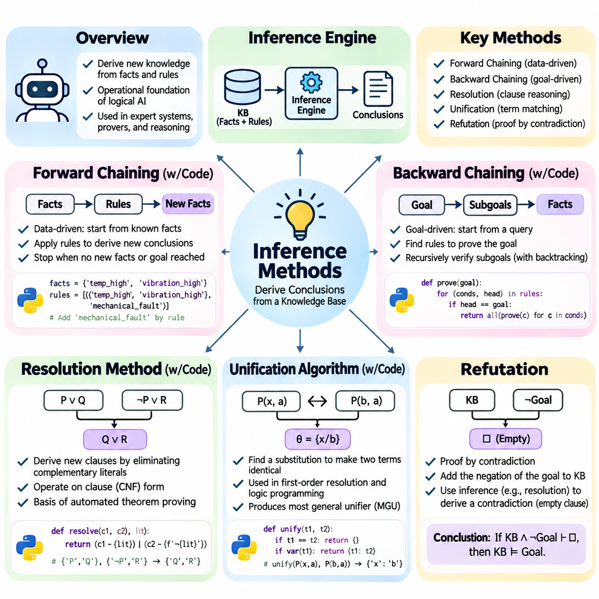
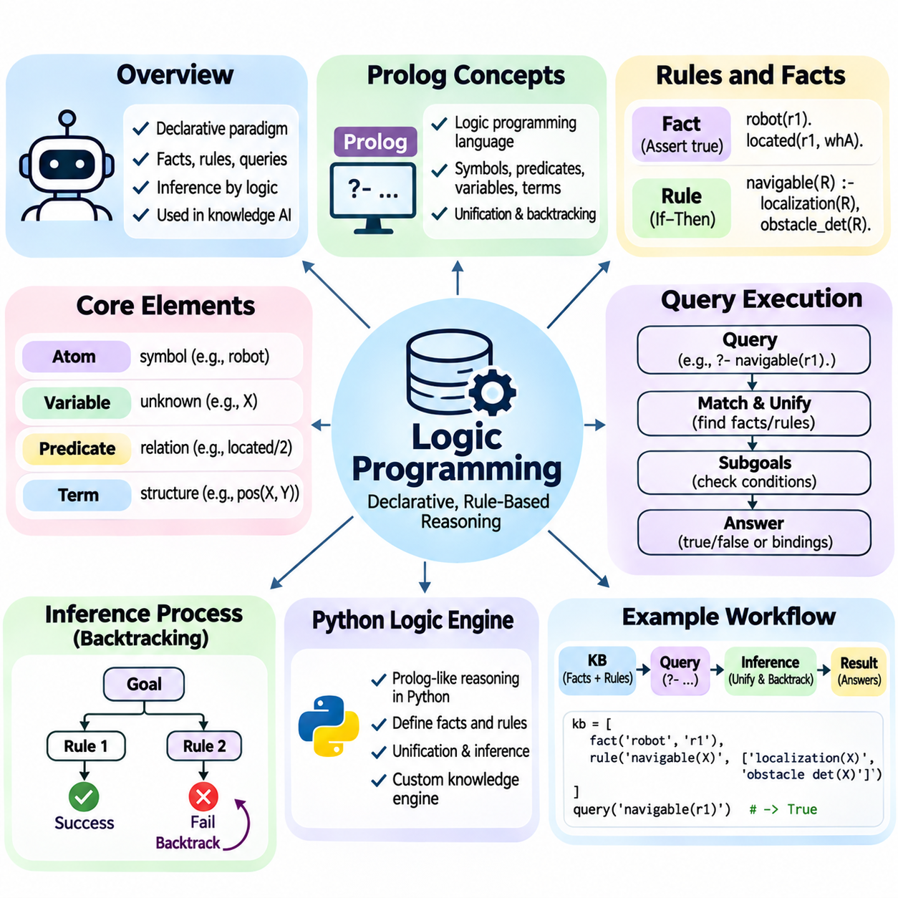
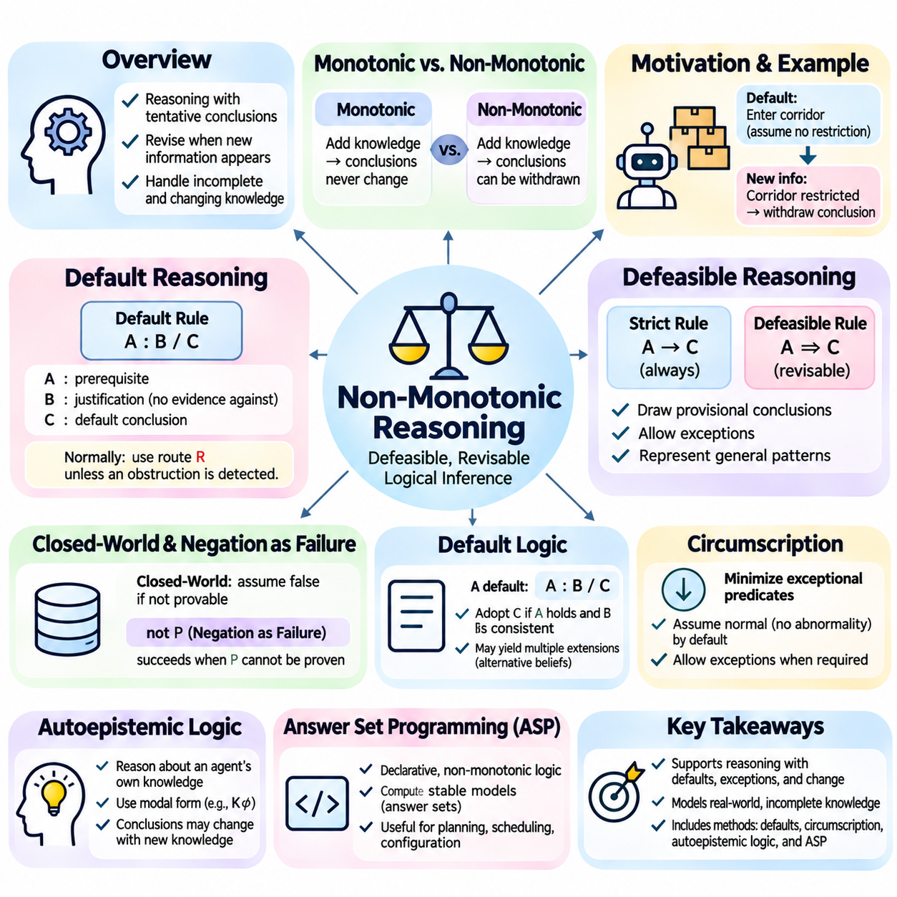
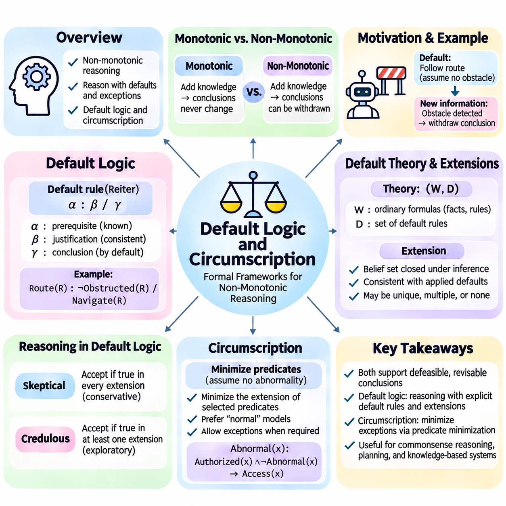
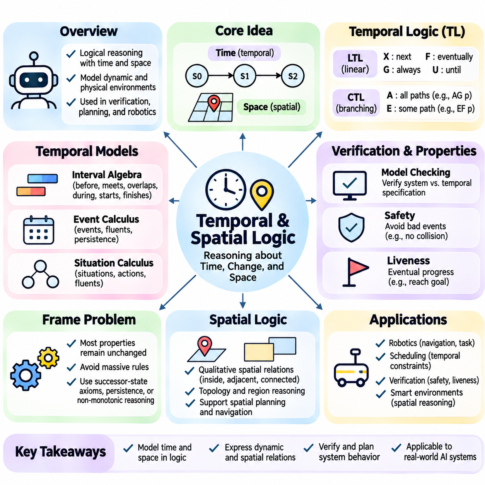
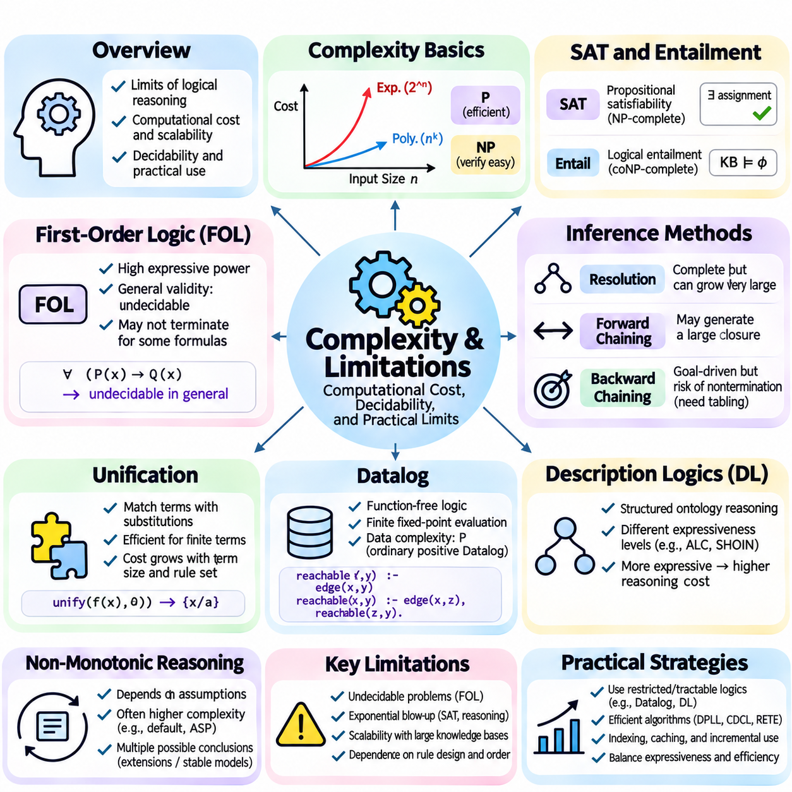
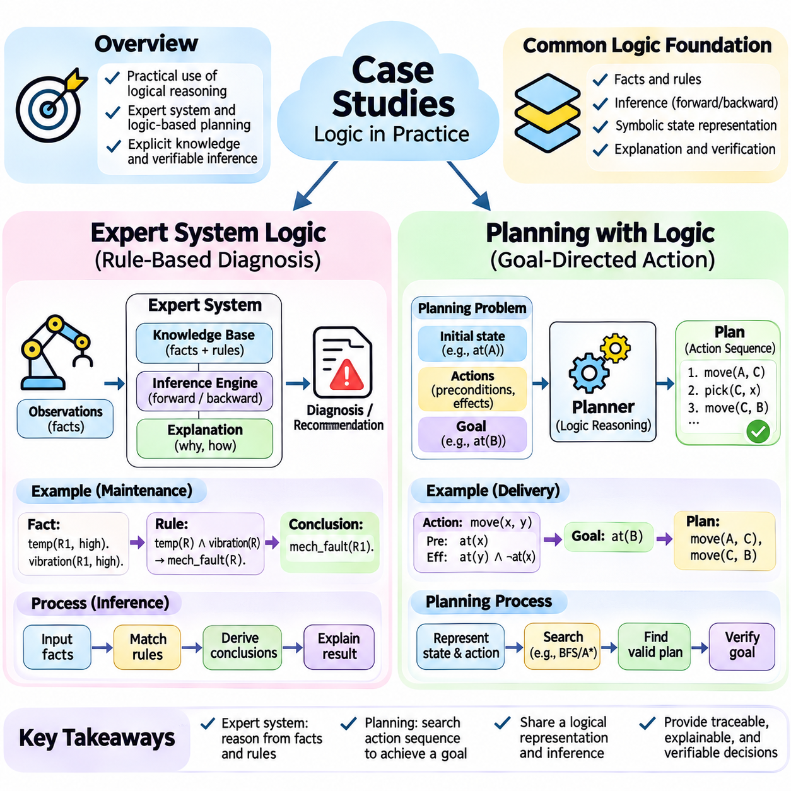

**Volume 02. Knowledge Representation**

# 01. Logic and Inference

## 01.01 Introduction to Logic

{width="7.268055555555556in" height="7.268055555555556in"}

## 01.02 Propositional Logic

{width="7.268055555555556in" height="7.268055555555556in"}

명제 논리(Propositional Logic)는 명제(Proposition)를 표현하고 정확한 규칙에 따라 명제 사이의 논리적 관계(Logical Relationship)를 판단하는 형식 체계(Formal System)이다. 각 명제는 특정 해석(Interpretation) 아래에서 참(True) 또는 거짓(False)으로 평가되는 선언적 문장(Declarative Statement)을 나타낸다. 인공지능(Artificial Intelligence) 시스템은 논리 연산자(Logical Operator)를 사용하여 명제들을 결합함으로써 조건(Condition), 제약조건(Constraint), 의존관계(Dependency)를 자동 추론(Automated Reasoning)과 계산적 검증(Computational Verification)에 적합한 형태로 표현할 수 있다.

명제 논리의 구문(Syntax)은 원자 명제(Atomic Proposition), 논리 연결사(Logical Connective), 괄호(Parentheses)를 사용하여 올바른 논리식(Logical Expression)을 구성하는 방법을 정의한다. 원자 명제는 일반적으로 P, Q, R과 같은 기호(Symbol)로 표현된다. 더 복잡한 논리식은 부정(Negation), 논리곱(Conjunction), 논리합(Disjunction), 함의(Implication), 쌍조건 연산자(Biconditional Operator)를 통해 형성된다. 이러한 형성 규칙(Formation Rule)은 모든 올바른 형식의 논리식(Well-Formed Formula)이 명확하게 식별 가능한 문법적 구조(Grammatical Structure)를 갖도록 보장한다.

논리 연결사(Logical Connective)는 개별 명제가 복합 논리식(Compound Formula)의 진리값(Truth Value)에 어떻게 기여하는지를 결정한다. 부정(Negation)은 진리값을 반전시키고, 논리곱(Conjunction)은 두 피연산자(Operand)가 모두 참일 것을 요구하며, 논리합(Disjunction)은 적어도 하나의 피연산자가 참일 것을 요구한다. 물질 함의(Material Implication)는 전건(Antecedent)이 참이고 후건(Consequent)이 거짓일 때만 거짓이 된다. 쌍조건 동치(Biconditional Equivalence)는 동일한 해석에서 두 피연산자의 진리값이 같을 때 성립한다.

괄호(Parentheses)는 논리식의 의도된 결합 구조(Grouping Structure)를 명확하게 정의하고 평가 과정에서 발생할 수 있는 모호성(Ambiguity)을 방지한다. 예를 들어 P ∧ (Q ∨ R)과 (P ∧ Q) ∨ R은 구성 명제에 서로 다른 조건을 부과하므로 동일하지 않다. 연산자 우선순위(Operator Precedence) 규칙을 사용하면 괄호 사용을 줄일 수 있지만, 가독성(Readability)과 정확성(Correctness)이 중요한 소프트웨어 구현(Software Implementation)에서는 명시적인 괄호 사용이 일반적으로 바람직하다.

명제 논리의 의미론(Semantics)은 원자 명제에 진리값(Truth Value)을 할당하고 논리 연산자의 의미에 따라 복합 논리식(Compound Formula)을 평가한다. 진리값 할당(Valuation)은 각 명제를 참 또는 거짓에 대응시킨다. 이러한 할당이 결정되면 모든 복합 논리식의 진리값을 재귀적(Recursively)으로 계산할 수 있다. 이와 같은 합성적 해석(Compositional Interpretation)은 자동 논리 평가(Automated Logical Evaluation)의 수학적 기반을 제공한다.

논리식(Logical Formula)은 가능한 진리값 할당에 따른 평가 결과에 따라 충족 가능(Satisfiable), 충족 불가능(Unsatisfiable), 타당(Valid)으로 구분할 수 있다. 충족 가능한 논리식은 적어도 하나의 진리값 할당에서 참이 되지만, 충족 불가능한 논리식은 모든 할당에서 거짓이 된다. 타당한 논리식은 모든 할당에서 참이다. 이러한 분류는 논리적 검증(Logical Verification), 제약조건 해결(Constraint Solving), 자동 정리 증명(Automated Theorem Proving)의 핵심 기반을 제공한다.

진리표(Truth Table)는 가능한 모든 진리값 할당(Truth Assignment)에 대해 명제 논리식을 체계적으로 평가하는 방법이다. 서로 다른 원자 명제(Atomic Proposition)가 n개 포함된 논리식의 완전한 진리표에는 2\^n개의 할당이 존재한다. 각 행(Row)은 하나의 가능한 해석(Interpretation)을 나타내며, 추가 열(Column)은 중간 계산 결과와 최종 평가 결과를 기록한다. 이러한 전수 평가(Exhaustive Evaluation)는 논리적 관계를 명시적으로 표현하고 수학적으로 검증할 수 있도록 한다.

로봇(Robot)의 전원 공급 여부, 안전 제어기(Safety Controller)의 활성화 여부, 이동 허가(Movement Permission) 여부를 나타내는 명제들이 포함된 시스템을 생각할 수 있다. 진리표(Truth Table)는 이러한 조건의 모든 조합을 열거하고 이동 승인 규칙(Movement Authorization Rule)을 평가할 수 있다. 이러한 분석은 승인 논리식(Authorization Expression)이 의도된 안전 요구사항(Safety Requirement)과 다르게 동작하는 조건을 엔지니어가 식별하는 데 도움이 된다.

진리표(Truth Table)는 항진식(Tautology), 모순식(Contradiction), 우연식(Contingent Formula)을 구별하는 실용적인 방법도 제공한다. 항진식은 모든 행에서 참으로 평가되며, 모순식은 모든 행에서 거짓으로 평가된다. 우연식은 일부 할당에서는 참이고 다른 할당에서는 거짓이다. 이러한 구분은 규칙이 무조건적인 원칙, 실현 불가능한 조건, 또는 상황에 따라 달라지는 요구사항을 표현하는지 판단하는 데 도움이 된다.

프로그램 기반 진리표 생성(Programmatic Truth-Table Generation)은 일반적으로 모든 원자 명제를 식별하고, 불리언 할당(Boolean Assignment)을 열거한 다음, 각 할당에 대해 논리식을 평가하는 과정으로 구성된다. 파이썬(Python) 구현에서는 불리언 연산(Boolean Operation), 재귀적 표현식 트리(Recursive Expression Tree), 기호 논리 라이브러리(Symbolic Logic Library)를 사용할 수 있다. 전수 열거(Exhaustive Enumeration)는 구현이 간단하지만, 지수적 증가(Exponential Growth)로 인해 독립 변수의 수가 많아지면 확장성(Scalability)에 한계가 발생한다.

논리적 동치(Logical Equivalence)는 가능한 모든 진리값 할당에서 동일한 진리값을 생성하는 두 논리식 사이의 관계를 의미한다. 논리식 A와 B가 논리적으로 동치라면, 주변 논리식의 의미를 변경하지 않고 서로 대체할 수 있다. 이러한 성질은 지식 베이스(Knowledge Base)에 표현된 원래 조건을 유지하면서 논리식의 단순화(Simplification), 최적화(Optimization), 변환(Transformation)을 가능하게 한다.

여러 동치 법칙(Equivalence Law)은 명제 논리식을 변형하는 기초를 제공한다. 드모르간 법칙(De Morgan\'s Laws)은 부정된 논리곱을 부정된 피연산자의 논리합으로 변환하거나 그 반대로 변환한다. 이중 부정(Double Negation)은 연속된 두 부정 연산자를 제거하며, 분배 법칙(Distributive Law)은 논리곱과 논리합을 재구성한다. 교환 법칙(Commutative Law), 결합 법칙(Associative Law), 흡수 법칙(Absorption Law), 멱등 법칙(Idempotent Law)도 불리언 논리식(Boolean Expression)의 체계적인 단순화를 지원한다.

함의 제거(Implication Elimination)는 물질 함의(Material Implication)를 부정과 논리합으로 표현할 수 있기 때문에 특히 중요하다. 논리식 P → Q는 ¬P ∨ Q와 논리적으로 동치(Logically Equivalent)이다. 마찬가지로 쌍조건문(Biconditional)은 두 함의의 논리곱으로 표현할 수 있다. 이러한 변환을 통해 복잡한 논리식의 진리 조건(Truth Condition)을 변경하지 않으면서 더 적은 종류의 논리 연산자로 재작성할 수 있다.

논리적 동치(Logical Equivalence)는 논리적 함축(Logical Entailment)과 구별해야 한다. 동치는 두 논리식이 모든 해석에서 동일한 진리값을 가질 것을 요구하지만, 함축은 전제(Premise)를 만족하는 모든 해석이 결론(Conclusion)도 만족할 것을 요구한다. 따라서 두 논리식은 서로 동치가 아니더라도 함축 관계를 가질 수 있다. 이러한 차이는 추론 규칙(Inference Rule)과 지식 베이스의 논리적 귀결(Logical Consequence)을 평가할 때 중요하다.

정규형(Normal Form)은 논리적 조작과 계산 처리를 단순화하는 표준화된 표현 방식이다. 논리곱 정규형(Conjunctive Normal Form, CNF)은 논리식을 절(Clause)들의 논리곱으로 표현하며, 각 절은 리터럴(Literal)들의 논리합으로 구성된다. 리터럴은 원자 명제 또는 그 부정이다. CNF는 많은 충족 가능성 알고리즘(Satisfiability Algorithm)과 자동 추론 절차(Automated Reasoning Procedure)가 절 기반 표현(Clause-Based Representation)을 사용하기 때문에 특히 중요하다.

논리합 정규형(Disjunctive Normal Form, DNF)은 논리식을 항(Term)들의 논리합으로 표현하며, 각 항은 리터럴들의 논리곱으로 구성된다. DNF는 논리식을 참으로 만드는 충분조건(Sufficient Condition)의 대안적 조합을 강조한다. 이러한 표현은 불리언 함수 분석(Boolean Function Analysis), 규칙 해석(Rule Interpretation), 특정 결정 절차(Decision Procedure)에 유용하다. CNF와 DNF는 모두 임의의 명제 불리언 함수(Propositional Boolean Function)를 표현할 수 있다.

논리식을 CNF로 변환하는 과정은 일반적으로 쌍조건 연산자와 함의 연산자를 제거하고, 부정을 내부로 이동시키며, 논리합을 논리곱에 대해 분배하는 단계로 구성된다. 드모르간 법칙(De Morgan\'s Laws)과 이중 부정 제거(Double-Negation Elimination)를 사용하여 부정 연산자를 원자 명제에 가깝게 이동시킨다. 최종 논리식은 논리곱으로 연결된 절(Clause)들로 구성되며, 충족 가능성 분석(Satisfiability Analysis)에 적합한 표준 구조를 갖는다.

DNF 변환(DNF Conversion)도 유사한 과정을 따르지만, 논리곱을 논리합에 대해 분배하여 논리곱 항(Conjunctive Term)들의 논리합을 구성한다. 예를 들어 P ∧ (Q ∨ R)은 (P ∧ Q) ∨ (P ∧ R)로 변환할 수 있다. 원래 논리식과 변환된 논리식은 논리적으로 동치이다. 그러나 분배 법칙을 반복적으로 적용하면 논리식의 크기가 크게 증가할 수 있으므로 효율적인 변환 전략(Transformation Strategy)이 중요하다.

표준 CNF(Canonical CNF)와 표준 DNF(Canonical DNF)는 진리표(Truth Table)로부터 직접 구성할 수도 있다. 표준 DNF는 논리식을 참으로 만드는 할당에 해당하는 최소항(Minterm)을 결합하고, 표준 CNF는 논리식을 거짓으로 만드는 할당에 해당하는 최대항(Maxterm)을 결합한다. 이러한 방법은 체계적이지만, 명제의 수가 증가함에 따라 생성되는 논리식의 크기가 지수적으로 커질 수 있다.

실용적인 CNF 변환에서는 논리적 동치(Logical Equivalence)와 동충족 가능성(Equisatisfiability)의 차이를 고려해야 한다. 직접적인 분배 변환은 논리적 동치를 유지하지만 논리식의 크기를 크게 증가시킬 수 있다. 차이틴 변환(Tseitin Transformation)은 보조 변수(Auxiliary Variable)를 도입하여 원래 논리식과 충족 가능성 여부가 동일한 CNF를 구성한다. 이 기법은 입력 논리식 크기에 선형적으로 비례하는 표현을 생성할 수 있어 효율적인 솔버 통합(Solver Integration)을 지원한다.

불리언 충족 가능성 문제(Boolean Satisfiability Problem)는 일반적으로 SAT라고 하며, 명제 논리식을 참으로 만드는 진리값 할당이 존재하는지를 판단하는 문제이다. 이러한 할당이 존재하면 논리식은 충족 가능(Satisfiable)하며, 해당 할당은 만족 모델(Satisfying Model)이 된다. 그렇지 않으면 논리식은 충족 불가능(Unsatisfiable)하다. SAT는 다양한 이산 결정 문제(Discrete Decision Problem)를 표현하고 해결하기 위한 일반적인 계산 프레임워크(Computational Framework)를 제공한다.

SAT는 계산 복잡도 이론(Computational Complexity Theory)에서 최초로 NP-완전(NP-Complete)임이 증명된 문제라는 점에서 역사적으로 중요하다. 이러한 분류는 SAT가 NP에 속하며, NP에 속하는 모든 문제를 다항 시간(Polynomial Time) 안에 SAT로 환원(Reduction)할 수 있음을 의미한다. 일반적인 SAT에 대한 다항 시간 알고리즘은 알려져 있지 않지만, 특화된 알고리즘과 정교하게 설계된 솔버(Solver)는 많은 대규모 실제 문제를 효율적으로 처리할 수 있다.

초기의 SAT 해결 방법은 체계적인 탐색(Systematic Search)과 논리적 단순화(Logical Simplification)에 기반하였다. DPLL 알고리즘(Davis--Putnam--Logemann--Loveland Algorithm)은 분기 결정(Branching Decision), 단위 전파(Unit Propagation), 백트래킹(Backtracking)을 결합한다. 단위 전파는 할당되지 않은 리터럴이 하나만 남은 절에서 필수적인 할당을 도출한다. 모순이 발견되면 솔버는 이전 결정을 수정하고 다른 할당을 탐색한다.

현대 SAT 솔버는 탐색 효율성을 높이기 위해 충돌 주도 절 학습(Conflict-Driven Clause Learning, CDCL)을 일반적으로 사용한다. CDCL은 충돌(Conflict)을 분석하고, 양립할 수 없는 할당을 반복적으로 탐색하지 않도록 학습 절(Learned Clause)을 생성하며, 비연대기적 백트래킹(Non-Chronological Backtracking)을 수행한다. 변수 선택 휴리스틱(Variable Selection Heuristic), 감시 리터럴(Watched Literal), 재시작(Restart), 절 데이터베이스 관리(Clause Database Management)도 실제 성능 향상에 기여한다.

SAT 모델링(SAT Modeling)은 응용 분야의 요구사항을 불리언 변수(Boolean Variable)와 논리적 제약조건(Logical Constraint)으로 변환한다. 일정 계획(Scheduling)에서는 변수가 특정 작업이 지정된 시간 구간에 배치되는지를 나타낼 수 있다. 하드웨어 검증(Hardware Verification)에서는 회로 신호(Circuit Signal)와 예상 동작을 표현할 수 있다. 로봇공학(Robotics)에서는 불리언 제약조건을 통해 이산적 행동 허가(Discrete Action Permission), 자원 가용성(Resource Availability), 상호 배타적 운영 상태(Mutually Exclusive Operational State)를 계획 모델에 표현할 수 있다.

실용적인 SAT 작업 흐름(Practical SAT Workflow)은 결정 변수(Decision Variable)를 정의하고 관련 제약조건을 인코딩(Encoding)하는 것으로 시작한다. 생성된 논리식은 CNF로 변환되어 솔버에 전달된다. 충족 가능 결과는 해답으로 해석할 수 있는 후보 할당(Candidate Assignment)을 제공하며, 충족 불가능 결과는 인코딩된 모든 제약조건을 만족하는 할당이 없음을 의미한다. 결과의 올바른 해석은 원래 모델의 완전성(Completeness)과 정확성(Accuracy)에 달려 있다.

명제 논리(Propositional Logic)는 기호적 지식 표현(Symbolic Knowledge Representation)과 실행 가능한 계산적 추론(Executable Computational Reasoning)을 직접 연결한다. 구문(Syntax)과 의미론(Semantics)은 의미 있는 논리식을 정의하고, 진리표(Truth Table)는 그 동작을 규명하며, 논리적 동치(Logical Equivalence)는 변환을 지원하고, 정규형(Normal Form)은 표현을 표준화하며, SAT 알고리즘은 충족 가능성을 판단한다. 이러한 메커니즘은 추론 엔진(Inference Engine), 형식 검증(Formal Verification), 자동 계획(Automated Planning), 지식 기반 인공지능(Knowledge-Based Artificial Intelligence)의 핵심 기반을 제공한다.

## 01.03 First Order Logic FOL

{width="7.268055555555556in" height="7.268055555555556in"}

1차 논리(First-Order Logic, FOL)는 명제 논리(Propositional Logic)를 확장하여 객체(Object), 속성(Property), 관계(Relationship), 양화된 명제(Quantified Statement)를 형식 언어(Formal Language)로 표현하는 논리 체계이다. 명제를 더 이상 분해할 수 없는 단위로 취급하는 명제 논리와 달리, 1차 논리는 명제의 내부 구조(Internal Structure)를 표현한다. 이러한 능력을 통해 인공지능(Artificial Intelligence) 시스템은 개체(Entity)에 관한 일반적인 지식을 표현하고 개체 사이의 관계에 대한 결론을 도출할 수 있다.

1차 논리의 표현력(Expressive Power)은 상수(Constant), 변수(Variable), 술어(Predicate), 함수(Function), 양화사(Quantifier)를 사용하는 데서 비롯된다. 상수는 특정 논의 영역(Domain of Discourse)에 속한 개별 객체를 식별하고, 변수는 식별 대상이 달라질 수 있는 객체를 나타낸다. 술어는 속성이나 관계를 기술하며, 함수는 객체를 다른 객체에 대응시킨다. 양화사는 논리적 명제가 영역 내 모든 객체에 적용되는지 또는 적어도 하나의 객체에 적용되는지를 지정한다.

술어(Predicate)는 관계형 지식 표현(Relational Knowledge Representation)의 기본 구성 요소이다. 단항 술어(Unary Predicate)는 하나의 객체에 대한 속성을 기술하며, 이항 술어(Binary Predicate)와 더 높은 항수(Arity)의 술어는 여러 객체 사이의 관계를 표현한다. 예를 들어 Robot(R1)은 R1이 로봇임을 나타내고, LocatedIn(R1, WarehouseA)는 해당 로봇의 위치를 표현한다. 술어의 인자(Predicate Argument)는 개별 개체와 그 상호작용에 대해 추론하는 데 필요한 구조를 제공한다.

함수(Function)는 참 또는 거짓으로 평가되는 관계가 아니라 객체를 나타낸다는 점에서 술어(Predicate)와 다르다. SupervisorOf(R1)과 같은 함수는 로봇 R1과 연관된 객체를 식별하지만, Authorized(R1)과 같은 술어는 참 또는 거짓으로 평가될 수 있는 명제를 표현한다. 함수는 복잡한 관계를 나타내기 위해 중첩(Nesting)될 수 있지만, 제한 없는 중첩은 구문적으로 서로 다른 항(Term)을 무한히 생성할 수 있다.

전칭 양화(Universal Quantification)는 영역 내 모든 객체에 적용되는 명제를 표현한다. ∀x (Robot(x) → RequiresPower(x))는 모든 로봇에 전원이 필요하다는 의미이다. 존재 양화(Existential Quantification)는 특정 조건을 만족하는 객체가 적어도 하나 존재함을 표현한다. 예를 들어 ∃x (Robot(x) ∧ Autonomous(x))는 해석된 영역(Interpreted Domain)에 적어도 하나의 자율 로봇(Autonomous Robot)이 존재함을 주장한다.

양화사의 범위(Quantifier Scope)는 해당 양화사의 변수 결속(Variable Binding)이 적용되는 논리식의 부분을 결정한다. 변수의 출현(Variable Occurrence)이 적절한 양화사의 범위 안에 있으면 결속 변수(Bound Variable)이고, 그렇지 않으면 자유 변수(Free Variable)이다. 자유 변수가 없는 문장(Sentence)은 해석에 따라 참 또는 거짓으로 평가될 수 있다. 양화사의 범위를 변경하면 명제의 의미가 근본적으로 달라질 수 있으므로 올바른 변수 결속이 중요하다.

양화사의 순서(Quantifier Ordering)는 객체 사이의 의존관계(Dependency)를 표현할 때 특히 중요하다. ∀x ∃y AssignedTo(x,y)는 모든 객체에 어떤 대응 객체가 할당되어 있으며, 그 대응 객체는 각각 다를 수 있음을 의미한다. 반면 ∃y ∀x AssignedTo(x,y)는 하나의 특정 객체가 모든 객체에 할당되어야 함을 요구한다. 이러한 논리식은 일반적으로 동치(Equivalent)가 아니며 실질적으로 서로 다른 제약조건을 나타낸다.

1차 논리의 의미론(Semantics)은 논의 영역(Domain of Discourse)과 기호에 의미를 부여하는 해석(Interpretation)에 기반한다. 상수는 영역의 원소(Domain Element)를 나타내고, 술어는 영역 위의 관계(Relation)를 나타내며, 함수는 영역의 원소 사이의 대응 관계(Mapping)를 나타낸다. 양화된 논리식(Quantified Formula)은 영역에 대한 변수 할당(Variable Assignment)을 고려하여 평가된다. 이러한 의미론적 체계는 기호 표현을 실제 객체 및 관계와 연결한다.

지식 베이스(Knowledge Base)는 사실(Fact), 관계(Relationship), 일반 규칙(General Rule)을 기술하는 논리 문장(Logical Sentence)의 구조화된 집합이다. 1차 논리에서 지식 베이스는 특정 객체에 관한 기초 사실(Ground Fact)과 영역 전체에 적용되는 원칙을 기술하는 전칭 양화된 함의(Universally Quantified Implication)를 포함할 수 있다. 예를 들어 로봇공학 지식 베이스는 R1이 자율 로봇이며 모든 자율 로봇에는 내비게이션 시스템(Navigation System)이 필요하다는 사실을 기록할 수 있다.

지식 베이스 구축(Knowledge Base Construction)은 영역(Domain), 관련 개체(Entity), 중요한 관계(Relationship), 추론 요구사항(Reasoning Requirement)을 식별하는 것으로 시작한다. 이후 설계자는 일관된 의미를 갖는 상수, 술어, 함수의 어휘 체계(Vocabulary)를 정의한다. 명확한 명명 규칙(Naming Convention)과 명시적인 모델링 가정(Modeling Assumption)은 모호성을 방지하는 데 도움이 된다. 결과적으로 생성된 표현은 불필요한 논리적 복잡성을 도입하지 않으면서 의도된 질의(Query)를 지원해야 한다.

실용적인 지식 베이스 구축 과정은 자연어 요구사항(Natural-Language Requirement)을 형식 문장(Formal Sentence)으로 변환한다. 모든 이동 로봇(Mobile Robot)이 제어기(Controller)를 가진다는 명제는 ∀x (MobileRobot(x) → ∃y (Controller(y) ∧ HasController(x,y)))로 표현할 수 있다. 이 논리식은 이동 로봇의 분류(Classification)와 관련 제어기의 존재를 모두 나타내며, 양화된 관계가 구조화된 지식 모델링(Structured Knowledge Modeling)을 어떻게 지원하는지 보여준다.

지식 베이스는 명시적으로 주장된 사실(Explicitly Asserted Fact)과 추론을 통해 도출된 결론(Derived Conclusion)도 구별해야 한다. MobileRobot(R1)과 같은 명제는 직접 저장할 수 있지만, RequiresNavigation(R1)은 일반 규칙으로부터 도출될 수 있다. 이러한 구분은 추적 가능한 추론(Traceable Reasoning)을 가능하게 하고 중복된 주장(Redundant Assertion)을 줄인다. 그러나 도출된 결론은 전제(Premise)와 추론 절차(Inference Procedure)의 정확성에 의존한다.

1차 논리 지식 베이스는 추가적인 가정이 도입되지 않는 한 일반적으로 개방 세계 해석(Open-World Interpretation)에 따라 동작한다. 어떤 사실이 존재하지 않는다고 해서 그 사실의 부정이 자동으로 성립하는 것은 아니다. 지식 베이스에 로봇이 카메라를 가지고 있다는 정보가 없다면, 시스템은 해당 로봇에 카메라가 없다고 결론 내릴 수 없다. 반면 폐쇄 세계 추론(Closed-World Reasoning)은 기록되지 않은 특정 사실을 거짓으로 취급하며, 이를 위해 명시적인 모델링 규약(Modeling Convention)이 필요하다.

일관성(Consistency)은 지식 베이스 공학(Knowledge Base Engineering)의 핵심 요구사항이다. 모순된 주장(Contradictory Assertion)은 고전 논리(Classical Logic)의 추론을 훼손할 수 있는데, 표준 의미론에서는 일관성이 없는 이론(Inconsistent Theory)이 모든 논리식을 함축하기 때문이다. 따라서 개발자는 양립할 수 없는 제약조건을 검사하고, 영역 가정을 검증하며, 충돌하는 정보를 관리하는 메커니즘이 필요하다. 모듈형 지식 구성(Modular Knowledge Organization)과 자동 일관성 검사(Automated Consistency Testing)는 유지보수성(Maintainability)을 향상시킨다.

파이썬(Python)을 이용한 1차 논리 지식 베이스 구현은 일반적으로 항(Term)과 논리식(Formula)을 기호 표현식 트리(Symbolic Expression Tree)로 나타낸다. 상수, 변수, 술어, 양화사는 구조화된 객체(Structured Object)로 모델링할 수 있으며, 규칙은 논리 표현식으로 저장된다. 질의 처리(Query Processing)에는 치환(Substitution), 단일화(Unification), 추론 절차(Inference Procedure)가 포함될 수 있다. 라이브러리는 기호 조작(Symbolic Manipulation)을 단순화할 수 있지만, 지원하는 논리 단편(Logical Fragment)과 추론 기능은 서로 다르다.

스콜렘화(Skolemization)는 새로운 기호를 도입하여 존재 양화사(Existential Quantifier)를 제거하는 자동 정리 증명(Automated Theorem Proving)의 변환 기법이다. 존재 양화된 변수(Existentially Quantified Variable)가 전칭 양화된 변수에 의존하지 않으면 새로운 상수로 대체하고, 전칭 양화된 변수에 따라 값이 달라질 수 있으면 새로운 함수로 대체한다. 이러한 변환은 논리식을 해결 기반 추론(Resolution-Based Reasoning)에 적합한 형태로 준비하는 데 핵심적인 역할을 한다.

적어도 하나의 로봇이 존재한다는 의미의 ∃x Robot(x)를 생각할 수 있다. 스콜렘화(Skolemization)는 존재 변수(Existential Variable)를 새로운 상수로 대체하여 Robot(c)를 생성하며, 여기서 c는 새롭게 도입된 스콜렘 상수(Skolem Constant)이다. 변환된 논리식은 원래 어휘 체계(Original Vocabulary)에서의 논리적 동치(Logical Equivalence)를 보존하지 않지만, 새로운 기호를 적절하게 해석하면 충족 가능성(Satisfiability)을 보존한다.

존재 변수가 전칭 변수(Universal Variable)에 의존하는 경우에는 스콜렘 함수(Skolem Function)가 이러한 의존관계를 표현한다. ∀x ∃y Controls(y,x)는 모든 객체에 어떤 제어자가 존재한다는 의미이다. 스콜렘화를 적용하면 ∀x Controls(f(x),x)가 되며, 여기서 f는 전칭 양화된 각 객체에 제어자를 할당하는 새로운 함수이다. 이 함수는 제어자의 유일성(Uniqueness)을 의미하지 않으며, 각 객체에 대해 하나의 존재 증인(Witness)을 선택한다.

표준 스콜렘화 절차(Standard Skolemization Procedure)는 먼저 함의(Implication)를 제거하고, 부정(Negation)을 내부로 이동시키며, 결속 변수(Bound Variable)의 이름을 서로 구별하도록 표준화한다. 이후 양화사를 전위 정규형(Prenex Normal Form)으로 정리한 다음 존재 변수를 새로운 스콜렘 기호(Skolem Symbol)로 대체할 수 있다. 절(Clause)을 구성할 때는 관례적으로 전칭 양화사를 생략할 수 있다. 결과적으로 생성된 표현은 원래 논리식의 충족 가능성을 유지하면서 자동 해결(Automated Resolution)을 지원한다.

스콜렘화를 적용할 때는 충족 가능성 보존(Satisfiability Preservation)과 논리적 동치(Logical Equivalence)의 차이를 이해하는 것이 중요하다. 스콜렘화된 논리식(Skolemized Formula)은 원래 언어에 없던 기호를 도입하므로 확장된 어휘 체계에서 일반적으로 원래 논리식과 동치가 아니다. 그러나 원래 논리식이 충족 가능할 필요충분조건은 스콜렘화된 논리식이 충족 가능한 것이므로, 이 변환은 반증 기반 정리 증명(Refutation-Based Theorem Proving)에 적합하다.

허브랜드 우주(Herbrand Universe)는 1차 논리의 자동 추론(Automated Reasoning)을 위한 구문적 기반(Syntactic Foundation)을 제공한다. 허브랜드 우주는 논리 언어에 포함된 상수와 함수 기호(Function Symbol)로 구성할 수 있는 모든 기초 항(Ground Term)의 집합이다. 기초 항은 변수를 포함하지 않는다. 언어에 상수가 없다면 허브랜드 우주가 공집합이 되지 않도록 새로운 상수를 도입한다.

함수 기호가 없고 상수 a와 b만 포함된 언어의 허브랜드 우주(Herbrand Universe)는 a와 b로만 구성된다. 그러나 단항 함수(Unary Function) f가 추가되면 a, b, f(a), f(b), f(f(a)) 및 점점 더 깊게 중첩된 항이 포함된다. 따라서 유한한 수의 기호만 포함된 언어라도 함수 기호가 제한 없는 중첩을 허용하면 무한한 허브랜드 우주(Infinite Herbrand Universe)를 생성할 수 있다.

허브랜드 기저(Herbrand Base)는 술어 기호(Predicate Symbol)와 허브랜드 우주의 항으로 구성할 수 있는 모든 기초 원자식(Ground Atomic Formula)의 집합이다. 예를 들어 단항 술어 Robot과 기초 항 a, f(a)는 Robot(a), Robot(f(a))와 같은 원자식을 생성한다. 허브랜드 해석(Herbrand Interpretation)은 기초 원자식에 진리값을 할당하며, 1차 논리식과 명제 논리 추론(Propositional Reasoning)을 연결하는 구조화된 기반을 제공한다.

허브랜드 정리(Herbrand\'s Theorem)는 1차 논리의 충족 가능성(First-Order Satisfiability)과 논리식의 기초 인스턴스(Ground Instance) 사이에 중요한 관계가 있음을 확립한다. 적절한 절 표현(Clausal Representation)에서는 충족 불가능성(Unsatisfiability)을 유한한 수의 충족 불가능한 기초 인스턴스 집합으로 증명할 수 있다. 이 원리는 양화된 추론(Quantified Reasoning)을 명제 논리 충족 가능성과 연결하여 자동 정리 증명을 지원하지만, 관련 기초 인스턴스를 탐색하는 과정은 계산 비용이 클 수 있다.

기초화(Grounding)는 양화된 논리식(Quantified Formula)을 특정 기초 항(Ground Term)이 포함된 인스턴스로 변환한다. 유한 영역(Finite Domain)에서는 기초화를 통해 SAT 해결에 적합한 관리 가능한 크기의 명제 논리 표현을 생성할 수 있다. 그러나 함수 기호(Function Symbol)는 무한한 수의 기초 항을 생성할 수 있으므로 전수 기초화(Exhaustive Grounding)는 비현실적일 수 있다. 따라서 자동 추론 시스템은 선택적 인스턴스화(Selective Instantiation), 단일화(Unification), 탐색 전략(Search Strategy)을 사용하여 계산 복잡도(Computational Complexity)를 제어한다.

1차 논리(First-Order Logic)는 관계형 지식(Relational Knowledge)을 표현하고 일반 원칙으로부터 결론을 도출하기 위한 엄밀한 기반을 제공한다. 술어(Predicate), 함수(Function), 양화사(Quantifier)는 표현력이 높은 기호 구조(Symbolic Structure)를 정의하며, 지식 베이스(Knowledge Base)는 영역에 관한 주장(Domain Assertion)을 체계적으로 구성한다. 스콜렘화(Skolemization)는 양화된 논리식을 자동 추론에 적합하도록 준비하고, 허브랜드 구성(Herbrand Construction)은 1차 논리 추론을 기초 논리 표현(Ground Logical Representation)과 연결한다. 이러한 개념은 전문가 시스템(Expert System), 온톨로지(Ontology), 지식 그래프(Knowledge Graph), 기호 인공지능(Symbolic AI)을 지원한다.

## 01.04 Inference Methods

{width="7.268055555555556in" height="7.268055555555556in"}

추론 방법(Inference Methods)은 인공지능(Artificial Intelligence) 시스템이 기존 사실(Fact)과 논리 규칙(Logical Rule)으로부터 새로운 지식(Knowledge)을 도출하는 계산적 메커니즘(Computational Mechanism)을 제공한다. 지식 표현(Knowledge Representation)이 정보를 표현하는 방법을 정의한다면, 추론(Inference)은 해당 정보로부터 어떤 결론이 논리적으로 도출되는지를 결정한다. 이러한 방법은 전문가 시스템(Expert System), 자동 정리 증명기(Automated Theorem Prover), 논리 프로그래밍 환경(Logic Programming Environment), 지식 기반 의사결정 시스템(Knowledge-Based Decision System)의 운영 기반을 형성한다.

추론 엔진(Inference Engine)은 주장(Assertion), 관계(Relationship), 규칙(Rule)이 포함된 지식 베이스(Knowledge Base)를 대상으로 동작한다. 추론 엔진의 주요 역할은 적용 가능한 논리적 원칙(Logical Principle)을 식별하고, 주어진 전제(Premise)에 의해 정당화되는 결론(Conclusion)을 도출하는 것이다. 서로 다른 추론 전략(Inference Strategy)은 이 과정을 다르게 구성하며, 알려진 사실을 체계적으로 확장하거나 특정 목표(Goal)를 선택적으로 검증하는 데 중점을 둔다.

전방향 추론(Forward Chaining)은 알려진 사실에서 시작하여 규칙을 반복적으로 적용함으로써 추가적인 결론을 생성하는 데이터 주도 추론 전략(Data-Driven Inference Strategy)이다. 규칙의 전제 조건(Premise Condition)이 충족되면 해당 규칙의 결론을 지식 베이스에 추가할 수 있다. 이러한 과정은 더 이상 새로운 결론을 도출할 수 없거나, 지정된 목표에 도달하거나, 운영상의 종료 조건(Stopping Condition)이 충족될 때까지 계속된다.

모터 온도(Motor Temperature)가 상승하고 진동(Vibration)이 허용 임계값(Acceptable Threshold)을 초과했다는 사실을 포함하는 로봇 유지보수 시스템(Robotic Maintenance System)을 생각할 수 있다. 특정 규칙은 이러한 조건이 잠재적인 기계적 고장(Mechanical Fault)을 나타낸다고 정의할 수 있다. 전방향 추론은 일치하는 조건을 식별하고 해당 진단 결론(Diagnostic Conclusion)을 도출한다. 이후 추가 규칙은 수립된 유지보수 정책(Maintenance Policy)에 따라 점검을 권고하거나 장비 작동을 제한할 수 있다.

전방향 추론(Forward Chaining)은 새롭게 입력되는 관측값(Observation)이 여러 가능한 결론을 유발해야 하는 경우 특히 효과적이다. 모니터링 시스템(Monitoring System), 산업 자동화 플랫폼(Industrial Automation Platform), 규칙 기반 경보 엔진(Rule-Based Alert Engine)은 명시적인 질의(Query) 없이도 새로운 사실이 관련 규칙을 활성화할 수 있으므로 이 접근법을 자주 사용한다. 그러나 제한 없는 규칙 활성화(Rule Activation)는 현재 운영 목표와 관련이 없는 결론까지 생성할 수 있다.

기본적인 전방향 추론 구현(Forward-Chaining Implementation)은 알려진 사실의 집합을 유지하고 해당 집합에 대해 규칙을 반복적으로 평가한다. 각 규칙은 조건(Condition)과 결론(Conclusion)으로 구성되며, 새롭게 도출된 사실은 기존에 존재하지 않을 때만 추가된다. 효율적인 구현에서는 변경 사항을 추적하거나 술어(Predicate)를 인덱싱하거나 RETE 알고리즘(RETE Algorithm)과 같은 패턴 매칭 네트워크(Pattern-Matching Network)를 사용하여 영향을 받지 않은 규칙을 반복적으로 검사하는 작업을 줄인다.

후방향 추론(Backward Chaining)은 원하는 결론에서 시작하여 이를 성립시킬 수 있는 규칙을 탐색하는 목표 주도 추론 전략(Goal-Driven Inference Strategy)이다. 알려진 사실로부터 가능한 모든 결과를 도출하는 대신, 특정 목표를 증명하는 데 필요한 전제 조건을 식별한다. 이러한 전제 조건은 하위 목표(Subgoal)가 되며, 기존 사실이나 추가 규칙을 대상으로 재귀적으로 평가된다.

예를 들어 유지보수 보조 시스템(Maintenance Assistant)이 특정 로봇에 점검이 필요한지를 묻는 질의를 받을 수 있다. 후방향 추론은 점검 필요성을 결론으로 도출하는 규칙을 탐색한다. 관련 규칙이 비정상 진동(Abnormal Vibration)과 과도한 온도(Excessive Temperature)에 의존한다면 시스템은 이러한 조건을 검증하려고 시도한다. 필요한 하위 목표가 모두 성립하면 원래 질의가 성공적으로 해결된다.

후방향 추론(Backward Chaining)은 가능한 결론의 수는 많지만 실제로 답변해야 하는 질문은 제한적인 경우에 유용하다. 진단 시스템(Diagnostic System), 논리 프로그래밍 언어(Logic Programming Language), 대화형 전문가 시스템(Interactive Expert System)은 이 접근법을 자주 사용한다. 추론 효율성은 규칙 구성(Rule Organization), 목표 선택(Goal Selection), 탐색 제어(Search Control)에 따라 달라지며, 특히 재귀적 의존관계(Recursive Dependency)나 여러 대안적 증명(Alternative Proof)이 존재할 때 중요하다.

후방향 추론 엔진(Backward-Chaining Engine)은 일반적으로 목표 스택(Goal Stack) 또는 재귀적 증명 절차(Recursive Proof Procedure)를 유지한다. 해결되지 않은 각 목표는 사용 가능한 사실 및 규칙의 결론과 비교된다. 일치에 성공하면 치환(Substitution)과 추가 하위 목표가 생성되며, 실패한 탐색 분기(Search Branch)에서는 백트래킹(Backtracking)이 필요하다. 실용적인 구현에서는 제어되지 않는 재귀를 방지하기 위해 순환 의존관계(Cyclic Dependency), 반복되는 하위 목표, 종료 조건(Termination Condition)을 처리해야 한다.

전방향 추론(Forward Chaining)과 후방향 추론(Backward Chaining)은 모든 상황에서 경쟁하는 알고리즘이라기보다 상호 보완적인 접근법이다. 전방향 추론은 사실이 지속적으로 입력되고 다양한 결과가 중요한 경우에 적합하며, 후방향 추론은 특정 질문에 따라 추론이 수행되는 경우에 효과적이다. 하이브리드 시스템(Hybrid System)은 자주 필요한 결론을 선제적으로 도출하면서 계산 비용이 높거나 요청 빈도가 낮은 질의에는 목표 지향 추론(Goal-Directed Inference)을 적용할 수 있다.

해결법(Resolution Method)은 기존 절(Clause)에서 서로 상보적인 리터럴(Complementary Literal)을 제거하여 새로운 절을 도출하는 일반적인 추론 방법이다. 이 방법은 지식을 논리합 절(Disjunctive Clause)들의 논리곱으로 표현하는 논리곱 정규형(Conjunctive Normal Form, CNF)을 대상으로 동작한다. 해결법은 자동 정리 증명(Automated Theorem Proving)의 체계적인 기반을 제공하며, 특히 반증 기반 논리 추론(Refutation-Based Logical Reasoning)에서 중요하다.

명제 논리(Propositional Logic)에서 P ∨ Q와 ¬P ∨ R이라는 두 절을 해결하면 Q ∨ R을 도출할 수 있다. 상보적 리터럴인 P와 ¬P는 서로 반대되는 진리 조건을 가지므로 제거되며, 나머지 대안들이 새로운 절을 구성한다. 이렇게 생성된 절을 해결 절(Resolvent)이라고 하며, 원래 절들로부터 논리적으로 함축(Logically Entailed)되므로 이후 추론 단계에 포함할 수 있다.

해결법 기반 추론(Resolution-Based Reasoning)은 일반적으로 추론을 시작하기 전에 논리식을 절 형식(Clause Form)으로 변환해야 한다. 함의(Implication)를 제거하고 부정(Negation)을 내부로 이동시킨 다음 논리식을 논리곱 정규형(CNF)으로 변환한다. 1차 논리(First-Order Logic)에서는 변수 표준화(Variable Standardization), 스콜렘화(Skolemization), 결과 절에서 암묵적인 전칭 양화사(Implicit Universal Quantifier)를 제거하는 추가 변환이 필요하다.

1차 논리 해결법(First-Order Resolution)은 변수 치환(Variable Substitution)을 통해 상보적 리터럴이 일치하도록 허용함으로써 명제 논리 해결법을 확장한다. 예를 들어 ¬Robot(x) ∨ RequiresPower(x)와 Robot(R1)이라는 절로부터 RequiresPower(R1)을 도출할 수 있다. x에 R1을 할당하는 치환은 관련 리터럴을 상보적으로 만든다. 이러한 메커니즘은 가능한 모든 인스턴스를 명시적으로 열거하지 않고도 일반 규칙을 특정 개체에 적용할 수 있도록 한다.

단일화(Unification)는 두 기호 표현식(Symbolic Expression)을 동일하게 만드는 치환(Substitution)을 찾는 알고리즘적 과정(Algorithmic Process)이다. 술어(Predicate)에 변수(Variable), 상수(Constant), 중첩 함수 항(Nested Function Term)이 포함될 수 있으므로 단일화는 1차 논리 추론에 필수적이다. 성공적인 단일화는 호환 가능한 변수 할당(Variable Assignment)을 식별하여 일반적인 논리 패턴(Logical Pattern)이 구체적인 사실이나 다른 양화된 표현식과 일치하도록 한다.

LocatedIn(x, WarehouseA)와 LocatedIn(R1, y)라는 표현식을 생각할 수 있다. x에 R1을 할당하고 y에 WarehouseA를 할당하면 두 표현식을 단일화할 수 있다. 결과적인 치환은 두 표현식을 동일하게 만든다. 반면 대응하는 상수가 서로 다르거나 함수 구조(Function Structure)가 호환되지 않는 경우에는 허용 가능한 치환으로 표현식 사이의 차이를 해결할 수 없으므로 단일화가 실패한다.

최대 일반 단일화자(Most General Unifier, MGU)는 불필요한 제약을 추가하지 않으면서 두 표현식을 단일화하는 치환이다. 다른 단일화자(Unifier)는 최대 일반 단일화자에 추가적인 치환을 적용하여 얻을 수 있다. 최대 일반 단일화자를 사용하면 추론 과정에서 유연성(Flexibility)을 유지할 수 있으며, 유효한 추론 경로(Reasoning Path)를 불필요하게 제거할 수 있는 성급한 변수 할당을 방지할 수 있다.

표준 단일화 알고리즘(Standard Unification Algorithm)은 두 항(Term)의 구조를 재귀적으로 비교한다. 동일한 상수는 즉시 단일화되지만, 복합 항(Compound Term)은 함수 기호(Function Symbol)와 인자 구조(Argument Structure)가 일치해야 한다. 치환의 일관성이 유지되는 경우 변수는 다른 항으로 대체될 수 있다. 출현 검사(Occurs Check)는 변수가 자기 자신을 포함하는 항으로 치환되는 것을 방지한다.

출현 검사(Occurs Check)는 x = f(x)와 같은 치환이 표준 항 의미론(Standard Term Semantics)에서 유한한 1차 논리 항(Finite First-Order Term)을 생성할 수 없기 때문에 중요하다. 일부 논리 프로그래밍 구현(Logic Programming Implementation)에서는 성능 향상을 위해 이 검사를 생략할 수 있지만, 이는 단일화의 동작을 변경하고 순환 항 구조(Cyclic Term Structure)를 허용할 수 있다. 따라서 올바른 구현은 의도된 논리 의미론(Logical Semantics)과 표현 모델(Representation Model)에 따라 달라진다.

파이썬(Python) 기반 단일화 구현(Unification Implementation)은 일반적으로 기호(Symbol)와 인자 목록(Argument List)을 포함하는 재귀적 자료구조(Recursive Data Structure)로 표현식을 나타낸다. 알고리즘은 치환 매핑(Substitution Mapping)을 유지하고 대응하는 항을 비교하면서 이를 갱신한다. 성공하면 일관된 치환을 반환하고, 구조가 호환되지 않으면 실패한다. 단위 테스트(Unit Test)에는 중첩 함수, 반복 변수, 충돌하는 상수, 출현 검사 사례가 포함되어야 한다.

반증법(Refutation)은 결론의 부정이 주어진 전제와 모순된다는 사실을 증명하여 원래 결론을 확립하는 증명 전략(Proof Strategy)이다. 지식 베이스 K로부터 명제 G를 증명하려면 시스템은 K와 ¬G를 함께 고려한다. 이 결합된 집합이 충족 불가능(Unsatisfiable)하다면 G는 K로부터 논리적으로 도출된다. 이러한 접근법은 자동 정리 증명(Automated Theorem Proving)에서 널리 사용된다.

해결 반증법(Resolution Refutation)은 지식 베이스와 부정된 목표(Negated Goal)로부터 생성된 절에 해결 규칙(Resolution Rule)을 반복적으로 적용한다. 성공적인 증명은 결국 모순을 나타내는 공절(Empty Clause)을 생성한다. 공절은 전제와 부정된 결론이 동시에 모두 충족될 수 없음을 보여주며, 이를 통해 원래의 논리적 함축 관계(Logical Entailment Relationship)를 확립한다.

예를 들어 지식 베이스에 Robot(R1)과 모든 로봇에는 전원이 필요하다는 규칙이 포함되어 있다고 가정할 수 있다. RequiresPower(R1)을 증명하기 위해 시스템은 ¬RequiresPower(R1)을 지식 베이스에 추가한다. 해결법은 일반 규칙과 Robot(R1)을 결합하여 RequiresPower(R1)을 도출한다. 이는 부정된 목표와 모순되므로 최종적으로 공절(Empty Clause)이 생성된다.

반증법(Refutation)은 추론 규칙(Inference Rule)의 건전성(Soundness)과 논리식 변환(Logical Formula Transformation)의 정확성에 의존한다. 해결법(Resolution)은 적절한 단일화(Unification)와 절 변환(Clause Transformation)이 결합되면 1차 논리에 대해 반증 완전성(Refutation Completeness)을 가진다. 그러나 모순이 존재하지 않는 경우 증명 탐색(Proof Search)이 종료되지 않을 수 있으며, 이는 1차 논리의 타당성 판정(First-Order Logical Validity)이 일반적으로 결정 불가능(Undecidable)하다는 특성을 반영한다.

탐색 전략(Search Strategy)은 해결법 기반 정리 증명(Resolution-Based Theorem Proving)의 실제 효율성에 상당한 영향을 미친다. 단위 절 우선 전략(Unit Preference)은 하나의 리터럴만 포함하는 절을 우선적으로 처리하며, 지원 집합 전략(Set-of-Support Strategy)은 부정된 목표와 연결된 절을 중심으로 해결 연산을 제한한다. 포섭(Subsumption)은 더 일반적인 절에 의해 불필요해진 절을 제거한다. 이러한 기법은 기본적인 논리적 정당성(Logical Justification)을 변경하지 않으면서 불필요한 도출을 줄인다.

추론 방법(Inference Method)의 선택은 지식 베이스의 구조(Knowledge Base Structure), 예상되는 질의 패턴(Query Pattern), 계산 제약조건(Computational Constraint)에 따라 달라진다. 전방향 추론(Forward Chaining)은 지속적인 규칙 활성화를 지원하고, 후방향 추론(Backward Chaining)은 요청된 결론에 집중하며, 해결법(Resolution)은 일반적인 정리 증명 기능을 제공한다. 단일화(Unification)는 변수 기반 매칭(Variable-Based Matching)을 가능하게 하며, 반증법(Refutation)은 모순을 통해 결론을 확립하고 엄밀한 증명 검증(Proof Verification)의 기반을 제공한다.

실용적인 인공지능 아키텍처(Artificial Intelligence Architecture)에서는 추론 방법이 지식 그래프(Knowledge Graph), 온톨로지(Ontology), 데이터베이스(Database), 학습 모델(Learned Model)과 결합되는 경우가 많다. 기호 추론(Symbolic Inference)은 명시적인 제약조건을 적용하고 관계를 검증하며 추적 가능한 결론을 생성할 수 있고, 통계적 구성 요소(Statistical Component)는 관측값이나 후보 사실을 제공할 수 있다. 신뢰성 있는 통합을 위해서는 불확실성(Uncertainty), 정보 불일치(Inconsistent Information), 계산 복잡도(Computational Complexity), 명시된 지식(Asserted Knowledge)과 추론된 지식(Inferred Knowledge)의 차이를 신중하게 처리해야 한다.

## 01.05 Logic Programming

{width="7.268055555555556in" height="7.268055555555556in"}

논리 프로그래밍(Logic Programming)은 계산 문제를 명시적인 명령어 실행 순서가 아니라 사실(Fact), 규칙(Rule), 논리적 관계(Logical Relationship)를 통해 표현하는 선언적 프로그래밍 패러다임(Declarative Programming Paradigm)이다. 프로그램은 어떤 조건이 성립해야 하는지를 기술하고, 추론 엔진(Inference Engine)은 이러한 조건을 충족하는 방법을 결정한다. 이 접근법은 형식 논리(Formal Logic)를 실행 가능한 계산(Executable Computation)과 연결하며, 지식 기반 인공지능(Knowledge-Based Artificial Intelligence)의 기초를 제공한다.

논리 프로그래밍의 이론적 기반(Theoretical Foundation)은 1차 논리(First-Order Logic), 특히 혼 절(Horn Clause)이라고 알려진 제한된 형태의 논리 절(Logical Clause)에서 비롯된다. 혼 절은 최대 하나의 양의 리터럴(Positive Literal)을 포함하며 사실, 조건부 규칙(Conditional Rule), 목표(Goal)를 표현할 수 있다. 이러한 구조는 논리적 명제와 계산 실행(Computational Execution) 사이의 의미 있는 관계를 유지하면서 효율적인 추론 메커니즘을 가능하게 한다.

프롤로그(Prolog)는 Programming in Logic에서 유래한 이름으로, 가장 널리 확립된 논리 프로그래밍 언어(Logic Programming Language) 중 하나이다. 프롤로그는 기호 항(Symbolic Term), 술어(Predicate), 사실(Fact), 규칙(Rule)을 사용하여 지식을 표현한다. 개발자는 전통적인 제어 흐름(Control Flow)을 정의하는 대신 특정 영역(Domain)에서 성립해야 하는 관계를 명시한다. 프롤로그 실행 엔진(Prolog Execution Engine)은 단일화(Unification), 목표 축소(Goal Reduction), 체계적인 백트래킹(Backtracking)을 적용하여 질의(Query)를 충족하려고 시도한다.

프롤로그 프로그램(Prolog Program)은 일반적으로 원자(Atom), 숫자(Number), 변수(Variable), 복합 항(Compound Term)을 사용하여 정보를 표현한다. 원자는 기호적 개체(Symbolic Entity)를 식별하고, 변수는 추론 과정에서 결정될 수 있는 값을 나타낸다. 복합 항은 함수 기호(Functor)와 인자(Argument)를 결합하여 구조화된 관계를 표현한다. 리스트(List)와 재귀적으로 정의된 구조(Recursively Defined Structure)는 순서열(Sequence), 계층적 객체(Hierarchical Object), 기호 표현식(Symbolic Expression)과 같은 복잡한 표현을 지원한다.

술어(Predicate)는 인자 사이의 관계를 정의하며, 항수(Arity)는 해당 술어가 허용하는 인자의 개수를 나타낸다. 예를 들어 located_in(robot1, warehouse_a)는 로봇과 위치 사이의 관계를 표현한다. operational(robot1)과 같은 술어는 하나의 개체가 갖는 속성을 나타낸다. 프롤로그에서는 이름이 같더라도 항수가 다르면 서로 다른 술어 식별자(Predicate Indicator)로 취급한다.

사실(Fact)은 프로그램의 논리 모델(Logical Model)에서 참으로 받아들여지는 명제를 나타낸다. 로봇공학 지식 베이스(Robotics Knowledge Base)에는 어떤 로봇이 존재하는지, 어디에서 작동하는지, 어떤 센서를 보유하는지를 기술하는 사실이 포함될 수 있다. 이러한 사실은 질의가 평가되는 초기 정보(Initial Information)를 제공한다. 프롤로그의 일반적인 폐쇄 세계 운영 방식(Closed-World Operational Behavior)에서는 프로그램이 요청된 관계를 증명할 수 없을 때 질의가 실패할 수 있다.

규칙(Rule)은 결론(Conclusion)과 이를 뒷받침하는 조건(Supporting Condition) 사이의 논리적 의존관계(Logical Dependency)를 기술한다. 규칙은 결론을 나타내는 머리부(Head)와 결론을 성립시키는 데 필요한 조건을 포함하는 몸체부(Body)로 구성된다. 프롤로그에서는 :- 연산자가 머리부와 몸체부를 구분한다. 예를 들어 위치 추정 시스템(Localization System)과 장애물 감지 기능(Obstacle Detection Capability)을 사용할 수 있을 때 로봇이 주행 가능한 상태임을 규칙으로 표현할 수 있다.

사실(Fact)과 규칙(Rule)의 구분은 구조화된 지식 베이스(Structured Knowledge Base)를 유지하는 데 필수적이다. 사실은 직접 주장된 정보(Directly Asserted Information)를 인코딩하고, 규칙은 추가적인 결론을 추론할 수 있는 관계를 정의한다. 이러한 구성 요소를 분리하면 유지보수성(Maintainability)이 향상되며, 개별 사실을 모두 수정하지 않고도 운영 정책(Operational Policy)을 변경할 수 있다. 그러나 규칙의 정확성은 일관된 술어 정의(Predicate Definition)와 타당한 가정(Valid Assumption)에 의존한다.

변수(Variable)를 사용하면 가능한 모든 조합을 열거하지 않고도 규칙을 여러 개체에 일반화(Generalization)할 수 있다. 센서 가용성(Sensor Availability)을 기술하는 규칙은 요구 조건을 충족하는 모든 로봇에 적용될 수 있다. 질의 실행(Query Execution) 중에는 표현식을 서로 호환되도록 만드는 치환(Substitution)을 통해 변수의 값이 결정된다. 이러한 메커니즘은 간결한 프로그램으로 방대한 관계 집합을 표현하고, 사전에 지정되지 않은 객체에 대해서도 답을 도출할 수 있도록 한다.

재귀 규칙(Recursive Rule)은 관계를 자기 자신을 이용하여 정의할 수 있다는 점에서 논리 프로그래밍의 특징적인 요소이다. 예를 들어 도달 가능성 술어(Reachability Predicate)는 두 위치가 직접 연결되어 있거나 중간에 도달 가능한 위치가 존재하면 한 위치에서 다른 위치로 이동할 수 있다고 정의할 수 있다. 재귀적 정의(Recursive Definition)는 그래프 탐색(Graph Traversal), 계층적 추론(Hierarchical Reasoning), 의존성 분석(Dependency Analysis), 기호 계획(Symbolic Planning)을 지원한다.

재귀(Recursion)는 논리적 정확성(Logical Correctness)이 운영상의 종료(Termination)를 자동으로 보장하지 않기 때문에 신중하게 설계해야 한다. 잘못된 순서로 구성된 재귀 규칙은 동일한 하위 목표(Subgoal)를 반복적으로 생성하거나 무한 탐색 경로(Infinite Search Path)에 진입할 수 있다. 프롤로그의 실행 전략(Execution Strategy)에서는 규칙 순서(Rule Ordering)와 목표 순서(Goal Ordering)가 중요하다. 누산기(Accumulator), 테이블링(Tabling), 명시적인 종료 조건(Explicit Termination Condition)과 같은 기법은 실행 동작을 개선할 수 있다.

질의 실행(Query Execution)은 사용자 또는 응용 프로그램이 논리 프로그래밍 엔진(Logic Programming Engine)에 목표(Goal)를 제출할 때 시작된다. 엔진은 요청된 술어와 일치할 수 있는 사실 또는 규칙의 머리부(Rule Head)를 탐색한다. 규칙이 일치하면 해당 규칙의 몸체부(Rule Body)는 충족해야 할 하위 목표들의 집합이 된다. 평가에 성공하면 원래 질의에 포함된 변수에 대한 치환을 포함할 수 있는 논리적 답변(Logical Answer)이 생성된다.

단일화(Unification)는 프롤로그 질의 실행(Prolog Query Execution)에서 사용하는 핵심 매칭 연산(Matching Operation)이다. 단일화는 일관된 변수 치환(Consistent Variable Substitution)을 통해 두 항(Term)이 동일해질 수 있는지를 판단한다. 예를 들어 robot1의 위치를 요청하는 질의는 해당 로봇 식별자(Robot Identifier)와 위치 변수를 포함하는 저장된 사실과 단일화될 수 있다. 결과적인 치환은 명시적인 절차적 탐색 명령(Procedural Search Instruction) 없이 요청된 위치를 제공한다.

프롤로그(Prolog)는 전통적으로 하위 목표(Subgoal)를 왼쪽에서 오른쪽으로 선택하고, 일치하는 절(Clause)을 깊이 우선 탐색(Depth-First Search) 방식으로 탐색한다. 선택된 대안이 실패하면 엔진은 이전 선택 지점(Choice Point)으로 되돌아가 다른 가능성을 시도한다. 이러한 과정은 하나의 질의에서 여러 해답(Multiple Solution)을 생성할 수 있도록 한다. 그러나 깊이 우선 탐색은 다른 경로에 유효한 해답이 존재하더라도 무한 분기(Infinite Branch)에 갇힐 수 있다.

백트래킹(Backtracking)은 대안적인 논리적 해답(Alternative Logical Solution)을 체계적으로 탐색하는 메커니즘을 제공한다. 여러 로봇이 조건을 만족할 수 있는 질의는 처음에 하나의 일치하는 개체를 반환하고, 실행이 재개되면 추가 개체를 발견할 수 있다. 실패한 탐색 분기에서 설정된 변수 결속(Variable Binding)은 다른 대안을 탐색하기 전에 취소된다. 이러한 동작은 개발자가 중첩 탐색 반복문(Nested Search Loop)을 직접 구현하지 않고도 관계형 질의(Relational Query)를 수행할 수 있도록 한다.

프롤로그에는 논리적 실행(Logical Execution)에 영향을 주는 운영 구성 요소(Operational Construct)도 포함된다. 느낌표로 표현되는 컷 연산자(Cut Operator)는 선택된 선택 지점(Choice Point)을 넘어서는 백트래킹을 방지할 수 있다. 컷은 실행 효율성을 개선하거나 의도된 절차적 동작(Procedural Behavior)을 강제할 수 있지만, 접근 가능한 해답의 범위를 변경할 수도 있다. 과도한 절차적 제어(Procedural Control)는 선언적 명확성(Declarative Clarity)을 훼손할 수 있으므로 신중하게 사용해야 한다.

전통적인 프롤로그의 부정(Negation)은 일반적으로 고전 논리적 부정(Classical Logical Negation)이 아니라 실패에 의한 부정(Negation as Failure)으로 구현된다. 부정된 목표(Negated Goal)는 엔진이 대응하는 긍정 목표(Positive Goal)를 증명할 수 없을 때 성공한다. 이러한 해석은 운영상의 가정(Operational Assumption)에 의존하며, 특히 불완전한 지식(Incomplete Knowledge)과 값이 결정되지 않은 변수(Uninstantiated Variable)에 민감하다. 따라서 명제가 명시적으로 거짓임을 증명하는 것과 혼동해서는 안 된다.

실용적인 프롤로그 시스템(Prolog System)은 산술 평가(Arithmetic Evaluation), 데이터베이스 갱신(Database Update), 제약조건 처리(Constraint Handling), 외부 인터페이스(External Interface)를 제공할 수 있다. 산술 표현식(Arithmetic Expression)은 일반적인 기호 단일화(Symbolic Unification)가 아니라 명시적인 평가를 요구하는 경우가 많다. 제약 논리 프로그래밍(Constraint Logic Programming)은 특수한 제약 영역(Constraint Domain)을 이용하여 관계형 추론을 확장하며, 정수(Integer), 유한 영역(Finite Domain), 기타 수학적 관계와 관련된 문제를 해결할 수 있도록 한다.

파이썬(Python)은 전용 추론 엔진(Dedicated Inference Engine)이나 기존 기호 추론 라이브러리(Symbolic Reasoning Library)를 통해 논리 프로그래밍 개념을 구현할 수 있다. 기본적인 파이썬 논리 엔진(Python Logic Engine)은 일반적으로 상수(Constant), 변수(Variable), 복합 항(Compound Term), 사실(Fact), 규칙(Rule), 질의(Query)의 표현을 포함한다. 실행 메커니즘은 매칭(Matching), 치환(Substitution), 재귀적 목표 평가(Recursive Goal Evaluation)를 수행한다. 이러한 아키텍처는 논리 기반 추론(Logic-Based Reasoning)을 기존 응용 프로그램 구성 요소와 통합할 수 있도록 한다.

파이썬 논리 엔진의 내부 표현(Internal Representation)은 변수 식별자(Variable Identity)와 기호 상수(Symbolic Constant)를 구별해야 한다. 술어(Predicate)는 이름과 인자 시퀀스(Argument Sequence)를 포함하는 구조화된 객체(Structured Object)로 저장할 수 있으며, 규칙은 결론과 이를 뒷받침하는 전제(Supporting Premise)를 포함한다. 치환 환경(Substitution Environment)은 추론 중에 설정된 변수 결속(Variable Binding)을 유지한다. 일관된 자료구조(Data Structure)는 단일화, 규칙 적용(Rule Application), 디버깅(Debugging)을 단순화한다.

파이썬 단일화 절차(Python Unification Procedure)는 두 항을 재귀적으로 비교하고 호환 가능한 할당이 발견되면 치환 매핑(Substitution Mapping)을 갱신한다. 일치하는 상수는 동일해야 하며, 복합 표현식(Compound Expression)은 호환 가능한 술어 또는 함수 기호(Predicate or Function Symbol)와 대응하는 인자를 가져야 한다. 변수 치환은 반복적으로 출현하는 변수에 대해서도 일관성을 유지해야 한다. 유한한 1차 논리 항 의미론(Finite First-Order Term Semantics)이 필요한 경우 출현 검사(Occurs Check)를 포함할 수 있다.

후방향 추론(Backward Chaining)은 간결한 파이썬 논리 엔진(Python Logic Engine)에 자연스럽게 적용할 수 있는 실행 전략이다. 엔진은 목표를 입력받아 일치하는 사실과 규칙의 결론을 탐색하고, 적용 가능한 규칙의 전제를 재귀적으로 평가한다. 대안적인 일치 결과는 생성기(Generator) 또는 명시적인 백트래킹 구조(Backtracking Structure)를 통해 탐색할 수 있다. 성공적인 각 증명(Proof)은 하나의 가능한 답변을 나타내는 치환 환경(Substitution Environment)을 반환한다.

추론 과정에서 규칙이 재사용될 때마다 규칙 변수(Rule Variable)는 서로 구별되도록 이름을 변경해야 한다. 변수 표준화(Variable Standardization)가 없다면 서로 다른 규칙 적용에서 생성된 결속이 간섭하여 잘못된 결과를 만들 수 있다. 새로운 변수 식별자(Fresh Variable Identity)는 각 논리적 호출(Logical Invocation)의 독립성을 유지한다. 이러한 요구사항은 재귀 규칙(Recursive Rule)이나 여러 중첩 질의(Nested Query)가 동일한 기호 변수 이름을 사용하는 경우 특히 중요하다.

실용적인 파이썬 구현(Python Implementation)은 중복된 결론(Duplicate Conclusion), 순환 의존관계(Cyclic Dependency), 계산 자원 제한(Computational Resource Limit)도 고려해야 한다. 메모이제이션(Memoization)이나 테이블링(Tabling)은 이전에 평가한 하위 목표를 저장하여 반복적인 추론을 줄일 수 있다. 깊이 제한(Depth Limit)과 실행 예산(Execution Budget)은 제어되지 않는 재귀를 방지할 수 있지만, 추론을 불완전하게 만들 수도 있다. 신뢰성 있는 구현은 실제 논리적 실패(Logical Failure)와 자원 고갈(Resource Exhaustion)을 구별해야 한다.

논리 프로그래밍 엔진(Logic Programming Engine)의 테스트는 성공적인 질의만 확인하는 것으로 충분하지 않다. 검증(Validation)에는 호환되지 않는 항(Incompatible Term), 반복 변수(Repeated Variable), 다중 해답(Multiple Solution), 재귀적 관계(Recursive Relationship), 모순된 사실(Contradictory Fact), 도출 가능한 답변이 없는 질의가 포함되어야 한다. 개발자는 탐색 분기 사이에서 치환이 독립적으로 유지되는지도 검증해야 한다. 이러한 테스트는 단일화, 백트래킹, 변수 범위(Variable Scoping), 규칙 평가(Rule Evaluation)의 오류를 식별하는 데 도움이 된다.

논리 프로그래밍(Logic Programming)은 명시적인 관계(Explicit Relationship), 설명 가능한 의사결정(Explainable Decision), 기호적 제약조건(Symbolic Constraint)이 필요한 응용 분야에서 특히 유용하다. 전문가 시스템(Expert System)은 진단 지식을 인코딩할 수 있고, 지식 그래프(Knowledge Graph)는 관계형 질의(Relational Query)를 지원할 수 있으며, 로봇 작업 계획기(Robotic Task Planner)는 기호적 선행조건(Symbolic Prerequisite)을 평가할 수 있다. 파이썬 기반 엔진은 유연한 통합을 제공하고, 프롤로그는 성숙한 언어 구성 요소와 확립된 선언적 추론 실행 메커니즘을 제공한다.

논리 프로그래밍의 효과성(Effectiveness)은 표현력(Expressive Power), 계산 효율성(Computational Efficiency), 운영 예측 가능성(Operational Predictability) 사이의 균형에 달려 있다. 사실과 규칙은 투명한 지식 구조(Transparent Knowledge Structure)를 제공하고, 단일화(Unification)는 일반화된 매칭(Generalized Matching)을 가능하게 하며, 질의 실행(Query Execution)은 선언적 기술(Declarative Description)을 도출된 답변(Derived Answer)으로 변환한다. 프롤로그 개념(Prolog Concepts)과 파이썬 추론 엔진 설계(Python Inference-Engine Design)를 이해하는 것은 더 큰 인공지능 시스템에서 기호 추론(Symbolic Reasoning)을 구현하기 위한 실용적인 기반을 확립한다.

## 01.06 Non Monotonic Reasoning

{width="7.268055555555556in" height="7.268055555555556in"}

비단조 추론(Non-Monotonic Reasoning)은 추가적인 정보가 제공될 때 이전에 받아들였던 결론을 철회할 수 있는 논리적 추론(Logical Inference)의 한 형태이다. 전제가 추가되어도 이미 확립된 논리적 귀결(Logical Consequence)이 무효화되지 않는 고전적 단조 논리(Classical Monotonic Logic)와 달리, 비단조 추론 시스템은 믿음 수정(Belief Revision)을 지원한다. 이러한 능력은 인공지능(Artificial Intelligence)이 불완전한 지식(Incomplete Knowledge), 변화하는 환경(Changing Environment), 나중에 잘못된 것으로 밝혀질 수 있는 가정(Assumption)을 바탕으로 추론할 수 있도록 한다.

단조 추론(Monotonic Reasoning)과 비단조 추론(Non-Monotonic Reasoning)의 차이는 지식이 확장될 때 결론이 어떻게 반응하는지에 있다. 단조 논리에서는 어떤 결론이 지식 베이스(Knowledge Base)로부터 도출된다면 추가적인 전제가 도입된 이후에도 그 결론은 계속 성립한다. 반면 비단조 추론은 잠정적인 가정(Provisional Assumption)에 근거한 결론을 수정할 수 있다. 이러한 동작은 새로운 증거(New Evidence)가 이전 판단을 자주 변화시키는 일상적인 추론 방식과 유사하다.

배송 로봇(Delivery Robot)이 접근 제한(Access Restriction)이 기록되지 않은 창고 복도(Warehouse Corridor)에 진입할 수 있다고 가정하는 시스템을 생각할 수 있다. 초기에는 제한 정보가 없다는 사실이 진입이 허용된다는 잠정적 결론(Provisional Conclusion)을 뒷받침한다. 이후 해당 복도가 일시적으로 제한된 구역임을 나타내는 새로운 규칙이 추가되면 이전 결론을 철회해야 한다. 비단조 추론은 최초의 가정을 영구적으로 유효한 것으로 취급하지 않으면서 이러한 변화를 처리하는 형식적 메커니즘(Formal Mechanism)을 제공한다.

불완전한 정보(Incomplete Information)는 비단조 추론의 주요 동기이다. 실제 시스템은 모든 객체(Object), 사건(Event), 관계(Relationship)에 관한 완전한 지식을 보유하는 경우가 드물다. 따라서 누락된 정보가 반드시 영구적인 참 또는 거짓을 의미하지 않는다는 점을 인식하면서 이용 가능한 증거(Available Evidence)를 바탕으로 의사결정을 수행해야 한다. 비단조 추론 프레임워크(Non-Monotonic Framework)는 시스템이 잠정적인 결론을 채택하고 관련 사실이 새롭게 나타나면 이를 수정할 수 있도록 한다.

기본값 추론(Default Reasoning)은 비단조 추론의 주요 접근법이다. 기본값 규칙(Default Rule)은 예외를 나타내는 증거가 없는 한 일반적으로 성립하는 결론을 표현한다. 예를 들어 로봇은 장애물이 감지되지 않는 한 일반적으로 할당된 주행 경로(Assigned Navigation Route)를 사용할 수 있다. 이러한 규칙은 정상적인 조건에서 효율적인 의사결정(Decision-Making)을 지원하면서 예외적인 상황(Exceptional Circumstance)이 확인되면 결론을 변경할 수 있도록 한다.

기본값 규칙(Default Rule)은 결론이 철회 가능하다는 점에서 엄격한 논리적 함의(Strict Logical Implication)와 다르다. 엄격한 규칙(Strict Rule)은 전제가 성립할 때마다 결과가 성립하도록 하지만, 철회 가능한 규칙(Defeasible Rule)은 추가적인 정보에 의해 무효화될 수 있다. 이러한 차이는 지식 베이스가 일반적인 패턴(General Pattern)을 표현하면서도 모든 상황에 보편적으로 적용된다고 주장하지 않도록 한다. 이는 운영 정책(Operational Policy), 상식적 지식(Commonsense Knowledge), 상황 의존적 의사결정(Context-Dependent Decision)에 특히 유용하다.

철회 가능 추론(Defeasible Reasoning)은 수정 가능성을 유지하는 결론을 도출하는 과정을 형식화한다. 시스템은 최근 진단 결과가 정상이라는 이유로 장비가 정상 작동 중이라고 결론 내릴 수 있지만, 이후 심각한 고장 보고(Critical Fault Report)를 수신하면 해당 결론을 철회할 수 있다. 철회 가능 추론은 잠정적인 근거(Provisional Support)와 논리적으로 필연적인 귀결(Logically Necessary Consequence)을 구별하여 구조화된 추론(Structured Reasoning)을 유지하면서 예외를 수용할 수 있도록 한다.

폐쇄 세계 추론(Closed-World Reasoning)은 비단조 논리(Non-Monotonic Logic)와 관련된 또 다른 중요한 메커니즘이다. 폐쇄 세계 가정(Closed-World Assumption)에서는 지정된 지식 베이스로부터 증명할 수 없는 사실을 거짓으로 취급할 수 있다. 이러한 접근법은 명시적으로 기록된 정보가 지식의 운영 범위(Operational Scope)를 정의하는 데이터베이스(Database)와 논리 프로그래밍(Logic Programming)에서 일반적이다. 그러나 신뢰성은 관련 정보가 충분히 완전한지에 따라 달라진다.

실패에 의한 부정(Negation as Failure)은 폐쇄 세계 추론을 실용적으로 구현하는 방법이다. 논리 프로그래밍에서 부정된 목표(Negated Goal)는 대응하는 긍정 목표(Positive Goal)를 증명할 수 없을 때 성공할 수 있다. 예를 들어 시스템은 할당 정보를 도출할 수 없을 때 로봇을 미할당 상태(Unassigned State)로 분류할 수 있다. 이러한 결론은 할당이 존재하지 않는다는 독립적인 증거가 아니라 할당을 증명하지 못했다는 사실을 반영하므로 그 차이를 구별하는 것이 중요하다.

기본값 논리(Default Logic)는 정당화 조건(Justification)이 일관성을 유지하는 경우 가정을 받아들이는 추론을 위한 형식적 프레임워크(Formal Framework)를 제공한다. 기본값 규칙은 선행조건(Prerequisite), 정당화 조건(Justification), 결론(Conclusion)으로 구성된다. 선행조건이 성립하고 정당화 조건이 결과적인 믿음 집합(Belief Set)과 모순되지 않으면 해당 결론을 채택할 수 있다. 서로 양립 가능한 기본값 집합이 다르면 대안적인 해석을 나타내는 여러 확장(Extension)이 생성될 수 있다.

최소화 논리(Circumscription)는 특정 술어(Predicate)의 외연(Extension)을 최소화하면서 지정된 사실과 제약조건을 유지하는 방식으로 비단조 추론에 접근한다. 이 방법은 이용 가능한 지식에 의해 요구되지 않는 한 특정 속성(Property)이나 비정상 상태(Abnormality)가 존재하지 않는다고 가정하는 개념을 형식화한다. 예외적인 조건을 최소화함으로써 정상적인 상황(Normal Situation)에 근거한 결론을 지원하면서 추가적인 예외가 필요해지면 수정할 수 있도록 한다.

자기인식 논리(Autoepistemic Logic)는 에이전트(Agent)가 자신의 지식(Knowledge)이나 믿음(Belief)에 대해 수행하는 추론을 모델링한다. 이 논리는 명제(Proposition) 자체와 해당 명제가 믿어지고 있는지에 관한 진술을 구별하는 양상 표현식(Modal Expression)을 도입한다. 이러한 프레임워크는 알려진 반대 정보가 없다는 사실에 근거한 가정을 표현할 수 있다. 새로운 지식을 획득하면 이전의 제한된 인식 상태(Epistemic State)에 근거한 결론이 무효화될 수 있기 때문에 비단조적 동작이 발생한다.

정답 집합 프로그래밍(Answer Set Programming, ASP)은 비단조 논리(Non-Monotonic Logic)에 기반한 선언적 프로그래밍 접근법(Declarative Programming Approach)이다. 프로그램은 안정 모델 의미론(Stable Model Semantics)에 따라 해석되는 규칙(Rule)과 제약조건(Constraint)을 포함한다. ASP 솔버(ASP Solver)는 하나의 절차적 실행 추적(Procedural Execution Trace)을 생성하는 대신 일관된 해답을 나타내는 정답 집합(Answer Set)을 계산한다. 이 접근법은 계획(Planning), 일정 관리(Scheduling), 구성(Configuration), 예외를 포함한 조합적 추론(Combinatorial Reasoning)에 유용하다.

안정 모델 의미론(Stable Model Semantics)은 기본값 부정(Default Negation)과 재귀적 의존관계(Recursive Dependency)를 포함하는 프로그램에 정확한 의미를 부여한다. 후보 해석(Candidate Interpretation)은 변환된 프로그램에 대해 평가되며, 필요한 안정성 조건(Stability Condition)을 충족하는 해석만 허용된다. 이러한 메커니즘은 근거 없는 임의의 결론(Unsupported Conclusion)을 방지하고 정답 집합 계산(Answer Set Computation)을 위한 수학적 기반을 제공한다.

믿음 수정(Belief Revision)은 새로운 정보가 기존 믿음과 충돌할 때 지식 베이스를 합리적으로 변경하는 과정을 다룬다. 수정 과정은 신뢰할 수 있는 증거(Reliable Evidence)를 반영하면서 관련된 기존 지식을 가능한 한 많이 보존해야 한다. 알쿠론(Alchourrón), 가든포스(Gärdenfors), 마킨슨(Makinson)의 이름을 딴 AGM 프레임워크(AGM Framework)는 확장(Expansion), 축소(Contraction), 수정(Revision)을 포함하는 믿음 변화(Belief Change)의 주요 원칙을 확립하였다.

믿음 수정(Belief Revision)과 믿음 갱신(Belief Update)은 서로 다른 종류의 변화를 다룬다는 점에서 구별된다. 수정은 일반적으로 세계가 변하지 않았다고 가정한 상태에서 새로운 정보를 반영하는 반면, 갱신은 세계 자체의 변화를 표현한다. 로봇이 복도가 이미 차단되어 있었다는 사실을 발견하는 것은 수정의 사례이며, 문이 닫힌 이후 복도가 새롭게 차단되는 것은 갱신의 사례이다.

예외 처리(Exception Handling)는 비단조 지식 표현(Non-Monotonic Knowledge Representation)의 핵심 요소이다. 일반 규칙(General Rule)은 광범위한 범주에 적용될 수 있지만, 더 구체적인 규칙(Specific Rule)은 예외적인 상황에서 이를 우선하여 적용될 수 있다. 예를 들어 이동 로봇(Mobile Robot)은 일반적으로 예정된 운영 시간에 작동하지만, 유지보수 로봇(Maintenance Robot)은 운영 시간 외에 특별 승인을 받을 수 있다. 규칙 사이의 우선순위 관계(Priority Relationship)는 경쟁하는 기본값이 적용될 때 어떤 결론이 우선해야 하는지를 결정하는 데 도움이 된다.

충돌하는 기본값(Conflicting Default)은 개별적으로는 합리적인 여러 가정이 서로 양립할 수 없는 결론을 뒷받침할 수 있기 때문에 추가적인 문제를 발생시킨다. 시스템은 특정 규칙이 더 높은 구체성(Specificity), 권한(Authority), 상황적 관련성(Contextual Relevance)을 갖는지 판단해야 한다. 일부 프레임워크는 명시적인 우선순위를 적용하고, 다른 프레임워크는 여러 대안적인 믿음 집합을 허용한다. 선택된 의미론(Semantics)에 따라 모든 확장에서 인정되는 회의적 결론(Skeptical Conclusion)과 적어도 하나의 확장에서 인정되는 수용적 결론(Credulous Conclusion)이 구분된다.

시간적 변화(Temporal Change)는 이전에 유효했던 결론이 환경 조건의 변화에 따라 만료될 수 있으므로 비단조 추론을 더욱 복잡하게 만든다. 로봇은 배터리 경고(Battery Warning), 유지보수 사건(Maintenance Event), 작업 할당(Task Assignment)이 상태를 변경하기 전까지 사용 가능한 것으로 간주될 수 있다. 시간적 표현(Temporal Representation), 사건 추적(Event Tracking), 규칙 무효화 메커니즘(Rule Invalidation Mechanism)은 오래된 관측값이 아니라 현재 조건을 반영하는 결론을 유지하는 데 도움이 된다.

진리 유지 시스템(Truth Maintenance System, TMS)은 가정(Assumption)과 도출된 결론(Derived Conclusion) 사이의 의존관계(Dependency)를 기록하여 비단조 추론을 지원한다. 근거가 되는 가정이 철회되면 시스템은 더 이상 정당화되지 않을 수 있는 결론을 식별한다. 정당화 기반 진리 유지 구조(Justification-Based Truth Maintenance Architecture)와 가정 기반 진리 유지 구조(Assumption-Based Truth Maintenance Architecture)는 변화하는 지식 상태(Knowledge State)에서 의존관계, 대안, 일관성을 관리하는 서로 다른 메커니즘을 제공한다.

비단조 추론(Non-Monotonic Reasoning)은 로봇공학(Robotics), 자율 에이전트(Autonomous Agent), 산업 인공지능(Industrial Artificial Intelligence)에서 특히 중요하다. 이러한 시스템은 부분적인 관측(Partial Observation), 불확실한 운영 상태(Uncertain Operational State), 변화하는 환경 제약조건(Environmental Constraint) 속에서 동작한다. 기호 규칙(Symbolic Rule)은 기본 동작(Default Behavior), 예외적 허가(Exceptional Permission), 안전 제한(Safety Restriction)을 인코딩할 수 있다. 그러나 물리적 행동(Physical Action)에 영향을 주기 전에 잠정적인 결론과 검증된 안전 조건(Verified Safety Condition)을 구별해야 한다.

비단조 추론 시스템(Non-Monotonic Inference System)을 설계할 때는 규칙 우선순위(Rule Priority), 충돌하는 가정(Conflicting Assumption), 계산 복잡도(Computational Complexity)를 신중하게 고려해야 한다. 일부 추론 프레임워크는 특히 여러 대안적인 믿음 집합이 존재하는 경우 어려운 조합 탐색(Combinatorial Search)을 요구한다. 효율적인 구현에서는 지식이 변경될 때 불필요한 계산을 줄이기 위해 증분 추론(Incremental Reasoning), 의존관계 추적(Dependency Tracking), 특화 솔버(Specialized Solver), 선택적 재평가(Selective Reevaluation)를 사용할 수 있다.

비단조 시스템(Non-Monotonic System)의 평가는 논리적 정확성(Logical Correctness)과 변화하는 정보에 대한 적응 능력(Adaptation)을 모두 검토해야 한다. 테스트 사례(Test Case)에는 누락된 사실(Missing Fact), 새롭게 발견된 예외(Newly Discovered Exception), 충돌하는 기본값(Conflicting Default), 철회된 가정(Withdrawn Assumption), 반복적인 갱신(Repeated Update)이 포함되어야 한다. 개발자는 정당화 근거가 사라졌을 때 지원되지 않는 결론이 제거되고, 관련이 없는 유효한 결론은 계속 유지되는지 검증해야 한다.

비단조 추론(Non-Monotonic Reasoning)은 유용하지만 수정 가능한 결론을 지원함으로써 고전적 연역(Classical Deduction)을 보완한다. 기본값 논리(Default Logic), 최소화 논리(Circumscription), 철회 가능 추론(Defeasible Reasoning), 정답 집합 프로그래밍(Answer Set Programming), 믿음 수정(Belief Revision)은 불완전하고 변화하는 지식을 관리하기 위한 서로 다른 메커니즘을 제공한다. 이러한 접근법은 인공지능 시스템이 예외를 표현하고, 가정을 재검토하며, 동적인 환경(Dynamic Environment)에서 상황에 적합한 결론(Context-Sensitive Conclusion)을 유지할 수 있도록 한다.

## 01.07 Default Logic and Circumscription

{width="7.268055555555556in" height="7.268055555555556in"}

기본값 논리(Default Logic)와 최소화 논리(Circumscription)는 인공지능(Artificial Intelligence) 시스템이 불완전한 지식(Incomplete Knowledge)으로부터 타당한 결론을 도출할 수 있도록 하는 비단조 추론(Non-Monotonic Reasoning)의 형식적 접근법이다. 추가적인 전제가 도입되어도 기존 결론이 유효하게 유지되는 고전 논리(Classical Logic)와 달리, 이러한 프레임워크는 예외가 알려지면 기존 가정을 철회할 수 있도록 한다. 이는 상식 추론(Commonsense Reasoning), 지식 표현(Knowledge Representation), 적응형 의사결정(Adaptive Decision-Making)을 위한 수학적 기반을 제공한다.

기본값 논리(Default Logic)는 일반적으로 성립하지만 예외가 존재할 수 있는 가정에 근거한 추론을 형식화하기 위해 레이먼드 라이터(Raymond Reiter)가 제안하였다. 핵심 개념은 선행조건(Prerequisite)이 성립하고 정당화 조건(Justification)이 이용 가능한 믿음(Belief)과 일관성을 유지할 때 결론을 받아들일 수 있다는 것이다. 이 접근법은 엄격한 논리적 귀결(Strict Logical Consequence)과 잠정적인 결론(Provisional Conclusion)을 구별하여, 보편적인 확실성을 주장하지 않으면서 일반적인 상황을 지식 베이스(Knowledge Base)에 표현할 수 있도록 한다.

기본값 규칙(Default Rule)은 선행조건(Prerequisite), 정당화 조건(Justification), 귀결(Consequent)의 세 가지 구성 요소로 이루어진다. 일반적으로 α : β / γ로 표현하며, α는 선행조건, β는 정당화 조건, γ는 결론을 의미한다. 이 규칙은 α가 성립하고 β를 가정하는 것이 관련 믿음 집합(Belief Set)과 충돌하지 않을 때 γ를 추론하도록 허용한다. 보다 일반적인 형식에서는 여러 개의 정당화 조건을 포함할 수도 있다.

장애물이 감지되지 않는 한 일반적으로 할당된 경로를 따라 이동하는 창고 로봇(Warehouse Robot)을 생각할 수 있다. 선행조건은 로봇에 할당된 경로가 존재한다는 사실을 나타내고, 정당화 조건은 해당 경로에 장애물이 없다는 가정과의 일관성을 요구할 수 있다. 결론은 정상적인 주행(Normal Navigation)을 허용한다. 새로운 정보가 장애물의 존재를 확립하면 기존의 기본값 결론(Default Conclusion)은 더 이상 정당화되지 않을 수 있다.

기본값 규칙(Default Rule)은 적용 가능성이 선행조건의 참 여부에만 의존하지 않고 가정의 일관성(Consistency)에 의존한다는 점에서 일반적인 함의(Implication)와 다르다. 고전적 함의(Classical Implication)는 전건(Antecedent)이 성립할 때마다 적용되지만, 기본값 규칙은 모순되는 증거(Contradictory Evidence)에 의해 차단될 수 있다. 이러한 차이는 인공지능 시스템이 일반적인 운영 기대사항(Operational Expectation)과 예외적인 상황(Exceptional Circumstance)을 함께 표현할 수 있도록 한다.

기본값 이론(Default Theory)은 일반적인 논리식(Logical Formula)의 집합과 기본값 규칙(Default Rule)의 모음으로 구성된다. 논리식은 확립된 지식(Established Knowledge)을 나타내고, 기본값은 적절한 조건에서 채택할 수 있는 결론을 기술한다. 추론 과정에서는 연역적으로 닫혀 있고(Deductively Closed) 적용된 기본값과 양립할 수 있는 믿음 집합(Belief Set)을 식별한다. 이러한 믿음 집합을 기본값 이론의 확장(Extension)이라고 한다.

확장(Extension)은 적용 가능한 가정을 특정 방식으로 선택했을 때 형성되는 기본값 이론(Default Theory)의 일관된 해석(Coherent Interpretation)을 나타낸다. 일부 기본값 이론은 하나의 확장만 가지지만, 다른 이론은 여러 확장을 허용하거나 확장이 전혀 존재하지 않을 수도 있다. 여러 확장은 서로 양립할 수 있는 다른 가정들이 대안적인 결론(Alternative Conclusion)을 도출할 때 발생한다. 이러한 특성은 불완전한 지식이 둘 이상의 합리적인 해석을 뒷받침할 수 있음을 반영한다.

예를 들어 서로 경쟁하는 두 기본값(Default)이 이동 로봇(Mobile Robot)에 대해 에너지 절약(Energy Conservation) 또는 작업 긴급성(Task Urgency)을 각각 우선해야 한다고 제안할 수 있다. 두 결론이 서로 양립할 수 없고 어느 기본값에도 확립된 우선순위(Priority)가 없다면, 해당 이론은 대안적인 확장(Alternative Extension)을 지원할 수 있다. 이 경우 시스템은 모든 확장에서 받아들여지는 결론과 일부 확장에서만 뒷받침되는 결론을 구별해야 한다.

회의적 추론(Skeptical Reasoning)은 기본값 이론(Default Theory)의 모든 확장(Extension)에 포함되는 결론만 받아들인다. 반면 수용적 추론(Credulous Reasoning)은 적어도 하나의 확장에 포함되는 결론을 받아들인다. 회의적 추론은 해결되지 않은 대안에 의존하는 결론을 피하므로 더 보수적이다. 수용적 추론은 가능한 설명(Possible Explanation), 후보 계획(Candidate Plan), 대안적인 해석(Alternative Interpretation)을 탐색하는 데 유용하다.

기본값 논리(Default Logic)의 계산 복잡도(Computational Complexity)는 규칙의 구조와 수행하는 추론 작업(Reasoning Task)에 따라 달라진다. 확장의 존재 여부나 특정 결론의 지지 여부를 판단하려면 상당한 조합 탐색(Combinatorial Search)이 필요할 수 있다. 따라서 실용적인 시스템에서는 제한된 규칙 언어(Restricted Rule Language), 의존성 분석(Dependency Analysis), 우선순위 메커니즘(Priority Mechanism), 특화된 추론 절차(Specialized Inference Procedure)를 활용하여 불필요한 탐색을 줄이는 것이 유리하다.

존 매카시(John McCarthy)가 제안한 최소화 논리(Circumscription)는 비단조 추론을 위한 또 다른 형식적 기반을 제공한다. 이 방법은 명시적인 기본값 규칙을 적용하는 대신 지정된 논리적 제약조건(Logical Constraint)을 유지하면서 선택된 술어(Predicate)의 외연(Extension)을 최소화한다. 기본 원칙은 특정 속성(Property), 특히 비정상 상태(Abnormality)나 예외(Exception)가 이용 가능한 지식에 의해 요구되지 않는 한 존재하지 않는다고 가정하는 것이다.

최소화 논리 모델(Circumscription Model)은 논리 이론(Logical Theory)에서 시작하여 외연을 최소화할 술어(Predicate)를 식별한다. 결과적인 의미론(Semantics)은 원래 이론을 충족한다는 조건 아래에서 이러한 술어가 가능한 한 적은 개체에 적용되는 모델(Model)을 선호한다. 이러한 선호는 명시적으로 기술된 사실과의 일관성을 유지하면서, 제한되지 않은 고전 논리 모델에서는 도출되지 않는 결론을 시스템이 추론할 수 있도록 한다.

접근이 승인되고 비정상적인 제한이 적용되지 않을 때 로봇이 복도에 진입할 수 있다는 규칙을 생각할 수 있다. AbnormalAccess(x)와 같은 술어는 예외적인 접근 조건(Exceptional Access Condition)을 나타낼 수 있다. 최소화 논리는 이 술어를 만족하는 개체를 최소화하여 일반적인 승인 접근(Authorized Access)이 기본적으로 허용되도록 한다. 제한이 명시적으로 확립되면 해당 예외 조건을 반드시 표현해야 한다.

술어 최소화(Predicate Minimization)는 알려지지 않은 모든 명제를 단순히 거짓으로 취급하는 것을 의미하지 않는다. 최소화 논리(Circumscription)는 지정된 술어만 선택적으로 최소화하며, 다른 술어는 선택한 형식에 따라 고정하거나 변화하도록 허용한다. 이러한 구분은 관련이 없는 속성을 최소화하면 의도하지 않은 결론(Unintended Conclusion)이 생성될 수 있기 때문에 필수적이다. 올바른 모델링(Modeling)을 위해서는 비정상 상태(Abnormality)와 보존 제약조건(Preservation Constraint)을 신중하게 식별해야 한다.

1차 논리 최소화(First-Order Circumscription)는 일반적으로 최소화 대상 술어에 대해 원래 이론을 만족하면서도 더 작은 외연을 할당하는 대안적 해석이 존재하지 않는다는 사실을 나타내는 2차 논리식(Second-Order Formula)으로 표현된다. 이러한 형식은 최소성(Minimality)을 비형식적인 선호가 아니라 논리적 조건(Logical Condition)으로 포착한다. 수학적으로 표현력이 높지만 2차 논리 추론(Second-Order Reasoning)은 상당한 계산상의 어려움을 발생시킬 수 있다.

병렬 최소화(Parallel Circumscription)는 여러 술어를 동시에 최소화하는 반면, 우선순위 최소화(Prioritized Circumscription)는 선택된 술어에 서로 다른 최소화 우선순위(Minimization Priority)를 부여한다. 우선순위는 예외가 서로 다른 운영상 중요성(Operational Significance)을 가질 때 유용하다. 예를 들어 안전 관련 비정상 상태(Safety-Related Abnormality)는 일정 관리 예외(Scheduling Exception)보다 더 엄격한 처리가 필요할 수 있지만, 구체적인 순서는 의도된 영역 의미론(Domain Semantics)을 반영해야 한다.

기본값 논리(Default Logic)와 최소화 논리(Circumscription)는 완전한 정보를 요구하지 않으면서 합리적인 결론을 도출한다는 공통 목표를 가진다. 그러나 형식적 메커니즘(Formal Mechanism)은 서로 다르다. 기본값 논리는 선행조건(Prerequisite)과 정당화 조건(Justification)을 통해 가정을 명시적으로 표현하지만, 최소화 논리는 모델 최소화(Model Minimization)를 통해 정상성(Normality)을 표현한다. 두 방법 모두 비단조적 결론(Non-Monotonic Conclusion)을 생성할 수 있지만, 의미론과 계산적 특성은 서로 동일하지 않다.

두 접근법 중 어떤 것을 선택할지는 영역 지식(Domain Knowledge)이 자연스럽게 표현되는 방식에 따라 달라진다. 기본값 논리는 가정과 예외를 명시적인 조건부 규칙(Conditional Rule)으로 기술할 수 있을 때 적합하다. 최소화 논리는 예외 술어(Exceptional Predicate)를 최소화하여 정상 동작(Normal Behavior)을 특성화할 수 있을 때 유리하다. 하이브리드 지식 시스템(Hybrid Knowledge System)은 이러한 개념을 규칙 우선순위(Rule Priority), 시간적 조건(Temporal Condition), 기타 비단조 메커니즘과 결합할 수 있다.

지식 베이스 설계(Knowledge Base Design)에서는 엄격한 사실(Strict Fact), 철회 가능한 가정(Defeasible Assumption), 예외 조건(Exceptional Condition)을 구별해야 한다. 기본값이 더 이상 적용되지 않는다는 이유만으로 엄격한 사실을 철회해서는 안 되며, 기본값 결론은 추적 가능한 정당화 근거(Traceable Justification)를 유지해야 한다. 명시적인 출처 정보(Provenance)는 결론이 받아들여진 이유와 어떤 새로운 관측값이 이를 무효화할 수 있는지를 식별하는 데 도움이 된다. 이러한 구분은 투명하고 유지보수 가능한 추론 시스템을 지원한다.

동적 환경(Dynamic Environment)에서는 관측값이 입력됨에 따라 기본값이 변경될 수 있으므로 추가적인 문제가 발생한다. 처음에 정상 작동 중인 것으로 간주된 로봇이 이후 배터리 고장(Battery Fault)이나 위치 추정 실패(Localization Failure)를 보고할 수 있다. 추론 시스템은 더 이상 정당화되지 않는 운영 관련 결론을 철회하고 종속된 규칙(Dependent Rule)을 재평가해야 한다. 증분 추론(Incremental Inference)과 진리 유지 메커니즘(Truth Maintenance Mechanism)은 지식이 갱신될 때마다 결론을 다시 계산하는 비용을 줄일 수 있다.

로봇 계획(Robotic Planning)에서 기본값 논리(Default Logic)는 일반적인 작업 가정(Task Assumption)을 표현할 수 있으며, 최소화 논리(Circumscription)는 예외적인 운영 조건이 존재하지 않는 상태를 모델링할 수 있다. 계획기(Planner)는 새로운 증거가 반대 상황을 나타내지 않는 한 지정된 이동 경로가 접근 가능한 상태로 유지된다고 가정할 수 있다. 그러나 이러한 가정이 필수적인 안전 검증(Mandatory Safety Verification)을 대체해서는 안 된다. 잘못된 기본값이 허용할 수 없는 위험(Unacceptable Risk)을 초래할 수 있다면 물리적 행동(Physical Action)에는 명시적인 검사가 필요하다.

산업 전문가 시스템(Industrial Expert System)은 기본값 추론(Default Reasoning)을 사용하여 일반적인 장비 동작(Equipment Behavior)과 예외적인 유지보수 요구사항(Maintenance Requirement)을 표현할 수 있다. 최소화 논리는 비정상 조건(Abnormal Condition)이 증거에 의해 정당화되는 범위로 제한된다는 기대를 표현할 수 있다. 이러한 접근법은 불완전한 진단 정보(Incomplete Diagnostic Information)를 관리하는 데 도움이 되지만, 결론은 정확한 규칙, 신뢰할 수 있는 관측값(Reliable Observation), 충돌하는 증거(Conflicting Evidence)의 적절한 처리에 의존한다.

기본값 논리(Default Logic)와 최소화 논리(Circumscription)의 평가(Evaluation)에서는 일반적인 상황과 예외적인 사례를 모두 테스트해야 한다. 테스트는 정당화 조건이 충족될 때 예상된 기본값이 적용되고, 모순되는 정보가 나타나면 해당 결론이 철회되며, 엄격한 제약조건(Strict Constraint)을 무효화하지 않는지 검증해야 한다. 다중 확장 시나리오(Multiple-Extension Scenario), 충돌하는 가정(Conflicting Assumption), 의도하지 않은 술어 최소화(Unintended Predicate Minimization)에 특별한 주의가 필요하다. 설명 추적(Explanation Trace)은 각 결론을 뒷받침하는 가정을 식별할 수 있어야 한다.

기본값 논리(Default Logic)와 최소화 논리(Circumscription)는 순수한 단조적 연역(Monotonic Deduction)의 한계를 넘어 기호 인공지능(Symbolic Artificial Intelligence)을 확장한다. 기본값 논리는 잠정적인 가정(Provisional Assumption)을 위한 구조화된 규칙을 제공하고, 최소화 논리는 예외가 최소화된 모델을 선호하는 원칙을 형식화한다. 두 접근법은 함께 적응형 지식 표현(Adaptive Knowledge Representation), 예외 인식 추론(Exception-Aware Inference), 정보가 불완전하고 지속적으로 변화하는 환경에서의 합리적 의사결정(Rational Decision-Making)을 지원한다.

## 01.08 Temporal and Spatial Logic

{width="7.268055555555556in" height="7.268055555555556in"}

시간 논리(Temporal Logic)와 공간 논리(Spatial Logic)는 시간(Time), 위치(Location), 이동(Movement), 개체 간 관계(Relationship Between Entities)에 대한 형식적 표현을 도입하여 고전적 논리 추론(Classical Logical Reasoning)을 확장한다. 전통적인 명제 논리(Propositional Logic)와 1차 논리(First-Order Logic)는 사실과 의존관계를 기술하지만, 조건이 시간에 따라 어떻게 변화하거나 객체가 기하학적으로 어떤 관계를 갖는지를 본질적으로 표현하지는 않는다. 시간 및 공간 논리 프레임워크는 인공지능(Artificial Intelligence) 시스템이 동적 환경(Dynamic Environment)과 물리적 상호작용(Physical Interaction)에 대해 추론할 수 있도록 한다.

시간 논리(Temporal Logic)는 진리값(Truth Value)이 시간에 따라 달라지는 명제를 표현하기 위한 형식 언어(Formal Language)를 제공한다. 정적인 해석(Static Interpretation)에서만 명제를 평가하는 대신, 시간 추론(Temporal Reasoning)은 상태(State)나 사건(Event)의 연속을 고려한다. 로봇은 특정 시점에 정상 작동하다가 유지보수 중에는 사용 불가능해지고, 이후 다시 정상 작동할 수 있다. 시간 논리는 이러한 변화를 포착하고 순서(Ordering), 지속성(Persistence), 미래 의무(Future Obligation)에 관한 추론을 지원한다.

선형 시간 논리(Linear Temporal Logic, LTL)는 선형적인 상태 시퀀스(Linear Sequence of States)를 대상으로 시간 논리식을 해석한다. 주요 연산자에는 다음(Next), 언젠가(Eventually), 항상(Always), 그때까지(Until)가 있으며, 일반적으로 X, F, G, U로 표현한다. 이러한 연산자는 명제가 상태 시퀀스 전반에서 어떻게 성립해야 하는지를 기술한다. 예를 들어 G(safe)는 모든 상태에서 안전이 유지되어야 함을 의미하고, F(goal)은 미래의 어느 시점에 목표가 참이 되어야 함을 의미한다.

그때까지 연산자(Until Operator)는 지속되는 조건과 미래에 발생할 사건 사이의 의존관계를 표현한다. p U q와 같은 논리식은 q가 참이 될 때까지 p가 계속 참이어야 하며, q는 결국 반드시 발생해야 함을 의미한다. 이는 로봇이 승인을 받을 때까지 제한된 운영 모드(Restricted Operating Mode)를 유지해야 한다는 요구사항을 명시하는 데 유용하다. 이러한 명세(Specification)는 제어기(Controller)의 구현 방법을 규정하지 않으면서 시간적 요구사항(Temporal Requirement)을 기술한다.

계산 트리 논리(Computation Tree Logic, CTL)는 대안적인 미래 동작(Alternative Future Behavior)을 나타내는 분기 구조(Branching Structure)를 대상으로 시간적 속성을 평가한다. 이 논리는 경로 양화사(Path Quantifier)와 시간 연산자(Temporal Operator)를 결합한다. 전칭 경로 양화사(Universal Path Quantifier) A는 가능한 모든 경로를 나타내고, 존재 경로 양화사(Existential Path Quantifier) E는 적어도 하나의 경로를 나타낸다. AG(safe)와 EF(goal) 같은 표현식은 보장된 안전성과 도달 가능한 목표 상태의 존재를 구별한다.

선형 시간 논리(LTL)와 계산 트리 논리(CTL)는 시스템 동작(System Behavior)을 서로 다른 관점에서 표현한다. LTL은 실행 시퀀스(Execution Sequence)를 따라 속성을 평가하는 반면, CTL은 대안적인 계산 경로(Computational Path)를 명시적으로 구별한다. 두 논리의 표현 능력(Expressive Capability)은 동일하지 않으며, 적절한 형식 체계(Formalism)의 선택은 검증 목표(Verification Objective)에 따라 달라진다. 두 방법 모두 시스템 모델을 형식적 동작 요구사항과 비교하는 모델 검사(Model Checking)에 널리 사용된다.

모델 검사(Model Checking)는 전이 시스템(Transition System)이 시간 논리 명세(Temporal Logic Specification)를 충족하는지 판단하는 자동 검증 기법(Automated Verification Technique)이다. 시스템은 관련 조건을 기술하는 상태(State), 전이(Transition), 명제(Proposition)로 표현된다. 모델 검사기(Model Checker)는 도달 가능한 동작(Reachable Behavior)을 탐색하고 명시된 속성의 위반을 식별한다. 검증이 실패하면 반례 추적(Counterexample Trace)을 통해 바람직하지 않은 상태가 어떻게 발생할 수 있는지 보여줄 수 있다.

안전 속성(Safety Property)은 바람직하지 않은 사건이 절대로 발생해서는 안 된다는 요구사항을 표현하고, 활성 속성(Liveness Property)은 바람직한 진행이 가능하게 유지되거나 결국 발생해야 한다는 요구사항을 나타낸다. 로봇공학(Robotics)에서 안전은 충돌 회피(Collision Avoidance)를 요구할 수 있고, 활성은 궁극적인 작업 완료(Task Completion)를 요구할 수 있다. 유해한 동작을 방지하는 것만으로 시스템이 유용한 진행을 계속한다는 사실이 자동으로 보장되지는 않으므로 두 속성은 개념적으로 구별된다.

시간 추론(Temporal Reasoning)은 이산적인 상태 시퀀스(Discrete State Sequence)뿐 아니라 시간 구간 기반 표현(Interval-Based Representation)도 포함한다. 앨런의 구간 대수(Allen\'s Interval Algebra)는 선행(Before), 접속(Meets), 중첩(Overlaps), 포함 관계(During), 시작 일치(Starts), 종료 일치(Finishes), 동일(Equals) 및 각각의 역관계(Inverse Relation)를 포함하는 시간 구간 사이의 정성적 관계(Qualitative Relationship)를 정의한다. 이러한 관계는 정확한 타임스탬프(Timestamp)보다 활동의 지속시간(Duration)과 상대적인 시간 관계(Relative Timing)가 중요한 상황에서 추론을 가능하게 한다.

예를 들어 산업 일정 관리 시스템(Industrial Scheduling System)은 생산이 시작되기 전에 장비 점검(Equipment Inspection)이 완료되어야 한다고 요구할 수 있으며, 배터리 충전(Battery Charging)은 다른 유지보수 활동(Maintenance Activity)과 시간적으로 중첩될 수 있다. 구간 관계(Interval Relation)는 모든 사건에 사전에 결정된 수치적 지속시간(Numerical Duration)을 부여하지 않고도 이러한 요구사항을 표현한다. 제약조건 전파(Constraint Propagation)는 일관성이 없는 일정(Inconsistent Schedule)을 식별하고 추가적인 시간 관계를 추론할 수 있다.

사건 계산(Event Calculus)은 행동(Action)과 변화하는 조건(Changing Condition)에 대해 추론하기 위한 또 다른 프레임워크이다. 이 방법은 유동 속성(Fluent)이라고 하는 속성을 시작하거나 종료시키는 사건을 표현하며, 유동 속성은 사건 사이에서 지속될 수 있다. 로봇의 가용성(Availability)은 유지보수 완료 후 참이 되고 심각한 고장이 발생하면 거짓이 될 수 있다. 사건 계산은 시간에 따른 지속성과 행동의 결과(Consequence of Action)에 대한 명시적인 추론을 지원한다.

상황 계산(Situation Calculus)은 상황(Situation), 행동(Action), 현재 상황에 따라 값이 달라지는 유동 속성(Fluent)을 통해 동적 세계(Dynamic World)를 표현한다. 하나의 행동은 특정 상황을 다른 상황으로 변환하며, 이를 통해 행동 시퀀스(Action Sequence)와 그 효과(Effect)에 대한 추론이 가능해진다. 이러한 프레임워크는 행동에 대한 논리적 기술(Logical Description)을 실제 실행 결과 상태(Resulting State)와 연결하므로 자동 계획(Automated Planning)과 관련성이 높다.

프레임 문제(Frame Problem)는 대부분의 속성이 행동 발생 후에도 변경되지 않는다는 점에서 시간 추론의 핵심 과제이다. 영향을 받지 않는 모든 속성을 명시적으로 기술하면 지식 베이스(Knowledge Base)가 불필요하게 커진다. 후속 상태 공리(Successor-State Axiom), 사건 계산의 지속성 규칙(Persistence Rule), 비단조 추론(Non-Monotonic Reasoning)과 같은 접근법은 변화하는 속성을 표현하면서 일반적으로 유지되는 속성을 보존하는 데 도움이 된다.

공간 논리(Spatial Logic)는 위치(Position), 방향(Direction), 연결성(Connectivity), 거리(Distance), 기하학적 구조(Geometric Structure)와 관련된 관계를 다룬다. 순수한 수치 좌표 표현(Numerical Coordinate Representation)과 달리 정성적 공간 추론(Qualitative Spatial Reasoning)은 내부(Inside), 인접(Adjacent), 연결(Connected), 분리(Separated)와 같은 관계를 기술한다. 이러한 표현은 특정 추론 작업에서 정확한 측정값을 사용할 수 없거나 필요하지 않을 때 유용하다.

위상 관계(Topological Relationship)는 정확한 거리나 형태와 무관하게 공간 영역(Spatial Region)이 어떻게 상호작용하는지를 기술한다. 영역 연결 계산(Region Connection Calculus), 특히 RCC-8은 분리(Disconnection), 외부 연결(External Connection), 중첩(Overlap), 동일(Equality), 여러 형태의 포함 관계(Containment)를 포함하는 영역 사이의 여덟 가지 기본 관계를 구별한다. 이러한 관계는 지도(Map), 방(Room), 제한 구역(Restricted Area), 물리적 작업 공간(Physical Workspace)에 대한 추론을 지원한다.

방향 기반 공간 추론(Directional Spatial Reasoning)은 북쪽(North Of), 왼쪽(Left Of), 뒤쪽(Behind), 위쪽(Above)과 같은 관계를 통해 상대적인 방향(Relative Orientation)을 기술한다. 이러한 관계는 전역 좌표계(Global Reference Frame), 객체 중심 좌표계(Object-Centered Reference Frame), 관찰자 중심 좌표계(Observer-Centered Reference Frame) 중 어떤 기준 좌표계(Reference Frame)를 선택하는지에 따라 달라진다. 차량 뒤쪽으로 이동하라는 명령을 해석하는 로봇은 해당 관계를 물리적 목표 위치(Physical Target)로 변환하기 전에 적절한 방향 기준을 식별해야 한다.

계량적 공간 추론(Metric Spatial Reasoning)은 거리(Distance), 각도(Angle), 위치(Position), 기하학적 제약조건(Geometric Constraint)과 같은 정량적 속성(Quantitative Property)을 포함한다. 좌표계(Coordinate System)와 기하학적 모델(Geometric Model)은 정밀한 주행(Navigation)과 조작(Manipulation)을 지원한다. 정성적 추론과 계량적 추론은 상호 보완적이며, 정성적 관계는 상위 수준의 의사결정을 구성하고 수치 계산(Numerical Calculation)은 실행 가능한 궤적(Trajectory), 여유 간격(Clearance), 물리적 구성(Physical Configuration)을 결정한다.

공간 제약조건 네트워크(Spatial Constraint Network)는 객체나 영역을 공간 관계(Spatial Relation)로 연결된 변수(Variable)로 표현한다. 추론 알고리즘(Reasoning Algorithm)은 제약조건을 전파하여 일관성이 없는 조합을 제거하고 추가적인 관계를 도출한다. 예를 들어 특정 방이 건물 내부에 있고 로봇이 그 방 내부에 있다면, 선택한 공간 의미론(Spatial Semantics)에 따라 포함 관계(Containment Relationship)를 이용하여 로봇의 더 넓은 위치 범위에 대한 결론을 도출할 수 있다.

시간 논리(Temporal Logic)와 공간 논리(Spatial Logic)를 결합하면 위치와 관계가 시간에 따라 변화하는 개체에 대해 추론할 수 있다. 로봇은 한 시간 구간(Time Interval)에는 적재 구역(Loading Zone)을 점유하고 다른 구간에는 제한 복도(Restricted Corridor)에 진입할 수 있다. 시공간 표현(Spatiotemporal Representation)은 위치와 시간을 모두 포착하여 접근 권한(Access Permission), 충돌 위험(Collision Risk), 자원 점유(Resource Occupancy), 협조 이동(Coordinated Movement)을 평가할 수 있도록 한다.

시공간 논리(Spatiotemporal Logic)는 두 로봇이 위험 구역(Hazardous Region)을 동시에 점유하지 못하도록 하거나 차량이 금지 구역(Prohibited Area)에 진입하지 않으면서 결국 목적지(Destination)에 도달하도록 보장하는 요구사항을 표현할 수 있다. 이러한 속성은 시간 연산자(Temporal Operator)와 공간 술어(Spatial Predicate)를 결합한다. 해석은 연속 이동(Continuous Movement), 이산 전이(Discrete Transition), 불확실성(Uncertainty), 기하학적 경계(Geometric Boundary)를 어떻게 표현하는지에 따라 달라진다.

실용적인 구현(Practical Implementation)에서는 계산 복잡도(Computational Complexity), 불완전한 관측(Incomplete Observation), 물리적 측정값의 불확실성(Measurement Uncertainty)을 처리해야 한다. 시간 모델(Temporal Model)은 상태 공간 폭발(State-Space Explosion) 문제를 겪을 수 있으며, 공간 추론은 기하학적 세부 수준(Geometric Detail)이 증가함에 따라 계산 비용이 높아질 수 있다. 추상화(Abstraction), 계층적 표현(Hierarchical Representation), 증분 갱신(Incremental Update), 특화된 제약조건 솔버(Specialized Constraint Solver)는 표현력(Expressive Power)과 계산 가능성(Computational Feasibility) 사이의 균형을 유지하는 데 도움이 된다.

시간 논리(Temporal Logic)와 공간 논리(Spatial Logic)는 자율 로봇공학(Autonomous Robotics), 산업 자동화(Industrial Automation), 지리 정보 시스템(Geographic Information System), 지능형 교통 시스템(Intelligent Transportation System)에서 특히 유용하다. 이러한 논리는 사건이 언제 발생하는지, 개체가 어디에 존재하는지, 관계가 어떻게 변화하는지를 표현하기 위한 형식적 메커니즘(Formal Mechanism)을 제공한다. 계획(Planning), 인식(Perception), 검증 시스템(Verification System)과 통합하면 동적인 물리 환경(Dynamic Physical Environment)에서 설명 가능한 의사결정(Explainable Decision-Making)과 더욱 신뢰성 있는 운영(Reliable Operation)을 지원한다.

## 01.09 Complexity and Limitations

{width="7.268055555555556in" height="7.268055555555556in"}

논리적 추론(Logical Reasoning)의 복잡도(Complexity)와 한계(Limitations)는 지식 기반 인공지능(Knowledge-Based Artificial Intelligence) 시스템이 효율적이고 신뢰성 있게 실용적인 규모로 작동할 수 있는지를 결정한다. 형식 논리(Formal Logic)는 정확한 의미론(Precise Semantics)과 수학적으로 정당화된 추론(Mathematically Justified Inference)을 제공하지만, 지식 베이스(Knowledge Base)가 커질수록 계산 요구사항(Computational Requirement)이 급격히 증가할 수 있다. 이러한 제약조건을 이해하는 것은 지식 표현 언어(Knowledge Representation Language), 추론 알고리즘(Inference Algorithm), 시스템 아키텍처(System Architecture)를 선택할 때 필수적이다.

계산 복잡도(Computational Complexity)는 문제의 입력 크기(Input Size)가 증가함에 따라 문제 해결에 필요한 자원(Resource)이 어떻게 증가하는지를 설명한다. 논리적 추론에서 중요한 자원에는 실행 시간(Execution Time), 메모리 사용량(Memory Consumption), 추론 연산 횟수(Number of Inference Operations)가 포함된다. 복잡도 분석(Complexity Analysis)은 효율적으로 해결할 수 있는 문제와 잠재적으로 지수적인 계산(Exponential Computation)이 필요한 문제를 구별한다. 또한 논리적 표현력이 높은 시스템이 대규모 응용 분야에서 비실용적이 될 수 있는 이유를 설명한다.

일반적으로 SAT라고 부르는 명제 만족 가능성(Propositional Satisfiability)은 계산 논리(Computational Logic)의 기초적인 문제이다. 이는 주어진 명제 논리식(Propositional Formula)을 만족시키는 진리값 할당(Truth Assignment)이 존재하는지를 묻는다. SAT는 NP-완전(NP-Complete) 문제로, 제안된 해답은 다항 시간(Polynomial Time)에 검증할 수 있지만 모든 사례를 해결하는 다항 시간 알고리즘(Polynomial-Time Algorithm)은 알려져 있지 않다. 그럼에도 현대적인 SAT 솔버(SAT Solver)는 많은 대규모 실용 문제를 효율적으로 처리한다.

SAT 문제의 난이도는 변수의 개수만이 아니라 논리식의 구조(Formula Structure)에 크게 의존한다. 구조화된 산업 문제(Structured Industrial Instance)에는 활용 가능한 규칙성이 존재할 수 있지만, 규모가 더 작은 적대적 문제(Adversarial Instance)는 광범위한 탐색을 요구할 수 있다. DPLL과 충돌 주도 절 학습(Conflict-Driven Clause Learning, CDCL) 같은 알고리즘은 전파(Propagation), 분기 휴리스틱(Branching Heuristic), 학습된 제약조건(Learned Constraint)을 통해 불필요한 탐색을 줄인다. 그러나 실제적인 효율성이 최악의 경우 복잡도(Worst-Case Complexity)를 제거하는 것은 아니다.

명제 논리(Propositional Logic)의 논리적 함축(Logical Entailment)은 전제를 만족하는 모든 해석(Interpretation)에서 특정 결론이 성립하는지를 판단한다. 이 문제는 일반적으로 coNP-완전(coNP-Complete)이며, 만족 가능성(Satisfiability)과 밀접한 관계가 있음을 보여준다. 일반적인 방법은 전제와 부정된 결론(Negated Conclusion)을 결합한 논리식이 만족 불가능(Unsatisfiable)한지를 검사하는 것이다. 이러한 변환은 자동 증명 절차(Automated Proof Procedure)를 지원하지만, 어려운 사례에서는 여전히 상당한 계산이 필요할 수 있다.

1차 논리(First-Order Logic)는 변수(Variable), 양화사(Quantifier), 술어(Predicate), 잠재적으로 무한한 영역(Infinite Domain)을 도입하여 표현력(Expressive Power)을 크게 높인다. 일반적인 1차 논리의 타당성(First-Order Validity)은 결정 불가능(Undecidable)하며, 이는 모든 가능한 논리식에 대해 항상 종료하면서 타당성을 올바르게 판단하는 알고리즘이 존재하지 않는다는 의미이다. 완전한 증명 절차(Complete Proof Procedure)는 타당한 논리식을 결국 증명할 수 있지만, 타당하지 않은 논리식에 대해서는 무한히 실행될 수 있다.

결정 가능성(Decidability)과 계산 복잡도(Computational Complexity)의 차이는 근본적으로 중요하다. 결정 가능한 문제(Decidable Problem)는 허용되는 모든 입력에 대해 올바른 답을 반환하고 종료하는 알고리즘이 존재하지만, 필요한 자원은 매우 클 수 있다. 결정 불가능한 문제(Undecidable Problem)에는 이러한 일반적인 알고리즘이 존재하지 않는다. 논리 언어(Logical Language)나 지식 구조(Knowledge Structure)를 제한하면 결정 가능성을 회복하고 경우에 따라 유용한 계산적 보장(Computational Guarantee)을 제공할 수 있다.

해결법 기반 정리 증명(Resolution-Based Theorem Proving)은 논리적 완전성(Logical Completeness)과 실용적 한계(Practical Limitation) 사이의 관계를 보여준다. 해결법(Resolution)은 적절한 절 변환(Clause Transformation)과 단일화(Unification)가 적용되면 1차 논리에 대해 반증 완전성(Refutation Completeness)을 가진다. 그러나 제한 없는 해결법은 많은 중간 절(Intermediate Clause)을 생성할 수 있다. 중복된 도출(Redundant Derivation), 재귀적 항(Recursive Term), 부적절하게 선택된 추론 단계(Inference Step)는 심각한 탐색 공간 확장(Search-Space Expansion)을 초래할 수 있다.

단일화(Unification)는 일반적인 유한 1차 논리 항(Finite First-Order Term)에 대해서는 대체로 효율적이지만, 광범위한 규칙 집합(Rule Collection)에 대해 반복적으로 매칭(Matching)을 수행하면 계산 비용이 증가할 수 있다. 전체 비용은 항 구조(Term Structure), 인덱싱(Indexing), 치환 관리(Substitution Management), 후보 절(Candidate Clause)의 개수에 따라 달라진다. 효율적인 구현은 술어 인덱싱(Predicate Indexing), 공유 표현(Shared Representation), 신중한 변수 처리(Variable Handling)를 사용하여 의도된 논리 의미론(Logical Semantics)을 변경하지 않으면서 매칭 부담을 줄인다.

전방향 추론(Forward Chaining)은 많은 규칙이 상호작용할 때 대규모의 추론된 사실 집합(Inferred Fact Closure)을 생성할 수 있다. 개별 규칙 적용(Rule Application)의 비용이 낮더라도 술어 간 반복적인 조인(Join)은 상당한 계산 부하(Computational Workload)를 발생시킬 수 있다. 데이터베이스 기반 기법(Database-Inspired Technique), 증분 평가(Incremental Evaluation), RETE 방식의 매칭 네트워크(RETE-Style Matching Network)는 중복 연산을 줄인다. 이러한 방법의 효과는 규칙 구조(Rule Structure), 데이터 분포(Data Distribution), 갱신 빈도(Update Frequency)에 따라 달라진다.

후방향 추론(Backward Chaining)은 질의(Query)와 관련된 목표(Goal)로 추론 범위를 제한하지만, 다른 운영상의 문제를 발생시킨다. 재귀적 의존관계(Recursive Dependency)는 깊이 우선 탐색(Depth-First Search)에서 반복적인 하위 목표 평가(Repeated Subgoal Evaluation)나 비종료(Nontermination)를 초래할 수 있다. 규칙 순서(Rule Ordering)와 목표 선택(Goal Selection)은 성능에 큰 영향을 미친다. 테이블링(Tabling)은 이전에 계산된 답변을 재사용하여 적절한 논리 프로그램(Logic Program)의 종료 특성을 개선할 수 있지만, 추가적인 메모리가 필요하다.

데이터로그(Datalog)는 유용한 결정 가능성(Decidability)을 제공하는 제한된 논리 프로그래밍 프레임워크(Restricted Logic Programming Framework)이다. 유한한 활성 영역(Finite Active Domain)을 사용하는 함수 기호가 없는 데이터로그(Function-Free Datalog)는 유한한 고정점 평가(Finite Fixed-Point Evaluation)를 지원한다. 일반적인 긍정 데이터로그(Positive Datalog)의 데이터 복잡도(Data Complexity)는 다항식 수준이지만, 프로그램 자체도 입력에 포함되는 결합 복잡도(Combined Complexity)는 훨씬 높을 수 있다. 이러한 차이는 대규모 데이터베이스를 위한 규칙 엔진(Rule Engine)을 평가할 때 중요하다.

기술 논리(Description Logic)는 표현력이 높은 지식 표현(Expressive Knowledge Representation)과 계산적으로 관리 가능한 추론(Computationally Manageable Reasoning) 사이의 균형을 추구한다. 서로 다른 기술 논리의 부분 언어(Fragment)는 개념(Concept), 역할(Role), 제한조건(Restriction)의 다양한 조합을 지원한다. 표현력이 높은 부분 언어는 분류(Classification)와 일관성 검사(Consistency Checking)에 훨씬 많은 계산 자원을 요구할 수 있다. 따라서 온톨로지 공학(Ontology Engineering)에서는 응용 요구사항을 충족하는 범위에서 표현력이 가장 낮은 언어를 선택하는 것이 중요하다.

비단조 추론(Non-Monotonic Reasoning)은 결론이 가정(Assumption), 예외(Exception), 대안적인 해석(Alternative Interpretation)에 의존하기 때문에 추가적인 복잡성을 도입한다. 기본값 논리(Default Logic)와 정답 집합 프로그래밍(Answer Set Programming)은 여러 양립 가능한 믿음 집합(Belief Set)이나 안정 모델(Stable Model)을 탐색해야 할 수 있다. 충돌하는 기본값(Conflicting Default)과 재귀적 부정(Recursive Negation)은 추론 난이도를 높일 수 있다. 실용적인 구현에서는 제한된 규칙 형식(Restricted Rule Form), 특화된 솔버(Specialized Solver), 명시적인 우선순위 정책(Priority Policy)을 사용하는 경우가 많다.

지식 베이스의 일관성(Knowledge Base Consistency)은 고전 논리 시스템(Classical Logical System)의 또 다른 한계이다. 표준 고전 논리 의미론(Classical Semantics)에서는 모순된 전제 집합(Inconsistent Premise Set)으로부터 폭발 원리(Principle of Explosion)에 따라 모든 논리식을 도출할 수 있다. 따라서 모순된 정보(Contradictory Information)는 제한 없는 연역(Unrestricted Deduction)을 무의미하게 만들 수 있다. 일관성 검사(Consistency Checking), 출처 추적(Provenance Tracking), 모순 허용 논리(Paraconsistent Logic), 제어된 충돌 해결(Controlled Conflict Resolution)은 모순된 지식을 관리하기 위한 서로 다른 접근법을 제공한다.

개방 세계 가정(Open-World Assumption)과 폐쇄 세계 가정(Closed-World Assumption)도 추론 동작에 영향을 미친다. 개방 세계 가정에서는 정보가 없다는 사실이 거짓을 의미하지 않는다. 폐쇄 세계 해석(Closed-World Interpretation)에서는 지정된 범위 내에서 증명할 수 없는 명제를 거짓으로 취급할 수 있다. 어느 가정도 모든 상황에 보편적으로 적합하지 않다. 잘못된 가정을 선택하면 특히 데이터베이스에 불완전하거나 지연된 관측값(Delayed Observation)이 포함된 경우 오해를 유발하는 결론(Misleading Conclusion)이 생성될 수 있다.

불확실성(Uncertainty)은 순수한 기호 추론(Purely Symbolic Reasoning)의 주요 한계이다. 고전적 논리 명제(Classical Logical Statement)는 일반적으로 참과 거짓을 구별하지만, 신뢰도(Confidence), 측정 잡음(Measurement Noise), 확률적 의존관계(Probabilistic Dependence)를 직접 표현하지는 않는다. 실제 센서(Sensor)는 불완전한 관측값(Imperfect Observation)을 생성하며, 학습 모델(Learned Model)은 불확실한 예측(Uncertain Prediction)을 제공할 수 있다. 확률 논리(Probabilistic Logic), 퍼지 논리(Fuzzy Logic), 하이브리드 신경 기호 방법(Hybrid Neuro-Symbolic Method)은 특정 형태의 불확실성을 처리하도록 기호적 프레임워크를 확장한다.

지식 획득(Knowledge Acquisition)과 유지보수(Maintenance)는 추론 실행 자체보다 더 많은 비용을 요구할 수 있다. 전문가는 술어(Predicate)를 정의하고 규칙(Rule)을 구성하며 용어(Terminology)를 정리하고 가정(Assumption)을 검증해야 한다. 대규모 지식 베이스에는 중복된 개념(Duplicated Concept), 오래된 사실(Outdated Fact), 충돌하는 정책(Conflicting Policy)이 포함될 수 있다. 온톨로지 정렬(Ontology Alignment), 자동 추출(Automated Extraction), 버전 관리(Version Control), 체계적인 검증(Systematic Validation)은 이러한 문제를 줄이는 데 도움이 되지만 영역 전문성(Domain Expertise)의 필요성을 완전히 제거할 수는 없다.

프레임 문제(Frame Problem)는 동적 환경(Dynamic Environment)을 표현하는 과정의 어려움을 보여준다. 추론 시스템은 행동(Action) 이후 어떤 속성(Property)이 변경되고 어떤 속성이 그대로 유지되는지를 결정해야 한다. 영향을 받지 않는 모든 속성을 명시적으로 인코딩하면 과도한 모델링 부담(Modeling Overhead)이 발생한다. 후속 상태 공리(Successor-State Axiom), 사건 계산(Event Calculus), 비단조적 지속성 가정(Non-Monotonic Persistence Assumption)은 대안적인 방법을 제공하지만, 각각 신중하게 정의된 행동 의미론(Action Semantics)과 예외 처리(Exception Handling)가 필요하다.

시간 추론(Temporal Reasoning)과 공간 추론(Spatial Reasoning)은 추가적인 계산 문제를 도입한다. 시간 모델 검사(Temporal Model Checking)는 동시 실행 구성 요소(Concurrent Component)와 상태 변수(State Variable)가 증가함에 따라 상태 공간 폭발(State-Space Explosion)에 직면할 수 있다. 공간 제약조건 추론(Spatial Constraint Reasoning)은 많은 기하학적 관계(Geometric Relationship)나 정성적 관계(Qualitative Relationship)가 상호작용할 때 어려워질 수 있다. 추상화(Abstraction), 기호적 상태 표현(Symbolic State Representation), 제한된 검증(Bounded Verification), 계층적 분해(Hierarchical Decomposition)는 이러한 비용을 관리하는 데 도움이 된다.

확장성(Scalability)은 논리 알고리즘(Logical Algorithm) 자체뿐 아니라 시스템 수준의 엔지니어링(System-Level Engineering)에도 의존한다. 지식 저장(Knowledge Storage), 인덱싱(Indexing), 캐싱(Caching), 병렬 실행(Parallel Execution), 분산 질의 처리(Distributed Query Processing)는 실제 성능에 영향을 미친다. 증분 추론(Incremental Reasoning)은 변경되지 않은 결론을 다시 계산하지 않도록 하며, 선택적 구체화(Selective Materialization)는 자주 요청되는 결과를 저장한다. 이러한 최적화는 명시된 사실(Asserted Fact), 추론된 결론(Inferred Conclusion), 변화하는 데이터 소스(Data Source) 사이의 일관성을 유지해야 한다.

설명 가능성(Explainability)은 기호 추론(Symbolic Reasoning)의 장점이지만, 이해하기 쉬운 설명(Understandable Explanation)을 생성하는 것은 여전히 어려운 과제이다. 형식적 증명(Formal Proof)은 수학적으로 타당하지만 운영자가 이해하기 어려운 수백 개의 추론 단계(Inference Step)를 포함할 수 있다. 설명 시스템(Explanation System)은 관련 전제(Relevant Premise)를 식별하고 증명 의존관계(Proof Dependency)를 단순화하며 직접적인 증거(Direct Evidence)와 도출된 가정(Derived Assumption)을 구별해야 한다. 과도한 단순화는 중요한 제한사항(Qualification)을 숨길 수 있다.

신뢰성 있는 배포(Reliable Deployment)를 위해서는 명시적인 운영 한계(Operational Limit)와 검증 절차(Validation Procedure)가 필요하다. 시스템은 추론 지연시간(Inference Latency), 메모리 사용량(Memory Usage), 증명 깊이(Proof Depth), 규칙 활성화 횟수(Rule Activation Count), 해결되지 않은 질의(Unresolved Query)를 모니터링해야 한다. 불완전한 탐색(Incomplete Search)은 부정적인 결론을 정당화할 수 없으므로 시간 초과(Timeout)와 논리적 실패(Logical Failure)를 구별해야 한다. 안전 필수 응용 분야(Safety-Critical Application)에서는 제한 없는 추론에만 의존하지 않고 검증된 제약조건(Verified Constraint)과 독립적인 안전장치(Independent Safeguard)를 사용해야 한다.

논리 기반 인공지능(Logic-Based Artificial Intelligence)의 실용적 가치는 추론 능력(Reasoning Capability)을 응용 요구사항(Application Requirement)에 적절하게 대응시키는 데서 나타난다. 명제 논리 솔버(Propositional Solver), 데이터로그 엔진(Datalog Engine), 기술 논리 추론기(Description Logic Reasoner), 1차 논리 정리 증명기(First-Order Theorem Prover)는 표현력(Expressiveness), 결정 가능성(Decidability), 효율성(Efficiency) 사이에서 서로 다른 절충 관계(Tradeoff)를 제공한다. 하이브리드 아키텍처(Hybrid Architecture)는 검증된 사실(Verified Fact)과 불확실한 예측(Uncertain Prediction) 사이의 명확한 경계를 유지하면서 기호적 제약조건(Symbolic Constraint)과 통계 모델(Statistical Model)을 결합할 수 있다.

따라서 복잡도(Complexity)와 한계(Limitations)를 이해하는 것은 책임 있는 지식 기반 시스템 설계(Knowledge-Based System Design)에 필수적이다. 형식 논리(Formal Logic)는 엄밀한 표현(Representation)과 추론(Inference)을 제공하지만, 높은 표현력이 계산 가능성(Computational Feasibility), 지식의 완전성(Completeness of Knowledge), 운영 신뢰성(Operational Reliability)을 보장하지는 않는다. 효과적인 아키텍처(Effective Architecture)는 제한된 언어(Restricted Language), 최적화된 알고리즘(Optimized Algorithm), 일관성 제어(Consistency Control), 지속적인 평가(Continuous Evaluation)를 활용하여 실제 환경의 제약조건(Real-World Constraint) 아래에서 신뢰할 수 있는 추론을 제공한다.

## 01.10 Case Studies

{width="7.268055555555556in" height="7.268055555555556in"}

논리와 추론(Logic and Inference)의 사례 연구(Case Study)는 형식적 지식 표현(Formal Knowledge Representation)이 실용적인 인공지능(Artificial Intelligence) 응용을 어떻게 지원할 수 있는지 보여준다. 전문가 시스템(Expert System)과 논리 기반 계획(Logic-Based Planning)은 기호 추론(Symbolic Reasoning)의 상호 보완적인 사례를 제공한다. 전문가 시스템은 특정 영역의 사실과 규칙으로부터 결론을 도출하는 반면, 계획 시스템(Planning System)은 논리적 목표(Logical Goal)를 충족하는 행동 시퀀스(Action Sequence)를 구성한다. 두 접근법 모두 명시적 지식(Explicit Knowledge), 추적 가능한 추론(Traceable Inference), 검증 가능한 의사결정 과정(Verifiable Decision Process)을 강조한다.

전문가 시스템(Expert System)은 정의된 영역(Domain)에서 인간 전문가(Human Specialist)의 특정 추론 능력을 재현하도록 설계된 지식 기반 응용 시스템(Knowledge-Based Application)이다. 일반적인 아키텍처는 지식 베이스(Knowledge Base), 추론 엔진(Inference Engine), 상호작용 인터페이스(Interaction Interface)를 분리한다. 지식 베이스는 사실(Fact)과 규칙(Rule)을 저장하고, 추론 엔진은 이용 가능한 증거(Evidence)로부터 어떤 결론을 도출할 수 있는지 판단한다. 이러한 분리는 추론 메커니즘(Reasoning Mechanism)과 독립적으로 영역 지식(Domain Knowledge)을 발전시킬 수 있도록 한다.

잠재적인 장비 고장(Equipment Fault)을 식별하는 산업용 로봇 유지보수 전문가 시스템(Industrial Robot Maintenance Expert System)을 생각할 수 있다. 지식 베이스에는 모터 온도(Motor Temperature), 진동(Vibration), 배터리 전압(Battery Voltage), 통신 상태(Communication Status), 센서 가용성(Sensor Availability)을 기술하는 사실이 포함된다. 진단 규칙(Diagnostic Rule)은 관측값의 조합을 가능한 고장 조건(Fault Condition)과 연결한다. 시스템은 입력되는 측정값을 평가하고 조건이 충족된 규칙에 근거하여 설명이나 권고사항(Recommendation)을 생성한다.

대표적인 규칙은 과도한 모터 온도(Excessive Motor Temperature)와 비정상 진동(Abnormal Vibration)이 함께 발생하면 기계적 고장(Mechanical Fault)의 가능성을 나타낸다고 기술할 수 있다. 다른 규칙은 불안정한 전압(Unstable Voltage)을 전원 공급 문제(Power Supply Problem)와 연결할 수 있다. 이러한 규칙은 영역 전문지식(Domain Expertise)을 숨겨진 수치 매개변수(Hidden Numerical Parameter)가 아닌 명시적인 논리적 관계(Logical Relationship)로 인코딩한다. 결론은 이용 가능한 증거와 기본 진단 가정(Diagnostic Assumption)의 신뢰성에 따라 해석해야 한다.

전방향 추론(Forward Chaining)은 전문가 시스템이 센서 관측값(Sensor Observation)을 지속적으로 수신할 때 자연스러운 실행 전략(Execution Strategy)을 제공한다. 새로운 측정값은 기호적 사실(Symbolic Fact)로 변환되어 작업 메모리(Working Memory)에 삽입된다. 적용 가능한 규칙이 활성화되어 진단 결론(Diagnostic Conclusion)을 생성하고 추가적인 규칙을 실행할 수 있다. 이 과정은 더 이상 새로운 결론을 도출할 수 없거나 정의된 운영 종료 조건(Operational Stopping Condition)에 도달할 때까지 계속된다.

후방향 추론(Backward Chaining)은 유지보수 엔지니어(Maintenance Engineer)가 특정 구성 요소(Component)에 점검이 필요한지 질문할 때 유용하다. 추론 엔진은 요청된 결론에서 시작하여 이를 확립할 수 있는 규칙을 식별한다. 각 규칙은 이용 가능한 사실과 대조하여 검증해야 하는 지원 조건(Supporting Condition)을 도입한다. 이러한 목표 지향적 접근법(Goal-Directed Approach)은 가능한 모든 고장을 평가하는 대신 특정 진단 질문(Diagnostic Question)에 답해야 할 때 불필요한 추론을 줄인다.

실용적인 전문가 시스템은 직접 관측된 사실(Directly Observed Fact)과 추론된 결론(Inferred Conclusion)을 구별해야 한다. 센서 측정값은 온도가 임계값(Threshold)을 초과한다는 사실을 확립할 수 있지만, 진단 규칙은 냉각 시스템 고장(Cooling Failure)의 가능성을 추론할 수 있다. 이러한 명제는 서로 다른 증거적 지위(Evidential Status)를 가진다. 출처(Origin)와 의존관계(Dependency)를 기록하면 운영자는 어떤 측정값이 각 결론을 뒷받침하는지, 어떤 가정이 아직 검증되지 않았는지 이해할 수 있다.

충돌하는 증거(Conflicting Evidence)는 규칙 기반 진단(Rule-Based Diagnosis)에 중요한 과제를 제기한다. 하나의 규칙은 기계적 고장(Mechanical Fault)을 제안할 수 있지만, 다른 규칙은 비정상 진동이 외부 교란(External Disturbance)에서 발생했다고 나타낼 수 있다. 견고한 시스템(Robust System)은 모든 규칙의 결론을 동일한 확실성(Certainty)을 가진 것으로 취급하지 않아야 한다. 규칙 우선순위(Rule Priority), 예외 처리(Exception Handling), 신뢰도 주석(Confidence Annotation), 추가 검증 절차(Additional Verification Procedure)는 경쟁하는 설명(Competing Explanation)을 구별하는 데 도움이 된다.

설명 기능(Explanation Facility)은 전문가 시스템이 운영상 의사결정(Operational Decision)을 지원할 때 필수적이다. 유용한 설명은 규칙을 활성화한 사실(Triggering Fact), 적용된 규칙(Applicable Rule), 중간 결론(Intermediate Conclusion), 최종 권고사항(Final Recommendation)을 식별한다. 예를 들어 유지보수 보고서(Maintenance Report)는 비정상 진동과 상승한 온도를 제안된 점검(Inspection)과 연결할 수 있다. 이러한 추적 가능성(Traceability)은 문제 해결(Troubleshooting), 지식 검증(Knowledge Validation), 책임성(Accountability)을 지원하지만, 유효한 규칙 추적(Rule Trace)이 전제의 정확성을 보장하지는 않는다.

파이썬(Python)으로 전문가 시스템을 구현할 때는 사실과 조건부 규칙(Conditional Rule)의 구조화된 표현(Structured Representation)에서 시작할 수 있다. 추론 엔진(Inference Engine)은 작업 메모리(Working Memory)에 저장된 정보와 규칙 조건(Rule Condition)을 비교하여 새롭게 확립된 결론을 삽입한다. 술어 인덱싱(Predicate Indexing)과 증분 평가(Incremental Evaluation)는 규칙 집합(Rule Collection)이 증가함에 따라 효율성을 개선할 수 있다. 테스트에서는 규칙 활성화(Rule Activation), 충돌 처리(Conflict Handling), 종료성(Termination), 중복 결론(Duplicate Conclusion)의 방지를 검증해야 한다.

전문가 시스템 평가(Expert System Evaluation)에는 논리적 측정(Logical Measurement)과 운영적 측정(Operational Measurement)이 모두 필요하다. 논리적 정확성(Logical Correctness)은 결론이 인코딩된 규칙에서 올바르게 도출되는지를 의미하며, 진단 효과성(Diagnostic Effectiveness)은 해당 규칙이 실제 장비 동작(Equipment Behavior)을 정확하게 설명하는지를 의미한다. 평가 데이터셋(Evaluation Dataset)에는 정상 조건(Normal Condition), 알려진 고장(Known Fault), 모호한 관측값(Ambiguous Observation), 예외 사례(Exceptional Case)가 포함되어야 한다. 오경보(False Alarm), 고장 미탐지(Missed Fault), 설명 품질(Explanation Quality), 응답 지연시간(Response Latency)은 유용한 성능 지표(Performance Indicator)를 제공한다.

논리 기반 계획(Logic-Based Planning)은 기호 추론(Symbolic Reasoning)을 적용하여 초기 상태(Initial State)를 원하는 목표 상태(Goal State)로 변환할 수 있는 행동을 결정한다. 기존 조건을 진단하는 대신 계획기(Planner)는 상태를 변화시키는 연산(State-Changing Operation)의 유효한 시퀀스를 탐색한다. 각 행동은 논리적 전제조건(Logical Precondition)과 효과(Effect)를 통해 기술된다. 따라서 계획은 지식 표현(Knowledge Representation)을 의사결정(Decision-Making), 행동 선택(Action Selection), 목표 달성(Goal Achievement)과 연결한다.

고전적 계획 문제(Classical Planning Problem)는 일반적으로 초기 상태(Initial State), 사용 가능한 행동 집합(Available Action Set), 목표 기술(Goal Description)로 구성된다. 초기 상태는 실행 전에 성립한다고 가정되는 사실을 명시한다. 행동은 적용에 필요한 조건과 실행으로 발생하는 변화를 정의한다. 목표는 원하는 최종 조건(Final Condition)을 기술한다. 해법(Solution)은 초기 상태에서 실행했을 때 목표를 성립시키는 행동 시퀀스(Action Sequence)이다.

보관 구역(Storage Area)에서 적재 장소(Loading Station)로 물품(Package)을 운송하도록 할당된 창고 로봇(Warehouse Robot)을 생각할 수 있다. 초기 상태는 로봇의 위치(Robot Location), 물품의 위치(Package Location), 로봇의 물체 운반 여부를 기술한다. 목표는 물품이 적재 장소에 도착하도록 요구한다. 계획기는 주행(Navigation), 집기(Pickup), 운송(Transportation), 인도(Delivery) 행동을 통해 필요한 조건을 달성할 수 있는지 판단해야 한다.

STRIPS 방식의 행동 표현(STRIPS-Style Action Representation)은 전제조건(Precondition), 추가 효과(Add Effect), 삭제 효과(Delete Effect)를 사용하여 연산을 기술한다. 집기 행동(Pickup Action)은 로봇과 물품이 같은 위치에 있고 로봇의 그리퍼(Gripper)가 비어 있어야 한다는 조건을 요구할 수 있다. 행동의 효과는 로봇이 물품을 운반한다는 사실을 확립하는 동시에 물품이 이전 위치에 남아 있다는 사실을 제거한다. 이러한 표현은 상태 전이(State Transition)를 명시적으로 나타낸다.

논리적 전제조건(Logical Precondition)은 필요한 조건이 충족되지 않았을 때 행동이 선택되는 것을 방지한다. 로봇이 지정된 물품을 운반하고 적절한 인도 위치(Delivery Location)에 있지 않다면 인도 행동(Delivery Action)을 적용할 수 없다. 이러한 제약조건(Constraint)은 물리적 실행(Physical Execution) 전에 유효하지 않은 계획(Invalid Plan)을 제거한다. 그러나 고전적 계획(Classical Planning)은 일반적으로 모델링된 행동 효과(Action Effect)가 신뢰할 수 있다고 가정하므로, 불확실한 환경에서는 실행 모니터링(Execution Monitoring)이 필요하다.

전방향 상태 공간 계획(Forward State-Space Planning)은 초기 상태에서 시작하여 목표 상태에 도달할 때까지 적용 가능한 행동을 탐색한다. 각 후속 상태(Successor State)는 현재 상태(Current State)에 행동의 효과를 적용하여 생성된다. 너비 우선 탐색(Breadth-First Search), 균일 비용 탐색(Uniform-Cost Search), A\\\* 탐색(A\\\* Search)과 같은 탐색 알고리즘(Search Algorithm)은 생성된 상태 그래프(State Graph)를 탐색할 수 있다. 휴리스틱(Heuristic)은 남은 작업량(Remaining Effort)을 추정하고 유망한 행동 시퀀스의 우선순위를 높이는 데 도움이 된다.

후방향 계획(Backward Planning)은 원하는 목표에서 시작하여 필요한 조건을 확립할 수 있는 행동을 식별한다. 선택된 행동의 전제조건(Precondition)은 달성해야 하는 새로운 하위 목표(Subgoal)가 된다. 이러한 회귀 기반 추론(Regression-Based Reasoning)은 목표 달성에 기여하는 행동이 제한적일 때 관련 없는 탐색을 줄일 수 있다. 올바른 회귀(Regression)는 필요한 사실을 확립하면서 다른 목표 조건을 무효화하지 않는 행동을 고려해야 한다.

계획 그래프(Planning Graph)는 연속적인 수준(Level)에 걸쳐 도달 가능한 명제(Reachable Proposition)와 행동(Action)을 구성하는 또 다른 방법을 제공한다. 계획 그래프는 잠재적인 행동 적용 가능성(Action Applicability)과 양립할 수 없는 선택 사이의 상호 배제 관계(Mutual Exclusion)를 기록한다. 그래프플랜 방식의 추론(Graphplan-Style Reasoning)은 이러한 구조를 사용하여 실행 가능한 계획(Feasible Plan)을 식별하거나 특정 조합이 동시에 발생할 수 없음을 입증한다. 계획 그래프는 탐색 휴리스틱(Search Heuristic)을 구성하기 위한 정보도 제공한다.

논리 프로그래밍(Logic Programming)은 도달 가능성(Reachability)과 유효한 상태 전이(Valid State Transition)를 기술하는 재귀 규칙(Recursive Rule)을 통해 계획을 구현할 수 있다. 술어(Predicate)는 특정 상태에서 적용 가능한 행동이 다른 상태로 이어지고, 그 상태에서 목표에 도달할 수 있다면 원래 상태에서도 목표를 달성할 수 있음을 표현할 수 있다. 프롤로그(Prolog)는 단일화(Unification)와 백트래킹(Backtracking)을 통해 이러한 형식을 지원하며, 파이썬(Python) 구현에서는 기호적 행동 모델(Symbolic Action Model)과 명시적인 탐색 절차(Explicit Search Procedure)를 결합할 수 있다.

논리 기반 계획(Logic-Based Planning)은 자원(Resource), 시간(Time), 동시 실행 행동(Concurrent Action)을 고려해야 할 때 더욱 복잡해진다. 두 로봇이 동일한 충전소(Charging Station)를 필요로 하거나 배송 작업(Delivery Task)이 예정된 마감시간(Deadline) 전에 완료되어야 할 수 있다. 시간 제약조건(Temporal Constraint), 자원 가용성(Resource Availability), 행동 의존관계(Action Dependency)는 고전적 계획을 단순한 상태 전이 이상으로 확장한다. 제약조건 기반 계획(Constraint-Based Planning)과 일정 관리 방법(Scheduling Method)은 이러한 추가 요구사항을 표현하는 데 도움이 된다.

실제 환경의 계획(Real-World Planning)은 예상하지 못한 사건(Unexpected Event)에 대한 대응도 필요하다. 로봇은 계획된 복도(Corridor)가 막혀 있거나 물품이 다른 위치로 이동했다는 사실을 발견할 수 있다. 기존 계획은 더 이상 실행할 수 없게 되어 상태 갱신(State Update)과 재계획(Replanning)이 필요할 수 있다. 비단조 추론(Non-Monotonic Reasoning)은 오래된 가정(Outdated Assumption)을 철회할 수 있으며, 실행 모니터링(Execution Monitoring)은 관측된 결과(Observed Outcome)가 예측된 행동 효과(Predicted Action Effect)와 일치하는지 판단한다.

통합 아키텍처(Integrated Architecture)는 전문가 시스템 논리(Expert System Logic)와 기호적 계획(Symbolic Planning)을 결합할 수 있다. 진단 규칙(Diagnostic Rule)은 장비 준비 상태(Equipment Readiness)를 판단하고, 계획 규칙(Planning Rule)은 운영 제약조건(Operational Constraint)에 부합하는 행동을 선택한다. 고장이 감지되면 전문가 시스템은 계획기가 안전하지 않은 작업(Unsafe Operation)을 선택하지 못하도록 제한조건(Restriction)을 확립할 수 있다. 이러한 통합은 공통 지식 프레임워크(Common Knowledge Framework) 내에서 상태 평가(Condition Assessment), 논리적 추론(Logical Inference), 행동 생성(Action Generation)을 연결한다.

이러한 사례 연구(Case Study)는 기호 인공지능(Symbolic Artificial Intelligence)의 강점과 한계를 모두 보여준다. 전문가 시스템(Expert System)은 투명한 진단 추론(Transparent Diagnostic Reasoning)을 제공하고, 논리 기반 계획(Logic-Based Planning)은 설명 가능한 행동 시퀀스(Explainable Action Sequence)를 생성한다. 신뢰성(Reliability)은 정확한 지식(Accurate Knowledge), 유효한 가정(Valid Assumption), 효율적인 추론(Efficient Inference), 지속적인 검증(Continuous Verification)에 의존한다. 명시적인 논리 모델(Explicit Logical Model)과 관측 기반 갱신(Observation-Driven Update)을 결합하면 실용적인 시스템이 추적 가능성(Traceability)을 유지하면서 의사결정을 적응적으로 변경할 수 있다.
