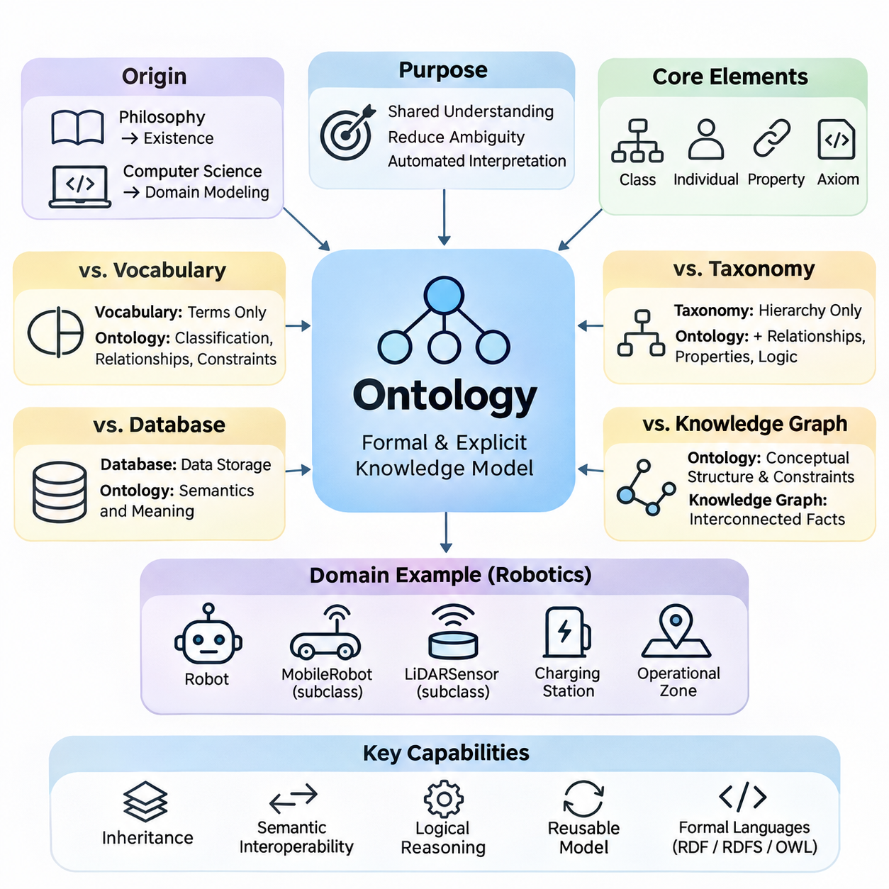
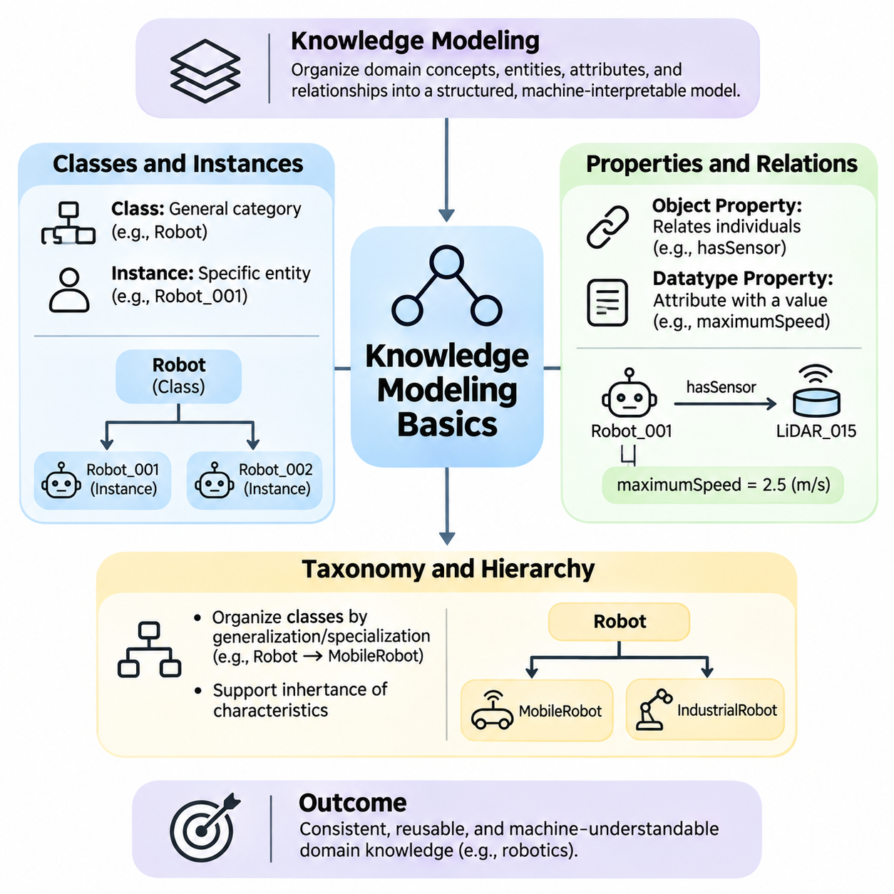
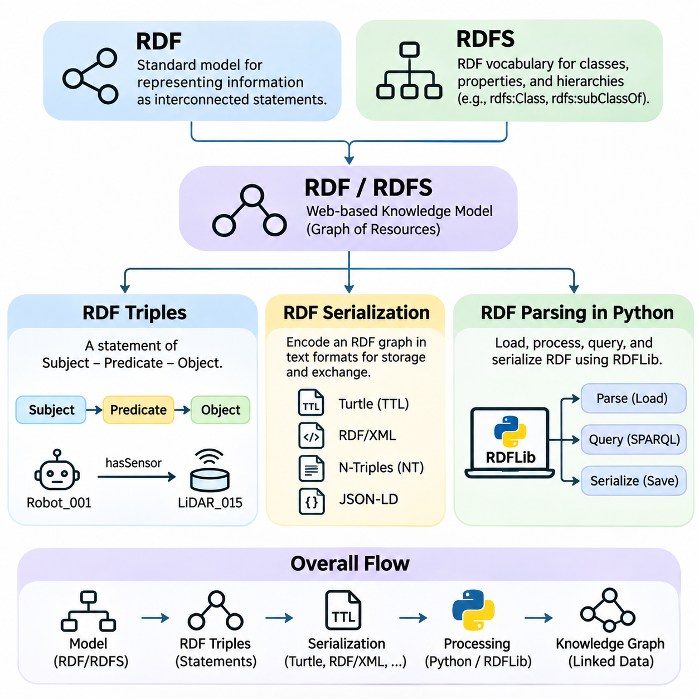
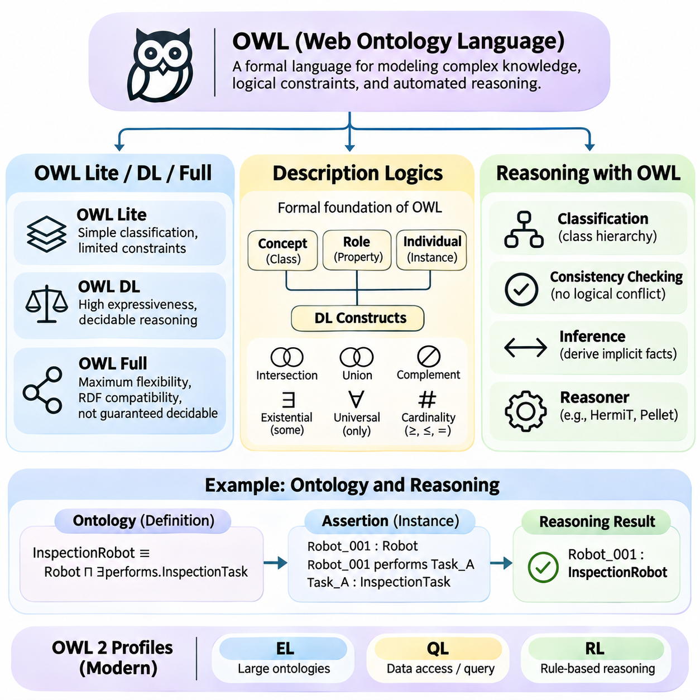
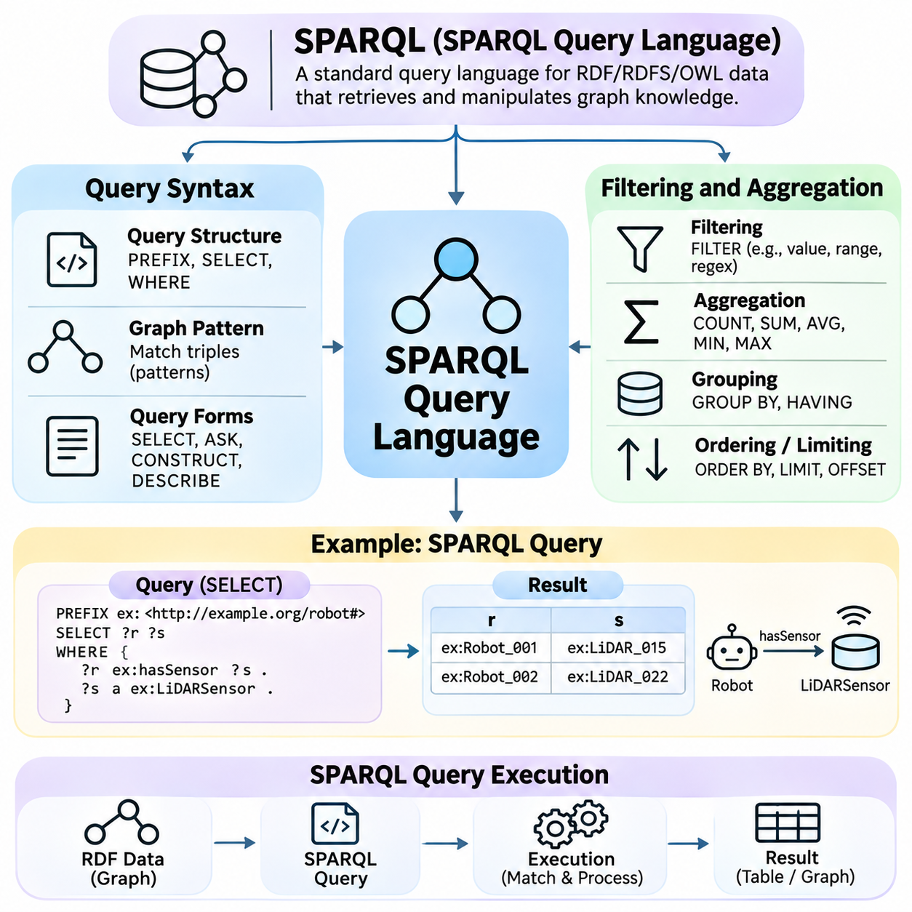
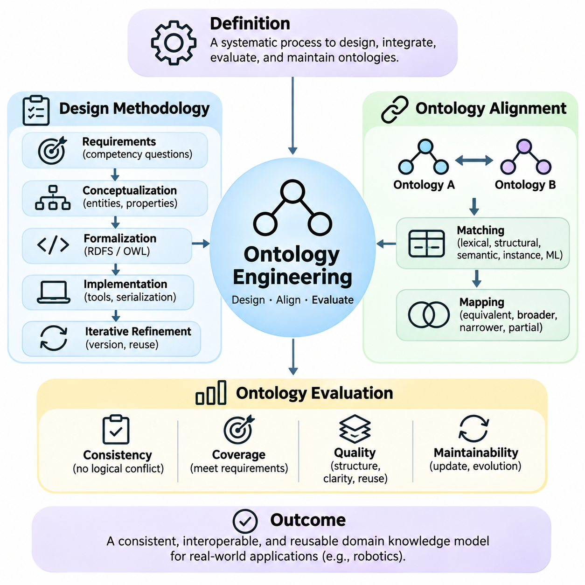
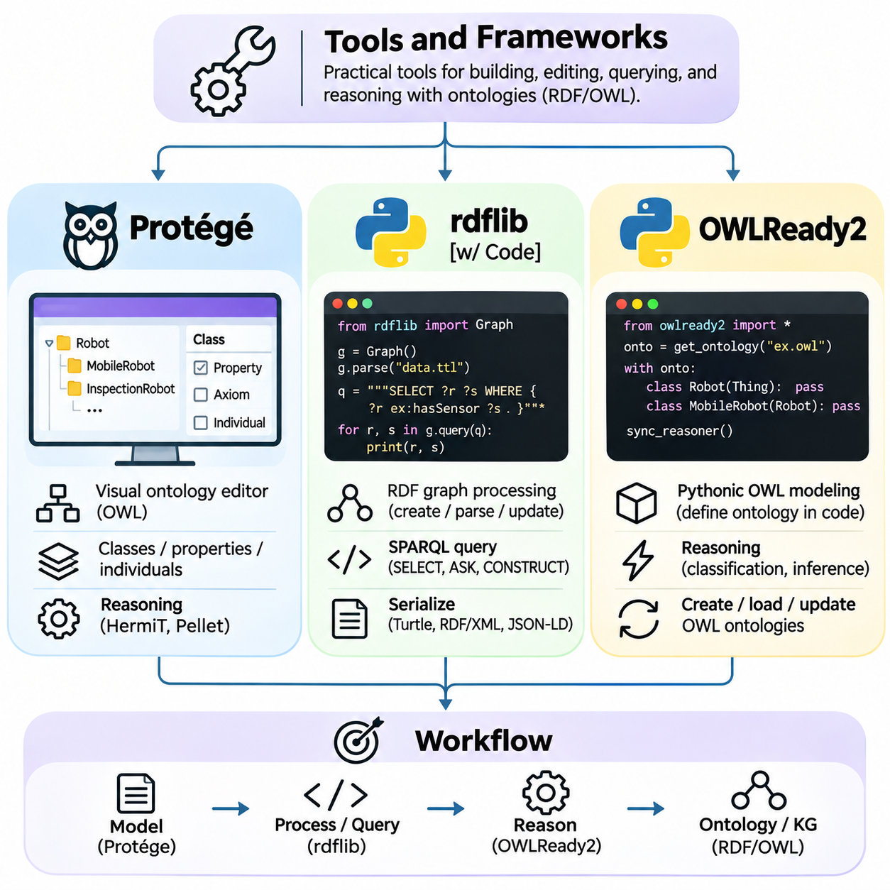
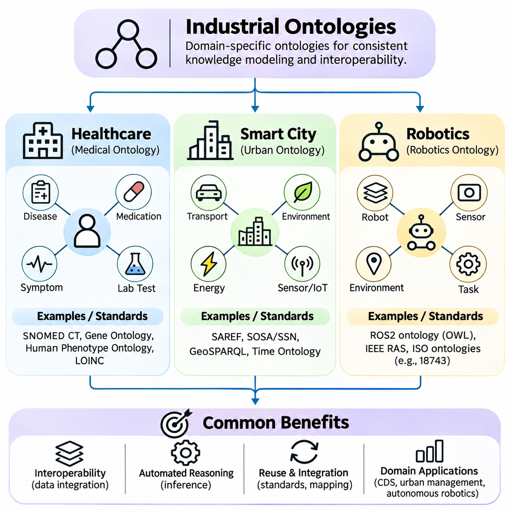
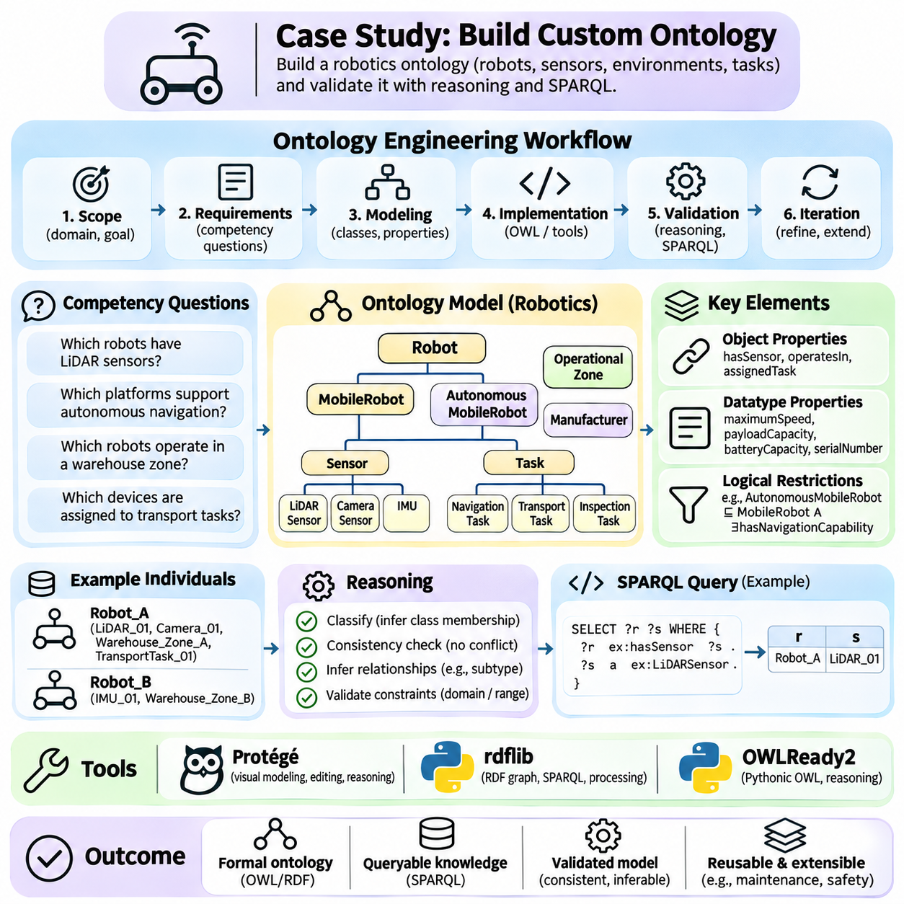

**Volume 02. Knowledge Representation**


# 02. Ontology

## 02.01 What is Ontology

{width="7.268055555555556in" height="7.268055555555556in"}

Ontology is a formal and explicit representation of knowledge that defines the concepts, relationships, and constraints within a particular domain. In artificial intelligence, an ontology provides a shared conceptual framework through which machines can interpret information consistently. Rather than storing isolated facts, it establishes the meaning of entities and the logical connections that organize them into a coherent knowledge structure.

The term ontology originates from philosophy, where it concerns the nature of existence and the categories of things that exist. In computer science, the concept has been adapted into a practical method for modeling domain knowledge. An engineering ontology, for example, may describe machines, components, sensors, operational processes, and their relationships, allowing different software systems to exchange information using consistent definitions.

An ontology differs from an ordinary vocabulary because it specifies more than the names of concepts. It describes how concepts are classified, which relationships are permitted, and what conditions must hold for particular statements to be meaningful. A vocabulary may identify the terms Robot, Sensor, and Environment, while an ontology can express that a robot contains sensors and that sensors observe properties of an environment.

The fundamental purpose of ontology is to make domain knowledge understandable to both humans and computational systems. Human communication frequently depends on implicit assumptions, contextual meanings, and specialized terminology. Machines cannot reliably interpret these assumptions without additional structure. Ontologies reduce ambiguity by assigning explicit meanings to concepts and establishing relationships that support automated interpretation.

A typical ontology contains classes, individuals, properties, and axioms. Classes represent categories of entities, while individuals represent particular members of those categories. Properties describe attributes or relationships, and axioms express logical conditions governing the domain. Together, these elements provide a formal representation that can support classification, consistency checking, and automated inference.

Consider an autonomous robotics environment containing mobile robots, navigation sensors, charging stations, and operational zones. An ontology can define MobileRobot as a subclass of Robot and LiDARSensor as a subclass of Sensor. It may also specify that robots operate within designated zones and use sensors for environmental perception. These definitions establish a reusable semantic foundation for robotic applications.

One important characteristic of ontology is the separation between conceptual knowledge and individual observations. The ontology defines general concepts and constraints, while instance data describes particular objects and events. For example, the ontology may define a temperature sensor and its measurement relationships, whereas operational data records that Sensor_01 measured a temperature of 35 degrees Celsius at a specific time.

Ontologies also support inheritance through hierarchical relationships. If an AutonomousMobileRobot is defined as a specialized type of MobileRobot, it can inherit relevant characteristics associated with the broader category. This organization reduces redundant definitions and enables systems to reason across multiple abstraction levels. However, inheritance must follow the formal semantics of the ontology language rather than informal assumptions.

Another essential capability is semantic interoperability, which allows independent systems to exchange information without losing its intended meaning. Different organizations may use distinct database structures or terminology for similar concepts. A shared ontology can establish common definitions and mappings, enabling information from heterogeneous sources to be interpreted within a consistent conceptual framework.

Ontology-based knowledge representation is closely related to formal logic. Logical expressions provide the foundation for defining relationships, restrictions, and implications among concepts. For instance, an ontology may specify that every inspection robot is a robot or that two categories are mutually exclusive. A reasoning engine can evaluate such statements and derive consequences that follow from the available definitions and assertions.

Unlike conventional databases, ontologies are primarily concerned with the semantics of information rather than its physical storage arrangement. Relational databases organize records into tables and enforce structural constraints, while ontologies describe domain meaning and logical relationships. These technologies are complementary because database records can be mapped to ontology concepts, enabling semantic reasoning over operational information.

Ontologies are also distinct from taxonomies, although taxonomies frequently form part of an ontology. A taxonomy primarily organizes concepts through hierarchical classification, such as Vehicle, GroundVehicle, and AutonomousVehicle. An ontology extends this organization by describing additional relationships, properties, restrictions, and logical conditions that characterize how entities interact within the modeled domain.

The distinction between ontology and knowledge graph is equally important. An ontology defines conceptual structures and semantic constraints, while a knowledge graph represents interconnected entities and relationships, often using ontology-defined vocabulary. A knowledge graph may contain thousands of robots, facilities, and operational events, whereas its ontology specifies the categories and relationships through which those facts are interpreted.

Formal ontology languages make these conceptual models computationally accessible. The Resource Description Framework provides a graph-based model for expressing statements, while RDF Schema introduces basic mechanisms for defining classes and properties. The Web Ontology Language extends these capabilities with richer logical constructs, allowing more sophisticated descriptions of classes, relationships, and constraints.

Ontology reasoning can identify implicit knowledge that was not explicitly recorded. If every InspectionRobot is classified as a Robot and Robot_17 is identified as an InspectionRobot, a reasoner can infer that Robot_17 is also a Robot. Depending on the ontology language and its logical semantics, reasoning systems may also detect contradictions, classify concepts, and determine whether particular relationships logically follow from existing assertions.

An important consideration is the open-world assumption commonly used in ontology-based reasoning. Under this assumption, the absence of a statement does not necessarily imply that the statement is false. If a robot has no recorded charging station, the system cannot automatically conclude that no charging station exists. This differs from many conventional database applications that interpret missing records using closed-world operational assumptions.

Ontology design therefore requires careful attention to the distinction between logical inference and data validation. A formal restriction does not always behave like a database integrity constraint. For example, a minimum-cardinality requirement may imply the existence of an unspecified related entity rather than immediately report missing data. Separate validation mechanisms may be necessary when applications require explicit completeness checks.

The development of an ontology begins with identifying the domain, its intended users, and the questions the knowledge model must answer. Engineers determine which concepts are essential, how those concepts relate, and which distinctions are operationally meaningful. A well-designed ontology should be sufficiently expressive to represent important domain knowledge without introducing unnecessary complexity that increases maintenance and reasoning costs.

Domain experts play a critical role because ontology quality depends on the accuracy of its conceptual assumptions. Software engineers may understand formal representation languages, but specialized knowledge is needed to determine whether the modeled relationships reflect real-world practices. Collaboration between domain experts and knowledge engineers helps establish definitions that are technically precise, practically useful, and understandable across organizational boundaries.

Ontologies are particularly valuable in industrial environments where information originates from heterogeneous machines, sensors, control systems, and enterprise applications. A manufacturing ontology can connect equipment specifications, production operations, maintenance records, and quality measurements. This semantic integration supports equipment monitoring, fault analysis, operational planning, and the consistent interpretation of information across engineering systems.

In healthcare, ontologies support standardized representations of medical concepts, clinical observations, procedures, and relationships among healthcare entities. In smart cities, they can describe transportation infrastructure, environmental sensors, public facilities, and urban services. In robotics, they provide structured representations of robot capabilities, spatial relationships, operational tasks, and environmental objects.

Modern artificial intelligence systems can also combine ontologies with machine learning and large language models. Neural models are effective at extracting patterns from unstructured data, while ontologies provide explicit conceptual definitions and logical constraints. Integrating these approaches can improve semantic grounding, support structured information retrieval, and enable certain forms of verifiable reasoning, although correctness depends on the underlying knowledge and integration methods.

Ontology-based systems nevertheless face practical limitations. Building accurate conceptual models requires substantial domain expertise, and large ontologies can become difficult to maintain. Conflicting definitions, incomplete knowledge, evolving terminology, and computationally expensive reasoning may reduce their effectiveness. Successful implementations therefore balance semantic expressiveness, reasoning requirements, interoperability, and operational scalability.

Ultimately, ontology provides a foundation for transforming disconnected information into structured, interpretable knowledge. Its value lies not merely in organizing terminology but in establishing explicit meanings that support communication, integration, and logical inference. As artificial intelligence systems become increasingly interconnected, ontologies remain an important mechanism for connecting symbolic knowledge representation with data-driven intelligence and real-world applications.

Ontology is a formal and explicit representation of knowledge that defines the concepts, relationships, and constraints within a particular domain. In artificial intelligence, an ontology provides a shared conceptual framework through which machines can interpret information consistently. Rather than storing isolated facts, it establishes the meaning of entities and the logical connections that organize them into a coherent knowledge structure.

The term ontology originates from philosophy, where it concerns the nature of existence and the categories of things that exist. In computer science, the concept has been adapted into a practical method for modeling domain knowledge. An engineering ontology, for example, may describe machines, components, sensors, operational processes, and their relationships, allowing different software systems to exchange information using consistent definitions.

An ontology differs from an ordinary vocabulary because it specifies more than the names of concepts. It describes how concepts are classified, which relationships are permitted, and what conditions must hold for particular statements to be meaningful. A vocabulary may identify the terms Robot, Sensor, and Environment, while an ontology can express that a robot contains sensors and that sensors observe properties of an environment.

The fundamental purpose of ontology is to make domain knowledge understandable to both humans and computational systems. Human communication frequently depends on implicit assumptions, contextual meanings, and specialized terminology. Machines cannot reliably interpret these assumptions without additional structure. Ontologies reduce ambiguity by assigning explicit meanings to concepts and establishing relationships that support automated interpretation.

A typical ontology contains classes, individuals, properties, and axioms. Classes represent categories of entities, while individuals represent particular members of those categories. Properties describe attributes or relationships, and axioms express logical conditions governing the domain. Together, these elements provide a formal representation that can support classification, consistency checking, and automated inference.

Consider an autonomous robotics environment containing mobile robots, navigation sensors, charging stations, and operational zones. An ontology can define MobileRobot as a subclass of Robot and LiDARSensor as a subclass of Sensor. It may also specify that robots operate within designated zones and use sensors for environmental perception. These definitions establish a reusable semantic foundation for robotic applications.

One important characteristic of ontology is the separation between conceptual knowledge and individual observations. The ontology defines general concepts and constraints, while instance data describes particular objects and events. For example, the ontology may define a temperature sensor and its measurement relationships, whereas operational data records that Sensor_01 measured a temperature of 35 degrees Celsius at a specific time.

Ontologies also support inheritance through hierarchical relationships. If an AutonomousMobileRobot is defined as a specialized type of MobileRobot, it can inherit relevant characteristics associated with the broader category. This organization reduces redundant definitions and enables systems to reason across multiple abstraction levels. However, inheritance must follow the formal semantics of the ontology language rather than informal assumptions.

Another essential capability is semantic interoperability, which allows independent systems to exchange information without losing its intended meaning. Different organizations may use distinct database structures or terminology for similar concepts. A shared ontology can establish common definitions and mappings, enabling information from heterogeneous sources to be interpreted within a consistent conceptual framework.

Ontology-based knowledge representation is closely related to formal logic. Logical expressions provide the foundation for defining relationships, restrictions, and implications among concepts. For instance, an ontology may specify that every inspection robot is a robot or that two categories are mutually exclusive. A reasoning engine can evaluate such statements and derive consequences that follow from the available definitions and assertions.

Unlike conventional databases, ontologies are primarily concerned with the semantics of information rather than its physical storage arrangement. Relational databases organize records into tables and enforce structural constraints, while ontologies describe domain meaning and logical relationships. These technologies are complementary because database records can be mapped to ontology concepts, enabling semantic reasoning over operational information.

Ontologies are also distinct from taxonomies, although taxonomies frequently form part of an ontology. A taxonomy primarily organizes concepts through hierarchical classification, such as Vehicle, GroundVehicle, and AutonomousVehicle. An ontology extends this organization by describing additional relationships, properties, restrictions, and logical conditions that characterize how entities interact within the modeled domain.

The distinction between ontology and knowledge graph is equally important. An ontology defines conceptual structures and semantic constraints, while a knowledge graph represents interconnected entities and relationships, often using ontology-defined vocabulary. A knowledge graph may contain thousands of robots, facilities, and operational events, whereas its ontology specifies the categories and relationships through which those facts are interpreted.

Formal ontology languages make these conceptual models computationally accessible. The Resource Description Framework provides a graph-based model for expressing statements, while RDF Schema introduces basic mechanisms for defining classes and properties. The Web Ontology Language extends these capabilities with richer logical constructs, allowing more sophisticated descriptions of classes, relationships, and constraints.

Ontology reasoning can identify implicit knowledge that was not explicitly recorded. If every InspectionRobot is classified as a Robot and Robot_17 is identified as an InspectionRobot, a reasoner can infer that Robot_17 is also a Robot. Depending on the ontology language and its logical semantics, reasoning systems may also detect contradictions, classify concepts, and determine whether particular relationships logically follow from existing assertions.

An important consideration is the open-world assumption commonly used in ontology-based reasoning. Under this assumption, the absence of a statement does not necessarily imply that the statement is false. If a robot has no recorded charging station, the system cannot automatically conclude that no charging station exists. This differs from many conventional database applications that interpret missing records using closed-world operational assumptions.

Ontology design therefore requires careful attention to the distinction between logical inference and data validation. A formal restriction does not always behave like a database integrity constraint. For example, a minimum-cardinality requirement may imply the existence of an unspecified related entity rather than immediately report missing data. Separate validation mechanisms may be necessary when applications require explicit completeness checks.

The development of an ontology begins with identifying the domain, its intended users, and the questions the knowledge model must answer. Engineers determine which concepts are essential, how those concepts relate, and which distinctions are operationally meaningful. A well-designed ontology should be sufficiently expressive to represent important domain knowledge without introducing unnecessary complexity that increases maintenance and reasoning costs.

Domain experts play a critical role because ontology quality depends on the accuracy of its conceptual assumptions. Software engineers may understand formal representation languages, but specialized knowledge is needed to determine whether the modeled relationships reflect real-world practices. Collaboration between domain experts and knowledge engineers helps establish definitions that are technically precise, practically useful, and understandable across organizational boundaries.

Ontologies are particularly valuable in industrial environments where information originates from heterogeneous machines, sensors, control systems, and enterprise applications. A manufacturing ontology can connect equipment specifications, production operations, maintenance records, and quality measurements. This semantic integration supports equipment monitoring, fault analysis, operational planning, and the consistent interpretation of information across engineering systems.

In healthcare, ontologies support standardized representations of medical concepts, clinical observations, procedures, and relationships among healthcare entities. In smart cities, they can describe transportation infrastructure, environmental sensors, public facilities, and urban services. In robotics, they provide structured representations of robot capabilities, spatial relationships, operational tasks, and environmental objects.

Modern artificial intelligence systems can also combine ontologies with machine learning and large language models. Neural models are effective at extracting patterns from unstructured data, while ontologies provide explicit conceptual definitions and logical constraints. Integrating these approaches can improve semantic grounding, support structured information retrieval, and enable certain forms of verifiable reasoning, although correctness depends on the underlying knowledge and integration methods.

Ontology-based systems nevertheless face practical limitations. Building accurate conceptual models requires substantial domain expertise, and large ontologies can become difficult to maintain. Conflicting definitions, incomplete knowledge, evolving terminology, and computationally expensive reasoning may reduce their effectiveness. Successful implementations therefore balance semantic expressiveness, reasoning requirements, interoperability, and operational scalability.

Ultimately, ontology provides a foundation for transforming disconnected information into structured, interpretable knowledge. Its value lies not merely in organizing terminology but in establishing explicit meanings that support communication, integration, and logical inference. As artificial intelligence systems become increasingly interconnected, ontologies remain an important mechanism for connecting symbolic knowledge representation with data-driven intelligence and real-world applications.

## 02.02 Knowledge Modeling Basics

{width="7.268055555555556in" height="7.268055555555556in"}

Knowledge modeling is the process of organizing domain concepts, individual entities, attributes, and relationships into a structured representation that computational systems can interpret. In ontology engineering, this process establishes the conceptual foundation for describing what exists within a domain and how its elements interact. Classes, instances, properties, and taxonomic hierarchies provide the essential building blocks for constructing consistent and reusable knowledge models.

A knowledge model differs from an ordinary collection of records because it explicitly describes the meaning and organization of information. Instead of merely storing that a robot has a sensor, the model defines what constitutes a robot, what qualifies as a sensor, and how these entities may be related. This semantic structure enables information integration, automated classification, logical inference, and consistent interpretation across different applications.

Classes represent general categories of entities that share common characteristics or satisfy particular definitions. A class such as Robot describes a conceptual category rather than one physical machine. More specialized classes, including MobileRobot, IndustrialRobot, and InspectionRobot, represent narrower categories. Classes provide reusable abstractions that allow knowledge engineers to describe large collections of entities without defining every characteristic separately.

Instances, also called individuals, represent specific entities belonging to one or more classes. Robot_001 may represent a particular autonomous mobile robot operating inside a warehouse, while Sensor_015 identifies a specific LiDAR device installed on that machine. The relationship between an instance and its class is called class membership. This distinction separates general conceptual definitions from concrete entities represented within a knowledge base.

An individual may belong to multiple classes when the ontology permits overlapping classifications. For example, Robot_001 could simultaneously be an instance of MobileRobot and InspectionEquipment. Such membership does not necessarily imply that these classes are identical or hierarchically related. Ontology modeling therefore supports flexible classification structures that reflect the multiple functional roles and characteristics of real-world entities.

Classes can be defined through explicit membership assertions or logical conditions. A knowledge engineer may directly classify Robot_001 as an AutonomousRobot, or define a class using conditions that a reasoning engine can evaluate. In expressive ontology languages, equivalent-class definitions can establish necessary and sufficient conditions for membership, enabling automated classification when the available assertions logically satisfy those conditions.

The distinction between classes and instances is fundamental to avoiding modeling errors. A class describes a category, whereas an instance denotes an entity represented as a member of that category. Robot is ordinarily modeled as a class, while Robot_001 is an individual. However, some ontology languages support metamodeling, allowing resources to participate in more than one modeling role under specific semantic interpretations.

Properties describe characteristics of entities and relationships between them. In ontology engineering, properties are commonly divided into object properties and datatype properties. Object properties connect individuals to other individuals, while datatype properties associate individuals with literal values. This distinction allows knowledge models to represent both structural relationships and measurable attributes within a unified semantic framework.

An object property such as hasSensor can connect Robot_001 to LiDAR_015, expressing that a particular robot is associated with a particular sensor. Other object properties may describe locatedIn, controlledBy, connectedTo, or performsTask relationships. These relationships transform isolated entities into interconnected knowledge structures and enable systems to navigate dependencies, functional associations, and operational contexts.

Datatype properties describe attributes whose values are represented using data types such as integers, decimal numbers, strings, and timestamps. A robot may have a maximumSpeed value of 2.5 meters per second, while a sensor may have a measurementRange value of 30 meters. The ontology can define the expected datatype, although measurement units often require additional modeling conventions or explicit quantity representations.

Properties may also have domains and ranges that establish logical implications about the entities participating in relationships. If hasSensor has Robot as its domain and Sensor as its range, a reasoner can infer that the subject belongs to Robot and the object belongs to Sensor. In OWL, these declarations are logical axioms rather than ordinary database-style validation rules that automatically reject incorrectly typed records.

Ontology languages support additional property characteristics that influence reasoning behavior. A transitive relationship can propagate across chains of connected entities, while a symmetric relationship applies in both directions. Inverse properties express complementary relationships, and functional properties restrict the number of distinct values associated with a subject under the relevant logical semantics.

For example, if locatedWithin is transitive, an object located within a room that is located within a building may also be inferred to be located within that building. If connectedTo is symmetric, a connection asserted from Device_A to Device_B implies the reverse connection. Such characteristics must be selected carefully because inappropriate declarations can produce unintended logical consequences or inaccurate domain interpretations.

Relationships may require more complex representations when they involve multiple participants, changing conditions, or contextual information. A maintenance event, for example, may involve a robot, technician, maintenance procedure, timestamp, and outcome. Representing the event as an individual allows these elements to be connected through separate properties, preserving contextual details that a simple binary relationship cannot adequately express.

Taxonomy refers to the systematic classification of concepts into categories and subcategories. In ontology modeling, taxonomic relationships commonly express subclass hierarchies in which specialized classes are included within broader classes. For example, AutonomousMobileRobot may be a subclass of MobileRobot, which is itself a subclass of Robot. This structure organizes domain concepts according to their logical generality and specialization.

Subclass relationships support inheritance of logical characteristics. If every MobileRobot is a Robot and every AutonomousMobileRobot is a MobileRobot, then every AutonomousMobileRobot is also a Robot. This conclusion follows from the transitivity of class inclusion. A reasoning engine can use these relationships to infer additional class memberships without requiring knowledge engineers to explicitly repeat every classification assertion.

A taxonomy is not necessarily a simple tree. A class may have multiple parent classes when its definition belongs to several broader categories. For example, AutonomousInspectionRobot could be a subclass of both AutonomousRobot and InspectionEquipment. This multiple-inheritance structure creates a directed hierarchy that may contain several paths between concepts while preserving the logical relationships among their definitions.

Taxonomic modeling requires distinguishing subclass relationships from part-whole relationships. A LiDARSensor may be a subclass of Sensor because every LiDAR sensor is a sensor, but a LiDARSensor is not a subclass of Robot merely because robots may contain LiDAR sensors. Component relationships should instead be represented through properties such as hasComponent or partOf, preserving the difference between classification and composition.

Ontology hierarchies can also include disjointness constraints that specify when classes cannot share members. For example, a carefully defined domain may declare PhysicalDevice and SoftwareProcess disjoint if their intended interpretations are mutually exclusive. Such declarations support consistency checking by allowing a reasoner to detect contradictions when an individual is logically required to belong to incompatible classes.

A well-designed hierarchy balances abstraction and specificity. Excessively broad categories provide limited semantic discrimination, while overly specialized categories increase modeling complexity and maintenance requirements. Knowledge engineers should introduce subclasses when meaningful conceptual differences affect reasoning, information retrieval, or application behavior, rather than creating separate classes for every minor variation in recorded data.

Taxonomy development often begins with identifying high-level domain concepts and progressively refining them into specialized categories. In a robotics ontology, these concepts may include PhysicalEntity, Agent, Device, Environment, and Task. Specialized categories can then represent mobile platforms, manipulation devices, perception sensors, navigation tasks, and operational environments according to the requirements of the intended applications.

The combination of classes, instances, properties, and taxonomic hierarchies establishes a semantic model that can be populated with operational information. Classes define conceptual categories, instances identify concrete entities, properties express relationships and attributes, and hierarchies organize generalization. Together, these structures enable consistent knowledge representation while providing the foundation for more expressive logical constraints.

Knowledge modeling also requires attention to naming conventions, identity management, and semantic consistency. Different systems may assign different identifiers to the same physical entity, or use identical terms for distinct concepts. Stable identifiers, explicit definitions, and carefully managed mappings reduce ambiguity. Ontology engineers must also distinguish between identical individuals, equivalent classes, and merely related concepts.

In practical applications, knowledge models evolve as new devices, processes, and organizational requirements emerge. Adding a new sensor type may require extending an existing taxonomy, while introducing a new operational workflow may require additional properties or event classes. Changes should preserve intended semantics and be evaluated for their effects on existing assertions, queries, integrations, and reasoning results.

Effective ontology modeling therefore involves more than constructing a classification hierarchy. It requires identifying domain boundaries, defining meaningful abstractions, representing relationships accurately, and ensuring that logical assumptions reflect the intended interpretation of real-world entities. The resulting model provides a structured foundation for semantic interoperability, knowledge graph construction, automated reasoning, and intelligent system integration.

Ultimately, classes and instances establish what kinds of entities exist and which particular entities are represented, while properties and relations describe how those entities are characterized and connected. Taxonomies organize these concepts into logical hierarchies that support classification and inference. Their coordinated use transforms fragmented information into a coherent knowledge structure suitable for advanced artificial intelligence applications.

지식 모델링(Knowledge Modeling)은 도메인(Domain)의 개념(Concept), 개별 개체(Individual Entity), 속성(Attribute), 관계(Relationship)를 컴퓨터 시스템이 해석할 수 있는 구조화된 표현(Structured Representation)으로 조직하는 과정이다. 온톨로지 공학(Ontology Engineering)에서 이 과정은 특정 도메인에 무엇이 존재하고 각 요소가 어떻게 상호작용하는지를 기술하는 개념적 기반(Conceptual Foundation)을 확립한다. 클래스(Class), 인스턴스(Instance), 속성(Property), 분류 계층(Taxonomic Hierarchy)은 일관되고 재사용 가능한 지식 모델(Knowledge Model)을 구성하는 핵심 요소이다.

지식 모델(Knowledge Model)은 정보의 의미와 조직 방식을 명시적으로 기술한다는 점에서 일반적인 레코드(Record) 집합과 구별된다. 단순히 로봇이 센서를 가지고 있다는 사실을 저장하는 대신, 로봇의 정의와 센서의 자격 조건, 그리고 두 개체가 어떤 관계를 맺을 수 있는지를 정의한다. 이러한 의미 구조(Semantic Structure)는 서로 다른 응용 시스템(Application)에서 정보 통합(Information Integration), 자동 분류(Automated Classification), 논리적 추론(Logical Inference), 일관된 해석(Consistent Interpretation)을 가능하게 한다.

클래스(Class)는 공통된 특성을 공유하거나 특정 정의를 만족하는 개체들의 일반적인 범주(Category)를 나타낸다. Robot과 같은 클래스는 하나의 물리적 기계가 아니라 개념적 범주(Conceptual Category)를 설명한다. MobileRobot, IndustrialRobot, InspectionRobot과 같은 보다 전문화된 클래스는 더 좁은 범주를 나타낸다. 클래스는 모든 특성을 개별적으로 정의하지 않고도 대규모 개체 집합을 설명할 수 있는 재사용 가능한 추상화(Reusable Abstraction)를 제공한다.

인스턴스(Instance)는 개체(Individual)라고도 하며, 하나 이상의 클래스에 속하는 특정 대상을 나타낸다. Robot_001은 창고에서 작동하는 특정 자율이동로봇(Autonomous Mobile Robot)을 나타낼 수 있으며, Sensor_015는 해당 로봇에 설치된 특정 라이다(LiDAR) 장치를 식별한다. 인스턴스와 클래스 사이의 관계를 클래스 소속 관계(Class Membership)라고 한다. 이러한 구분은 일반적인 개념 정의와 지식 베이스(Knowledge Base)에 표현된 구체적인 개체를 분리한다.

온톨로지(Ontology)가 중복되는 분류를 허용하는 경우, 하나의 개체(Individual)는 여러 클래스에 속할 수 있다. 예를 들어 Robot_001은 MobileRobot과 InspectionEquipment의 인스턴스일 수 있다. 이러한 소속 관계가 두 클래스가 동일하거나 계층적으로 연결되어 있음을 반드시 의미하지는 않는다. 따라서 온톨지 모델링(Ontology Modeling)은 실제 개체가 가지는 다양한 기능적 역할(Functional Role)과 특성을 반영하는 유연한 분류 구조(Classification Structure)를 지원한다.

클래스(Class)는 명시적인 소속 선언(Membership Assertion)이나 논리적 조건(Logical Condition)을 통해 정의할 수 있다. 지식 엔지니어(Knowledge Engineer)는 Robot_001을 AutonomousRobot으로 직접 분류하거나, 추론 엔진(Reasoning Engine)이 평가할 수 있는 조건으로 클래스를 정의할 수 있다. 표현력이 높은 온톨로지 언어(Ontology Language)에서는 동등 클래스 정의(Equivalent Class Definition)를 통해 소속의 필요충분조건(Necessary and Sufficient Conditions)을 설정하고, 해당 조건이 논리적으로 충족되면 자동 분류를 수행할 수 있다.

클래스(Class)와 인스턴스(Instance)의 구분은 모델링 오류(Modeling Error)를 방지하는 데 필수적이다. 클래스는 범주를 설명하고, 인스턴스는 해당 범주에 속하는 개체를 나타낸다. 일반적으로 Robot은 클래스로, Robot_001은 개체로 모델링된다. 그러나 일부 온톨로지 언어는 메타모델링(Metamodeling)을 지원하여 특정 의미론적 해석(Semantic Interpretation)에 따라 하나의 리소스(Resource)가 여러 모델링 역할에 참여하도록 허용한다.

속성(Property)은 개체의 특성과 개체 사이의 관계를 설명한다. 온톨로지 공학(Ontology Engineering)에서 속성은 일반적으로 객체 속성(Object Property)과 데이터형 속성(Datatype Property)으로 구분된다. 객체 속성은 개체와 다른 개체를 연결하며, 데이터형 속성은 개체를 리터럴 값(Literal Value)과 연결한다. 이러한 구분을 통해 지식 모델은 구조적 관계(Structural Relationship)와 측정 가능한 속성을 통합된 의미 체계(Semantic Framework) 안에서 표현할 수 있다.

hasSensor와 같은 객체 속성(Object Property)은 Robot_001과 LiDAR_015를 연결하여 특정 로봇이 특정 센서와 연관되어 있음을 표현한다. 다른 객체 속성으로는 locatedIn, controlledBy, connectedTo, performsTask 등이 있다. 이러한 관계는 고립된 개체들을 상호 연결된 지식 구조(Interconnected Knowledge Structure)로 변환하며, 시스템이 의존성(Dependency), 기능적 연관성(Functional Association), 운영 맥락(Operational Context)을 탐색할 수 있도록 한다.

데이터형 속성(Datatype Property)은 정수(Integer), 십진수(Decimal Number), 문자열(String), 타임스탬프(Timestamp)와 같은 데이터형(Data Type)을 사용하여 표현되는 특성을 설명한다. 로봇은 초당 2.5미터의 maximumSpeed 값을 가질 수 있으며, 센서는 30미터의 measurementRange 값을 가질 수 있다. 온톨로지는 예상 데이터형을 정의할 수 있지만, 측정 단위(Measurement Unit)는 별도의 모델링 규칙이나 명시적인 수량 표현(Quantity Representation)이 필요할 수 있다.

속성(Property)은 관계에 참여하는 개체에 대한 논리적 함의(Logical Implication)를 설정하는 도메인(Domain)과 범위(Range)를 가질 수 있다. hasSensor의 도메인이 Robot이고 범위가 Sensor라면, 추론기(Reasoner)는 주체가 Robot에 속하고 객체가 Sensor에 속한다고 추론할 수 있다. OWL에서 이러한 선언은 논리적 공리(Logical Axiom)이며, 잘못된 데이터형의 레코드를 자동으로 거부하는 일반적인 데이터베이스 검증 규칙(Database Validation Rule)과는 다르다.

온톨로지 언어(Ontology Language)는 추론 동작에 영향을 주는 추가적인 속성 특성(Property Characteristic)을 지원한다. 추이적 관계(Transitive Relationship)는 연결된 개체의 연쇄를 따라 관계를 확장할 수 있으며, 대칭 관계(Symmetric Relationship)는 양방향으로 적용된다. 역속성(Inverse Property)은 상호 보완적인 관계를 표현하고, 함수적 속성(Functional Property)은 관련 논리 의미론에 따라 하나의 주체와 연결되는 서로 구별되는 값의 수를 제한한다.

예를 들어 locatedWithin이 추이적 관계(Transitive Relationship)라면, 어떤 객체가 방 안에 있고 그 방이 건물 안에 있을 때 해당 객체도 건물 안에 있다고 추론할 수 있다. connectedTo가 대칭 관계(Symmetric Relationship)라면 Device_A에서 Device_B로의 연결은 반대 방향의 연결도 의미한다. 이러한 특성은 부적절하게 선언하면 의도하지 않은 논리적 결과나 부정확한 도메인 해석이 발생할 수 있으므로 신중하게 선택해야 한다.

관계(Relationship)는 여러 참여자, 변화하는 조건 또는 맥락 정보(Contextual Information)를 포함할 때 더 복잡한 표현이 필요할 수 있다. 예를 들어 유지보수 이벤트(Maintenance Event)는 로봇, 기술자, 유지보수 절차, 타임스탬프, 작업 결과를 포함할 수 있다. 이벤트를 하나의 개체로 표현하면 이러한 요소를 별도의 속성으로 연결할 수 있으며, 단순한 이항 관계(Binary Relationship)만으로 충분히 표현하기 어려운 맥락 정보를 보존할 수 있다.

분류 체계(Taxonomy)는 개념을 범주와 하위 범주로 체계적으로 분류하는 방법이다. 온톨로지 모델링(Ontology Modeling)에서 분류 관계는 일반적으로 전문화된 클래스가 더 넓은 클래스에 포함되는 하위 클래스 계층(Subclass Hierarchy)을 표현한다. 예를 들어 AutonomousMobileRobot은 MobileRobot의 하위 클래스이고, MobileRobot은 Robot의 하위 클래스일 수 있다. 이러한 구조는 논리적 일반화(Generalization)와 전문화(Specialization)에 따라 도메인 개념을 조직한다.

하위 클래스 관계(Subclass Relationship)는 논리적 특성의 상속(Inheritance)을 지원한다. 모든 MobileRobot이 Robot이고 모든 AutonomousMobileRobot이 MobileRobot이라면, 모든 AutonomousMobileRobot 역시 Robot이다. 이러한 결론은 클래스 포함 관계(Class Inclusion)의 추이성(Transitivity)에서 도출된다. 추론 엔진(Reasoning Engine)은 이러한 관계를 활용하여 모든 분류 선언을 명시적으로 반복하지 않고도 추가적인 클래스 소속 관계를 추론할 수 있다.

분류 체계(Taxonomy)가 반드시 단순한 트리(Tree) 구조인 것은 아니다. 하나의 클래스는 여러 상위 범주에 속할 때 복수의 부모 클래스(Parent Class)를 가질 수 있다. 예를 들어 AutonomousInspectionRobot은 AutonomousRobot과 InspectionEquipment의 하위 클래스일 수 있다. 이러한 다중 상속(Multiple Inheritance) 구조는 개념 사이에 여러 경로가 존재하는 방향성 계층 구조(Directed Hierarchy)를 형성하면서 정의 간 논리적 관계를 유지한다.

분류 체계 모델링(Taxonomic Modeling)에서는 하위 클래스 관계(Subclass Relationship)와 부분-전체 관계(Part-Whole Relationship)를 구별해야 한다. LiDARSensor는 모든 라이다 센서가 센서이므로 Sensor의 하위 클래스가 될 수 있지만, 로봇에 장착된다는 이유만으로 Robot의 하위 클래스가 되지는 않는다. 구성요소 관계(Component Relationship)는 hasComponent 또는 partOf와 같은 속성으로 표현하여 분류(Classification)와 구성(Composition)의 차이를 유지해야 한다.

온톨로지 계층(Ontology Hierarchy)에는 클래스가 공통 구성원을 가질 수 없는 조건을 지정하는 상호 배타성 제약(Disjointness Constraint)도 포함할 수 있다. 예를 들어 도메인의 정의상 두 개념이 상호 배타적이라면 PhysicalDevice와 SoftwareProcess를 서로소 클래스(Disjoint Class)로 선언할 수 있다. 이러한 선언은 하나의 개체가 양립할 수 없는 클래스에 속해야 하는 논리적 상황을 추론기가 감지하도록 하여 일관성 검사(Consistency Checking)를 지원한다.

잘 설계된 계층 구조(Hierarchy)는 추상화(Abstraction)와 구체성(Specificity) 사이의 균형을 유지한다. 지나치게 넓은 범주는 의미적 구별 능력(Semantic Discrimination)이 제한되고, 지나치게 세분화된 범주는 모델링 복잡도와 유지보수 요구를 증가시킨다. 지식 엔지니어는 기록된 데이터의 사소한 차이마다 별도의 클래스를 만드는 대신, 추론이나 정보 검색 또는 응용 동작에 영향을 주는 의미 있는 개념적 차이가 있을 때 하위 클래스를 도입해야 한다.

분류 체계 개발(Taxonomy Development)은 일반적으로 상위 수준의 도메인 개념을 식별하고 이를 점진적으로 세분화하는 과정에서 시작된다. 로봇 온톨로지(Robotics Ontology)에서는 PhysicalEntity, Agent, Device, Environment, Task 등이 이러한 개념에 포함될 수 있다. 이후 응용 시스템의 요구사항에 따라 이동 플랫폼(Mobile Platform), 조작 장치(Manipulation Device), 인지 센서(Perception Sensor), 내비게이션 작업(Navigation Task), 운영 환경(Operational Environment) 등을 전문화된 범주로 표현할 수 있다.

클래스(Class), 인스턴스(Instance), 속성(Property), 분류 계층(Taxonomic Hierarchy)의 결합은 운영 정보(Operational Information)를 채워 넣을 수 있는 의미 모델(Semantic Model)을 형성한다. 클래스는 개념적 범주를 정의하고, 인스턴스는 구체적인 개체를 식별하며, 속성은 관계와 특성을 표현하고, 계층 구조는 일반화 관계를 조직한다. 이러한 요소는 일관된 지식 표현(Knowledge Representation)을 가능하게 하며 더 정교한 논리적 제약(Logical Constraint)의 기반을 제공한다.

지식 모델링(Knowledge Modeling)은 명명 규칙(Naming Convention), 식별자 관리(Identity Management), 의미적 일관성(Semantic Consistency)에도 주의를 기울여야 한다. 서로 다른 시스템은 동일한 물리적 개체에 서로 다른 식별자를 부여하거나, 서로 다른 개념에 동일한 용어를 사용할 수 있다. 안정적인 식별자(Stable Identifier), 명시적인 정의(Explicit Definition), 체계적으로 관리되는 매핑(Mapping)은 모호성을 줄인다. 또한 온톨로지 엔지니어는 동일한 개체, 동등한 클래스, 단순히 관련된 개념을 구별해야 한다.

실제 응용 환경에서 지식 모델(Knowledge Model)은 새로운 장치, 프로세스, 조직적 요구사항이 등장함에 따라 발전한다. 새로운 센서 유형을 추가하려면 기존 분류 체계(Taxonomy)를 확장해야 할 수 있으며, 새로운 운영 워크플로(Operational Workflow)를 도입하려면 추가적인 속성이나 이벤트 클래스가 필요할 수 있다. 변경 과정에서는 의도된 의미론(Semantics)을 보존하고 기존 선언(Assertion), 질의(Query), 통합(Integration), 추론 결과(Reasoning Result)에 미치는 영향을 평가해야 한다.

효과적인 온톨로지 모델링(Ontology Modeling)은 단순히 분류 계층을 구성하는 것 이상의 작업이다. 도메인 경계(Domain Boundary)를 식별하고, 의미 있는 추상화를 정의하며, 관계를 정확하게 표현하고, 논리적 가정(Logical Assumption)이 실제 개체에 대한 의도된 해석과 일치하도록 해야 한다. 이렇게 구축된 모델은 의미적 상호운용성(Semantic Interoperability), 지식 그래프 구축(Knowledge Graph Construction), 자동 추론(Automated Reasoning), 지능형 시스템 통합(Intelligent System Integration)을 위한 구조적 기반을 제공한다.

궁극적으로 클래스(Class)와 인스턴스(Instance)는 어떤 종류의 개체가 존재하고 어떤 구체적인 개체가 표현되는지를 정의하며, 속성(Property)과 관계(Relation)는 해당 개체의 특성과 연결 방식을 설명한다. 분류 체계(Taxonomy)는 이러한 개념을 분류와 추론을 지원하는 논리적 계층으로 조직한다. 이 요소들을 통합적으로 활용하면 단편적인 정보(Fragmented Information)를 고급 인공지능 응용(Advanced Artificial Intelligence Application)에 적합한 일관된 지식 구조(Coherent Knowledge Structure)로 변환할 수 있다.

## 02.03 RDF and RDFS

{width="7.268055555555556in" height="7.268055555555556in"}

The Resource Description Framework, commonly known as RDF, is a standard model for representing information as interconnected statements. Developed within the World Wide Web Consortium ecosystem, RDF provides a foundation for exchanging structured knowledge across applications and organizations. Its central principle is that information can be expressed through relationships between identifiable resources, creating a graph-based representation of domain knowledge.

RDF Schema, abbreviated as RDFS, extends RDF by introducing a basic vocabulary for describing classes, properties, and hierarchical relationships. RDF provides the underlying data model, while RDFS supplies semantic constructs that help interpret the meaning of statements. Together, they enable knowledge engineers to describe entities, organize conceptual categories, and support elementary forms of logical inference.

The fundamental unit of RDF representation is the triple, consisting of a subject, predicate, and object. The subject identifies the resource being described, the predicate specifies a relationship or attribute, and the object represents the corresponding value or related resource. This structure resembles a simple declarative sentence and provides a consistent mechanism for expressing facts independently of particular database schemas.

Consider a robotics knowledge base containing the statement that Robot_001 hasSensor LiDAR_015. Robot_001 is the subject, hasSensor is the predicate, and LiDAR_015 is the object. Another statement may express that LiDAR_015 hasManufacturer SensorCompany. By combining such triples, the system constructs a connected graph describing robots, components, manufacturers, and operational relationships.

RDF subjects are identified by Internationalized Resource Identifiers or represented as blank nodes. Predicates are IRIs, while objects may be IRIs, blank nodes, or literals. IRIs provide globally interpretable identifiers that help distinguish resources across distributed systems. Blank nodes represent resources without explicit global identifiers, while literals express values such as names, numerical measurements, and timestamps.

Literal values may include datatypes or language tags that clarify their interpretation. For example, a sensor measurement can be represented as a decimal value, while a descriptive label may carry an English language tag. Typed literals distinguish numerical values from ordinary strings and allow applications to interpret data more precisely. However, RDF itself does not automatically define measurement units or enforce application-specific validation rules.

An RDF graph is a set of triples whose subjects and objects form nodes connected by predicate-labeled edges. Multiple statements about the same resource naturally combine into a connected representation. This graph structure is particularly useful when information contains many interconnected relationships, such as equipment dependencies, organizational structures, geographic associations, or semantic links between scientific concepts.

RDFS introduces vocabulary elements such as rdfs:Class, rdfs:subClassOf, rdfs:subPropertyOf, rdfs:domain, and rdfs:range. These constructs describe how resources and properties are organized conceptually. For example, MobileRobot can be declared a subclass of Robot, allowing an RDFS reasoner to infer that an individual classified as MobileRobot also belongs to the broader Robot class.

Domain and range declarations in RDFS provide additional inferential meaning. If the hasSensor property has Robot as its domain and Sensor as its range, an RDF statement connecting Robot_001 to LiDAR_015 through hasSensor supports the inference that Robot_001 is a Robot and LiDAR_015 is a Sensor. These declarations are semantic rules rather than conventional database constraints that reject records violating expected types.

RDFS also supports property hierarchies through rdfs:subPropertyOf. For example, hasLiDARSensor may be declared a subproperty of hasSensor. Consequently, a statement asserting that a robot hasLiDARSensor LiDAR_015 also entails the more general relationship hasSensor LiDAR_015. Such inference mechanisms enable applications to retrieve and interpret information across different levels of semantic specificity.

Although RDFS supports fundamental classification and inheritance, its expressive power is limited compared with more advanced ontology languages. It does not directly provide the full range of cardinality restrictions, class disjointness declarations, or complex class expressions available in OWL. RDFS is therefore appropriate for relatively lightweight semantic models, while applications requiring richer logical constraints may benefit from more expressive representations.

RDF serialization refers to the process of encoding RDF graphs into textual or binary formats suitable for storage, transmission, and processing. Because RDF is an abstract data model, the same graph can be represented using different serialization syntaxes. These formats may differ substantially in readability, compactness, and processing convenience while preserving equivalent RDF statements when interpreted correctly.

Turtle is a widely used RDF serialization format designed for concise and human-readable graph descriptions. It supports namespace prefixes, abbreviated resource identifiers, and compact notation for multiple statements sharing a subject. Turtle is particularly convenient for ontology development, documentation, and manual inspection because its syntax closely reflects the subject-predicate-object structure of RDF.

RDF/XML represents RDF information using XML syntax and was historically important in Semantic Web applications. Its hierarchical document structure can appear more complex than Turtle because RDF graphs do not necessarily correspond naturally to XML trees. Nevertheless, RDF/XML remains useful when interoperability with XML-based systems or established RDF processing environments is required.

N-Triples provides a simpler line-oriented serialization in which each statement is written as a separate triple using explicit identifiers and standardized syntax. Its straightforward structure supports streaming, debugging, and large-scale data processing. N-Quads extends this approach by including graph identifiers, allowing statements to be associated with named graphs within an RDF dataset.

JSON-LD expresses linked data using JSON-compatible structures and is particularly useful for web applications and API integration. It uses contextual definitions to associate JSON terms with semantic identifiers, allowing ordinary-looking JSON documents to represent RDF information. This approach enables developers to incorporate linked data into existing web technologies without abandoning familiar data interchange formats.

Serialization formats should not be confused with different knowledge representation models. Turtle, RDF/XML, N-Triples, and JSON-LD can describe the same underlying RDF graph despite their distinct syntactic structures. Converting between these formats generally preserves RDF semantics, although document ordering, prefix choices, blank-node identifiers, and formatting may change during transformation.

Python provides practical tools for creating, parsing, querying, and serializing RDF graphs. One commonly used library is RDFLib, which implements RDF graph structures and supports several standard serialization formats. RDFLib allows developers to load RDF documents, inspect triples, construct new statements, manage namespaces, and execute graph queries through a consistent programming interface.

An RDF parsing workflow in Python typically begins by creating a Graph object and loading a document using its parse method. The parser interprets the selected RDF syntax and populates the graph with triples. Developers can then iterate over subjects, predicates, and objects to examine the resulting statements. The parsing format may be specified explicitly or determined from available file metadata and parser capabilities.

After parsing, Python applications can filter triples by subject, predicate, or object to retrieve relevant knowledge. For example, an application may search for every sensor connected to Robot_001 or identify all resources classified as MobileRobot. RDFLib also supports SPARQL queries, providing a declarative mechanism for matching graph patterns and retrieving structured results from RDF datasets.

Python applications can construct RDF graphs programmatically by creating URIRef, Literal, and BNode objects and adding triples to a Graph instance. Namespace objects simplify the creation of consistent resource identifiers. Once constructed, the graph can be serialized into Turtle, RDF/XML, JSON-LD, or another supported format, allowing generated knowledge to be stored or exchanged with external systems.

A critical distinction exists between RDF parsing and semantic reasoning. Parsing converts serialized information into an RDF graph, but it does not necessarily calculate all consequences implied by RDFS declarations. Applications requiring inferred subclass memberships or property relationships must employ an appropriate reasoning mechanism or materialization process. This separation helps distinguish data ingestion from semantic interpretation.

Practical RDF processing also requires attention to malformed documents, invalid identifiers, datatype handling, and namespace consistency. Large graphs may introduce memory and performance challenges, particularly when processed entirely in memory. Production systems can address these concerns through streaming workflows, persistent graph stores, selective querying, and careful separation of parsing, validation, and reasoning operations.

In industrial artificial intelligence, RDF and RDFS provide a flexible foundation for integrating information from sensors, robots, manufacturing equipment, and enterprise databases. Python-based RDF processing can transform heterogeneous records into semantically connected resources, while RDFS establishes shared conceptual relationships. This combination supports knowledge graph development, semantic interoperability, and structured reasoning across increasingly complex intelligent systems.

자원 기술 프레임워크(Resource Description Framework, RDF)는 정보를 상호 연결된 명제(Statement)로 표현하기 위한 표준 모델(Standard Model)이다. 월드 와이드 웹 컨소시엄(World Wide Web Consortium, W3C) 생태계에서 개발된 RDF는 응용 프로그램(Application)과 조직 간에 구조화된 지식(Structured Knowledge)을 교환하기 위한 기반을 제공한다. 핵심 원리는 식별 가능한 자원(Resource) 사이의 관계를 통해 정보를 표현하고, 도메인 지식(Domain Knowledge)을 그래프 기반 표현(Graph-Based Representation)으로 구성하는 것이다.

RDF 스키마(RDF Schema, RDFS)는 클래스(Class), 속성(Property), 계층적 관계(Hierarchical Relationship)를 기술하기 위한 기본 어휘(Vocabulary)를 도입하여 RDF를 확장한다. RDF가 기본 데이터 모델(Data Model)을 제공한다면, RDFS는 명제의 의미를 해석하는 데 필요한 의미적 구성 요소(Semantic Construct)를 제공한다. 두 기술을 함께 사용하면 지식 엔지니어(Knowledge Engineer)는 개체를 기술하고, 개념적 범주를 조직하며, 기본적인 논리적 추론(Logical Inference)을 지원할 수 있다.

RDF 표현(Representation)의 기본 단위는 주어(Subject), 술어(Predicate), 목적어(Object)로 구성되는 트리플(Triple)이다. 주어는 기술 대상인 자원을 식별하고, 술어는 관계 또는 속성을 지정하며, 목적어는 해당 값이나 관련 자원을 나타낸다. 이러한 구조는 단순한 선언문(Declarative Sentence)과 유사하며, 특정 데이터베이스 스키마(Database Schema)에 종속되지 않고 사실을 일관되게 표현하는 메커니즘을 제공한다.

Robot_001 hasSensor LiDAR_015라는 명제를 포함하는 로봇 지식 베이스(Robotics Knowledge Base)를 생각할 수 있다. Robot_001은 주어, hasSensor는 술어, LiDAR_015는 목적어이다. 또 다른 명제는 LiDAR_015 hasManufacturer SensorCompany라는 관계를 표현할 수 있다. 이러한 트리플을 결합하면 로봇, 구성요소(Component), 제조업체(Manufacturer), 운영 관계(Operational Relationship)를 설명하는 연결된 그래프(Graph)가 구성된다.

RDF의 주어(Subject)는 국제화 자원 식별자(Internationalized Resource Identifier, IRI) 또는 빈 노드(Blank Node)로 표현된다. 술어(Predicate)는 IRI이며, 목적어(Object)는 IRI, 빈 노드 또는 리터럴(Literal)이 될 수 있다. IRI는 분산 시스템(Distributed System) 전반에서 자원을 구별할 수 있는 식별자를 제공한다. 빈 노드는 명시적인 전역 식별자(Global Identifier)가 없는 자원을 나타내며, 리터럴은 이름, 수치 측정값, 타임스탬프(Timestamp)와 같은 값을 표현한다.

리터럴 값(Literal Value)에는 해석을 명확하게 하는 데이터형(Datatype) 또는 언어 태그(Language Tag)가 포함될 수 있다. 예를 들어 센서 측정값은 십진수(Decimal Value)로 표현할 수 있으며, 설명용 레이블(Descriptive Label)에는 영어 언어 태그를 지정할 수 있다. 형식이 지정된 리터럴(Typed Literal)은 수치와 일반 문자열을 구별하여 응용 프로그램이 데이터를 보다 정확하게 해석하도록 한다. 그러나 RDF 자체가 측정 단위를 자동으로 정의하거나 응용 프로그램별 검증 규칙(Application-Specific Validation Rule)을 강제하지는 않는다.

RDF 그래프(RDF Graph)는 주어와 목적어가 노드(Node)를 형성하고 술어가 표시된 간선(Edge)으로 연결되는 트리플 집합(Triple Set)이다. 동일한 자원에 대한 여러 명제는 자연스럽게 연결된 표현으로 결합된다. 이러한 그래프 구조(Graph Structure)는 장비 의존성(Equipment Dependency), 조직 구조(Organizational Structure), 지리적 연관성(Geographic Association), 과학적 개념 사이의 의미적 연결(Semantic Link)처럼 상호 연결된 관계가 많은 정보를 표현하는 데 유용하다.

RDFS는 rdfs:Class, rdfs:subClassOf, rdfs:subPropertyOf, rdfs:domain, rdfs:range와 같은 어휘 요소(Vocabulary Element)를 도입한다. 이러한 구성 요소는 자원과 속성이 개념적으로 어떻게 조직되는지를 설명한다. 예를 들어 MobileRobot을 Robot의 하위 클래스(Subclass)로 선언하면, RDFS 추론기(RDFS Reasoner)는 MobileRobot으로 분류된 개체가 더 넓은 Robot 클래스에도 속한다고 추론할 수 있다.

RDFS의 도메인(Domain)과 범위(Range) 선언은 추가적인 추론적 의미(Inferential Meaning)를 제공한다. hasSensor 속성의 도메인이 Robot이고 범위가 Sensor라면, hasSensor를 통해 Robot_001과 LiDAR_015를 연결하는 RDF 명제로부터 Robot_001이 Robot이고 LiDAR_015가 Sensor라는 사실을 추론할 수 있다. 이러한 선언은 예상 데이터형을 위반하는 레코드를 거부하는 일반적인 데이터베이스 제약(Database Constraint)이 아니라 의미적 규칙(Semantic Rule)이다.

RDFS는 rdfs:subPropertyOf를 통해 속성 계층(Property Hierarchy)도 지원한다. 예를 들어 hasLiDARSensor를 hasSensor의 하위 속성(Subproperty)으로 선언할 수 있다. 그러면 로봇이 LiDAR_015와 hasLiDARSensor 관계를 가진다는 명제는 더 일반적인 hasSensor 관계도 논리적으로 함의(Entailment)한다. 이러한 추론 메커니즘(Inference Mechanism)은 응용 프로그램이 서로 다른 의미적 구체성(Semantic Specificity) 수준에서 정보를 검색하고 해석할 수 있도록 한다.

RDFS는 기본적인 분류(Classification)와 상속(Inheritance)을 지원하지만, 더 발전된 온톨로지 언어(Ontology Language)에 비해 표현력(Expressive Power)이 제한적이다. OWL에서 제공하는 카디널리티 제약(Cardinality Restriction), 클래스 상호 배타성 선언(Class Disjointness Declaration), 복잡한 클래스 표현(Complex Class Expression)을 모두 직접 제공하지는 않는다. 따라서 RDFS는 비교적 경량의 의미 모델(Semantic Model)에 적합하며, 풍부한 논리적 제약이 필요한 응용 프로그램은 표현력이 높은 언어를 활용할 수 있다.

RDF 직렬화(RDF Serialization)는 RDF 그래프를 저장, 전송, 처리에 적합한 텍스트 또는 바이너리 형식(Binary Format)으로 인코딩(Encoding)하는 과정이다. RDF는 추상 데이터 모델(Abstract Data Model)이므로 동일한 그래프를 서로 다른 직렬화 구문(Serialization Syntax)으로 표현할 수 있다. 이러한 형식은 가독성(Readability), 간결성(Compactness), 처리 편의성(Processing Convenience)에서 차이가 있지만, 올바르게 해석하면 동등한 RDF 명제를 유지한다.

터틀(Turtle)은 간결하고 사람이 읽기 쉬운 그래프 기술(Graph Description)을 위해 설계된 RDF 직렬화 형식(Serialization Format)이다. 네임스페이스 접두사(Namespace Prefix), 축약된 자원 식별자(Abbreviated Resource Identifier), 동일한 주어를 공유하는 여러 명제의 압축 표기법(Compact Notation)을 지원한다. Turtle은 RDF의 주어-술어-목적어 구조를 직접적으로 반영하므로 온톨로지 개발(Ontology Development), 문서화(Documentation), 수동 검사(Manual Inspection)에 편리하다.

RDF/XML은 XML 구문(XML Syntax)을 사용하여 RDF 정보를 표현하며, 초기 시맨틱 웹(Semantic Web) 응용 프로그램에서 중요한 역할을 수행했다. RDF 그래프가 XML 트리(XML Tree)와 자연스럽게 대응하지 않을 수 있으므로 계층적 문서 구조(Hierarchical Document Structure)가 Turtle보다 복잡하게 보일 수 있다. 그러나 RDF/XML은 XML 기반 시스템(XML-Based System)이나 기존 RDF 처리 환경과의 상호운용성(Interoperability)이 필요한 경우 여전히 유용하다.

N-Triples는 각 명제를 명시적인 식별자와 표준화된 구문(Standardized Syntax)을 사용하여 별도의 트리플로 작성하는 단순한 행 기반 직렬화(Line-Oriented Serialization) 형식이다. 직관적인 구조는 스트리밍(Streaming), 디버깅(Debugging), 대규모 데이터 처리(Large-Scale Data Processing)를 지원한다. N-Quads는 그래프 식별자(Graph Identifier)를 추가하여 이러한 방식을 확장하며, RDF 데이터셋(RDF Dataset) 내에서 명제를 명명된 그래프(Named Graph)와 연결할 수 있도록 한다.

JSON-LD는 JSON 호환 구조(JSON-Compatible Structure)를 사용하여 연결 데이터(Linked Data)를 표현하며, 특히 웹 응용 프로그램(Web Application)과 API 통합(API Integration)에 유용하다. 문맥 정의(Contextual Definition)를 통해 JSON 용어를 의미적 식별자(Semantic Identifier)와 연결하므로 일반적인 JSON 문서처럼 보이는 구조도 RDF 정보를 표현할 수 있다. 이러한 접근 방식은 개발자가 익숙한 데이터 교환 형식(Data Interchange Format)을 유지하면서 연결 데이터를 기존 웹 기술에 통합하도록 한다.

직렬화 형식(Serialization Format)을 서로 다른 지식 표현 모델(Knowledge Representation Model)과 혼동해서는 안 된다. Turtle, RDF/XML, N-Triples, JSON-LD는 구문 구조가 서로 다르지만 동일한 기본 RDF 그래프를 기술할 수 있다. 이러한 형식 사이의 변환(Conversion)은 일반적으로 RDF 의미론(RDF Semantics)을 보존하지만, 변환 과정에서 문서 순서(Document Ordering), 접두사 선택(Prefix Choice), 빈 노드 식별자(Blank-Node Identifier), 서식(Formatting)은 변경될 수 있다.

파이썬(Python)은 RDF 그래프를 생성, 파싱(Parsing), 질의(Querying), 직렬화(Serialization)하기 위한 실용적인 도구를 제공한다. 널리 사용되는 라이브러리(Library) 중 하나인 RDFLib는 RDF 그래프 구조를 구현하고 여러 표준 직렬화 형식을 지원한다. RDFLib를 사용하면 개발자는 일관된 프로그래밍 인터페이스(Programming Interface)를 통해 RDF 문서를 불러오고, 트리플을 검사하며, 새로운 명제를 구성하고, 네임스페이스(Namespace)를 관리하고, 그래프 질의를 실행할 수 있다.

파이썬의 RDF 파싱 워크플로(RDF Parsing Workflow)는 일반적으로 Graph 객체(Object)를 생성하고 parse 메서드(Method)를 사용하여 문서를 불러오는 과정에서 시작된다. 파서(Parser)는 선택된 RDF 구문을 해석하고 그래프를 트리플로 채운다. 이후 개발자는 주어, 술어, 목적어를 순회(Iteration)하면서 결과 명제를 검사할 수 있다. 파싱 형식은 명시적으로 지정하거나 파일 메타데이터(File Metadata)와 파서 기능(Parser Capability)에 따라 결정할 수 있다.

파싱 이후 파이썬 응용 프로그램은 주어, 술어 또는 목적어를 기준으로 트리플을 필터링(Filtering)하여 관련 지식을 검색할 수 있다. 예를 들어 Robot_001에 연결된 모든 센서를 검색하거나 MobileRobot으로 분류된 모든 자원을 식별할 수 있다. RDFLib는 SPARQL 질의(SPARQL Query)도 지원하며, 그래프 패턴(Graph Pattern)을 일치시켜 RDF 데이터셋에서 구조화된 결과(Structured Result)를 검색하는 선언적 메커니즘(Declarative Mechanism)을 제공한다.

파이썬 응용 프로그램은 URIRef, Literal, BNode 객체를 생성하고 Graph 인스턴스에 트리플을 추가하여 RDF 그래프를 프로그래밍 방식(Programmatic Method)으로 구성할 수 있다. Namespace 객체는 일관된 자원 식별자(Resource Identifier)의 생성을 단순화한다. 그래프가 구성되면 Turtle, RDF/XML, JSON-LD 또는 지원되는 다른 형식으로 직렬화하여 생성된 지식을 저장하거나 외부 시스템과 교환할 수 있다.

RDF 파싱(RDF Parsing)과 의미적 추론(Semantic Reasoning) 사이에는 중요한 차이가 존재한다. 파싱은 직렬화된 정보를 RDF 그래프로 변환하지만, RDFS 선언에 의해 함의되는 모든 결과를 반드시 계산하지는 않는다. 추론된 하위 클래스 소속 관계(Inferred Subclass Membership)나 속성 관계(Property Relationship)가 필요한 응용 프로그램은 적절한 추론 메커니즘(Reasoning Mechanism) 또는 구체화 과정(Materialization Process)을 사용해야 한다. 이러한 분리는 데이터 수집(Data Ingestion)과 의미적 해석(Semantic Interpretation)을 구별하는 데 도움이 된다.

실용적인 RDF 처리(RDF Processing)에서는 잘못 구성된 문서(Malformed Document), 유효하지 않은 식별자(Invalid Identifier), 데이터형 처리(Datatype Handling), 네임스페이스 일관성(Namespace Consistency)에도 주의를 기울여야 한다. 대규모 그래프는 특히 전체 데이터를 메모리(In-Memory)에 적재하여 처리할 때 메모리와 성능 문제를 발생시킬 수 있다. 운영 시스템(Production System)은 스트리밍 워크플로(Streaming Workflow), 영속적 그래프 저장소(Persistent Graph Store), 선택적 질의(Selective Querying), 파싱·검증·추론 작업의 명확한 분리를 통해 이러한 문제를 해결할 수 있다.

산업용 인공지능(Industrial Artificial Intelligence)에서 RDF와 RDFS는 센서, 로봇, 제조 장비, 기업 데이터베이스(Enterprise Database)의 정보를 통합하기 위한 유연한 기반을 제공한다. 파이썬 기반 RDF 처리(Python-Based RDF Processing)는 이기종 레코드(Heterogeneous Record)를 의미적으로 연결된 자원으로 변환할 수 있으며, RDFS는 공유된 개념적 관계(Shared Conceptual Relationship)를 확립한다. 이러한 결합은 점점 복잡해지는 지능형 시스템(Intelligent System) 전반에서 지식 그래프 개발(Knowledge Graph Development), 의미적 상호운용성(Semantic Interoperability), 구조화된 추론(Structured Reasoning)을 지원한다.

## 02.04 OWL Web Ontology Language

{width="7.268055555555556in" height="7.268055555555556in"}

The Web Ontology Language, commonly known as OWL, is a formal knowledge representation language designed to describe complex concepts, relationships, and logical constraints within ontologies. Developed as a World Wide Web Consortium standard, OWL extends the semantic capabilities of RDF and RDFS. It enables machines to interpret structured knowledge, derive implicit relationships, and evaluate the logical consistency of conceptual models.

OWL provides a richer vocabulary than RDF Schema for describing classes, properties, individuals, and their logical relationships. While RDFS supports basic classification and property hierarchies, OWL introduces constructs such as class equivalence, disjointness, cardinality restrictions, and property characteristics. These capabilities allow knowledge engineers to represent domain rules with greater precision and support more sophisticated automated reasoning.

The original OWL specification introduced three language variants known as OWL Lite, OWL DL, and OWL Full. These variants were designed to accommodate different requirements for expressiveness, computational reasoning, and compatibility with RDF. Their distinctions reflect an important engineering tradeoff: more expressive knowledge representations can describe richer semantics, but may introduce greater computational complexity or weaken reasoning guarantees.

OWL Lite was designed for applications requiring relatively simple classification hierarchies and constrained property descriptions. It supports fundamental ontology constructs while restricting certain expressive features, including cardinality constraints to values of zero or one. Its intended applications included taxonomies and basic knowledge organization, although its limitations reduced its attractiveness for many practical ontology engineering tasks.

OWL DL was designed to provide substantial expressive power while retaining computational properties associated with decidable description logics. It supports complex class descriptions, logical restrictions, and automated classification under carefully defined modeling constraints. Decidability means that reasoning procedures can, in principle, terminate for supported reasoning problems, although practical computational costs may still be substantial.

OWL Full emphasizes compatibility with the expressive flexibility of RDF and RDF Schema. It permits forms of metamodeling and unrestricted combinations of vocabulary that are not allowed under the original OWL DL restrictions. This flexibility enables highly expressive representations but sacrifices general decidability guarantees. Consequently, complete automated reasoning over arbitrary OWL Full ontologies cannot be guaranteed to terminate.

The distinction between these original variants is important historically, but modern ontology engineering primarily uses OWL 2. OWL 2 extends the original language with additional modeling constructs and defines computationally useful profiles such as OWL 2 EL, OWL 2 QL, and OWL 2 RL. These profiles restrict particular language features to support efficient reasoning for different application requirements.

OWL 2 EL is designed for ontologies containing extensive class hierarchies and relationships, making it useful for large terminological knowledge bases. OWL 2 QL supports ontology-based data access and query rewriting over relational databases. OWL 2 RL emphasizes rule-oriented reasoning that can be implemented using rule-based technologies. Each profile provides a different balance between expressiveness and computational efficiency.

The theoretical foundation of OWL reasoning is closely connected to description logics, a family of formal knowledge representation languages derived from mathematical logic. Description logics provide precise semantics for defining concepts, relationships, and individuals. They are particularly suitable for representing structured domain knowledge because they combine class-based modeling with formally specified reasoning operations.

Description logics commonly distinguish between concepts, roles, and individuals. Concepts correspond approximately to ontology classes, roles represent binary relationships, and individuals denote particular entities. A robotics ontology may define Robot and Sensor as concepts, hasSensor as a role, and Robot_001 as an individual. Logical expressions can then describe how these elements relate and which conditions characterize particular categories.

Description logic expressions support operations such as intersection, union, complement, and quantified restrictions. For example, an InspectionRobot may be described as a Robot that performs at least one inspection task. A more restrictive definition may require every associated operational task to belong to an approved task category. Such expressions allow complex classifications to be constructed from simpler concepts and relationships.

Existential restrictions express that at least one relationship of a specified kind exists, while universal restrictions constrain all values associated with a relationship. For example, a robot with some sensor belonging to LiDARSensor satisfies an existential sensor restriction. A universal restriction can specify that all sensors connected through a particular property belong to an approved sensor class.

Cardinality restrictions express numerical conditions on property relationships. A class may require at least two distinct sensor components or at most one primary controller. These restrictions describe logical constraints on the number of related individuals, rather than directly counting database records. Under open-world semantics, missing information does not automatically establish that a cardinality requirement has been violated.

Description logics also distinguish between terminological knowledge and assertional knowledge. The terminological component, commonly called the TBox, defines classes, relationships, and conceptual constraints. The assertional component, called the ABox, describes individuals and their memberships or relationships. Some formulations additionally distinguish an RBox containing role axioms, such as property hierarchies and characteristics.

Reasoning with OWL involves determining which conclusions logically follow from ontology axioms and individual assertions. A reasoner can infer class memberships, discover implicit subclass relationships, and determine whether concepts are satisfiable. It can also detect logical inconsistencies when the ontology contains assertions that cannot simultaneously hold under the selected semantics.

Ontology consistency checking determines whether the complete knowledge base admits at least one valid interpretation. If an individual is asserted to belong to two disjoint classes, the ontology may become inconsistent. Class satisfiability checking addresses a related but distinct question: whether a particular class could possibly have an instance while satisfying all applicable logical constraints.

Automated classification computes implied relationships among classes and can reorganize an ontology hierarchy according to its logical definitions. For example, if every AutonomousInspectionRobot necessarily satisfies the definition of InspectionRobot, a reasoner can infer the corresponding subclass relationship. This capability is valuable when complex ontologies contain relationships that are not immediately apparent from manually declared hierarchies.

OWL reasoning typically follows the open-world assumption, meaning that unknown information is not automatically considered false. If a robot has no explicitly recorded battery, a reasoner cannot conclude that the robot lacks a battery. Similarly, OWL generally does not assume that differently named individuals represent different entities unless their distinctness is established through appropriate axioms.

Several reasoning approaches are used to evaluate OWL ontologies, including tableau-based procedures, consequence-based reasoning, and rule-oriented implementations for restricted profiles. Different reasoners support different OWL fragments and optimization strategies. Tools such as HermiT, Pellet, and ELK illustrate how automated reasoning technologies can be applied to ontology classification and consistency analysis.

OWL reasoning is not equivalent to conventional procedural rule execution or database validation. Its conclusions are derived from formal logical semantics rather than arbitrary application instructions. A restriction may imply the existence of an unspecified entity instead of producing a missing-data error. Applications requiring explicit data completeness checks often combine OWL reasoning with validation technologies such as SHACL.

In industrial and robotic systems, OWL can describe equipment categories, component compatibility, operational capabilities, and environmental relationships. A reasoner may identify devices satisfying logically defined capability classes or detect contradictory equipment classifications. However, rapidly changing sensor measurements and real-time control constraints often require complementary data processing and control mechanisms outside the ontology reasoning layer.

Effective OWL engineering requires selecting an appropriate expressiveness level, defining consistent class semantics, and evaluating reasoning performance as the ontology grows. Excessive logical complexity can increase computational costs, while insufficient expressiveness may fail to capture important domain relationships. The objective is to construct knowledge models that remain understandable, maintainable, logically sound, and computationally practical.

Ultimately, OWL connects structured knowledge representation with formal logical inference. Its historical language variants illustrate the relationship between expressiveness and decidability, while description logics provide the mathematical foundation for precise semantic modeling. Through automated reasoning, OWL enables intelligent systems to classify knowledge, derive implicit facts, and verify conceptual consistency across interconnected domains.

웹 온톨로지 언어(Web Ontology Language, OWL)는 온톨로지(Ontology) 내에서 복잡한 개념(Concept), 관계(Relationship), 논리적 제약(Logical Constraint)을 기술하기 위해 설계된 형식적 지식 표현 언어(Formal Knowledge Representation Language)이다. 월드 와이드 웹 컨소시엄(World Wide Web Consortium, W3C)의 표준으로 개발된 OWL은 RDF와 RDFS의 의미적 기능(Semantic Capability)을 확장한다. 이를 통해 기계는 구조화된 지식(Structured Knowledge)을 해석하고, 암묵적인 관계(Implicit Relationship)를 도출하며, 개념 모델(Conceptual Model)의 논리적 일관성(Logical Consistency)을 평가할 수 있다.

OWL은 클래스(Class), 속성(Property), 개체(Individual), 그리고 이들 사이의 논리적 관계를 기술하기 위해 RDF 스키마(RDF Schema)보다 풍부한 어휘(Vocabulary)를 제공한다. RDFS가 기본적인 분류(Classification)와 속성 계층(Property Hierarchy)을 지원하는 반면, OWL은 클래스 동등성(Class Equivalence), 상호 배타성(Disjointness), 카디널리티 제약(Cardinality Restriction), 속성 특성(Property Characteristic)과 같은 구성 요소를 도입한다. 이러한 기능을 통해 지식 엔지니어(Knowledge Engineer)는 도메인 규칙(Domain Rule)을 더욱 정밀하게 표현하고 정교한 자동 추론(Automated Reasoning)을 지원할 수 있다.

초기 OWL 명세(Original OWL Specification)는 OWL Lite, OWL DL, OWL Full이라는 세 가지 언어 변형(Language Variant)을 도입하였다. 이러한 변형은 표현력(Expressiveness), 계산적 추론(Computational Reasoning), RDF와의 호환성(Compatibility)에 대한 서로 다른 요구사항을 수용하기 위해 설계되었다. 이들의 차이는 중요한 공학적 절충 관계(Engineering Tradeoff)를 보여준다. 표현력이 높은 지식 표현(Knowledge Representation)은 더욱 풍부한 의미론(Semantics)을 기술할 수 있지만, 계산 복잡도(Computational Complexity)가 증가하거나 추론 보장(Reasoning Guarantee)이 약화될 수 있다.

OWL Lite는 비교적 단순한 분류 계층(Classification Hierarchy)과 제한된 속성 기술(Property Description)이 필요한 응용 프로그램을 위해 설계되었다. 기본적인 온톨로지 구성 요소(Ontology Construct)를 지원하면서 카디널리티 제약(Cardinality Constraint)을 0 또는 1로 제한하는 등 특정 표현 기능을 제한한다. 주요 적용 대상으로는 분류 체계(Taxonomy)와 기본적인 지식 조직(Knowledge Organization)이 포함되었지만, 이러한 제약은 여러 실제 온톨로지 공학(Ontology Engineering) 작업에서 활용성을 감소시켰다.

OWL DL은 결정 가능한 기술 논리(Decidable Description Logic)의 계산적 특성을 유지하면서 상당한 표현력(Expressive Power)을 제공하도록 설계되었다. 엄격하게 정의된 모델링 제약(Modeling Constraint) 아래에서 복잡한 클래스 기술(Complex Class Description), 논리적 제한(Logical Restriction), 자동 분류(Automated Classification)를 지원한다. 결정 가능성(Decidability)은 지원되는 추론 문제(Reasoning Problem)에 대해 추론 절차가 원칙적으로 종료될 수 있음을 의미하지만, 실제 계산 비용(Computational Cost)은 여전히 상당할 수 있다.

OWL Full은 RDF와 RDF 스키마(RDF Schema)의 유연한 표현 능력과의 호환성을 강조한다. 초기 OWL DL의 제한 아래에서는 허용되지 않는 메타모델링(Metamodeling)과 어휘의 제한 없는 조합(Unrestricted Vocabulary Combination)을 허용한다. 이러한 유연성은 매우 표현력이 높은 지식 표현을 가능하게 하지만, 일반적인 결정 가능성 보장(Decidability Guarantee)을 포기한다. 따라서 임의의 OWL Full 온톨로지에 대한 완전한 자동 추론(Complete Automated Reasoning)이 반드시 종료된다고 보장할 수는 없다.

초기 언어 변형(Language Variant) 사이의 구분은 역사적으로 중요하지만, 현대 온톨로지 공학(Modern Ontology Engineering)에서는 주로 OWL 2를 사용한다. OWL 2는 추가적인 모델링 구성 요소(Modeling Construct)로 기존 언어를 확장하고, OWL 2 EL, OWL 2 QL, OWL 2 RL과 같은 계산적으로 유용한 프로파일(Profile)을 정의한다. 이러한 프로파일은 서로 다른 응용 요구사항(Application Requirement)에 대해 효율적인 추론(Efficient Reasoning)을 지원하도록 특정 언어 기능을 제한한다.

OWL 2 EL은 광범위한 클래스 계층(Class Hierarchy)과 관계(Relationship)를 포함하는 온톨로지를 위해 설계되어 대규모 용어 지식 베이스(Terminological Knowledge Base)에 유용하다. OWL 2 QL은 온톨로지 기반 데이터 접근(Ontology-Based Data Access)과 관계형 데이터베이스(Relational Database)에 대한 질의 재작성(Query Rewriting)을 지원한다. OWL 2 RL은 규칙 기반 기술(Rule-Based Technology)을 사용하여 구현할 수 있는 규칙 지향 추론(Rule-Oriented Reasoning)을 강조한다. 각 프로파일은 표현력과 계산 효율성(Computational Efficiency) 사이에서 서로 다른 균형을 제공한다.

OWL 추론(OWL Reasoning)의 이론적 기반(Theoretical Foundation)은 수리 논리학(Mathematical Logic)에서 발전한 형식적 지식 표현 언어(Formal Knowledge Representation Language)의 한 계열인 기술 논리(Description Logics)와 밀접하게 연결되어 있다. 기술 논리는 개념(Concept), 관계(Relationship), 개체(Individual)를 정의하기 위한 정확한 의미론(Precise Semantics)을 제공한다. 클래스 기반 모델링(Class-Based Modeling)과 형식적으로 정의된 추론 연산(Reasoning Operation)을 결합하므로 구조화된 도메인 지식(Structured Domain Knowledge)을 표현하는 데 적합하다.

기술 논리(Description Logics)는 일반적으로 개념(Concept), 역할(Role), 개체(Individual)를 구분한다. 개념은 대체로 온톨로지 클래스(Ontology Class)에 대응하고, 역할은 이항 관계(Binary Relationship)를 나타내며, 개체는 특정 대상을 의미한다. 로봇 온톨로지(Robotics Ontology)에서는 Robot과 Sensor를 개념으로, hasSensor를 역할로, Robot_001을 개체로 정의할 수 있다. 이후 논리 표현식(Logical Expression)을 사용하여 이러한 요소들이 어떻게 연결되고 특정 범주를 어떤 조건이 특징짓는지 기술할 수 있다.

기술 논리 표현식(Description Logic Expression)은 교집합(Intersection), 합집합(Union), 여집합(Complement), 양화 제약(Quantified Restriction)과 같은 연산을 지원한다. 예를 들어 InspectionRobot은 하나 이상의 검사 작업(Inspection Task)을 수행하는 Robot으로 기술할 수 있다. 더욱 제한적인 정의에서는 연결된 모든 운영 작업(Operational Task)이 승인된 작업 범주(Approved Task Category)에 속하도록 요구할 수 있다. 이러한 표현식은 단순한 개념과 관계를 조합하여 복잡한 분류(Classification)를 구성할 수 있도록 한다.

존재 제약(Existential Restriction)은 지정된 종류의 관계가 적어도 하나 존재함을 표현하며, 전칭 제약(Universal Restriction)은 특정 관계와 연결된 모든 값에 조건을 부여한다. 예를 들어 LiDARSensor에 속하는 센서가 하나 이상 연결된 로봇은 존재적 센서 제약(Existential Sensor Restriction)을 만족한다. 전칭 제약은 특정 속성을 통해 연결된 모든 센서가 승인된 센서 클래스(Approved Sensor Class)에 속하도록 지정할 수 있다.

카디널리티 제약(Cardinality Restriction)은 속성 관계(Property Relationship)에 대한 수치적 조건(Numerical Condition)을 표현한다. 하나의 클래스는 서로 구별되는 센서 구성요소(Sensor Component)가 최소 두 개 필요하거나, 기본 제어기(Primary Controller)가 최대 하나만 존재하도록 요구할 수 있다. 이러한 제약은 데이터베이스 레코드(Database Record)의 개수를 직접 계산하는 것이 아니라 관련 개체의 수에 대한 논리적 제약을 기술한다. 개방 세계 의미론(Open-World Semantics)에서는 정보가 누락되었다는 사실만으로 카디널리티 요구사항이 위반되었다고 판단하지 않는다.

기술 논리(Description Logics)는 용어적 지식(Terminological Knowledge)과 단언적 지식(Assertional Knowledge)도 구분한다. 일반적으로 TBox라고 부르는 용어적 구성요소(Terminological Component)는 클래스, 관계, 개념적 제약(Conceptual Constraint)을 정의한다. ABox라고 부르는 단언적 구성요소(Assertional Component)는 개체와 그 소속 관계(Membership Relationship) 또는 개체 간 관계를 기술한다. 일부 형식화(Formalization)에서는 속성 계층과 특성 등 역할 공리(Role Axiom)를 포함하는 RBox를 추가로 구분한다.

OWL을 이용한 추론(Reasoning with OWL)은 온톨로지 공리(Ontology Axiom)와 개체에 대한 단언(Individual Assertion)으로부터 어떤 결론이 논리적으로 도출되는지를 판단하는 과정이다. 추론기(Reasoner)는 클래스 소속 관계(Class Membership)를 추론하고, 암묵적인 하위 클래스 관계(Implicit Subclass Relationship)를 발견하며, 개념의 만족 가능성(Satisfiability)을 판단할 수 있다. 또한 선택된 의미론 아래에서 동시에 성립할 수 없는 단언이 존재하면 논리적 불일치(Logical Inconsistency)를 탐지할 수 있다.

온톨로지 일관성 검사(Ontology Consistency Checking)는 전체 지식 베이스(Knowledge Base)에 대해 적어도 하나의 유효한 해석(Valid Interpretation)이 존재하는지를 판단한다. 하나의 개체가 서로소 클래스(Disjoint Class) 두 개에 동시에 속한다고 단언되면 온톨로지가 불일치 상태(Inconsistent State)가 될 수 있다. 클래스 만족 가능성 검사(Class Satisfiability Checking)는 이와 관련되지만 구별되는 문제로, 특정 클래스가 적용 가능한 모든 논리적 제약을 만족하면서 인스턴스를 가질 가능성이 있는지를 판단한다.

자동 분류(Automated Classification)는 클래스 사이에 함의된 관계(Implied Relationship)를 계산하고 논리적 정의(Logical Definition)에 따라 온톨로지 계층(Ontology Hierarchy)을 재구성할 수 있다. 예를 들어 모든 AutonomousInspectionRobot이 필연적으로 InspectionRobot의 정의를 만족한다면, 추론기는 이에 해당하는 하위 클래스 관계(Subclass Relationship)를 도출할 수 있다. 이러한 기능은 복잡한 온톨로지에서 수동으로 선언된 계층만으로는 즉시 파악하기 어려운 관계가 존재할 때 유용하다.

OWL 추론(OWL Reasoning)은 일반적으로 알려지지 않은 정보를 자동으로 거짓으로 간주하지 않는 개방 세계 가정(Open-World Assumption)을 따른다. 로봇에 배터리(Battery)가 명시적으로 기록되어 있지 않더라도 추론기는 해당 로봇에 배터리가 없다고 결론 내릴 수 없다. 마찬가지로 OWL은 적절한 공리(Axiom)를 통해 서로 다른 개체임이 확립되지 않는 한, 이름이 다른 개체들이 반드시 서로 다른 대상을 나타낸다고 가정하지 않는다.

OWL 온톨로지를 평가하기 위해 태블로 기반 절차(Tableau-Based Procedure), 결과 기반 추론(Consequence-Based Reasoning), 제한된 프로파일을 위한 규칙 지향 구현(Rule-Oriented Implementation) 등 여러 추론 접근법(Reasoning Approach)이 사용된다. 추론기마다 지원하는 OWL 부분 언어(Fragment)와 최적화 전략(Optimization Strategy)이 다르다. HermiT, Pellet, ELK와 같은 도구는 자동 추론 기술(Automated Reasoning Technology)을 온톨로지 분류(Ontology Classification)와 일관성 분석(Consistency Analysis)에 적용하는 방법을 보여준다.

OWL 추론(OWL Reasoning)은 일반적인 절차적 규칙 실행(Procedural Rule Execution)이나 데이터베이스 검증(Database Validation)과 동일하지 않다. OWL의 결론은 임의의 응용 프로그램 명령(Application Instruction)이 아니라 형식 논리 의미론(Formal Logical Semantics)에서 도출된다. 특정 제약은 누락 데이터 오류(Missing-Data Error)를 발생시키는 대신 명시되지 않은 개체의 존재를 함의할 수 있다. 따라서 명시적인 데이터 완전성 검사(Data Completeness Check)가 필요한 응용 프로그램은 OWL 추론과 SHACL과 같은 검증 기술(Validation Technology)을 함께 사용하는 경우가 많다.

산업 및 로봇 시스템(Industrial and Robotic System)에서 OWL은 장비 범주(Equipment Category), 구성요소 호환성(Component Compatibility), 운영 능력(Operational Capability), 환경 관계(Environmental Relationship)를 기술할 수 있다. 추론기는 논리적으로 정의된 능력 클래스(Capability Class)를 만족하는 장치를 식별하거나 모순된 장비 분류(Contradictory Equipment Classification)를 탐지할 수 있다. 그러나 빠르게 변화하는 센서 측정값(Sensor Measurement)과 실시간 제어 제약(Real-Time Control Constraint)은 온톨로지 추론 계층(Ontology Reasoning Layer) 외부의 보완적인 데이터 처리 및 제어 메커니즘을 필요로 하는 경우가 많다.

효과적인 OWL 공학(OWL Engineering)을 위해서는 적절한 표현력 수준(Expressiveness Level)을 선택하고, 일관된 클래스 의미론(Class Semantics)을 정의하며, 온톨로지가 확장됨에 따라 추론 성능(Reasoning Performance)을 평가해야 한다. 과도한 논리적 복잡성(Logical Complexity)은 계산 비용을 증가시키는 반면, 표현력이 부족하면 중요한 도메인 관계(Domain Relationship)를 충분히 표현하지 못할 수 있다. 목표는 이해하기 쉽고, 유지보수가 가능하며, 논리적으로 건전하고, 계산 측면에서 실용적인 지식 모델(Knowledge Model)을 구축하는 것이다.

궁극적으로 OWL은 구조화된 지식 표현(Structured Knowledge Representation)과 형식적 논리 추론(Formal Logical Inference)을 연결한다. 역사적인 언어 변형(Language Variant)은 표현력(Expressiveness)과 결정 가능성(Decidability) 사이의 관계를 보여주며, 기술 논리(Description Logics)는 정확한 의미 모델링(Precise Semantic Modeling)을 위한 수학적 기반(Mathematical Foundation)을 제공한다. 자동 추론(Automated Reasoning)을 통해 OWL은 지능형 시스템(Intelligent System)이 지식을 분류하고, 암묵적인 사실(Implicit Fact)을 도출하며, 상호 연결된 도메인 전반에서 개념적 일관성(Conceptual Consistency)을 검증할 수 있도록 한다.

## 02.05 SPARQL Query Language

{width="7.268055555555556in" height="7.268055555555556in"}

SPARQL is a standardized query language and protocol designed to retrieve and manipulate information represented in RDF graphs. Developed by the World Wide Web Consortium, SPARQL provides a declarative mechanism for identifying relationships among interconnected resources. Rather than navigating graph structures procedurally, developers describe patterns of information they want to retrieve, allowing query engines to determine how those patterns should be evaluated.

SPARQL plays a central role in semantic web technologies because RDF knowledge graphs frequently contain information distributed across multiple conceptual categories and relationships. A robotics knowledge graph, for example, may connect robots, sensors, operational zones, maintenance events, and equipment manufacturers. SPARQL enables applications to retrieve these connections without requiring the underlying information to be organized into conventional relational tables.

The fundamental structure of a SPARQL query consists of query forms, graph patterns, variables, and optional solution modifiers. Variables are commonly written with a question mark, such as ?robot or ?sensor, and represent values to be discovered during query evaluation. Triple patterns resemble RDF statements but may contain variables in place of concrete resources, allowing the query engine to identify matching combinations within a graph.

The SELECT query form retrieves variable bindings that satisfy specified graph patterns. A query may request all robots associated with LiDAR sensors by matching relationships between robot resources and sensor resources. The WHERE clause defines the graph patterns used for matching, while SELECT determines which variables appear in the result. This separation allows developers to express information requirements independently of storage implementation details.

SPARQL also supports ASK, CONSTRUCT, and DESCRIBE query forms. ASK determines whether at least one solution satisfies a graph pattern and returns a Boolean result. CONSTRUCT generates an RDF graph from matched data using a specified template. DESCRIBE returns an RDF description of selected resources, although the exact description produced depends on the implementation and available dataset.

Namespace declarations simplify the use of resource identifiers in SPARQL queries. The PREFIX keyword associates abbreviated names with full namespace IRIs, allowing developers to reference ontology classes and properties concisely. For example, a robotics namespace may define identifiers for Robot, Sensor, and hasSensor. Consistent namespace management improves readability and reduces errors when queries combine multiple ontologies.

Basic graph patterns consist of collections of triple patterns that must be satisfied together. When several patterns share a variable, SPARQL joins their compatible solution mappings to identify connected information. For example, one pattern may identify robots with sensors, while another identifies sensors manufactured by a particular company. Their shared sensor variable connects the relationships into a single query.

The OPTIONAL construct allows a query to retrieve additional information when available without eliminating resources that lack the optional relationship. A robot query may return all registered robots while including battery capacity only when that attribute is recorded. OPTIONAL therefore supports incomplete knowledge graphs and produces results containing unbound variables when optional patterns do not match.

Alternative graph structures can be expressed through UNION, which combines solutions from different graph patterns. A query may retrieve devices classified as either MobileRobot or IndustrialRobot without requiring both classifications. Property paths provide another expressive mechanism by allowing queries to traverse sequences of relationships, including hierarchical connections and repeated graph edges.

SPARQL supports filtering operations that restrict query results according to logical conditions. The FILTER construct can evaluate numerical comparisons, string expressions, Boolean combinations, and datatype-related conditions. For example, a query may retrieve robots whose maximum operating speed exceeds a specified threshold or sensors whose measurement range falls within an acceptable interval.

Filtering must account for RDF literal datatypes and the possibility of unbound variables. Numerical comparisons require compatible values, while string operations depend on the applicable expression semantics. The BOUND function can test whether a variable has an assigned value, which is particularly useful when OPTIONAL patterns are involved. Careful filtering prevents unexpected omissions or evaluation errors.

SPARQL provides functions for examining text, language tags, datatypes, and resource identifiers. Functions such as STR, LANG, DATATYPE, and REGEX support common semantic data processing requirements. A multilingual knowledge graph may use language filters to retrieve English descriptions, while regular expressions can identify labels matching a particular textual pattern.

Aggregation enables SPARQL to summarize groups of matching solutions rather than returning every individual binding. Common aggregate functions include COUNT, SUM, AVG, MIN, MAX, GROUP_CONCAT, and SAMPLE. These operations support analytical questions such as determining the number of robots in each facility, calculating average sensor measurements, or identifying the highest recorded equipment temperature.

The GROUP BY clause organizes solution mappings according to selected variables or expressions, allowing aggregate functions to operate over each group. A robotics query may group devices by operational zone and count the number of registered robots in each location. HAVING applies conditions to grouped results, enabling queries to retain only zones whose robot counts exceed a specified threshold.

Result ordering and pagination are controlled through ORDER BY, LIMIT, and OFFSET. ORDER BY sorts solutions according to specified expressions, while LIMIT restricts the number of returned results. OFFSET skips a designated number of solutions before returning subsequent entries. These features support reporting interfaces and incremental result retrieval, although stable pagination generally requires deterministic ordering.

DISTINCT removes duplicate projected solution rows from SELECT results, while REDUCED permits implementations to eliminate some duplicates without requiring complete duplicate removal. This distinction matters because graph pattern matching can generate repeated bindings through different relationship paths. Selecting the appropriate modifier helps control result interpretation and may influence query processing costs.

SPARQL queries operate over RDF datasets that may contain a default graph and multiple named graphs. The GRAPH keyword allows patterns to target a named graph, while dataset clauses can define which graphs participate in evaluation. Named graphs are useful for organizing information by source, operational context, or data collection, although graph names alone do not establish provenance guarantees.

SPARQL 1.1 introduces federated query capabilities through the SERVICE construct, allowing compatible query endpoints to participate in distributed information retrieval. A knowledge application may combine equipment information from one endpoint with manufacturer metadata from another. Federated execution requires attention to endpoint availability, network latency, access permissions, and differences in supported query features.

SPARQL query execution begins with parsing the query text and validating its syntactic structure. The query engine then translates graph patterns and expressions into an internal algebraic representation. Optimization may reorder compatible operations, select indexes, and reduce intermediate results. The execution plan determines how graph matching, joins, filters, aggregation, and result construction are performed.

Graph databases and RDF triple stores commonly maintain indexes over combinations of subjects, predicates, objects, and graph identifiers. These indexes accelerate pattern matching by reducing the number of statements examined during execution. Query performance depends on graph size, predicate selectivity, join ordering, available indexes, and the complexity of expressions or property paths.

Python applications can execute SPARQL queries using RDFLib, which provides a query method for evaluating SPARQL against an RDF graph. A typical workflow loads RDF data into a Graph object, defines a query string containing namespace declarations and graph patterns, and invokes the query method. Returned bindings can then be processed as Python objects or converted into application-specific data structures.

For larger knowledge bases, Python applications may communicate with dedicated SPARQL endpoints rather than loading entire graphs into memory. HTTP-based query requests can retrieve results in formats such as SPARQL Results JSON or XML. This architecture separates application logic from graph storage and allows multiple clients to access shared semantic data through standardized interfaces.

SPARQL 1.1 Update extends query capabilities with operations for inserting, deleting, and modifying RDF statements. INSERT DATA and DELETE DATA handle explicit triples, while more general update forms can modify data according to graph patterns. Production applications must manage authorization, concurrent modifications, and transactional behavior according to the capabilities of their RDF storage systems.

Effective SPARQL engineering requires attention to query correctness, semantic assumptions, and execution efficiency. Queries should distinguish explicitly stored statements from inferred knowledge because reasoning behavior depends on the graph store and its entailment configuration. Developers should also account for incomplete data, datatype compatibility, access restrictions, and the computational cost of complex joins.

Ultimately, SPARQL provides the operational interface through which RDF knowledge graphs become searchable and analytically useful. Its query syntax expresses semantic relationships, filtering and aggregation transform matched data into meaningful results, and execution engines evaluate graph patterns efficiently. Combined with RDF, RDFS, OWL, and Python-based applications, SPARQL supports scalable knowledge retrieval and integration across intelligent systems.

SPARQL은 RDF 그래프로 표현된 정보를 검색하고 조작하기 위해 설계된 표준화된 질의 언어 및 프로토콜(Standardized Query Language and Protocol)이다. 월드 와이드 웹 컨소시엄(World Wide Web Consortium, W3C)에서 개발한 SPARQL은 상호 연결된 자원(Resource) 사이의 관계를 식별하기 위한 선언적 메커니즘(Declarative Mechanism)을 제공한다. 개발자는 그래프 구조(Graph Structure)를 절차적으로 탐색하는 대신 검색하려는 정보의 패턴(Pattern)을 기술하며, 질의 엔진(Query Engine)은 해당 패턴을 평가하는 방법을 결정한다.

SPARQL은 RDF 지식 그래프(RDF Knowledge Graph)가 여러 개념적 범주(Conceptual Category)와 관계(Relationship)에 걸쳐 분산된 정보를 포함하는 경우가 많기 때문에 시맨틱 웹 기술(Semantic Web Technology)에서 핵심적인 역할을 수행한다. 예를 들어 로봇 지식 그래프(Robotics Knowledge Graph)는 로봇, 센서, 운영 구역(Operational Zone), 유지보수 이벤트(Maintenance Event), 장비 제조업체(Equipment Manufacturer)를 연결할 수 있다. SPARQL은 기본 정보가 일반적인 관계형 테이블(Relational Table)로 구성되어 있지 않아도 이러한 연결 관계를 검색할 수 있도록 한다.

SPARQL 질의(SPARQL Query)의 기본 구조는 질의 형식(Query Form), 그래프 패턴(Graph Pattern), 변수(Variable), 선택적 결과 수정자(Solution Modifier)로 구성된다. 변수는 일반적으로 ?robot 또는 ?sensor처럼 물음표로 시작하며, 질의 평가(Query Evaluation) 과정에서 발견해야 하는 값을 나타낸다. 트리플 패턴(Triple Pattern)은 RDF 명제(RDF Statement)와 유사하지만 구체적인 자원 대신 변수를 포함할 수 있으므로, 질의 엔진이 그래프 내부에서 일치하는 조합을 식별할 수 있다.

SELECT 질의 형식(SELECT Query Form)은 지정된 그래프 패턴을 만족하는 변수 바인딩(Variable Binding)을 검색한다. 예를 들어 질의는 로봇 자원과 센서 자원 사이의 관계를 일치시켜 라이다 센서(LiDAR Sensor)와 연결된 모든 로봇을 요청할 수 있다. WHERE 절(WHERE Clause)은 패턴 일치(Pattern Matching)에 사용되는 그래프 패턴을 정의하고, SELECT는 결과에 표시할 변수를 결정한다. 이러한 분리는 개발자가 저장소 구현 세부사항(Storage Implementation Detail)과 독립적으로 정보 요구사항을 표현하도록 한다.

SPARQL은 ASK, CONSTRUCT, DESCRIBE 질의 형식(Query Form)도 지원한다. ASK는 적어도 하나의 해(Solution)가 그래프 패턴을 만족하는지 판단하고 불리언 결과(Boolean Result)를 반환한다. CONSTRUCT는 일치한 데이터를 지정된 템플릿(Template)에 적용하여 RDF 그래프를 생성한다. DESCRIBE는 선택된 자원의 RDF 기술(RDF Description)을 반환하지만, 실제로 생성되는 기술 내용은 구현 방식(Implementation)과 사용 가능한 데이터셋(Dataset)에 따라 달라진다.

네임스페이스 선언(Namespace Declaration)은 SPARQL 질의에서 자원 식별자(Resource Identifier)의 사용을 단순화한다. PREFIX 키워드(Keyword)는 축약된 이름을 전체 네임스페이스 IRI(Namespace IRI)와 연결하여 개발자가 온톨로지 클래스(Ontology Class)와 속성(Property)을 간결하게 참조하도록 한다. 예를 들어 로봇 네임스페이스(Robotics Namespace)는 Robot, Sensor, hasSensor에 대한 식별자를 정의할 수 있다. 일관된 네임스페이스 관리(Namespace Management)는 여러 온톨로지를 결합하는 질의의 가독성을 높이고 오류를 줄인다.

기본 그래프 패턴(Basic Graph Pattern)은 함께 만족되어야 하는 트리플 패턴(Triple Pattern)의 집합으로 구성된다. 여러 패턴이 하나의 변수를 공유하면 SPARQL은 서로 호환되는 해 매핑(Solution Mapping)을 조인(Join)하여 연결된 정보를 식별한다. 예를 들어 하나의 패턴은 센서를 가진 로봇을 식별하고, 다른 패턴은 특정 회사에서 제조한 센서를 식별할 수 있다. 두 패턴이 공유하는 센서 변수는 이러한 관계를 하나의 질의로 연결한다.

OPTIONAL 구문(OPTIONAL Construct)은 선택적 관계가 존재하지 않는 자원을 제외하지 않으면서, 사용 가능한 추가 정보를 검색하도록 한다. 로봇 질의는 등록된 모든 로봇을 반환하면서 배터리 용량(Battery Capacity)이 기록된 경우에만 해당 정보를 포함할 수 있다. 따라서 OPTIONAL은 불완전한 지식 그래프(Incomplete Knowledge Graph)를 지원하며, 선택적 패턴이 일치하지 않을 때 바인딩되지 않은 변수(Unbound Variable)를 포함하는 결과를 생성한다.

대체 그래프 구조(Alternative Graph Structure)는 서로 다른 그래프 패턴의 해를 결합하는 UNION을 통해 표현할 수 있다. 질의는 두 분류를 모두 만족하도록 요구하지 않고 MobileRobot 또는 IndustrialRobot으로 분류된 장치를 검색할 수 있다. 속성 경로(Property Path)는 계층적 연결(Hierarchical Connection)과 반복되는 그래프 간선(Repeated Graph Edge)을 포함하여 관계의 연속적인 경로를 탐색할 수 있도록 하는 또 다른 표현 메커니즘이다.

SPARQL은 논리적 조건(Logical Condition)에 따라 질의 결과를 제한하는 필터링 연산(Filtering Operation)을 지원한다. FILTER 구문(FILTER Construct)은 수치 비교(Numerical Comparison), 문자열 표현식(String Expression), 불리언 조합(Boolean Combination), 데이터형 관련 조건(Datatype-Related Condition)을 평가할 수 있다. 예를 들어 최대 운행 속도(Maximum Operating Speed)가 지정된 임계값(Threshold)을 초과하는 로봇이나 측정 범위(Measurement Range)가 허용 구간(Acceptable Interval)에 속하는 센서를 검색할 수 있다.

필터링(Filtering)에서는 RDF 리터럴 데이터형(RDF Literal Datatype)과 바인딩되지 않은 변수(Unbound Variable)의 가능성을 고려해야 한다. 수치 비교에는 호환 가능한 값이 필요하며, 문자열 연산(String Operation)은 적용되는 표현식 의미론(Expression Semantics)에 따라 동작한다. BOUND 함수(Function)는 변수에 값이 할당되었는지를 검사하며, 특히 OPTIONAL 패턴이 포함된 경우 유용하다. 신중한 필터링은 예상하지 못한 결과 누락이나 평가 오류(Evaluation Error)를 방지한다.

SPARQL은 텍스트(Text), 언어 태그(Language Tag), 데이터형(Datatype), 자원 식별자(Resource Identifier)를 검사하기 위한 함수를 제공한다. STR, LANG, DATATYPE, REGEX와 같은 함수는 일반적인 의미 데이터 처리(Semantic Data Processing) 요구사항을 지원한다. 다국어 지식 그래프(Multilingual Knowledge Graph)는 언어 필터(Language Filter)를 사용하여 영어 설명을 검색할 수 있으며, 정규 표현식(Regular Expression)은 특정 텍스트 패턴(Textual Pattern)과 일치하는 레이블(Label)을 식별할 수 있다.

집계(Aggregation)는 일치하는 모든 개별 바인딩을 반환하는 대신, 해의 그룹(Group)을 요약할 수 있도록 한다. 일반적인 집계 함수(Aggregate Function)에는 COUNT, SUM, AVG, MIN, MAX, GROUP_CONCAT, SAMPLE이 포함된다. 이러한 연산은 시설별 로봇 수를 계산하거나, 센서 측정값의 평균(Average)을 산출하거나, 기록된 장비 온도(Equipment Temperature) 중 최댓값을 식별하는 등의 분석적 질의(Analytical Query)를 지원한다.

GROUP BY 절(GROUP BY Clause)은 선택된 변수나 표현식(Expression)에 따라 해 매핑(Solution Mapping)을 조직하여 집계 함수가 각 그룹에 대해 동작하도록 한다. 로봇 질의는 장치를 운영 구역(Operational Zone)별로 그룹화하고 각 위치에 등록된 로봇 수를 계산할 수 있다. HAVING은 그룹화된 결과(Grouped Result)에 조건을 적용하여 로봇 수가 지정된 임계값을 초과하는 구역만 유지하도록 한다.

결과 정렬(Result Ordering)과 페이지네이션(Pagination)은 ORDER BY, LIMIT, OFFSET을 통해 제어한다. ORDER BY는 지정된 표현식에 따라 해를 정렬하고, LIMIT는 반환되는 결과 수를 제한한다. OFFSET은 지정된 수의 해를 건너뛴 후 후속 항목을 반환한다. 이러한 기능은 보고 인터페이스(Reporting Interface)와 점진적 결과 검색(Incremental Result Retrieval)을 지원하지만, 안정적인 페이지네이션을 위해서는 일반적으로 결정적인 정렬 순서(Deterministic Ordering)가 필요하다.

DISTINCT는 SELECT 결과에서 중복된 투영 결과 행(Duplicate Projected Solution Row)을 제거하며, REDUCED는 모든 중복을 완전히 제거할 의무 없이 구현체가 일부 중복을 제거하도록 허용한다. 이러한 차이는 그래프 패턴 일치(Graph Pattern Matching)가 서로 다른 관계 경로(Relationship Path)를 통해 반복된 바인딩을 생성할 수 있기 때문에 중요하다. 적절한 수정자(Modifier)를 선택하면 결과 해석(Result Interpretation)을 제어하고 질의 처리 비용(Query Processing Cost)에 영향을 줄 수 있다.

SPARQL 질의는 기본 그래프(Default Graph)와 여러 명명된 그래프(Named Graph)를 포함할 수 있는 RDF 데이터셋(RDF Dataset)을 대상으로 실행된다. GRAPH 키워드는 패턴이 특정 명명된 그래프를 대상으로 하도록 하며, 데이터셋 절(Dataset Clause)은 평가에 참여하는 그래프를 정의할 수 있다. 명명된 그래프는 정보의 출처(Source), 운영 맥락(Operational Context), 데이터 수집(Data Collection) 기준으로 정보를 조직하는 데 유용하지만, 그래프 이름만으로 출처 보증(Provenance Guarantee)이 확립되는 것은 아니다.

SPARQL 1.1은 SERVICE 구문(SERVICE Construct)을 통해 연합 질의(Federated Query) 기능을 도입하여 호환 가능한 질의 엔드포인트(Query Endpoint)가 분산 정보 검색(Distributed Information Retrieval)에 참여할 수 있도록 한다. 지식 응용 프로그램(Knowledge Application)은 하나의 엔드포인트에서 장비 정보를 가져오고 다른 엔드포인트에서 제조업체 메타데이터(Manufacturer Metadata)를 가져와 결합할 수 있다. 연합 실행(Federated Execution)에서는 엔드포인트 가용성(Endpoint Availability), 네트워크 지연(Network Latency), 접근 권한(Access Permission), 지원되는 질의 기능의 차이를 고려해야 한다.

SPARQL 질의 실행(SPARQL Query Execution)은 질의 텍스트(Query Text)를 파싱(Parsing)하고 구문 구조(Syntactic Structure)를 검증하는 과정에서 시작된다. 이후 질의 엔진(Query Engine)은 그래프 패턴과 표현식을 내부 대수 표현(Internal Algebraic Representation)으로 변환한다. 최적화(Optimization)는 호환 가능한 연산의 순서를 재배치하고, 인덱스(Index)를 선택하며, 중간 결과(Intermediate Result)를 줄일 수 있다. 실행 계획(Execution Plan)은 그래프 패턴 일치, 조인, 필터, 집계, 결과 생성이 수행되는 방식을 결정한다.

그래프 데이터베이스(Graph Database)와 RDF 트리플 저장소(RDF Triple Store)는 일반적으로 주어, 술어, 목적어, 그래프 식별자(Graph Identifier)의 조합에 대한 인덱스를 유지한다. 이러한 인덱스는 실행 중 검사해야 하는 명제의 수를 줄여 패턴 일치(Pattern Matching)를 가속한다. 질의 성능(Query Performance)은 그래프 크기(Graph Size), 술어 선택도(Predicate Selectivity), 조인 순서(Join Ordering), 사용 가능한 인덱스, 표현식 또는 속성 경로의 복잡도에 따라 달라진다.

파이썬 응용 프로그램(Python Application)은 RDF 그래프에 대해 SPARQL을 평가하는 query 메서드(Method)를 제공하는 RDFLib를 사용하여 SPARQL 질의를 실행할 수 있다. 일반적인 워크플로(Workflow)는 RDF 데이터를 Graph 객체(Object)에 불러오고, 네임스페이스 선언과 그래프 패턴을 포함하는 질의 문자열(Query String)을 정의한 다음, query 메서드를 호출하는 방식으로 진행된다. 반환된 바인딩(Returned Binding)은 파이썬 객체로 처리하거나 응용 프로그램별 데이터 구조(Application-Specific Data Structure)로 변환할 수 있다.

대규모 지식 베이스(Knowledge Base)의 경우 파이썬 응용 프로그램은 전체 그래프를 메모리에 적재하는 대신 전용 SPARQL 엔드포인트(Dedicated SPARQL Endpoint)와 통신할 수 있다. HTTP 기반 질의 요청(HTTP-Based Query Request)은 SPARQL Results JSON 또는 XML과 같은 형식으로 결과를 검색할 수 있다. 이러한 아키텍처(Architecture)는 응용 프로그램 로직(Application Logic)과 그래프 저장소(Graph Storage)를 분리하고, 여러 클라이언트(Client)가 표준화된 인터페이스(Standardized Interface)를 통해 공유 의미 데이터(Shared Semantic Data)에 접근하도록 한다.

SPARQL 1.1 업데이트(SPARQL 1.1 Update)는 RDF 명제를 삽입, 삭제, 수정하는 연산을 통해 질의 기능을 확장한다. INSERT DATA와 DELETE DATA는 명시적인 트리플을 처리하며, 보다 일반적인 업데이트 형식(Update Form)은 그래프 패턴에 따라 데이터를 수정할 수 있다. 운영 응용 프로그램(Production Application)은 RDF 저장 시스템(RDF Storage System)의 기능에 따라 권한 부여(Authorization), 동시 수정(Concurrent Modification), 트랜잭션 동작(Transactional Behavior)을 관리해야 한다.

효과적인 SPARQL 공학(SPARQL Engineering)을 위해서는 질의 정확성(Query Correctness), 의미론적 가정(Semantic Assumption), 실행 효율성(Execution Efficiency)에 주의를 기울여야 한다. 추론 동작(Reasoning Behavior)은 그래프 저장소와 함의 설정(Entailment Configuration)에 따라 달라지므로, 질의는 명시적으로 저장된 명제(Explicitly Stored Statement)와 추론된 지식(Inferred Knowledge)을 구별해야 한다. 개발자는 불완전한 데이터(Incomplete Data), 데이터형 호환성(Datatype Compatibility), 접근 제한(Access Restriction), 복잡한 조인의 계산 비용(Computational Cost)도 고려해야 한다.

궁극적으로 SPARQL은 RDF 지식 그래프(RDF Knowledge Graph)를 검색 가능하고 분석적으로 유용하게 만드는 운영 인터페이스(Operational Interface)를 제공한다. 질의 구문(Query Syntax)은 의미적 관계(Semantic Relationship)를 표현하고, 필터링(Filtering)과 집계(Aggregation)는 일치한 데이터를 의미 있는 결과로 변환하며, 실행 엔진(Execution Engine)은 그래프 패턴을 효율적으로 평가한다. SPARQL은 RDF, RDFS, OWL, 파이썬 기반 응용 프로그램(Python-Based Application)과 결합하여 지능형 시스템(Intelligent System) 전반에서 확장 가능한 지식 검색(Scalable Knowledge Retrieval)과 통합(Integration)을 지원한다.

## 02.06 Ontology Engineering

{width="7.268055555555556in" height="7.268055555555556in"}

Ontology engineering is the systematic process of designing, constructing, integrating, evaluating, and maintaining formal representations of domain knowledge. It combines knowledge representation principles with software engineering practices to create conceptual models that are understandable to humans and computational systems. Effective ontology engineering emphasizes semantic precision, logical consistency, interoperability, and long-term maintainability across evolving applications.

An ontology engineering project begins by defining its purpose, domain boundaries, intended users, and operational requirements. Engineers identify the information that must be represented and the reasoning tasks the ontology should support. A robotics ontology, for example, may describe robot capabilities, sensor configurations, operational environments, and maintenance activities. Clear requirements prevent unnecessary complexity and guide subsequent modeling decisions.

Ontology design methodologies provide structured procedures for transforming domain knowledge into formal conceptual models. Established approaches such as METHONTOLOGY, NeOn, and Ontology Development 101 emphasize requirements analysis, conceptualization, formalization, implementation, and evaluation. Although their detailed workflows differ, these methodologies encourage iterative development, documentation, knowledge reuse, and collaboration between domain experts and ontology engineers.

Requirements specification frequently includes competency questions, which describe the information an ontology should be capable of answering. In an industrial robotics application, such questions might ask which robots support autonomous navigation, which sensors are installed on a particular platform, or which equipment requires maintenance. Competency questions connect conceptual modeling decisions to measurable application requirements.

Conceptualization identifies the principal entities, categories, properties, and relationships within the target domain. Engineers distinguish general concepts from individual instances and determine which relationships are essential for representing operational knowledge. During this stage, informal diagrams, terminology inventories, and domain documentation may help clarify assumptions before concepts are translated into formal ontology languages.

Formalization transforms conceptual descriptions into logically defined structures. Classes, object properties, datatype properties, subclass relationships, and restrictions are expressed using appropriate ontology constructs. RDF Schema may support lightweight classification, while OWL provides richer logical descriptions. The selected formalism should match the intended reasoning requirements without introducing unnecessary computational complexity.

Ontology implementation converts the formal model into machine-processable artifacts using tools and serialization formats such as OWL, Turtle, and RDF/XML. Development environments such as Protégé support interactive ontology editing, while programming libraries enable automated construction and integration. Implementation also requires consistent naming conventions, namespace management, stable identifiers, and documentation of modeling assumptions.

Ontology development is rarely a strictly linear process. New domain requirements, inconsistent definitions, or unexpected reasoning results may require revisions to earlier modeling decisions. Iterative engineering allows concepts, relationships, and axioms to be refined through repeated testing. Version control and change documentation help preserve traceability as the ontology evolves across development cycles and organizational boundaries.

Ontology reuse reduces development effort by incorporating established vocabularies and conceptual structures when appropriate. Widely adopted models may provide definitions for time, measurement, geographic relationships, or organizational entities. However, reuse requires examining the original semantics and licensing conditions. Importing an external ontology without understanding its assumptions can introduce unintended logical consequences or unnecessary dependencies.

Ontology alignment addresses the problem of identifying semantic correspondences between independently developed ontologies. Different organizations may describe similar concepts using different names, structures, or levels of abstraction. For example, one robotics ontology may define AutonomousMobileRobot, while another uses MobilePlatform. Alignment determines whether these concepts are equivalent, hierarchically related, or only partially overlapping.

Alignment is particularly important when integrating heterogeneous knowledge graphs, enterprise databases, and industrial information systems. Without semantic mappings, equivalent entities or relationships may remain disconnected across organizational boundaries. Ontology alignment establishes interpretable connections that support cross-system queries, information exchange, and coordinated reasoning while preserving the distinct conceptual assumptions of participating models.

Ontology matching techniques identify candidate correspondences using lexical, structural, semantic, and instance-based evidence. Lexical methods compare labels, synonyms, and descriptions, while structural methods examine neighboring classes and relationships. Semantic approaches may use background knowledge or logical definitions, and instance-based methods compare observed data associated with candidate concepts.

Modern ontology matching systems may incorporate machine learning, embeddings, and language models to estimate semantic similarity between concepts. These methods can discover relationships that simple string matching would miss, especially when terminology differs significantly. However, similarity scores do not establish logical equivalence. Candidate mappings require semantic verification before they are accepted as formal ontology relationships.

Alignment relationships may express equivalence, subsumption, or other forms of correspondence. Equivalent classes describe the same extension under the intended semantics, while subclass mappings indicate that one category is more specialized than another. Broader associative mappings may indicate conceptual relatedness without implying logical inclusion. Selecting an inappropriate mapping type can produce incorrect inferences across integrated ontologies.

Entity alignment is related to ontology alignment but addresses a different problem. Ontology alignment primarily connects conceptual structures, whereas entity alignment identifies individual resources that refer to the same real-world object. Two industrial systems may use different identifiers for one physical robot. Establishing identity requires reliable evidence because incorrectly merging distinct individuals can propagate errors throughout a knowledge graph.

Alignment workflows typically generate candidate mappings, evaluate their semantic compatibility, resolve conflicts, and publish accepted correspondences. Human experts remain important when terminology is ambiguous or operational definitions differ. Mapping provenance, confidence information, and version metadata support later review. Alignment should also be revisited when source ontologies change, since previously valid correspondences may become inaccurate.

Ontology integration may reveal inconsistencies that were absent from the original models. Two ontologies might classify the same concept differently or impose incompatible restrictions on shared properties. Reasoning over the combined knowledge base can expose contradictions or unintended classifications. Integration therefore requires consistency checking, controlled mapping decisions, and explicit documentation of unresolved semantic differences.

Ontology evaluation determines whether a knowledge model satisfies its intended purpose and quality requirements. Evaluation is broader than checking whether an ontology file can be parsed successfully. It examines conceptual accuracy, logical consistency, coverage, clarity, interoperability, and practical usability. A technically valid ontology may still be unsuitable if its definitions fail to represent the operational domain accurately.

Logical evaluation uses automated reasoners to detect inconsistencies, unsatisfiable classes, and unintended subclass relationships. A class may become unsatisfiable when its restrictions conflict with inherited axioms. Consistency checking helps identify contradictions, but it does not guarantee that the ontology accurately describes reality. A logically consistent model can still contain incorrect assumptions or omit essential domain knowledge.

Structural evaluation examines the organization of classes, properties, and hierarchical relationships. Metrics may include class counts, hierarchy depth, branching patterns, property usage, and connectivity. These measurements help identify unusually complex or disconnected portions of a model. However, structural metrics must be interpreted in context because greater hierarchy depth or higher connectivity does not automatically indicate better ontology quality.

Coverage evaluation measures how adequately the ontology represents the concepts and relationships required by its application. Competency questions provide a practical evaluation mechanism by testing whether expected information can be retrieved or inferred. Domain experts may also compare ontology definitions against technical specifications, operational procedures, and representative scenarios to identify missing concepts or inaccurate relationships.

Ontology quality also depends on semantic clarity and modeling consistency. Ambiguous class definitions, inconsistent naming conventions, redundant properties, and unclear relationship meanings can reduce usability. Documentation should explain important concepts, intended interpretations, and modeling decisions. Evaluation may additionally examine whether equivalent modeling situations are represented consistently throughout the ontology.

Performance evaluation considers the computational behavior of ontology-based applications. Large class hierarchies, expressive logical restrictions, and extensive instance data can increase reasoning time and memory consumption. Engineers may benchmark classification, consistency checking, and query execution under representative workloads. These measurements help determine whether the ontology is practical for enterprise services, robotics platforms, or distributed knowledge systems.

Ontology evaluation should combine automated analysis with expert review and application-level testing. Automated tools identify formal defects and measurable structural characteristics, while domain specialists assess conceptual correctness and operational relevance. Application tests determine whether the ontology supports required queries, integrations, and reasoning tasks. Combining these perspectives produces stronger evidence of quality than relying on a single evaluation method.

Long-term ontology engineering requires governance mechanisms for versioning, ownership, change approval, and compatibility management. Modifications to class definitions or property semantics may affect dependent applications and previously established mappings. Controlled releases, regression tests, and documented migration procedures reduce integration risks. Governance is especially important when multiple organizations contribute to a shared knowledge infrastructure.

Ultimately, ontology engineering transforms domain expertise into formal, reusable, and computationally interpretable knowledge structures. Design methodologies establish systematic development practices, ontology alignment enables semantic integration across independent models, and evaluation verifies logical and practical quality. Together, these activities provide the foundation for reliable knowledge graphs, automated reasoning, and interoperable intelligent systems.

온톨로지 공학(Ontology Engineering)은 도메인 지식(Domain Knowledge)의 형식적 표현(Formal Representation)을 설계, 구축, 통합, 평가 및 유지보수하는 체계적인 과정이다. 지식 표현 원리(Knowledge Representation Principle)와 소프트웨어 공학 실무(Software Engineering Practice)를 결합하여 인간과 컴퓨터 시스템 모두가 이해할 수 있는 개념 모델(Conceptual Model)을 생성한다. 효과적인 온톨로지 공학은 변화하는 응용 환경 전반에서 의미적 정확성(Semantic Precision), 논리적 일관성(Logical Consistency), 상호운용성(Interoperability), 장기적 유지보수성(Long-Term Maintainability)을 강조한다.

온톨로지 공학 프로젝트(Ontology Engineering Project)는 목적(Purpose), 도메인 경계(Domain Boundary), 대상 사용자(Intended User), 운영 요구사항(Operational Requirement)을 정의하는 것으로 시작된다. 엔지니어는 표현해야 할 정보와 온톨로지가 지원해야 하는 추론 작업(Reasoning Task)을 식별한다. 예를 들어 로봇 온톨로지(Robotics Ontology)는 로봇 능력(Robot Capability), 센서 구성(Sensor Configuration), 운영 환경(Operational Environment), 유지보수 활동(Maintenance Activity)을 기술할 수 있다. 명확한 요구사항은 불필요한 복잡성을 방지하고 후속 모델링 의사결정(Modeling Decision)을 안내한다.

온톨로지 설계 방법론(Ontology Design Methodology)은 도메인 지식을 형식적 개념 모델(Formal Conceptual Model)로 변환하기 위한 구조화된 절차(Structured Procedure)를 제공한다. METHONTOLOGY, NeOn, Ontology Development 101과 같은 기존 접근법은 요구사항 분석(Requirements Analysis), 개념화(Conceptualization), 형식화(Formalization), 구현(Implementation), 평가(Evaluation)를 강조한다. 세부 작업 흐름(Workflow)은 서로 다르지만, 이러한 방법론은 반복적 개발(Iterative Development), 문서화(Documentation), 지식 재사용(Knowledge Reuse), 도메인 전문가(Domain Expert)와 온톨로지 엔지니어(Ontology Engineer) 사이의 협업을 장려한다.

요구사항 명세(Requirements Specification)에는 온톨로지가 답변할 수 있어야 하는 정보를 설명하는 역량 질문(Competency Question)이 자주 포함된다. 산업용 로봇 응용 프로그램(Industrial Robotics Application)에서는 어떤 로봇이 자율 주행(Autonomous Navigation)을 지원하는지, 특정 플랫폼(Platform)에 어떤 센서가 설치되어 있는지, 어떤 장비에 유지보수가 필요한지 등을 질문할 수 있다. 역량 질문은 개념 모델링 의사결정(Conceptual Modeling Decision)을 측정 가능한 응용 요구사항(Measurable Application Requirement)과 연결한다.

개념화(Conceptualization)는 대상 도메인(Target Domain) 내의 주요 개체(Entity), 범주(Category), 속성(Property), 관계(Relationship)를 식별하는 과정이다. 엔지니어는 일반적인 개념(General Concept)과 개별 인스턴스(Individual Instance)를 구분하고, 운영 지식(Operational Knowledge)을 표현하는 데 필수적인 관계를 결정한다. 이 단계에서는 개념을 형식적 온톨로지 언어(Formal Ontology Language)로 변환하기 전에 비형식적 다이어그램(Informal Diagram), 용어 목록(Terminology Inventory), 도메인 문서(Domain Documentation)를 활용하여 가정을 명확하게 할 수 있다.

형식화(Formalization)는 개념적 기술(Conceptual Description)을 논리적으로 정의된 구조(Logically Defined Structure)로 변환한다. 클래스(Class), 객체 속성(Object Property), 데이터형 속성(Datatype Property), 하위 클래스 관계(Subclass Relationship), 제약(Restriction)은 적절한 온톨로지 구성 요소(Ontology Construct)를 사용하여 표현된다. RDF 스키마(RDF Schema)는 경량 분류(Lightweight Classification)를 지원할 수 있으며, OWL은 더욱 풍부한 논리적 기술(Logical Description)을 제공한다. 선택한 형식 체계(Formalism)는 불필요한 계산 복잡도(Computational Complexity)를 도입하지 않으면서 의도된 추론 요구사항(Reasoning Requirement)에 부합해야 한다.

온톨로지 구현(Ontology Implementation)은 OWL, Turtle, RDF/XML과 같은 도구 및 직렬화 형식(Serialization Format)을 사용하여 형식 모델(Formal Model)을 기계 처리 가능한 산출물(Machine-Processable Artifact)로 변환한다. Protégé와 같은 개발 환경(Development Environment)은 대화형 온톨로지 편집(Interactive Ontology Editing)을 지원하며, 프로그래밍 라이브러리(Programming Library)는 자동화된 구축과 통합을 가능하게 한다. 구현에는 일관된 명명 규칙(Naming Convention), 네임스페이스 관리(Namespace Management), 안정적인 식별자(Stable Identifier), 모델링 가정(Modeling Assumption)의 문서화도 필요하다.

온톨로지 개발(Ontology Development)은 엄격한 선형 과정(Linear Process)으로 진행되는 경우가 드물다. 새로운 도메인 요구사항(Domain Requirement), 일관되지 않은 정의(Inconsistent Definition), 예상하지 못한 추론 결과(Reasoning Result)는 이전 모델링 의사결정의 수정을 요구할 수 있다. 반복적 공학(Iterative Engineering)은 반복적인 테스트를 통해 개념, 관계, 공리(Axiom)를 정제하도록 한다. 버전 관리(Version Control)와 변경 문서화(Change Documentation)는 개발 주기(Development Cycle)와 조직 경계를 넘어 온톨로지가 발전하는 동안 추적 가능성(Traceability)을 유지하는 데 도움이 된다.

온톨로지 재사용(Ontology Reuse)은 적절한 경우 기존에 확립된 어휘(Vocabulary)와 개념 구조(Conceptual Structure)를 활용하여 개발 노력을 줄인다. 널리 채택된 모델은 시간(Time), 측정(Measurement), 지리적 관계(Geographic Relationship), 조직 개체(Organizational Entity)에 대한 정의를 제공할 수 있다. 그러나 재사용에는 원래의 의미론(Semantics)과 라이선스 조건(Licensing Condition)에 대한 검토가 필요하다. 외부 온톨로지(External Ontology)의 가정을 이해하지 않고 가져오면 의도하지 않은 논리적 결과(Logical Consequence)나 불필요한 의존성(Dependency)이 발생할 수 있다.

온톨로지 정렬(Ontology Alignment)은 독립적으로 개발된 온톨로지 사이의 의미적 대응 관계(Semantic Correspondence)를 식별하는 문제를 다룬다. 서로 다른 조직은 유사한 개념을 서로 다른 이름, 구조 또는 추상화 수준(Abstraction Level)으로 기술할 수 있다. 예를 들어 하나의 로봇 온톨로지는 AutonomousMobileRobot을 정의하지만, 다른 온톨로지는 MobilePlatform을 사용할 수 있다. 정렬은 이러한 개념이 동등한지(Equivalent), 계층적으로 관련되어 있는지(Hierarchically Related), 또는 부분적으로만 중첩되는지(Partially Overlapping)를 판단한다.

온톨로지 정렬(Ontology Alignment)은 이기종 지식 그래프(Heterogeneous Knowledge Graph), 기업 데이터베이스(Enterprise Database), 산업 정보 시스템(Industrial Information System)을 통합할 때 특히 중요하다. 의미적 매핑(Semantic Mapping)이 없으면 동등한 개체나 관계가 조직 경계를 넘어 연결되지 않은 상태로 남을 수 있다. 온톨로지 정렬은 참여 모델의 서로 다른 개념적 가정(Conceptual Assumption)을 보존하면서 시스템 간 질의(Cross-System Query), 정보 교환(Information Exchange), 협력적 추론(Coordinated Reasoning)을 지원하는 해석 가능한 연결을 확립한다.

온톨로지 매칭 기법(Ontology Matching Technique)은 어휘적 증거(Lexical Evidence), 구조적 증거(Structural Evidence), 의미적 증거(Semantic Evidence), 인스턴스 기반 증거(Instance-Based Evidence)를 사용하여 후보 대응 관계(Candidate Correspondence)를 식별한다. 어휘적 방법(Lexical Method)은 레이블(Label), 동의어(Synonym), 설명(Description)을 비교하며, 구조적 방법(Structural Method)은 인접 클래스(Neighboring Class)와 관계를 검사한다. 의미적 접근법(Semantic Approach)은 배경 지식(Background Knowledge)이나 논리적 정의(Logical Definition)를 활용할 수 있고, 인스턴스 기반 방법(Instance-Based Method)은 후보 개념과 연결된 관측 데이터(Observed Data)를 비교한다.

현대 온톨로지 매칭 시스템(Modern Ontology Matching System)은 개념 사이의 의미적 유사성(Semantic Similarity)을 추정하기 위해 머신러닝(Machine Learning), 임베딩(Embedding), 언어 모델(Language Model)을 활용할 수 있다. 이러한 방법은 특히 용어가 크게 다를 때 단순 문자열 매칭(String Matching)으로 발견하기 어려운 관계를 식별할 수 있다. 그러나 유사도 점수(Similarity Score)가 논리적 동등성(Logical Equivalence)을 확립하는 것은 아니다. 후보 매핑(Candidate Mapping)을 형식적 온톨로지 관계(Formal Ontology Relationship)로 승인하기 전에 의미적 검증(Semantic Verification)이 필요하다.

정렬 관계(Alignment Relationship)는 동등성(Equivalence), 포함 관계(Subsumption), 기타 대응 형태(Correspondence)를 표현할 수 있다. 동등 클래스(Equivalent Class)는 의도된 의미론 아래에서 동일한 외연(Extension)을 기술하며, 하위 클래스 매핑(Subclass Mapping)은 하나의 범주가 다른 범주보다 더 전문화되어 있음을 나타낸다. 더 넓은 연관 매핑(Associative Mapping)은 논리적 포함 관계(Logical Inclusion)를 의미하지 않으면서 개념적 관련성(Conceptual Relatedness)을 나타낼 수 있다. 부적절한 매핑 유형(Mapping Type)을 선택하면 통합된 온톨로지 전반에서 잘못된 추론(Incorrect Inference)이 발생할 수 있다.

개체 정렬(Entity Alignment)은 온톨로지 정렬(Ontology Alignment)과 관련되어 있지만 서로 다른 문제를 다룬다. 온톨로지 정렬은 주로 개념 구조(Conceptual Structure)를 연결하는 반면, 개체 정렬은 동일한 실제 객체(Real-World Object)를 가리키는 개별 자원(Individual Resource)을 식별한다. 두 산업 시스템이 하나의 물리적 로봇에 서로 다른 식별자를 사용할 수 있다. 서로 다른 개체를 잘못 병합(Merging)하면 지식 그래프 전체에 오류가 전파될 수 있으므로 동일성(Identity)을 확립하려면 신뢰할 수 있는 증거(Reliable Evidence)가 필요하다.

정렬 워크플로(Alignment Workflow)는 일반적으로 후보 매핑을 생성하고, 의미적 호환성(Semantic Compatibility)을 평가하며, 충돌(Conflict)을 해결하고, 승인된 대응 관계를 공개하는 과정으로 구성된다. 용어가 모호하거나 운영 정의(Operational Definition)가 서로 다른 경우에는 인간 전문가(Human Expert)가 여전히 중요하다. 매핑 출처 정보(Mapping Provenance), 신뢰도 정보(Confidence Information), 버전 메타데이터(Version Metadata)는 이후 검토를 지원한다. 원본 온톨로지(Source Ontology)가 변경되면 기존 대응 관계가 부정확해질 수 있으므로 정렬도 다시 검토해야 한다.

온톨로지 통합(Ontology Integration)은 원래 모델에서는 존재하지 않았던 불일치(Inconsistency)를 드러낼 수 있다. 두 온톨로지가 동일한 개념을 다르게 분류하거나 공유 속성(Shared Property)에 서로 양립할 수 없는 제약(Incompatible Restriction)을 부과할 수 있다. 결합된 지식 베이스(Combined Knowledge Base)에 대한 추론은 모순(Contradiction)이나 의도하지 않은 분류(Unintended Classification)를 발견할 수 있다. 따라서 통합에는 일관성 검사(Consistency Checking), 통제된 매핑 의사결정(Controlled Mapping Decision), 해결되지 않은 의미적 차이(Semantic Difference)에 대한 명시적인 문서화가 필요하다.

온톨로지 평가(Ontology Evaluation)는 지식 모델(Knowledge Model)이 의도된 목적과 품질 요구사항(Quality Requirement)을 충족하는지 판단한다. 평가는 온톨로지 파일(Ontology File)이 성공적으로 파싱(Parsing)되는지 확인하는 것보다 넓은 개념이다. 개념적 정확성(Conceptual Accuracy), 논리적 일관성(Logical Consistency), 포괄성(Coverage), 명확성(Clarity), 상호운용성(Interoperability), 실용적 사용성(Practical Usability)을 검토한다. 기술적으로 유효한 온톨로지라도 정의가 실제 운영 도메인(Operational Domain)을 정확하게 표현하지 못한다면 적합하지 않을 수 있다.

논리적 평가(Logical Evaluation)는 자동 추론기(Automated Reasoner)를 사용하여 불일치(Inconsistency), 만족 불가능한 클래스(Unsatisfiable Class), 의도하지 않은 하위 클래스 관계(Unintended Subclass Relationship)를 탐지한다. 클래스의 제약이 상속된 공리(Inherited Axiom)와 충돌하면 해당 클래스는 만족 불가능해질 수 있다. 일관성 검사(Consistency Checking)는 모순을 식별하는 데 도움이 되지만, 온톨로지가 현실을 정확하게 기술한다는 사실까지 보장하지는 않는다. 논리적으로 일관된 모델도 잘못된 가정(Incorrect Assumption)을 포함하거나 필수적인 도메인 지식을 누락할 수 있다.

구조적 평가(Structural Evaluation)는 클래스, 속성, 계층적 관계(Hierarchical Relationship)의 조직 방식을 검사한다. 평가 지표(Metric)에는 클래스 수(Class Count), 계층 깊이(Hierarchy Depth), 분기 패턴(Branching Pattern), 속성 사용량(Property Usage), 연결성(Connectivity)이 포함될 수 있다. 이러한 측정값은 비정상적으로 복잡하거나 연결되지 않은 모델 영역을 식별하는 데 도움이 된다. 그러나 계층 깊이가 크거나 연결성이 높다고 해서 온톨로지 품질(Ontology Quality)이 자동으로 향상되는 것은 아니므로 구조적 지표는 맥락에 따라 해석해야 한다.

포괄성 평가(Coverage Evaluation)는 온톨로지가 응용 프로그램에서 요구하는 개념과 관계를 얼마나 충분히 표현하는지 측정한다. 역량 질문(Competency Question)은 예상되는 정보를 검색하거나 추론할 수 있는지 테스트함으로써 실용적인 평가 메커니즘(Evaluation Mechanism)을 제공한다. 도메인 전문가는 온톨로지 정의를 기술 명세(Technical Specification), 운영 절차(Operational Procedure), 대표 시나리오(Representative Scenario)와 비교하여 누락된 개념이나 부정확한 관계를 식별할 수도 있다.

온톨로지 품질(Ontology Quality)은 의미적 명확성(Semantic Clarity)과 모델링 일관성(Modeling Consistency)에도 의존한다. 모호한 클래스 정의(Ambiguous Class Definition), 일관되지 않은 명명 규칙(Inconsistent Naming Convention), 중복 속성(Redundant Property), 불명확한 관계 의미(Unclear Relationship Meaning)는 사용성을 저하시킬 수 있다. 문서화(Documentation)는 중요한 개념, 의도된 해석(Intended Interpretation), 모델링 의사결정(Modeling Decision)을 설명해야 한다. 평가에서는 동등한 모델링 상황(Equivalent Modeling Situation)이 온톨로지 전체에서 일관되게 표현되는지도 검사할 수 있다.

성능 평가(Performance Evaluation)는 온톨로지 기반 응용 프로그램(Ontology-Based Application)의 계산적 동작(Computational Behavior)을 고려한다. 대규모 클래스 계층(Large Class Hierarchy), 표현력이 높은 논리적 제약(Expressive Logical Restriction), 광범위한 인스턴스 데이터(Instance Data)는 추론 시간(Reasoning Time)과 메모리 사용량(Memory Consumption)을 증가시킬 수 있다. 엔지니어는 대표적인 작업 부하(Representative Workload)에서 분류(Classification), 일관성 검사, 질의 실행(Query Execution)의 성능을 벤치마킹(Benchmarking)할 수 있다. 이러한 측정은 온톨로지가 기업 서비스(Enterprise Service), 로봇 플랫폼(Robotics Platform), 분산 지식 시스템(Distributed Knowledge System)에 실용적인지 판단하는 데 도움이 된다.

온톨로지 평가(Ontology Evaluation)는 자동 분석(Automated Analysis), 전문가 검토(Expert Review), 응용 프로그램 수준 테스트(Application-Level Testing)를 결합해야 한다. 자동화 도구(Automated Tool)는 형식적 결함(Formal Defect)과 측정 가능한 구조적 특성(Structural Characteristic)을 식별하고, 도메인 전문가는 개념적 정확성과 운영 관련성(Operational Relevance)을 평가한다. 응용 프로그램 테스트는 온톨로지가 필요한 질의(Query), 통합(Integration), 추론 작업(Reasoning Task)을 지원하는지 판단한다. 이러한 관점을 결합하면 단일 평가 방법에 의존하는 것보다 품질에 대한 더 강력한 근거를 확보할 수 있다.

장기적인 온톨로지 공학(Long-Term Ontology Engineering)에는 버전 관리(Versioning), 소유권(Ownership), 변경 승인(Change Approval), 호환성 관리(Compatibility Management)를 위한 거버넌스 메커니즘(Governance Mechanism)이 필요하다. 클래스 정의나 속성 의미론(Property Semantics)의 변경은 의존 응용 프로그램(Dependent Application)과 기존 매핑(Existing Mapping)에 영향을 줄 수 있다. 통제된 릴리스(Controlled Release), 회귀 테스트(Regression Test), 문서화된 마이그레이션 절차(Migration Procedure)는 통합 위험(Integration Risk)을 줄인다. 여러 조직이 공유 지식 인프라(Shared Knowledge Infrastructure)에 기여하는 경우 거버넌스는 특히 중요하다.

궁극적으로 온톨로지 공학(Ontology Engineering)은 도메인 전문 지식(Domain Expertise)을 형식적이고 재사용 가능하며 컴퓨터가 해석할 수 있는 지식 구조(Knowledge Structure)로 변환한다. 설계 방법론(Design Methodology)은 체계적인 개발 실무(Systematic Development Practice)를 확립하고, 온톨로지 정렬(Ontology Alignment)은 독립적인 모델 사이의 의미적 통합(Semantic Integration)을 가능하게 하며, 평가(Evaluation)는 논리적 품질(Logical Quality)과 실용적 품질(Practical Quality)을 검증한다. 이러한 활동은 신뢰할 수 있는 지식 그래프(Knowledge Graph), 자동 추론(Automated Reasoning), 상호운용 가능한 지능형 시스템(Interoperable Intelligent System)을 위한 기반을 제공한다.

## 02.07 Tools and Frameworks

{width="7.268055555555556in" height="7.268055555555556in"}

Ontology development tools and frameworks provide practical environments for constructing, editing, validating, querying, and maintaining structured knowledge models. They translate formal representation standards into accessible engineering workflows and programming interfaces. Protégé, RDFLib, and Owlready2 are widely used tools that address complementary aspects of ontology engineering, ranging from visual modeling to automated graph processing and logical reasoning.

Selecting an ontology development tool depends on the intended knowledge representation language, reasoning requirements, dataset size, and integration environment. Visual editors support conceptual design and expert review, while programming libraries enable automated processing and application integration. A practical ontology engineering workflow often combines interactive modeling tools with Python libraries and dedicated reasoning components.

Protégé is an open-source ontology development environment maintained by the Stanford Center for Biomedical Informatics Research. It provides a graphical interface for creating and managing ontologies expressed primarily in OWL. Protégé allows knowledge engineers to define classes, properties, individuals, annotations, and logical axioms without manually editing serialization files, making complex ontology structures easier to inspect and maintain.

The class hierarchy editor in Protégé supports the creation of taxonomic relationships and logical class descriptions. Engineers can define superclass relationships, equivalent classes, disjoint classes, and property restrictions. These constructs establish formal semantics that extend beyond simple hierarchical classification. The interface also helps users distinguish asserted relationships from classifications inferred through automated reasoning.

Protégé provides dedicated interfaces for object properties, datatype properties, annotation properties, and individual assertions. Object properties describe relationships between individuals, while datatype properties connect individuals to literal values. Annotation properties attach descriptive metadata such as labels and comments. Together, these facilities enable engineers to represent both formal domain semantics and supporting documentation.

One important capability of Protégé is its integration with automated ontology reasoners. Reasoning plugins can classify ontologies, identify unsatisfiable classes, and detect logical inconsistencies. Tools such as HermiT and Pellet support expressive OWL reasoning, while specialized reasoners may optimize particular language profiles. Reasoning results help engineers evaluate whether formal definitions produce the intended classifications.

Protégé also supports ontology imports, namespace management, and visualization plugins that assist with understanding interconnected concepts. Imported ontologies allow established vocabularies to be reused, although their axioms may introduce additional logical implications. Visualization tools can reveal complex relationships, but graphical presentation does not replace formal semantic analysis or consistency checking.

A typical Protégé workflow begins by creating an ontology identifier and defining foundational classes. Engineers then introduce properties, restrictions, and representative individuals before running a reasoner to examine inferred relationships. Iterative revisions refine the model until its logical behavior aligns with domain requirements. The resulting ontology can be saved in standard formats for exchange with other systems.

RDFLib is a Python library for creating, parsing, querying, and serializing RDF graphs. It provides programmatic access to RDF statements through graph-oriented data structures and standardized resource representations. RDFLib is particularly useful when ontology-related information must be extracted from files, transformed from external datasets, or integrated into automated software pipelines.

The central abstraction in RDFLib is the Graph object, which stores RDF triples consisting of subjects, predicates, and objects. URIRef represents identified resources, Literal represents typed or language-tagged values, and BNode represents blank nodes. Namespace utilities simplify identifier construction. These abstractions allow developers to manipulate semantic information using ordinary Python programming techniques.

RDFLib supports several RDF serialization formats, including Turtle, RDF/XML, N-Triples, and JSON-LD. A developer can parse an existing RDF document into a graph, add or remove triples, and serialize the resulting graph into another supported format. This capability is valuable for exchanging knowledge between heterogeneous systems that use different RDF representations while preserving the underlying graph semantics.

SPARQL integration is another major capability of RDFLib. Python applications can execute SELECT, ASK, and CONSTRUCT queries against loaded RDF graphs using the library\'s query interface. Graph pattern matching enables developers to retrieve entities according to their relationships rather than relying on fixed database tables. Query results can subsequently be transformed into application-specific objects or analytical datasets.

RDFLib also supports graph traversal, triple filtering, and the construction of RDF datasets containing named graphs. These capabilities are useful for separating information sources, organizing semantic records, and processing interconnected relationships. However, RDFLib is primarily an RDF data management toolkit, and parsing an ontology does not automatically perform complete OWL reasoning or comprehensive logical validation.

In practical applications, RDFLib can transform equipment records into RDF statements by assigning stable identifiers to robots, sensors, and operational events. Python scripts may read structured source data, generate triples, and store the resulting graph for later querying. Such workflows support repeatable knowledge graph construction and provide a bridge between conventional data processing and semantic technologies.

Owlready2 is a Python library designed for ontology-oriented programming with OWL. It allows developers to create and manipulate ontology classes, properties, and individuals using Python constructs. Unlike RDFLib\'s primarily triple-oriented interface, Owlready2 provides an object-oriented representation of ontology elements, making it convenient for applications that require direct interaction with logical class structures.

In Owlready2, ontology classes can be defined through Python class declarations associated with an ontology namespace. Object properties and datatype properties can also be represented through specialized class definitions. Individuals are created as instances of ontology classes, while their relationships are managed through property assignments. This programming model connects ontology structures with familiar object-oriented development practices.

Owlready2 supports logical class expressions, including intersections, unions, restrictions, and equivalence definitions. Developers can express conditions such as requiring a robot to possess particular sensor capabilities or belong to a specialized operational category. These definitions can subsequently be evaluated through compatible reasoning mechanisms, allowing applications to derive classifications beyond explicitly assigned class memberships.

Reasoning integration is a significant feature of Owlready2. The library can invoke supported reasoners, including HermiT and Pellet, to compute inferred class memberships and examine ontology consistency. Some reasoning operations require a configured Java runtime. Reasoning behavior depends on the selected reasoner, ontology expressiveness, and available logical axioms rather than on Python object assignments alone.

Owlready2 provides ontology loading, saving, searching, and local persistence capabilities. Its internal storage mechanisms support management of ontology entities and their relationships within Python applications. Developers can inspect classes and individuals, update assertions, and export ontology content. These facilities are useful for research prototypes, semantic applications, and automated ontology maintenance workflows.

The differences between Protégé, RDFLib, and Owlready2 reflect distinct engineering priorities. Protégé emphasizes interactive ontology authoring and expert inspection. RDFLib focuses on RDF graph manipulation, serialization, and SPARQL processing. Owlready2 emphasizes Python-based OWL modeling and integration with logical reasoning. Their capabilities overlap, but they should not be treated as interchangeable implementations of the same functionality.

A combined workflow may use Protégé to design a robotics ontology, RDFLib to transform operational records into RDF graphs, and Owlready2 to manipulate OWL classes and execute reasoning tasks. Standard ontology formats provide a basis for exchanging information between these components. Nevertheless, compatibility must be tested because serialization support, inference behavior, and treatment of ontology constructs may differ across tools.

Tool integration also requires careful management of namespaces, identifiers, imports, and ontology versions. Inconsistent resource identifiers can fragment knowledge graphs, while incompatible class definitions may introduce contradictions. Automated tests should verify expected triples, class relationships, and query results after transformations. Version-controlled ontology files and reproducible processing scripts improve reliability across development environments.

Performance considerations become important when ontology applications contain extensive instance data or complex logical restrictions. RDF graph processing may become memory-intensive, while expressive OWL reasoning can require substantial computational resources. Engineers should evaluate representative workloads and separate bulk data processing from expensive reasoning operations when appropriate. Dedicated graph stores may be preferable for large production datasets.

Ultimately, ontology tools and frameworks transform formal knowledge representation into practical software engineering capabilities. Protégé supports conceptual modeling and logical inspection, RDFLib enables flexible RDF processing and SPARQL integration, and Owlready2 connects OWL ontologies with Python programming and automated reasoning. Their coordinated use supports maintainable knowledge graphs, semantic interoperability, and intelligent applications grounded in explicit domain knowledge.

온톨로지 개발 도구 및 프레임워크(Ontology Development Tools and Frameworks)는 구조화된 지식 모델(Structured Knowledge Model)을 구축, 편집, 검증, 질의 및 유지보수하기 위한 실용적인 환경을 제공한다. 이러한 도구는 형식적 표현 표준(Formal Representation Standard)을 접근하기 쉬운 엔지니어링 워크플로(Engineering Workflow)와 프로그래밍 인터페이스(Programming Interface)로 변환한다. Protégé, RDFLib, Owlready2는 시각적 모델링(Visual Modeling)부터 자동화된 그래프 처리(Automated Graph Processing)와 논리적 추론(Logical Reasoning)에 이르기까지 온톨로지 공학(Ontology Engineering)의 상호 보완적인 영역을 지원하는 널리 사용되는 도구이다.

온톨로지 개발 도구(Ontology Development Tool)의 선택은 사용하려는 지식 표현 언어(Knowledge Representation Language), 추론 요구사항(Reasoning Requirement), 데이터셋 크기(Dataset Size), 통합 환경(Integration Environment)에 따라 달라진다. 시각적 편집기(Visual Editor)는 개념 설계(Conceptual Design)와 전문가 검토(Expert Review)를 지원하며, 프로그래밍 라이브러리(Programming Library)는 자동화된 처리(Automated Processing)와 응용 프로그램 통합(Application Integration)을 가능하게 한다. 실용적인 온톨로지 공학 워크플로는 대화형 모델링 도구(Interactive Modeling Tool), 파이썬 라이브러리(Python Library), 전용 추론 구성요소(Dedicated Reasoning Component)를 함께 사용하는 경우가 많다.

Protégé는 스탠퍼드 생의학 정보학 연구센터(Stanford Center for Biomedical Informatics Research)에서 유지관리하는 오픈소스 온톨로지 개발 환경(Open-Source Ontology Development Environment)이다. 주로 OWL로 표현된 온톨로지를 생성하고 관리하기 위한 그래픽 사용자 인터페이스(Graphical User Interface)를 제공한다. Protégé를 사용하면 지식 엔지니어(Knowledge Engineer)가 직렬화 파일(Serialization File)을 직접 편집하지 않고도 클래스(Class), 속성(Property), 개체(Individual), 주석(Annotation), 논리적 공리(Logical Axiom)를 정의할 수 있어 복잡한 온톨로지 구조를 더욱 쉽게 검사하고 유지보수할 수 있다.

Protégé의 클래스 계층 편집기(Class Hierarchy Editor)는 분류 관계(Taxonomic Relationship)와 논리적 클래스 기술(Logical Class Description)의 생성을 지원한다. 엔지니어는 상위 클래스 관계(Superclass Relationship), 동등 클래스(Equivalent Class), 서로소 클래스(Disjoint Class), 속성 제약(Property Restriction)을 정의할 수 있다. 이러한 구성 요소는 단순한 계층적 분류(Hierarchical Classification)를 넘어서는 형식적 의미론(Formal Semantics)을 확립한다. 또한 인터페이스는 명시적으로 선언된 관계(Asserted Relationship)와 자동 추론을 통해 도출된 분류(Inferred Classification)를 구별하도록 지원한다.

Protégé는 객체 속성(Object Property), 데이터형 속성(Datatype Property), 주석 속성(Annotation Property), 개체 단언(Individual Assertion)을 위한 전용 인터페이스를 제공한다. 객체 속성은 개체 사이의 관계를 기술하고, 데이터형 속성은 개체를 리터럴 값(Literal Value)과 연결한다. 주석 속성은 레이블(Label)과 설명(Comment) 같은 기술적 메타데이터(Descriptive Metadata)를 첨부한다. 이러한 기능은 형식적 도메인 의미론(Formal Domain Semantics)과 이를 뒷받침하는 문서화(Documentation)를 함께 표현할 수 있도록 한다.

Protégé의 중요한 기능 중 하나는 자동 온톨로지 추론기(Automated Ontology Reasoner)와의 통합이다. 추론 플러그인(Reasoning Plugin)은 온톨로지를 분류하고, 만족 불가능한 클래스(Unsatisfiable Class)를 식별하며, 논리적 불일치(Logical Inconsistency)를 탐지할 수 있다. HermiT와 Pellet 같은 도구는 표현력이 높은 OWL 추론(Expressive OWL Reasoning)을 지원하며, 특화된 추론기(Specialized Reasoner)는 특정 언어 프로파일(Language Profile)에 최적화될 수 있다. 추론 결과는 형식적 정의(Formal Definition)가 의도된 분류를 생성하는지 평가하는 데 도움이 된다.

Protégé는 온톨로지 가져오기(Ontology Import), 네임스페이스 관리(Namespace Management), 상호 연결된 개념의 이해를 돕는 시각화 플러그인(Visualization Plugin)도 지원한다. 가져온 온톨로지(Imported Ontology)를 통해 기존 어휘(Established Vocabulary)를 재사용할 수 있지만, 해당 온톨로지의 공리(Axiom)가 추가적인 논리적 함의(Logical Implication)를 도입할 수 있다. 시각화 도구는 복잡한 관계를 드러낼 수 있으나, 그래픽 표현(Graphical Presentation)이 형식적 의미 분석(Formal Semantic Analysis)이나 일관성 검사(Consistency Checking)를 대체하지는 않는다.

일반적인 Protégé 워크플로(Protégé Workflow)는 온톨로지 식별자(Ontology Identifier)를 생성하고 기본 클래스(Foundational Class)를 정의하는 것으로 시작된다. 이후 엔지니어는 속성, 제약, 대표 개체(Representative Individual)를 도입한 다음 추론기를 실행하여 추론된 관계(Inferred Relationship)를 검사한다. 반복적인 수정(Iterative Revision)을 통해 모델의 논리적 동작(Logical Behavior)이 도메인 요구사항(Domain Requirement)과 일치하도록 개선한다. 완성된 온톨로지는 다른 시스템과 교환할 수 있도록 표준 형식(Standard Format)으로 저장할 수 있다.

RDFLib는 RDF 그래프(RDF Graph)를 생성, 파싱(Parsing), 질의(Querying), 직렬화(Serialization)하기 위한 파이썬 라이브러리(Python Library)이다. 그래프 지향 데이터 구조(Graph-Oriented Data Structure)와 표준화된 자원 표현(Standardized Resource Representation)을 통해 RDF 명제(RDF Statement)에 프로그래밍 방식으로 접근할 수 있도록 한다. RDFLib는 파일에서 온톨로지 관련 정보를 추출하거나, 외부 데이터셋(External Dataset)을 변환하거나, 자동화된 소프트웨어 파이프라인(Automated Software Pipeline)에 통합해야 할 때 특히 유용하다.

RDFLib의 핵심 추상화(Central Abstraction)는 주어(Subject), 술어(Predicate), 목적어(Object)로 구성된 RDF 트리플(RDF Triple)을 저장하는 Graph 객체(Graph Object)이다. URIRef는 식별된 자원(Identified Resource)을 나타내고, Literal은 데이터형 또는 언어 태그가 지정된 값(Typed or Language-Tagged Value)을 나타내며, BNode는 빈 노드(Blank Node)를 나타낸다. 네임스페이스 유틸리티(Namespace Utility)는 식별자 생성을 단순화한다. 이러한 추상화를 통해 개발자는 일반적인 파이썬 프로그래밍 기법(Python Programming Technique)으로 의미 정보(Semantic Information)를 조작할 수 있다.

RDFLib는 Turtle, RDF/XML, N-Triples, JSON-LD를 포함한 여러 RDF 직렬화 형식(RDF Serialization Format)을 지원한다. 개발자는 기존 RDF 문서를 그래프로 파싱하고, 트리플을 추가하거나 제거한 다음, 결과 그래프를 지원되는 다른 형식으로 직렬화할 수 있다. 이러한 기능은 기본 그래프 의미론(Underlying Graph Semantics)을 보존하면서 서로 다른 RDF 표현을 사용하는 이기종 시스템(Heterogeneous System) 사이에서 지식을 교환하는 데 유용하다.

SPARQL 통합(SPARQL Integration)은 RDFLib의 또 다른 주요 기능이다. 파이썬 응용 프로그램(Python Application)은 라이브러리의 질의 인터페이스(Query Interface)를 사용하여 적재된 RDF 그래프에 대해 SELECT, ASK, CONSTRUCT 질의를 실행할 수 있다. 그래프 패턴 매칭(Graph Pattern Matching)을 통해 개발자는 고정된 데이터베이스 테이블(Fixed Database Table)에 의존하지 않고 개체 사이의 관계에 따라 정보를 검색할 수 있다. 이후 질의 결과(Query Result)는 응용 프로그램별 객체(Application-Specific Object)나 분석 데이터셋(Analytical Dataset)으로 변환할 수 있다.

RDFLib는 그래프 탐색(Graph Traversal), 트리플 필터링(Triple Filtering), 명명된 그래프(Named Graph)를 포함하는 RDF 데이터셋(RDF Dataset)의 구성도 지원한다. 이러한 기능은 정보 출처(Information Source)를 분리하고, 의미 레코드(Semantic Record)를 조직하며, 상호 연결된 관계를 처리하는 데 유용하다. 그러나 RDFLib는 기본적으로 RDF 데이터 관리 도구(RDF Data Management Toolkit)이므로 온톨로지를 파싱한다고 해서 완전한 OWL 추론(Complete OWL Reasoning)이나 포괄적인 논리적 검증(Comprehensive Logical Validation)이 자동으로 수행되는 것은 아니다.

실제 응용 환경에서 RDFLib는 로봇, 센서, 운영 이벤트(Operational Event)에 안정적인 식별자(Stable Identifier)를 부여하여 장비 레코드(Equipment Record)를 RDF 명제로 변환할 수 있다. 파이썬 스크립트(Python Script)는 구조화된 원본 데이터(Structured Source Data)를 읽고, 트리플을 생성하며, 이후 질의를 위해 결과 그래프를 저장할 수 있다. 이러한 워크플로는 반복 가능한 지식 그래프 구축(Repeatable Knowledge Graph Construction)을 지원하고, 일반적인 데이터 처리(Conventional Data Processing)와 의미 기술(Semantic Technology)을 연결하는 역할을 한다.

Owlready2는 OWL을 이용한 온톨로지 지향 프로그래밍(Ontology-Oriented Programming)을 위해 설계된 파이썬 라이브러리(Python Library)이다. 개발자가 파이썬 구성 요소(Python Construct)를 사용하여 온톨로지 클래스, 속성, 개체를 생성하고 조작할 수 있도록 한다. 주로 트리플 지향 인터페이스(Triple-Oriented Interface)를 제공하는 RDFLib와 달리, Owlready2는 온톨로지 요소(Ontology Element)에 대한 객체 지향 표현(Object-Oriented Representation)을 제공하므로 논리적 클래스 구조(Logical Class Structure)를 직접 다루어야 하는 응용 프로그램에 편리하다.

Owlready2에서는 온톨로지 네임스페이스(Ontology Namespace)와 연결된 파이썬 클래스 선언(Python Class Declaration)을 통해 온톨로지 클래스를 정의할 수 있다. 객체 속성(Object Property)과 데이터형 속성(Datatype Property)도 특수한 클래스 정의(Specialized Class Definition)를 통해 표현할 수 있다. 개체는 온톨로지 클래스의 인스턴스(Instance)로 생성되며, 개체 사이의 관계는 속성 할당(Property Assignment)을 통해 관리된다. 이러한 프로그래밍 모델(Programming Model)은 온톨로지 구조를 익숙한 객체 지향 개발 방식(Object-Oriented Development Practice)과 연결한다.

Owlready2는 교집합(Intersection), 합집합(Union), 제약(Restriction), 동등성 정의(Equivalence Definition)를 포함한 논리적 클래스 표현식(Logical Class Expression)을 지원한다. 개발자는 로봇이 특정 센서 능력(Sensor Capability)을 보유하거나 전문화된 운영 범주(Specialized Operational Category)에 속하도록 요구하는 조건을 표현할 수 있다. 이후 이러한 정의는 호환 가능한 추론 메커니즘(Reasoning Mechanism)을 통해 평가할 수 있으며, 응용 프로그램은 명시적으로 할당된 클래스 소속 관계(Class Membership)를 넘어서는 분류를 도출할 수 있다.

추론 통합(Reasoning Integration)은 Owlready2의 중요한 기능이다. 이 라이브러리는 HermiT와 Pellet을 포함한 지원 추론기(Supported Reasoner)를 호출하여 추론된 클래스 소속 관계(Inferred Class Membership)를 계산하고 온톨로지 일관성(Ontology Consistency)을 검사할 수 있다. 일부 추론 작업에는 설정된 자바 실행 환경(Java Runtime)이 필요하다. 추론 동작(Reasoning Behavior)은 파이썬 객체 할당(Python Object Assignment)만이 아니라 선택된 추론기, 온톨로지 표현력(Ontology Expressiveness), 사용 가능한 논리적 공리(Logical Axiom)에 따라 달라진다.

Owlready2는 온톨로지 불러오기(Ontology Loading), 저장(Saving), 검색(Searching), 로컬 영속성(Local Persistence) 기능을 제공한다. 내부 저장 메커니즘(Internal Storage Mechanism)은 파이썬 응용 프로그램 내에서 온톨로지 개체와 그 관계를 관리하도록 지원한다. 개발자는 클래스와 개체를 검사하고, 단언(Assertion)을 수정하며, 온톨로지 내용을 내보낼 수 있다. 이러한 기능은 연구 프로토타입(Research Prototype), 의미 기반 응용 프로그램(Semantic Application), 자동화된 온톨로지 유지보수 워크플로(Automated Ontology Maintenance Workflow)에 유용하다.

Protégé, RDFLib, Owlready2의 차이는 서로 다른 엔지니어링 우선순위(Engineering Priority)를 반영한다. Protégé는 대화형 온톨로지 작성(Interactive Ontology Authoring)과 전문가 검사(Expert Inspection)를 강조한다. RDFLib는 RDF 그래프 조작(RDF Graph Manipulation), 직렬화(Serialization), SPARQL 처리(SPARQL Processing)에 중점을 둔다. Owlready2는 파이썬 기반 OWL 모델링(Python-Based OWL Modeling)과 논리적 추론(Logical Reasoning)의 통합을 강조한다. 기능이 일부 중첩되지만, 세 도구를 동일한 기능의 상호 교환 가능한 구현체(Interchangeable Implementation)로 취급해서는 안 된다.

통합 워크플로(Combined Workflow)에서는 Protégé를 사용하여 로봇 온톨로지(Robotics Ontology)를 설계하고, RDFLib를 사용하여 운영 레코드(Operational Record)를 RDF 그래프로 변환하며, Owlready2를 사용하여 OWL 클래스를 조작하고 추론 작업(Reasoning Task)을 실행할 수 있다. 표준 온톨로지 형식(Standard Ontology Format)은 이러한 구성요소 사이에서 정보를 교환하기 위한 기반을 제공한다. 그러나 도구마다 직렬화 지원(Serialization Support), 추론 동작(Inference Behavior), 온톨로지 구성 요소(Ontology Construct)의 처리 방식이 다를 수 있으므로 호환성(Compatibility)을 검증해야 한다.

도구 통합(Tool Integration)에서는 네임스페이스(Namespace), 식별자(Identifier), 가져오기(Import), 온톨로지 버전(Ontology Version)을 신중하게 관리해야 한다. 일관되지 않은 자원 식별자(Resource Identifier)는 지식 그래프를 분절시킬 수 있으며, 호환되지 않는 클래스 정의(Incompatible Class Definition)는 모순(Contradiction)을 도입할 수 있다. 자동화된 테스트(Automated Test)는 변환 이후 예상되는 트리플, 클래스 관계, 질의 결과를 검증해야 한다. 버전 관리되는 온톨로지 파일(Version-Controlled Ontology File)과 재현 가능한 처리 스크립트(Reproducible Processing Script)는 개발 환경 전반에서 신뢰성을 향상시킨다.

온톨로지 응용 프로그램(Ontology Application)에 광범위한 인스턴스 데이터(Instance Data)나 복잡한 논리적 제약(Complex Logical Restriction)이 포함되면 성능 고려사항(Performance Consideration)이 중요해진다. RDF 그래프 처리(RDF Graph Processing)는 많은 메모리를 사용할 수 있으며, 표현력이 높은 OWL 추론(Expressive OWL Reasoning)은 상당한 계산 자원(Computational Resource)을 요구할 수 있다. 엔지니어는 대표적인 작업 부하(Representative Workload)를 평가하고, 적절한 경우 대량 데이터 처리(Bulk Data Processing)와 계산 비용이 높은 추론 작업(Expensive Reasoning Operation)을 분리해야 한다. 대규모 운영 데이터셋(Large Production Dataset)에는 전용 그래프 저장소(Dedicated Graph Store)가 더 적합할 수 있다.

궁극적으로 온톨로지 도구 및 프레임워크(Ontology Tools and Frameworks)는 형식적 지식 표현(Formal Knowledge Representation)을 실용적인 소프트웨어 공학 기능(Software Engineering Capability)으로 전환한다. Protégé는 개념 모델링(Conceptual Modeling)과 논리적 검사(Logical Inspection)를 지원하고, RDFLib는 유연한 RDF 처리(RDF Processing)와 SPARQL 통합(SPARQL Integration)을 가능하게 하며, Owlready2는 OWL 온톨로지를 파이썬 프로그래밍(Python Programming) 및 자동 추론(Automated Reasoning)과 연결한다. 이러한 도구의 통합적 활용은 유지보수 가능한 지식 그래프(Maintainable Knowledge Graph), 의미적 상호운용성(Semantic Interoperability), 명시적인 도메인 지식(Explicit Domain Knowledge)에 기반한 지능형 응용 프로그램(Intelligent Application)을 지원한다.

## 02.08 Industrial Ontologies

{width="7.268055555555556in" height="7.268055555555556in"}

Industrial ontologies provide formal knowledge representations that describe the entities, relationships, constraints, and processes within specialized application domains. They establish shared semantic structures that enable heterogeneous information systems to exchange and interpret data consistently. Healthcare, smart cities, and robotics illustrate how ontology engineering supports interoperability, automated reasoning, and knowledge integration across complex operational environments.

Unlike general-purpose ontologies, industrial ontologies emphasize domain-specific terminology, operational requirements, regulatory constraints, and integration with existing infrastructure. Their development often involves domain specialists, software engineers, and knowledge representation experts. Effective industrial ontologies must balance semantic expressiveness with computational efficiency, maintainability, and compatibility with established industry standards.

Healthcare ontologies organize medical knowledge into structured representations of diseases, symptoms, anatomical structures, clinical procedures, medications, and patient observations. They help reconcile terminology differences across electronic health records, laboratory systems, and clinical applications. By establishing explicit conceptual relationships, healthcare ontologies support semantic search, clinical data integration, and computational interpretation of medical information.

SNOMED CT is a comprehensive clinical terminology system that represents healthcare concepts and their relationships through formally defined structures. It supports consistent recording and interpretation of clinical information across healthcare organizations. Its hierarchical organization and logical definitions enable applications to identify related concepts, classify clinical observations, and improve semantic consistency in electronic health records.

Other important healthcare knowledge resources include the Gene Ontology, Human Phenotype Ontology, and terminology systems such as LOINC. The Gene Ontology describes molecular functions, biological processes, and cellular components, while the Human Phenotype Ontology represents abnormalities associated with human diseases. LOINC provides standardized identifiers for laboratory observations and clinical measurements, supporting data exchange between healthcare systems.

Healthcare ontology integration frequently requires mappings between clinical terminologies, biomedical ontologies, and institutional data models. Different hospitals may represent similar observations using different codes or local naming conventions. Semantic alignment helps connect these representations, but mappings must preserve clinical meaning. Incorrect equivalence assumptions can distort diagnostic information or produce misleading analytical results.

Ontology-based clinical applications can support patient cohort identification, biomedical research, clinical decision support, and knowledge-driven information retrieval. A system may combine laboratory observations, diagnoses, and medication records to identify patients satisfying specified research criteria. However, clinical reasoning requires careful validation because ontology relationships alone do not establish medical causality or justify treatment decisions.

Healthcare ontologies must also address privacy, security, provenance, and evolving medical knowledge. Sensitive patient information should remain subject to appropriate access controls, while terminology updates require version management and compatibility testing. Clinical concepts may change as scientific understanding advances. Governance mechanisms help ensure that ontology-based applications remain traceable, consistent, and aligned with accepted medical practices.

Smart city ontologies describe urban infrastructure, public services, environmental conditions, transportation systems, buildings, and connected devices. They provide common semantic models for integrating information generated by municipal agencies and distributed sensing networks. A smart city knowledge graph may connect roads, traffic sensors, energy systems, weather observations, and public facilities within a unified representation.

Urban information systems often contain heterogeneous datasets collected through incompatible platforms and communication protocols. Ontologies address this fragmentation by defining shared concepts and relationships independent of individual data formats. Semantic interoperability allows applications to combine information from transportation management, environmental monitoring, utility operations, and emergency response systems without requiring identical internal database structures.

The Smart Applications REFerence ontology, commonly known as SAREF, provides reusable semantic models for connected devices and their functions. Its extensions address specialized application domains, including buildings, energy, and other connected environments. The W3C Semantic Sensor Network ontology and SOSA vocabulary describe sensors, observations, sampling activities, and actuators, supporting semantic integration of distributed sensing systems.

Smart city ontologies may also incorporate geospatial standards and representations of temporal information. Geographic relationships connect infrastructure assets to locations, administrative regions, and transportation networks. Temporal models describe observation times, event durations, and changing operational states. Combining spatial and temporal semantics enables applications to analyze how urban conditions evolve across different locations and periods.

A transportation knowledge graph may represent intersections, traffic signals, road segments, vehicle flows, and congestion observations. Semantic queries can identify intersections experiencing unusual traffic conditions or retrieve sensor measurements associated with specific road networks. Ontology-based reasoning can classify infrastructure conditions according to predefined rules, although real-time traffic control still requires specialized optimization and safety mechanisms.

Energy and environmental applications use ontologies to connect electricity consumption, building equipment, air quality measurements, and environmental events. Shared semantic descriptions allow observations from different manufacturers and agencies to be compared more consistently. Such integration can support energy management, environmental monitoring, and urban planning while reducing the effort required to interpret heterogeneous data sources.

Smart city ontology engineering must account for scalability, data freshness, security, and organizational governance. Urban knowledge graphs may receive continuous updates from large numbers of connected devices. Engineers must distinguish relatively stable infrastructure knowledge from rapidly changing sensor observations. Distributed architectures, provenance tracking, and controlled access policies help maintain trustworthy information across municipal systems.

Robotics ontologies represent robots, physical components, sensing capabilities, actuators, tasks, environments, and operational constraints. They establish formal relationships between a robot\'s structure, available functions, and intended activities. A robotics knowledge graph may describe mobile platforms, manipulators, cameras, LiDAR sensors, navigation modules, and task requirements within a shared semantic framework.

The IEEE 1872 Core Ontologies for Robotics and Automation standard provides foundational concepts for representing robotics and automation knowledge. Related ontology initiatives address robot capabilities, environments, and task descriptions. Such frameworks encourage consistent terminology across robotic systems, although practical interoperability still depends on compatible modeling choices, implementation details, and domain-specific extensions.

Robot capability modeling connects hardware configurations and software functions to operational abilities. A mobile robot equipped with suitable sensors and navigation software may be described as supporting localization, obstacle detection, or autonomous movement. Ontology restrictions can express required components or relationships, while reasoning systems may infer capability classifications from explicitly represented evidence and logical definitions.

Task ontologies describe actions, goals, prerequisites, resources, and execution relationships. An autonomous warehouse robot may perform navigation, object transport, docking, and charging tasks. Semantic representations connect these activities to robot capabilities and environmental conditions. Planning systems can use ontology-derived information to identify suitable resources, although temporal scheduling and motion planning require additional computational mechanisms.

Robotics knowledge graphs can integrate information from perception systems, world models, simulation environments, and operational databases. Sensor observations may identify objects and environmental features, while semantic models associate these observations with known categories and relationships. This integration supports knowledge-aware planning, task interpretation, and contextual reasoning, provided that uncertain observations are distinguished from verified facts.

Multi-robot systems benefit from shared ontologies because heterogeneous platforms may expose different hardware interfaces and capability descriptions. A common semantic model can represent which robots support particular tasks, payload capacities, or environmental conditions. Coordination services may query this information when assigning missions. Nevertheless, ontology compatibility alone does not guarantee communication interoperability or safe coordinated execution.

Robotics ontologies must accommodate dynamic environments, uncertain perception, and changing operational states. Classical OWL reasoning generally operates under open-world assumptions and does not inherently provide probabilistic state estimation. Practical architectures therefore combine symbolic knowledge representation with probabilistic inference, geometric reasoning, and real-time control. Clear separation between static knowledge and dynamic state improves system reliability.

Across healthcare, smart cities, and robotics, industrial ontology evaluation requires domain-specific competency questions, logical consistency checks, and integration testing. Healthcare emphasizes clinical correctness, smart cities emphasize cross-platform data interoperability, and robotics emphasizes operational capability and task semantics. Each domain also requires governance procedures for terminology updates, access permissions, provenance, and compatibility.

Ultimately, industrial ontologies transform fragmented domain information into structured and interoperable knowledge resources. Healthcare ontologies organize clinical and biomedical concepts, smart city ontologies connect urban infrastructure and sensing systems, and robotics ontologies formalize capabilities, environments, and tasks. Their effective application depends on rigorous engineering, semantic alignment, continuous evaluation, and integration with domain-specific computational systems.

산업 온톨로지(Industrial Ontology)는 전문 응용 도메인(Specialized Application Domain) 내의 개체(Entity), 관계(Relationship), 제약(Constraint), 프로세스(Process)를 기술하는 형식적 지식 표현(Formal Knowledge Representation)을 제공한다. 산업 온톨로지는 이기종 정보 시스템(Heterogeneous Information System)이 데이터를 일관되게 교환하고 해석할 수 있도록 공유 의미 구조(Shared Semantic Structure)를 확립한다. 헬스케어(Healthcare), 스마트 시티(Smart City), 로보틱스(Robotics)는 온톨로지 공학(Ontology Engineering)이 복잡한 운영 환경에서 상호운용성(Interoperability), 자동 추론(Automated Reasoning), 지식 통합(Knowledge Integration)을 지원하는 대표적인 분야이다.

범용 온톨로지(General-Purpose Ontology)와 달리 산업 온톨로지는 도메인 특화 용어(Domain-Specific Terminology), 운영 요구사항(Operational Requirement), 규제 제약(Regulatory Constraint), 기존 인프라(Existing Infrastructure)와의 통합을 강조한다. 개발 과정에는 도메인 전문가(Domain Specialist), 소프트웨어 엔지니어(Software Engineer), 지식 표현 전문가(Knowledge Representation Expert)가 참여하는 경우가 많다. 효과적인 산업 온톨로지는 의미적 표현력(Semantic Expressiveness), 계산 효율성(Computational Efficiency), 유지보수성(Maintainability), 기존 산업 표준(Industry Standard)과의 호환성(Compatibility) 사이에서 균형을 유지해야 한다.

헬스케어 온톨로지(Healthcare Ontology)는 질병(Disease), 증상(Symptom), 해부학적 구조(Anatomical Structure), 임상 절차(Clinical Procedure), 의약품(Medication), 환자 관찰 정보(Patient Observation)를 구조화된 표현(Structured Representation)으로 조직한다. 전자의무기록(Electronic Health Record), 검사실 시스템(Laboratory System), 임상 응용 프로그램(Clinical Application) 사이의 용어 차이를 조정하는 데 도움이 된다. 명시적인 개념 관계(Conceptual Relationship)를 확립함으로써 의미 검색(Semantic Search), 임상 데이터 통합(Clinical Data Integration), 의료 정보의 계산적 해석(Computational Interpretation)을 지원한다.

SNOMED CT는 형식적으로 정의된 구조(Formally Defined Structure)를 통해 의료 개념(Healthcare Concept)과 그 관계를 표현하는 포괄적인 임상 용어 체계(Clinical Terminology System)이다. 의료 기관 전반에서 임상 정보(Clinical Information)를 일관되게 기록하고 해석하도록 지원한다. 계층적 조직(Hierarchical Organization)과 논리적 정의(Logical Definition)를 통해 응용 프로그램이 관련 개념을 식별하고, 임상 관찰 정보(Clinical Observation)를 분류하며, 전자의무기록의 의미적 일관성(Semantic Consistency)을 향상시킬 수 있도록 한다.

그 밖의 중요한 헬스케어 지식 자원(Healthcare Knowledge Resource)에는 유전자 온톨로지(Gene Ontology), 인간 표현형 온톨로지(Human Phenotype Ontology), LOINC와 같은 용어 체계(Terminology System)가 포함된다. 유전자 온톨로지는 분자 기능(Molecular Function), 생물학적 과정(Biological Process), 세포 구성요소(Cellular Component)를 기술하며, 인간 표현형 온톨로지는 인간 질병과 관련된 이상 표현형(Phenotypic Abnormality)을 표현한다. LOINC는 검사실 관찰 정보(Laboratory Observation)와 임상 측정값(Clinical Measurement)에 대한 표준화된 식별자(Standardized Identifier)를 제공하여 의료 시스템 간 데이터 교환을 지원한다.

헬스케어 온톨로지 통합(Healthcare Ontology Integration)에서는 임상 용어 체계(Clinical Terminology), 생의학 온톨로지(Biomedical Ontology), 기관별 데이터 모델(Institutional Data Model) 사이의 매핑(Mapping)이 필요한 경우가 많다. 서로 다른 병원은 유사한 관찰 정보를 서로 다른 코드(Code)나 지역별 명명 규칙(Local Naming Convention)으로 표현할 수 있다. 의미적 정렬(Semantic Alignment)은 이러한 표현을 연결하는 데 도움이 되지만, 매핑은 임상적 의미(Clinical Meaning)를 보존해야 한다. 잘못된 동등성 가정(Incorrect Equivalence Assumption)은 진단 정보(Diagnostic Information)를 왜곡하거나 오해를 유발하는 분석 결과(Analytical Result)를 생성할 수 있다.

온톨로지 기반 임상 응용 프로그램(Ontology-Based Clinical Application)은 환자 코호트 식별(Patient Cohort Identification), 생의학 연구(Biomedical Research), 임상 의사결정 지원(Clinical Decision Support), 지식 기반 정보 검색(Knowledge-Driven Information Retrieval)을 지원할 수 있다. 시스템은 검사실 관찰 정보, 진단 기록(Diagnosis Record), 투약 기록(Medication Record)을 결합하여 지정된 연구 기준(Research Criteria)을 충족하는 환자를 식별할 수 있다. 그러나 온톨로지 관계만으로 의학적 인과관계(Medical Causality)를 확립하거나 치료 결정(Treatment Decision)을 정당화할 수 없으므로 임상 추론(Clinical Reasoning)에는 신중한 검증이 필요하다.

헬스케어 온톨로지는 개인정보 보호(Privacy), 보안(Security), 출처 정보(Provenance), 변화하는 의학 지식(Evolving Medical Knowledge)도 다루어야 한다. 민감한 환자 정보(Sensitive Patient Information)는 적절한 접근 제어(Access Control)의 적용을 받아야 하며, 용어 체계 업데이트(Terminology Update)에는 버전 관리(Version Management)와 호환성 테스트(Compatibility Testing)가 필요하다. 과학적 이해(Scientific Understanding)가 발전함에 따라 임상 개념(Clinical Concept)도 변화할 수 있다. 거버넌스 메커니즘(Governance Mechanism)은 온톨로지 기반 응용 프로그램이 추적 가능성(Traceability), 일관성(Consistency), 인정된 의료 실무(Accepted Medical Practice)와의 정합성을 유지하도록 지원한다.

스마트 시티 온톨로지(Smart City Ontology)는 도시 인프라(Urban Infrastructure), 공공 서비스(Public Service), 환경 조건(Environmental Condition), 교통 시스템(Transportation System), 건물(Building), 연결 장치(Connected Device)를 기술한다. 지방자치단체(Municipal Agency)와 분산 센싱 네트워크(Distributed Sensing Network)에서 생성되는 정보를 통합하기 위한 공통 의미 모델(Common Semantic Model)을 제공한다. 스마트 시티 지식 그래프(Smart City Knowledge Graph)는 도로(Road), 교통 센서(Traffic Sensor), 에너지 시스템(Energy System), 기상 관측(Weather Observation), 공공시설(Public Facility)을 통합된 표현(Unified Representation)으로 연결할 수 있다.

도시 정보 시스템(Urban Information System)은 호환되지 않는 플랫폼(Platform)과 통신 프로토콜(Communication Protocol)을 통해 수집된 이기종 데이터셋(Heterogeneous Dataset)을 포함하는 경우가 많다. 온톨로지는 개별 데이터 형식(Data Format)과 독립적인 공유 개념(Shared Concept)과 관계를 정의하여 이러한 단편화(Fragmentation)를 해결한다. 의미적 상호운용성(Semantic Interoperability)은 응용 프로그램이 동일한 내부 데이터베이스 구조(Internal Database Structure)를 요구하지 않고도 교통 관리(Transportation Management), 환경 모니터링(Environmental Monitoring), 공공설비 운영(Utility Operation), 비상 대응 시스템(Emergency Response System)의 정보를 결합하도록 한다.

스마트 응용 참조 온톨로지(Smart Applications REFerence Ontology)인 SAREF는 연결 장치(Connected Device)와 그 기능(Function)에 대한 재사용 가능한 의미 모델(Reusable Semantic Model)을 제공한다. SAREF 확장 모델(Extension)은 건물, 에너지 및 기타 연결 환경(Connected Environment)을 포함한 전문 응용 도메인을 다룬다. W3C 의미 센서 네트워크 온톨로지(Semantic Sensor Network Ontology)와 SOSA 어휘(SOSA Vocabulary)는 센서(Sensor), 관찰(Observation), 샘플링 활동(Sampling Activity), 액추에이터(Actuator)를 기술하여 분산 센싱 시스템(Distributed Sensing System)의 의미적 통합(Semantic Integration)을 지원한다.

스마트 시티 온톨로지는 지리공간 표준(Geospatial Standard)과 시간 정보 표현(Temporal Information Representation)을 포함할 수도 있다. 지리적 관계(Geographic Relationship)는 인프라 자산(Infrastructure Asset)을 위치(Location), 행정구역(Administrative Region), 교통 네트워크(Transportation Network)와 연결한다. 시간 모델(Temporal Model)은 관찰 시각(Observation Time), 이벤트 지속시간(Event Duration), 변화하는 운영 상태(Operational State)를 기술한다. 공간 의미론(Spatial Semantics)과 시간 의미론(Temporal Semantics)을 결합하면 응용 프로그램이 여러 위치와 기간에 걸쳐 도시 환경이 어떻게 변화하는지 분석할 수 있다.

교통 지식 그래프(Transportation Knowledge Graph)는 교차로(Intersection), 교통 신호(Traffic Signal), 도로 구간(Road Segment), 차량 흐름(Vehicle Flow), 혼잡 관측 정보(Congestion Observation)를 표현할 수 있다. 의미 질의(Semantic Query)는 비정상적인 교통 상황(Unusual Traffic Condition)이 발생하는 교차로를 식별하거나 특정 도로 네트워크(Road Network)와 관련된 센서 측정값(Sensor Measurement)을 검색할 수 있다. 온톨로지 기반 추론(Ontology-Based Reasoning)은 사전 정의된 규칙(Predefined Rule)에 따라 인프라 상태(Infrastructure Condition)를 분류할 수 있지만, 실시간 교통 제어(Real-Time Traffic Control)에는 별도의 최적화(Optimization) 및 안전 메커니즘(Safety Mechanism)이 필요하다.

에너지 및 환경 응용 프로그램(Energy and Environmental Application)은 온톨로지를 사용하여 전력 소비(Electricity Consumption), 건물 설비(Building Equipment), 대기질 측정값(Air Quality Measurement), 환경 이벤트(Environmental Event)를 연결한다. 공유 의미 기술(Shared Semantic Description)을 통해 서로 다른 제조업체(Manufacturer)와 기관(Agency)의 관측 정보를 더욱 일관되게 비교할 수 있다. 이러한 통합은 이기종 데이터 소스(Heterogeneous Data Source)를 해석하는 데 필요한 노력을 줄이면서 에너지 관리(Energy Management), 환경 모니터링(Environmental Monitoring), 도시 계획(Urban Planning)을 지원할 수 있다.

스마트 시티 온톨로지 공학(Smart City Ontology Engineering)은 확장성(Scalability), 데이터 최신성(Data Freshness), 보안(Security), 조직 거버넌스(Organizational Governance)를 고려해야 한다. 도시 지식 그래프(Urban Knowledge Graph)는 수많은 연결 장치로부터 지속적인 업데이트(Continuous Update)를 받을 수 있다. 엔지니어는 상대적으로 안정적인 인프라 지식(Stable Infrastructure Knowledge)과 빠르게 변화하는 센서 관찰 정보(Sensor Observation)를 구별해야 한다. 분산 아키텍처(Distributed Architecture), 출처 추적(Provenance Tracking), 통제된 접근 정책(Controlled Access Policy)은 도시 시스템 전반에서 신뢰할 수 있는 정보를 유지하는 데 도움이 된다.

로보틱스 온톨로지(Robotics Ontology)는 로봇(Robot), 물리적 구성요소(Physical Component), 센싱 능력(Sensing Capability), 액추에이터(Actuator), 작업(Task), 환경(Environment), 운영 제약(Operational Constraint)을 표현한다. 로봇의 구조(Structure), 사용 가능한 기능(Available Function), 의도된 활동(Intended Activity) 사이의 형식적 관계(Formal Relationship)를 확립한다. 로보틱스 지식 그래프(Robotics Knowledge Graph)는 모바일 플랫폼(Mobile Platform), 매니퓰레이터(Manipulator), 카메라(Camera), 라이다 센서(LiDAR Sensor), 내비게이션 모듈(Navigation Module), 작업 요구사항(Task Requirement)을 공유 의미 프레임워크(Shared Semantic Framework) 안에서 기술할 수 있다.

IEEE 1872 로보틱스 및 자동화 핵심 온톨로지 표준(IEEE 1872 Core Ontologies for Robotics and Automation Standard)은 로보틱스 및 자동화 지식(Robotics and Automation Knowledge)을 표현하기 위한 기초 개념(Foundational Concept)을 제공한다. 관련 온톨로지 개발 활동(Ontology Initiative)은 로봇 능력(Robot Capability), 환경(Environment), 작업 기술(Task Description)을 다룬다. 이러한 프레임워크는 로봇 시스템 전반에서 일관된 용어(Consistent Terminology)의 사용을 장려하지만, 실제 상호운용성(Practical Interoperability)은 호환 가능한 모델링 선택(Modeling Choice), 구현 세부사항(Implementation Detail), 도메인 특화 확장(Domain-Specific Extension)에 따라 달라진다.

로봇 능력 모델링(Robot Capability Modeling)은 하드웨어 구성(Hardware Configuration)과 소프트웨어 기능(Software Function)을 운영 능력(Operational Ability)에 연결한다. 적절한 센서와 내비게이션 소프트웨어(Navigation Software)를 갖춘 모바일 로봇(Mobile Robot)은 위치 추정(Localization), 장애물 탐지(Obstacle Detection), 자율 이동(Autonomous Movement)을 지원하는 것으로 기술될 수 있다. 온톨로지 제약(Ontology Restriction)은 필요한 구성요소나 관계를 표현할 수 있으며, 추론 시스템(Reasoning System)은 명시적으로 표현된 증거(Explicitly Represented Evidence)와 논리적 정의(Logical Definition)로부터 능력 분류(Capability Classification)를 도출할 수 있다.

작업 온톨로지(Task Ontology)는 행동(Action), 목표(Goal), 사전조건(Prerequisite), 자원(Resource), 실행 관계(Execution Relationship)를 기술한다. 자율 창고 로봇(Autonomous Warehouse Robot)은 주행(Navigation), 물체 운반(Object Transport), 도킹(Docking), 충전(Charging) 작업을 수행할 수 있다. 의미 표현(Semantic Representation)은 이러한 활동을 로봇 능력(Robot Capability)과 환경 조건(Environmental Condition)에 연결한다. 계획 시스템(Planning System)은 온톨로지에서 도출된 정보(Ontology-Derived Information)를 사용하여 적절한 자원을 식별할 수 있지만, 시간적 스케줄링(Temporal Scheduling)과 동작 계획(Motion Planning)에는 추가적인 계산 메커니즘(Computational Mechanism)이 필요하다.

로보틱스 지식 그래프(Robotics Knowledge Graph)는 인식 시스템(Perception System), 월드 모델(World Model), 시뮬레이션 환경(Simulation Environment), 운영 데이터베이스(Operational Database)의 정보를 통합할 수 있다. 센서 관찰 정보(Sensor Observation)는 객체(Object)와 환경 특징(Environmental Feature)을 식별할 수 있으며, 의미 모델(Semantic Model)은 이러한 관찰 정보를 알려진 범주(Known Category)와 관계에 연결한다. 이러한 통합은 불확실한 관찰 정보(Uncertain Observation)와 검증된 사실(Verified Fact)을 구별한다는 전제 아래 지식 기반 계획(Knowledge-Aware Planning), 작업 해석(Task Interpretation), 맥락적 추론(Contextual Reasoning)을 지원한다.

다중 로봇 시스템(Multi-Robot System)은 이기종 플랫폼(Heterogeneous Platform)이 서로 다른 하드웨어 인터페이스(Hardware Interface)와 능력 기술(Capability Description)을 제공할 수 있기 때문에 공유 온톨로지(Shared Ontology)의 이점을 얻는다. 공통 의미 모델(Common Semantic Model)은 어떤 로봇이 특정 작업, 적재 용량(Payload Capacity), 환경 조건(Environmental Condition)을 지원하는지 표현할 수 있다. 협업 서비스(Coordination Service)는 임무 할당(Mission Assignment) 과정에서 이러한 정보를 질의할 수 있다. 그러나 온톨로지 호환성(Ontology Compatibility)만으로 통신 상호운용성(Communication Interoperability)이나 안전한 협력 실행(Safe Coordinated Execution)이 보장되지는 않는다.

로보틱스 온톨로지는 동적 환경(Dynamic Environment), 불확실한 인식(Uncertain Perception), 변화하는 운영 상태(Changing Operational State)를 수용해야 한다. 고전적인 OWL 추론(Classical OWL Reasoning)은 일반적으로 개방 세계 가정(Open-World Assumption)에 기반하며, 확률적 상태 추정(Probabilistic State Estimation)을 본질적으로 제공하지 않는다. 따라서 실제 아키텍처(Practical Architecture)는 기호적 지식 표현(Symbolic Knowledge Representation)을 확률적 추론(Probabilistic Inference), 기하학적 추론(Geometric Reasoning), 실시간 제어(Real-Time Control)와 결합한다. 정적 지식(Static Knowledge)과 동적 상태(Dynamic State)를 명확하게 분리하면 시스템 신뢰성(System Reliability)이 향상된다.

헬스케어, 스마트 시티, 로보틱스 전반에서 산업 온톨로지 평가(Industrial Ontology Evaluation)에는 도메인 특화 역량 질문(Domain-Specific Competency Question), 논리적 일관성 검사(Logical Consistency Check), 통합 테스트(Integration Testing)가 필요하다. 헬스케어는 임상적 정확성(Clinical Correctness)을 강조하고, 스마트 시티는 플랫폼 간 데이터 상호운용성(Cross-Platform Data Interoperability)을 강조하며, 로보틱스는 운영 능력(Operational Capability)과 작업 의미론(Task Semantics)을 강조한다. 각 도메인에는 용어 업데이트(Terminology Update), 접근 권한(Access Permission), 출처 정보(Provenance), 호환성(Compatibility)을 관리하기 위한 거버넌스 절차(Governance Procedure)도 필요하다.

궁극적으로 산업 온톨로지(Industrial Ontology)는 단편화된 도메인 정보(Fragmented Domain Information)를 구조화되고 상호운용 가능한 지식 자원(Structured and Interoperable Knowledge Resource)으로 변환한다. 헬스케어 온톨로지(Healthcare Ontology)는 임상 및 생의학 개념(Clinical and Biomedical Concept)을 조직하고, 스마트 시티 온톨로지(Smart City Ontology)는 도시 인프라와 센싱 시스템(Sensing System)을 연결하며, 로보틱스 온톨로지(Robotics Ontology)는 능력(Capability), 환경(Environment), 작업(Task)을 형식화한다. 이러한 온톨로지의 효과적인 활용은 엄격한 공학적 개발(Rigorous Engineering), 의미적 정렬(Semantic Alignment), 지속적인 평가(Continuous Evaluation), 도메인 특화 계산 시스템(Domain-Specific Computational System)과의 통합에 달려 있다.

## 02.09 Case Study

{width="7.268055555555556in" height="7.268055555555556in"}

Building a custom ontology provides a practical demonstration of how domain knowledge can be transformed into a formal, machine-interpretable representation. This case study develops a robotics ontology describing mobile robots, sensors, operational environments, and assigned tasks. The objective is to connect ontology engineering principles with a reproducible implementation workflow that supports semantic querying, logical validation, and future system integration.

The development process begins by defining the ontology\'s scope and intended applications. The proposed model represents autonomous mobile robots operating in an industrial facility, including their hardware configurations, navigation capabilities, and operational assignments. It does not attempt to describe every aspect of robotics. A clearly bounded domain reduces modeling complexity and allows the ontology to focus on relationships needed for equipment management and task planning.

Requirements are translated into competency questions that establish measurable expectations for the ontology. Representative questions include which robots carry LiDAR sensors, which platforms support autonomous navigation, which robots operate in a designated warehouse zone, and which devices are assigned to transportation tasks. These questions guide the selection of classes, properties, and logical constraints while providing a basis for subsequent validation.

The conceptual model begins with foundational classes such as Robot, MobileRobot, Sensor, Task, OperationalZone, and Manufacturer. MobileRobot is defined as a subclass of Robot, while specialized sensor categories include LiDARSensor, CameraSensor, and IMUSensor. Task categories may include NavigationTask, TransportTask, and InspectionTask. This hierarchy establishes reusable concepts without confusing equipment categories with individual physical devices.

Object properties describe relationships between ontology individuals. The hasSensor property connects robots to installed sensors, operatesIn connects robots to operational zones, and assignedTask connects robots to tasks. Additional properties may represent manufacturer associations and component dependencies. Each relationship should have a clearly documented meaning, with domain and range declarations selected according to the intended semantics.

Datatype properties represent measurable attributes and descriptive values associated with individual resources. Examples include maximumSpeed, payloadCapacity, batteryCapacity, and serialNumber. Appropriate XML Schema datatypes distinguish numerical quantities from textual identifiers. Measurement units must also be documented, since a numerical value without a defined unit may be ambiguous or unsuitable for reliable comparison across equipment records.

Ontology identifiers are organized through a dedicated namespace that provides stable IRIs for classes, properties, and individuals. A hypothetical namespace such as [https://example.org/robotics#](https://example.org/robotics?utm_source=chatgpt.com) can be used during development. Consistent naming conventions distinguish conceptual classes from relationship properties and individual identifiers. Stable identifiers support future integration with RDF datasets, SPARQL endpoints, and external knowledge graphs.

The ontology can be constructed interactively using Protégé or programmatically through Python libraries. Protégé supports visual editing of class hierarchies, property declarations, and logical restrictions. RDFLib enables direct RDF graph construction and SPARQL querying, while Owlready2 provides an object-oriented interface for defining OWL concepts. Tool selection depends on whether the primary objective is conceptual modeling, automated processing, or logical reasoning.

A Python implementation using Owlready2 begins by creating an ontology object associated with the selected namespace. Developers define Robot, MobileRobot, and Sensor as ontology classes, then introduce object properties connecting robots with sensors and tasks. Datatype properties represent numerical attributes such as payload capacity. These definitions can be saved as an OWL document and inspected through compatible ontology development tools.

Representative individuals are introduced to demonstrate the ontology\'s practical behavior. Robot_A may be modeled as a MobileRobot equipped with LiDAR_01 and Camera_01, operating in Warehouse_Zone_A. Robot_B may carry a different sensor configuration and operate in Warehouse_Zone_B. TransportTask_01 can be assigned to Robot_A. These assertions establish a small but meaningful knowledge base for testing relationships and queries.

Logical restrictions add semantic meaning beyond simple class hierarchies. An AutonomousMobileRobot class may be defined using conditions involving mobile robot classification and explicitly modeled navigation capabilities. OWL reasoners can infer class memberships when the required axioms and assertions are present. However, possessing a particular sensor does not automatically establish autonomous navigation capability unless the ontology explicitly defines that implication.

Domain and range declarations require careful interpretation because OWL generally treats them as inference rules rather than conventional database validation constraints. Declaring Robot as the domain of hasSensor allows a reasoner to infer that subjects using this property belong to Robot. It does not automatically reject an unexpected subject. Separate validation mechanisms, such as SHACL, are appropriate when strict data-quality constraints must be enforced.

After defining the ontology, developers can inspect its logical consistency using an OWL reasoner such as HermiT or Pellet. Classification may reveal inferred subclasses or individual memberships that were not explicitly asserted. Unsatisfiable classes indicate conflicting logical restrictions, while ontology inconsistency indicates that the asserted knowledge cannot satisfy the combined axioms. Reasoning results should be reviewed against the original domain requirements.

RDFLib can be used to load the serialized ontology and execute SPARQL queries against its RDF representation. A query may retrieve robots connected to LiDAR sensors through the hasSensor relationship or identify tasks assigned to particular platforms. Query results depend on the available RDF statements and the entailment behavior of the execution environment. Inferred relationships must be materialized or otherwise supported when required by the query.

Competency-question testing evaluates whether the ontology answers its intended operational questions. Each question can be translated into a SPARQL query or reasoning test with an expected result. For example, a test may verify that Robot_A is associated with Warehouse_Zone_A and TransportTask_01. Comparing actual results with expected answers reveals missing assertions, incorrect relationships, or modeling assumptions that require revision.

Ontology evaluation also examines structural quality, semantic clarity, and maintainability. Engineers review class hierarchy depth, property definitions, naming consistency, and documentation completeness. Redundant concepts or ambiguous relationships should be corrected before the ontology is extended. Evaluation should include domain expert feedback because logical consistency alone cannot guarantee that the model accurately represents industrial robotics operations.

A custom robotics ontology can be extended to represent maintenance events, fault conditions, battery health, navigation maps, and safety restrictions. Additional classes may describe charging stations, inspection schedules, or equipment status. Such extensions should preserve the original conceptual boundaries while introducing new relationships only when they serve identifiable application requirements. Modular design reduces unnecessary coupling between ontology components.

Integration with operational systems requires mapping ontology individuals to external equipment identifiers and database records. A robot management platform may publish status information, while a knowledge graph stores relatively stable equipment descriptions and capability relationships. Dynamic observations can be represented through timestamped records or linked data streams. This separation helps prevent rapidly changing operational states from being confused with persistent domain knowledge.

Ontology alignment becomes relevant when the custom model must exchange information with external robotics standards or enterprise vocabularies. Existing concepts should be compared with the ontology\'s classes and properties before equivalence mappings are introduced. Similar names do not necessarily indicate identical meanings. Explicit alignment documentation helps maintain semantic compatibility and reduces integration errors when multiple knowledge sources are combined.

Version management supports the long-term evolution of the ontology. Changes to class definitions, property semantics, and logical restrictions should be recorded and tested against existing queries and applications. Automated regression tests can verify expected classifications and relationships after each revision. Stable namespace policies, documented releases, and controlled migration procedures help maintain compatibility with dependent software systems.

Performance considerations become important as the ontology grows beyond a small demonstration dataset. Large numbers of individuals increase storage and query requirements, while expressive OWL restrictions may increase reasoning complexity. Engineers should benchmark representative queries and classification tasks before deployment. Separating ontology reasoning from high-frequency control loops is particularly important for robotic systems with strict timing constraints.

Security and governance are also relevant when the ontology contains operationally sensitive information. Equipment configurations, facility layouts, and task assignments may require controlled access. Provenance metadata can identify the source and update history of important assertions. Authorization, validation, and audit mechanisms should be implemented at the application and storage layers because ontology semantics alone do not enforce operational security policies.

The completed case study demonstrates an engineering workflow that connects requirements, conceptual modeling, OWL formalization, implementation, reasoning, querying, and evaluation. Its principal deliverables include a documented ontology, representative individuals, competency questions, validation tests, and reproducible processing procedures. These artifacts provide a foundation for extending the model into larger industrial knowledge management systems.

Ultimately, building a custom ontology illustrates how explicit semantic models can support reliable knowledge integration in robotics applications. Classes establish shared concepts, properties describe operational relationships, logical axioms enable inference, and SPARQL provides structured retrieval. Combined with systematic evaluation and governance, these mechanisms transform a small domain model into a reusable knowledge infrastructure for intelligent systems.

사용자 정의 온톨로지 구축(Building a Custom Ontology)은 도메인 지식(Domain Knowledge)을 형식적이고 기계가 해석할 수 있는 표현(Formal, Machine-Interpretable Representation)으로 변환하는 방법을 실질적으로 보여준다. 이 사례 연구(Case Study)에서는 모바일 로봇(Mobile Robot), 센서(Sensor), 운영 환경(Operational Environment), 할당된 작업(Assigned Task)을 기술하는 로보틱스 온톨로지(Robotics Ontology)를 개발한다. 목표는 온톨로지 공학 원리(Ontology Engineering Principle)를 의미 질의(Semantic Querying), 논리적 검증(Logical Validation), 향후 시스템 통합(System Integration)을 지원하는 재현 가능한 구현 워크플로(Reproducible Implementation Workflow)와 연결하는 것이다.

개발 과정(Development Process)은 온톨로지의 범위(Scope)와 의도된 응용 분야(Intended Application)를 정의하는 것으로 시작된다. 제안된 모델은 산업 시설(Industrial Facility)에서 운영되는 자율 모바일 로봇(Autonomous Mobile Robot)을 대상으로 하며, 하드웨어 구성(Hardware Configuration), 내비게이션 능력(Navigation Capability), 운영 작업 할당(Operational Assignment)을 포함한다. 로보틱스의 모든 측면을 기술하려는 것은 아니다. 명확하게 제한된 도메인(Bounded Domain)은 모델링 복잡도(Modeling Complexity)를 줄이고, 장비 관리(Equipment Management)와 작업 계획(Task Planning)에 필요한 관계에 온톨로지가 집중하도록 한다.

요구사항(Requirement)은 온톨로지에 대한 측정 가능한 기대사항(Measurable Expectation)을 확립하는 역량 질문(Competency Question)으로 변환된다. 대표적인 질문에는 어떤 로봇이 라이다 센서(LiDAR Sensor)를 탑재하고 있는지, 어떤 플랫폼(Platform)이 자율 주행(Autonomous Navigation)을 지원하는지, 어떤 로봇이 지정된 창고 구역(Warehouse Zone)에서 운영되는지, 어떤 장치(Device)가 운송 작업(Transportation Task)에 할당되어 있는지가 포함된다. 이러한 질문은 클래스(Class), 속성(Property), 논리적 제약(Logical Constraint)의 선택을 안내하고 후속 검증(Validation)의 기준을 제공한다.

개념 모델(Conceptual Model)은 Robot, MobileRobot, Sensor, Task, OperationalZone, Manufacturer와 같은 기본 클래스(Foundational Class)에서 시작된다. MobileRobot은 Robot의 하위 클래스(Subclass)로 정의되며, 특화된 센서 범주(Specialized Sensor Category)에는 LiDARSensor, CameraSensor, IMUSensor가 포함된다. 작업 범주(Task Category)에는 NavigationTask, TransportTask, InspectionTask가 포함될 수 있다. 이러한 계층 구조(Hierarchy)는 장비 범주(Equipment Category)와 개별 물리 장치(Individual Physical Device)를 혼동하지 않으면서 재사용 가능한 개념(Reusable Concept)을 확립한다.

객체 속성(Object Property)은 온톨로지 개체(Ontology Individual) 사이의 관계를 기술한다. hasSensor 속성은 로봇을 설치된 센서(Installed Sensor)와 연결하고, operatesIn은 로봇을 운영 구역(Operational Zone)과 연결하며, assignedTask는 로봇을 작업(Task)과 연결한다. 추가 속성은 제조업체 연관 관계(Manufacturer Association)와 구성요소 의존성(Component Dependency)을 표현할 수 있다. 각 관계는 명확하게 문서화된 의미(Meaning)를 가져야 하며, 도메인 선언(Domain Declaration)과 범위 선언(Range Declaration)은 의도된 의미론(Intended Semantics)에 따라 선택해야 한다.

데이터형 속성(Datatype Property)은 개별 자원(Individual Resource)과 연결된 측정 가능한 속성(Measurable Attribute)과 설명 값(Descriptive Value)을 표현한다. 예로 maximumSpeed, payloadCapacity, batteryCapacity, serialNumber가 있다. 적절한 XML 스키마 데이터형(XML Schema Datatype)을 사용하면 수치형 수량(Numerical Quantity)과 텍스트 식별자(Textual Identifier)를 구별할 수 있다. 측정 단위(Measurement Unit)도 문서화해야 하며, 정의된 단위가 없는 수치 값(Numerical Value)은 모호하거나 장비 기록(Equipment Record) 사이의 신뢰할 수 있는 비교에 적합하지 않을 수 있다.

온톨로지 식별자(Ontology Identifier)는 클래스, 속성, 개체에 안정적인 IRI(Internationalized Resource Identifier)를 제공하는 전용 네임스페이스(Dedicated Namespace)를 통해 조직된다. 개발 중에는 [https://example.org/robotics#와](https://example.org/robotics?utm_source=chatgpt.com#%EC%99%80) 같은 가상의 네임스페이스(Hypothetical Namespace)를 사용할 수 있다. 일관된 명명 규칙(Naming Convention)은 개념 클래스(Conceptual Class), 관계 속성(Relationship Property), 개별 식별자(Individual Identifier)를 구별한다. 안정적인 식별자(Stable Identifier)는 향후 RDF 데이터셋(RDF Dataset), SPARQL 엔드포인트(SPARQL Endpoint), 외부 지식 그래프(External Knowledge Graph)와의 통합을 지원한다.

온톨로지는 Protégé를 사용하여 대화형으로 구축하거나 파이썬 라이브러리(Python Library)를 통해 프로그래밍 방식으로 구축할 수 있다. Protégé는 클래스 계층(Class Hierarchy), 속성 선언(Property Declaration), 논리적 제약(Logical Restriction)의 시각적 편집(Visual Editing)을 지원한다. RDFLib는 직접적인 RDF 그래프 구축(RDF Graph Construction)과 SPARQL 질의(SPARQL Querying)를 가능하게 하며, Owlready2는 OWL 개념(OWL Concept)을 정의하기 위한 객체 지향 인터페이스(Object-Oriented Interface)를 제공한다. 도구 선택(Tool Selection)은 주요 목표가 개념 모델링(Conceptual Modeling), 자동화된 처리(Automated Processing), 논리적 추론(Logical Reasoning) 중 무엇인지에 따라 달라진다.

Owlready2를 사용하는 파이썬 구현(Python Implementation)은 선택한 네임스페이스(Namespace)와 연결된 온톨로지 객체(Ontology Object)를 생성하는 것으로 시작된다. 개발자는 Robot, MobileRobot, Sensor를 온톨로지 클래스(Ontology Class)로 정의한 다음, 로봇을 센서 및 작업과 연결하는 객체 속성(Object Property)을 도입한다. 데이터형 속성(Datatype Property)은 적재 용량(Payload Capacity)과 같은 수치 속성(Numerical Attribute)을 표현한다. 이러한 정의는 OWL 문서(OWL Document)로 저장할 수 있으며, 호환 가능한 온톨로지 개발 도구(Ontology Development Tool)를 통해 검사할 수 있다.

온톨로지의 실제 동작(Practical Behavior)을 보여주기 위해 대표 개체(Representative Individual)를 도입한다. Robot_A는 LiDAR_01과 Camera_01을 장착하고 Warehouse_Zone_A에서 운영되는 MobileRobot으로 모델링할 수 있다. Robot_B는 서로 다른 센서 구성(Sensor Configuration)을 갖추고 Warehouse_Zone_B에서 운영될 수 있다. TransportTask_01은 Robot_A에 할당할 수 있다. 이러한 단언(Assertion)은 관계와 질의를 테스트하기 위한 작지만 의미 있는 지식 베이스(Knowledge Base)를 형성한다.

논리적 제약(Logical Restriction)은 단순한 클래스 계층(Simple Class Hierarchy)을 넘어서는 의미적 정보(Semantic Meaning)를 추가한다. AutonomousMobileRobot 클래스는 모바일 로봇 분류(Mobile Robot Classification)와 명시적으로 모델링된 내비게이션 능력(Navigation Capability)에 관련된 조건을 사용하여 정의할 수 있다. OWL 추론기(OWL Reasoner)는 필요한 공리(Axiom)와 단언(Assertion)이 존재할 때 클래스 소속 관계(Class Membership)를 추론할 수 있다. 그러나 특정 센서를 보유하고 있다는 사실만으로 자율 주행 능력이 자동으로 확립되는 것은 아니며, 온톨로지가 해당 함의(Implication)를 명시적으로 정의해야 한다.

도메인 선언(Domain Declaration)과 범위 선언(Range Declaration)은 신중하게 해석해야 한다. OWL은 일반적으로 이러한 선언을 전통적인 데이터베이스 검증 제약(Database Validation Constraint)이 아니라 추론 규칙(Inference Rule)으로 취급하기 때문이다. Robot을 hasSensor의 도메인으로 선언하면 추론기(Reasoner)는 해당 속성을 사용하는 주어(Subject)가 Robot에 속한다고 추론할 수 있다. 예상하지 못한 주어를 자동으로 거부하는 것은 아니다. 엄격한 데이터 품질 제약(Strict Data-Quality Constraint)이 필요한 경우에는 SHACL과 같은 별도의 검증 메커니즘(Validation Mechanism)이 적절하다.

온톨로지를 정의한 후 개발자는 HermiT 또는 Pellet과 같은 OWL 추론기(OWL Reasoner)를 사용하여 논리적 일관성(Logical Consistency)을 검사할 수 있다. 분류(Classification) 과정에서는 명시적으로 단언되지 않은 하위 클래스(Subclass)나 개체 소속 관계(Individual Membership)가 추론될 수 있다. 만족 불가능한 클래스(Unsatisfiable Class)는 충돌하는 논리적 제약(Conflicting Logical Restriction)을 나타내며, 온톨로지 불일치(Ontology Inconsistency)는 단언된 지식(Asserted Knowledge)이 결합된 공리(Combined Axiom)를 동시에 만족할 수 없음을 의미한다. 추론 결과는 원래의 도메인 요구사항(Domain Requirement)과 비교하여 검토해야 한다.

RDFLib는 직렬화된 온톨로지(Serialized Ontology)를 불러오고 RDF 표현(RDF Representation)에 대해 SPARQL 질의를 실행하는 데 사용할 수 있다. 질의는 hasSensor 관계를 통해 라이다 센서와 연결된 로봇을 검색하거나 특정 플랫폼에 할당된 작업을 식별할 수 있다. 질의 결과(Query Result)는 사용 가능한 RDF 명제(RDF Statement)와 실행 환경(Execution Environment)의 함의 처리 방식(Entailment Behavior)에 따라 달라진다. 추론된 관계(Inferred Relationship)가 질의에 필요한 경우에는 해당 관계를 구체화(Materialization)하거나 다른 방식으로 지원해야 한다.

역량 질문 테스트(Competency-Question Testing)는 온톨로지가 의도된 운영 질문(Operational Question)에 답변할 수 있는지 평가한다. 각 질문은 예상 결과(Expected Result)를 갖는 SPARQL 질의 또는 추론 테스트(Reasoning Test)로 변환할 수 있다. 예를 들어 Robot_A가 Warehouse_Zone_A 및 TransportTask_01과 연결되어 있는지 검증할 수 있다. 실제 결과(Actual Result)와 예상 답변(Expected Answer)을 비교하면 누락된 단언(Missing Assertion), 잘못된 관계(Incorrect Relationship), 수정이 필요한 모델링 가정(Modeling Assumption)을 발견할 수 있다.

온톨로지 평가(Ontology Evaluation)는 구조적 품질(Structural Quality), 의미적 명확성(Semantic Clarity), 유지보수성(Maintainability)도 검사한다. 엔지니어는 클래스 계층 깊이(Class Hierarchy Depth), 속성 정의(Property Definition), 명명 일관성(Naming Consistency), 문서화 완전성(Documentation Completeness)을 검토한다. 중복 개념(Redundant Concept)이나 모호한 관계(Ambiguous Relationship)는 온톨지를 확장하기 전에 수정해야 한다. 논리적 일관성만으로 모델이 산업용 로봇 운영(Industrial Robotics Operation)을 정확하게 표현한다고 보장할 수 없으므로, 평가에는 도메인 전문가 피드백(Domain Expert Feedback)이 포함되어야 한다.

사용자 정의 로보틱스 온톨로지(Custom Robotics Ontology)는 유지보수 이벤트(Maintenance Event), 고장 상태(Fault Condition), 배터리 상태(Battery Health), 내비게이션 지도(Navigation Map), 안전 제약(Safety Restriction)을 표현하도록 확장할 수 있다. 추가 클래스는 충전소(Charging Station), 검사 일정(Inspection Schedule), 장비 상태(Equipment Status)를 기술할 수 있다. 이러한 확장은 식별 가능한 응용 요구사항(Application Requirement)에 기여하는 경우에만 새로운 관계를 도입하면서 기존 개념적 경계(Conceptual Boundary)를 보존해야 한다. 모듈형 설계(Modular Design)는 온톨로지 구성요소(Ontology Component) 사이의 불필요한 결합(Coupling)을 줄인다.

운영 시스템(Operational System)과의 통합에는 온톨로지 개체(Ontology Individual)를 외부 장비 식별자(External Equipment Identifier)와 데이터베이스 레코드(Database Record)에 매핑하는 과정이 필요하다. 로봇 관리 플랫폼(Robot Management Platform)은 상태 정보(Status Information)를 게시할 수 있으며, 지식 그래프(Knowledge Graph)는 상대적으로 안정적인 장비 기술(Equipment Description)과 능력 관계(Capability Relationship)를 저장할 수 있다. 동적 관찰 정보(Dynamic Observation)는 타임스탬프가 포함된 레코드(Timestamped Record)나 연결된 데이터 스트림(Linked Data Stream)을 통해 표현할 수 있다. 이러한 분리는 빠르게 변화하는 운영 상태(Operational State)와 지속적인 도메인 지식(Persistent Domain Knowledge)이 혼동되는 것을 방지하는 데 도움이 된다.

사용자 정의 모델(Custom Model)이 외부 로보틱스 표준(External Robotics Standard)이나 기업 어휘(Enterprise Vocabulary)와 정보를 교환해야 하는 경우 온톨로지 정렬(Ontology Alignment)이 중요해진다. 동등성 매핑(Equivalence Mapping)을 도입하기 전에 기존 개념(Existing Concept)을 온톨로지의 클래스 및 속성과 비교해야 한다. 이름이 유사하다고 해서 반드시 동일한 의미(Identical Meaning)를 갖는 것은 아니다. 명시적인 정렬 문서화(Alignment Documentation)는 의미적 호환성(Semantic Compatibility)을 유지하고 여러 지식 소스(Knowledge Source)를 결합할 때 통합 오류(Integration Error)를 줄이는 데 도움이 된다.

버전 관리(Version Management)는 온톨로지의 장기적인 발전(Long-Term Evolution)을 지원한다. 클래스 정의(Class Definition), 속성 의미론(Property Semantics), 논리적 제약(Logical Restriction)의 변경사항은 기록하고 기존 질의 및 응용 프로그램에 대해 테스트해야 한다. 자동화된 회귀 테스트(Automated Regression Test)는 각 수정 이후 예상되는 분류(Classification)와 관계(Relationship)를 검증할 수 있다. 안정적인 네임스페이스 정책(Stable Namespace Policy), 문서화된 릴리스(Documented Release), 통제된 마이그레이션 절차(Controlled Migration Procedure)는 의존 소프트웨어 시스템(Dependent Software System)과의 호환성을 유지하는 데 도움이 된다.

온톨로지가 소규모 시연 데이터셋(Demonstration Dataset)을 넘어 확장되면 성능 고려사항(Performance Consideration)이 중요해진다. 개체(Individual)의 수가 많아지면 저장소(Storage)와 질의 요구사항(Query Requirement)이 증가하며, 표현력이 높은 OWL 제약(Expressive OWL Restriction)은 추론 복잡도(Reasoning Complexity)를 높일 수 있다. 엔지니어는 배포(Deployment) 전에 대표적인 질의(Representative Query)와 분류 작업(Classification Task)의 성능을 벤치마킹(Benchmarking)해야 한다. 특히 엄격한 시간 제약(Strict Timing Constraint)을 갖는 로봇 시스템에서는 온톨로지 추론(Ontology Reasoning)을 고주파 제어 루프(High-Frequency Control Loop)와 분리하는 것이 중요하다.

온톨로지에 운영상 민감한 정보(Operationally Sensitive Information)가 포함된 경우 보안(Security)과 거버넌스(Governance)도 중요하다. 장비 구성(Equipment Configuration), 시설 배치(Facility Layout), 작업 할당(Task Assignment)에는 통제된 접근(Controlled Access)이 필요할 수 있다. 출처 메타데이터(Provenance Metadata)는 중요한 단언(Assertion)의 출처(Source)와 업데이트 이력(Update History)을 식별할 수 있다. 온톨로지 의미론(Ontology Semantics)만으로 운영 보안 정책(Operational Security Policy)을 강제할 수 없으므로 권한 부여(Authorization), 검증(Validation), 감사 메커니즘(Audit Mechanism)은 응용 프로그램 계층(Application Layer)과 저장소 계층(Storage Layer)에서 구현해야 한다.

완성된 사례 연구(Completed Case Study)는 요구사항(Requirement), 개념 모델링(Conceptual Modeling), OWL 형식화(OWL Formalization), 구현(Implementation), 추론(Reasoning), 질의(Querying), 평가(Evaluation)를 연결하는 엔지니어링 워크플로(Engineering Workflow)를 보여준다. 주요 산출물(Principal Deliverable)에는 문서화된 온톨로지(Documented Ontology), 대표 개체(Representative Individual), 역량 질문(Competency Question), 검증 테스트(Validation Test), 재현 가능한 처리 절차(Reproducible Processing Procedure)가 포함된다. 이러한 산출물은 모델을 더 큰 산업 지식 관리 시스템(Industrial Knowledge Management System)으로 확장하기 위한 기반을 제공한다.

궁극적으로 사용자 정의 온톨로지 구축(Building a Custom Ontology)은 명시적인 의미 모델(Explicit Semantic Model)이 로보틱스 응용 프로그램(Robotics Application)에서 신뢰할 수 있는 지식 통합(Reliable Knowledge Integration)을 지원하는 방법을 보여준다. 클래스(Class)는 공유 개념(Shared Concept)을 확립하고, 속성(Property)은 운영 관계(Operational Relationship)를 기술하며, 논리적 공리(Logical Axiom)는 추론(Inference)을 가능하게 하고, SPARQL은 구조화된 검색(Structured Retrieval)을 제공한다. 이러한 메커니즘은 체계적인 평가(Systematic Evaluation) 및 거버넌스(Governance)와 결합되어 소규모 도메인 모델(Small Domain Model)을 지능형 시스템(Intelligent System)을 위한 재사용 가능한 지식 인프라(Reusable Knowledge Infrastructure)로 발전시킨다.
