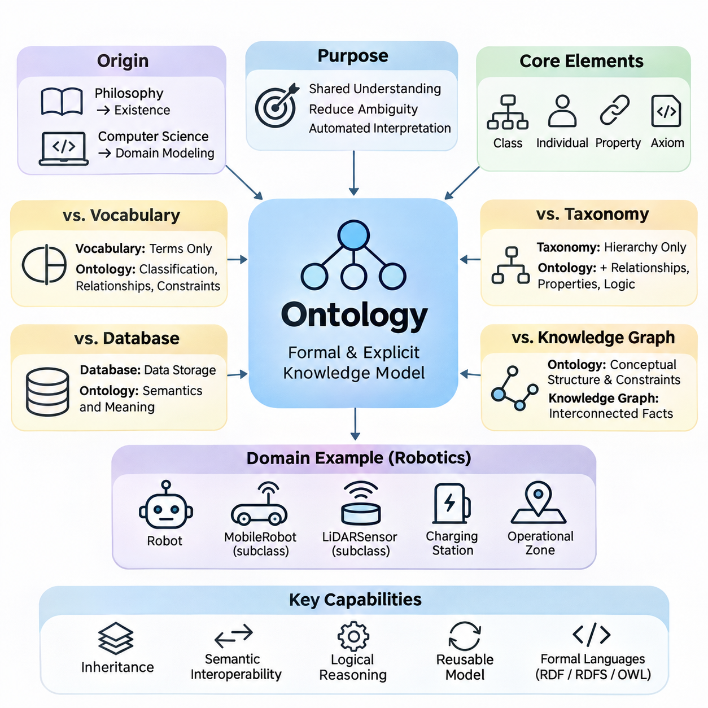
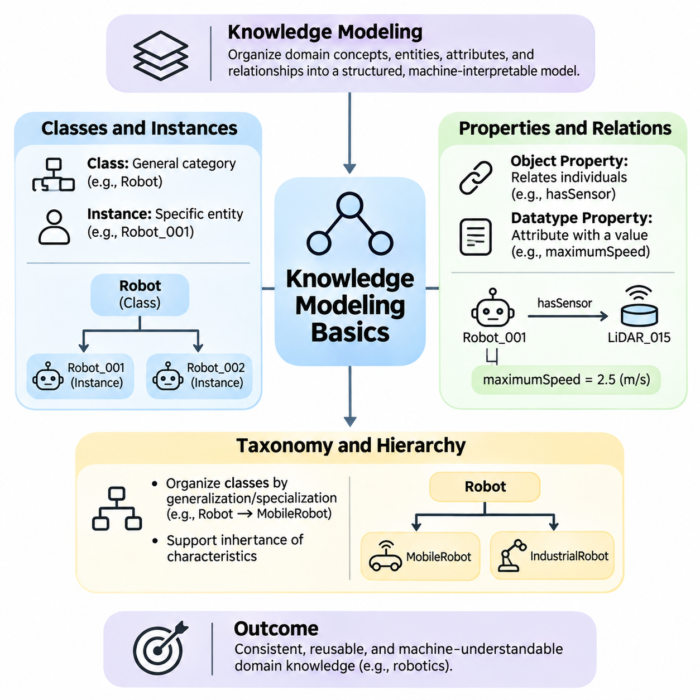
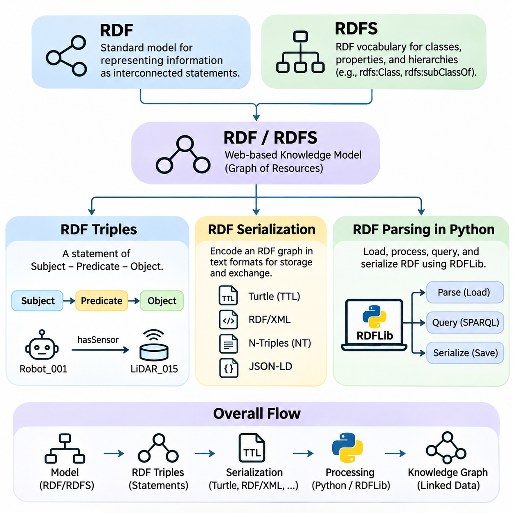
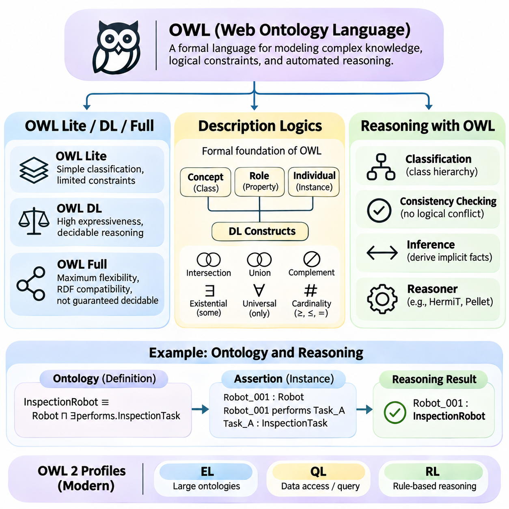
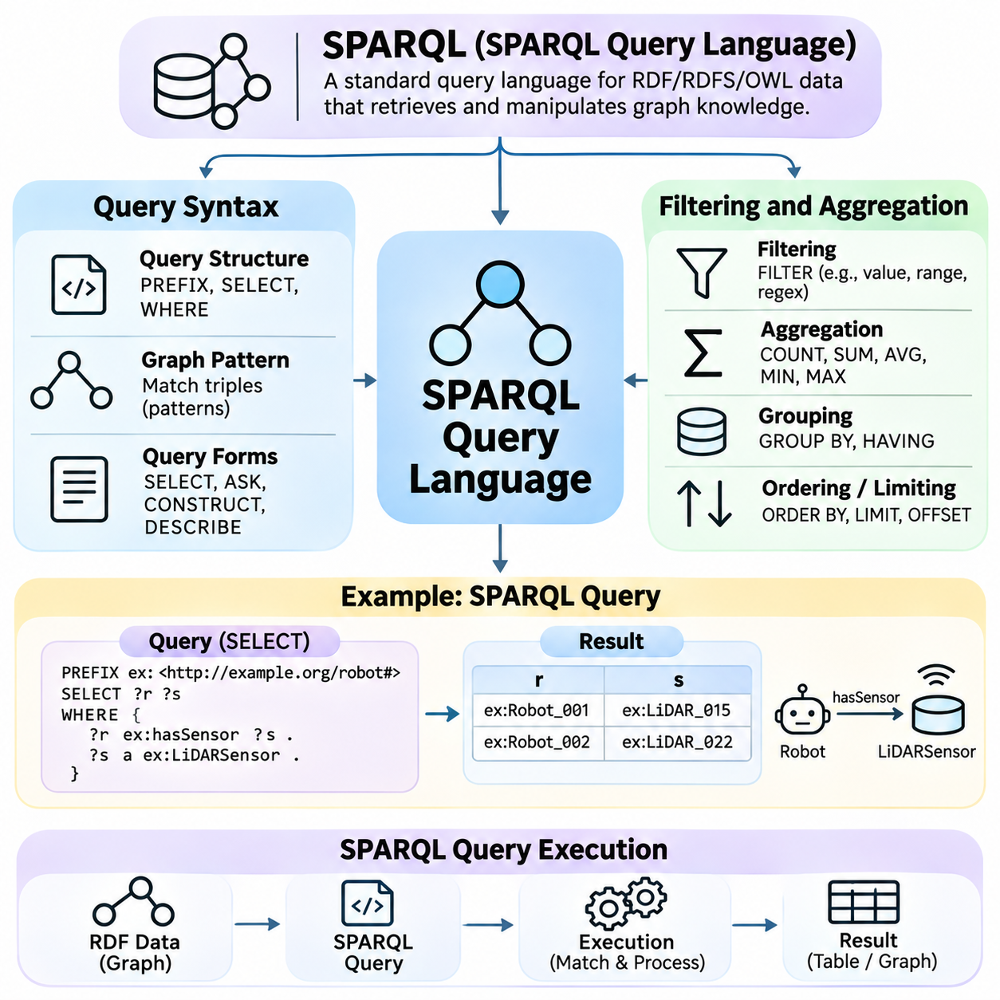
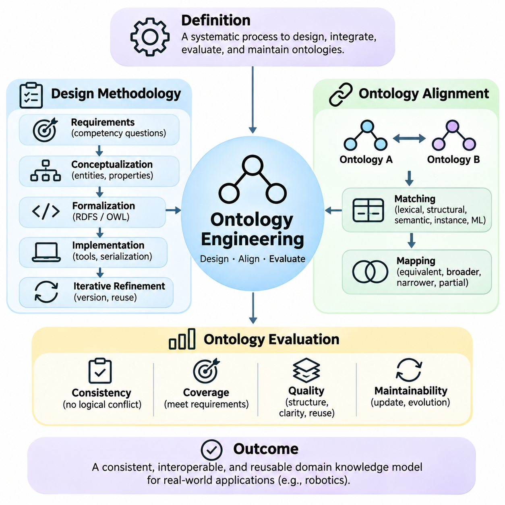
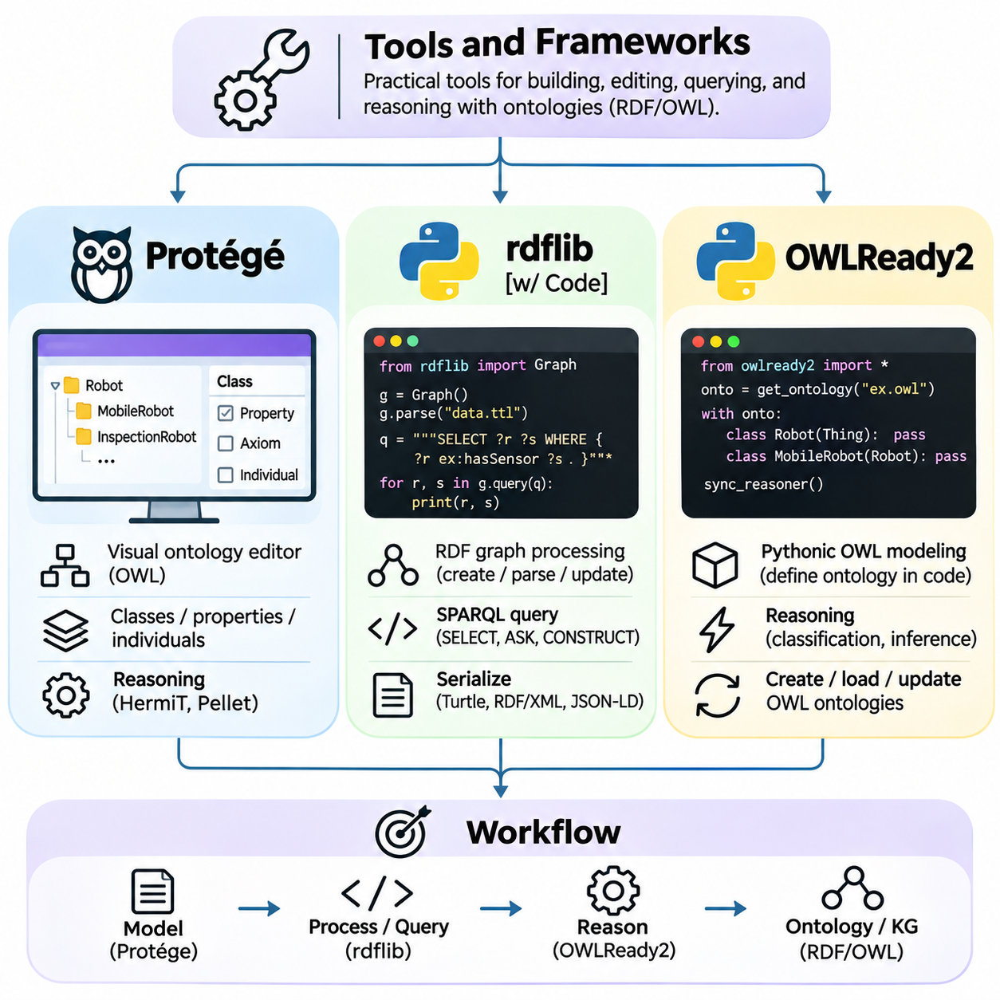
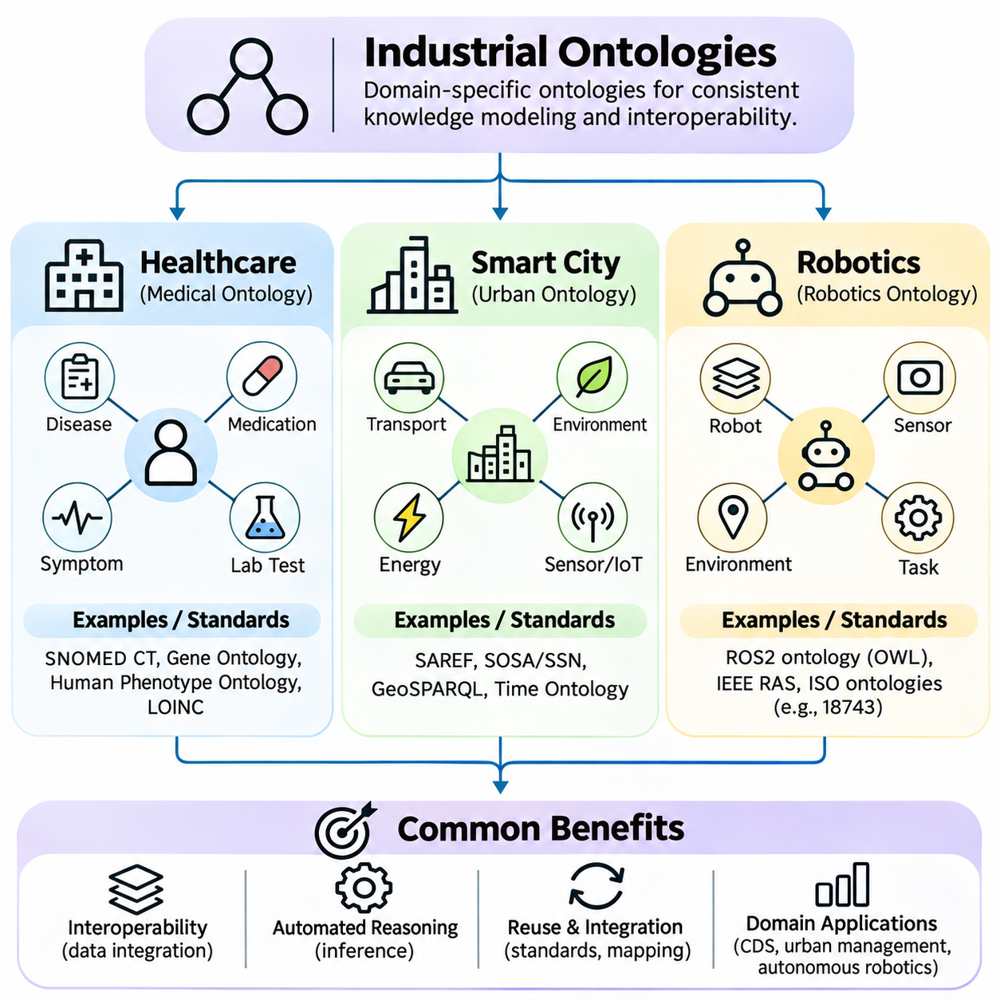
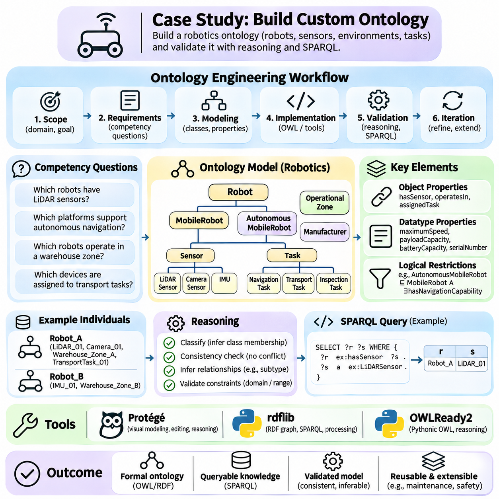

**Volume 02. Knowledge Representation**

# 02. Ontology

## 02.01 What is Ontology

{width="7.268055555555556in" height="7.268055555555556in"}

Ontology is a formal and explicit representation of knowledge that defines the concepts, relationships, and constraints within a particular domain. In artificial intelligence, an ontology provides a shared conceptual framework through which machines can interpret information consistently. Rather than storing isolated facts, it establishes the meaning of entities and the logical connections that organize them into a coherent knowledge structure.

The term ontology originates from philosophy, where it concerns the nature of existence and the categories of things that exist. In computer science, the concept has been adapted into a practical method for modeling domain knowledge. An engineering ontology, for example, may describe machines, components, sensors, operational processes, and their relationships, allowing different software systems to exchange information using consistent definitions.

An ontology differs from an ordinary vocabulary because it specifies more than the names of concepts. It describes how concepts are classified, which relationships are permitted, and what conditions must hold for particular statements to be meaningful. A vocabulary may identify the terms Robot, Sensor, and Environment, while an ontology can express that a robot contains sensors and that sensors observe properties of an environment.

The fundamental purpose of ontology is to make domain knowledge understandable to both humans and computational systems. Human communication frequently depends on implicit assumptions, contextual meanings, and specialized terminology. Machines cannot reliably interpret these assumptions without additional structure. Ontologies reduce ambiguity by assigning explicit meanings to concepts and establishing relationships that support automated interpretation.

A typical ontology contains classes, individuals, properties, and axioms. Classes represent categories of entities, while individuals represent particular members of those categories. Properties describe attributes or relationships, and axioms express logical conditions governing the domain. Together, these elements provide a formal representation that can support classification, consistency checking, and automated inference.

Consider an autonomous robotics environment containing mobile robots, navigation sensors, charging stations, and operational zones. An ontology can define MobileRobot as a subclass of Robot and LiDARSensor as a subclass of Sensor. It may also specify that robots operate within designated zones and use sensors for environmental perception. These definitions establish a reusable semantic foundation for robotic applications.

One important characteristic of ontology is the separation between conceptual knowledge and individual observations. The ontology defines general concepts and constraints, while instance data describes particular objects and events. For example, the ontology may define a temperature sensor and its measurement relationships, whereas operational data records that Sensor_01 measured a temperature of 35 degrees Celsius at a specific time.

Ontologies also support inheritance through hierarchical relationships. If an AutonomousMobileRobot is defined as a specialized type of MobileRobot, it can inherit relevant characteristics associated with the broader category. This organization reduces redundant definitions and enables systems to reason across multiple abstraction levels. However, inheritance must follow the formal semantics of the ontology language rather than informal assumptions.

Another essential capability is semantic interoperability, which allows independent systems to exchange information without losing its intended meaning. Different organizations may use distinct database structures or terminology for similar concepts. A shared ontology can establish common definitions and mappings, enabling information from heterogeneous sources to be interpreted within a consistent conceptual framework.

Ontology-based knowledge representation is closely related to formal logic. Logical expressions provide the foundation for defining relationships, restrictions, and implications among concepts. For instance, an ontology may specify that every inspection robot is a robot or that two categories are mutually exclusive. A reasoning engine can evaluate such statements and derive consequences that follow from the available definitions and assertions.

Unlike conventional databases, ontologies are primarily concerned with the semantics of information rather than its physical storage arrangement. Relational databases organize records into tables and enforce structural constraints, while ontologies describe domain meaning and logical relationships. These technologies are complementary because database records can be mapped to ontology concepts, enabling semantic reasoning over operational information.

Ontologies are also distinct from taxonomies, although taxonomies frequently form part of an ontology. A taxonomy primarily organizes concepts through hierarchical classification, such as Vehicle, GroundVehicle, and AutonomousVehicle. An ontology extends this organization by describing additional relationships, properties, restrictions, and logical conditions that characterize how entities interact within the modeled domain.

The distinction between ontology and knowledge graph is equally important. An ontology defines conceptual structures and semantic constraints, while a knowledge graph represents interconnected entities and relationships, often using ontology-defined vocabulary. A knowledge graph may contain thousands of robots, facilities, and operational events, whereas its ontology specifies the categories and relationships through which those facts are interpreted.

Formal ontology languages make these conceptual models computationally accessible. The Resource Description Framework provides a graph-based model for expressing statements, while RDF Schema introduces basic mechanisms for defining classes and properties. The Web Ontology Language extends these capabilities with richer logical constructs, allowing more sophisticated descriptions of classes, relationships, and constraints.

Ontology reasoning can identify implicit knowledge that was not explicitly recorded. If every InspectionRobot is classified as a Robot and Robot_17 is identified as an InspectionRobot, a reasoner can infer that Robot_17 is also a Robot. Depending on the ontology language and its logical semantics, reasoning systems may also detect contradictions, classify concepts, and determine whether particular relationships logically follow from existing assertions.

An important consideration is the open-world assumption commonly used in ontology-based reasoning. Under this assumption, the absence of a statement does not necessarily imply that the statement is false. If a robot has no recorded charging station, the system cannot automatically conclude that no charging station exists. This differs from many conventional database applications that interpret missing records using closed-world operational assumptions.

Ontology design therefore requires careful attention to the distinction between logical inference and data validation. A formal restriction does not always behave like a database integrity constraint. For example, a minimum-cardinality requirement may imply the existence of an unspecified related entity rather than immediately report missing data. Separate validation mechanisms may be necessary when applications require explicit completeness checks.

The development of an ontology begins with identifying the domain, its intended users, and the questions the knowledge model must answer. Engineers determine which concepts are essential, how those concepts relate, and which distinctions are operationally meaningful. A well-designed ontology should be sufficiently expressive to represent important domain knowledge without introducing unnecessary complexity that increases maintenance and reasoning costs.

Domain experts play a critical role because ontology quality depends on the accuracy of its conceptual assumptions. Software engineers may understand formal representation languages, but specialized knowledge is needed to determine whether the modeled relationships reflect real-world practices. Collaboration between domain experts and knowledge engineers helps establish definitions that are technically precise, practically useful, and understandable across organizational boundaries.

Ontologies are particularly valuable in industrial environments where information originates from heterogeneous machines, sensors, control systems, and enterprise applications. A manufacturing ontology can connect equipment specifications, production operations, maintenance records, and quality measurements. This semantic integration supports equipment monitoring, fault analysis, operational planning, and the consistent interpretation of information across engineering systems.

In healthcare, ontologies support standardized representations of medical concepts, clinical observations, procedures, and relationships among healthcare entities. In smart cities, they can describe transportation infrastructure, environmental sensors, public facilities, and urban services. In robotics, they provide structured representations of robot capabilities, spatial relationships, operational tasks, and environmental objects.

Modern artificial intelligence systems can also combine ontologies with machine learning and large language models. Neural models are effective at extracting patterns from unstructured data, while ontologies provide explicit conceptual definitions and logical constraints. Integrating these approaches can improve semantic grounding, support structured information retrieval, and enable certain forms of verifiable reasoning, although correctness depends on the underlying knowledge and integration methods.

Ontology-based systems nevertheless face practical limitations. Building accurate conceptual models requires substantial domain expertise, and large ontologies can become difficult to maintain. Conflicting definitions, incomplete knowledge, evolving terminology, and computationally expensive reasoning may reduce their effectiveness. Successful implementations therefore balance semantic expressiveness, reasoning requirements, interoperability, and operational scalability.

Ultimately, ontology provides a foundation for transforming disconnected information into structured, interpretable knowledge. Its value lies not merely in organizing terminology but in establishing explicit meanings that support communication, integration, and logical inference. As artificial intelligence systems become increasingly interconnected, ontologies remain an important mechanism for connecting symbolic knowledge representation with data-driven intelligence and real-world applications.

Ontology is a formal and explicit representation of knowledge that defines the concepts, relationships, and constraints within a particular domain. In artificial intelligence, an ontology provides a shared conceptual framework through which machines can interpret information consistently. Rather than storing isolated facts, it establishes the meaning of entities and the logical connections that organize them into a coherent knowledge structure.

The term ontology originates from philosophy, where it concerns the nature of existence and the categories of things that exist. In computer science, the concept has been adapted into a practical method for modeling domain knowledge. An engineering ontology, for example, may describe machines, components, sensors, operational processes, and their relationships, allowing different software systems to exchange information using consistent definitions.

An ontology differs from an ordinary vocabulary because it specifies more than the names of concepts. It describes how concepts are classified, which relationships are permitted, and what conditions must hold for particular statements to be meaningful. A vocabulary may identify the terms Robot, Sensor, and Environment, while an ontology can express that a robot contains sensors and that sensors observe properties of an environment.

The fundamental purpose of ontology is to make domain knowledge understandable to both humans and computational systems. Human communication frequently depends on implicit assumptions, contextual meanings, and specialized terminology. Machines cannot reliably interpret these assumptions without additional structure. Ontologies reduce ambiguity by assigning explicit meanings to concepts and establishing relationships that support automated interpretation.

A typical ontology contains classes, individuals, properties, and axioms. Classes represent categories of entities, while individuals represent particular members of those categories. Properties describe attributes or relationships, and axioms express logical conditions governing the domain. Together, these elements provide a formal representation that can support classification, consistency checking, and automated inference.

Consider an autonomous robotics environment containing mobile robots, navigation sensors, charging stations, and operational zones. An ontology can define MobileRobot as a subclass of Robot and LiDARSensor as a subclass of Sensor. It may also specify that robots operate within designated zones and use sensors for environmental perception. These definitions establish a reusable semantic foundation for robotic applications.

One important characteristic of ontology is the separation between conceptual knowledge and individual observations. The ontology defines general concepts and constraints, while instance data describes particular objects and events. For example, the ontology may define a temperature sensor and its measurement relationships, whereas operational data records that Sensor_01 measured a temperature of 35 degrees Celsius at a specific time.

Ontologies also support inheritance through hierarchical relationships. If an AutonomousMobileRobot is defined as a specialized type of MobileRobot, it can inherit relevant characteristics associated with the broader category. This organization reduces redundant definitions and enables systems to reason across multiple abstraction levels. However, inheritance must follow the formal semantics of the ontology language rather than informal assumptions.

Another essential capability is semantic interoperability, which allows independent systems to exchange information without losing its intended meaning. Different organizations may use distinct database structures or terminology for similar concepts. A shared ontology can establish common definitions and mappings, enabling information from heterogeneous sources to be interpreted within a consistent conceptual framework.

Ontology-based knowledge representation is closely related to formal logic. Logical expressions provide the foundation for defining relationships, restrictions, and implications among concepts. For instance, an ontology may specify that every inspection robot is a robot or that two categories are mutually exclusive. A reasoning engine can evaluate such statements and derive consequences that follow from the available definitions and assertions.

Unlike conventional databases, ontologies are primarily concerned with the semantics of information rather than its physical storage arrangement. Relational databases organize records into tables and enforce structural constraints, while ontologies describe domain meaning and logical relationships. These technologies are complementary because database records can be mapped to ontology concepts, enabling semantic reasoning over operational information.

Ontologies are also distinct from taxonomies, although taxonomies frequently form part of an ontology. A taxonomy primarily organizes concepts through hierarchical classification, such as Vehicle, GroundVehicle, and AutonomousVehicle. An ontology extends this organization by describing additional relationships, properties, restrictions, and logical conditions that characterize how entities interact within the modeled domain.

The distinction between ontology and knowledge graph is equally important. An ontology defines conceptual structures and semantic constraints, while a knowledge graph represents interconnected entities and relationships, often using ontology-defined vocabulary. A knowledge graph may contain thousands of robots, facilities, and operational events, whereas its ontology specifies the categories and relationships through which those facts are interpreted.

Formal ontology languages make these conceptual models computationally accessible. The Resource Description Framework provides a graph-based model for expressing statements, while RDF Schema introduces basic mechanisms for defining classes and properties. The Web Ontology Language extends these capabilities with richer logical constructs, allowing more sophisticated descriptions of classes, relationships, and constraints.

Ontology reasoning can identify implicit knowledge that was not explicitly recorded. If every InspectionRobot is classified as a Robot and Robot_17 is identified as an InspectionRobot, a reasoner can infer that Robot_17 is also a Robot. Depending on the ontology language and its logical semantics, reasoning systems may also detect contradictions, classify concepts, and determine whether particular relationships logically follow from existing assertions.

An important consideration is the open-world assumption commonly used in ontology-based reasoning. Under this assumption, the absence of a statement does not necessarily imply that the statement is false. If a robot has no recorded charging station, the system cannot automatically conclude that no charging station exists. This differs from many conventional database applications that interpret missing records using closed-world operational assumptions.

Ontology design therefore requires careful attention to the distinction between logical inference and data validation. A formal restriction does not always behave like a database integrity constraint. For example, a minimum-cardinality requirement may imply the existence of an unspecified related entity rather than immediately report missing data. Separate validation mechanisms may be necessary when applications require explicit completeness checks.

The development of an ontology begins with identifying the domain, its intended users, and the questions the knowledge model must answer. Engineers determine which concepts are essential, how those concepts relate, and which distinctions are operationally meaningful. A well-designed ontology should be sufficiently expressive to represent important domain knowledge without introducing unnecessary complexity that increases maintenance and reasoning costs.

Domain experts play a critical role because ontology quality depends on the accuracy of its conceptual assumptions. Software engineers may understand formal representation languages, but specialized knowledge is needed to determine whether the modeled relationships reflect real-world practices. Collaboration between domain experts and knowledge engineers helps establish definitions that are technically precise, practically useful, and understandable across organizational boundaries.

Ontologies are particularly valuable in industrial environments where information originates from heterogeneous machines, sensors, control systems, and enterprise applications. A manufacturing ontology can connect equipment specifications, production operations, maintenance records, and quality measurements. This semantic integration supports equipment monitoring, fault analysis, operational planning, and the consistent interpretation of information across engineering systems.

In healthcare, ontologies support standardized representations of medical concepts, clinical observations, procedures, and relationships among healthcare entities. In smart cities, they can describe transportation infrastructure, environmental sensors, public facilities, and urban services. In robotics, they provide structured representations of robot capabilities, spatial relationships, operational tasks, and environmental objects.

Modern artificial intelligence systems can also combine ontologies with machine learning and large language models. Neural models are effective at extracting patterns from unstructured data, while ontologies provide explicit conceptual definitions and logical constraints. Integrating these approaches can improve semantic grounding, support structured information retrieval, and enable certain forms of verifiable reasoning, although correctness depends on the underlying knowledge and integration methods.

Ontology-based systems nevertheless face practical limitations. Building accurate conceptual models requires substantial domain expertise, and large ontologies can become difficult to maintain. Conflicting definitions, incomplete knowledge, evolving terminology, and computationally expensive reasoning may reduce their effectiveness. Successful implementations therefore balance semantic expressiveness, reasoning requirements, interoperability, and operational scalability.

Ultimately, ontology provides a foundation for transforming disconnected information into structured, interpretable knowledge. Its value lies not merely in organizing terminology but in establishing explicit meanings that support communication, integration, and logical inference. As artificial intelligence systems become increasingly interconnected, ontologies remain an important mechanism for connecting symbolic knowledge representation with data-driven intelligence and real-world applications.

## 02.02 Knowledge Modeling Basics

{width="7.268055555555556in" height="7.268055555555556in"}

Knowledge modeling is the process of organizing domain concepts, individual entities, attributes, and relationships into a structured representation that computational systems can interpret. In ontology engineering, this process establishes the conceptual foundation for describing what exists within a domain and how its elements interact. Classes, instances, properties, and taxonomic hierarchies provide the essential building blocks for constructing consistent and reusable knowledge models.

A knowledge model differs from an ordinary collection of records because it explicitly describes the meaning and organization of information. Instead of merely storing that a robot has a sensor, the model defines what constitutes a robot, what qualifies as a sensor, and how these entities may be related. This semantic structure enables information integration, automated classification, logical inference, and consistent interpretation across different applications.

Classes represent general categories of entities that share common characteristics or satisfy particular definitions. A class such as Robot describes a conceptual category rather than one physical machine. More specialized classes, including MobileRobot, IndustrialRobot, and InspectionRobot, represent narrower categories. Classes provide reusable abstractions that allow knowledge engineers to describe large collections of entities without defining every characteristic separately.

Instances, also called individuals, represent specific entities belonging to one or more classes. Robot_001 may represent a particular autonomous mobile robot operating inside a warehouse, while Sensor_015 identifies a specific LiDAR device installed on that machine. The relationship between an instance and its class is called class membership. This distinction separates general conceptual definitions from concrete entities represented within a knowledge base.

An individual may belong to multiple classes when the ontology permits overlapping classifications. For example, Robot_001 could simultaneously be an instance of MobileRobot and InspectionEquipment. Such membership does not necessarily imply that these classes are identical or hierarchically related. Ontology modeling therefore supports flexible classification structures that reflect the multiple functional roles and characteristics of real-world entities.

Classes can be defined through explicit membership assertions or logical conditions. A knowledge engineer may directly classify Robot_001 as an AutonomousRobot, or define a class using conditions that a reasoning engine can evaluate. In expressive ontology languages, equivalent-class definitions can establish necessary and sufficient conditions for membership, enabling automated classification when the available assertions logically satisfy those conditions.

The distinction between classes and instances is fundamental to avoiding modeling errors. A class describes a category, whereas an instance denotes an entity represented as a member of that category. Robot is ordinarily modeled as a class, while Robot_001 is an individual. However, some ontology languages support metamodeling, allowing resources to participate in more than one modeling role under specific semantic interpretations.

Properties describe characteristics of entities and relationships between them. In ontology engineering, properties are commonly divided into object properties and datatype properties. Object properties connect individuals to other individuals, while datatype properties associate individuals with literal values. This distinction allows knowledge models to represent both structural relationships and measurable attributes within a unified semantic framework.

An object property such as hasSensor can connect Robot_001 to LiDAR_015, expressing that a particular robot is associated with a particular sensor. Other object properties may describe locatedIn, controlledBy, connectedTo, or performsTask relationships. These relationships transform isolated entities into interconnected knowledge structures and enable systems to navigate dependencies, functional associations, and operational contexts.

Datatype properties describe attributes whose values are represented using data types such as integers, decimal numbers, strings, and timestamps. A robot may have a maximumSpeed value of 2.5 meters per second, while a sensor may have a measurementRange value of 30 meters. The ontology can define the expected datatype, although measurement units often require additional modeling conventions or explicit quantity representations.

Properties may also have domains and ranges that establish logical implications about the entities participating in relationships. If hasSensor has Robot as its domain and Sensor as its range, a reasoner can infer that the subject belongs to Robot and the object belongs to Sensor. In OWL, these declarations are logical axioms rather than ordinary database-style validation rules that automatically reject incorrectly typed records.

Ontology languages support additional property characteristics that influence reasoning behavior. A transitive relationship can propagate across chains of connected entities, while a symmetric relationship applies in both directions. Inverse properties express complementary relationships, and functional properties restrict the number of distinct values associated with a subject under the relevant logical semantics.

For example, if locatedWithin is transitive, an object located within a room that is located within a building may also be inferred to be located within that building. If connectedTo is symmetric, a connection asserted from Device_A to Device_B implies the reverse connection. Such characteristics must be selected carefully because inappropriate declarations can produce unintended logical consequences or inaccurate domain interpretations.

Relationships may require more complex representations when they involve multiple participants, changing conditions, or contextual information. A maintenance event, for example, may involve a robot, technician, maintenance procedure, timestamp, and outcome. Representing the event as an individual allows these elements to be connected through separate properties, preserving contextual details that a simple binary relationship cannot adequately express.

Taxonomy refers to the systematic classification of concepts into categories and subcategories. In ontology modeling, taxonomic relationships commonly express subclass hierarchies in which specialized classes are included within broader classes. For example, AutonomousMobileRobot may be a subclass of MobileRobot, which is itself a subclass of Robot. This structure organizes domain concepts according to their logical generality and specialization.

Subclass relationships support inheritance of logical characteristics. If every MobileRobot is a Robot and every AutonomousMobileRobot is a MobileRobot, then every AutonomousMobileRobot is also a Robot. This conclusion follows from the transitivity of class inclusion. A reasoning engine can use these relationships to infer additional class memberships without requiring knowledge engineers to explicitly repeat every classification assertion.

A taxonomy is not necessarily a simple tree. A class may have multiple parent classes when its definition belongs to several broader categories. For example, AutonomousInspectionRobot could be a subclass of both AutonomousRobot and InspectionEquipment. This multiple-inheritance structure creates a directed hierarchy that may contain several paths between concepts while preserving the logical relationships among their definitions.

Taxonomic modeling requires distinguishing subclass relationships from part-whole relationships. A LiDARSensor may be a subclass of Sensor because every LiDAR sensor is a sensor, but a LiDARSensor is not a subclass of Robot merely because robots may contain LiDAR sensors. Component relationships should instead be represented through properties such as hasComponent or partOf, preserving the difference between classification and composition.

Ontology hierarchies can also include disjointness constraints that specify when classes cannot share members. For example, a carefully defined domain may declare PhysicalDevice and SoftwareProcess disjoint if their intended interpretations are mutually exclusive. Such declarations support consistency checking by allowing a reasoner to detect contradictions when an individual is logically required to belong to incompatible classes.

A well-designed hierarchy balances abstraction and specificity. Excessively broad categories provide limited semantic discrimination, while overly specialized categories increase modeling complexity and maintenance requirements. Knowledge engineers should introduce subclasses when meaningful conceptual differences affect reasoning, information retrieval, or application behavior, rather than creating separate classes for every minor variation in recorded data.

Taxonomy development often begins with identifying high-level domain concepts and progressively refining them into specialized categories. In a robotics ontology, these concepts may include PhysicalEntity, Agent, Device, Environment, and Task. Specialized categories can then represent mobile platforms, manipulation devices, perception sensors, navigation tasks, and operational environments according to the requirements of the intended applications.

The combination of classes, instances, properties, and taxonomic hierarchies establishes a semantic model that can be populated with operational information. Classes define conceptual categories, instances identify concrete entities, properties express relationships and attributes, and hierarchies organize generalization. Together, these structures enable consistent knowledge representation while providing the foundation for more expressive logical constraints.

Knowledge modeling also requires attention to naming conventions, identity management, and semantic consistency. Different systems may assign different identifiers to the same physical entity, or use identical terms for distinct concepts. Stable identifiers, explicit definitions, and carefully managed mappings reduce ambiguity. Ontology engineers must also distinguish between identical individuals, equivalent classes, and merely related concepts.

In practical applications, knowledge models evolve as new devices, processes, and organizational requirements emerge. Adding a new sensor type may require extending an existing taxonomy, while introducing a new operational workflow may require additional properties or event classes. Changes should preserve intended semantics and be evaluated for their effects on existing assertions, queries, integrations, and reasoning results.

Effective ontology modeling therefore involves more than constructing a classification hierarchy. It requires identifying domain boundaries, defining meaningful abstractions, representing relationships accurately, and ensuring that logical assumptions reflect the intended interpretation of real-world entities. The resulting model provides a structured foundation for semantic interoperability, knowledge graph construction, automated reasoning, and intelligent system integration.

Ultimately, classes and instances establish what kinds of entities exist and which particular entities are represented, while properties and relations describe how those entities are characterized and connected. Taxonomies organize these concepts into logical hierarchies that support classification and inference. Their coordinated use transforms fragmented information into a coherent knowledge structure suitable for advanced artificial intelligence applications.

## 02.03 RDF and RDFS

{width="7.268055555555556in" height="7.268055555555556in"}

The Resource Description Framework, commonly known as RDF, is a standard model for representing information as interconnected statements. Developed within the World Wide Web Consortium ecosystem, RDF provides a foundation for exchanging structured knowledge across applications and organizations. Its central principle is that information can be expressed through relationships between identifiable resources, creating a graph-based representation of domain knowledge.

RDF Schema, abbreviated as RDFS, extends RDF by introducing a basic vocabulary for describing classes, properties, and hierarchical relationships. RDF provides the underlying data model, while RDFS supplies semantic constructs that help interpret the meaning of statements. Together, they enable knowledge engineers to describe entities, organize conceptual categories, and support elementary forms of logical inference.

The fundamental unit of RDF representation is the triple, consisting of a subject, predicate, and object. The subject identifies the resource being described, the predicate specifies a relationship or attribute, and the object represents the corresponding value or related resource. This structure resembles a simple declarative sentence and provides a consistent mechanism for expressing facts independently of particular database schemas.

Consider a robotics knowledge base containing the statement that Robot_001 hasSensor LiDAR_015. Robot_001 is the subject, hasSensor is the predicate, and LiDAR_015 is the object. Another statement may express that LiDAR_015 hasManufacturer SensorCompany. By combining such triples, the system constructs a connected graph describing robots, components, manufacturers, and operational relationships.

RDF subjects are identified by Internationalized Resource Identifiers or represented as blank nodes. Predicates are IRIs, while objects may be IRIs, blank nodes, or literals. IRIs provide globally interpretable identifiers that help distinguish resources across distributed systems. Blank nodes represent resources without explicit global identifiers, while literals express values such as names, numerical measurements, and timestamps.

Literal values may include datatypes or language tags that clarify their interpretation. For example, a sensor measurement can be represented as a decimal value, while a descriptive label may carry an English language tag. Typed literals distinguish numerical values from ordinary strings and allow applications to interpret data more precisely. However, RDF itself does not automatically define measurement units or enforce application-specific validation rules.

An RDF graph is a set of triples whose subjects and objects form nodes connected by predicate-labeled edges. Multiple statements about the same resource naturally combine into a connected representation. This graph structure is particularly useful when information contains many interconnected relationships, such as equipment dependencies, organizational structures, geographic associations, or semantic links between scientific concepts.

RDFS introduces vocabulary elements such as rdfs:Class, rdfs:subClassOf, rdfs:subPropertyOf, rdfs:domain, and rdfs:range. These constructs describe how resources and properties are organized conceptually. For example, MobileRobot can be declared a subclass of Robot, allowing an RDFS reasoner to infer that an individual classified as MobileRobot also belongs to the broader Robot class.

Domain and range declarations in RDFS provide additional inferential meaning. If the hasSensor property has Robot as its domain and Sensor as its range, an RDF statement connecting Robot_001 to LiDAR_015 through hasSensor supports the inference that Robot_001 is a Robot and LiDAR_015 is a Sensor. These declarations are semantic rules rather than conventional database constraints that reject records violating expected types.

RDFS also supports property hierarchies through rdfs:subPropertyOf. For example, hasLiDARSensor may be declared a subproperty of hasSensor. Consequently, a statement asserting that a robot hasLiDARSensor LiDAR_015 also entails the more general relationship hasSensor LiDAR_015. Such inference mechanisms enable applications to retrieve and interpret information across different levels of semantic specificity.

Although RDFS supports fundamental classification and inheritance, its expressive power is limited compared with more advanced ontology languages. It does not directly provide the full range of cardinality restrictions, class disjointness declarations, or complex class expressions available in OWL. RDFS is therefore appropriate for relatively lightweight semantic models, while applications requiring richer logical constraints may benefit from more expressive representations.

RDF serialization refers to the process of encoding RDF graphs into textual or binary formats suitable for storage, transmission, and processing. Because RDF is an abstract data model, the same graph can be represented using different serialization syntaxes. These formats may differ substantially in readability, compactness, and processing convenience while preserving equivalent RDF statements when interpreted correctly.

Turtle is a widely used RDF serialization format designed for concise and human-readable graph descriptions. It supports namespace prefixes, abbreviated resource identifiers, and compact notation for multiple statements sharing a subject. Turtle is particularly convenient for ontology development, documentation, and manual inspection because its syntax closely reflects the subject-predicate-object structure of RDF.

RDF/XML represents RDF information using XML syntax and was historically important in Semantic Web applications. Its hierarchical document structure can appear more complex than Turtle because RDF graphs do not necessarily correspond naturally to XML trees. Nevertheless, RDF/XML remains useful when interoperability with XML-based systems or established RDF processing environments is required.

N-Triples provides a simpler line-oriented serialization in which each statement is written as a separate triple using explicit identifiers and standardized syntax. Its straightforward structure supports streaming, debugging, and large-scale data processing. N-Quads extends this approach by including graph identifiers, allowing statements to be associated with named graphs within an RDF dataset.

JSON-LD expresses linked data using JSON-compatible structures and is particularly useful for web applications and API integration. It uses contextual definitions to associate JSON terms with semantic identifiers, allowing ordinary-looking JSON documents to represent RDF information. This approach enables developers to incorporate linked data into existing web technologies without abandoning familiar data interchange formats.

Serialization formats should not be confused with different knowledge representation models. Turtle, RDF/XML, N-Triples, and JSON-LD can describe the same underlying RDF graph despite their distinct syntactic structures. Converting between these formats generally preserves RDF semantics, although document ordering, prefix choices, blank-node identifiers, and formatting may change during transformation.

Python provides practical tools for creating, parsing, querying, and serializing RDF graphs. One commonly used library is RDFLib, which implements RDF graph structures and supports several standard serialization formats. RDFLib allows developers to load RDF documents, inspect triples, construct new statements, manage namespaces, and execute graph queries through a consistent programming interface.

An RDF parsing workflow in Python typically begins by creating a Graph object and loading a document using its parse method. The parser interprets the selected RDF syntax and populates the graph with triples. Developers can then iterate over subjects, predicates, and objects to examine the resulting statements. The parsing format may be specified explicitly or determined from available file metadata and parser capabilities.

After parsing, Python applications can filter triples by subject, predicate, or object to retrieve relevant knowledge. For example, an application may search for every sensor connected to Robot_001 or identify all resources classified as MobileRobot. RDFLib also supports SPARQL queries, providing a declarative mechanism for matching graph patterns and retrieving structured results from RDF datasets.

Python applications can construct RDF graphs programmatically by creating URIRef, Literal, and BNode objects and adding triples to a Graph instance. Namespace objects simplify the creation of consistent resource identifiers. Once constructed, the graph can be serialized into Turtle, RDF/XML, JSON-LD, or another supported format, allowing generated knowledge to be stored or exchanged with external systems.

A critical distinction exists between RDF parsing and semantic reasoning. Parsing converts serialized information into an RDF graph, but it does not necessarily calculate all consequences implied by RDFS declarations. Applications requiring inferred subclass memberships or property relationships must employ an appropriate reasoning mechanism or materialization process. This separation helps distinguish data ingestion from semantic interpretation.

Practical RDF processing also requires attention to malformed documents, invalid identifiers, datatype handling, and namespace consistency. Large graphs may introduce memory and performance challenges, particularly when processed entirely in memory. Production systems can address these concerns through streaming workflows, persistent graph stores, selective querying, and careful separation of parsing, validation, and reasoning operations.

In industrial artificial intelligence, RDF and RDFS provide a flexible foundation for integrating information from sensors, robots, manufacturing equipment, and enterprise databases. Python-based RDF processing can transform heterogeneous records into semantically connected resources, while RDFS establishes shared conceptual relationships. This combination supports knowledge graph development, semantic interoperability, and structured reasoning across increasingly complex intelligent systems.

## 02.04 OWL Web Ontology Language

{width="7.268055555555556in" height="7.268055555555556in"}

The Web Ontology Language, commonly known as OWL, is a formal knowledge representation language designed to describe complex concepts, relationships, and logical constraints within ontologies. Developed as a World Wide Web Consortium standard, OWL extends the semantic capabilities of RDF and RDFS. It enables machines to interpret structured knowledge, derive implicit relationships, and evaluate the logical consistency of conceptual models.

OWL provides a richer vocabulary than RDF Schema for describing classes, properties, individuals, and their logical relationships. While RDFS supports basic classification and property hierarchies, OWL introduces constructs such as class equivalence, disjointness, cardinality restrictions, and property characteristics. These capabilities allow knowledge engineers to represent domain rules with greater precision and support more sophisticated automated reasoning.

The original OWL specification introduced three language variants known as OWL Lite, OWL DL, and OWL Full. These variants were designed to accommodate different requirements for expressiveness, computational reasoning, and compatibility with RDF. Their distinctions reflect an important engineering tradeoff: more expressive knowledge representations can describe richer semantics, but may introduce greater computational complexity or weaken reasoning guarantees.

OWL Lite was designed for applications requiring relatively simple classification hierarchies and constrained property descriptions. It supports fundamental ontology constructs while restricting certain expressive features, including cardinality constraints to values of zero or one. Its intended applications included taxonomies and basic knowledge organization, although its limitations reduced its attractiveness for many practical ontology engineering tasks.

OWL DL was designed to provide substantial expressive power while retaining computational properties associated with decidable description logics. It supports complex class descriptions, logical restrictions, and automated classification under carefully defined modeling constraints. Decidability means that reasoning procedures can, in principle, terminate for supported reasoning problems, although practical computational costs may still be substantial.

OWL Full emphasizes compatibility with the expressive flexibility of RDF and RDF Schema. It permits forms of metamodeling and unrestricted combinations of vocabulary that are not allowed under the original OWL DL restrictions. This flexibility enables highly expressive representations but sacrifices general decidability guarantees. Consequently, complete automated reasoning over arbitrary OWL Full ontologies cannot be guaranteed to terminate.

The distinction between these original variants is important historically, but modern ontology engineering primarily uses OWL 2. OWL 2 extends the original language with additional modeling constructs and defines computationally useful profiles such as OWL 2 EL, OWL 2 QL, and OWL 2 RL. These profiles restrict particular language features to support efficient reasoning for different application requirements.

OWL 2 EL is designed for ontologies containing extensive class hierarchies and relationships, making it useful for large terminological knowledge bases. OWL 2 QL supports ontology-based data access and query rewriting over relational databases. OWL 2 RL emphasizes rule-oriented reasoning that can be implemented using rule-based technologies. Each profile provides a different balance between expressiveness and computational efficiency.

The theoretical foundation of OWL reasoning is closely connected to description logics, a family of formal knowledge representation languages derived from mathematical logic. Description logics provide precise semantics for defining concepts, relationships, and individuals. They are particularly suitable for representing structured domain knowledge because they combine class-based modeling with formally specified reasoning operations.

Description logics commonly distinguish between concepts, roles, and individuals. Concepts correspond approximately to ontology classes, roles represent binary relationships, and individuals denote particular entities. A robotics ontology may define Robot and Sensor as concepts, hasSensor as a role, and Robot_001 as an individual. Logical expressions can then describe how these elements relate and which conditions characterize particular categories.

Description logic expressions support operations such as intersection, union, complement, and quantified restrictions. For example, an InspectionRobot may be described as a Robot that performs at least one inspection task. A more restrictive definition may require every associated operational task to belong to an approved task category. Such expressions allow complex classifications to be constructed from simpler concepts and relationships.

Existential restrictions express that at least one relationship of a specified kind exists, while universal restrictions constrain all values associated with a relationship. For example, a robot with some sensor belonging to LiDARSensor satisfies an existential sensor restriction. A universal restriction can specify that all sensors connected through a particular property belong to an approved sensor class.

Cardinality restrictions express numerical conditions on property relationships. A class may require at least two distinct sensor components or at most one primary controller. These restrictions describe logical constraints on the number of related individuals, rather than directly counting database records. Under open-world semantics, missing information does not automatically establish that a cardinality requirement has been violated.

Description logics also distinguish between terminological knowledge and assertional knowledge. The terminological component, commonly called the TBox, defines classes, relationships, and conceptual constraints. The assertional component, called the ABox, describes individuals and their memberships or relationships. Some formulations additionally distinguish an RBox containing role axioms, such as property hierarchies and characteristics.

Reasoning with OWL involves determining which conclusions logically follow from ontology axioms and individual assertions. A reasoner can infer class memberships, discover implicit subclass relationships, and determine whether concepts are satisfiable. It can also detect logical inconsistencies when the ontology contains assertions that cannot simultaneously hold under the selected semantics.

Ontology consistency checking determines whether the complete knowledge base admits at least one valid interpretation. If an individual is asserted to belong to two disjoint classes, the ontology may become inconsistent. Class satisfiability checking addresses a related but distinct question: whether a particular class could possibly have an instance while satisfying all applicable logical constraints.

Automated classification computes implied relationships among classes and can reorganize an ontology hierarchy according to its logical definitions. For example, if every AutonomousInspectionRobot necessarily satisfies the definition of InspectionRobot, a reasoner can infer the corresponding subclass relationship. This capability is valuable when complex ontologies contain relationships that are not immediately apparent from manually declared hierarchies.

OWL reasoning typically follows the open-world assumption, meaning that unknown information is not automatically considered false. If a robot has no explicitly recorded battery, a reasoner cannot conclude that the robot lacks a battery. Similarly, OWL generally does not assume that differently named individuals represent different entities unless their distinctness is established through appropriate axioms.

Several reasoning approaches are used to evaluate OWL ontologies, including tableau-based procedures, consequence-based reasoning, and rule-oriented implementations for restricted profiles. Different reasoners support different OWL fragments and optimization strategies. Tools such as HermiT, Pellet, and ELK illustrate how automated reasoning technologies can be applied to ontology classification and consistency analysis.

OWL reasoning is not equivalent to conventional procedural rule execution or database validation. Its conclusions are derived from formal logical semantics rather than arbitrary application instructions. A restriction may imply the existence of an unspecified entity instead of producing a missing-data error. Applications requiring explicit data completeness checks often combine OWL reasoning with validation technologies such as SHACL.

In industrial and robotic systems, OWL can describe equipment categories, component compatibility, operational capabilities, and environmental relationships. A reasoner may identify devices satisfying logically defined capability classes or detect contradictory equipment classifications. However, rapidly changing sensor measurements and real-time control constraints often require complementary data processing and control mechanisms outside the ontology reasoning layer.

Effective OWL engineering requires selecting an appropriate expressiveness level, defining consistent class semantics, and evaluating reasoning performance as the ontology grows. Excessive logical complexity can increase computational costs, while insufficient expressiveness may fail to capture important domain relationships. The objective is to construct knowledge models that remain understandable, maintainable, logically sound, and computationally practical.

Ultimately, OWL connects structured knowledge representation with formal logical inference. Its historical language variants illustrate the relationship between expressiveness and decidability, while description logics provide the mathematical foundation for precise semantic modeling. Through automated reasoning, OWL enables intelligent systems to classify knowledge, derive implicit facts, and verify conceptual consistency across interconnected domains.

## 02.05 SPARQL Query Language

{width="7.268055555555556in" height="7.268055555555556in"}

SPARQL is a standardized query language and protocol designed to retrieve and manipulate information represented in RDF graphs. Developed by the World Wide Web Consortium, SPARQL provides a declarative mechanism for identifying relationships among interconnected resources. Rather than navigating graph structures procedurally, developers describe patterns of information they want to retrieve, allowing query engines to determine how those patterns should be evaluated.

SPARQL plays a central role in semantic web technologies because RDF knowledge graphs frequently contain information distributed across multiple conceptual categories and relationships. A robotics knowledge graph, for example, may connect robots, sensors, operational zones, maintenance events, and equipment manufacturers. SPARQL enables applications to retrieve these connections without requiring the underlying information to be organized into conventional relational tables.

The fundamental structure of a SPARQL query consists of query forms, graph patterns, variables, and optional solution modifiers. Variables are commonly written with a question mark, such as ?robot or ?sensor, and represent values to be discovered during query evaluation. Triple patterns resemble RDF statements but may contain variables in place of concrete resources, allowing the query engine to identify matching combinations within a graph.

The SELECT query form retrieves variable bindings that satisfy specified graph patterns. A query may request all robots associated with LiDAR sensors by matching relationships between robot resources and sensor resources. The WHERE clause defines the graph patterns used for matching, while SELECT determines which variables appear in the result. This separation allows developers to express information requirements independently of storage implementation details.

SPARQL also supports ASK, CONSTRUCT, and DESCRIBE query forms. ASK determines whether at least one solution satisfies a graph pattern and returns a Boolean result. CONSTRUCT generates an RDF graph from matched data using a specified template. DESCRIBE returns an RDF description of selected resources, although the exact description produced depends on the implementation and available dataset.

Namespace declarations simplify the use of resource identifiers in SPARQL queries. The PREFIX keyword associates abbreviated names with full namespace IRIs, allowing developers to reference ontology classes and properties concisely. For example, a robotics namespace may define identifiers for Robot, Sensor, and hasSensor. Consistent namespace management improves readability and reduces errors when queries combine multiple ontologies.

Basic graph patterns consist of collections of triple patterns that must be satisfied together. When several patterns share a variable, SPARQL joins their compatible solution mappings to identify connected information. For example, one pattern may identify robots with sensors, while another identifies sensors manufactured by a particular company. Their shared sensor variable connects the relationships into a single query.

The OPTIONAL construct allows a query to retrieve additional information when available without eliminating resources that lack the optional relationship. A robot query may return all registered robots while including battery capacity only when that attribute is recorded. OPTIONAL therefore supports incomplete knowledge graphs and produces results containing unbound variables when optional patterns do not match.

Alternative graph structures can be expressed through UNION, which combines solutions from different graph patterns. A query may retrieve devices classified as either MobileRobot or IndustrialRobot without requiring both classifications. Property paths provide another expressive mechanism by allowing queries to traverse sequences of relationships, including hierarchical connections and repeated graph edges.

SPARQL supports filtering operations that restrict query results according to logical conditions. The FILTER construct can evaluate numerical comparisons, string expressions, Boolean combinations, and datatype-related conditions. For example, a query may retrieve robots whose maximum operating speed exceeds a specified threshold or sensors whose measurement range falls within an acceptable interval.

Filtering must account for RDF literal datatypes and the possibility of unbound variables. Numerical comparisons require compatible values, while string operations depend on the applicable expression semantics. The BOUND function can test whether a variable has an assigned value, which is particularly useful when OPTIONAL patterns are involved. Careful filtering prevents unexpected omissions or evaluation errors.

SPARQL provides functions for examining text, language tags, datatypes, and resource identifiers. Functions such as STR, LANG, DATATYPE, and REGEX support common semantic data processing requirements. A multilingual knowledge graph may use language filters to retrieve English descriptions, while regular expressions can identify labels matching a particular textual pattern.

Aggregation enables SPARQL to summarize groups of matching solutions rather than returning every individual binding. Common aggregate functions include COUNT, SUM, AVG, MIN, MAX, GROUP_CONCAT, and SAMPLE. These operations support analytical questions such as determining the number of robots in each facility, calculating average sensor measurements, or identifying the highest recorded equipment temperature.

The GROUP BY clause organizes solution mappings according to selected variables or expressions, allowing aggregate functions to operate over each group. A robotics query may group devices by operational zone and count the number of registered robots in each location. HAVING applies conditions to grouped results, enabling queries to retain only zones whose robot counts exceed a specified threshold.

Result ordering and pagination are controlled through ORDER BY, LIMIT, and OFFSET. ORDER BY sorts solutions according to specified expressions, while LIMIT restricts the number of returned results. OFFSET skips a designated number of solutions before returning subsequent entries. These features support reporting interfaces and incremental result retrieval, although stable pagination generally requires deterministic ordering.

DISTINCT removes duplicate projected solution rows from SELECT results, while REDUCED permits implementations to eliminate some duplicates without requiring complete duplicate removal. This distinction matters because graph pattern matching can generate repeated bindings through different relationship paths. Selecting the appropriate modifier helps control result interpretation and may influence query processing costs.

SPARQL queries operate over RDF datasets that may contain a default graph and multiple named graphs. The GRAPH keyword allows patterns to target a named graph, while dataset clauses can define which graphs participate in evaluation. Named graphs are useful for organizing information by source, operational context, or data collection, although graph names alone do not establish provenance guarantees.

SPARQL 1.1 introduces federated query capabilities through the SERVICE construct, allowing compatible query endpoints to participate in distributed information retrieval. A knowledge application may combine equipment information from one endpoint with manufacturer metadata from another. Federated execution requires attention to endpoint availability, network latency, access permissions, and differences in supported query features.

SPARQL query execution begins with parsing the query text and validating its syntactic structure. The query engine then translates graph patterns and expressions into an internal algebraic representation. Optimization may reorder compatible operations, select indexes, and reduce intermediate results. The execution plan determines how graph matching, joins, filters, aggregation, and result construction are performed.

Graph databases and RDF triple stores commonly maintain indexes over combinations of subjects, predicates, objects, and graph identifiers. These indexes accelerate pattern matching by reducing the number of statements examined during execution. Query performance depends on graph size, predicate selectivity, join ordering, available indexes, and the complexity of expressions or property paths.

Python applications can execute SPARQL queries using RDFLib, which provides a query method for evaluating SPARQL against an RDF graph. A typical workflow loads RDF data into a Graph object, defines a query string containing namespace declarations and graph patterns, and invokes the query method. Returned bindings can then be processed as Python objects or converted into application-specific data structures.

For larger knowledge bases, Python applications may communicate with dedicated SPARQL endpoints rather than loading entire graphs into memory. HTTP-based query requests can retrieve results in formats such as SPARQL Results JSON or XML. This architecture separates application logic from graph storage and allows multiple clients to access shared semantic data through standardized interfaces.

SPARQL 1.1 Update extends query capabilities with operations for inserting, deleting, and modifying RDF statements. INSERT DATA and DELETE DATA handle explicit triples, while more general update forms can modify data according to graph patterns. Production applications must manage authorization, concurrent modifications, and transactional behavior according to the capabilities of their RDF storage systems.

Effective SPARQL engineering requires attention to query correctness, semantic assumptions, and execution efficiency. Queries should distinguish explicitly stored statements from inferred knowledge because reasoning behavior depends on the graph store and its entailment configuration. Developers should also account for incomplete data, datatype compatibility, access restrictions, and the computational cost of complex joins.

Ultimately, SPARQL provides the operational interface through which RDF knowledge graphs become searchable and analytically useful. Its query syntax expresses semantic relationships, filtering and aggregation transform matched data into meaningful results, and execution engines evaluate graph patterns efficiently. Combined with RDF, RDFS, OWL, and Python-based applications, SPARQL supports scalable knowledge retrieval and integration across intelligent systems.

## 02.06 Ontology Engineering

{width="7.268055555555556in" height="7.268055555555556in"}

Ontology engineering is the systematic process of designing, constructing, integrating, evaluating, and maintaining formal representations of domain knowledge. It combines knowledge representation principles with software engineering practices to create conceptual models that are understandable to humans and computational systems. Effective ontology engineering emphasizes semantic precision, logical consistency, interoperability, and long-term maintainability across evolving applications.

An ontology engineering project begins by defining its purpose, domain boundaries, intended users, and operational requirements. Engineers identify the information that must be represented and the reasoning tasks the ontology should support. A robotics ontology, for example, may describe robot capabilities, sensor configurations, operational environments, and maintenance activities. Clear requirements prevent unnecessary complexity and guide subsequent modeling decisions.

Ontology design methodologies provide structured procedures for transforming domain knowledge into formal conceptual models. Established approaches such as METHONTOLOGY, NeOn, and Ontology Development 101 emphasize requirements analysis, conceptualization, formalization, implementation, and evaluation. Although their detailed workflows differ, these methodologies encourage iterative development, documentation, knowledge reuse, and collaboration between domain experts and ontology engineers.

Requirements specification frequently includes competency questions, which describe the information an ontology should be capable of answering. In an industrial robotics application, such questions might ask which robots support autonomous navigation, which sensors are installed on a particular platform, or which equipment requires maintenance. Competency questions connect conceptual modeling decisions to measurable application requirements.

Conceptualization identifies the principal entities, categories, properties, and relationships within the target domain. Engineers distinguish general concepts from individual instances and determine which relationships are essential for representing operational knowledge. During this stage, informal diagrams, terminology inventories, and domain documentation may help clarify assumptions before concepts are translated into formal ontology languages.

Formalization transforms conceptual descriptions into logically defined structures. Classes, object properties, datatype properties, subclass relationships, and restrictions are expressed using appropriate ontology constructs. RDF Schema may support lightweight classification, while OWL provides richer logical descriptions. The selected formalism should match the intended reasoning requirements without introducing unnecessary computational complexity.

Ontology implementation converts the formal model into machine-processable artifacts using tools and serialization formats such as OWL, Turtle, and RDF/XML. Development environments such as Protégé support interactive ontology editing, while programming libraries enable automated construction and integration. Implementation also requires consistent naming conventions, namespace management, stable identifiers, and documentation of modeling assumptions.

Ontology development is rarely a strictly linear process. New domain requirements, inconsistent definitions, or unexpected reasoning results may require revisions to earlier modeling decisions. Iterative engineering allows concepts, relationships, and axioms to be refined through repeated testing. Version control and change documentation help preserve traceability as the ontology evolves across development cycles and organizational boundaries.

Ontology reuse reduces development effort by incorporating established vocabularies and conceptual structures when appropriate. Widely adopted models may provide definitions for time, measurement, geographic relationships, or organizational entities. However, reuse requires examining the original semantics and licensing conditions. Importing an external ontology without understanding its assumptions can introduce unintended logical consequences or unnecessary dependencies.

Ontology alignment addresses the problem of identifying semantic correspondences between independently developed ontologies. Different organizations may describe similar concepts using different names, structures, or levels of abstraction. For example, one robotics ontology may define AutonomousMobileRobot, while another uses MobilePlatform. Alignment determines whether these concepts are equivalent, hierarchically related, or only partially overlapping.

Alignment is particularly important when integrating heterogeneous knowledge graphs, enterprise databases, and industrial information systems. Without semantic mappings, equivalent entities or relationships may remain disconnected across organizational boundaries. Ontology alignment establishes interpretable connections that support cross-system queries, information exchange, and coordinated reasoning while preserving the distinct conceptual assumptions of participating models.

Ontology matching techniques identify candidate correspondences using lexical, structural, semantic, and instance-based evidence. Lexical methods compare labels, synonyms, and descriptions, while structural methods examine neighboring classes and relationships. Semantic approaches may use background knowledge or logical definitions, and instance-based methods compare observed data associated with candidate concepts.

Modern ontology matching systems may incorporate machine learning, embeddings, and language models to estimate semantic similarity between concepts. These methods can discover relationships that simple string matching would miss, especially when terminology differs significantly. However, similarity scores do not establish logical equivalence. Candidate mappings require semantic verification before they are accepted as formal ontology relationships.

Alignment relationships may express equivalence, subsumption, or other forms of correspondence. Equivalent classes describe the same extension under the intended semantics, while subclass mappings indicate that one category is more specialized than another. Broader associative mappings may indicate conceptual relatedness without implying logical inclusion. Selecting an inappropriate mapping type can produce incorrect inferences across integrated ontologies.

Entity alignment is related to ontology alignment but addresses a different problem. Ontology alignment primarily connects conceptual structures, whereas entity alignment identifies individual resources that refer to the same real-world object. Two industrial systems may use different identifiers for one physical robot. Establishing identity requires reliable evidence because incorrectly merging distinct individuals can propagate errors throughout a knowledge graph.

Alignment workflows typically generate candidate mappings, evaluate their semantic compatibility, resolve conflicts, and publish accepted correspondences. Human experts remain important when terminology is ambiguous or operational definitions differ. Mapping provenance, confidence information, and version metadata support later review. Alignment should also be revisited when source ontologies change, since previously valid correspondences may become inaccurate.

Ontology integration may reveal inconsistencies that were absent from the original models. Two ontologies might classify the same concept differently or impose incompatible restrictions on shared properties. Reasoning over the combined knowledge base can expose contradictions or unintended classifications. Integration therefore requires consistency checking, controlled mapping decisions, and explicit documentation of unresolved semantic differences.

Ontology evaluation determines whether a knowledge model satisfies its intended purpose and quality requirements. Evaluation is broader than checking whether an ontology file can be parsed successfully. It examines conceptual accuracy, logical consistency, coverage, clarity, interoperability, and practical usability. A technically valid ontology may still be unsuitable if its definitions fail to represent the operational domain accurately.

Logical evaluation uses automated reasoners to detect inconsistencies, unsatisfiable classes, and unintended subclass relationships. A class may become unsatisfiable when its restrictions conflict with inherited axioms. Consistency checking helps identify contradictions, but it does not guarantee that the ontology accurately describes reality. A logically consistent model can still contain incorrect assumptions or omit essential domain knowledge.

Structural evaluation examines the organization of classes, properties, and hierarchical relationships. Metrics may include class counts, hierarchy depth, branching patterns, property usage, and connectivity. These measurements help identify unusually complex or disconnected portions of a model. However, structural metrics must be interpreted in context because greater hierarchy depth or higher connectivity does not automatically indicate better ontology quality.

Coverage evaluation measures how adequately the ontology represents the concepts and relationships required by its application. Competency questions provide a practical evaluation mechanism by testing whether expected information can be retrieved or inferred. Domain experts may also compare ontology definitions against technical specifications, operational procedures, and representative scenarios to identify missing concepts or inaccurate relationships.

Ontology quality also depends on semantic clarity and modeling consistency. Ambiguous class definitions, inconsistent naming conventions, redundant properties, and unclear relationship meanings can reduce usability. Documentation should explain important concepts, intended interpretations, and modeling decisions. Evaluation may additionally examine whether equivalent modeling situations are represented consistently throughout the ontology.

Performance evaluation considers the computational behavior of ontology-based applications. Large class hierarchies, expressive logical restrictions, and extensive instance data can increase reasoning time and memory consumption. Engineers may benchmark classification, consistency checking, and query execution under representative workloads. These measurements help determine whether the ontology is practical for enterprise services, robotics platforms, or distributed knowledge systems.

Ontology evaluation should combine automated analysis with expert review and application-level testing. Automated tools identify formal defects and measurable structural characteristics, while domain specialists assess conceptual correctness and operational relevance. Application tests determine whether the ontology supports required queries, integrations, and reasoning tasks. Combining these perspectives produces stronger evidence of quality than relying on a single evaluation method.

Long-term ontology engineering requires governance mechanisms for versioning, ownership, change approval, and compatibility management. Modifications to class definitions or property semantics may affect dependent applications and previously established mappings. Controlled releases, regression tests, and documented migration procedures reduce integration risks. Governance is especially important when multiple organizations contribute to a shared knowledge infrastructure.

Ultimately, ontology engineering transforms domain expertise into formal, reusable, and computationally interpretable knowledge structures. Design methodologies establish systematic development practices, ontology alignment enables semantic integration across independent models, and evaluation verifies logical and practical quality. Together, these activities provide the foundation for reliable knowledge graphs, automated reasoning, and interoperable intelligent systems.

## 02.07 Tools and Frameworks

{width="7.268055555555556in" height="7.268055555555556in"}

Ontology development tools and frameworks provide practical environments for constructing, editing, validating, querying, and maintaining structured knowledge models. They translate formal representation standards into accessible engineering workflows and programming interfaces. Protégé, RDFLib, and Owlready2 are widely used tools that address complementary aspects of ontology engineering, ranging from visual modeling to automated graph processing and logical reasoning.

Selecting an ontology development tool depends on the intended knowledge representation language, reasoning requirements, dataset size, and integration environment. Visual editors support conceptual design and expert review, while programming libraries enable automated processing and application integration. A practical ontology engineering workflow often combines interactive modeling tools with Python libraries and dedicated reasoning components.

Protégé is an open-source ontology development environment maintained by the Stanford Center for Biomedical Informatics Research. It provides a graphical interface for creating and managing ontologies expressed primarily in OWL. Protégé allows knowledge engineers to define classes, properties, individuals, annotations, and logical axioms without manually editing serialization files, making complex ontology structures easier to inspect and maintain.

The class hierarchy editor in Protégé supports the creation of taxonomic relationships and logical class descriptions. Engineers can define superclass relationships, equivalent classes, disjoint classes, and property restrictions. These constructs establish formal semantics that extend beyond simple hierarchical classification. The interface also helps users distinguish asserted relationships from classifications inferred through automated reasoning.

Protégé provides dedicated interfaces for object properties, datatype properties, annotation properties, and individual assertions. Object properties describe relationships between individuals, while datatype properties connect individuals to literal values. Annotation properties attach descriptive metadata such as labels and comments. Together, these facilities enable engineers to represent both formal domain semantics and supporting documentation.

One important capability of Protégé is its integration with automated ontology reasoners. Reasoning plugins can classify ontologies, identify unsatisfiable classes, and detect logical inconsistencies. Tools such as HermiT and Pellet support expressive OWL reasoning, while specialized reasoners may optimize particular language profiles. Reasoning results help engineers evaluate whether formal definitions produce the intended classifications.

Protégé also supports ontology imports, namespace management, and visualization plugins that assist with understanding interconnected concepts. Imported ontologies allow established vocabularies to be reused, although their axioms may introduce additional logical implications. Visualization tools can reveal complex relationships, but graphical presentation does not replace formal semantic analysis or consistency checking.

A typical Protégé workflow begins by creating an ontology identifier and defining foundational classes. Engineers then introduce properties, restrictions, and representative individuals before running a reasoner to examine inferred relationships. Iterative revisions refine the model until its logical behavior aligns with domain requirements. The resulting ontology can be saved in standard formats for exchange with other systems.

RDFLib is a Python library for creating, parsing, querying, and serializing RDF graphs. It provides programmatic access to RDF statements through graph-oriented data structures and standardized resource representations. RDFLib is particularly useful when ontology-related information must be extracted from files, transformed from external datasets, or integrated into automated software pipelines.

The central abstraction in RDFLib is the Graph object, which stores RDF triples consisting of subjects, predicates, and objects. URIRef represents identified resources, Literal represents typed or language-tagged values, and BNode represents blank nodes. Namespace utilities simplify identifier construction. These abstractions allow developers to manipulate semantic information using ordinary Python programming techniques.

RDFLib supports several RDF serialization formats, including Turtle, RDF/XML, N-Triples, and JSON-LD. A developer can parse an existing RDF document into a graph, add or remove triples, and serialize the resulting graph into another supported format. This capability is valuable for exchanging knowledge between heterogeneous systems that use different RDF representations while preserving the underlying graph semantics.

SPARQL integration is another major capability of RDFLib. Python applications can execute SELECT, ASK, and CONSTRUCT queries against loaded RDF graphs using the library\'s query interface. Graph pattern matching enables developers to retrieve entities according to their relationships rather than relying on fixed database tables. Query results can subsequently be transformed into application-specific objects or analytical datasets.

RDFLib also supports graph traversal, triple filtering, and the construction of RDF datasets containing named graphs. These capabilities are useful for separating information sources, organizing semantic records, and processing interconnected relationships. However, RDFLib is primarily an RDF data management toolkit, and parsing an ontology does not automatically perform complete OWL reasoning or comprehensive logical validation.

In practical applications, RDFLib can transform equipment records into RDF statements by assigning stable identifiers to robots, sensors, and operational events. Python scripts may read structured source data, generate triples, and store the resulting graph for later querying. Such workflows support repeatable knowledge graph construction and provide a bridge between conventional data processing and semantic technologies.

Owlready2 is a Python library designed for ontology-oriented programming with OWL. It allows developers to create and manipulate ontology classes, properties, and individuals using Python constructs. Unlike RDFLib\'s primarily triple-oriented interface, Owlready2 provides an object-oriented representation of ontology elements, making it convenient for applications that require direct interaction with logical class structures.

In Owlready2, ontology classes can be defined through Python class declarations associated with an ontology namespace. Object properties and datatype properties can also be represented through specialized class definitions. Individuals are created as instances of ontology classes, while their relationships are managed through property assignments. This programming model connects ontology structures with familiar object-oriented development practices.

Owlready2 supports logical class expressions, including intersections, unions, restrictions, and equivalence definitions. Developers can express conditions such as requiring a robot to possess particular sensor capabilities or belong to a specialized operational category. These definitions can subsequently be evaluated through compatible reasoning mechanisms, allowing applications to derive classifications beyond explicitly assigned class memberships.

Reasoning integration is a significant feature of Owlready2. The library can invoke supported reasoners, including HermiT and Pellet, to compute inferred class memberships and examine ontology consistency. Some reasoning operations require a configured Java runtime. Reasoning behavior depends on the selected reasoner, ontology expressiveness, and available logical axioms rather than on Python object assignments alone.

Owlready2 provides ontology loading, saving, searching, and local persistence capabilities. Its internal storage mechanisms support management of ontology entities and their relationships within Python applications. Developers can inspect classes and individuals, update assertions, and export ontology content. These facilities are useful for research prototypes, semantic applications, and automated ontology maintenance workflows.

The differences between Protégé, RDFLib, and Owlready2 reflect distinct engineering priorities. Protégé emphasizes interactive ontology authoring and expert inspection. RDFLib focuses on RDF graph manipulation, serialization, and SPARQL processing. Owlready2 emphasizes Python-based OWL modeling and integration with logical reasoning. Their capabilities overlap, but they should not be treated as interchangeable implementations of the same functionality.

A combined workflow may use Protégé to design a robotics ontology, RDFLib to transform operational records into RDF graphs, and Owlready2 to manipulate OWL classes and execute reasoning tasks. Standard ontology formats provide a basis for exchanging information between these components. Nevertheless, compatibility must be tested because serialization support, inference behavior, and treatment of ontology constructs may differ across tools.

Tool integration also requires careful management of namespaces, identifiers, imports, and ontology versions. Inconsistent resource identifiers can fragment knowledge graphs, while incompatible class definitions may introduce contradictions. Automated tests should verify expected triples, class relationships, and query results after transformations. Version-controlled ontology files and reproducible processing scripts improve reliability across development environments.

Performance considerations become important when ontology applications contain extensive instance data or complex logical restrictions. RDF graph processing may become memory-intensive, while expressive OWL reasoning can require substantial computational resources. Engineers should evaluate representative workloads and separate bulk data processing from expensive reasoning operations when appropriate. Dedicated graph stores may be preferable for large production datasets.

Ultimately, ontology tools and frameworks transform formal knowledge representation into practical software engineering capabilities. Protégé supports conceptual modeling and logical inspection, RDFLib enables flexible RDF processing and SPARQL integration, and Owlready2 connects OWL ontologies with Python programming and automated reasoning. Their coordinated use supports maintainable knowledge graphs, semantic interoperability, and intelligent applications grounded in explicit domain knowledge.

## 02.08 Industrial Ontologies

{width="7.268055555555556in" height="7.268055555555556in"}

Industrial ontologies provide formal knowledge representations that describe the entities, relationships, constraints, and processes within specialized application domains. They establish shared semantic structures that enable heterogeneous information systems to exchange and interpret data consistently. Healthcare, smart cities, and robotics illustrate how ontology engineering supports interoperability, automated reasoning, and knowledge integration across complex operational environments.

Unlike general-purpose ontologies, industrial ontologies emphasize domain-specific terminology, operational requirements, regulatory constraints, and integration with existing infrastructure. Their development often involves domain specialists, software engineers, and knowledge representation experts. Effective industrial ontologies must balance semantic expressiveness with computational efficiency, maintainability, and compatibility with established industry standards.

Healthcare ontologies organize medical knowledge into structured representations of diseases, symptoms, anatomical structures, clinical procedures, medications, and patient observations. They help reconcile terminology differences across electronic health records, laboratory systems, and clinical applications. By establishing explicit conceptual relationships, healthcare ontologies support semantic search, clinical data integration, and computational interpretation of medical information.

SNOMED CT is a comprehensive clinical terminology system that represents healthcare concepts and their relationships through formally defined structures. It supports consistent recording and interpretation of clinical information across healthcare organizations. Its hierarchical organization and logical definitions enable applications to identify related concepts, classify clinical observations, and improve semantic consistency in electronic health records.

Other important healthcare knowledge resources include the Gene Ontology, Human Phenotype Ontology, and terminology systems such as LOINC. The Gene Ontology describes molecular functions, biological processes, and cellular components, while the Human Phenotype Ontology represents abnormalities associated with human diseases. LOINC provides standardized identifiers for laboratory observations and clinical measurements, supporting data exchange between healthcare systems.

Healthcare ontology integration frequently requires mappings between clinical terminologies, biomedical ontologies, and institutional data models. Different hospitals may represent similar observations using different codes or local naming conventions. Semantic alignment helps connect these representations, but mappings must preserve clinical meaning. Incorrect equivalence assumptions can distort diagnostic information or produce misleading analytical results.

Ontology-based clinical applications can support patient cohort identification, biomedical research, clinical decision support, and knowledge-driven information retrieval. A system may combine laboratory observations, diagnoses, and medication records to identify patients satisfying specified research criteria. However, clinical reasoning requires careful validation because ontology relationships alone do not establish medical causality or justify treatment decisions.

Healthcare ontologies must also address privacy, security, provenance, and evolving medical knowledge. Sensitive patient information should remain subject to appropriate access controls, while terminology updates require version management and compatibility testing. Clinical concepts may change as scientific understanding advances. Governance mechanisms help ensure that ontology-based applications remain traceable, consistent, and aligned with accepted medical practices.

Smart city ontologies describe urban infrastructure, public services, environmental conditions, transportation systems, buildings, and connected devices. They provide common semantic models for integrating information generated by municipal agencies and distributed sensing networks. A smart city knowledge graph may connect roads, traffic sensors, energy systems, weather observations, and public facilities within a unified representation.

Urban information systems often contain heterogeneous datasets collected through incompatible platforms and communication protocols. Ontologies address this fragmentation by defining shared concepts and relationships independent of individual data formats. Semantic interoperability allows applications to combine information from transportation management, environmental monitoring, utility operations, and emergency response systems without requiring identical internal database structures.

The Smart Applications REFerence ontology, commonly known as SAREF, provides reusable semantic models for connected devices and their functions. Its extensions address specialized application domains, including buildings, energy, and other connected environments. The W3C Semantic Sensor Network ontology and SOSA vocabulary describe sensors, observations, sampling activities, and actuators, supporting semantic integration of distributed sensing systems.

Smart city ontologies may also incorporate geospatial standards and representations of temporal information. Geographic relationships connect infrastructure assets to locations, administrative regions, and transportation networks. Temporal models describe observation times, event durations, and changing operational states. Combining spatial and temporal semantics enables applications to analyze how urban conditions evolve across different locations and periods.

A transportation knowledge graph may represent intersections, traffic signals, road segments, vehicle flows, and congestion observations. Semantic queries can identify intersections experiencing unusual traffic conditions or retrieve sensor measurements associated with specific road networks. Ontology-based reasoning can classify infrastructure conditions according to predefined rules, although real-time traffic control still requires specialized optimization and safety mechanisms.

Energy and environmental applications use ontologies to connect electricity consumption, building equipment, air quality measurements, and environmental events. Shared semantic descriptions allow observations from different manufacturers and agencies to be compared more consistently. Such integration can support energy management, environmental monitoring, and urban planning while reducing the effort required to interpret heterogeneous data sources.

Smart city ontology engineering must account for scalability, data freshness, security, and organizational governance. Urban knowledge graphs may receive continuous updates from large numbers of connected devices. Engineers must distinguish relatively stable infrastructure knowledge from rapidly changing sensor observations. Distributed architectures, provenance tracking, and controlled access policies help maintain trustworthy information across municipal systems.

Robotics ontologies represent robots, physical components, sensing capabilities, actuators, tasks, environments, and operational constraints. They establish formal relationships between a robot\'s structure, available functions, and intended activities. A robotics knowledge graph may describe mobile platforms, manipulators, cameras, LiDAR sensors, navigation modules, and task requirements within a shared semantic framework.

The IEEE 1872 Core Ontologies for Robotics and Automation standard provides foundational concepts for representing robotics and automation knowledge. Related ontology initiatives address robot capabilities, environments, and task descriptions. Such frameworks encourage consistent terminology across robotic systems, although practical interoperability still depends on compatible modeling choices, implementation details, and domain-specific extensions.

Robot capability modeling connects hardware configurations and software functions to operational abilities. A mobile robot equipped with suitable sensors and navigation software may be described as supporting localization, obstacle detection, or autonomous movement. Ontology restrictions can express required components or relationships, while reasoning systems may infer capability classifications from explicitly represented evidence and logical definitions.

Task ontologies describe actions, goals, prerequisites, resources, and execution relationships. An autonomous warehouse robot may perform navigation, object transport, docking, and charging tasks. Semantic representations connect these activities to robot capabilities and environmental conditions. Planning systems can use ontology-derived information to identify suitable resources, although temporal scheduling and motion planning require additional computational mechanisms.

Robotics knowledge graphs can integrate information from perception systems, world models, simulation environments, and operational databases. Sensor observations may identify objects and environmental features, while semantic models associate these observations with known categories and relationships. This integration supports knowledge-aware planning, task interpretation, and contextual reasoning, provided that uncertain observations are distinguished from verified facts.

Multi-robot systems benefit from shared ontologies because heterogeneous platforms may expose different hardware interfaces and capability descriptions. A common semantic model can represent which robots support particular tasks, payload capacities, or environmental conditions. Coordination services may query this information when assigning missions. Nevertheless, ontology compatibility alone does not guarantee communication interoperability or safe coordinated execution.

Robotics ontologies must accommodate dynamic environments, uncertain perception, and changing operational states. Classical OWL reasoning generally operates under open-world assumptions and does not inherently provide probabilistic state estimation. Practical architectures therefore combine symbolic knowledge representation with probabilistic inference, geometric reasoning, and real-time control. Clear separation between static knowledge and dynamic state improves system reliability.

Across healthcare, smart cities, and robotics, industrial ontology evaluation requires domain-specific competency questions, logical consistency checks, and integration testing. Healthcare emphasizes clinical correctness, smart cities emphasize cross-platform data interoperability, and robotics emphasizes operational capability and task semantics. Each domain also requires governance procedures for terminology updates, access permissions, provenance, and compatibility.

Ultimately, industrial ontologies transform fragmented domain information into structured and interoperable knowledge resources. Healthcare ontologies organize clinical and biomedical concepts, smart city ontologies connect urban infrastructure and sensing systems, and robotics ontologies formalize capabilities, environments, and tasks. Their effective application depends on rigorous engineering, semantic alignment, continuous evaluation, and integration with domain-specific computational systems.

## 02.09 Case Study

{width="7.268055555555556in" height="7.268055555555556in"}

Building a custom ontology provides a practical demonstration of how domain knowledge can be transformed into a formal, machine-interpretable representation. This case study develops a robotics ontology describing mobile robots, sensors, operational environments, and assigned tasks. The objective is to connect ontology engineering principles with a reproducible implementation workflow that supports semantic querying, logical validation, and future system integration.

The development process begins by defining the ontology\'s scope and intended applications. The proposed model represents autonomous mobile robots operating in an industrial facility, including their hardware configurations, navigation capabilities, and operational assignments. It does not attempt to describe every aspect of robotics. A clearly bounded domain reduces modeling complexity and allows the ontology to focus on relationships needed for equipment management and task planning.

Requirements are translated into competency questions that establish measurable expectations for the ontology. Representative questions include which robots carry LiDAR sensors, which platforms support autonomous navigation, which robots operate in a designated warehouse zone, and which devices are assigned to transportation tasks. These questions guide the selection of classes, properties, and logical constraints while providing a basis for subsequent validation.

The conceptual model begins with foundational classes such as Robot, MobileRobot, Sensor, Task, OperationalZone, and Manufacturer. MobileRobot is defined as a subclass of Robot, while specialized sensor categories include LiDARSensor, CameraSensor, and IMUSensor. Task categories may include NavigationTask, TransportTask, and InspectionTask. This hierarchy establishes reusable concepts without confusing equipment categories with individual physical devices.

Object properties describe relationships between ontology individuals. The hasSensor property connects robots to installed sensors, operatesIn connects robots to operational zones, and assignedTask connects robots to tasks. Additional properties may represent manufacturer associations and component dependencies. Each relationship should have a clearly documented meaning, with domain and range declarations selected according to the intended semantics.

Datatype properties represent measurable attributes and descriptive values associated with individual resources. Examples include maximumSpeed, payloadCapacity, batteryCapacity, and serialNumber. Appropriate XML Schema datatypes distinguish numerical quantities from textual identifiers. Measurement units must also be documented, since a numerical value without a defined unit may be ambiguous or unsuitable for reliable comparison across equipment records.

Ontology identifiers are organized through a dedicated namespace that provides stable IRIs for classes, properties, and individuals. A hypothetical namespace such as [https://example.org/robotics#](https://example.org/robotics?utm_source=chatgpt.com) can be used during development. Consistent naming conventions distinguish conceptual classes from relationship properties and individual identifiers. Stable identifiers support future integration with RDF datasets, SPARQL endpoints, and external knowledge graphs.

The ontology can be constructed interactively using Protégé or programmatically through Python libraries. Protégé supports visual editing of class hierarchies, property declarations, and logical restrictions. RDFLib enables direct RDF graph construction and SPARQL querying, while Owlready2 provides an object-oriented interface for defining OWL concepts. Tool selection depends on whether the primary objective is conceptual modeling, automated processing, or logical reasoning.

A Python implementation using Owlready2 begins by creating an ontology object associated with the selected namespace. Developers define Robot, MobileRobot, and Sensor as ontology classes, then introduce object properties connecting robots with sensors and tasks. Datatype properties represent numerical attributes such as payload capacity. These definitions can be saved as an OWL document and inspected through compatible ontology development tools.

Representative individuals are introduced to demonstrate the ontology\'s practical behavior. Robot_A may be modeled as a MobileRobot equipped with LiDAR_01 and Camera_01, operating in Warehouse_Zone_A. Robot_B may carry a different sensor configuration and operate in Warehouse_Zone_B. TransportTask_01 can be assigned to Robot_A. These assertions establish a small but meaningful knowledge base for testing relationships and queries.

Logical restrictions add semantic meaning beyond simple class hierarchies. An AutonomousMobileRobot class may be defined using conditions involving mobile robot classification and explicitly modeled navigation capabilities. OWL reasoners can infer class memberships when the required axioms and assertions are present. However, possessing a particular sensor does not automatically establish autonomous navigation capability unless the ontology explicitly defines that implication.

Domain and range declarations require careful interpretation because OWL generally treats them as inference rules rather than conventional database validation constraints. Declaring Robot as the domain of hasSensor allows a reasoner to infer that subjects using this property belong to Robot. It does not automatically reject an unexpected subject. Separate validation mechanisms, such as SHACL, are appropriate when strict data-quality constraints must be enforced.

After defining the ontology, developers can inspect its logical consistency using an OWL reasoner such as HermiT or Pellet. Classification may reveal inferred subclasses or individual memberships that were not explicitly asserted. Unsatisfiable classes indicate conflicting logical restrictions, while ontology inconsistency indicates that the asserted knowledge cannot satisfy the combined axioms. Reasoning results should be reviewed against the original domain requirements.

RDFLib can be used to load the serialized ontology and execute SPARQL queries against its RDF representation. A query may retrieve robots connected to LiDAR sensors through the hasSensor relationship or identify tasks assigned to particular platforms. Query results depend on the available RDF statements and the entailment behavior of the execution environment. Inferred relationships must be materialized or otherwise supported when required by the query.

Competency-question testing evaluates whether the ontology answers its intended operational questions. Each question can be translated into a SPARQL query or reasoning test with an expected result. For example, a test may verify that Robot_A is associated with Warehouse_Zone_A and TransportTask_01. Comparing actual results with expected answers reveals missing assertions, incorrect relationships, or modeling assumptions that require revision.

Ontology evaluation also examines structural quality, semantic clarity, and maintainability. Engineers review class hierarchy depth, property definitions, naming consistency, and documentation completeness. Redundant concepts or ambiguous relationships should be corrected before the ontology is extended. Evaluation should include domain expert feedback because logical consistency alone cannot guarantee that the model accurately represents industrial robotics operations.

A custom robotics ontology can be extended to represent maintenance events, fault conditions, battery health, navigation maps, and safety restrictions. Additional classes may describe charging stations, inspection schedules, or equipment status. Such extensions should preserve the original conceptual boundaries while introducing new relationships only when they serve identifiable application requirements. Modular design reduces unnecessary coupling between ontology components.

Integration with operational systems requires mapping ontology individuals to external equipment identifiers and database records. A robot management platform may publish status information, while a knowledge graph stores relatively stable equipment descriptions and capability relationships. Dynamic observations can be represented through timestamped records or linked data streams. This separation helps prevent rapidly changing operational states from being confused with persistent domain knowledge.

Ontology alignment becomes relevant when the custom model must exchange information with external robotics standards or enterprise vocabularies. Existing concepts should be compared with the ontology\'s classes and properties before equivalence mappings are introduced. Similar names do not necessarily indicate identical meanings. Explicit alignment documentation helps maintain semantic compatibility and reduces integration errors when multiple knowledge sources are combined.

Version management supports the long-term evolution of the ontology. Changes to class definitions, property semantics, and logical restrictions should be recorded and tested against existing queries and applications. Automated regression tests can verify expected classifications and relationships after each revision. Stable namespace policies, documented releases, and controlled migration procedures help maintain compatibility with dependent software systems.

Performance considerations become important as the ontology grows beyond a small demonstration dataset. Large numbers of individuals increase storage and query requirements, while expressive OWL restrictions may increase reasoning complexity. Engineers should benchmark representative queries and classification tasks before deployment. Separating ontology reasoning from high-frequency control loops is particularly important for robotic systems with strict timing constraints.

Security and governance are also relevant when the ontology contains operationally sensitive information. Equipment configurations, facility layouts, and task assignments may require controlled access. Provenance metadata can identify the source and update history of important assertions. Authorization, validation, and audit mechanisms should be implemented at the application and storage layers because ontology semantics alone do not enforce operational security policies.

The completed case study demonstrates an engineering workflow that connects requirements, conceptual modeling, OWL formalization, implementation, reasoning, querying, and evaluation. Its principal deliverables include a documented ontology, representative individuals, competency questions, validation tests, and reproducible processing procedures. These artifacts provide a foundation for extending the model into larger industrial knowledge management systems.

Ultimately, building a custom ontology illustrates how explicit semantic models can support reliable knowledge integration in robotics applications. Classes establish shared concepts, properties describe operational relationships, logical axioms enable inference, and SPARQL provides structured retrieval. Combined with systematic evaluation and governance, these mechanisms transform a small domain model into a reusable knowledge infrastructure for intelligent systems.
