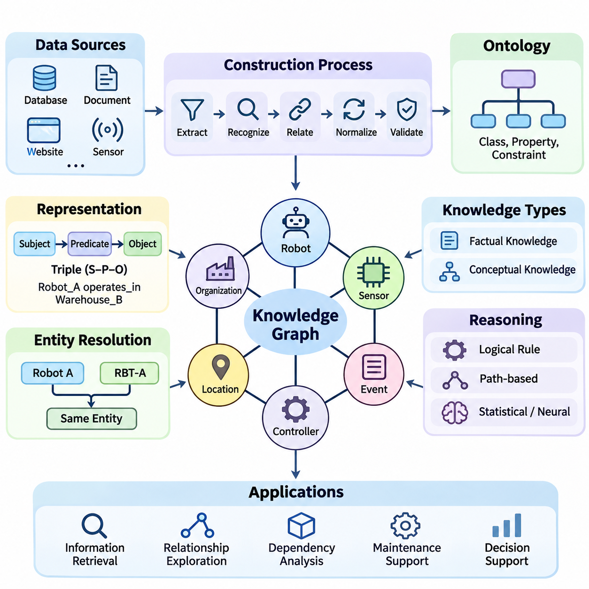
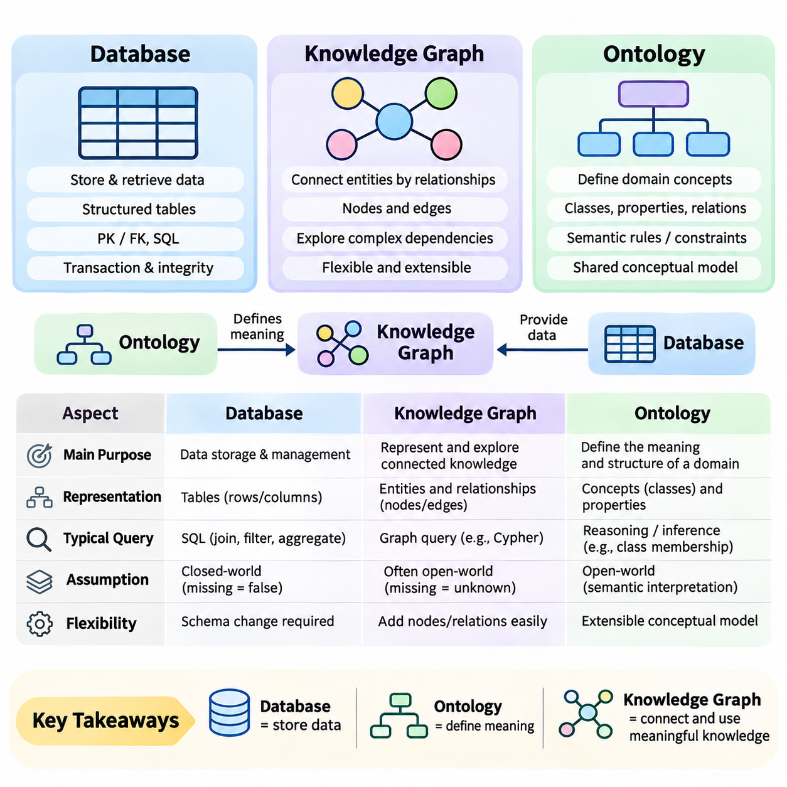
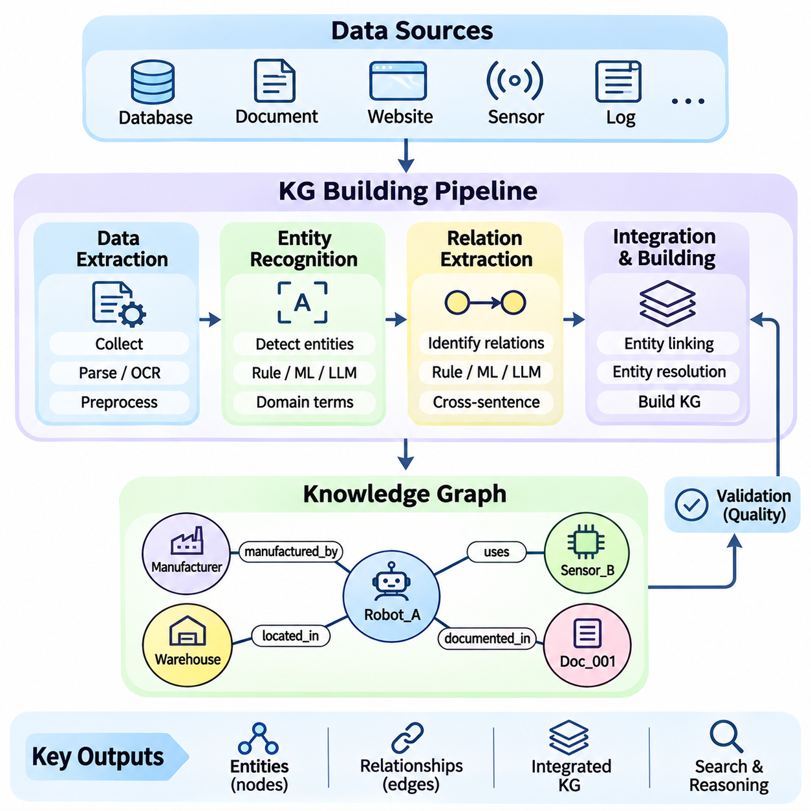
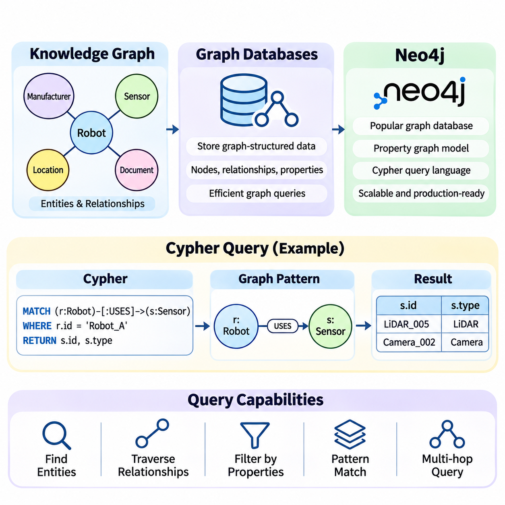
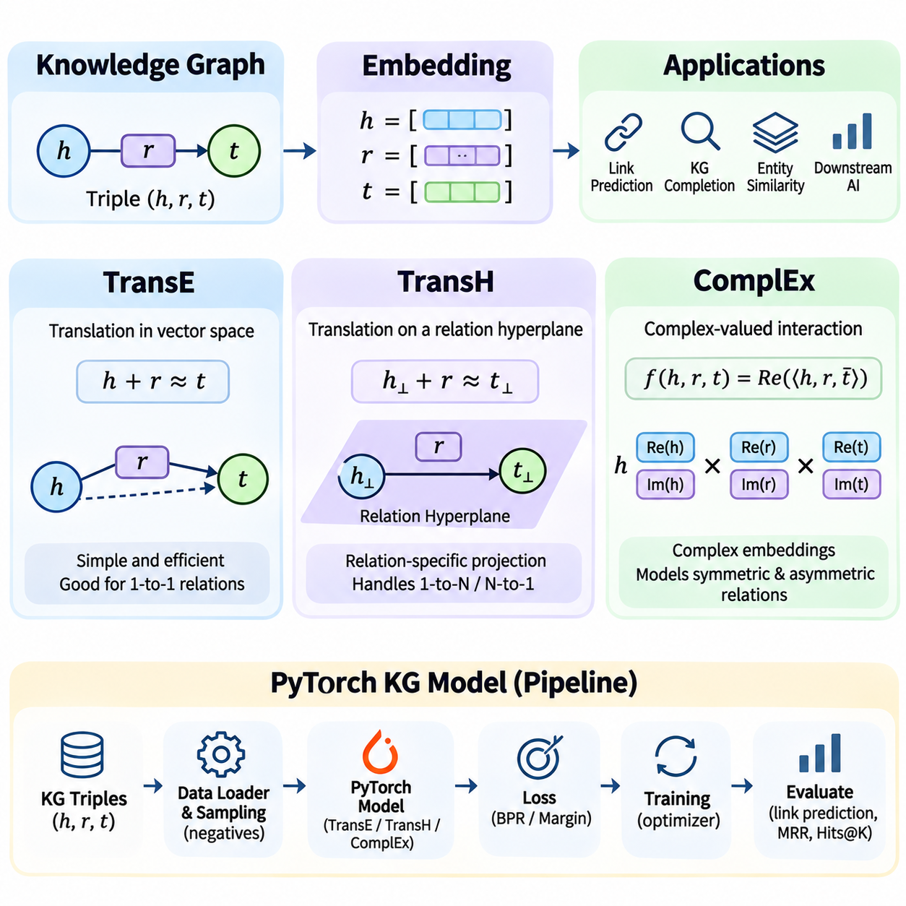
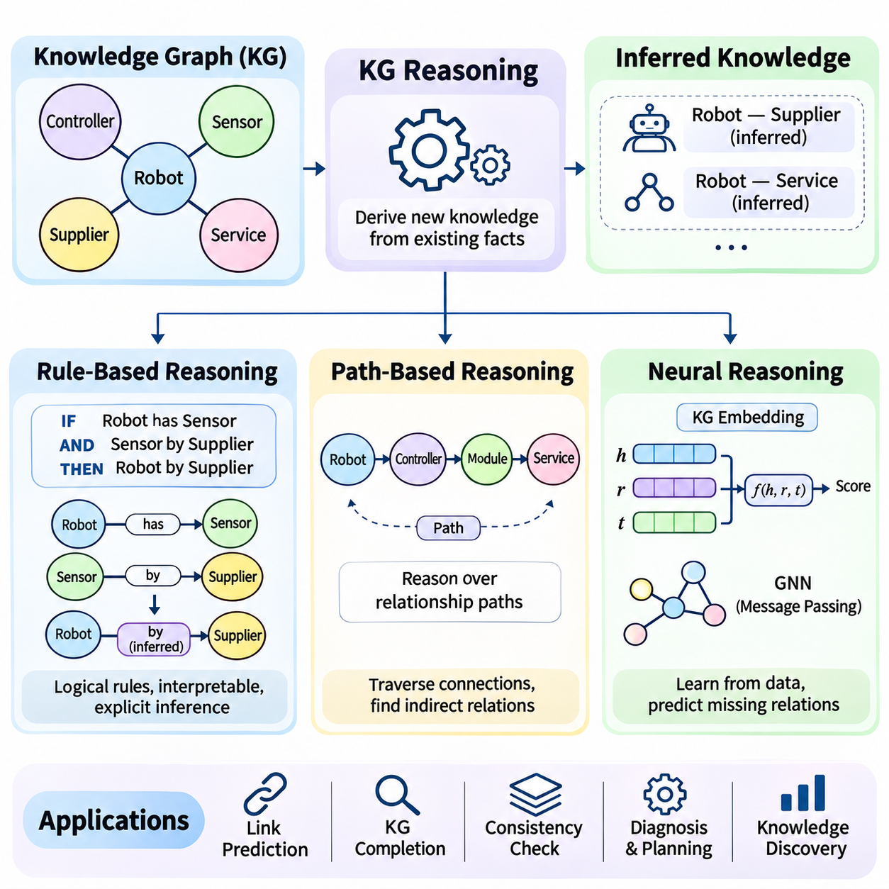
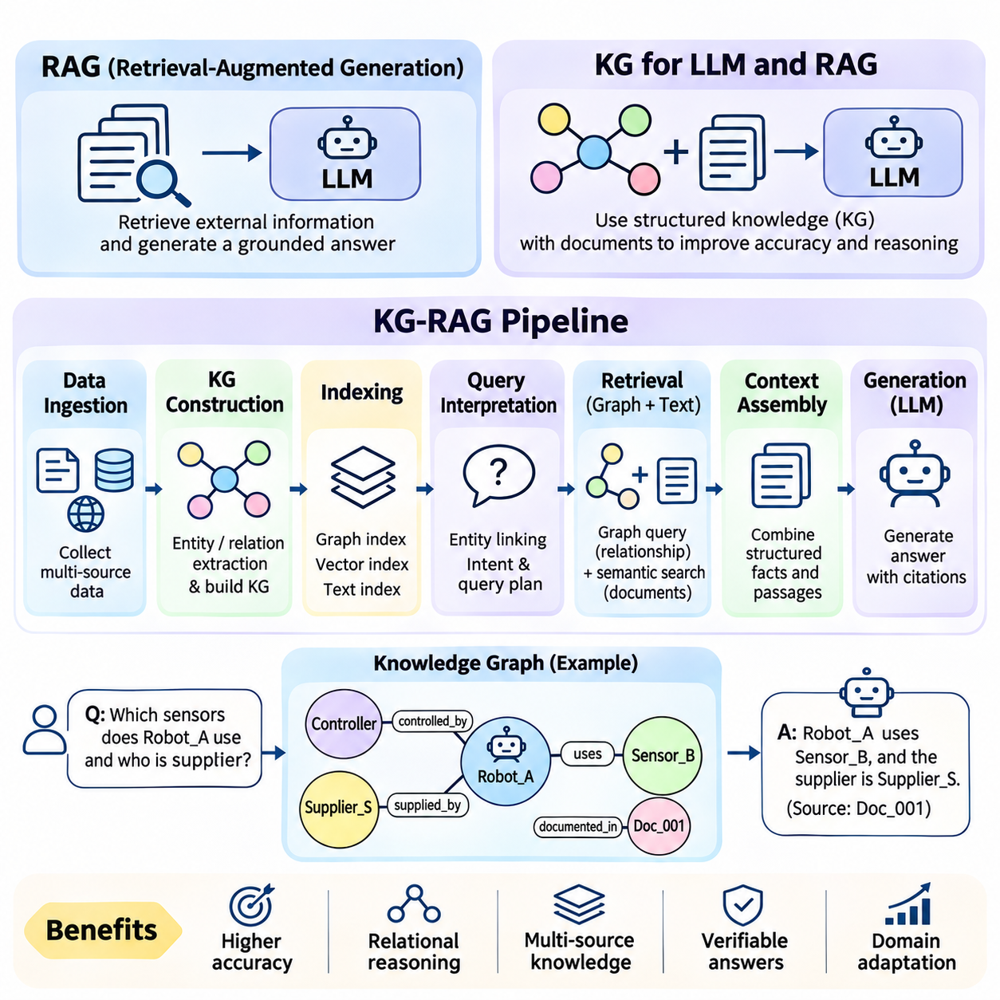
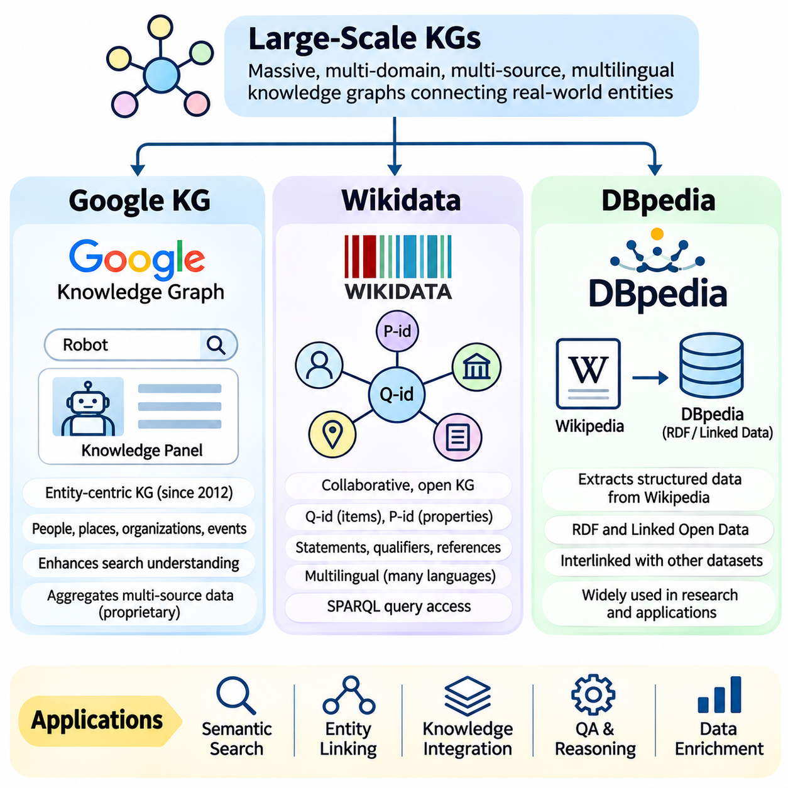
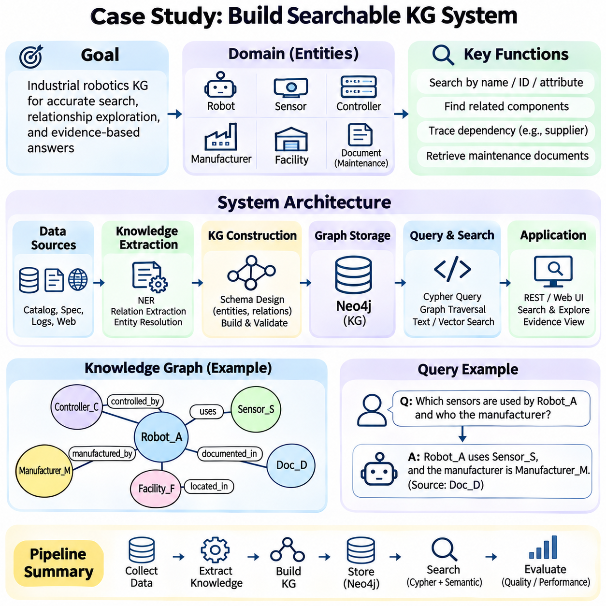

**Volume 02. Knowledge Representation**

# 03. Knowledge Graph

## 03.01 Introduction to Knowledge Graphs

{width="7.268055555555556in" height="7.268055555555556in"}

A knowledge graph is a structured representation of information in which entities, their attributes, and their relationships are explicitly connected. Unlike isolated records or unstructured documents, a knowledge graph captures how concepts and real-world objects relate to one another. This interconnected representation enables artificial intelligence systems to organize information, discover relationships, and support meaningful knowledge-based reasoning.

The fundamental purpose of a knowledge graph is to transform fragmented information into an interconnected network of meaningful facts. Organizations frequently maintain information across databases, documents, applications, and external services. Knowledge graphs establish explicit relationships among these sources, allowing information to be interpreted within a shared semantic context rather than treated as independent data elements.

A knowledge graph generally consists of entities and relationships, often represented as nodes and edges. Entities may describe people, organizations, locations, products, events, or abstract concepts. Relationships express meaningful associations between entities, such as ownership, membership, dependency, or location. Properties provide additional descriptive information, including names, identifiers, timestamps, measurements, and classification labels.

One common representation of knowledge graph information is the subject-predicate-object triple. The subject identifies an entity, the predicate describes a relationship or property, and the object identifies another entity or a value. For example, the statement "Robot_A operates_in Warehouse_B" expresses a relationship between a robot and a warehouse. Multiple interconnected triples form a graph capable of representing increasingly complex knowledge.

Knowledge graphs distinguish between the identity of an entity and the textual expressions used to describe it. A single organization may appear under several names, abbreviations, or identifiers across different information sources. Entity resolution establishes whether these references describe the same real-world object. Reliable identification prevents unnecessary duplication and improves consistency when information is integrated from heterogeneous systems.

Relationships provide much of the expressive power of knowledge graphs because they describe how individual facts contribute to a larger context. A manufacturing graph might connect a robot to its controller, sensors, assigned tasks, maintenance records, and operating environment. These connections allow applications to investigate dependencies and operational conditions without requiring every relevant relationship to be predefined in a conventional database query.

Knowledge graphs can represent both factual knowledge and conceptual knowledge. Factual knowledge describes specific instances, such as a particular robot installed in a warehouse. Conceptual knowledge defines categories and relationships, such as the classification of mobile robots as robotic systems. Connecting these levels allows applications to interpret individual observations using broader domain concepts and established relationships.

Ontologies often provide the conceptual foundation for knowledge graphs by defining classes, properties, constraints, and semantic relationships. An ontology specifies how knowledge should be interpreted, while a knowledge graph contains interconnected information about particular entities and their relationships. Although knowledge graphs do not always require formal ontologies, semantic modeling improves consistency, interoperability, and automated reasoning.

Knowledge graphs may be implemented using different data models, including Resource Description Framework representations and labeled property graphs. RDF expresses information through triples and supports standardized semantic technologies. Property graphs represent entities and relationships with associated properties. Both approaches support connected information, although their modeling conventions, query languages, and reasoning capabilities differ.

The construction of a knowledge graph usually begins with identifying relevant information sources and determining the entities and relationships that must be represented. Structured databases, technical documents, websites, sensor records, and application logs may provide useful knowledge. Data extraction, entity recognition, relationship extraction, normalization, and validation transform these heterogeneous inputs into consistent graph representations.

Knowledge graph quality depends on more than the number of entities and relationships collected. Accurate entity identification, meaningful relationship definitions, consistent terminology, and reliable source information are essential. Incorrect relationships can propagate misleading conclusions through graph queries and reasoning operations. Quality assurance therefore requires validation procedures, provenance tracking, duplicate detection, and continuous correction.

Knowledge graphs support information retrieval by allowing applications to navigate relationships rather than relying exclusively on keyword matching. A query can identify entities satisfying particular conditions and follow connections to related information. For example, a maintenance application may locate robots using a specific motor model and retrieve associated failure reports, operating environments, and replacement components through connected relationships.

Reasoning extends knowledge graph functionality beyond direct retrieval of explicitly stored facts. Logical rules can derive additional relationships from existing information, while path-based methods investigate sequences of connected entities. Statistical and neural approaches may estimate missing relationships or identify plausible associations. These methods differ in their assumptions and reliability, making validation important when inferred knowledge influences decisions.

Knowledge graph embeddings represent entities and relationships as numerical vectors within a continuous mathematical space. These representations allow machine learning algorithms to process relational information and estimate patterns that are difficult to express using explicit rules alone. Embedding methods can support link prediction, entity similarity, and knowledge graph completion, although predicted relationships should not automatically be treated as verified facts.

Large-scale knowledge graphs demonstrate how interconnected information can support search, discovery, and semantic integration across extensive domains. Resources such as Wikidata and DBpedia organize information about diverse entities and their relationships. Commercial knowledge graphs similarly support entity-oriented search and information integration. Their practical value depends on coverage, data quality, update mechanisms, and application requirements.

Knowledge graphs are increasingly integrated with large language models to provide structured contextual information during response generation. A language model can use graph retrieval to identify relevant entities, relationships, and supporting facts before generating an answer. This approach can improve factual grounding and multi-hop information access, but it does not guarantee correctness because retrieval errors and unsupported generation remain possible.

In retrieval-augmented generation systems, knowledge graphs can complement document retrieval and vector similarity search. Vector retrieval identifies semantically related content, while graph traversal identifies explicitly connected entities and relationships. Combining these mechanisms can provide richer context for questions involving dependencies, organizational structures, technical components, or multiple interconnected facts.

Robotics and industrial automation provide practical examples of knowledge graph applications. A robotic knowledge graph may connect mobile platforms, sensors, actuators, control software, workspaces, operational tasks, and safety constraints. Such representations support equipment identification, maintenance analysis, task coordination, and contextual information retrieval. Real-time control, however, still requires appropriate computational and safety mechanisms.

Enterprise knowledge management also benefits from graph-based representations because organizational information is often distributed across departments and software platforms. Knowledge graphs can connect products, employees, projects, suppliers, documents, and operational processes through shared entity identifiers. These relationships support cross-system search, dependency analysis, impact assessment, and more consistent interpretation of organizational knowledge.

Temporal information introduces another important dimension of knowledge graph representation. Relationships may change as equipment is replaced, organizations are reorganized, or operational conditions evolve. Recording validity periods, event timestamps, and historical states allows applications to distinguish current facts from previous conditions. Temporal modeling is particularly valuable when decisions depend on the state of knowledge at a specific time.

Provenance and trust are essential when knowledge graphs integrate information from multiple sources. A relationship may originate from an official database, an automatically extracted document, or a probabilistic prediction. Recording its origin, extraction method, confidence, and verification status helps applications evaluate reliability. Provenance also supports auditing, correction, and responsible reuse of knowledge across organizational boundaries.

Knowledge graphs introduce engineering challenges involving scalability, consistency, schema evolution, and computational efficiency. Large graphs may contain millions or billions of relationships, requiring specialized indexing, storage, and query optimization. Continuous updates can introduce conflicting facts or outdated relationships. Effective architectures must balance expressive modeling with operational performance, maintainability, and reliable access.

Security and governance become particularly important when knowledge graphs connect sensitive organizational information. Access controls may need to operate at the entity, relationship, or property level. Different applications and users may require restricted views of the same underlying knowledge network. Appropriate authorization, provenance management, and information isolation help prevent unauthorized disclosure through direct queries or inferred relationships.

A well-designed knowledge graph should reflect the questions that its intended applications need to answer. Modeling every possible entity and relationship is rarely practical or necessary. Instead, developers should identify important domain concepts, define meaningful relationships, establish identity conventions, and evaluate representative queries. This application-driven approach helps maintain a useful balance between semantic richness and implementation complexity.

Knowledge graphs occupy an important position between symbolic knowledge representation and modern data-driven artificial intelligence. They preserve explicit relationships that can be inspected and queried while supporting integration with statistical learning, neural models, and language-based interfaces. Their central contribution is the organization of information into connected, interpretable structures that enable knowledge integration, retrieval, and reasoning across complex domains.

## 03.02 KG vs Database vs Ontology

{width="7.268055555555556in" height="7.268055555555556in"}

Knowledge graphs, databases, and ontologies are closely related technologies, but they serve different purposes in information representation and management. A database primarily stores and retrieves data, an ontology formally defines concepts and their relationships, and a knowledge graph connects entities through meaningful associations. Understanding these distinctions is essential for designing intelligent systems that require structured information, semantic interpretation, and reasoning.

A traditional database organizes information according to a defined data model and provides mechanisms for storage, retrieval, updating, and transaction management. Relational databases represent information through tables containing rows and columns. Relationships are typically established using primary and foreign keys, allowing applications to combine records through joins. This architecture is particularly effective for structured business transactions and operational data.

A knowledge graph emphasizes the relationships among entities rather than treating connections primarily as references between separate records. Entities are represented as nodes, while relationships connect those nodes through explicitly defined associations. This representation allows applications to navigate interconnected information naturally and investigate complex dependencies without requiring every relationship path to be predetermined during application development.

An ontology operates at a different conceptual level by defining the vocabulary and semantic rules used to describe a domain. It identifies classes, properties, relationships, and logical constraints that determine how information should be interpreted. For example, an ontology may define a Robot as a type of Machine and specify that a Robot can perform a Task. These definitions establish a shared conceptual model.

The distinction between an ontology and a knowledge graph becomes clearer when considering instances and conceptual definitions. An ontology may define the classes Robot, Sensor, and Warehouse, together with relationships such as equippedWith and locatedIn. A knowledge graph can then represent Robot_001 equippedWith LiDAR_005 and Robot_001 locatedIn Warehouse_A. The ontology defines meaning, while the graph represents interconnected knowledge about particular entities.

However, knowledge graphs do not necessarily require a formal ontology. Some systems use lightweight schemas, property labels, or application-specific relationship definitions without adopting comprehensive semantic standards. Similarly, an ontology can exist independently of a populated knowledge graph. The two technologies are complementary rather than interchangeable, and their integration depends on application requirements and desired reasoning capabilities.

Relational databases emphasize structured schemas and data integrity through constraints, normalization, and transaction processing. Tables are designed to reduce unnecessary duplication and maintain consistent relationships between records. SQL provides powerful operations for filtering, joining, aggregating, and modifying data. These characteristics make relational databases suitable for financial transactions, inventory systems, and enterprise resource planning.

Knowledge graphs provide advantages when relationships are numerous, heterogeneous, or frequently explored through multiple connection paths. A graph can represent suppliers, components, products, factories, and maintenance events within a connected structure. Applications can traverse these relationships to identify indirect dependencies or investigate how changes propagate across a network of entities.

The difference between relational and graph representations is not absolute because relational databases can model complex networks through junction tables and recursive queries. Likewise, graph databases can support structured properties, indexing, and transactional operations. The practical distinction concerns modeling convenience, query patterns, semantic requirements, and performance characteristics rather than whether a particular relationship can be represented at all.

Graph databases provide storage and query infrastructure for graph-structured information. Property graph systems commonly represent nodes and relationships with associated labels and properties. RDF-based systems represent information through subject-predicate-object triples. Both can support knowledge graph applications, but a graph database alone does not guarantee semantic consistency, domain understanding, or automated reasoning.

Ontologies introduce formal semantics that enable additional interpretation beyond basic graph connectivity. Technologies such as RDF Schema and the Web Ontology Language define class hierarchies, property characteristics, and logical restrictions. Reasoning engines can use these definitions to infer class membership or detect certain inconsistencies. The available reasoning capabilities depend on the ontology language and inference implementation.

A significant conceptual distinction involves the assumptions used to interpret missing information. Conventional database applications frequently use closed-world reasoning, where missing records may be treated as false within a defined operational context. Semantic knowledge systems often adopt an open-world assumption, where an absent statement is considered unknown rather than necessarily false. These assumptions influence validation, inference, and application behavior.

Schema flexibility is another important consideration. Relational databases commonly require explicit schema modifications when new entity types or relationships are introduced. Graph models can often accommodate additional node labels, relationship types, and properties with fewer structural changes. Nevertheless, uncontrolled flexibility may produce inconsistent terminology, duplicated entities, and unreliable queries unless governance mechanisms are established.

Ontologies address some of these consistency challenges by providing shared definitions and reusable conceptual structures. A common ontology can help different systems interpret the same entity types and relationships consistently. This capability is especially important when integrating information across organizations or technical domains. Ontology alignment and mapping are still required when independent systems use incompatible vocabularies.

Knowledge graphs are particularly useful for integrating heterogeneous information sources because they can connect entities extracted from databases, documents, application interfaces, and external datasets. Entity resolution identifies references to the same real-world object, while relationship mapping establishes meaningful connections. The resulting graph provides a unified view without necessarily replacing the original storage systems.

A database may remain the authoritative source for operational records while a knowledge graph provides an integrated semantic layer above multiple databases. For example, a manufacturing database may maintain equipment inventories, while another system records maintenance histories. A knowledge graph can connect equipment, components, maintenance events, and operational locations, enabling cross-system analysis through shared entity identifiers.

Query languages reflect differences in representation and intended usage. SQL is optimized for relational operations involving tables and structured records. Cypher expresses graph patterns and relationship traversal in property graph environments. SPARQL queries RDF graphs through triple patterns and semantic graph matching. Selecting a query language depends on the underlying data model, supported operations, and application architecture.

Performance comparisons require careful consideration because no representation is universally superior. Relational databases often provide excellent performance for structured transactions and well-optimized joins. Graph databases may simplify and accelerate certain relationship-intensive queries, particularly when traversing connected entities. Actual performance depends on indexing, graph density, query selectivity, data distribution, and implementation details.

Ontologies also introduce computational tradeoffs. Expressive logical constraints can support sophisticated classification and inference, but reasoning complexity may increase substantially as ontology expressiveness grows. Some applications therefore adopt lightweight taxonomies or restricted reasoning profiles. Others require richer semantic models despite higher computational costs because logical consistency and inference are central requirements.

In artificial intelligence systems, the three technologies frequently operate together rather than competing directly. Databases provide reliable persistence, ontologies define domain meaning, and knowledge graphs connect facts into a navigable representation. Machine learning models can extract entities and relationships from unstructured sources, while reasoning components interpret graph information using explicit rules or learned relational patterns.

Large language model applications illustrate this complementary architecture. Operational databases supply verified records, ontologies clarify entity categories and relationship meanings, and knowledge graphs support structured retrieval across connected information. A retrieval-augmented generation pipeline can combine graph queries with document search to provide contextual evidence for language generation, although factual accuracy still requires validation.

Robotics provides a practical example of these distinctions. A relational database may store robot identifiers, sensor configurations, and maintenance records. An ontology can define robot categories, component relationships, and operational concepts. A knowledge graph can connect individual robots to their sensors, assigned tasks, environments, and maintenance histories, supporting contextual queries and dependency analysis.

Industrial digital twins can similarly combine databases, ontologies, and knowledge graphs. Databases maintain measurements and operational records, ontologies establish consistent definitions for equipment and processes, and knowledge graphs represent dependencies among physical assets and digital components. This combination supports system integration, operational analysis, and knowledge-driven decision support across complex industrial environments.

Data governance requirements also differ among these technologies. Databases emphasize transactional integrity, access control, backup, and recovery. Ontologies require vocabulary management, semantic versioning, and conceptual consistency. Knowledge graphs require entity identity management, relationship validation, provenance tracking, and update coordination. Integrated architectures must address these responsibilities across all three layers.

Choosing among databases, ontologies, and knowledge graphs should begin with the intended information requirements rather than a preference for a particular technology. Applications dominated by structured transactions may require conventional databases, while applications requiring shared conceptual definitions benefit from ontologies. Systems involving interconnected knowledge, relationship exploration, and semantic integration may benefit from knowledge graphs.

Ultimately, databases, ontologies, and knowledge graphs represent complementary dimensions of knowledge engineering. Databases answer how information is stored and managed, ontologies define what concepts and relationships mean, and knowledge graphs express how specific entities are connected. Their coordinated use provides a foundation for intelligent information systems that combine reliable data management, semantic interoperability, and knowledge-based reasoning.

## 03.03 KG Construction

{width="7.268055555555556in" height="7.268055555555556in"}

Knowledge graph construction is the process of transforming heterogeneous information into a structured network of entities and meaningful relationships. It combines data extraction, entity recognition, relation extraction, normalization, and graph integration into a coordinated workflow. The objective is not simply to collect information but to create a consistent, searchable, and interpretable representation that supports knowledge discovery and reasoning.

The construction process begins by identifying relevant information sources and defining the knowledge requirements of the target application. Sources may include relational databases, technical documents, websites, application interfaces, sensor records, and operational logs. Each source provides different types of information, requiring extraction methods that account for its structure, reliability, update frequency, and semantic characteristics.

Data extraction converts information from source systems into representations suitable for subsequent processing. Structured sources can be accessed through database queries or application programming interfaces, while semi-structured sources may require JSON, XML, or HTML parsing. Unstructured documents often require text processing and document analysis. The extracted information should preserve sufficient context to support accurate entity and relationship identification.

Document extraction introduces challenges because useful information may appear in paragraphs, tables, metadata, or embedded technical descriptions. Text preprocessing can include character normalization, sentence segmentation, language identification, and removal of irrelevant formatting. For scanned documents, optical character recognition may be necessary. Extraction quality directly influences the reliability of all subsequent knowledge graph construction stages.

Entity recognition identifies references to meaningful objects or concepts within extracted information. Named entity recognition systems commonly detect people, organizations, locations, dates, and products, while domain-specific systems identify equipment, components, processes, or technical parameters. The objective is to transform textual mentions into candidate entities that can be represented consistently within the knowledge graph.

Entity recognition can use rule-based methods, statistical models, transformer architectures, or combinations of these approaches. Dictionary matching is effective when domain terminology is well controlled, while machine learning methods can recognize entities appearing in varied linguistic contexts. Domain adaptation is often necessary because general-purpose models may not recognize specialized industrial identifiers, scientific terminology, or equipment classifications.

Recognizing an entity mention does not automatically establish its unique identity. Entity linking associates extracted mentions with existing graph entities or reference identifiers. For example, different abbreviations may refer to the same manufacturing organization, while identical equipment names may describe different physical devices. Reliable entity linking requires contextual evidence, identifier matching, and ambiguity resolution.

Entity resolution further addresses duplication and inconsistency across heterogeneous information sources. Records describing the same real-world object may contain different names, incomplete attributes, or conflicting identifiers. Matching algorithms compare relevant characteristics and contextual relationships to determine whether records should be merged. Incorrect merging can corrupt the graph, while insufficient merging creates fragmented knowledge.

Relation extraction identifies meaningful associations between recognized entities. A relationship may describe ownership, location, component membership, operational dependency, or temporal interaction. For example, the sentence "Robot_A uses LiDAR_B for navigation" can produce a relationship connecting the robot and sensor. Relation extraction transforms descriptive information into explicit graph connections that support structured retrieval.

Rule-based relation extraction uses predefined linguistic patterns, dependency structures, or domain-specific templates. These methods can provide predictable behavior when source language follows consistent conventions. However, rigid patterns may fail when relationships are expressed through unfamiliar wording. Statistical and neural extraction methods can recognize more varied expressions but require appropriate training data and validation.

Transformer-based language models can identify relationships using contextual representations of sentences and documents. Such models may classify predefined relation types or generate candidate relational statements from natural language. Their outputs must be checked against the target schema because plausible predictions may contain unsupported relationships, incorrect entity assignments, or information absent from the original source.

Relation extraction becomes more difficult when relevant entities appear across multiple sentences or documents. Coreference resolution identifies expressions referring to previously mentioned entities, while document-level relation extraction investigates connections distributed throughout a text. These capabilities are important when technical documentation describes equipment configurations, operational procedures, and component dependencies across separate sections.

A knowledge graph building pipeline coordinates extraction and transformation stages into a repeatable engineering process. A typical pipeline acquires source information, preprocesses content, recognizes entities, extracts relationships, resolves identities, validates statements, and writes approved facts into graph storage. Each stage should expose intermediate results so that errors can be identified before they propagate into downstream knowledge representations.

Schema mapping translates extracted information into the entity types, relationship categories, and property definitions required by the target graph. Source terminology may differ from the vocabulary established by an ontology or application schema. Mapping rules align these differences while preserving intended meaning. Consistent schema mapping enables information from independent sources to participate in shared graph queries and reasoning operations.

Graph construction commonly represents extracted facts as subject-predicate-object triples or labeled property graph structures. In an RDF-oriented pipeline, entities and relationships may receive globally identifiable resource identifiers. Property graph pipelines typically create nodes and edges with associated labels and attributes. The selected representation influences storage operations, query design, interoperability, and available reasoning mechanisms.

Validation is essential because extraction pipelines can introduce missing entities, incorrect relationships, inconsistent properties, and duplicate statements. Structural validation checks whether graph records satisfy expected formats and required fields. Semantic validation examines whether relationships conform to domain definitions and constraints. Human review may be necessary for ambiguous or high-impact information that automated checks cannot reliably resolve.

Provenance tracking records where graph information originated and how it was produced. A statement may be associated with its source document, extraction timestamp, processing model, confidence score, and verification status. This metadata helps distinguish verified facts from automatically generated candidates. Provenance also supports auditing, correction, and traceability when knowledge is reused across applications.

Confidence management is particularly important when machine learning models participate in entity and relation extraction. Model confidence estimates can help prioritize manual review, but they do not guarantee factual correctness. Thresholds should be calibrated using representative validation data. High-confidence predictions may still be wrong, making source verification and domain-specific consistency checks necessary for reliable graph construction.

Incremental construction allows a knowledge graph to evolve as new information becomes available. Rather than rebuilding the entire graph after every update, pipelines can identify changed records and apply targeted modifications. This approach reduces processing costs and supports frequently updated operational systems. Incremental updates must also address deleted information, modified relationships, and conflicting versions of previously stored facts.

Scalable construction requires efficient processing of large document collections, databases, and streaming information sources. Batch pipelines are suitable for historical datasets, while event-driven architectures can process updates as they occur. Parallel extraction, distributed processing, and optimized graph loading improve throughput. However, scalability must not compromise identity consistency, validation quality, or reliable error recovery.

Python provides a practical environment for implementing knowledge graph construction pipelines because it supports text processing, machine learning, data transformation, and graph database integration. Libraries such as spaCy and transformer-based frameworks can support entity and relation extraction, while RDFLib can construct RDF graphs. Database connectors and graph clients enable extracted knowledge to be stored and queried through production systems.

A modular Python pipeline can separate document loading, entity recognition, relation extraction, entity resolution, and graph persistence into independent components. Each component receives structured inputs and produces outputs that can be tested individually. Configuration files can define entity categories, relationship mappings, and validation policies. Modular design improves maintainability and allows individual extraction methods to be replaced without rebuilding the entire system.

Evaluation should examine both individual pipeline stages and the resulting knowledge graph. Entity recognition can be assessed using precision, recall, and F1 score, while relation extraction requires evaluation of entity pairs and relation labels. Entity resolution can be measured through matching accuracy and clustering quality. Graph-level evaluation additionally examines completeness, consistency, provenance coverage, and usefulness for downstream queries.

Industrial robotics illustrates how these construction methods operate in practice. Technical specifications may identify robots, sensors, controllers, and actuators, while maintenance records describe failures and component replacements. Extraction models recognize relevant entities and relationships, and resolution mechanisms connect them to existing equipment identifiers. The resulting graph supports equipment search, dependency analysis, and maintenance knowledge integration.

Successful knowledge graph construction requires coordination between data engineering, natural language processing, semantic modeling, and software architecture. Extraction accuracy alone is insufficient if entities are inconsistently identified or relationships lack reliable meaning. A robust pipeline combines automated processing with schema governance, provenance, validation, and controlled updates to produce trustworthy knowledge structures that remain useful as information sources and application requirements evolve.

## 03.04 KG Storage and Query

{width="7.268055555555556in" height="7.268055555555556in"}

Knowledge graph storage and querying provide the infrastructure required to manage interconnected entities, relationships, and properties efficiently. Unlike conventional data management approaches centered on isolated records, graph-oriented systems emphasize connectivity and relationship traversal. Their purpose is to preserve graph structures while enabling applications to retrieve facts, explore dependencies, and execute complex queries across connected information.

Graph databases are specialized data management systems designed to represent and manipulate graph-structured information. They typically organize data as nodes, relationships, and properties, allowing connections to become explicit elements of the storage model. This organization is particularly useful when applications frequently investigate relationships among entities, such as organizational hierarchies, supply chains, equipment dependencies, or knowledge networks.

Two major graph representation approaches are labeled property graphs and Resource Description Framework graphs. Property graphs associate labels and attributes with nodes and relationships, while RDF represents information through subject-predicate-object triples. Both approaches support interconnected knowledge, but they differ in data modeling conventions, query languages, semantic standards, and available reasoning mechanisms.

Graph database architecture commonly includes storage engines, indexing mechanisms, query processors, transaction managers, and access interfaces. Storage engines maintain graph records and associated properties, while indexes accelerate entity identification and property filtering. Query processors interpret graph patterns and determine execution strategies. Transaction management helps maintain consistency when multiple applications modify shared graph information.

Relationship traversal is a fundamental graph database operation. Starting from a selected entity, an application can follow connected relationships to discover neighboring entities or investigate longer paths. For example, a manufacturing system may traverse from a robot to its sensors, controllers, maintenance events, and suppliers. Such operations support dependency analysis and contextual exploration across interconnected technical information.

Graph databases can simplify relationship-intensive queries compared with relational representations that require numerous joins. However, performance advantages depend on graph structure, indexing, query selectivity, and execution strategy. Relational databases remain effective for many structured workloads, while graph databases are especially attractive when flexible relationship navigation is central to application requirements.

Neo4j is a graph database management system that implements the labeled property graph model. It represents information through nodes, directed relationships, labels, and properties. Nodes commonly describe entities such as people, organizations, devices, or locations, while relationships express associations between them. Properties provide additional information such as identifiers, names, timestamps, and operational attributes.

In Neo4j, labels classify nodes according to their conceptual roles, while relationship types identify the meaning of connections. A node labeled Robot may contain properties describing its identifier and model. A relationship of type USES_SENSOR may connect that robot to a node labeled Sensor. This representation allows technical knowledge to be modeled through explicit relationships rather than application-specific references alone.

Neo4j provides database services for storing, updating, retrieving, and managing connected information. Its ecosystem includes graphical exploration interfaces, programmatic drivers, administrative tools, and integration capabilities. Applications can interact with the database through supported client libraries and network interfaces, enabling graph operations to become part of larger software systems and knowledge engineering pipelines.

The Cypher query language provides a declarative mechanism for expressing graph patterns and manipulating property graph information. Rather than specifying every low-level traversal operation, developers describe the nodes, relationships, and conditions they want to match. The database query engine determines an execution strategy for retrieving or modifying the corresponding graph structures.

Cypher expresses nodes using parentheses and relationships using directional connections between node patterns. Labels and properties can constrain which entities are matched, while relationship types specify the associations being explored. This pattern-oriented syntax makes graph queries resemble the conceptual structures represented in the database, improving readability when investigating connected entities.

The MATCH clause identifies graph patterns satisfying specified conditions. A query may match Robot nodes connected to Sensor nodes through USES_SENSOR relationships. The RETURN clause determines which matched values appear in the result. Together, these operations allow applications to retrieve connected entities, inspect their properties, and answer questions about relationships stored in the knowledge graph.

Filtering operations refine graph queries by restricting matches according to property values or logical conditions. The WHERE clause can specify comparisons, string conditions, and combinations of predicates. For example, a maintenance application may retrieve robots operating in a particular warehouse or sensors associated with a specific equipment model. Appropriate filtering reduces unnecessary results and improves query relevance.

Cypher supports graph creation and modification through clauses such as CREATE, MERGE, SET, and DELETE. CREATE introduces new graph elements, while MERGE matches an existing pattern or creates it when no match exists. SET updates properties or labels, and deletion operations remove selected graph elements. Careful use of these operations helps prevent duplicate entities and unintended modifications.

MERGE is particularly useful when constructing knowledge graphs from repeated extraction pipelines. An application can identify an entity through a stable identifier and create it only when the corresponding graph pattern is absent. However, reliable uniqueness also requires appropriate constraints and consistent identity rules. Without these safeguards, concurrent operations or inconsistent identifiers may introduce duplicate records.

Cypher supports variable-length path matching, allowing applications to explore connections spanning multiple relationships. Such queries can investigate organizational hierarchies, dependency chains, or connected technical components. Path length restrictions and relationship type filters help control exploration. Unbounded traversal across densely connected graphs can produce expensive queries and unexpectedly large result sets.

Aggregation enables graph queries to summarize information rather than return individual matches. Cypher provides functions for counting entities, calculating numerical statistics, and collecting related values. A manufacturing knowledge graph might count sensors associated with each robot or summarize maintenance events by equipment category. These operations connect relationship exploration with operational reporting and analytical applications.

Query optimization is essential when knowledge graphs grow to millions of entities and relationships. Indexes accelerate searches based on selected properties, while uniqueness constraints support reliable entity identification. Query planners evaluate available access paths and execution strategies. Developers can inspect execution plans to identify inefficient scans, excessive intermediate results, or unnecessarily expensive relationship traversals.

Neo4j provides execution plan inspection through Cypher commands such as EXPLAIN and PROFILE. EXPLAIN displays a planned query execution strategy without executing the query, while PROFILE executes the query and reports runtime information. These capabilities help developers evaluate index usage, traversal costs, and intermediate operations. Performance analysis should use representative data and realistic query workloads.

Transaction management protects graph consistency when multiple operations must succeed or fail together. For example, registering a new robot may require creating its entity, assigning component relationships, and recording its installation location. Executing related modifications within a transaction helps prevent partially applied updates. Constraints and application-level validation remain important for preserving semantic correctness.

Knowledge graph storage systems must also address security, reliability, and operational maintenance. Authentication and authorization restrict database access, while backup and recovery mechanisms protect stored information. Monitoring tools track resource consumption, query performance, and database availability. Production deployments should establish policies for schema changes, data retention, access permissions, and recovery procedures.

Graph databases do not automatically provide complete semantic reasoning simply because information is stored as connected nodes and relationships. Explicit inference requires additional rules, reasoning engines, or application logic. RDF-based systems may integrate standardized semantic technologies, while property graph systems can implement domain-specific inference procedures. Storage architecture and reasoning architecture should therefore be considered separately.

Python applications can interact with Neo4j through official database drivers and execute parameterized Cypher queries. Parameters separate query structure from application data, improving maintainability and reducing injection risks. A knowledge graph pipeline may recognize entities, resolve identifiers, construct relationship records, and submit database transactions. Error handling and transaction retries are important for reliable integration.

A practical robotics knowledge graph can store robots, sensors, controllers, tasks, and operating environments as connected entities. Cypher queries can identify robots equipped with particular sensors, discover shared components, or investigate maintenance dependencies. The same graph may support equipment search, operational analysis, and contextual retrieval for intelligent assistants, provided its information remains accurate and current.

Selecting a graph database requires evaluating data models, query requirements, scalability, transaction guarantees, interoperability, and operational costs. Neo4j is suitable for many property graph applications, while RDF-oriented platforms may be preferable when standardized semantic interoperability is essential. The appropriate architecture depends on the intended workload rather than the assumption that one graph technology is universally superior.

Effective knowledge graph storage and querying depend on coordinated decisions about graph modeling, entity identifiers, relationship semantics, indexing, and query design. Neo4j and Cypher demonstrate how property graph databases can make interconnected information accessible through expressive pattern matching and controlled updates. When combined with reliable construction pipelines and governance, these capabilities establish a practical foundation for knowledge retrieval, relationship analysis, and intelligent applications.

## 03.05 Knowledge Graph Embeddings

{width="7.268055555555556in" height="7.268055555555556in"}

Knowledge graph embeddings transform entities and relationships into continuous vector representations that can be processed by machine learning algorithms. Traditional knowledge graphs represent facts as symbolic triples consisting of a head entity, relation, and tail entity. Embedding methods assign numerical vectors to these components, allowing relational patterns to be learned through mathematical operations and enabling predictions about connections not explicitly recorded in the graph.

The primary objective of knowledge graph embedding is to preserve useful structural and semantic information within a lower-dimensional vector space. Entities participating in similar relationships may develop related representations, while relation embeddings capture patterns of interaction. These learned representations support link prediction, knowledge graph completion, entity similarity analysis, and downstream artificial intelligence applications.

Knowledge graph embedding models commonly learn from observed triples represented as (head, relation, tail). During training, the model assigns a plausibility score to each triple and adjusts its parameters to distinguish observed relationships from corrupted or sampled alternatives. The scoring function determines how entity and relation embeddings interact, while the training objective encourages meaningful separation between plausible and implausible statements.

TransE is a foundational translation-based embedding model that represents relationships as vector translations. For a valid triple, the head entity embedding combined with the relation embedding should approximate the tail entity embedding. This principle can be expressed as h + r ≈ t, where h, r, and t denote embedding vectors. Training minimizes the distance between translated head representations and corresponding tail representations for observed facts.

The TransE scoring function commonly measures the negative distance between h + r and t using an L1 or L2 norm. Triples with smaller distances receive higher plausibility under a negative-distance scoring convention. This simple geometric interpretation makes TransE computationally efficient and relatively easy to implement. However, its representational assumptions impose limitations when relationships exhibit complex mapping patterns.

TransE performs naturally for certain one-to-one relationships but may struggle with one-to-many, many-to-one, and many-to-many associations. When a single entity participates in the same relation with several different targets, translation constraints may encourage those targets to occupy similar positions. Such geometric pressure can reduce the model\'s ability to distinguish entities with different meanings or relational roles.

TransH extends translation-based modeling by introducing relation-specific hyperplanes. Instead of representing every relationship in a single shared translation space, TransH projects entity embeddings onto a hyperplane associated with each relation. The projected head and tail vectors are then evaluated using a relation-specific translation vector. This approach allows the same entity to exhibit different representations under different relational contexts.

A TransH relation is typically characterized by a hyperplane normal vector and a translation vector lying within that hyperplane. Entity embeddings are projected by removing their components along the normal direction. The resulting representations are compared through a translation-based distance function. This additional flexibility can improve modeling of complex relation cardinalities while retaining much of the geometric intuition of TransE.

Although TransH offers greater flexibility than TransE, it introduces additional parameters and computational operations. Training requires maintaining suitable normalization conditions for entity vectors and relation-specific hyperplanes. The effectiveness of these constraints depends on implementation details and optimization settings. More expressive translation models may still encounter difficulties representing certain logical or relational patterns.

ComplEx approaches knowledge graph embedding through complex-valued vector representations rather than geometric translation alone. Entities and relations are embedded in a complex vector space containing real and imaginary components. The model evaluates triples using a tri-linear interaction involving the head embedding, relation embedding, and complex conjugate of the tail embedding. This formulation supports expressive relational scoring.

The ComplEx scoring function takes the real part of the sum of elementwise products between the head, relation, and conjugated tail embeddings. Complex conjugation is important because it allows the model to represent asymmetric relationships. For example, the relationship "isParentOf" is directional, and reversing the head and tail should generally produce a different plausibility score.

ComplEx can model symmetric and asymmetric relations without requiring separate architectures for each relation category. Its complex-valued interactions also provide a flexible mechanism for representing relational patterns that simple translation models may struggle to capture. Nevertheless, the model does not automatically enforce arbitrary logical rules, and successful generalization still depends on training data, optimization, and appropriate evaluation.

Comparing TransE, TransH, and ComplEx reveals different assumptions about relational structure. TransE emphasizes translation consistency, TransH introduces relation-specific projection spaces, and ComplEx uses multiplicative interactions in complex vector space. These differences affect expressiveness, computational cost, and suitability for particular graph characteristics. Model selection should consider relation cardinality, asymmetry, graph density, and available computational resources.

Training knowledge graph embeddings requires converting symbolic entities and relations into numerical identifiers. An entity vocabulary maps each unique entity to an integer index, while a relation vocabulary performs the same function for relation types. Embedding matrices store trainable vectors associated with these indices. A triple dataset can then be represented as integer tuples suitable for efficient tensor operations.

PyTorch provides a practical framework for implementing knowledge graph embedding models through trainable embedding layers and automatic differentiation. A basic TransE implementation can use separate embedding tables for entities and relations, followed by vector addition and distance computation. TransH requires additional relation-specific projection parameters, while ComplEx maintains real and imaginary embedding components for its scoring function.

A PyTorch knowledge graph model typically defines an initialization procedure, a triple scoring function, and a training objective. During the forward pass, entity and relation identifiers are converted into embedding vectors. The scoring function evaluates the compatibility of each triple, and the loss function measures prediction errors. Backpropagation computes gradients, allowing an optimizer such as Adam to update embedding parameters.

Negative sampling is widely used because most knowledge graphs contain observed positive triples but do not explicitly identify all false statements. A training procedure may replace the head or tail entity of an observed triple to construct a candidate negative example. However, an unobserved triple is not necessarily false. Filtering known positive triples and using appropriate sampling strategies can reduce misleading training signals.

Loss functions determine how positive and negative triples influence embedding learning. Margin-ranking objectives encourage positive triples to score better than negative alternatives by a specified margin. Logistic and binary cross-entropy objectives provide other optimization formulations. Regularization, embedding normalization, and suitable learning rates help control parameter growth and improve numerical stability during training.

Knowledge graph completion evaluates whether a trained model can predict missing entities or relationships. In link prediction, a model may receive a head entity and relation and rank candidate tail entities according to their scores. The reverse task predicts a missing head entity. Ranking-based evaluation examines whether the correct entity appears near the top of the candidate list.

Common evaluation metrics include Mean Reciprocal Rank and Hits at K. Mean Reciprocal Rank summarizes the reciprocal ranks of correct answers, while Hits at K measures how frequently a correct entity appears within the highest-ranked K candidates. Filtered evaluation removes other known true triples from candidate rankings so that valid alternative answers are not incorrectly treated as prediction errors.

Reliable experiments require careful dataset splitting and prevention of information leakage. Training, validation, and test triples should be separated according to the intended generalization setting. Entity overlap, inverse relationships, and duplicated facts can influence measured performance. Comparisons among embedding models should use consistent splits, negative sampling assumptions, ranking protocols, and computational budgets.

Knowledge graph embeddings have limitations that must be considered in practical systems. Learned scores reflect statistical patterns rather than guaranteed logical truth. Sparse entities, rare relationships, incomplete graphs, and distribution shifts can reduce prediction quality. Embeddings may also encode biases present in source data. Consequently, high-scoring predictions should be treated as candidates requiring verification rather than automatically accepted facts.

In industrial robotics, knowledge graph embeddings can represent robots, sensors, controllers, maintenance events, and operational tasks. A model may learn relationships among equipment configurations and identify plausible missing connections. For example, it could rank candidate components associated with a particular robot platform. Such predictions can support technical investigation, but engineering constraints and authoritative equipment records must determine whether proposed connections are valid.

Embedding models can also complement retrieval systems and large language model applications. Vector representations provide similarity signals for identifying relevant entities and candidate relationships, while symbolic graph queries preserve explicit relational structure. Combining embedding-based retrieval with graph traversal may improve knowledge discovery and contextual information access. Provenance and validation remain necessary when predicted relationships influence generated answers.

Effective knowledge graph embedding systems require coordination among graph preparation, model architecture, training objectives, evaluation protocols, and deployment requirements. TransE provides an accessible translation-based foundation, TransH introduces relation-specific geometric flexibility, and ComplEx supports expressive asymmetric scoring. PyTorch enables these approaches to be implemented and compared systematically, providing a practical foundation for learning relational representations from structured knowledge.

## 03.06 KG Reasoning

{width="7.268055555555556in" height="7.268055555555556in"}

Knowledge graph reasoning is the process of deriving new knowledge from existing entities, relationships, and semantic constraints. Unlike basic graph querying, which retrieves explicitly stored information, reasoning identifies implications that may not appear directly in the graph. It enables intelligent systems to discover indirect relationships, evaluate logical consistency, and generate plausible conclusions from interconnected knowledge.

Reasoning approaches differ in how they represent knowledge and produce conclusions. Rule-based reasoning applies explicit logical rules, path-based reasoning investigates sequences of connected relationships, and neural reasoning learns relational patterns from data. These methods offer different balances of interpretability, flexibility, computational efficiency, and generalization, making their selection dependent on application requirements.

Rule-based reasoning uses predefined logical statements to derive conclusions from known facts. A rule typically contains conditions that must be satisfied and a conclusion that follows when those conditions hold. For example, if a robot contains a sensor and the sensor is manufactured by a supplier, a rule may infer an indirect supplier association for that robot. The conclusion depends on the precise meaning of the defined relationships.

Logical rules can be expressed through Horn clauses, Datalog, ontology axioms, or domain-specific inference languages. A Horn-style rule may state that if connectedTo(A,B) and connectedTo(B,C), then reachableFrom(A,C). Such rules enable systematic inference over graph structures. However, the validity of inferred conclusions depends on whether the rule accurately represents the intended domain semantics.

Forward chaining begins with available facts and repeatedly applies applicable rules to generate additional statements. Newly inferred facts may activate further rules, producing a sequence of deductions until no additional conclusions can be derived. This approach is useful when applications need to materialize inferred relationships for repeated retrieval, although unrestricted rule application may increase storage and computational costs.

Backward chaining starts with a specific question or hypothesis and searches for facts and rules that can establish it. Instead of generating every possible conclusion, the reasoning engine focuses on evidence relevant to the requested goal. This strategy is appropriate for targeted diagnostic questions and goal-directed inference. Its efficiency depends on rule organization, search control, and the complexity of supporting evidence.

Rule-based reasoning provides strong interpretability because conclusions can be traced through explicit premises and inference steps. Nevertheless, it requires carefully maintained rules and consistent graph semantics. Incorrect rules can propagate invalid conclusions, while incomplete rule sets may overlook useful implications. Contradictory information also requires explicit handling, particularly when knowledge originates from multiple sources.

Path-based reasoning examines sequences of relationships connecting entities within a knowledge graph. A path may reveal indirect associations that are not represented by a single edge. For example, a robot may be connected to a controller, which is connected to a communication module, which depends on a network service. Exploring this path can reveal operational dependencies relevant to system analysis.

Path-based methods may use breadth-first search, depth-first search, shortest-path algorithms, or constrained graph traversal. The selected method determines which connections are explored and how candidate paths are prioritized. Relationship types, directionality, path length, and node properties can restrict exploration. These constraints are important because large graphs may contain numerous irrelevant or redundant paths.

Not every graph path represents a valid logical implication. A sequence of relationships may indicate connectivity without establishing causality, ownership, or functional dependency. Path-based reasoning therefore requires semantic interpretation of relationship sequences. Domain rules, path templates, or learned scoring functions can determine whether a discovered path supports a meaningful conclusion.

Path ranking algorithms evaluate candidate relationship sequences according to their usefulness for predicting a target relation. A model may learn that particular sequences frequently correspond to missing links in the graph. Such approaches combine graph traversal with statistical learning, allowing relational evidence to be evaluated without requiring every inference pattern to be manually specified.

Neural reasoning uses machine learning models to infer relational patterns from graph structure, entity attributes, and observed connections. Instead of depending exclusively on predefined rules, neural models learn representations that support predictions about missing relationships or entity properties. Their ability to generalize beyond explicitly encoded rules makes them useful for incomplete and heterogeneous knowledge graphs.

Knowledge graph embedding models provide one foundation for neural reasoning by representing entities and relations as trainable vectors. Models such as TransE and ComplEx assign plausibility scores to candidate triples using learned relational representations. These scores support link prediction and graph completion. However, predicting a plausible relationship is not equivalent to proving that the relationship is logically valid.

Graph neural networks extend neural reasoning by propagating information through graph neighborhoods. During message passing, nodes aggregate representations from connected entities and relationships. Repeated propagation allows information from increasingly distant neighborhoods to influence predictions. Relational graph convolutional networks can distinguish different edge types, making them suitable for knowledge graphs with heterogeneous relationships.

Neural reasoning can also incorporate attention mechanisms to prioritize relevant neighbors, relations, or reasoning paths. Attention-based models learn weights that influence how information is combined during inference. These mechanisms may improve performance when graph neighborhoods contain many connections. Nevertheless, attention weights should not automatically be interpreted as complete explanations of model decisions.

Differentiable reasoning attempts to integrate logical structures with gradient-based learning. Rules may be represented through continuous relaxations of logical operations, allowing model parameters to be optimized using backpropagation. Such approaches can combine symbolic constraints with learned relational representations. Their effectiveness depends on the chosen logical approximation, training objective, and complexity of the reasoning task.

Hybrid reasoning systems combine symbolic rules, graph traversal, and neural prediction within a shared architecture. Explicit rules can enforce known constraints, path exploration can retrieve supporting relational evidence, and neural models can rank uncertain hypotheses. This combination is valuable when applications require both logical consistency and flexibility in handling incomplete information.

Reasoning results should distinguish verified deductions from statistical predictions. A conclusion derived from valid premises through a sound logical rule has a different evidential status from a high-scoring neural prediction. Systems should preserve this distinction through provenance records, confidence indicators, and inference metadata. Such practices help prevent uncertain predictions from being treated as established facts.

Evaluation methods depend on the reasoning approach and intended application. Rule-based systems can be assessed through logical correctness, consistency, and inference completeness within defined assumptions. Path-based methods may be evaluated through retrieval quality and path relevance. Neural reasoning commonly uses link prediction metrics such as Mean Reciprocal Rank and Hits at K, alongside task-specific validation.

Scalability presents challenges because reasoning may involve large rule sets, extensive graph traversal, or computationally demanding neural models. Materializing every inferred relationship can increase storage requirements, while executing inference on demand may increase response latency. Practical architectures often combine cached deductions, selective traversal, and learned candidate ranking to balance computational cost and responsiveness.

PyTorch can support neural knowledge graph reasoning through embedding layers, graph neural network components, and differentiable optimization. A reasoning model may receive entity identifiers, relation types, and graph connectivity as inputs before producing candidate relationship scores. Training requires suitable positive examples, negative sampling strategies, and evaluation procedures that avoid information leakage between datasets.

Industrial robotics illustrates the complementary roles of reasoning methods. Rule-based reasoning can identify equipment configurations that violate defined compatibility constraints. Path-based reasoning can trace dependencies between robots, controllers, communication modules, and infrastructure. Neural reasoning can suggest potentially missing equipment relationships, which must subsequently be checked against technical specifications.

Knowledge graph reasoning can also support retrieval-augmented generation by identifying relationships relevant to a user\'s question. Explicit rules may derive additional contextual facts, graph traversal can collect connected evidence, and neural models can prioritize candidate information. Language models can then use these results as supporting context, provided the system distinguishes verified knowledge from uncertain predictions.

Reliable knowledge graph reasoning requires accurate source information, consistent relationship semantics, controlled inference procedures, and appropriate evaluation. Rule-based methods offer explicit logical structure, path-based methods expose indirect connections, and neural methods learn flexible relational patterns. Combining these capabilities enables knowledge graphs to function not merely as connected information stores but as foundations for intelligent analysis and decision support.

## 03.07 KG for LLM and RAG

{width="7.268055555555556in" height="7.268055555555556in"}

Knowledge graphs provide structured knowledge that can improve how large language models retrieve, interpret, and use external information. Large language models generate responses from learned statistical patterns, but their internal parameters do not guarantee factual accuracy or access to current knowledge. Integrating knowledge graphs with retrieval-augmented generation enables applications to ground responses in explicit entities, relationships, and verifiable information sources.

Retrieval-augmented generation, commonly called RAG, combines information retrieval with language generation. Instead of relying exclusively on knowledge encoded during model training, a RAG system retrieves relevant external information when processing a user request. The retrieved material becomes additional context for the language model, allowing responses to incorporate domain-specific facts without requiring complete retraining of the underlying model.

Conventional RAG architectures typically retrieve passages from document collections using keyword search, vector similarity, or hybrid retrieval. Documents are divided into manageable chunks, transformed into searchable representations, and indexed for efficient access. When a question arrives, the system identifies relevant passages and supplies them to the language model. Retrieval quality strongly influences the accuracy and completeness of generated answers.

Document-centered retrieval has limitations when information depends on relationships distributed across multiple sources. A question about how a robot, controller, sensor, and maintenance event are connected may require evidence from several documents. Similarity search can retrieve individually relevant passages without identifying their structural relationships. Knowledge graphs address this limitation by explicitly representing connections among entities.

Knowledge graph RAG, often called KG-RAG or GraphRAG, incorporates graph-structured information into retrieval-augmented generation. The graph represents entities, relationships, attributes, and sometimes links to supporting documents. Retrieval can therefore combine semantic similarity with graph traversal, relationship filtering, and structured queries. The objective is to provide language models with connected evidence rather than isolated text passages.

A KG-RAG architecture generally includes data ingestion, knowledge graph construction, indexing, query interpretation, graph retrieval, context assembly, and response generation. Each component contributes to transforming heterogeneous information into evidence suitable for language models. The architecture may combine a graph database with a document store and vector index, allowing structured and unstructured knowledge to be retrieved together.

Data ingestion begins by collecting relevant documents, database records, application outputs, and other authorized information sources. Preprocessing extracts text, metadata, and structured attributes while preserving document identifiers and provenance. Entity recognition identifies domain objects, and relation extraction identifies associations among them. Entity resolution then connects references to the same real-world objects before graph records are created.

Knowledge graph construction maps extracted information into a consistent schema of entity types, relationship categories, and properties. For example, an industrial graph may contain Robot, Sensor, Controller, Task, and Facility entities. Relationships such as USES_SENSOR, CONTROLLED_BY, and OPERATES_IN connect these entities. Source references should remain associated with graph statements so that retrieved relationships can be verified.

Indexing supports efficient retrieval across both textual and graph representations. Vector indexes identify semantically similar passages or entities, while graph indexes accelerate lookup through identifiers and selected properties. Full-text search can complement embeddings when questions contain exact equipment codes or specialized terminology. Combining these retrieval methods helps accommodate both natural-language questions and precise technical identifiers.

Query interpretation converts a user request into operations that can retrieve relevant evidence. Named entity recognition may identify mentioned equipment, organizations, or concepts, while entity linking maps those mentions to graph nodes. The system can then determine whether the question requires direct property lookup, relationship traversal, multi-hop reasoning, document retrieval, or a combination of these operations.

Structured graph retrieval uses query languages such as Cypher or SPARQL to identify entities and relationships satisfying specified patterns. A question about which sensors are installed on a robot may require a direct relationship query. A question about suppliers associated with those sensors may require additional traversal steps. Explicit graph queries make relational retrieval more precise when the graph contains reliable information.

Multi-hop retrieval explores chains of relationships to gather evidence that cannot be obtained through a single connection. For example, identifying which network services affect a robot may involve traversing relationships among robots, controllers, communication modules, and infrastructure. Path length restrictions, relationship filters, and relevance scoring help prevent excessive exploration and reduce irrelevant context.

Hybrid retrieval combines graph traversal with document-based search to balance structural precision and descriptive detail. Graph queries may identify the relevant equipment and relationships, while vector retrieval locates maintenance instructions or technical explanations. Conversely, semantic search may first identify candidate entities that guide graph exploration. The retrieval order can adapt to the question and available evidence.

Context assembly converts retrieved graph records and document passages into a representation suitable for language model input. Raw graph structures may be serialized into concise statements, tables, or textual descriptions. Supporting document excerpts can provide explanations and qualifications. Context selection should preserve entity identities, relationship directions, source references, and important constraints while respecting model context limits.

Prompt construction instructs the language model to answer using the supplied evidence and distinguish supported conclusions from missing information. Retrieved statements should not automatically be treated as authoritative because graph construction and document extraction may introduce errors. Effective prompts encourage evidence-based responses, appropriate uncertainty, and explicit acknowledgment when available sources do not support a requested conclusion.

Provenance tracking is essential for trustworthy KG-RAG systems. Each retrieved statement should ideally retain references to its original document, database record, or verified source. When multiple sources disagree, the system should preserve their distinctions rather than silently merging contradictory claims. Provenance enables citation generation, auditing, and investigation of incorrect responses.

Knowledge graph reasoning can extend retrieval beyond explicitly stored facts. Rule-based inference may derive relationships from validated premises, while path-based methods identify indirect connections. Neural models may rank potentially relevant links or candidate entities. These methods must preserve the distinction between logically derived conclusions, observed facts, and statistical predictions to avoid presenting uncertain inferences as verified knowledge.

Graph-based retrieval does not automatically eliminate hallucinations or guarantee accurate language generation. Errors can originate from incorrect entity linking, incomplete relationships, misleading document passages, or unsupported model interpretations. Reliable systems therefore combine retrieval validation, source attribution, answer checking, and controlled generation. High-impact applications may additionally require human verification.

A practical KG-RAG pipeline can be implemented using Python, a graph database such as Neo4j, embedding models, and a language model interface. Document processing components extract entities and relations, while database drivers persist graph records. Retrieval modules execute parameterized graph queries and semantic searches. An orchestration layer combines results into evidence packages that are passed to the generation component.

Modular implementation separates ingestion, graph construction, indexing, retrieval, reasoning, and response generation into independently testable services. This organization allows developers to replace embedding models, update graph schemas, or change language model providers without redesigning the entire application. Logging and monitoring should capture retrieval decisions, query execution, context composition, and generation outcomes.

Evaluation should measure retrieval quality and answer quality separately. Retrieval metrics can examine entity coverage, relation relevance, recall, and ranking effectiveness. Generation evaluation considers factual correctness, faithfulness to retrieved evidence, completeness, and citation accuracy. End-to-end testing should include questions requiring direct lookup, multi-hop reasoning, ambiguous entity resolution, and explicit recognition of unavailable information.

Performance optimization requires balancing retrieval depth, graph query complexity, document search cost, and language model context size. Excessive graph expansion can introduce irrelevant evidence and increase latency. Caching frequent queries, limiting traversal depth, and reranking retrieved results can improve efficiency. Incremental graph updates help maintain current information without repeatedly rebuilding the entire knowledge base.

Security and governance are critical when KG-RAG accesses enterprise knowledge. Graph nodes, relationships, and linked documents may contain information with different access restrictions. Retrieval must enforce user permissions before evidence reaches the language model. Data lineage, retention policies, audit logs, and controlled graph updates support compliance and prevent unauthorized disclosure through generated responses.

Industrial robotics provides a practical application of KG-RAG. A user may ask which robots depend on a particular controller and what maintenance procedures apply to its communication modules. Graph traversal identifies connected equipment and dependencies, while document retrieval locates relevant service instructions. The language model can combine these sources into an explanation supported by explicit technical evidence.

Knowledge graph integration transforms RAG from primarily document-oriented retrieval into a system capable of exploring structured relationships and contextual dependencies. Effective KG-RAG pipelines combine reliable graph construction, precise entity linking, hybrid retrieval, controlled reasoning, and evidence-grounded generation. This architecture provides a foundation for enterprise knowledge assistants, scientific information systems, and intelligent robotics applications requiring explainable access to interconnected knowledge.

## 03.08 Large Scale KGs

{width="7.268055555555556in" height="7.268055555555556in"}

Large-scale knowledge graphs organize extensive collections of entities, relationships, and attributes into interconnected semantic structures. Unlike small domain-specific graphs, they integrate information from many subjects, languages, and data providers. Their primary purpose is to support entity discovery, semantic search, relationship exploration, and knowledge integration across heterogeneous information environments.

Building large-scale knowledge graphs requires reliable entity identification, schema management, data integration, and continuous updates. The same real-world entity may appear under different names or identifiers across sources, making entity resolution essential. Relationship consistency, provenance tracking, and quality control become increasingly important as graph size and diversity increase.

Google Knowledge Graph is a prominent example of a large-scale knowledge system supporting search experiences. Introduced in 2012, it connects information about people, places, organizations, events, and other entities. Its entity-oriented representation helps search systems interpret queries beyond individual keywords and present structured information associated with recognized real-world concepts.

Google Knowledge Graph supports semantic understanding by distinguishing entities from the words used to describe them. A search query mentioning a company, for example, may be associated with an identified organization rather than treated only as a sequence of text tokens. Relationships among entities can provide additional context for interpreting ambiguous queries and presenting relevant information.

Knowledge Panels are a visible application of entity-oriented information in Google Search. Depending on the query and available data, a panel may present descriptions, attributes, related entities, and references to supporting sources. These presentations illustrate how structured knowledge can complement conventional search results, although the internal graph and ranking mechanisms are not fully exposed publicly.

Google Knowledge Graph combines information from multiple sources and applies automated systems to organize entity-level knowledge. Entity reconciliation, relationship extraction, and information quality assessment are important capabilities in systems of this kind. However, the complete internal architecture, underlying schema, and operational update mechanisms are proprietary, limiting independent examination of its full structure.

Google also provides entity-related developer interfaces and structured data technologies, but these should not be confused with unrestricted access to its internal Knowledge Graph. Publicly available interfaces expose selected capabilities rather than the complete graph. This distinction matters when designing applications that require reproducible queries, comprehensive graph exports, or direct control over knowledge representation.

Wikidata is a collaboratively maintained, multilingual knowledge base operated within the Wikimedia ecosystem. It represents knowledge as structured statements about identifiable items and their properties. Wikidata is designed to support reuse across Wikimedia projects and external applications, making it an important resource for linked data, semantic integration, and open knowledge graph research.

Wikidata assigns persistent identifiers to items and properties, commonly represented by Q-identifiers and P-identifiers. An item may represent a person, organization, location, scientific concept, or physical object. Properties describe relationships and attributes associated with those items. Stable identifiers allow applications to distinguish entities independently of language-specific labels or alternative names.

Wikidata statements can contain values, qualifiers, and references that provide additional context. A statement describing an organization\'s headquarters may include temporal qualifications or supporting sources. Statements may also carry ranks that distinguish preferred, normal, and deprecated assertions. This representation supports knowledge that is more nuanced than a simple collection of subject-predicate-object triples.

Multilingual support is a defining characteristic of Wikidata. The same item identifier can be associated with labels, descriptions, and aliases in numerous languages. This design enables cross-language entity linking and reduces the need to create separate knowledge records for each linguistic representation. It is especially valuable for applications combining international documents and multilingual search.

Wikidata supports structured querying through SPARQL-based services and provides data access mechanisms for applications and researchers. Queries can retrieve entities satisfying property constraints, explore relationships, and combine graph patterns. Large or computationally expensive queries may encounter service limits, so production systems often require query optimization, caching, or locally maintained data subsets.

The collaborative nature of Wikidata offers broad coverage and transparent editing histories, but it also introduces quality challenges. Statements may be incomplete, outdated, disputed, or supported by sources of varying reliability. Constraint checks, references, community review, and automated validation help improve quality. Applications should nevertheless assess individual statements before treating them as authoritative evidence.

DBpedia is an established project that extracts structured knowledge from Wikipedia and related resources. Its objective is to transform information embedded in encyclopedia content into machine-readable data that can be linked and queried. DBpedia has played an important role in the development of the Linked Open Data ecosystem by providing reusable identifiers, structured descriptions, and semantic relationships.

DBpedia traditionally extracts information from Wikipedia infoboxes, categories, links, and other structured elements. Extraction procedures transform selected content into RDF statements that describe entities and their properties. Because Wikipedia articles differ in structure and completeness, extraction quality depends on available source content, mapping definitions, and the processing pipeline used for a particular dataset release.

The DBpedia ontology provides a shared conceptual structure for describing common entity classes and properties. Ontology mappings connect information extracted from Wikipedia templates to more consistent semantic categories. This organization helps applications query related concepts without depending entirely on individual template names, although mapping coverage and source inconsistencies can affect the resulting graph.

DBpedia resources use web identifiers that support connections to other datasets. Through RDF and linked data principles, an entity described in DBpedia can be associated with corresponding resources in external knowledge bases. Such connections facilitate semantic data integration and cross-dataset exploration. However, identity links require careful interpretation because different sources may represent entities at different levels of specificity.

DBpedia offers dataset distributions and query access mechanisms that support research and application development. Developers can retrieve structured descriptions, explore ontology relationships, and construct semantic queries over available datasets. Actual access methods, endpoint availability, and dataset freshness depend on the service or release being used, making operational verification important for deployed applications.

Google Knowledge Graph, Wikidata, and DBpedia differ in governance, accessibility, and knowledge acquisition. Google\'s system primarily supports commercial search services through proprietary infrastructure. Wikidata emphasizes collaborative structured editing and multilingual statements. DBpedia emphasizes extracting and organizing knowledge from Wikipedia content through semantic web technologies and ontology mappings.

These differences influence practical application design. A system requiring openly reusable identifiers and editable structured statements may favor Wikidata. A project investigating RDF extraction, ontology-based queries, or linked data integration may benefit from DBpedia. Google Knowledge Graph demonstrates large-scale entity-centered search, but its proprietary nature limits direct access to the underlying graph.

Large-scale knowledge graphs also face shared engineering challenges. Entity duplication, inconsistent schemas, changing facts, multilingual ambiguity, and conflicting sources complicate maintenance. Distributed storage, indexing, graph partitioning, and incremental updates help manage computational demands. Data quality procedures must operate continuously because graph growth alone does not guarantee more accurate or useful knowledge.

Integration across knowledge graphs requires entity alignment and semantic mapping. Two datasets may describe the same organization using different identifiers, property names, or classification systems. Alignment procedures combine lexical similarity, contextual relationships, external identifiers, and domain constraints. Incorrect equivalence mappings can propagate errors, so high-confidence matches and provenance records are essential.

Large-scale knowledge graphs can enrich retrieval-augmented generation by supplying entity definitions, relational context, and candidate evidence. Wikidata and DBpedia can support entity linking and structured retrieval, while proprietary knowledge systems illustrate broader search-oriented applications. Retrieved facts should retain source references and uncertainty information, particularly when language models transform graph evidence into natural-language answers.

The value of large-scale knowledge graphs lies not only in the number of entities they contain but also in their semantic organization, accessibility, reliability, and interoperability. Google Knowledge Graph illustrates entity-centered commercial search, Wikidata demonstrates collaborative multilingual knowledge representation, and DBpedia exemplifies structured extraction and linked open data. Together, they provide important architectural references for building scalable knowledge-driven AI systems.

## 03.09 Case Study

{width="7.268055555555556in" height="7.268055555555556in"}

Building a searchable knowledge graph system demonstrates how structured knowledge representation, graph databases, and semantic retrieval can operate together in a practical application. The case study focuses on an industrial robotics knowledge base containing robots, sensors, controllers, manufacturers, facilities, and maintenance records. Its objective is to transform fragmented technical information into an interconnected graph that supports accurate entity lookup, relationship exploration, and evidence-based search.

The system begins with clearly defined functional requirements. Users should be able to search equipment by name, identifier, category, or technical attribute and discover relationships among components. More complex questions may involve identifying compatible sensors, tracing controller dependencies, or locating maintenance documents associated with specific robots. The design must distinguish explicitly recorded facts from inferred relationships and preserve references to supporting sources.

A practical architecture separates data ingestion, knowledge extraction, graph storage, indexing, query processing, and result presentation. Python can coordinate these components, while Neo4j provides graph persistence and Cypher query capabilities. A lightweight application interface may expose search functions through REST endpoints or a web application. Separating components makes the system easier to test, maintain, and extend without coupling every operation to a single implementation.

Data collection begins with equipment catalogs, technical specifications, maintenance logs, and structured database exports. Each source should retain a document identifier, collection timestamp, source organization, and applicable access restrictions. Structured records may provide reliable identifiers and attributes, while unstructured documents contain descriptive relationships. Source normalization converts heterogeneous inputs into consistent formats suitable for extraction and validation.

Knowledge extraction identifies entities and relationships within the collected information. Named entity recognition may detect robot models, sensor identifiers, manufacturers, and facility names. Relation extraction identifies statements such as a robot using a particular sensor or a controller being manufactured by a company. Deterministic parsing is appropriate for structured catalogs, while language models or statistical extractors may assist with documents requiring contextual interpretation.

Entity resolution prevents duplicate graph nodes from representing the same real-world object. Product identifiers, manufacturer names, model numbers, and normalized labels can support matching. For example, abbreviated and complete names for the same controller should resolve to one canonical entity when sufficient evidence exists. Ambiguous matches must remain unresolved until verified, because incorrect merging can corrupt multiple relationships throughout the graph.

Schema design defines node categories, relationship types, and required properties. Robot, Sensor, Controller, Manufacturer, Facility, and Document can serve as principal node labels. Relationships such as USES_SENSOR, CONTROLLED_BY, MANUFACTURED_BY, LOCATED_IN, and DOCUMENTED_IN express domain connections. Unique identifiers and consistent naming conventions make graph operations predictable and reduce ambiguity during retrieval.

Graph construction transforms validated source records into nodes and directed relationships. A robot node may connect to its controller, installed sensors, operating facility, and associated technical documents. Each relationship should preserve source identifiers and relevant temporal information when available. Database constraints can enforce identifier uniqueness, while controlled import procedures prevent accidental duplication and support repeatable graph updates.

Neo4j stores the resulting graph as interconnected nodes, relationships, and properties. Cypher provides a declarative language for matching graph patterns and returning structured results. A query can identify every sensor connected to a selected robot or trace a controller to its manufacturer. Parameterized queries protect against unsafe string construction and allow application inputs to be processed without embedding arbitrary user text into query syntax.

Search functionality should support both exact matching and flexible discovery. Exact identifiers are essential when users search for specific equipment models, while full-text indexes accommodate names and descriptive terms. Vector embeddings may additionally support semantic similarity when questions use terminology different from stored labels. Combining these mechanisms allows the application to serve precise technical queries and broader natural-language requests.

The query processing layer interprets user input and selects appropriate retrieval operations. A request containing an equipment identifier may trigger direct node lookup, while a question about component dependencies may require graph traversal. Natural-language interfaces can map recognized entities and intents to predefined Cypher query templates. Restricting generated queries to approved patterns reduces execution risks and improves predictable behavior.

Relationship traversal enables searches beyond individual entities. A user may ask which robots depend on communication modules supplied by a particular manufacturer. The system can follow paths from manufacturers through modules and controllers to associated robots. Relationship direction, allowed edge types, and maximum traversal depth should constrain the search. These controls prevent irrelevant expansion and make the returned evidence easier to interpret.

Search results should present entities together with relevant properties, connected relationships, and source references. A result describing a robot may include its model identifier, installed sensors, controller, manufacturer, and available documentation. Graph paths can be summarized as readable relationship statements. Displaying supporting records allows users to verify conclusions instead of relying on unexplained matches or similarity scores.

A semantic search extension can combine graph retrieval with vector-based document retrieval. Technical manuals may contain detailed operating conditions that are not practical to encode as individual graph properties. Vector search can identify relevant passages, while graph queries determine which equipment those passages concern. The combined results provide both structured relationships and descriptive evidence, supporting more complete technical investigations.

Knowledge graph reasoning can enrich the searchable system when inference rules are explicitly validated. For example, a dependency rule may identify equipment indirectly affected by a controller failure if the represented dependency semantics justify that conclusion. Inferred relationships should retain their originating premises and rule identifiers. Statistical predictions from embedding models must be labeled separately because high plausibility does not establish factual correctness.

The application can optionally integrate a large language model to produce natural-language answers from retrieved graph evidence. A retrieval-augmented generation pipeline first resolves relevant entities, executes approved graph queries, and retrieves supporting documents. The language model then summarizes the collected information while retaining citations. When evidence is incomplete or contradictory, the response should communicate those limitations rather than invent missing relationships.

Evaluation begins with a curated collection of questions and verified expected results. Tests should cover exact entity lookup, attribute filtering, relationship traversal, multi-hop queries, and ambiguous identifiers. Precision, recall, ranking quality, and query latency provide useful measurements of retrieval behavior. Additional checks should verify that every returned relationship is supported by graph records and that source references remain accessible.

Data quality evaluation examines entity duplication, missing attributes, invalid relationship types, and inconsistent identifiers. Schema constraints can detect structural errors, while domain-specific validation rules identify incompatible combinations or suspicious values. Sampling imported records for manual inspection helps reveal extraction errors that automated checks may miss. Quality reports should distinguish verified records from uncertain or incomplete information.

Performance testing should reflect realistic graph sizes and concurrent query workloads. Indexes accelerate identifier and property lookup, while carefully designed traversal patterns limit unnecessary expansion. Query execution plans can reveal expensive operations and inefficient joins. Caching frequently requested results may reduce latency, but cache invalidation must follow graph updates to avoid presenting outdated technical information.

Security requirements apply throughout ingestion, storage, retrieval, and presentation. Equipment records and maintenance documents may contain proprietary or operationally sensitive information. Authentication identifies users, while authorization determines which nodes, relationships, and documents they may access. Access controls must be enforced before results are passed to external services or language models, and audit logs should record important retrieval activities.

Operational maintenance requires procedures for adding new equipment, updating relationships, correcting errors, and retiring obsolete records. Incremental ingestion can process changed documents without rebuilding the entire graph. Versioned schemas and migration procedures support controlled evolution as new entity categories appear. Monitoring should track ingestion failures, query errors, data freshness, and changes in retrieval quality over time.

A reproducible implementation should maintain configuration files, schema definitions, ingestion scripts, query templates, and evaluation datasets under version control. Automated tests can verify entity creation, relationship integrity, and search behavior after changes. Containerized deployment may simplify environment consistency, while documented setup procedures help other developers reproduce the system. Successful deployment depends on both correct graph modeling and reliable engineering practices.

The completed searchable knowledge graph system demonstrates the practical value of combining structured representation with flexible retrieval. Neo4j and Cypher support explicit relationship queries, Python coordinates data processing, and semantic search extends access to descriptive documents. With provenance, validation, security, and evaluation integrated into the architecture, the system becomes a reusable foundation for technical knowledge management, industrial robotics analysis, and future knowledge-driven AI applications.
