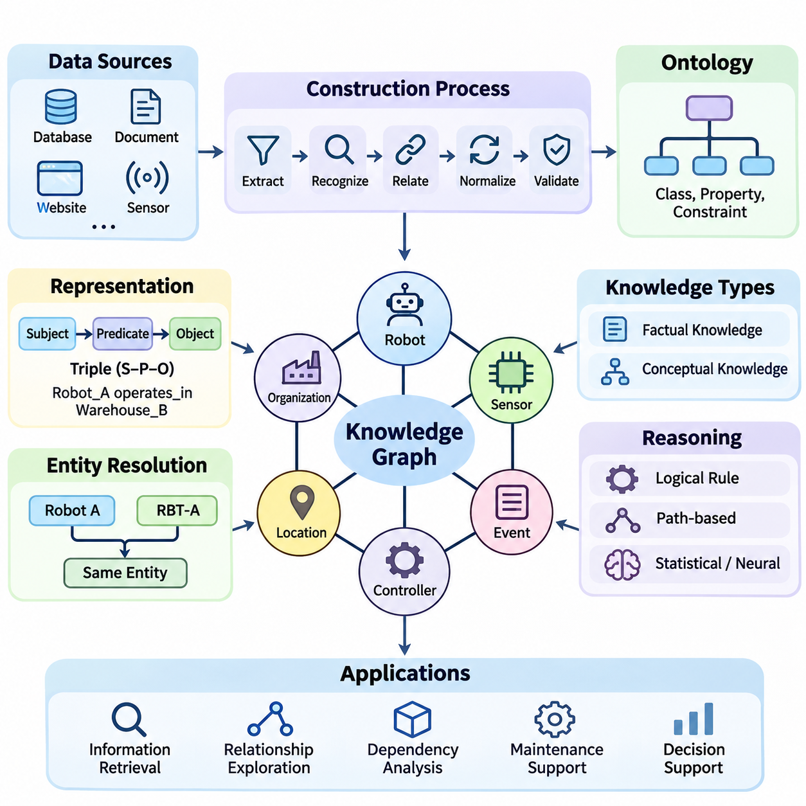
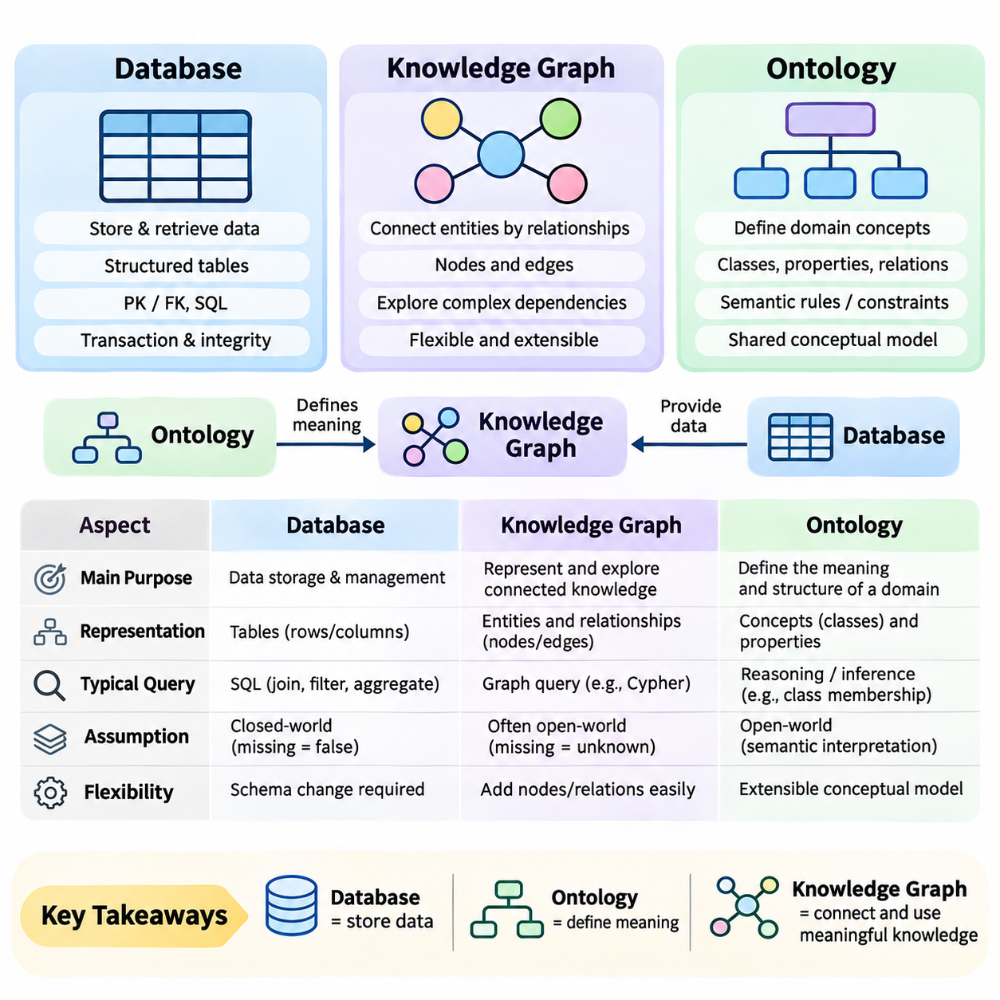
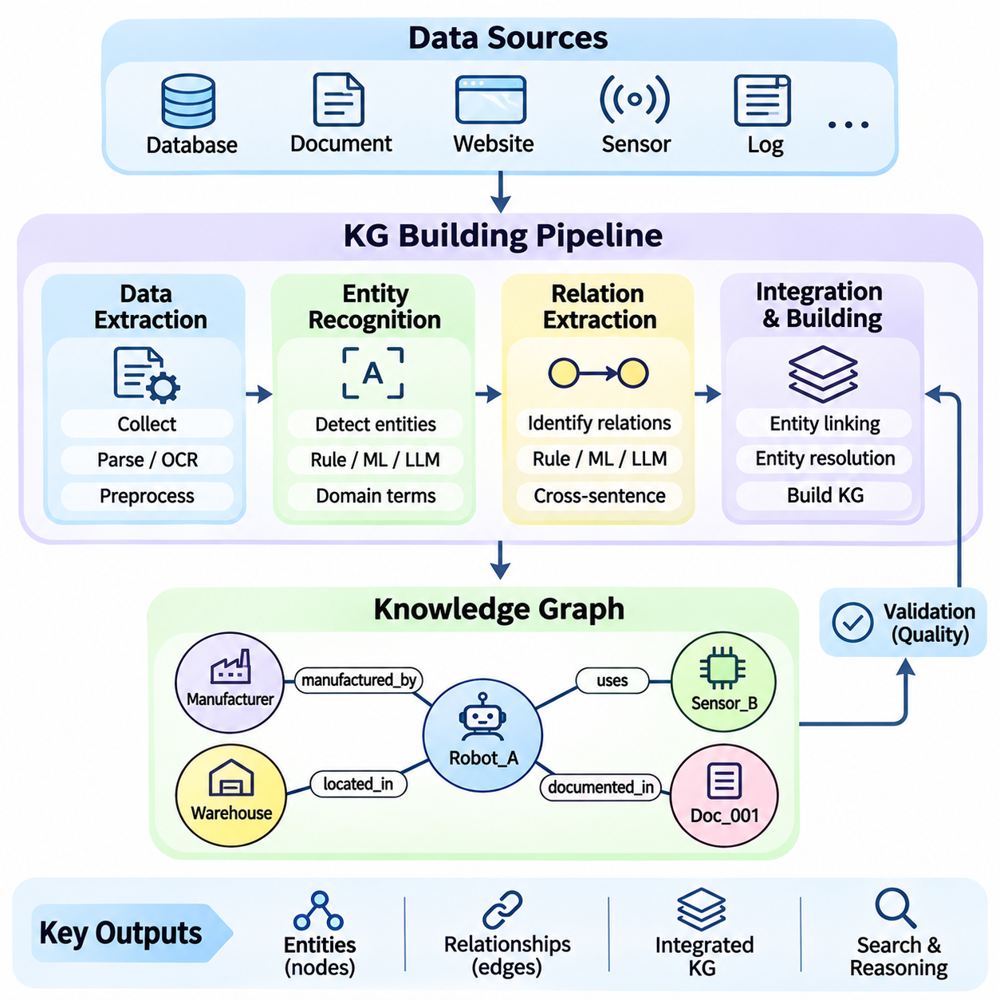
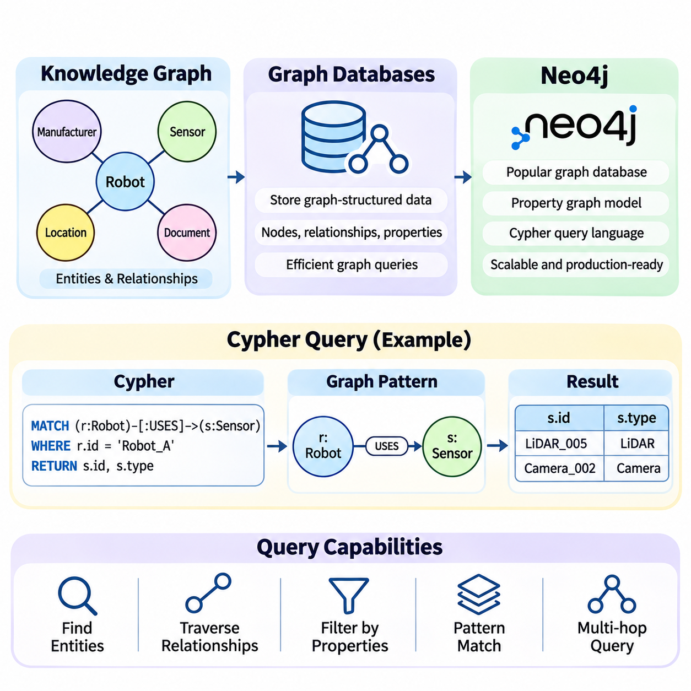
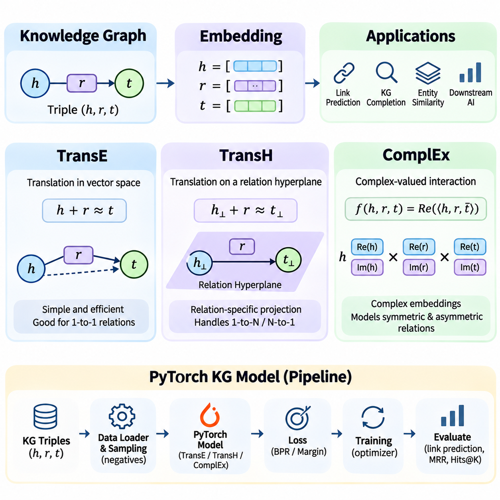
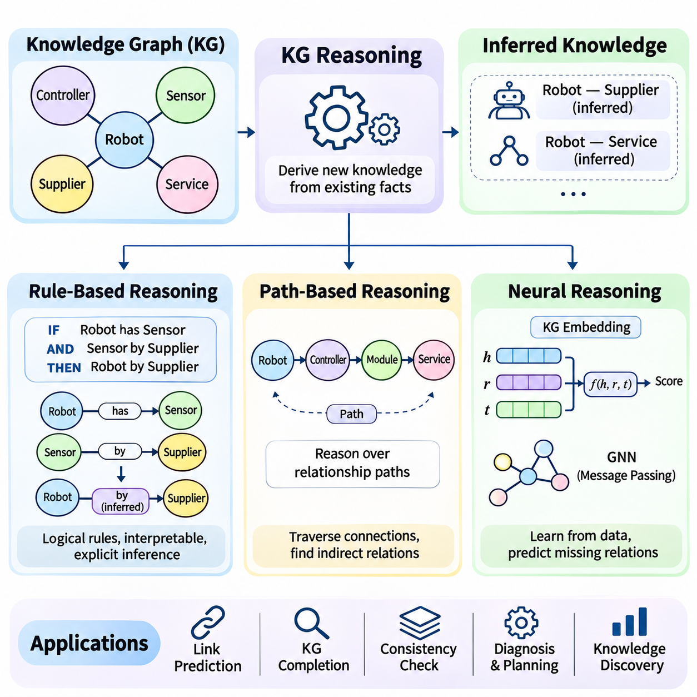
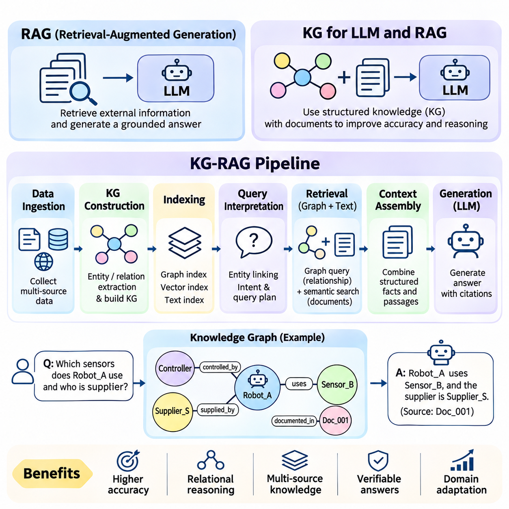
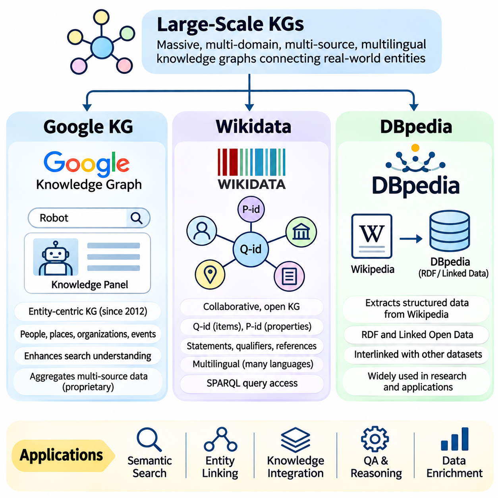
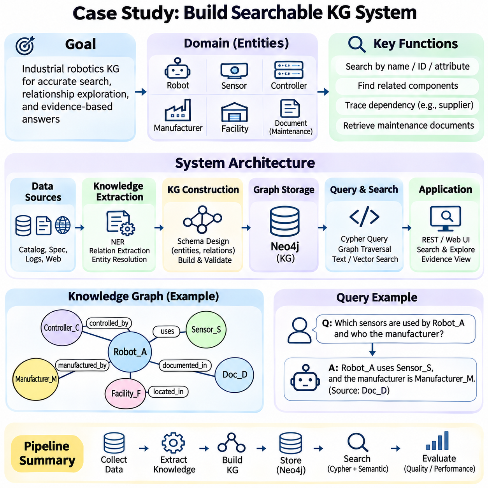

**Volume 02. Knowledge Representation**

# 03. Knowledge Graph

## 03.01 Introduction to Knowledge Graphs

{width="7.268055555555556in" height="7.268055555555556in"}

지식 그래프(Knowledge Graph)는 엔티티(개체), 엔티티의 속성, 그리고 이들 간의 관계가 명시적으로 연결된 정보의 구조화된 표현 방식입니다. 파편화된 기록이나 비구조화된 문서와 달리, 지식 그래프는 개념과 현실 세계의 객체가 서로 어떻게 관련되어 있는지를 포착합니다. 이러한 상호 연결된 표현 방식은 인공지능 시스템이 정보를 체계화하고, 관계를 탐색하며, 의미 있는 지식 기반 추론을 지원할 수 있도록 합니다.

지식 그래프의 근본적인 목적은 단편화된 정보를 의미 있는 사실들의 상호 연결된 네트워크로 변환하는 것입니다. 기업이나 조직은 수많은 데이터베이스, 문서, 애플리케이션 및 외부 서비스에 걸쳐 정보를 관리하는 경우가 많습니다. 지식 그래프는 이러한 출처들 사이에 명시적인 관계를 수립하여, 정보가 독립된 데이터 요소로 취급되는 대신 공유된 의미적 맥락(semantic context) 안에서 해석될 수 있도록 합니다.

지식 그래프는 일반적으로 노드(node)와 엣지(edge)로 표현되는 엔티티와 관계(relationship)로 구성됩니다. 엔티티는 사람, 조직, 위치, 제품, 사건 또는 추상적 개념을 설명할 수 있습니다. 관계는 소유권, 구성원 자격, 의존성, 위치 등 엔티티 간의 의미 있는 연관성을 표현합니다. 속성(properties)은 이름, 식별자, 타임스탬프, 측정값, 분류 레이블을 포함하여 추가적인 설명 정보를 제공합니다.

지식 그래프 정보를 표현하는 대표적인 방식 중 하나는 주어-서술어-목적어(subject-predicate-object) 삼항쌍(triple) 형태입니다. 주어는 엔티티를 식별하고, 서술어는 관계나 속성을 설명하며, 목적어는 또 다른 엔티티나 값을 식별합니다. 예를 들어 "로봇_A(Robot_A)는 창고_B(Warehouse_B)에서 작동한다(operates_in)"라는 문장은 로봇과 창고 사이의 관계를 표현합니다. 이렇게 상호 연결된 여러 삼항쌍이 모여 점차 복잡한 지식을 표현할 수 있는 그래프를 형성합니다.

지식 그래프는 엔티티의 고유한 정체성(identity)과 이를 설명하는 데 사용되는 텍스트 표현을 구분합니다. 하나의 조직이라도 서로 다른 정보 출처에서는 여러 이름, 약어 또는 식별자로 나타날 수 있습니다. 엔티티 개결(Entity Resolution)은 이러한 참조들이 동일한 현실 세계의 객체를 설명하는지 여부를 판별합니다. 신뢰할 수 있는 식별 프로세스는 불필요한 중복을 방지하고 이종 시스템에서 정보를 통합할 때 일관성을 향상시킵니다.

관계는 개별 사실이 더 큰 맥락에 어떻게 기여하는지 설명하므로 지식 그래프의 강력한 표현력을 제공하는 핵심 요소입니다. 예를 들어 제조 분야의 그래프는 로봇을 해당 제어기, 센서, 할당된 작업, 정비 기록, 작업 환경과 연결할 수 있습니다. 이러한 연결을 통해 애플리케이션은 기존 데이터베이스 쿼리처럼 모든 관련 관계를 미리 정의할 필요 없이 의존성과 운용 조건을 탐색할 수 있습니다.

지식 그래프는 사실적 지식(factual knowledge)과 개념적 지식(conceptual knowledge)을 모두 표현할 수 있습니다. 사실적 지식은 창고에 설치된 특정 로봇과 같은 구체적인 인스턴스를 설명합니다. 개념적 지식은 이동 로봇을 로봇 시스템의 일종으로 분류하는 것과 같이 범주와 관계를 정의합니다. 이 두 수준을 연결하면 애플리케이션이 광범위한 도메인 개념과 확립된 관계를 활용해 개별 관측 데이터를 해석할 수 있게 됩니다.

온톨로지(Ontology)는 클래스, 속성, 제약 조건, 의미적 관계를 정의함으로써 지식 그래프의 개념적 토대를 제공하는 경우가 많습니다. 온톨로지가 지식을 어떻게 해석해야 하는지 명세를 제공한다면, 지식 그래프는 특정 엔티티와 그 관계에 관한 상호 연결된 정보를 포함합니다. 지식 그래프가 항상 정식 온톨로지를 필요로 하는 것은 아니지만, 의미적 모델링(semantic modeling)은 일관성, 상호운용성 및 자동화된 추론 능력을 향상시킵니다.

지식 그래프는 자원 기술 프레임워크(RDF, Resource Description Framework) 표현 방식과 레이블 지정 속성 그래프(LPG, Labeled Property Graph)를 포함한 다양한 데이터 모델을 사용하여 구현될 수 있습니다. RDF는 삼항쌍을 통해 정보를 표현하고 표준화된 시맨틱 기술을 지원합니다. 속성 그래프는 연관된 속성을 가진 엔티티와 관계를 표현합니다. 두 접근 방식 모두 연결된 정보를 지원하지만, 모델링 관례, 쿼리 언어 및 추론 기능에서 차이가 있습니다.

지식 그래프 구축은 일반적으로 관련 정보 출처를 식별하고 표현해야 할 엔티티와 관계를 결정하는 것에서 시작됩니다. 구조화된 데이터베이스, 기술 문서, 웹사이트, 센서 기록, 애플리케이션 로그 등이 유용한 지식을 제공할 수 있습니다. 데이터 추출, 엔티티 인식, 관계 추출, 정규화 및 검증 과정을 거쳐 이러한 이종 입력 데이터가 일관된 그래프 표현으로 변환됩니다.

지식 그래프의 품질은 단순히 수집된 엔티티와 관계의 수에만 좌우되지 않습니다. 정확한 엔티티 식별, 의미 있는 관계 정의, 일관된 용어 사용, 신뢰할 수 있는 출처 정보가 필수적입니다. 잘못된 관계는 그래프 쿼리 및 추론 작업을 통해 잘못된 결론을 확산시킬 수 있습니다. 따라서 품질 보증을 위해서는 검증 절차, 출처 추적(provenance tracking), 중복 탐지 및 지속적인 수정 작업이 필요합니다.

지식 그래프는 애플리케이션이 단순히 키워드 매칭에만 의존하는 대신 관계를 탐색할 수 있도록 하여 정보 검색을 지원합니다. 쿼리를 통해 특정 조건을 충족하는 엔티티를 찾고 연결된 관계를 따라 관련 정보로 이동할 수 있습니다. 예를 들어 유지보수 애플리케이션은 특정 모터 모델을 사용하는 로봇을 찾은 후, 연결된 관계를 통해 관련 고장 보고서, 작업 환경 및 교체 부품 정보를 검색할 수 있습니다.

추론(Reasoning)은 명시적으로 저장된 사실을 단순히 검색하는 것을 넘어 지식 그래프의 기능을 확장합니다. 논리적 규칙을 사용하면 기존 정보로부터 추가적인 관계를 도출할 수 있으며, 경로 기반 방법을 통해 연결된 엔티티의 시퀀스를 탐색할 수도 있습니다. 통계적 및 신경망 접근 방식은 누락된 관계를 추정하거나 유력한 연관성을 식별할 수 있습니다. 이러한 방법들은 전제 조건과 신뢰도가 다르므로, 추론된 지식이 의사 결정에 영향을 미칠 때는 검증이 중요합니다.

지식 그래프 임베딩(Knowledge Graph Embeddings)은 연속적인 수학적 공간 내에서 엔티티와 관계를 수치 벡터로 표현합니다. 이러한 표현 방식을 통해 머신러닝 알고리즘은 관계형 정보를 처리하고 명시적 규칙만으로는 표현하기 어려운 패턴을 추정할 수 있습니다. 임베딩 방법은 링크 예측, 엔티티 유사도 평가, 지식 그래프 완성 등을 지원할 수 있으나, 예측된 관계를 자동으로 검증된 사실로 취급해서는 안 됩니다.

대규모 지식 그래프는 상호 연결된 정보가 광범위한 도메인에 걸쳐 검색, 탐색, 의미적 통합을 어떻게 지원할 수 있는지 보여줍니다. 위키데이터(Wikidata)나 DBpedia와 같은 자원은 다양한 엔티티와 그 관계에 관한 정보를 체계화합니다. 상업용 지식 그래프 역시 엔티티 중심 검색과 정보 통합을 지원합니다. 이들의 실용적 가치는 커버리지, 데이터 품질, 업데이트 메커니즘 및 애플리케이션 요구 사항에 따라 달라집니다.

지식 그래프는 응답 생성 과정에서 구조화된 맥락 정보를 제공하기 위해 거대 언어 모델(LLM)과 점점 더 많이 통합되고 있습니다. 언어 모델은 답변을 생성하기 전에 그래프 검색을 활용해 관련 엔티티, 관계, 뒷받침하는 사실을 식별할 수 있습니다. 이러한 접근 방식은 사실적 근거(factual grounding)와 다중 홉(multi-hop) 정보 접근성을 향상시킬 수 있지만, 검색 오류나 근거 없는 생성(환각) 가능성이 여전히 존재하므로 정확성을 완전히 보장하지는 않습니다.

검색 증강 생성(RAG) 시스템에서 지식 그래프는 문서 검색 및 벡터 유사도 검색을 보완할 수 있습니다. 벡터 검색이 의미적으로 유사한 콘텐츠를 찾아낸다면, 그래프 탐색은 명시적으로 연결된 엔티티와 관계를 찾아냅니다. 이러한 메커니즘을 결합하면 의존성, 조직 구조, 기술 구성 요소 또는 여러 상호 연결된 사실이 포함된 질문에 대해 더욱 풍부한 맥락을 제공할 수 있습니다.

로봇 공학과 산업 자동화는 지식 그래프 애플리케이션의 실용적인 예시를 제공합니다. 로봇 지식 그래프는 이동 플랫폼, 센서, 액추에이터, 제어 소프트웨어, 작업 공간, 운용 작업, 안전 제약 조건을 서로 연결할 수 있습니다. 이러한 표현 방식은 장비 식별, 유지보수 분석, 작업 조율, 맥락적 정보 검색을 지원합니다. 다만 실시간 제어를 위해서는 적절한 연산 및 안전 메커니즘이 여전히 필요합니다.

기업의 지식 관리(Enterprise Knowledge Management) 또한 그래프 기반 표현 방식의 이점을 누릴 수 있습니다. 조직의 정보는 부서와 소프트웨어 플랫폼에 걸쳐 분산되어 있는 경우가 많기 때문입니다. 지식 그래프는 공유된 엔티티 식별자를 통해 제품, 직원, 프로젝트, 공급업체, 문서, 운용 프로세스를 연결할 수 있습니다. 이러한 관계는 시스템 간 검색, 의존성 분석, 영향 평가, 조직 지식의 보다 일관된 해석을 지원합니다.

시간 정보(Temporal information)는 지식 그래프 표현의 또 다른 중요한 차원을 도입합니다. 장비가 교체되거나, 조직이 개편되거나, 운용 조건이 변화함에 따라 관계는 변할 수 있습니다. 유효 기간, 이벤트 타임스탬프, 과거 상태를 기록하면 애플리케이션이 현재의 사실과 이전의 조건을 구분할 수 있게 됩니다. 시간 모델링은 의사 결정이 특정 시점의 지식 상태에 의존할 때 특히 유용합니다.

출처(Provenance)와 신뢰성은 지식 그래프가 여러 출처의 정보를 통합할 때 필수적인 요소입니다. 특정 관계는 공식 데이터베이스, 자동 추출된 문서, 또는 확률적 예측에서 유래했을 수 있습니다. 정보의 출처, 추출 방법, 신뢰도, 검증 상태를 기록하면 애플리케이션이 신뢰성을 평가하는 데 도움이 됩니다. 출처 기록은 감사, 오류 수정, 조직 경계를 넘어선 지식의 책임 있는 재사용도 지원합니다.

지식 그래프는 확장성, 일관성, 스키마 진화, 연산 효율성과 관련된 엔지니어링 과제를 수반합니다. 대규모 그래프는 수억 또는 수십억 개의 관계를 포함할 수 있으므로 전문화된 인덱싱, 저장소, 쿼리 최적화가 필요합니다. 지속적인 업데이트는 상충되는 사실이나 오래된 관계를 유입시킬 수 있습니다. 효과적인 아키텍처는 표현력이 풍부한 모델링과 운용 성능, 유지관리성, 신뢰할 수 있는 접근성 간의 균형을 유지해야 합니다.

보안과 거버넌스는 지식 그래프가 조직의 민감한 정보를 연결할 때 특히 중요해집니다. 접근 제어는 엔티티, 관계, 또는 속성 수준에서 작동해야 할 수 있습니다. 서로 다른 애플리케이션과 사용자는 동일한 기반 지식 네트워크에 대해 제한된 뷰(view)를 요구할 수 있습니다. 적절한 권한 부여, 출처 관리, 정보 격리를 통해 직접적인 쿼리나 추론된 관계를 통한 무단 정보 유출을 방지할 수 있습니다.

잘 설계된 지식 그래프는 해당 애플리케이션이 답해야 하는 질문들을 반영해야 합니다. 가능한 모든 엔티티와 관계를 모델링하는 것은 실용적이지도 않고 필요하지도 않습니다. 대신 개발자는 중요한 도메인 개념을 식별하고, 의미 있는 관계를 정의하며, 식별 관례를 수립하고, 대표적인 쿼리를 평가해야 합니다. 이러한 애플리케이션 중심 접근 방식은 의미적 풍부함과 구현 복잡성 사이에서 유용한 균형을 유지하도록 돕습니다.

지식 그래프는 기호적 지식 표현(symbolic knowledge representation)과 현대의 데이터 기반 인공지능 사이에서 중요한 위치를 차지합니다. 지식 그래프는 점검과 쿼리가 가능한 명시적 관계를 보존하는 동시에 통계적 학습, 신경망 모델, 언어 기반 인터페이스와의 통합을 지원합니다. 지식 그래프의 핵심적 기여는 정보를 연결되고 해석 가능한 구조로 체계화하여 복잡한 도메인 전반에 걸친 지식 통합, 검색, 추론을 가능하게 하는 데 있습니다.

## 03.02 KG vs Database vs Ontology

{width="7.268055555555556in" height="7.268055555555556in"}

지식 그래프(Knowledge Graph), 데이터베이스(Database), 온톨로지(Ontology)는 서로 밀접하게 관련된 기술이지만, 정보 표현(Information Representation)과 관리(Management)에서 서로 다른 목적을 수행한다. 데이터베이스는 주로 데이터를 저장하고 검색하며, 온톨로지는 개념과 개념 간 관계를 형식적으로 정의하고, 지식 그래프는 의미 있는 연관성을 통해 개체들을 연결한다. 이러한 차이를 이해하는 것은 구조화된 정보, 의미적 해석(Semantic Interpretation), 추론(Reasoning)이 필요한 지능형 시스템(Intelligent System)을 설계하는 데 필수적이다.

전통적인 데이터베이스(Traditional Database)는 정의된 데이터 모델(Data Model)에 따라 정보를 구성하고 저장, 검색, 갱신 및 트랜잭션 관리(Transaction Management)를 위한 메커니즘을 제공한다. 관계형 데이터베이스(Relational Database)는 행(Row)과 열(Column)로 구성된 테이블(Table)을 통해 정보를 표현한다. 관계는 일반적으로 기본 키(Primary Key)와 외래 키(Foreign Key)를 사용하여 설정되며, 응용 프로그램은 조인(Join)을 통해 여러 레코드(Record)를 결합할 수 있다. 이러한 구조는 정형화된 비즈니스 거래와 운영 데이터 처리에 특히 효과적이다.

지식 그래프(Knowledge Graph)는 연결을 별도 레코드 사이의 참조로만 취급하기보다 개체(Entity) 사이의 관계(Relationship)를 중심으로 정보를 표현한다. 개체는 노드(Node)로 표현되고, 관계는 명시적으로 정의된 연관성을 통해 노드를 연결한다. 이러한 표현 방식은 응용 프로그램이 상호 연결된 정보를 자연스럽게 탐색하고, 개발 과정에서 모든 관계 경로를 미리 정의하지 않더라도 복잡한 의존성(Dependency)을 조사할 수 있도록 한다.

온톨로지(Ontology)는 도메인(Domain)을 설명하는 데 사용되는 어휘(Vocabulary)와 의미적 규칙(Semantic Rule)을 정의함으로써 다른 개념적 수준에서 작동한다. 온톨로지는 정보가 어떻게 해석되어야 하는지를 결정하는 클래스(Class), 속성(Property), 관계(Relationship), 논리적 제약조건(Logical Constraint)을 식별한다. 예를 들어 온톨로지는 로봇(Robot)을 기계(Machine)의 한 유형으로 정의하고, 로봇이 작업(Task)을 수행할 수 있다고 명시할 수 있다. 이러한 정의는 공유된 개념 모델(Conceptual Model)을 확립한다.

온톨로지와 지식 그래프의 차이는 인스턴스(Instance)와 개념적 정의(Conceptual Definition)를 고려하면 더욱 명확해진다. 온톨로지는 Robot, Sensor, Warehouse라는 클래스를 정의하고 equippedWith 및 locatedIn과 같은 관계를 지정할 수 있다. 이후 지식 그래프는 Robot_001 equippedWith LiDAR_005 및 Robot_001 locatedIn Warehouse_A와 같은 사실을 표현할 수 있다. 온톨로지가 의미를 정의한다면, 지식 그래프는 특정 개체에 관한 상호 연결된 지식을 표현한다.

그러나 지식 그래프(Knowledge Graph)에 반드시 형식적 온톨로지(Formal Ontology)가 필요한 것은 아니다. 일부 시스템은 포괄적인 의미 표준(Semantic Standard)을 채택하지 않고 경량 스키마(Lightweight Schema), 속성 레이블(Property Label), 응용 프로그램별 관계 정의(Application-Specific Relationship Definition)를 사용한다. 마찬가지로 온톨로지는 실제 데이터가 채워진 지식 그래프와 독립적으로 존재할 수 있다. 두 기술은 서로 대체하는 관계가 아니라 상호 보완적인 관계이며, 통합 방식은 응용 요구사항과 필요한 추론 능력에 따라 달라진다.

관계형 데이터베이스(Relational Database)는 제약조건(Constraint), 정규화(Normalization), 트랜잭션 처리(Transaction Processing)를 통해 구조화된 스키마(Structured Schema)와 데이터 무결성(Data Integrity)을 강조한다. 테이블은 불필요한 중복을 줄이고 레코드 간 일관된 관계를 유지하도록 설계된다. SQL은 필터링(Filtering), 조인(Join), 집계(Aggregation), 데이터 수정(Data Modification)을 위한 강력한 연산을 제공한다. 이러한 특성으로 인해 관계형 데이터베이스는 금융 거래, 재고 관리 시스템, 전사적 자원 관리(Enterprise Resource Planning)에 적합하다.

지식 그래프(Knowledge Graph)는 관계가 많거나 이질적이거나 여러 연결 경로를 통해 빈번하게 탐색해야 하는 경우 장점을 제공한다. 그래프는 공급업체(Supplier), 부품(Component), 제품(Product), 공장(Factory), 유지보수 이벤트(Maintenance Event)를 하나의 연결된 구조로 표현할 수 있다. 응용 프로그램은 이러한 관계를 탐색하여 간접적인 의존성을 식별하거나 변경 사항이 개체 네트워크 전체에 어떻게 전파되는지 조사할 수 있다.

관계형 표현(Relational Representation)과 그래프 표현(Graph Representation)의 차이가 절대적인 것은 아니다. 관계형 데이터베이스도 연결 테이블(Junction Table)과 재귀 쿼리(Recursive Query)를 통해 복잡한 네트워크를 모델링할 수 있다. 마찬가지로 그래프 데이터베이스(Graph Database)도 구조화된 속성, 인덱싱(Indexing), 트랜잭션 연산(Transaction Operation)을 지원할 수 있다. 실질적인 차이는 특정 관계를 표현할 수 있는지 여부가 아니라 모델링 편의성, 질의 패턴(Query Pattern), 의미적 요구사항, 성능 특성에 있다.

그래프 데이터베이스(Graph Database)는 그래프 구조 정보(Graph-Structured Information)를 위한 저장 및 질의 인프라(Storage and Query Infrastructure)를 제공한다. 속성 그래프 시스템(Property Graph System)은 일반적으로 레이블(Label)과 속성(Property)이 연결된 노드와 관계를 표현한다. RDF 기반 시스템(RDF-Based System)은 주어-술어-목적어(Subject-Predicate-Object) 트리플(Triple)을 통해 정보를 표현한다. 두 방식 모두 지식 그래프 응용을 지원하지만, 그래프 데이터베이스 자체가 의미적 일관성(Semantic Consistency), 도메인 이해(Domain Understanding), 자동 추론(Automated Reasoning)을 보장하지는 않는다.

온톨로지(Ontology)는 기본적인 그래프 연결성(Graph Connectivity)을 넘어 추가적인 해석을 가능하게 하는 형식 의미론(Formal Semantics)을 도입한다. RDF 스키마(RDF Schema)와 웹 온톨로지 언어(Web Ontology Language, OWL) 같은 기술은 클래스 계층(Class Hierarchy), 속성 특성(Property Characteristic), 논리적 제한(Logical Restriction)을 정의한다. 추론 엔진(Reasoning Engine)은 이러한 정의를 사용하여 클래스 소속(Class Membership)을 추론하거나 특정 불일치(Inconsistency)를 탐지할 수 있다. 사용 가능한 추론 능력은 온톨로지 언어와 추론 구현 방식에 따라 달라진다.

중요한 개념적 차이 중 하나는 누락된 정보(Missing Information)를 해석하는 데 사용되는 가정(Assumption)이다. 기존 데이터베이스 응용은 정의된 운영 맥락에서 누락된 레코드를 거짓으로 취급할 수 있는 폐쇄 세계 추론(Closed-World Reasoning)을 자주 사용한다. 반면 의미 기반 지식 시스템(Semantic Knowledge System)은 명시되지 않은 진술을 반드시 거짓으로 판단하지 않고 알 수 없는 것으로 간주하는 개방 세계 가정(Open-World Assumption)을 채택하는 경우가 많다. 이러한 가정은 검증, 추론 및 응용 프로그램 동작에 영향을 미친다.

스키마 유연성(Schema Flexibility)도 중요한 고려사항이다. 관계형 데이터베이스(Relational Database)는 새로운 개체 유형이나 관계가 도입될 때 명시적인 스키마 변경(Schema Modification)이 필요한 경우가 많다. 그래프 모델(Graph Model)은 상대적으로 적은 구조 변경만으로 추가적인 노드 레이블(Node Label), 관계 유형(Relationship Type), 속성(Property)을 수용할 수 있다. 그러나 이러한 유연성을 통제하지 않으면 일관되지 않은 용어, 중복된 개체, 신뢰할 수 없는 질의가 발생할 수 있으므로 거버넌스(Governance) 체계가 필요하다.

온톨로지(Ontology)는 공유된 정의(Shared Definition)와 재사용 가능한 개념 구조(Reusable Conceptual Structure)를 제공함으로써 일부 일관성 문제를 해결한다. 공통 온톨로지(Common Ontology)는 서로 다른 시스템이 동일한 개체 유형과 관계를 일관되게 해석하도록 지원한다. 이러한 기능은 조직이나 기술 도메인 간 정보를 통합할 때 특히 중요하다. 다만 독립적인 시스템들이 서로 호환되지 않는 어휘를 사용하는 경우에는 온톨로지 정렬(Ontology Alignment)과 매핑(Mapping)이 여전히 필요하다.

지식 그래프(Knowledge Graph)는 데이터베이스, 문서, 응용 프로그램 인터페이스(Application Interface), 외부 데이터셋(External Dataset)에서 추출한 개체를 연결할 수 있으므로 이기종 정보원(Heterogeneous Information Source)을 통합하는 데 특히 유용하다. 개체 식별 및 통합(Entity Resolution)은 동일한 실제 객체를 가리키는 참조를 식별하고, 관계 매핑(Relationship Mapping)은 의미 있는 연결을 설정한다. 그 결과 생성된 그래프는 원래의 저장 시스템을 반드시 대체하지 않으면서도 통합된 관점(Unified View)을 제공한다.

데이터베이스(Database)는 운영 레코드(Operational Record)의 권위 있는 원천(Authoritative Source)으로 유지되고, 지식 그래프는 여러 데이터베이스 위에 통합된 의미 계층(Semantic Layer)을 제공할 수 있다. 예를 들어 제조 데이터베이스는 장비 재고를 관리하고, 다른 시스템은 유지보수 이력(Maintenance History)을 기록할 수 있다. 지식 그래프는 공유 개체 식별자(Shared Entity Identifier)를 통해 장비, 부품, 유지보수 이벤트, 운영 위치를 연결하여 시스템 간 분석(Cross-System Analysis)을 가능하게 한다.

질의 언어(Query Language)는 표현 방식과 사용 목적의 차이를 반영한다. SQL은 테이블과 구조화된 레코드를 사용하는 관계형 연산(Relational Operation)에 최적화되어 있다. Cypher는 속성 그래프 환경(Property Graph Environment)에서 그래프 패턴(Graph Pattern)과 관계 탐색(Relationship Traversal)을 표현한다. SPARQL은 트리플 패턴(Triple Pattern)과 의미적 그래프 매칭(Semantic Graph Matching)을 통해 RDF 그래프를 질의한다. 질의 언어 선택은 기반 데이터 모델, 지원 연산, 응용 아키텍처(Application Architecture)에 따라 달라진다.

성능 비교(Performance Comparison)는 어떤 표현 방식도 보편적으로 우수하지 않기 때문에 신중하게 수행해야 한다. 관계형 데이터베이스(Relational Database)는 구조화된 트랜잭션과 최적화된 조인에서 뛰어난 성능을 제공하는 경우가 많다. 그래프 데이터베이스(Graph Database)는 특히 연결된 개체를 탐색할 때 특정 관계 중심 질의(Relationship-Intensive Query)를 단순화하고 가속할 수 있다. 실제 성능은 인덱싱, 그래프 밀도(Graph Density), 질의 선택도(Query Selectivity), 데이터 분포(Data Distribution), 구현 세부사항에 따라 달라진다.

온톨로지(Ontology) 역시 계산상의 절충관계(Computational Tradeoff)를 수반한다. 표현력이 높은 논리적 제약조건(Expressive Logical Constraint)은 정교한 분류(Classification)와 추론(Inference)을 지원하지만, 온톨로지의 표현력이 증가할수록 추론 복잡도(Reasoning Complexity)가 크게 증가할 수 있다. 따라서 일부 응용은 경량 분류체계(Lightweight Taxonomy)나 제한된 추론 프로파일(Restricted Reasoning Profile)을 채택한다. 반면 논리적 일관성과 추론이 핵심 요구사항인 시스템은 더 높은 계산 비용에도 불구하고 풍부한 의미 모델(Semantic Model)을 필요로 한다.

인공지능 시스템(Artificial Intelligence System)에서는 세 기술이 직접 경쟁하기보다 함께 작동하는 경우가 많다. 데이터베이스는 신뢰할 수 있는 영속 저장(Persistence)을 제공하고, 온톨로지는 도메인의 의미를 정의하며, 지식 그래프는 사실들을 탐색 가능한 표현으로 연결한다. 기계학습 모델(Machine Learning Model)은 비정형 정보원(Unstructured Source)에서 개체와 관계를 추출할 수 있으며, 추론 구성요소(Reasoning Component)는 명시적 규칙(Explicit Rule)이나 학습된 관계 패턴(Learned Relational Pattern)을 사용하여 그래프 정보를 해석할 수 있다.

대규모 언어 모델(Large Language Model, LLM) 응용은 이러한 상호 보완적 아키텍처(Complementary Architecture)를 잘 보여준다. 운영 데이터베이스는 검증된 레코드를 제공하고, 온톨로지는 개체 범주와 관계의 의미를 명확히 하며, 지식 그래프는 연결된 정보에 대한 구조적 검색(Structured Retrieval)을 지원한다. 검색 증강 생성(Retrieval-Augmented Generation, RAG) 파이프라인은 그래프 질의와 문서 검색을 결합하여 언어 생성(Language Generation)에 필요한 맥락적 근거(Contextual Evidence)를 제공할 수 있지만, 사실적 정확성(Factual Accuracy)을 위해서는 여전히 검증이 필요하다.

로보틱스(Robotics)는 이러한 차이를 보여주는 실용적인 사례이다. 관계형 데이터베이스는 로봇 식별자(Robot Identifier), 센서 구성(Sensor Configuration), 유지보수 레코드(Maintenance Record)를 저장할 수 있다. 온톨로지는 로봇 범주, 구성요소 관계, 운영 개념(Operational Concept)을 정의할 수 있다. 지식 그래프는 개별 로봇을 센서, 할당된 작업, 환경, 유지보수 이력과 연결하여 맥락 기반 질의(Contextual Query)와 의존성 분석(Dependency Analysis)을 지원한다.

산업용 디지털 트윈(Industrial Digital Twin)도 데이터베이스, 온톨로지, 지식 그래프를 결합할 수 있다. 데이터베이스는 측정값(Measurement)과 운영 레코드를 관리하고, 온톨로지는 장비와 공정에 대한 일관된 정의를 확립하며, 지식 그래프는 물리적 자산(Physical Asset)과 디지털 구성요소(Digital Component) 사이의 의존성을 표현한다. 이러한 결합은 복잡한 산업 환경에서 시스템 통합(System Integration), 운영 분석(Operational Analysis), 지식 기반 의사결정 지원(Knowledge-Driven Decision Support)을 가능하게 한다.

데이터 거버넌스(Data Governance) 요구사항도 기술에 따라 다르다. 데이터베이스는 트랜잭션 무결성(Transaction Integrity), 접근 제어(Access Control), 백업(Backup), 복구(Recovery)를 강조한다. 온톨로지는 어휘 관리(Vocabulary Management), 의미적 버전 관리(Semantic Versioning), 개념적 일관성(Conceptual Consistency)이 필요하다. 지식 그래프는 개체 식별 관리(Entity Identity Management), 관계 검증(Relationship Validation), 출처 추적(Provenance Tracking), 갱신 조정(Update Coordination)이 필요하다. 통합 아키텍처는 세 계층 전반에서 이러한 책임을 다루어야 한다.

데이터베이스, 온톨로지, 지식 그래프 중 무엇을 선택할지는 특정 기술에 대한 선호보다 의도한 정보 요구사항(Information Requirement)에서 출발해야 한다. 구조화된 트랜잭션이 중심인 응용에는 기존 데이터베이스가 적합할 수 있으며, 공유된 개념적 정의가 필요한 응용에는 온톨로지가 유용하다. 상호 연결된 지식, 관계 탐색, 의미적 통합(Semantic Integration)이 필요한 시스템에는 지식 그래프가 효과적인 선택이 될 수 있다.

궁극적으로 데이터베이스(Database), 온톨로지(Ontology), 지식 그래프(Knowledge Graph)는 지식 공학(Knowledge Engineering)의 상호 보완적인 차원을 나타낸다. 데이터베이스는 정보가 어떻게 저장되고 관리되는지에 답하고, 온톨로지는 개념과 관계가 무엇을 의미하는지 정의하며, 지식 그래프는 특정 개체들이 어떻게 연결되어 있는지를 표현한다. 이들을 조화롭게 활용하면 신뢰할 수 있는 데이터 관리(Reliable Data Management), 의미적 상호운용성(Semantic Interoperability), 지식 기반 추론(Knowledge-Based Reasoning)을 결합한 지능형 정보 시스템(Intelligent Information System)의 기반을 구축할 수 있다.

## 03.03 KG Construction

{width="7.268055555555556in" height="7.268055555555556in"}

지식 그래프 구축(Knowledge Graph Construction)은 이기종 정보(Heterogeneous Information)를 개체(Entity)와 의미 있는 관계(Relationship)로 구성된 구조화된 네트워크(Structured Network)로 변환하는 과정이다. 이 과정은 데이터 추출(Data Extraction), 개체 인식(Entity Recognition), 관계 추출(Relation Extraction), 정규화(Normalization), 그래프 통합(Graph Integration)을 하나의 체계적인 작업 흐름(Workflow)으로 결합한다. 목표는 단순히 정보를 수집하는 것이 아니라 지식 발견(Knowledge Discovery)과 추론(Reasoning)을 지원하는 일관되고 검색 가능하며 해석 가능한 표현을 생성하는 것이다.

구축 과정은 관련 정보원(Information Source)을 식별하고 대상 응용 프로그램(Target Application)의 지식 요구사항(Knowledge Requirement)을 정의하는 것에서 시작한다. 정보원에는 관계형 데이터베이스(Relational Database), 기술 문서(Technical Document), 웹사이트(Website), 응용 프로그램 인터페이스(Application Interface), 센서 기록(Sensor Record), 운영 로그(Operational Log) 등이 포함될 수 있다. 각 정보원은 서로 다른 유형의 정보를 제공하므로 구조, 신뢰성, 갱신 빈도(Update Frequency), 의미적 특성(Semantic Characteristic)을 고려한 추출 방법이 필요하다.

데이터 추출(Data Extraction)은 원천 시스템(Source System)의 정보를 후속 처리에 적합한 표현으로 변환한다. 정형 데이터(Structured Data)는 데이터베이스 질의(Database Query)나 응용 프로그램 프로그래밍 인터페이스(Application Programming Interface, API)를 통해 접근할 수 있으며, 반정형 데이터(Semi-Structured Data)는 JSON, XML, HTML 파싱(Parsing)이 필요할 수 있다. 비정형 문서(Unstructured Document)는 텍스트 처리(Text Processing)와 문서 분석(Document Analysis)이 필요한 경우가 많다. 추출된 정보는 정확한 개체 및 관계 식별을 지원할 수 있도록 충분한 문맥(Context)을 보존해야 한다.

문서 추출(Document Extraction)은 유용한 정보가 문단, 표(Table), 메타데이터(Metadata), 내장된 기술 설명(Technical Description) 등에 분산되어 있을 수 있기 때문에 여러 문제를 수반한다. 텍스트 전처리(Text Preprocessing)에는 문자 정규화(Character Normalization), 문장 분할(Sentence Segmentation), 언어 식별(Language Identification), 불필요한 서식 제거(Formatting Removal)가 포함될 수 있다. 스캔 문서(Scanned Document)의 경우 광학 문자 인식(Optical Character Recognition, OCR)이 필요할 수 있다. 추출 품질은 이후 모든 지식 그래프 구축 단계의 신뢰성에 직접적인 영향을 미친다.

개체 인식(Entity Recognition)은 추출된 정보에서 의미 있는 객체(Object)나 개념(Concept)에 대한 언급(Mention)을 식별한다. 개체명 인식(Named Entity Recognition, NER) 시스템은 일반적으로 사람, 조직, 위치, 날짜, 제품을 탐지하며, 도메인 특화 시스템(Domain-Specific System)은 장비, 구성요소, 공정, 기술 매개변수(Technical Parameter)를 식별한다. 목표는 텍스트에 나타난 언급을 지식 그래프 내에서 일관되게 표현할 수 있는 후보 개체(Candidate Entity)로 변환하는 것이다.

개체 인식(Entity Recognition)은 규칙 기반 방법(Rule-Based Method), 통계 모델(Statistical Model), 트랜스포머 아키텍처(Transformer Architecture), 또는 이러한 접근법의 조합을 사용할 수 있다. 사전 매칭(Dictionary Matching)은 도메인 용어가 잘 관리되는 경우 효과적이며, 기계학습 방법(Machine Learning Method)은 다양한 언어적 문맥(Linguistic Context)에 나타나는 개체를 인식할 수 있다. 범용 모델(General-Purpose Model)은 특수한 산업 식별자, 과학 용어, 장비 분류를 인식하지 못할 수 있으므로 도메인 적응(Domain Adaptation)이 필요한 경우가 많다.

개체에 대한 언급을 인식했다고 해서 고유한 정체성(Unique Identity)이 자동으로 확립되는 것은 아니다. 개체 연결(Entity Linking)은 추출된 언급을 기존 그래프 개체나 참조 식별자(Reference Identifier)와 연결한다. 예를 들어 서로 다른 약어(Abbreviation)가 동일한 제조 조직을 가리킬 수 있으며, 동일한 장비 이름이 서로 다른 물리적 장치를 나타낼 수도 있다. 신뢰할 수 있는 개체 연결에는 문맥적 근거(Contextual Evidence), 식별자 매칭(Identifier Matching), 모호성 해소(Ambiguity Resolution)가 필요하다.

개체 식별 및 통합(Entity Resolution)은 이기종 정보원(Heterogeneous Information Source) 전반에서 발생하는 중복(Duplication)과 불일치(Inconsistency)를 추가로 해결한다. 동일한 실제 객체를 설명하는 레코드는 서로 다른 이름, 불완전한 속성, 충돌하는 식별자를 포함할 수 있다. 매칭 알고리즘(Matching Algorithm)은 관련 특성과 문맥적 관계를 비교하여 레코드를 병합(Merge)해야 하는지 판단한다. 잘못된 병합은 그래프를 손상시킬 수 있으며, 불충분한 병합은 지식의 단편화(Knowledge Fragmentation)를 초래한다.

관계 추출(Relation Extraction)은 인식된 개체 사이의 의미 있는 연관성(Association)을 식별한다. 관계는 소유권(Ownership), 위치(Location), 구성요소 소속(Component Membership), 운영 의존성(Operational Dependency), 시간적 상호작용(Temporal Interaction)을 설명할 수 있다. 예를 들어 "Robot_A uses LiDAR_B for navigation"이라는 문장은 로봇과 센서를 연결하는 관계를 생성할 수 있다. 관계 추출은 서술형 정보를 구조화된 검색(Structured Retrieval)을 지원하는 명시적인 그래프 연결로 변환한다.

규칙 기반 관계 추출(Rule-Based Relation Extraction)은 사전에 정의된 언어 패턴(Linguistic Pattern), 의존 구문 구조(Dependency Structure), 도메인 특화 템플릿(Domain-Specific Template)을 사용한다. 이러한 방법은 원천 언어(Source Language)가 일관된 규칙을 따를 때 예측 가능한 동작을 제공할 수 있다. 그러나 고정된 패턴은 익숙하지 않은 표현으로 관계가 기술될 경우 실패할 수 있다. 통계적 및 신경망 기반 추출 방법(Statistical and Neural Extraction Method)은 더욱 다양한 표현을 인식할 수 있지만 적절한 학습 데이터(Training Data)와 검증(Validation)이 필요하다.

트랜스포머 기반 언어 모델(Transformer-Based Language Model)은 문장과 문서의 문맥적 표현(Contextual Representation)을 사용하여 관계를 식별할 수 있다. 이러한 모델은 사전에 정의된 관계 유형(Relation Type)을 분류하거나 자연어(Natural Language)에서 후보 관계 진술(Candidate Relational Statement)을 생성할 수 있다. 그러나 그 출력은 대상 스키마(Target Schema)에 따라 검증해야 한다. 그럴듯한 예측이라도 근거 없는 관계, 잘못된 개체 할당(Entity Assignment), 원본 정보에 존재하지 않는 내용을 포함할 수 있기 때문이다.

관계 추출(Relation Extraction)은 관련 개체가 여러 문장이나 문서에 분산되어 나타날 때 더욱 어려워진다. 상호참조 해소(Coreference Resolution)는 이전에 언급된 개체를 가리키는 표현을 식별하며, 문서 수준 관계 추출(Document-Level Relation Extraction)은 텍스트 전체에 분산된 연결을 조사한다. 이러한 기능은 기술 문서가 장비 구성(Equipment Configuration), 운영 절차(Operational Procedure), 구성요소 의존성(Component Dependency)을 서로 다른 절에 걸쳐 설명하는 경우 중요하다.

지식 그래프 구축 파이프라인(Knowledge Graph Building Pipeline)은 추출과 변환 단계를 반복 가능한 공학적 프로세스(Repeatable Engineering Process)로 조정한다. 일반적인 파이프라인은 원천 정보 수집, 콘텐츠 전처리, 개체 인식, 관계 추출, 개체 식별 및 통합, 진술 검증(Statement Validation), 승인된 사실의 그래프 저장(Graph Storage)을 수행한다. 각 단계는 중간 결과(Intermediate Result)를 제공해야 하며, 이를 통해 오류가 후속 지식 표현 단계로 전파되기 전에 식별할 수 있다.

스키마 매핑(Schema Mapping)은 추출된 정보를 대상 그래프(Target Graph)에 필요한 개체 유형(Entity Type), 관계 범주(Relationship Category), 속성 정의(Property Definition)로 변환한다. 원천 용어(Source Terminology)는 온톨로지나 응용 스키마(Application Schema)에 정의된 어휘와 다를 수 있다. 매핑 규칙(Mapping Rule)은 의도된 의미를 보존하면서 이러한 차이를 조정한다. 일관된 스키마 매핑은 독립적인 정보원에서 수집된 정보가 공통 그래프 질의(Graph Query)와 추론 연산(Reasoning Operation)에 활용되도록 한다.

그래프 구축(Graph Construction)은 일반적으로 추출된 사실을 주어-술어-목적어 트리플(Subject-Predicate-Object Triple)이나 레이블이 있는 속성 그래프 구조(Labeled Property Graph Structure)로 표현한다. RDF 중심 파이프라인(RDF-Oriented Pipeline)에서는 개체와 관계에 전역적으로 식별 가능한 자원 식별자(Resource Identifier)를 부여할 수 있다. 속성 그래프 파이프라인(Property Graph Pipeline)은 일반적으로 레이블과 속성을 포함하는 노드(Node)와 간선(Edge)을 생성한다. 선택한 표현 방식은 저장 연산, 질의 설계, 상호운용성(Interoperability), 사용 가능한 추론 메커니즘(Reasoning Mechanism)에 영향을 미친다.

검증(Validation)은 추출 파이프라인(Extraction Pipeline)이 누락된 개체, 잘못된 관계, 일관되지 않은 속성, 중복된 진술을 생성할 수 있기 때문에 필수적이다. 구조적 검증(Structural Validation)은 그래프 레코드가 예상 형식과 필수 필드를 충족하는지 확인한다. 의미적 검증(Semantic Validation)은 관계가 도메인 정의와 제약조건을 준수하는지 검사한다. 자동화된 검사가 신뢰성 있게 해결할 수 없는 모호하거나 영향력이 큰 정보에는 사람의 검토(Human Review)가 필요할 수 있다.

출처 추적(Provenance Tracking)은 그래프 정보가 어디에서 유래했으며 어떻게 생성되었는지를 기록한다. 하나의 진술(Statement)은 원본 문서(Source Document), 추출 시각(Extraction Timestamp), 처리 모델(Processing Model), 신뢰도 점수(Confidence Score), 검증 상태(Verification Status)와 연결될 수 있다. 이러한 메타데이터(Metadata)는 검증된 사실(Verified Fact)과 자동 생성된 후보(Automatically Generated Candidate)를 구별하는 데 도움이 된다. 또한 출처 정보는 지식이 여러 응용 프로그램에서 재사용될 때 감사(Auditing), 수정(Correction), 추적 가능성(Traceability)을 지원한다.

신뢰도 관리(Confidence Management)는 기계학습 모델(Machine Learning Model)이 개체 및 관계 추출에 참여할 때 특히 중요하다. 모델 신뢰도 추정(Model Confidence Estimation)은 수동 검토(Manual Review)의 우선순위를 결정하는 데 도움이 될 수 있지만 사실적 정확성(Factual Correctness)을 보장하지는 않는다. 임계값(Threshold)은 대표성 있는 검증 데이터(Validation Data)를 사용하여 보정(Calibration)해야 한다. 높은 신뢰도의 예측도 잘못될 수 있으므로 신뢰할 수 있는 그래프 구축에는 원천 검증(Source Verification)과 도메인 특화 일관성 검사(Domain-Specific Consistency Check)가 필요하다.

증분 구축(Incremental Construction)은 새로운 정보가 제공됨에 따라 지식 그래프(Knowledge Graph)가 지속적으로 발전하도록 한다. 매번 전체 그래프를 재구축하는 대신 파이프라인은 변경된 레코드를 식별하고 필요한 부분만 수정할 수 있다. 이러한 접근법은 처리 비용(Processing Cost)을 줄이고 자주 갱신되는 운영 시스템(Operational System)을 지원한다. 증분 갱신(Incremental Update)은 삭제된 정보, 수정된 관계, 기존에 저장된 사실의 충돌하는 버전(Conflicting Version)도 처리해야 한다.

확장 가능한 구축(Scalable Construction)을 위해서는 대규모 문서 집합(Document Collection), 데이터베이스, 스트리밍 정보원(Streaming Information Source)을 효율적으로 처리해야 한다. 배치 파이프라인(Batch Pipeline)은 과거 데이터셋(Historical Dataset)에 적합하며, 이벤트 기반 아키텍처(Event-Driven Architecture)는 변경 사항이 발생하는 즉시 처리할 수 있다. 병렬 추출(Parallel Extraction), 분산 처리(Distributed Processing), 최적화된 그래프 적재(Optimized Graph Loading)는 처리량(Throughput)을 향상시킨다. 그러나 확장성 확보가 개체 식별의 일관성, 검증 품질, 신뢰할 수 있는 오류 복구(Error Recovery)를 저해해서는 안 된다.

파이썬(Python)은 텍스트 처리(Text Processing), 기계학습(Machine Learning), 데이터 변환(Data Transformation), 그래프 데이터베이스 통합(Graph Database Integration)을 지원하므로 지식 그래프 구축 파이프라인을 구현하는 데 실용적인 환경을 제공한다. spaCy와 트랜스포머 기반 프레임워크(Transformer-Based Framework) 같은 라이브러리는 개체 및 관계 추출을 지원할 수 있으며, RDFLib는 RDF 그래프를 구축할 수 있다. 데이터베이스 커넥터(Database Connector)와 그래프 클라이언트(Graph Client)를 사용하면 추출된 지식을 운영 시스템에 저장하고 질의할 수 있다.

모듈형 파이썬 파이프라인(Modular Python Pipeline)은 문서 로딩(Document Loading), 개체 인식(Entity Recognition), 관계 추출(Relation Extraction), 개체 식별 및 통합(Entity Resolution), 그래프 영속 저장(Graph Persistence)을 독립적인 구성요소(Component)로 분리할 수 있다. 각 구성요소는 구조화된 입력(Structured Input)을 받아 개별적으로 테스트할 수 있는 출력을 생성한다. 구성 파일(Configuration File)은 개체 범주, 관계 매핑, 검증 정책(Validation Policy)을 정의할 수 있다. 모듈형 설계(Modular Design)는 유지보수성(Maintainability)을 높이고 전체 시스템을 재구축하지 않고도 개별 추출 방법을 교체할 수 있도록 한다.

평가(Evaluation)는 개별 파이프라인 단계와 최종 지식 그래프를 모두 대상으로 수행해야 한다. 개체 인식(Entity Recognition)은 정밀도(Precision), 재현율(Recall), F1 점수(F1 Score)를 사용하여 평가할 수 있으며, 관계 추출(Relation Extraction)은 개체 쌍(Entity Pair)과 관계 레이블(Relation Label)에 대한 평가가 필요하다. 개체 식별 및 통합(Entity Resolution)은 매칭 정확도(Matching Accuracy)와 군집 품질(Clustering Quality)을 통해 측정할 수 있다. 그래프 수준 평가(Graph-Level Evaluation)는 완전성(Completeness), 일관성(Consistency), 출처 정보의 포괄성(Provenance Coverage), 후속 질의(Downstream Query)에 대한 유용성도 조사한다.

산업용 로보틱스(Industrial Robotics)는 이러한 구축 방법이 실제로 어떻게 작동하는지 보여준다. 기술 사양서(Technical Specification)는 로봇, 센서, 제어기(Controller), 액추에이터(Actuator)를 식별할 수 있으며, 유지보수 기록(Maintenance Record)은 고장(Failure)과 구성요소 교체(Component Replacement)를 설명한다. 추출 모델(Extraction Model)은 관련 개체와 관계를 인식하고, 개체 식별 및 통합 메커니즘(Entity Resolution Mechanism)은 이를 기존 장비 식별자(Equipment Identifier)와 연결한다. 결과 그래프는 장비 검색, 의존성 분석, 유지보수 지식 통합(Maintenance Knowledge Integration)을 지원한다.

성공적인 지식 그래프 구축(Knowledge Graph Construction)을 위해서는 데이터 공학(Data Engineering), 자연어 처리(Natural Language Processing), 의미 모델링(Semantic Modeling), 소프트웨어 아키텍처(Software Architecture) 간의 긴밀한 조정이 필요하다. 개체가 일관되지 않게 식별되거나 관계에 신뢰할 수 있는 의미가 부여되지 않는다면 추출 정확도(Extraction Accuracy)만으로는 충분하지 않다. 견고한 파이프라인(Robust Pipeline)은 자동화된 처리와 스키마 거버넌스(Schema Governance), 출처 추적(Provenance Tracking), 검증(Validation), 통제된 갱신(Controlled Update)을 결합하여 정보원과 응용 요구사항이 변화하더라도 지속적으로 활용할 수 있는 신뢰성 높은 지식 구조(Trustworthy Knowledge Structure)를 생성한다.

## 03.04 KG Storage and Query

{width="7.268055555555556in" height="7.268055555555556in"}

지식 그래프 저장 및 질의(Knowledge Graph Storage and Query)는 상호 연결된 개체(Entity), 관계(Relationship), 속성(Property)을 효율적으로 관리하는 데 필요한 인프라(Infrastructure)를 제공한다. 개별 레코드(Isolated Record)를 중심으로 하는 기존 데이터 관리 방식과 달리, 그래프 중심 시스템(Graph-Oriented System)은 연결성(Connectivity)과 관계 탐색(Relationship Traversal)을 강조한다. 이러한 시스템의 목적은 그래프 구조(Graph Structure)를 보존하면서 응용 프로그램이 사실을 검색하고, 의존성(Dependency)을 탐색하며, 연결된 정보 전반에 걸쳐 복잡한 질의(Complex Query)를 실행할 수 있도록 하는 것이다.

그래프 데이터베이스(Graph Database)는 그래프 구조 정보(Graph-Structured Information)를 표현하고 조작하도록 설계된 특수한 데이터 관리 시스템(Data Management System)이다. 일반적으로 데이터를 노드(Node), 관계(Relationship), 속성(Property)으로 구성하여 연결 자체가 저장 모델(Storage Model)의 명시적인 요소가 되도록 한다. 이러한 구성은 조직 계층(Organizational Hierarchy), 공급망(Supply Chain), 장비 의존성(Equipment Dependency), 지식 네트워크(Knowledge Network)처럼 응용 프로그램이 개체 사이의 관계를 빈번하게 조사하는 경우 특히 유용하다.

대표적인 두 가지 그래프 표현 방식(Graph Representation Approach)은 레이블이 있는 속성 그래프(Labeled Property Graph)와 자원 기술 프레임워크 그래프(Resource Description Framework Graph, RDF Graph)이다. 속성 그래프(Property Graph)는 노드와 관계에 레이블(Label)과 속성(Attribute)을 연결하는 반면, RDF는 주어-술어-목적어 트리플(Subject-Predicate-Object Triple)을 통해 정보를 표현한다. 두 접근법 모두 상호 연결된 지식을 지원하지만 데이터 모델링 규칙(Data Modeling Convention), 질의 언어(Query Language), 의미 표준(Semantic Standard), 사용 가능한 추론 메커니즘(Reasoning Mechanism)에서 차이가 있다.

그래프 데이터베이스 아키텍처(Graph Database Architecture)는 일반적으로 저장 엔진(Storage Engine), 인덱싱 메커니즘(Indexing Mechanism), 질의 처리기(Query Processor), 트랜잭션 관리자(Transaction Manager), 접근 인터페이스(Access Interface)로 구성된다. 저장 엔진은 그래프 레코드와 관련 속성을 유지하고, 인덱스(Index)는 개체 식별과 속성 필터링(Property Filtering)을 가속한다. 질의 처리기는 그래프 패턴(Graph Pattern)을 해석하고 실행 전략(Execution Strategy)을 결정한다. 트랜잭션 관리(Transaction Management)는 여러 응용 프로그램이 공유 그래프 정보를 수정할 때 일관성(Consistency)을 유지하도록 지원한다.

관계 탐색(Relationship Traversal)은 그래프 데이터베이스의 기본적인 연산이다. 선택한 개체에서 시작하여 연결된 관계를 따라가면서 인접 개체(Neighboring Entity)를 발견하거나 더 긴 경로(Path)를 조사할 수 있다. 예를 들어 제조 시스템(Manufacturing System)은 로봇에서 시작하여 센서, 제어기(Controller), 유지보수 이벤트(Maintenance Event), 공급업체(Supplier)까지 관계를 탐색할 수 있다. 이러한 연산은 상호 연결된 기술 정보 전반에 걸친 의존성 분석(Dependency Analysis)과 맥락적 탐색(Contextual Exploration)을 지원한다.

그래프 데이터베이스(Graph Database)는 다수의 조인(Join)이 필요한 관계형 표현(Relational Representation)에 비해 관계 중심 질의(Relationship-Intensive Query)를 단순화할 수 있다. 그러나 성능상의 이점은 그래프 구조(Graph Structure), 인덱싱(Indexing), 질의 선택도(Query Selectivity), 실행 전략(Execution Strategy)에 따라 달라진다. 관계형 데이터베이스(Relational Database)는 여전히 많은 구조화된 작업 부하(Structured Workload)에 효과적이며, 그래프 데이터베이스는 유연한 관계 탐색(Flexible Relationship Navigation)이 응용 요구사항의 중심인 경우 특히 매력적인 선택이 된다.

Neo4j는 레이블이 있는 속성 그래프 모델(Labeled Property Graph Model)을 구현한 그래프 데이터베이스 관리 시스템(Graph Database Management System)이다. Neo4j는 노드(Node), 방향성 관계(Directed Relationship), 레이블(Label), 속성(Property)을 통해 정보를 표현한다. 노드는 일반적으로 사람, 조직, 장치, 위치와 같은 개체를 설명하며, 관계는 이들 사이의 연관성(Association)을 표현한다. 속성은 식별자(Identifier), 이름(Name), 타임스탬프(Timestamp), 운영 속성(Operational Attribute)과 같은 추가 정보를 제공한다.

Neo4j에서 레이블(Label)은 노드를 개념적 역할(Conceptual Role)에 따라 분류하고, 관계 유형(Relationship Type)은 연결의 의미를 식별한다. Robot이라는 레이블이 지정된 노드는 식별자와 모델을 설명하는 속성을 포함할 수 있다. USES_SENSOR 유형의 관계는 해당 로봇을 Sensor라는 레이블이 지정된 노드와 연결할 수 있다. 이러한 표현 방식은 응용 프로그램별 참조(Application-Specific Reference)에만 의존하지 않고 명시적인 관계를 통해 기술 지식(Technical Knowledge)을 모델링할 수 있도록 한다.

Neo4j는 연결된 정보의 저장, 갱신, 검색, 관리를 위한 데이터베이스 서비스(Database Service)를 제공한다. 관련 생태계(Ecosystem)에는 그래픽 탐색 인터페이스(Graphical Exploration Interface), 프로그래밍 방식의 드라이버(Programmatic Driver), 관리 도구(Administrative Tool), 통합 기능(Integration Capability)이 포함된다. 응용 프로그램은 지원되는 클라이언트 라이브러리(Client Library)와 네트워크 인터페이스(Network Interface)를 통해 데이터베이스와 상호작용할 수 있으며, 이를 통해 그래프 연산(Graph Operation)을 더 큰 소프트웨어 시스템과 지식 공학 파이프라인(Knowledge Engineering Pipeline)의 일부로 통합할 수 있다.

사이퍼 질의 언어(Cypher Query Language)는 그래프 패턴(Graph Pattern)을 표현하고 속성 그래프 정보(Property Graph Information)를 조작하기 위한 선언적 메커니즘(Declarative Mechanism)을 제공한다. 개발자는 모든 저수준 탐색 연산(Low-Level Traversal Operation)을 직접 지정하는 대신 일치시키려는 노드, 관계, 조건을 기술한다. 데이터베이스 질의 엔진(Database Query Engine)은 해당 그래프 구조를 검색하거나 수정하기 위한 실행 전략(Execution Strategy)을 결정한다.

Cypher는 괄호(Parentheses)를 사용하여 노드를 표현하고, 노드 패턴(Node Pattern) 사이의 방향성 연결(Directional Connection)을 통해 관계를 표현한다. 레이블(Label)과 속성(Property)은 일치시킬 개체를 제한할 수 있으며, 관계 유형(Relationship Type)은 탐색할 연관성을 지정한다. 이러한 패턴 중심 구문(Pattern-Oriented Syntax)은 그래프 질의가 데이터베이스에 표현된 개념 구조(Conceptual Structure)와 유사하도록 하여 연결된 개체를 조사할 때 가독성(Readability)을 향상시킨다.

MATCH 절(MATCH Clause)은 지정된 조건을 만족하는 그래프 패턴(Graph Pattern)을 식별한다. 질의는 USES_SENSOR 관계를 통해 Sensor 노드와 연결된 Robot 노드를 일치시킬 수 있다. RETURN 절(RETURN Clause)은 일치된 값 중 어떤 항목을 결과에 표시할지 결정한다. 이러한 연산을 함께 사용하면 응용 프로그램은 연결된 개체를 검색하고, 속성을 조사하며, 지식 그래프에 저장된 관계에 관한 질문에 답할 수 있다.

필터링 연산(Filtering Operation)은 속성값(Property Value)이나 논리적 조건(Logical Condition)에 따라 일치 결과를 제한하여 그래프 질의를 정교하게 만든다. WHERE 절(WHERE Clause)은 비교 연산(Comparison), 문자열 조건(String Condition), 조건식의 조합(Combination of Predicates)을 지정할 수 있다. 예를 들어 유지보수 응용 프로그램(Maintenance Application)은 특정 창고에서 운영되는 로봇이나 특정 장비 모델과 연결된 센서를 검색할 수 있다. 적절한 필터링은 불필요한 결과를 줄이고 질의 관련성(Query Relevance)을 향상시킨다.

Cypher는 CREATE, MERGE, SET, DELETE와 같은 절을 통해 그래프 생성 및 수정(Graph Creation and Modification)을 지원한다. CREATE는 새로운 그래프 요소(Graph Element)를 추가하며, MERGE는 기존 패턴을 일치시키거나 일치하는 패턴이 없을 때 생성한다. SET은 속성이나 레이블을 갱신하고, 삭제 연산(Deletion Operation)은 선택된 그래프 요소를 제거한다. 이러한 연산을 신중하게 사용하면 중복 개체(Duplicate Entity)와 의도하지 않은 수정(Unintended Modification)을 방지하는 데 도움이 된다.

MERGE는 반복적으로 실행되는 추출 파이프라인(Extraction Pipeline)에서 지식 그래프를 구축할 때 특히 유용하다. 응용 프로그램은 안정적인 식별자(Stable Identifier)를 통해 개체를 식별하고, 해당 그래프 패턴이 존재하지 않는 경우에만 생성할 수 있다. 그러나 신뢰할 수 있는 고유성(Uniqueness)을 확보하려면 적절한 제약조건(Constraint)과 일관된 식별 규칙(Identity Rule)도 필요하다. 이러한 보호 장치가 없으면 동시 실행 연산(Concurrent Operation)이나 일관되지 않은 식별자로 인해 중복 레코드(Duplicate Record)가 발생할 수 있다.

Cypher는 가변 길이 경로 매칭(Variable-Length Path Matching)을 지원하여 응용 프로그램이 여러 관계에 걸친 연결을 탐색할 수 있도록 한다. 이러한 질의는 조직 계층(Organizational Hierarchy), 의존성 체인(Dependency Chain), 연결된 기술 구성요소(Connected Technical Component)를 조사할 수 있다. 경로 길이 제한(Path Length Restriction)과 관계 유형 필터(Relationship Type Filter)는 탐색 범위를 제어하는 데 도움이 된다. 연결 밀도가 높은 그래프(Dense Graph)에서 제한 없는 탐색(Unbounded Traversal)을 수행하면 높은 질의 비용과 예상보다 큰 결과 집합(Result Set)이 발생할 수 있다.

집계(Aggregation)는 그래프 질의가 개별 일치 결과를 반환하는 대신 정보를 요약할 수 있도록 한다. Cypher는 개체 수 계산(Counting), 수치 통계 계산(Numerical Statistics Calculation), 관련 값 수집(Collection of Related Values)을 위한 함수를 제공한다. 제조 지식 그래프(Manufacturing Knowledge Graph)는 각 로봇과 연결된 센서 수를 계산하거나 장비 범주별 유지보수 이벤트를 요약할 수 있다. 이러한 연산은 관계 탐색(Relationship Exploration)을 운영 보고(Operational Reporting) 및 분석 응용(Analytical Application)과 연결한다.

질의 최적화(Query Optimization)는 지식 그래프가 수백만 개의 개체와 관계로 확장될 때 필수적이다. 인덱스(Index)는 선택된 속성을 기반으로 하는 검색을 가속하고, 고유성 제약조건(Uniqueness Constraint)은 신뢰할 수 있는 개체 식별을 지원한다. 질의 계획기(Query Planner)는 사용 가능한 접근 경로(Access Path)와 실행 전략(Execution Strategy)을 평가한다. 개발자는 실행 계획(Execution Plan)을 조사하여 비효율적인 스캔(Scan), 과도한 중간 결과(Intermediate Result), 불필요하게 비용이 높은 관계 탐색을 식별할 수 있다.

Neo4j는 EXPLAIN과 PROFILE 같은 Cypher 명령을 통해 실행 계획 검사(Execution Plan Inspection)를 제공한다. EXPLAIN은 질의를 실제로 실행하지 않고 계획된 질의 실행 전략(Query Execution Strategy)을 표시하며, PROFILE은 질의를 실행하고 실행 시간 정보(Runtime Information)를 보고한다. 이러한 기능은 개발자가 인덱스 사용(Index Usage), 탐색 비용(Traversal Cost), 중간 연산(Intermediate Operation)을 평가하는 데 도움이 된다. 성능 분석(Performance Analysis)은 대표성 있는 데이터와 실제 사용 환경을 반영한 질의 작업 부하(Realistic Query Workload)를 사용해야 한다.

트랜잭션 관리(Transaction Management)는 여러 연산이 모두 성공하거나 모두 실패해야 하는 경우 그래프 일관성(Graph Consistency)을 보호한다. 예를 들어 새로운 로봇을 등록하려면 로봇 개체 생성, 구성요소 관계(Component Relationship) 할당, 설치 위치(Installation Location) 기록이 필요할 수 있다. 관련 수정 작업을 하나의 트랜잭션(Transaction) 내에서 실행하면 일부 갱신만 적용되는 상황을 방지하는 데 도움이 된다. 의미적 정확성(Semantic Correctness)을 유지하기 위해서는 제약조건과 응용 프로그램 수준 검증(Application-Level Validation)도 중요하다.

지식 그래프 저장 시스템(Knowledge Graph Storage System)은 보안(Security), 신뢰성(Reliability), 운영 유지보수(Operational Maintenance)도 다루어야 한다. 인증(Authentication)과 권한 부여(Authorization)는 데이터베이스 접근을 제한하며, 백업 및 복구 메커니즘(Backup and Recovery Mechanism)은 저장된 정보를 보호한다. 모니터링 도구(Monitoring Tool)는 자원 소비(Resource Consumption), 질의 성능(Query Performance), 데이터베이스 가용성(Database Availability)을 추적한다. 운영 환경 배포(Production Deployment)에서는 스키마 변경(Schema Change), 데이터 보존(Data Retention), 접근 권한(Access Permission), 복구 절차(Recovery Procedure)에 대한 정책을 수립해야 한다.

그래프 데이터베이스(Graph Database)는 정보가 연결된 노드와 관계로 저장된다는 이유만으로 완전한 의미적 추론(Semantic Reasoning)을 자동으로 제공하지는 않는다. 명시적 추론(Explicit Inference)을 수행하려면 추가적인 규칙(Rule), 추론 엔진(Reasoning Engine), 응용 프로그램 로직(Application Logic)이 필요하다. RDF 기반 시스템(RDF-Based System)은 표준화된 의미 기술(Standardized Semantic Technology)을 통합할 수 있으며, 속성 그래프 시스템(Property Graph System)은 도메인 특화 추론 절차(Domain-Specific Inference Procedure)를 구현할 수 있다. 따라서 저장 아키텍처(Storage Architecture)와 추론 아키텍처(Reasoning Architecture)는 구분하여 고려해야 한다.

파이썬(Python) 응용 프로그램은 공식 데이터베이스 드라이버(Official Database Driver)를 통해 Neo4j와 상호작용하고 매개변수화된 Cypher 질의(Parameterized Cypher Query)를 실행할 수 있다. 매개변수(Parameter)는 질의 구조(Query Structure)와 응용 데이터를 분리하여 유지보수성(Maintainability)을 향상시키고 인젝션 위험(Injection Risk)을 줄인다. 지식 그래프 파이프라인(Knowledge Graph Pipeline)은 개체를 인식하고, 식별자를 통합하며, 관계 레코드를 구성하고, 데이터베이스 트랜잭션을 제출할 수 있다. 신뢰할 수 있는 통합을 위해서는 오류 처리(Error Handling)와 트랜잭션 재시도(Transaction Retry)가 중요하다.

실용적인 로보틱스 지식 그래프(Robotics Knowledge Graph)는 로봇, 센서, 제어기, 작업(Task), 운영 환경(Operating Environment)을 연결된 개체로 저장할 수 있다. Cypher 질의는 특정 센서를 장착한 로봇을 식별하거나, 공유 구성요소(Shared Component)를 발견하거나, 유지보수 의존성(Maintenance Dependency)을 조사할 수 있다. 정보가 정확하고 최신 상태로 유지된다면 동일한 그래프는 장비 검색(Equipment Search), 운영 분석(Operational Analysis), 지능형 어시스턴트(Intelligent Assistant)를 위한 맥락적 검색(Contextual Retrieval)을 지원할 수 있다.

그래프 데이터베이스(Graph Database)를 선택할 때는 데이터 모델(Data Model), 질의 요구사항(Query Requirement), 확장성(Scalability), 트랜잭션 보장(Transaction Guarantee), 상호운용성(Interoperability), 운영 비용(Operational Cost)을 평가해야 한다. Neo4j는 다양한 속성 그래프 응용(Property Graph Application)에 적합하며, 표준화된 의미적 상호운용성(Standardized Semantic Interoperability)이 필수적인 경우에는 RDF 중심 플랫폼(RDF-Oriented Platform)이 더 적합할 수 있다. 적절한 아키텍처는 특정 그래프 기술이 보편적으로 우수하다는 가정보다 실제 작업 부하(Workload)에 따라 결정된다.

효과적인 지식 그래프 저장 및 질의(Knowledge Graph Storage and Query)는 그래프 모델링(Graph Modeling), 개체 식별자(Entity Identifier), 관계 의미론(Relationship Semantics), 인덱싱(Indexing), 질의 설계(Query Design)에 관한 조정된 의사결정에 달려 있다. Neo4j와 Cypher는 속성 그래프 데이터베이스(Property Graph Database)가 표현력 높은 패턴 매칭(Expressive Pattern Matching)과 통제된 갱신(Controlled Update)을 통해 상호 연결된 정보에 접근할 수 있도록 하는 방식을 보여준다. 이러한 기능을 신뢰할 수 있는 구축 파이프라인(Construction Pipeline) 및 거버넌스(Governance)와 결합하면 지식 검색(Knowledge Retrieval), 관계 분석(Relationship Analysis), 지능형 응용(Intelligent Application)을 위한 실용적인 기반을 확립할 수 있다.

## 03.05 Knowledge Graph Embeddings

{width="7.268055555555556in" height="7.268055555555556in"}

지식 그래프 임베딩(Knowledge Graph Embedding)은 개체(Entity)와 관계(Relationship)를 기계학습 알고리즘(Machine Learning Algorithm)이 처리할 수 있는 연속적인 벡터 표현(Continuous Vector Representation)으로 변환한다. 전통적인 지식 그래프(Knowledge Graph)는 사실(Fact)을 머리 개체(Head Entity), 관계(Relation), 꼬리 개체(Tail Entity)로 구성된 기호적 트리플(Symbolic Triple)로 표현한다. 임베딩 방법은 이러한 구성요소에 수치 벡터(Numerical Vector)를 할당하여 수학적 연산을 통해 관계 패턴(Relational Pattern)을 학습하고, 그래프에 명시적으로 기록되지 않은 연결을 예측할 수 있도록 한다.

지식 그래프 임베딩(Knowledge Graph Embedding)의 주요 목표는 유용한 구조적 정보(Structural Information)와 의미적 정보(Semantic Information)를 저차원 벡터 공간(Lower-Dimensional Vector Space)에 보존하는 것이다. 유사한 관계에 참여하는 개체들은 서로 관련된 표현을 학습할 수 있으며, 관계 임베딩(Relation Embedding)은 상호작용 패턴(Interaction Pattern)을 포착한다. 이렇게 학습된 표현은 링크 예측(Link Prediction), 지식 그래프 완성(Knowledge Graph Completion), 개체 유사도 분석(Entity Similarity Analysis), 후속 인공지능 응용(Downstream Artificial Intelligence Application)을 지원한다.

지식 그래프 임베딩 모델(Knowledge Graph Embedding Model)은 일반적으로 (머리 개체, 관계, 꼬리 개체)로 표현되는 관측된 트리플(Observed Triple)로부터 학습한다. 학습 과정에서 모델은 각 트리플에 타당성 점수(Plausibility Score)를 부여하고, 관측된 관계를 변형되거나 샘플링된 대안과 구별하도록 매개변수(Parameter)를 조정한다. 점수 함수(Scoring Function)는 개체 임베딩과 관계 임베딩이 어떻게 상호작용하는지 결정하며, 학습 목적함수(Training Objective)는 타당한 진술과 타당하지 않은 진술 사이에 의미 있는 구분이 형성되도록 유도한다.

TransE는 관계를 벡터 평행이동(Vector Translation)으로 표현하는 대표적인 평행이동 기반 임베딩 모델(Translation-Based Embedding Model)이다. 유효한 트리플(Valid Triple)에 대해 머리 개체 임베딩에 관계 임베딩을 더한 결과는 꼬리 개체 임베딩에 가까워야 한다. 이러한 원리는 h + r ≈ t로 표현할 수 있으며, 여기서 h, r, t는 각각 임베딩 벡터(Embedding Vector)를 의미한다. 학습 과정에서는 관측된 사실에 대해 평행이동된 머리 개체 표현과 해당 꼬리 개체 표현 사이의 거리를 최소화한다.

TransE의 점수 함수(Scoring Function)는 일반적으로 L1 노름(L1 Norm) 또는 L2 노름(L2 Norm)을 사용하여 h + r과 t 사이의 음의 거리(Negative Distance)를 측정한다. 음의 거리를 점수로 사용하는 방식에서는 거리가 작을수록 높은 타당성 점수(Plausibility Score)를 받는다. 이러한 단순한 기하학적 해석(Geometric Interpretation)은 TransE를 계산 효율적(Computationally Efficient)이고 비교적 구현하기 쉬운 모델로 만든다. 그러나 표현상의 가정(Representational Assumption)으로 인해 복잡한 관계 매핑 패턴(Relational Mapping Pattern)을 처리할 때 한계가 발생한다.

TransE는 특정 일대일 관계(One-to-One Relationship)에서는 자연스럽게 작동하지만, 일대다 관계(One-to-Many Relationship), 다대일 관계(Many-to-One Relationship), 다대다 관계(Many-to-Many Relationship)를 표현하는 데 어려움을 겪을 수 있다. 하나의 개체가 동일한 관계를 통해 여러 대상과 연결되면 평행이동 제약조건(Translation Constraint)이 대상 개체들을 유사한 위치에 배치하도록 유도할 수 있다. 이러한 기하학적 압력(Geometric Pressure)은 서로 다른 의미나 관계적 역할(Relational Role)을 가진 개체를 구별하는 능력을 감소시킬 수 있다.

TransH는 관계별 초평면(Relation-Specific Hyperplane)을 도입하여 평행이동 기반 모델링(Translation-Based Modeling)을 확장한다. 모든 관계를 하나의 공유된 평행이동 공간(Shared Translation Space)에 표현하는 대신, TransH는 개체 임베딩을 각 관계에 대응하는 초평면에 투영(Projection)한다. 이후 투영된 머리 개체 벡터와 꼬리 개체 벡터를 관계별 평행이동 벡터(Relation-Specific Translation Vector)를 사용하여 평가한다. 이러한 접근법은 동일한 개체가 서로 다른 관계적 문맥(Relational Context)에서 다른 표현을 가질 수 있도록 한다.

TransH의 관계는 일반적으로 초평면 법선 벡터(Hyperplane Normal Vector)와 해당 초평면 위에 놓이는 평행이동 벡터(Translation Vector)로 특징지어진다. 개체 임베딩은 법선 방향의 성분을 제거하는 방식으로 투영된다. 이렇게 얻은 표현은 평행이동 기반 거리 함수(Translation-Based Distance Function)를 통해 비교된다. 이러한 추가적인 유연성(Flexibility)은 TransE의 기하학적 직관(Geometric Intuition)을 상당 부분 유지하면서 복잡한 관계 대응 수(Relation Cardinality)를 모델링하는 능력을 향상시킬 수 있다.

TransH는 TransE보다 높은 유연성을 제공하지만 추가적인 매개변수(Parameter)와 계산 연산(Computational Operation)을 도입한다. 학습 과정에서는 개체 벡터와 관계별 초평면에 대해 적절한 정규화 조건(Normalization Condition)을 유지해야 한다. 이러한 제약조건의 효과는 구현 세부사항(Implementation Detail)과 최적화 설정(Optimization Setting)에 따라 달라진다. 표현력이 더 높은 평행이동 모델(Translation Model)이라도 특정 논리적 패턴(Logical Pattern)이나 관계 패턴(Relational Pattern)을 표현하는 데 어려움을 겪을 수 있다.

ComplEx는 기하학적 평행이동만 사용하는 대신 복소수 값 벡터 표현(Complex-Valued Vector Representation)을 통해 지식 그래프 임베딩에 접근한다. 개체와 관계는 실수 성분(Real Component)과 허수 성분(Imaginary Component)을 포함하는 복소수 벡터 공간(Complex Vector Space)에 임베딩된다. 모델은 머리 개체 임베딩, 관계 임베딩, 꼬리 개체 임베딩의 켤레복소수(Complex Conjugate)를 포함하는 삼중 선형 상호작용(Trilinear Interaction)을 사용하여 트리플을 평가한다. 이러한 공식화는 표현력이 높은 관계 점수 계산(Relational Scoring)을 지원한다.

ComplEx의 점수 함수(Scoring Function)는 머리 개체 임베딩, 관계 임베딩, 켤레복소수로 변환된 꼬리 개체 임베딩 사이의 원소별 곱(Elementwise Product)을 합산한 결과에서 실수부(Real Part)를 취한다. 복소수 켤레 연산(Complex Conjugation)은 모델이 비대칭 관계(Asymmetric Relationship)를 표현할 수 있도록 한다는 점에서 중요하다. 예를 들어 "isParentOf" 관계는 방향성을 가지므로 머리 개체와 꼬리 개체를 서로 바꾸면 일반적으로 다른 타당성 점수(Plausibility Score)가 생성되어야 한다.

ComplEx는 관계 범주(Relation Category)마다 별도의 아키텍처(Architecture)를 요구하지 않으면서 대칭 관계(Symmetric Relation)와 비대칭 관계(Asymmetric Relation)를 모델링할 수 있다. 복소수 기반 상호작용(Complex-Valued Interaction)은 단순한 평행이동 모델이 표현하기 어려운 관계 패턴을 나타내는 유연한 메커니즘도 제공한다. 그러나 이 모델이 임의의 논리적 규칙(Logical Rule)을 자동으로 강제하는 것은 아니며, 성공적인 일반화(Generalization)는 여전히 학습 데이터, 최적화(Optimization), 적절한 평가(Evaluation)에 의존한다.

TransE, TransH, ComplEx를 비교하면 관계 구조(Relational Structure)에 대한 서로 다른 가정을 확인할 수 있다. TransE는 평행이동 일관성(Translation Consistency)을 강조하고, TransH는 관계별 투영 공간(Relation-Specific Projection Space)을 도입하며, ComplEx는 복소수 벡터 공간에서 곱셈 기반 상호작용(Multiplicative Interaction)을 사용한다. 이러한 차이는 표현력(Expressiveness), 계산 비용(Computational Cost), 특정 그래프 특성에 대한 적합성에 영향을 미친다. 모델 선택에서는 관계 대응 수(Relation Cardinality), 비대칭성(Asymmetry), 그래프 밀도(Graph Density), 사용 가능한 계산 자원(Computational Resource)을 고려해야 한다.

지식 그래프 임베딩(Knowledge Graph Embedding)을 학습하려면 기호적 개체(Symbolic Entity)와 관계를 수치 식별자(Numerical Identifier)로 변환해야 한다. 개체 어휘(Entity Vocabulary)는 각 고유 개체를 정수 인덱스(Integer Index)에 매핑하고, 관계 어휘(Relation Vocabulary)는 관계 유형에 대해 동일한 작업을 수행한다. 임베딩 행렬(Embedding Matrix)은 이러한 인덱스에 대응하는 학습 가능한 벡터(Trainable Vector)를 저장한다. 이후 트리플 데이터셋(Triple Dataset)은 효율적인 텐서 연산(Tensor Operation)에 적합한 정수 튜플(Integer Tuple)로 표현될 수 있다.

파이토치(PyTorch)는 학습 가능한 임베딩 계층(Trainable Embedding Layer)과 자동 미분(Automatic Differentiation)을 통해 지식 그래프 임베딩 모델을 구현하기 위한 실용적인 프레임워크(Framework)를 제공한다. 기본적인 TransE 구현은 개체와 관계에 대한 별도의 임베딩 테이블(Embedding Table)을 사용한 다음 벡터 덧셈(Vector Addition)과 거리 계산(Distance Computation)을 수행할 수 있다. TransH에는 추가적인 관계별 투영 매개변수(Relation-Specific Projection Parameter)가 필요하며, ComplEx는 점수 함수를 위해 실수 및 허수 임베딩 성분을 유지한다.

파이토치 기반 지식 그래프 모델(PyTorch Knowledge Graph Model)은 일반적으로 초기화 절차(Initialization Procedure), 트리플 점수 함수(Triple Scoring Function), 학습 목적함수(Training Objective)를 정의한다. 순전파(Forward Pass) 과정에서 개체와 관계 식별자는 임베딩 벡터로 변환된다. 점수 함수는 각 트리플의 적합성(Compatibility)을 평가하고, 손실 함수(Loss Function)는 예측 오류(Prediction Error)를 측정한다. 역전파(Backpropagation)는 기울기(Gradient)를 계산하며, Adam과 같은 최적화 알고리즘(Optimizer)은 이를 이용해 임베딩 매개변수를 갱신한다.

음성 샘플링(Negative Sampling)은 대부분의 지식 그래프가 관측된 양성 트리플(Positive Triple)은 포함하지만 모든 거짓 진술(False Statement)을 명시적으로 식별하지는 않기 때문에 널리 사용된다. 학습 절차는 관측된 트리플의 머리 개체 또는 꼬리 개체를 다른 개체로 교체하여 후보 음성 예제(Candidate Negative Example)를 생성할 수 있다. 그러나 관측되지 않은 트리플이 반드시 거짓인 것은 아니다. 알려진 양성 트리플을 필터링하고 적절한 샘플링 전략(Sampling Strategy)을 사용하면 잘못된 학습 신호(Misleading Training Signal)를 줄일 수 있다.

손실 함수(Loss Function)는 양성 트리플과 음성 트리플이 임베딩 학습(Embedding Learning)에 어떤 영향을 미치는지 결정한다. 마진 순위 목적함수(Margin-Ranking Objective)는 양성 트리플이 음성 대안보다 지정된 마진(Margin)만큼 높은 점수를 받도록 유도한다. 로지스틱 목적함수(Logistic Objective)와 이진 교차 엔트로피 목적함수(Binary Cross-Entropy Objective)는 다른 최적화 공식화(Optimization Formulation)를 제공한다. 정규화(Regularization), 임베딩 정규화(Embedding Normalization), 적절한 학습률(Learning Rate)은 매개변수 증가를 제어하고 학습 중 수치적 안정성(Numerical Stability)을 향상시키는 데 도움이 된다.

지식 그래프 완성(Knowledge Graph Completion)은 학습된 모델이 누락된 개체나 관계를 예측할 수 있는지 평가한다. 링크 예측(Link Prediction)에서 모델은 머리 개체와 관계를 입력받아 후보 꼬리 개체(Candidate Tail Entity)를 점수에 따라 순위화할 수 있다. 반대 방향의 작업에서는 누락된 머리 개체(Missing Head Entity)를 예측한다. 순위 기반 평가(Ranking-Based Evaluation)는 올바른 개체가 후보 목록의 상위에 나타나는지를 조사한다.

대표적인 평가 지표(Evaluation Metric)에는 평균 역순위(Mean Reciprocal Rank, MRR)와 상위 K개 적중률(Hits at K)이 있다. 평균 역순위는 정답 순위의 역수(Reciprocal Rank)를 평균하여 요약하고, 상위 K개 적중률은 올바른 개체가 상위 K개 후보에 포함되는 빈도를 측정한다. 필터링 평가(Filtered Evaluation)는 후보 순위에서 다른 알려진 참 트리플(Known True Triple)을 제거하여 유효한 대체 정답(Valid Alternative Answer)이 예측 오류로 잘못 처리되지 않도록 한다.

신뢰할 수 있는 실험(Reliable Experiment)을 위해서는 신중한 데이터셋 분할(Dataset Splitting)과 정보 누출(Information Leakage) 방지가 필요하다. 학습, 검증, 테스트 트리플(Training, Validation, and Test Triple)은 의도한 일반화 설정(Generalization Setting)에 따라 분리해야 한다. 개체 중복(Entity Overlap), 역관계(Inverse Relationship), 중복된 사실(Duplicated Fact)은 측정된 성능에 영향을 미칠 수 있다. 임베딩 모델 간 비교는 일관된 데이터 분할, 음성 샘플링 가정(Negative Sampling Assumption), 순위 평가 프로토콜(Ranking Protocol), 계산 예산(Computational Budget)을 사용해야 한다.

지식 그래프 임베딩(Knowledge Graph Embedding)은 실제 시스템에서 고려해야 할 한계를 가진다. 학습된 점수(Learned Score)는 논리적으로 보장된 진실(Logical Truth)이 아니라 통계적 패턴(Statistical Pattern)을 반영한다. 희소 개체(Sparse Entity), 드문 관계(Rare Relationship), 불완전한 그래프(Incomplete Graph), 분포 변화(Distribution Shift)는 예측 품질(Prediction Quality)을 저하시킬 수 있다. 또한 임베딩은 원천 데이터(Source Data)에 존재하는 편향(Bias)을 학습할 수 있다. 따라서 높은 점수를 받은 예측은 자동으로 승인된 사실이 아니라 검증이 필요한 후보로 취급해야 한다.

산업용 로보틱스(Industrial Robotics)에서 지식 그래프 임베딩은 로봇, 센서, 제어기(Controller), 유지보수 이벤트(Maintenance Event), 운영 작업(Operational Task)을 표현할 수 있다. 모델은 장비 구성(Equipment Configuration) 사이의 관계를 학습하고 누락되었을 가능성이 있는 연결을 식별할 수 있다. 예를 들어 특정 로봇 플랫폼(Robot Platform)과 관련된 후보 구성요소(Candidate Component)의 순위를 계산할 수 있다. 이러한 예측은 기술적 조사(Technical Investigation)를 지원할 수 있지만, 제안된 연결의 유효성은 공학적 제약조건(Engineering Constraint)과 공인된 장비 기록(Authoritative Equipment Record)을 통해 판단해야 한다.

임베딩 모델(Embedding Model)은 검색 시스템(Retrieval System)과 대규모 언어 모델(Large Language Model, LLM) 응용을 보완할 수도 있다. 벡터 표현(Vector Representation)은 관련 개체와 후보 관계를 식별하기 위한 유사도 신호(Similarity Signal)를 제공하며, 기호적 그래프 질의(Symbolic Graph Query)는 명시적인 관계 구조(Explicit Relational Structure)를 보존한다. 임베딩 기반 검색(Embedding-Based Retrieval)과 그래프 탐색(Graph Traversal)을 결합하면 지식 발견(Knowledge Discovery)과 맥락적 정보 접근(Contextual Information Access)을 개선할 수 있다. 예측된 관계가 생성된 답변에 영향을 미치는 경우에는 출처 추적(Provenance Tracking)과 검증(Validation)이 여전히 필요하다.

효과적인 지식 그래프 임베딩 시스템(Knowledge Graph Embedding System)을 구축하려면 그래프 준비(Graph Preparation), 모델 아키텍처(Model Architecture), 학습 목적함수(Training Objective), 평가 프로토콜(Evaluation Protocol), 배포 요구사항(Deployment Requirement) 사이의 조정이 필요하다. TransE는 이해하기 쉬운 평행이동 기반 기초(Translation-Based Foundation)를 제공하고, TransH는 관계별 기하학적 유연성(Relation-Specific Geometric Flexibility)을 도입하며, ComplEx는 표현력이 높은 비대칭 점수 계산(Expressive Asymmetric Scoring)을 지원한다. 파이토치(PyTorch)는 이러한 접근법을 체계적으로 구현하고 비교할 수 있도록 하여 구조화된 지식(Structured Knowledge)으로부터 관계 표현(Relational Representation)을 학습하기 위한 실용적인 기반을 제공한다.

## 03.06 KG Reasoning

{width="7.268055555555556in" height="7.268055555555556in"}

지식 그래프 추론(Knowledge Graph Reasoning)은 기존 개체(Entity), 관계(Relationship), 의미적 제약조건(Semantic Constraint)으로부터 새로운 지식을 도출하는 과정이다. 명시적으로 저장된 정보를 검색하는 기본적인 그래프 질의(Graph Query)와 달리, 추론은 그래프에 직접 나타나지 않는 함축적 의미(Implication)를 식별한다. 이를 통해 지능형 시스템(Intelligent System)은 간접적인 관계(Indirect Relationship)를 발견하고, 논리적 일관성(Logical Consistency)을 평가하며, 상호 연결된 지식으로부터 타당한 결론(Plausible Conclusion)을 생성할 수 있다.

추론 접근법(Reasoning Approach)은 지식을 표현하고 결론을 생성하는 방식에 따라 구분된다. 규칙 기반 추론(Rule-Based Reasoning)은 명시적인 논리 규칙(Logical Rule)을 적용하고, 경로 기반 추론(Path-Based Reasoning)은 연결된 관계의 연속적인 경로를 조사하며, 신경망 기반 추론(Neural Reasoning)은 데이터로부터 관계 패턴(Relational Pattern)을 학습한다. 이러한 방법들은 해석 가능성(Interpretability), 유연성(Flexibility), 계산 효율성(Computational Efficiency), 일반화(Generalization) 사이에서 서로 다른 특성을 제공하므로 응용 요구사항에 따라 선택해야 한다.

규칙 기반 추론(Rule-Based Reasoning)은 사전에 정의된 논리적 진술(Logical Statement)을 사용하여 알려진 사실(Known Fact)로부터 결론을 도출한다. 규칙은 일반적으로 충족되어야 하는 조건(Condition)과 해당 조건이 성립할 때 따라오는 결론(Conclusion)으로 구성된다. 예를 들어 로봇이 센서를 포함하고 해당 센서가 특정 공급업체(Supplier)에 의해 제조된다면, 규칙은 로봇과 공급업체 사이의 간접적인 연관성을 추론할 수 있다. 이러한 결론은 정의된 관계의 정확한 의미에 따라 달라진다.

논리 규칙(Logical Rule)은 혼 절(Horn Clause), 데이터로그(Datalog), 온톨로지 공리(Ontology Axiom), 도메인 특화 추론 언어(Domain-Specific Inference Language)를 통해 표현할 수 있다. 혼 절 형식의 규칙(Horn-Style Rule)은 connectedTo(A,B)와 connectedTo(B,C)가 성립하면 reachableFrom(A,C)가 성립한다고 정의할 수 있다. 이러한 규칙은 그래프 구조(Graph Structure)에 대한 체계적인 추론(Systematic Inference)을 가능하게 한다. 그러나 추론된 결론의 유효성(Validity)은 해당 규칙이 의도한 도메인 의미론(Domain Semantics)을 정확하게 표현하는지에 달려 있다.

전방향 추론(Forward Chaining)은 사용 가능한 사실에서 시작하여 적용 가능한 규칙을 반복적으로 실행함으로써 추가적인 진술을 생성한다. 새롭게 추론된 사실은 다른 규칙을 활성화할 수 있으며, 더 이상 새로운 결론을 도출할 수 없을 때까지 연속적인 연역(Deduction)이 이루어진다. 이러한 접근법은 반복적인 검색을 위해 추론된 관계를 구체화(Materialization)해야 하는 응용에서 유용하다. 다만 제한 없는 규칙 적용(Unrestricted Rule Application)은 저장 비용(Storage Cost)과 계산 비용(Computational Cost)을 증가시킬 수 있다.

후방향 추론(Backward Chaining)은 특정 질문이나 가설(Hypothesis)에서 시작하여 이를 입증할 수 있는 사실과 규칙을 탐색한다. 가능한 모든 결론을 생성하는 대신 추론 엔진(Reasoning Engine)은 요청된 목표(Goal)와 관련된 근거(Evidence)에 집중한다. 이러한 전략은 특정 진단 질문(Targeted Diagnostic Question)과 목표 지향적 추론(Goal-Directed Inference)에 적합하다. 효율성은 규칙 구성(Rule Organization), 탐색 제어(Search Control), 뒷받침하는 근거의 복잡도(Evidence Complexity)에 따라 달라진다.

규칙 기반 추론(Rule-Based Reasoning)은 결론을 명시적인 전제(Premise)와 추론 단계(Inference Step)를 통해 추적할 수 있으므로 높은 해석 가능성(Interpretability)을 제공한다. 그러나 신중하게 관리되는 규칙과 일관된 그래프 의미론(Graph Semantics)이 필요하다. 잘못된 규칙은 유효하지 않은 결론을 전파할 수 있으며, 불완전한 규칙 집합(Incomplete Rule Set)은 유용한 함축적 의미를 놓칠 수 있다. 특히 여러 정보원에서 지식이 유래한 경우에는 모순된 정보(Contradictory Information)를 명시적으로 처리해야 한다.

경로 기반 추론(Path-Based Reasoning)은 지식 그래프(Knowledge Graph) 내에서 개체들을 연결하는 관계의 연속적인 경로를 조사한다. 하나의 경로(Path)는 단일 간선(Edge)으로 표현되지 않은 간접적인 연관성(Indirect Association)을 드러낼 수 있다. 예를 들어 로봇은 제어기(Controller)에 연결되고, 제어기는 통신 모듈(Communication Module)에 연결되며, 통신 모듈은 네트워크 서비스(Network Service)에 의존할 수 있다. 이러한 경로를 탐색하면 시스템 분석(System Analysis)에 중요한 운영 의존성(Operational Dependency)을 발견할 수 있다.

경로 기반 방법(Path-Based Method)은 너비 우선 탐색(Breadth-First Search), 깊이 우선 탐색(Depth-First Search), 최단 경로 알고리즘(Shortest-Path Algorithm), 제약조건 기반 그래프 탐색(Constrained Graph Traversal)을 사용할 수 있다. 선택된 방법은 어떤 연결을 탐색하고 후보 경로(Candidate Path)의 우선순위를 어떻게 결정할지에 영향을 미친다. 관계 유형(Relationship Type), 방향성(Directionality), 경로 길이(Path Length), 노드 속성(Node Property)을 통해 탐색 범위를 제한할 수 있다. 대규모 그래프에는 관련성이 낮거나 중복된 경로가 매우 많을 수 있으므로 이러한 제약조건이 중요하다.

모든 그래프 경로(Graph Path)가 유효한 논리적 함축(Logical Implication)을 나타내는 것은 아니다. 관계의 연속적인 연결은 연결성(Connectivity)을 나타낼 수 있지만 인과관계(Causality), 소유권(Ownership), 기능적 의존성(Functional Dependency)을 입증하지는 못할 수 있다. 따라서 경로 기반 추론에는 관계 시퀀스(Relationship Sequence)에 대한 의미적 해석(Semantic Interpretation)이 필요하다. 도메인 규칙(Domain Rule), 경로 템플릿(Path Template), 학습된 점수 함수(Learned Scoring Function)를 사용하여 발견된 경로가 의미 있는 결론을 뒷받침하는지 판단할 수 있다.

경로 순위화 알고리즘(Path Ranking Algorithm)은 목표 관계(Target Relation)를 예측하는 데 얼마나 유용한지를 기준으로 후보 관계 시퀀스(Candidate Relationship Sequence)를 평가한다. 모델은 특정 관계 시퀀스가 그래프에서 누락된 링크(Missing Link)와 자주 대응한다는 패턴을 학습할 수 있다. 이러한 접근법은 그래프 탐색(Graph Traversal)과 통계적 학습(Statistical Learning)을 결합하여 모든 추론 패턴(Inference Pattern)을 수동으로 지정하지 않고도 관계적 근거(Relational Evidence)를 평가할 수 있도록 한다.

신경망 기반 추론(Neural Reasoning)은 기계학습 모델(Machine Learning Model)을 사용하여 그래프 구조(Graph Structure), 개체 속성(Entity Attribute), 관측된 연결(Observed Connection)에서 관계 패턴(Relational Pattern)을 추론한다. 사전에 정의된 규칙에만 의존하는 대신 신경망 모델(Neural Model)은 누락된 관계나 개체 속성에 대한 예측을 지원하는 표현(Representation)을 학습한다. 명시적으로 인코딩된 규칙(Explicitly Encoded Rule)을 넘어 일반화할 수 있는 능력은 불완전하고 이질적인 지식 그래프(Incomplete and Heterogeneous Knowledge Graph)에서 유용하다.

지식 그래프 임베딩 모델(Knowledge Graph Embedding Model)은 개체와 관계를 학습 가능한 벡터(Trainable Vector)로 표현함으로써 신경망 기반 추론의 기초를 제공한다. TransE와 ComplEx 같은 모델은 학습된 관계 표현(Learned Relational Representation)을 사용하여 후보 트리플(Candidate Triple)에 타당성 점수(Plausibility Score)를 부여한다. 이러한 점수는 링크 예측(Link Prediction)과 그래프 완성(Graph Completion)을 지원한다. 그러나 타당한 관계를 예측하는 것이 해당 관계의 논리적 유효성(Logical Validity)을 증명하는 것과 동일하지는 않다.

그래프 신경망(Graph Neural Network, GNN)은 그래프 이웃(Graph Neighborhood)을 통해 정보를 전파함으로써 신경망 기반 추론을 확장한다. 메시지 전달(Message Passing) 과정에서 노드는 연결된 개체와 관계로부터 표현을 집계(Aggregation)한다. 반복적인 정보 전파(Repeated Propagation)를 통해 점점 더 멀리 떨어진 이웃의 정보가 예측에 영향을 미칠 수 있다. 관계형 그래프 합성곱 신경망(Relational Graph Convolutional Network, R-GCN)은 서로 다른 간선 유형(Edge Type)을 구별할 수 있으므로 이질적인 관계를 포함하는 지식 그래프에 적합하다.

신경망 기반 추론(Neural Reasoning)은 관련된 이웃, 관계, 추론 경로(Reasoning Path)의 우선순위를 결정하기 위해 어텐션 메커니즘(Attention Mechanism)을 통합할 수도 있다. 어텐션 기반 모델(Attention-Based Model)은 추론 과정에서 정보가 결합되는 방식에 영향을 주는 가중치(Weight)를 학습한다. 이러한 메커니즘은 그래프 이웃에 많은 연결이 존재할 때 성능을 향상시킬 수 있다. 그러나 어텐션 가중치(Attention Weight)를 모델 의사결정(Model Decision)에 대한 완전한 설명으로 자동 해석해서는 안 된다.

미분 가능 추론(Differentiable Reasoning)은 논리적 구조(Logical Structure)를 기울기 기반 학습(Gradient-Based Learning)과 통합하려는 접근법이다. 논리 연산(Logical Operation)을 연속적인 완화 표현(Continuous Relaxation)으로 나타내어 역전파(Backpropagation)를 통해 모델 매개변수(Model Parameter)를 최적화할 수 있다. 이러한 접근법은 기호적 제약조건(Symbolic Constraint)과 학습된 관계 표현(Learned Relational Representation)을 결합할 수 있다. 효과는 선택한 논리적 근사(Logical Approximation), 학습 목적함수(Training Objective), 추론 작업의 복잡도(Reasoning Task Complexity)에 따라 달라진다.

하이브리드 추론 시스템(Hybrid Reasoning System)은 기호적 규칙(Symbolic Rule), 그래프 탐색(Graph Traversal), 신경망 예측(Neural Prediction)을 하나의 공유 아키텍처(Shared Architecture)로 결합한다. 명시적 규칙은 알려진 제약조건(Known Constraint)을 강제하고, 경로 탐색(Path Exploration)은 결론을 뒷받침하는 관계적 근거(Relational Evidence)를 검색하며, 신경망 모델은 불확실한 가설(Uncertain Hypothesis)의 순위를 결정할 수 있다. 이러한 결합은 논리적 일관성(Logical Consistency)과 불완전한 정보를 처리하는 유연성이 모두 필요한 응용에서 유용하다.

추론 결과(Reasoning Result)는 검증된 연역(Verified Deduction)과 통계적 예측(Statistical Prediction)을 구분해야 한다. 유효한 전제(Valid Premise)와 건전한 논리 규칙(Sound Logical Rule)을 통해 도출된 결론은 높은 점수를 받은 신경망 예측과 서로 다른 증거적 지위(Evidential Status)를 가진다. 시스템은 출처 기록(Provenance Record), 신뢰도 지표(Confidence Indicator), 추론 메타데이터(Inference Metadata)를 통해 이러한 차이를 보존해야 한다. 이러한 방식은 불확실한 예측이 확립된 사실(Established Fact)로 취급되는 것을 방지하는 데 도움이 된다.

평가 방법(Evaluation Method)은 추론 접근법(Reasoning Approach)과 의도한 응용에 따라 달라진다. 규칙 기반 시스템(Rule-Based System)은 정의된 가정 내에서 논리적 정확성(Logical Correctness), 일관성(Consistency), 추론 완전성(Inference Completeness)을 통해 평가할 수 있다. 경로 기반 방법(Path-Based Method)은 검색 품질(Retrieval Quality)과 경로 관련성(Path Relevance)을 기준으로 평가할 수 있다. 신경망 기반 추론(Neural Reasoning)은 일반적으로 평균 역순위(Mean Reciprocal Rank, MRR), 상위 K개 적중률(Hits at K)과 같은 링크 예측 지표(Link Prediction Metric)를 작업별 검증(Task-Specific Validation)과 함께 사용한다.

확장성(Scalability)은 추론 과정에서 대규모 규칙 집합(Large Rule Set), 광범위한 그래프 탐색(Extensive Graph Traversal), 계산 비용이 높은 신경망 모델(Computationally Demanding Neural Model)을 처리해야 할 수 있기 때문에 중요한 과제이다. 모든 추론 관계(Inferred Relationship)를 구체화(Materialization)하면 저장 요구량(Storage Requirement)이 증가할 수 있으며, 요청 시 추론(On-Demand Inference)을 수행하면 응답 지연시간(Response Latency)이 증가할 수 있다. 실용적인 아키텍처는 계산 비용과 응답성을 균형 있게 유지하기 위해 캐시된 연역 결과(Cached Deduction), 선택적 탐색(Selective Traversal), 학습된 후보 순위화(Learned Candidate Ranking)를 결합하는 경우가 많다.

파이토치(PyTorch)는 임베딩 계층(Embedding Layer), 그래프 신경망 구성요소(Graph Neural Network Component), 미분 가능 최적화(Differentiable Optimization)를 통해 신경망 기반 지식 그래프 추론(Neural Knowledge Graph Reasoning)을 지원할 수 있다. 추론 모델은 개체 식별자(Entity Identifier), 관계 유형(Relation Type), 그래프 연결성(Graph Connectivity)을 입력받아 후보 관계 점수(Candidate Relationship Score)를 생성할 수 있다. 학습에는 적절한 양성 예제(Positive Example), 음성 샘플링 전략(Negative Sampling Strategy), 데이터셋 간 정보 누출(Information Leakage)을 방지하는 평가 절차(Evaluation Procedure)가 필요하다.

산업용 로보틱스(Industrial Robotics)는 추론 방법들의 상호 보완적인 역할을 보여준다. 규칙 기반 추론(Rule-Based Reasoning)은 정의된 호환성 제약조건(Compatibility Constraint)을 위반하는 장비 구성(Equipment Configuration)을 식별할 수 있다. 경로 기반 추론(Path-Based Reasoning)은 로봇, 제어기, 통신 모듈(Communication Module), 인프라(Infrastructure) 사이의 의존성을 추적할 수 있다. 신경망 기반 추론(Neural Reasoning)은 누락되었을 가능성이 있는 장비 관계를 제안할 수 있으며, 이러한 제안은 이후 기술 사양서(Technical Specification)를 통해 검증해야 한다.

지식 그래프 추론(Knowledge Graph Reasoning)은 사용자 질문(User Question)과 관련된 관계를 식별함으로써 검색 증강 생성(Retrieval-Augmented Generation, RAG)을 지원할 수도 있다. 명시적 규칙(Explicit Rule)은 추가적인 맥락적 사실(Contextual Fact)을 도출하고, 그래프 탐색(Graph Traversal)은 연결된 근거(Connected Evidence)를 수집하며, 신경망 모델(Neural Model)은 후보 정보(Candidate Information)의 우선순위를 결정할 수 있다. 이후 언어 모델(Language Model)은 시스템이 검증된 지식(Verified Knowledge)과 불확실한 예측(Uncertain Prediction)을 구분한다는 전제하에 이러한 결과를 뒷받침 문맥(Supporting Context)으로 활용할 수 있다.

신뢰할 수 있는 지식 그래프 추론(Reliable Knowledge Graph Reasoning)을 위해서는 정확한 원천 정보(Source Information), 일관된 관계 의미론(Relationship Semantics), 통제된 추론 절차(Controlled Inference Procedure), 적절한 평가(Evaluation)가 필요하다. 규칙 기반 방법(Rule-Based Method)은 명시적인 논리 구조(Explicit Logical Structure)를 제공하고, 경로 기반 방법(Path-Based Method)은 간접적인 연결(Indirect Connection)을 드러내며, 신경망 기반 방법(Neural Method)은 유연한 관계 패턴(Flexible Relational Pattern)을 학습한다. 이러한 능력을 결합하면 지식 그래프는 단순한 연결 정보 저장소(Connected Information Store)를 넘어 지능형 분석(Intelligent Analysis)과 의사결정 지원(Decision Support)을 위한 기반으로 기능할 수 있다.

## 03.07 KG for LLM and RAG

{width="7.268055555555556in" height="7.268055555555556in"}

지식 그래프(Knowledge Graph)는 대규모 언어 모델(Large Language Model, LLM)이 외부 정보를 검색하고, 해석하며, 활용하는 방식을 개선할 수 있는 구조화된 지식(Structured Knowledge)을 제공한다. 대규모 언어 모델은 학습된 통계적 패턴(Statistical Pattern)을 기반으로 응답을 생성하지만, 내부 매개변수(Internal Parameter)만으로는 사실적 정확성(Factual Accuracy)이나 최신 지식(Current Knowledge)에 대한 접근을 보장할 수 없다. 지식 그래프를 검색 증강 생성(Retrieval-Augmented Generation, RAG)과 통합하면 명시적인 개체(Entity), 관계(Relationship), 검증 가능한 정보원(Verifiable Information Source)에 근거한 응답을 생성할 수 있다.

일반적으로 RAG라고 불리는 검색 증강 생성(Retrieval-Augmented Generation)은 정보 검색(Information Retrieval)과 언어 생성(Language Generation)을 결합한다. RAG 시스템은 모델 학습 과정에서 인코딩된 지식에만 의존하는 대신 사용자 요청(User Request)을 처리할 때 관련 외부 정보(External Information)를 검색한다. 검색된 자료는 언어 모델(Language Model)에 추가 문맥(Additional Context)으로 제공되며, 이를 통해 기반 모델(Underlying Model)을 완전히 재학습하지 않고도 도메인 특화 사실(Domain-Specific Fact)을 응답에 반영할 수 있다.

기존 RAG 아키텍처(Conventional RAG Architecture)는 일반적으로 키워드 검색(Keyword Search), 벡터 유사도(Vector Similarity), 하이브리드 검색(Hybrid Retrieval)을 사용하여 문서 집합(Document Collection)에서 관련 구절을 검색한다. 문서는 관리 가능한 청크(Chunk)로 분할되고 검색 가능한 표현(Searchable Representation)으로 변환된 다음 효율적인 접근을 위해 인덱싱(Indexing)된다. 질문이 입력되면 시스템은 관련 구절을 식별하여 언어 모델에 제공한다. 검색 품질(Retrieval Quality)은 생성된 답변의 정확성(Accuracy)과 완전성(Completeness)에 큰 영향을 미친다.

문서 중심 검색(Document-Centered Retrieval)은 정보가 여러 정보원에 분산된 관계에 의존하는 경우 한계를 가진다. 로봇, 제어기(Controller), 센서(Sensor), 유지보수 이벤트(Maintenance Event)가 어떻게 연결되어 있는지에 관한 질문은 여러 문서의 근거(Evidence)를 필요로 할 수 있다. 유사도 검색(Similarity Search)은 개별적으로 관련성이 높은 구절을 검색할 수 있지만, 이들 사이의 구조적 관계(Structural Relationship)를 식별하지 못할 수 있다. 지식 그래프는 개체 사이의 연결을 명시적으로 표현함으로써 이러한 한계를 해결한다.

지식 그래프 RAG(Knowledge Graph RAG)는 일반적으로 KG-RAG 또는 GraphRAG라고 불리며, 그래프 구조 정보(Graph-Structured Information)를 검색 증강 생성에 통합한다. 그래프는 개체, 관계, 속성(Attribute), 그리고 경우에 따라 근거 문서(Supporting Document)와의 연결을 표현한다. 따라서 검색 과정에서는 의미적 유사도(Semantic Similarity), 그래프 탐색(Graph Traversal), 관계 필터링(Relationship Filtering), 구조화된 질의(Structured Query)를 결합할 수 있다. 목표는 언어 모델에 고립된 텍스트 구절이 아니라 상호 연결된 근거(Connected Evidence)를 제공하는 것이다.

KG-RAG 아키텍처(KG-RAG Architecture)는 일반적으로 데이터 수집(Data Ingestion), 지식 그래프 구축(Knowledge Graph Construction), 인덱싱(Indexing), 질의 해석(Query Interpretation), 그래프 검색(Graph Retrieval), 문맥 구성(Context Assembly), 응답 생성(Response Generation)으로 구성된다. 각 구성요소(Component)는 이기종 정보(Heterogeneous Information)를 언어 모델에 적합한 근거로 변환하는 데 기여한다. 이 아키텍처는 그래프 데이터베이스(Graph Database), 문서 저장소(Document Store), 벡터 인덱스(Vector Index)를 결합하여 구조화된 지식과 비정형 지식(Unstructured Knowledge)을 함께 검색할 수 있다.

데이터 수집(Data Ingestion)은 관련 문서, 데이터베이스 레코드(Database Record), 응용 프로그램 출력(Application Output), 기타 접근이 허용된 정보원(Authorized Information Source)을 수집하는 것에서 시작한다. 전처리(Preprocessing)는 문서 식별자(Document Identifier)와 출처 정보(Provenance)를 보존하면서 텍스트, 메타데이터(Metadata), 구조화된 속성(Structured Attribute)을 추출한다. 개체 인식(Entity Recognition)은 도메인 객체(Domain Object)를 식별하고, 관계 추출(Relation Extraction)은 이들 사이의 연관성을 식별한다. 이후 개체 식별 및 통합(Entity Resolution)은 그래프 레코드가 생성되기 전에 동일한 실제 객체를 가리키는 참조를 연결한다.

지식 그래프 구축(Knowledge Graph Construction)은 추출된 정보를 개체 유형(Entity Type), 관계 범주(Relationship Category), 속성(Property)으로 구성된 일관된 스키마(Schema)에 매핑한다. 예를 들어 산업용 그래프(Industrial Graph)는 Robot, Sensor, Controller, Task, Facility 개체를 포함할 수 있다. USES_SENSOR, CONTROLLED_BY, OPERATES_IN과 같은 관계는 이러한 개체를 연결한다. 검색된 관계를 검증할 수 있도록 원천 참조(Source Reference)는 그래프 진술(Graph Statement)과 연결된 상태로 유지되어야 한다.

인덱싱(Indexing)은 텍스트 표현(Textual Representation)과 그래프 표현(Graph Representation) 모두에서 효율적인 검색을 지원한다. 벡터 인덱스(Vector Index)는 의미적으로 유사한 구절이나 개체를 식별하고, 그래프 인덱스(Graph Index)는 식별자(Identifier)와 선택된 속성을 통한 조회(Lookup)를 가속한다. 질문에 정확한 장비 코드(Equipment Code)나 특수한 기술 용어(Technical Terminology)가 포함된 경우 전문 검색(Full-Text Search)은 임베딩(Embedding)을 보완할 수 있다. 이러한 검색 방법을 결합하면 자연어 질문(Natural-Language Question)과 정확한 기술 식별자(Technical Identifier)를 모두 처리하는 데 도움이 된다.

질의 해석(Query Interpretation)은 사용자 요청을 관련 근거를 검색할 수 있는 연산(Operation)으로 변환한다. 개체명 인식(Named Entity Recognition, NER)은 언급된 장비, 조직, 개념을 식별할 수 있으며, 개체 연결(Entity Linking)은 이러한 언급을 그래프 노드(Graph Node)에 매핑한다. 이후 시스템은 질문이 직접적인 속성 조회(Direct Property Lookup), 관계 탐색(Relationship Traversal), 다중 홉 추론(Multi-Hop Reasoning), 문서 검색(Document Retrieval), 또는 이러한 연산의 조합을 필요로 하는지 판단할 수 있다.

구조화된 그래프 검색(Structured Graph Retrieval)은 Cypher 또는 SPARQL과 같은 질의 언어(Query Language)를 사용하여 지정된 패턴을 만족하는 개체와 관계를 식별한다. 특정 로봇에 어떤 센서가 설치되어 있는지에 관한 질문은 직접적인 관계 질의(Direct Relationship Query)를 필요로 할 수 있다. 해당 센서와 관련된 공급업체(Supplier)에 관한 질문은 추가적인 탐색 단계(Traversal Step)를 요구할 수 있다. 그래프에 신뢰할 수 있는 정보가 포함되어 있다면 명시적인 그래프 질의는 관계 검색(Relational Retrieval)의 정확성을 높일 수 있다.

다중 홉 검색(Multi-Hop Retrieval)은 단일 연결로는 얻을 수 없는 근거를 수집하기 위해 관계의 연쇄(Chain of Relationships)를 탐색한다. 예를 들어 어떤 네트워크 서비스(Network Service)가 로봇에 영향을 미치는지 식별하려면 로봇, 제어기, 통신 모듈(Communication Module), 인프라(Infrastructure) 사이의 관계를 탐색해야 할 수 있다. 경로 길이 제한(Path Length Restriction), 관계 필터(Relationship Filter), 관련성 점수(Relevance Scoring)는 과도한 탐색을 방지하고 관련성이 낮은 문맥을 줄이는 데 도움이 된다.

하이브리드 검색(Hybrid Retrieval)은 구조적 정확성(Structural Precision)과 설명의 상세성(Descriptive Detail) 사이의 균형을 유지하기 위해 그래프 탐색(Graph Traversal)과 문서 기반 검색(Document-Based Search)을 결합한다. 그래프 질의는 관련 장비와 관계를 식별하고, 벡터 검색(Vector Retrieval)은 유지보수 지침(Maintenance Instruction)이나 기술 설명(Technical Explanation)을 찾을 수 있다. 반대로 의미 검색(Semantic Search)이 먼저 후보 개체(Candidate Entity)를 식별하여 그래프 탐색을 안내할 수도 있다. 검색 순서는 질문과 사용 가능한 근거에 따라 조정될 수 있다.

문맥 구성(Context Assembly)은 검색된 그래프 레코드(Graph Record)와 문서 구절(Document Passage)을 언어 모델 입력(Language Model Input)에 적합한 표현으로 변환한다. 원시 그래프 구조(Raw Graph Structure)는 간결한 진술(Statement), 표(Table), 텍스트 설명(Textual Description)으로 직렬화(Serialization)될 수 있다. 근거 문서에서 추출한 구절은 설명과 제한사항(Qualification)을 제공할 수 있다. 문맥 선택(Context Selection)은 모델의 문맥 길이 제한(Context Limit)을 준수하면서 개체 정체성(Entity Identity), 관계 방향(Relationship Direction), 원천 참조(Source Reference), 중요한 제약조건(Constraint)을 보존해야 한다.

프롬프트 구성(Prompt Construction)은 언어 모델이 제공된 근거를 사용하여 답변하고, 뒷받침되는 결론(Supported Conclusion)과 누락된 정보(Missing Information)를 구분하도록 지시한다. 그래프 구축과 문서 추출 과정에서 오류가 발생할 수 있으므로 검색된 진술을 자동으로 권위 있는 정보(Authoritative Information)로 취급해서는 안 된다. 효과적인 프롬프트(Effective Prompt)는 근거 기반 응답(Evidence-Based Response), 적절한 불확실성 표현(Uncertainty Expression), 사용 가능한 정보원이 요청된 결론을 뒷받침하지 못하는 경우의 명시적인 인정을 유도한다.

출처 추적(Provenance Tracking)은 신뢰할 수 있는 KG-RAG 시스템(Trustworthy KG-RAG System)에 필수적이다. 검색된 각 진술은 이상적으로 원본 문서(Original Document), 데이터베이스 레코드(Database Record), 검증된 정보원(Verified Source)에 대한 참조를 유지해야 한다. 여러 정보원이 서로 다른 내용을 주장하는 경우 시스템은 모순된 주장(Contradictory Claim)을 조용히 병합하는 대신 차이를 보존해야 한다. 출처 정보는 인용 생성(Citation Generation), 감사(Auditing), 잘못된 응답에 대한 조사(Investigation)를 가능하게 한다.

지식 그래프 추론(Knowledge Graph Reasoning)은 명시적으로 저장된 사실을 넘어 검색 범위를 확장할 수 있다. 규칙 기반 추론(Rule-Based Inference)은 검증된 전제(Validated Premise)에서 관계를 도출할 수 있으며, 경로 기반 방법(Path-Based Method)은 간접적인 연결(Indirect Connection)을 식별한다. 신경망 모델(Neural Model)은 잠재적으로 관련된 링크(Potentially Relevant Link)나 후보 개체(Candidate Entity)의 순위를 결정할 수 있다. 이러한 방법은 불확실한 추론이 검증된 지식으로 제시되지 않도록 논리적으로 도출된 결론(Logically Derived Conclusion), 관측된 사실(Observed Fact), 통계적 예측(Statistical Prediction)을 구분해야 한다.

그래프 기반 검색(Graph-Based Retrieval)이 환각(Hallucination)을 자동으로 제거하거나 정확한 언어 생성(Accurate Language Generation)을 보장하는 것은 아니다. 오류는 잘못된 개체 연결(Incorrect Entity Linking), 불완전한 관계(Incomplete Relationship), 오해를 유발하는 문서 구절(Misleading Document Passage), 근거 없는 모델 해석(Unsupported Model Interpretation)에서 발생할 수 있다. 따라서 신뢰할 수 있는 시스템은 검색 검증(Retrieval Validation), 출처 명시(Source Attribution), 답변 검사(Answer Checking), 통제된 생성(Controlled Generation)을 결합한다. 영향력이 큰 응용(High-Impact Application)에서는 추가적으로 사람의 검증(Human Verification)이 필요할 수 있다.

실용적인 KG-RAG 파이프라인(KG-RAG Pipeline)은 파이썬(Python), Neo4j와 같은 그래프 데이터베이스(Graph Database), 임베딩 모델(Embedding Model), 언어 모델 인터페이스(Language Model Interface)를 사용하여 구현할 수 있다. 문서 처리 구성요소(Document Processing Component)는 개체와 관계를 추출하고, 데이터베이스 드라이버(Database Driver)는 그래프 레코드를 영속 저장(Persistence)한다. 검색 모듈(Retrieval Module)은 매개변수화된 그래프 질의(Parameterized Graph Query)와 의미 검색(Semantic Search)을 실행한다. 오케스트레이션 계층(Orchestration Layer)은 결과를 근거 패키지(Evidence Package)로 결합하여 생성 구성요소(Generation Component)에 전달한다.

모듈형 구현(Modular Implementation)은 데이터 수집(Data Ingestion), 그래프 구축(Graph Construction), 인덱싱(Indexing), 검색(Retrieval), 추론(Reasoning), 응답 생성(Response Generation)을 독립적으로 테스트할 수 있는 서비스로 분리한다. 이러한 구성은 전체 응용 프로그램을 재설계하지 않고도 임베딩 모델을 교체하거나, 그래프 스키마(Graph Schema)를 갱신하거나, 언어 모델 제공업체(Language Model Provider)를 변경할 수 있도록 한다. 로깅(Logging)과 모니터링(Monitoring)은 검색 결정(Retrieval Decision), 질의 실행(Query Execution), 문맥 구성(Context Composition), 생성 결과(Generation Outcome)를 기록해야 한다.

평가(Evaluation)는 검색 품질(Retrieval Quality)과 답변 품질(Answer Quality)을 구분하여 측정해야 한다. 검색 지표(Retrieval Metric)는 개체 포괄성(Entity Coverage), 관계 관련성(Relation Relevance), 재현율(Recall), 순위화 효과(Ranking Effectiveness)를 조사할 수 있다. 생성 평가(Generation Evaluation)는 사실적 정확성(Factual Correctness), 검색된 근거에 대한 충실성(Faithfulness), 완전성(Completeness), 인용 정확성(Citation Accuracy)을 고려한다. 종단 간 테스트(End-to-End Testing)에는 직접 조회(Direct Lookup), 다중 홉 추론(Multi-Hop Reasoning), 모호한 개체 식별 및 통합(Ambiguous Entity Resolution), 사용 불가능한 정보에 대한 명시적 인식(Explicit Recognition of Unavailable Information)이 필요한 질문이 포함되어야 한다.

성능 최적화(Performance Optimization)를 위해서는 검색 깊이(Retrieval Depth), 그래프 질의 복잡도(Graph Query Complexity), 문서 검색 비용(Document Search Cost), 언어 모델 문맥 크기(Language Model Context Size) 사이의 균형을 유지해야 한다. 과도한 그래프 확장(Graph Expansion)은 관련성이 낮은 근거를 유입시키고 지연시간(Latency)을 증가시킬 수 있다. 빈번한 질의의 캐싱(Caching), 탐색 깊이 제한(Traversal Depth Limitation), 검색 결과 재순위화(Reranking)는 효율성을 향상시킬 수 있다. 증분 그래프 갱신(Incremental Graph Update)은 전체 지식 기반(Knowledge Base)을 반복적으로 재구축하지 않고도 최신 정보를 유지하도록 지원한다.

KG-RAG가 기업 지식(Enterprise Knowledge)에 접근하는 경우 보안(Security)과 거버넌스(Governance)는 매우 중요하다. 그래프 노드(Graph Node), 관계(Relationship), 연결된 문서(Linked Document)는 서로 다른 접근 제한(Access Restriction)을 가진 정보를 포함할 수 있다. 검색 과정에서는 근거가 언어 모델에 전달되기 전에 사용자 권한(User Permission)을 적용해야 한다. 데이터 계보(Data Lineage), 보존 정책(Retention Policy), 감사 로그(Audit Log), 통제된 그래프 갱신(Controlled Graph Update)은 규정 준수(Compliance)를 지원하고 생성된 응답을 통한 무단 정보 공개(Unauthorized Disclosure)를 방지한다.

산업용 로보틱스(Industrial Robotics)는 KG-RAG의 실용적인 응용 사례를 제공한다. 사용자는 특정 제어기(Controller)에 의존하는 로봇이 무엇이며 해당 통신 모듈(Communication Module)에 어떤 유지보수 절차(Maintenance Procedure)가 적용되는지 질문할 수 있다. 그래프 탐색(Graph Traversal)은 연결된 장비와 의존성(Dependency)을 식별하고, 문서 검색(Document Retrieval)은 관련 서비스 지침(Service Instruction)을 찾는다. 언어 모델은 이러한 정보원을 결합하여 명시적인 기술적 근거(Technical Evidence)에 의해 뒷받침되는 설명을 생성할 수 있다.

지식 그래프 통합(Knowledge Graph Integration)은 RAG를 주로 문서 중심 검색(Document-Oriented Retrieval)에 의존하는 방식에서 구조화된 관계(Structured Relationship)와 맥락적 의존성(Contextual Dependency)을 탐색할 수 있는 시스템으로 발전시킨다. 효과적인 KG-RAG 파이프라인은 신뢰할 수 있는 그래프 구축(Reliable Graph Construction), 정확한 개체 연결(Precise Entity Linking), 하이브리드 검색(Hybrid Retrieval), 통제된 추론(Controlled Reasoning), 근거 기반 생성(Evidence-Grounded Generation)을 결합한다. 이러한 아키텍처는 상호 연결된 지식(Interconnected Knowledge)에 대한 설명 가능한 접근(Explainable Access)이 필요한 기업 지식 어시스턴트(Enterprise Knowledge Assistant), 과학 정보 시스템(Scientific Information System), 지능형 로보틱스 응용(Intelligent Robotics Application)을 위한 기반을 제공한다.

## 03.08 Large Scale KGs

{width="7.268055555555556in" height="7.268055555555556in"}

대규모 지식 그래프(Large-Scale Knowledge Graph)는 방대한 개체(Entity), 관계(Relationship), 속성(Attribute)의 집합을 상호 연결된 의미적 구조(Semantic Structure)로 구성한다. 소규모 도메인 특화 그래프(Domain-Specific Graph)와 달리 다양한 주제, 언어, 데이터 제공업체(Data Provider)의 정보를 통합한다. 주요 목적은 이질적인 정보 환경(Heterogeneous Information Environment)에서 개체 발견(Entity Discovery), 의미 검색(Semantic Search), 관계 탐색(Relationship Exploration), 지식 통합(Knowledge Integration)을 지원하는 것이다.

대규모 지식 그래프를 구축하려면 신뢰할 수 있는 개체 식별(Entity Identification), 스키마 관리(Schema Management), 데이터 통합(Data Integration), 지속적인 갱신(Continuous Update)이 필요하다. 동일한 실제 개체가 정보원에 따라 서로 다른 이름이나 식별자(Identifier)로 나타날 수 있으므로 개체 식별 및 통합(Entity Resolution)이 필수적이다. 그래프의 크기와 다양성이 증가할수록 관계 일관성(Relationship Consistency), 출처 추적(Provenance Tracking), 품질 관리(Quality Control)의 중요성도 커진다.

구글 지식 그래프(Google Knowledge Graph)는 검색 경험(Search Experience)을 지원하는 대표적인 대규모 지식 시스템(Large-Scale Knowledge System)이다. 2012년에 도입된 이 시스템은 사람, 장소, 조직, 사건 및 기타 개체에 관한 정보를 연결한다. 개체 중심 표현(Entity-Oriented Representation)은 검색 시스템이 개별 키워드(Keyword)를 넘어 질의를 해석하고, 인식된 실제 세계 개념(Real-World Concept)과 관련된 구조화된 정보(Structured Information)를 제공하도록 지원한다.

구글 지식 그래프(Google Knowledge Graph)는 개체와 이를 설명하는 단어를 구분함으로써 의미적 이해(Semantic Understanding)를 지원한다. 예를 들어 특정 기업이 언급된 검색 질의(Search Query)는 단순한 텍스트 토큰(Text Token)의 나열이 아니라 식별된 조직(Organization)과 연결될 수 있다. 개체 간 관계는 모호한 질의(Ambiguous Query)를 해석하고 관련 정보를 제시하기 위한 추가 문맥(Additional Context)을 제공할 수 있다.

지식 패널(Knowledge Panel)은 구글 검색(Google Search)에서 개체 중심 정보(Entity-Oriented Information)를 보여주는 대표적인 응용이다. 질의와 사용 가능한 데이터에 따라 지식 패널은 설명(Description), 속성(Attribute), 관련 개체(Related Entity), 근거 정보원(Supporting Source)에 대한 참조를 제공할 수 있다. 이러한 표현은 구조화된 지식이 기존 검색 결과(Conventional Search Result)를 어떻게 보완하는지 보여주지만, 내부 그래프와 순위화 메커니즘(Ranking Mechanism)이 모두 공개되어 있는 것은 아니다.

구글 지식 그래프(Google Knowledge Graph)는 여러 정보원의 정보를 결합하고 자동화된 시스템(Automated System)을 적용하여 개체 수준의 지식(Entity-Level Knowledge)을 구성한다. 개체 식별 및 통합(Entity Reconciliation), 관계 추출(Relationship Extraction), 정보 품질 평가(Information Quality Assessment)는 이러한 유형의 시스템에서 중요한 기능이다. 그러나 전체 내부 아키텍처(Internal Architecture), 기반 스키마(Underlying Schema), 운영 갱신 메커니즘(Operational Update Mechanism)은 독점 기술(Proprietary Technology)이므로 전체 구조를 독립적으로 조사하는 데 한계가 있다.

구글은 개체 관련 개발자 인터페이스(Entity-Related Developer Interface)와 구조화된 데이터 기술(Structured Data Technology)도 제공하지만, 이를 내부 지식 그래프에 대한 제한 없는 접근(Unrestricted Access)과 혼동해서는 안 된다. 공개 인터페이스(Public Interface)는 전체 그래프가 아니라 선택된 기능만 제공한다. 이러한 차이는 재현 가능한 질의(Reproducible Query), 포괄적인 그래프 내보내기(Comprehensive Graph Export), 지식 표현(Knowledge Representation)에 대한 직접적인 제어가 필요한 응용을 설계할 때 중요하다.

위키데이터(Wikidata)는 위키미디어 생태계(Wikimedia Ecosystem)에서 운영하는 공동 편집 기반의 다국어 지식 기반(Collaboratively Maintained Multilingual Knowledge Base)이다. 식별 가능한 항목(Item)과 해당 속성(Property)에 관한 구조화된 진술(Structured Statement)로 지식을 표현한다. 위키데이터는 위키미디어 프로젝트(Wikimedia Project)와 외부 응용에서 재사용할 수 있도록 설계되었으며, 연결 데이터(Linked Data), 의미적 통합(Semantic Integration), 개방형 지식 그래프 연구(Open Knowledge Graph Research)를 위한 중요한 자원이다.

위키데이터(Wikidata)는 항목과 속성에 영구 식별자(Persistent Identifier)를 할당하며, 일반적으로 Q 식별자(Q-Identifier)와 P 식별자(P-Identifier)로 표현한다. 항목은 사람, 조직, 위치, 과학적 개념(Scientific Concept), 물리적 객체(Physical Object)를 나타낼 수 있다. 속성은 이러한 항목과 관련된 관계 및 특성을 설명한다. 안정적인 식별자(Stable Identifier)를 사용하면 언어별 레이블(Language-Specific Label)이나 대체 명칭(Alternative Name)과 독립적으로 개체를 구별할 수 있다.

위키데이터의 진술(Statement)은 추가 문맥을 제공하는 값(Value), 한정자(Qualifier), 참조(Reference)를 포함할 수 있다. 조직의 본사 위치(Headquarters)를 설명하는 진술에는 시간적 한정 정보(Temporal Qualification)나 근거 정보원(Supporting Source)이 포함될 수 있다. 진술은 선호(Preferred), 일반(Normal), 사용 중단(Deprecated) 상태를 구별하는 순위(Rank)를 가질 수도 있다. 이러한 표현은 단순한 주어-술어-목적어 트리플(Subject-Predicate-Object Triple)의 집합보다 정교한 지식 표현을 지원한다.

다국어 지원(Multilingual Support)은 위키데이터(Wikidata)의 핵심적인 특징이다. 동일한 항목 식별자(Item Identifier)는 여러 언어의 레이블(Label), 설명(Description), 별칭(Alias)과 연결될 수 있다. 이러한 설계는 언어 간 개체 연결(Cross-Language Entity Linking)을 가능하게 하고, 각 언어적 표현(Linguistic Representation)에 대해 별도의 지식 레코드(Knowledge Record)를 생성할 필요성을 줄인다. 특히 국제 문서(International Document)와 다국어 검색(Multilingual Search)을 결합하는 응용에서 유용하다.

위키데이터(Wikidata)는 SPARQL 기반 서비스(SPARQL-Based Service)를 통한 구조화된 질의(Structured Query)를 지원하며, 응용 프로그램과 연구자를 위한 데이터 접근 메커니즘(Data Access Mechanism)을 제공한다. 질의는 속성 제약조건(Property Constraint)을 만족하는 개체를 검색하고, 관계를 탐색하며, 그래프 패턴(Graph Pattern)을 결합할 수 있다. 규모가 크거나 계산 비용이 높은 질의는 서비스 제한(Service Limit)에 도달할 수 있으므로 운영 시스템(Production System)에서는 질의 최적화(Query Optimization), 캐싱(Caching), 로컬 데이터 부분집합(Locally Maintained Data Subset)이 필요한 경우가 많다.

위키데이터의 공동 편집 특성(Collaborative Nature)은 폭넓은 정보 범위(Broad Coverage)와 투명한 편집 이력(Transparent Editing History)을 제공하지만, 품질 문제(Quality Challenge)도 발생시킨다. 진술은 불완전하거나 오래되었거나 논쟁의 대상이 될 수 있으며, 신뢰성이 서로 다른 정보원에 의해 뒷받침될 수도 있다. 제약조건 검사(Constraint Check), 참조(Reference), 공동체 검토(Community Review), 자동 검증(Automated Validation)은 품질 향상에 기여한다. 그럼에도 응용 시스템은 개별 진술을 권위 있는 근거(Authoritative Evidence)로 취급하기 전에 평가해야 한다.

DBpedia는 위키백과(Wikipedia)와 관련 자원에서 구조화된 지식(Structured Knowledge)을 추출하는 대표적인 프로젝트이다. 백과사전 콘텐츠(Encyclopedia Content)에 포함된 정보를 기계 판독 가능 데이터(Machine-Readable Data)로 변환하여 연결하고 질의할 수 있도록 하는 것이 목적이다. DBpedia는 재사용 가능한 식별자(Reusable Identifier), 구조화된 설명(Structured Description), 의미적 관계(Semantic Relationship)를 제공함으로써 연결된 개방형 데이터 생태계(Linked Open Data Ecosystem)의 발전에 중요한 역할을 수행해 왔다.

DBpedia는 전통적으로 위키백과의 정보상자(Infobox), 범주(Category), 링크(Link), 기타 구조화된 요소(Structured Element)에서 정보를 추출한다. 추출 절차(Extraction Procedure)는 선택된 콘텐츠를 개체와 속성을 설명하는 RDF 진술(RDF Statement)로 변환한다. 위키백과 문서는 구조와 완전성에서 차이가 있으므로 추출 품질(Extraction Quality)은 사용 가능한 원천 콘텐츠(Source Content), 매핑 정의(Mapping Definition), 특정 데이터셋 릴리스(Dataset Release)에 사용된 처리 파이프라인(Processing Pipeline)에 따라 달라진다.

DBpedia 온톨로지(DBpedia Ontology)는 일반적인 개체 클래스(Entity Class)와 속성(Property)을 설명하기 위한 공통 개념 구조(Shared Conceptual Structure)를 제공한다. 온톨로지 매핑(Ontology Mapping)은 위키백과 템플릿(Wikipedia Template)에서 추출된 정보를 보다 일관된 의미적 범주(Semantic Category)에 연결한다. 이러한 구성은 개별 템플릿 이름(Template Name)에 전적으로 의존하지 않고 관련 개념을 질의할 수 있도록 지원한다. 다만 매핑 범위(Mapping Coverage)와 원천 데이터의 불일치(Source Inconsistency)는 결과 그래프에 영향을 미칠 수 있다.

DBpedia 자원(DBpedia Resource)은 다른 데이터셋(Dataset)과의 연결을 지원하는 웹 식별자(Web Identifier)를 사용한다. RDF와 연결 데이터 원칙(Linked Data Principle)을 통해 DBpedia에 설명된 개체는 외부 지식 기반(External Knowledge Base)의 대응 자원(Corresponding Resource)과 연결될 수 있다. 이러한 연결은 의미적 데이터 통합(Semantic Data Integration)과 데이터셋 간 탐색(Cross-Dataset Exploration)을 촉진한다. 그러나 서로 다른 정보원은 개체를 상이한 구체성 수준(Level of Specificity)에서 표현할 수 있으므로 동일성 링크(Identity Link)를 신중하게 해석해야 한다.

DBpedia는 연구와 응용 개발(Application Development)을 지원하는 데이터셋 배포본(Dataset Distribution)과 질의 접근 메커니즘(Query Access Mechanism)을 제공한다. 개발자는 구조화된 설명을 검색하고, 온톨로지 관계(Ontology Relationship)를 탐색하며, 사용 가능한 데이터셋에 대해 의미 질의(Semantic Query)를 구성할 수 있다. 실제 접근 방법(Access Method), 엔드포인트 가용성(Endpoint Availability), 데이터셋 최신성(Dataset Freshness)은 사용하는 서비스나 릴리스에 따라 달라지므로 배포된 응용에서는 운영 검증(Operational Verification)이 중요하다.

구글 지식 그래프(Google Knowledge Graph), 위키데이터(Wikidata), DBpedia는 거버넌스(Governance), 접근성(Accessibility), 지식 획득(Knowledge Acquisition) 방식에서 차이가 있다. 구글의 시스템은 주로 독점 인프라(Proprietary Infrastructure)를 통해 상업적 검색 서비스(Commercial Search Service)를 지원한다. 위키데이터는 공동체 기반 구조화 편집(Collaborative Structured Editing)과 다국어 진술(Multilingual Statement)을 강조한다. DBpedia는 시맨틱 웹 기술(Semantic Web Technology)과 온톨로지 매핑(Ontology Mapping)을 통해 위키백과 콘텐츠에서 지식을 추출하고 구성하는 데 중점을 둔다.

이러한 차이는 실제 응용 설계(Application Design)에 영향을 미친다. 공개적으로 재사용할 수 있는 식별자(Openly Reusable Identifier)와 편집 가능한 구조화된 진술(Editable Structured Statement)이 필요한 시스템에는 위키데이터가 적합할 수 있다. RDF 추출(RDF Extraction), 온톨로지 기반 질의(Ontology-Based Query), 연결 데이터 통합(Linked Data Integration)을 연구하는 프로젝트에는 DBpedia가 유용할 수 있다. 구글 지식 그래프는 대규모 개체 중심 검색(Entity-Centered Search)의 사례를 보여주지만, 독점적인 특성으로 인해 기반 그래프에 대한 직접적인 접근이 제한된다.

대규모 지식 그래프는 공통적인 공학적 과제(Engineering Challenge)에도 직면한다. 개체 중복(Entity Duplication), 일관되지 않은 스키마(Inconsistent Schema), 변화하는 사실(Changing Fact), 다국어 모호성(Multilingual Ambiguity), 상충하는 정보원(Conflicting Source)은 유지보수를 복잡하게 만든다. 분산 저장(Distributed Storage), 인덱싱(Indexing), 그래프 분할(Graph Partitioning), 증분 갱신(Incremental Update)은 계산 요구사항(Computational Demand)을 관리하는 데 도움이 된다. 그래프의 규모가 증가한다고 해서 지식의 정확성이나 유용성이 자동으로 향상되는 것은 아니므로 데이터 품질 관리 절차(Data Quality Procedure)를 지속적으로 운영해야 한다.

지식 그래프 간 통합(Integration Across Knowledge Graphs)에는 개체 정렬(Entity Alignment)과 의미적 매핑(Semantic Mapping)이 필요하다. 두 데이터셋은 동일한 조직을 서로 다른 식별자, 속성 이름(Property Name), 분류 체계(Classification System)로 설명할 수 있다. 정렬 절차(Alignment Procedure)는 어휘적 유사도(Lexical Similarity), 맥락적 관계(Contextual Relationship), 외부 식별자(External Identifier), 도메인 제약조건(Domain Constraint)을 결합한다. 잘못된 동등성 매핑(Incorrect Equivalence Mapping)은 오류를 전파할 수 있으므로 높은 신뢰도의 일치(High-Confidence Match)와 출처 기록(Provenance Record)이 필수적이다.

대규모 지식 그래프는 개체 정의(Entity Definition), 관계적 문맥(Relational Context), 후보 근거(Candidate Evidence)를 제공함으로써 검색 증강 생성(Retrieval-Augmented Generation, RAG)을 강화할 수 있다. 위키데이터와 DBpedia는 개체 연결(Entity Linking)과 구조화된 검색(Structured Retrieval)을 지원할 수 있으며, 독점 지식 시스템(Proprietary Knowledge System)은 보다 광범위한 검색 중심 응용(Search-Oriented Application)의 사례를 보여준다. 특히 언어 모델(Language Model)이 그래프 근거(Graph Evidence)를 자연어 답변(Natural-Language Answer)으로 변환할 때 검색된 사실은 원천 참조(Source Reference)와 불확실성 정보(Uncertainty Information)를 유지해야 한다.

대규모 지식 그래프의 가치는 포함된 개체의 수뿐만 아니라 의미적 구성(Semantic Organization), 접근성(Accessibility), 신뢰성(Reliability), 상호운용성(Interoperability)에 의해 결정된다. 구글 지식 그래프는 개체 중심 상업 검색(Entity-Centered Commercial Search)을 보여주고, 위키데이터는 공동체 기반 다국어 지식 표현(Collaborative Multilingual Knowledge Representation)을 입증하며, DBpedia는 구조화된 추출(Structured Extraction)과 연결된 개방형 데이터(Linked Open Data)의 대표적인 사례를 제공한다. 이들은 함께 확장 가능한 지식 기반 인공지능 시스템(Scalable Knowledge-Driven AI System)을 구축하기 위한 중요한 아키텍처 참조 모델(Architectural Reference Model)을 제공한다.

## 03.09 Case Study

{width="7.268055555555556in" height="7.268055555555556in"}

검색 가능한 지식 그래프 시스템(Searchable Knowledge Graph System)을 구축하는 것은 구조화된 지식 표현(Structured Knowledge Representation), 그래프 데이터베이스(Graph Database), 의미 검색(Semantic Retrieval)이 실제 응용에서 어떻게 함께 작동하는지 보여준다. 이 사례 연구(Case Study)는 로봇, 센서, 제어기(Controller), 제조업체(Manufacturer), 시설(Facility), 유지보수 기록(Maintenance Record)을 포함하는 산업용 로보틱스 지식 기반(Industrial Robotics Knowledge Base)에 중점을 둔다. 목표는 분산된 기술 정보(Fragmented Technical Information)를 정확한 개체 조회(Entity Lookup), 관계 탐색(Relationship Exploration), 근거 기반 검색(Evidence-Based Search)을 지원하는 상호 연결된 그래프로 변환하는 것이다.

시스템은 명확하게 정의된 기능 요구사항(Functional Requirement)에서 시작한다. 사용자는 이름, 식별자(Identifier), 범주(Category), 기술적 속성(Technical Attribute)을 기준으로 장비를 검색하고 구성요소 간 관계를 발견할 수 있어야 한다. 더 복잡한 질문에는 호환 가능한 센서(Compatible Sensor) 식별, 제어기 의존성(Controller Dependency) 추적, 특정 로봇과 관련된 유지보수 문서(Maintenance Document) 검색이 포함될 수 있다. 설계에서는 명시적으로 기록된 사실(Explicitly Recorded Fact)과 추론된 관계(Inferred Relationship)를 구분하고 근거 정보원(Supporting Source)에 대한 참조를 보존해야 한다.

실용적인 아키텍처(Practical Architecture)는 데이터 수집(Data Ingestion), 지식 추출(Knowledge Extraction), 그래프 저장(Graph Storage), 인덱싱(Indexing), 질의 처리(Query Processing), 결과 표시(Result Presentation)를 분리한다. 파이썬(Python)은 이러한 구성요소를 조정할 수 있으며, Neo4j는 그래프 영속 저장(Graph Persistence)과 Cypher 질의 기능(Cypher Query Capability)을 제공한다. 경량 응용 인터페이스(Lightweight Application Interface)는 REST 엔드포인트(REST Endpoint) 또는 웹 응용(Web Application)을 통해 검색 기능을 제공할 수 있다. 구성요소를 분리하면 모든 연산을 단일 구현에 강하게 결합하지 않고도 시스템을 테스트, 유지보수, 확장하기 쉬워진다.

데이터 수집(Data Collection)은 장비 카탈로그(Equipment Catalog), 기술 사양서(Technical Specification), 유지보수 로그(Maintenance Log), 구조화된 데이터베이스 내보내기(Structured Database Export)에서 시작한다. 각 정보원은 문서 식별자(Document Identifier), 수집 시각(Collection Timestamp), 원천 조직(Source Organization), 적용 가능한 접근 제한(Access Restriction)을 유지해야 한다. 구조화된 레코드(Structured Record)는 신뢰할 수 있는 식별자와 속성을 제공할 수 있으며, 비정형 문서(Unstructured Document)는 서술적인 관계를 포함한다. 원천 데이터 정규화(Source Normalization)는 이질적인 입력(Heterogeneous Input)을 추출과 검증에 적합한 일관된 형식으로 변환한다.

지식 추출(Knowledge Extraction)은 수집된 정보에서 개체(Entity)와 관계(Relationship)를 식별한다. 개체명 인식(Named Entity Recognition, NER)은 로봇 모델(Robot Model), 센서 식별자(Sensor Identifier), 제조업체, 시설 이름을 탐지할 수 있다. 관계 추출(Relation Extraction)은 로봇이 특정 센서를 사용하거나 제어기가 특정 회사에서 제조된다는 진술을 식별한다. 구조화된 카탈로그에는 결정론적 파싱(Deterministic Parsing)이 적합하며, 문맥적 해석(Contextual Interpretation)이 필요한 문서에는 언어 모델(Language Model)이나 통계적 추출기(Statistical Extractor)가 도움을 줄 수 있다.

개체 식별 및 통합(Entity Resolution)은 동일한 실제 객체(Real-World Object)를 나타내는 중복 그래프 노드(Duplicate Graph Node)의 생성을 방지한다. 제품 식별자(Product Identifier), 제조업체 이름(Manufacturer Name), 모델 번호(Model Number), 정규화된 레이블(Normalized Label)을 일치 여부 판단에 사용할 수 있다. 예를 들어 동일한 제어기의 약칭과 전체 명칭은 충분한 근거가 있을 때 하나의 표준 개체(Canonical Entity)로 통합해야 한다. 모호한 일치(Ambiguous Match)는 검증될 때까지 미해결 상태로 유지해야 하며, 잘못된 병합(Incorrect Merging)은 그래프 전반의 여러 관계를 손상시킬 수 있기 때문이다.

스키마 설계(Schema Design)는 노드 범주(Node Category), 관계 유형(Relationship Type), 필수 속성(Required Property)을 정의한다. Robot, Sensor, Controller, Manufacturer, Facility, Document는 주요 노드 레이블(Node Label)로 사용할 수 있다. USES_SENSOR, CONTROLLED_BY, MANUFACTURED_BY, LOCATED_IN, DOCUMENTED_IN과 같은 관계는 도메인 연결(Domain Connection)을 표현한다. 고유 식별자(Unique Identifier)와 일관된 명명 규칙(Naming Convention)은 그래프 연산(Graph Operation)을 예측 가능하게 만들고 검색 과정에서 발생하는 모호성을 줄인다.

그래프 구축(Graph Construction)은 검증된 원천 레코드(Validated Source Record)를 노드(Node)와 방향성 관계(Directed Relationship)로 변환한다. 로봇 노드는 제어기, 설치된 센서, 운영 시설(Operating Facility), 관련 기술 문서(Technical Document)와 연결될 수 있다. 각 관계는 가능한 경우 원천 식별자(Source Identifier)와 관련 시간 정보(Temporal Information)를 보존해야 한다. 데이터베이스 제약조건(Database Constraint)은 식별자의 고유성(Identifier Uniqueness)을 강제할 수 있으며, 통제된 가져오기 절차(Controlled Import Procedure)는 우발적인 중복을 방지하고 반복 가능한 그래프 갱신(Repeatable Graph Update)을 지원한다.

Neo4j는 생성된 그래프를 상호 연결된 노드, 관계, 속성으로 저장한다. Cypher는 그래프 패턴(Graph Pattern)을 일치시키고 구조화된 결과(Structured Result)를 반환하기 위한 선언형 언어(Declarative Language)를 제공한다. 질의(Query)는 선택된 로봇에 연결된 모든 센서를 식별하거나 제어기에서 제조업체까지의 관계를 추적할 수 있다. 매개변수화된 질의(Parameterized Query)는 안전하지 않은 문자열 구성(Unsafe String Construction)을 방지하고, 임의의 사용자 텍스트를 질의 구문(Query Syntax)에 직접 삽입하지 않고도 응용 입력(Application Input)을 처리할 수 있도록 한다.

검색 기능(Search Functionality)은 정확한 일치(Exact Matching)와 유연한 탐색(Flexible Discovery)을 모두 지원해야 한다. 사용자가 특정 장비 모델을 검색할 때는 정확한 식별자가 필수적이며, 전문 검색 인덱스(Full-Text Index)는 이름과 설명 용어(Descriptive Term)를 처리한다. 벡터 임베딩(Vector Embedding)은 질문에 저장된 레이블과 다른 용어가 사용될 때 의미적 유사도(Semantic Similarity)를 추가로 지원할 수 있다. 이러한 메커니즘을 결합하면 정확한 기술 질의(Technical Query)와 폭넓은 자연어 요청(Natural-Language Request)을 모두 처리할 수 있다.

질의 처리 계층(Query Processing Layer)은 사용자 입력(User Input)을 해석하고 적절한 검색 연산(Retrieval Operation)을 선택한다. 장비 식별자가 포함된 요청은 직접적인 노드 조회(Direct Node Lookup)를 실행할 수 있으며, 구성요소 의존성(Component Dependency)에 관한 질문은 그래프 탐색(Graph Traversal)을 요구할 수 있다. 자연어 인터페이스(Natural-Language Interface)는 인식된 개체와 의도(Intent)를 사전에 정의된 Cypher 질의 템플릿(Cypher Query Template)에 매핑할 수 있다. 생성되는 질의를 승인된 패턴(Approved Pattern)으로 제한하면 실행 위험(Execution Risk)을 줄이고 동작의 예측 가능성(Predictable Behavior)을 향상시킬 수 있다.

관계 탐색(Relationship Traversal)은 개별 개체를 넘어서는 검색을 가능하게 한다. 사용자는 특정 제조업체가 공급한 통신 모듈(Communication Module)에 의존하는 로봇이 무엇인지 질문할 수 있다. 시스템은 제조업체에서 모듈과 제어기를 거쳐 관련 로봇까지 이어지는 경로(Path)를 탐색할 수 있다. 관계 방향(Relationship Direction), 허용된 간선 유형(Allowed Edge Type), 최대 탐색 깊이(Maximum Traversal Depth)를 통해 검색 범위를 제한해야 한다. 이러한 제어는 관련성이 낮은 확장을 방지하고 반환된 근거를 더 쉽게 해석할 수 있도록 한다.

검색 결과(Search Result)는 관련 속성(Relevant Property), 연결된 관계(Connected Relationship), 원천 참조(Source Reference)와 함께 개체를 제시해야 한다. 로봇을 설명하는 결과에는 모델 식별자(Model Identifier), 설치된 센서(Installed Sensor), 제어기, 제조업체, 사용 가능한 문서(Available Documentation)가 포함될 수 있다. 그래프 경로(Graph Path)는 읽기 쉬운 관계 진술(Relationship Statement)로 요약할 수 있다. 근거 레코드(Supporting Record)를 표시하면 사용자가 설명되지 않은 일치 결과나 유사도 점수(Similarity Score)에 의존하는 대신 결론을 검증할 수 있다.

의미 검색 확장(Semantic Search Extension)은 그래프 검색(Graph Retrieval)과 벡터 기반 문서 검색(Vector-Based Document Retrieval)을 결합할 수 있다. 기술 매뉴얼(Technical Manual)에는 개별 그래프 속성으로 인코딩하기 어려운 상세한 운영 조건(Operating Condition)이 포함될 수 있다. 벡터 검색(Vector Search)은 관련 구절을 식별하고, 그래프 질의(Graph Query)는 해당 구절이 어떤 장비와 관련되는지 판단한다. 결합된 결과는 구조화된 관계(Structured Relationship)와 서술적 근거(Descriptive Evidence)를 모두 제공하여 보다 완전한 기술적 조사(Technical Investigation)를 지원한다.

지식 그래프 추론(Knowledge Graph Reasoning)은 추론 규칙(Inference Rule)이 명시적으로 검증된 경우 검색 가능한 시스템의 기능을 확장할 수 있다. 예를 들어 표현된 의존성 의미론(Dependency Semantics)이 결론을 정당화한다면, 의존성 규칙(Dependency Rule)은 제어기 고장(Controller Failure)의 간접적인 영향을 받는 장비를 식별할 수 있다. 추론된 관계(Inferred Relationship)는 근거가 되는 전제(Premise)와 규칙 식별자(Rule Identifier)를 유지해야 한다. 임베딩 모델(Embedding Model)의 통계적 예측(Statistical Prediction)은 높은 타당성(Plausibility)이 사실적 정확성(Factual Correctness)을 입증하지 않으므로 별도로 표시해야 한다.

응용 시스템은 선택적으로 대규모 언어 모델(Large Language Model, LLM)을 통합하여 검색된 그래프 근거(Graph Evidence)로부터 자연어 답변(Natural-Language Answer)을 생성할 수 있다. 검색 증강 생성 파이프라인(Retrieval-Augmented Generation Pipeline)은 먼저 관련 개체를 식별하고, 승인된 그래프 질의를 실행하며, 근거 문서(Supporting Document)를 검색한다. 이후 언어 모델은 인용(Citation)을 유지하면서 수집된 정보를 요약한다. 근거가 불완전하거나 모순되는 경우 응답은 누락된 관계를 만들어내는 대신 해당 한계를 명확하게 전달해야 한다.

평가(Evaluation)는 엄선된 질문 집합(Curated Question Collection)과 검증된 예상 결과(Verified Expected Result)에서 시작한다. 테스트는 정확한 개체 조회(Exact Entity Lookup), 속성 필터링(Attribute Filtering), 관계 탐색(Relationship Traversal), 다중 홉 질의(Multi-Hop Query), 모호한 식별자(Ambiguous Identifier)를 포함해야 한다. 정밀도(Precision), 재현율(Recall), 순위화 품질(Ranking Quality), 질의 지연시간(Query Latency)은 검색 동작을 측정하는 유용한 지표이다. 추가 검사에서는 반환된 모든 관계가 그래프 레코드에 의해 뒷받침되고 원천 참조에 계속 접근할 수 있는지 검증해야 한다.

데이터 품질 평가(Data Quality Evaluation)는 개체 중복(Entity Duplication), 누락된 속성(Missing Attribute), 유효하지 않은 관계 유형(Invalid Relationship Type), 일관되지 않은 식별자(Inconsistent Identifier)를 조사한다. 스키마 제약조건(Schema Constraint)은 구조적 오류(Structural Error)를 탐지할 수 있으며, 도메인 특화 검증 규칙(Domain-Specific Validation Rule)은 호환되지 않는 조합(Incompatible Combination)이나 의심스러운 값(Suspicious Value)을 식별한다. 가져온 레코드(Imported Record)를 표본 추출(Sampling)하여 수동으로 검사하면 자동 검사에서 놓칠 수 있는 추출 오류(Extraction Error)를 발견하는 데 도움이 된다. 품질 보고서(Quality Report)는 검증된 레코드와 불확실하거나 불완전한 정보를 구분해야 한다.

성능 테스트(Performance Testing)는 현실적인 그래프 크기(Graph Size)와 동시 질의 작업부하(Concurrent Query Workload)를 반영해야 한다. 인덱스(Index)는 식별자 및 속성 조회를 가속하며, 신중하게 설계된 탐색 패턴(Traversal Pattern)은 불필요한 확장을 제한한다. 질의 실행 계획(Query Execution Plan)은 비용이 높은 연산(Expensive Operation)과 비효율적인 조인(Inefficient Join)을 드러낼 수 있다. 자주 요청되는 결과를 캐싱(Caching)하면 지연시간(Latency)을 줄일 수 있지만, 오래된 기술 정보가 표시되지 않도록 캐시 무효화(Cache Invalidation)는 그래프 갱신과 연동되어야 한다.

보안 요구사항(Security Requirement)은 데이터 수집, 저장, 검색, 결과 표시의 전 과정에 적용된다. 장비 레코드(Equipment Record)와 유지보수 문서(Maintenance Document)에는 독점 정보(Proprietary Information)나 운영상 민감한 정보(Operationally Sensitive Information)가 포함될 수 있다. 인증(Authentication)은 사용자를 식별하고, 인가(Authorization)는 사용자가 접근할 수 있는 노드, 관계, 문서를 결정한다. 결과가 외부 서비스(External Service)나 언어 모델에 전달되기 전에 접근 제어(Access Control)를 적용해야 하며, 감사 로그(Audit Log)는 중요한 검색 활동(Retrieval Activity)을 기록해야 한다.

운영 유지보수(Operational Maintenance)에는 새로운 장비 추가, 관계 갱신, 오류 수정, 오래된 레코드의 사용 중단(Retirement)을 위한 절차가 필요하다. 증분 데이터 수집(Incremental Ingestion)은 전체 그래프를 재구축하지 않고 변경된 문서를 처리할 수 있다. 버전 관리된 스키마(Versioned Schema)와 마이그레이션 절차(Migration Procedure)는 새로운 개체 범주(Entity Category)가 등장할 때 통제된 발전(Controlled Evolution)을 지원한다. 모니터링(Monitoring)은 데이터 수집 실패(Ingestion Failure), 질의 오류(Query Error), 데이터 최신성(Data Freshness), 시간에 따른 검색 품질 변화를 추적해야 한다.

재현 가능한 구현(Reproducible Implementation)을 위해서는 설정 파일(Configuration File), 스키마 정의(Schema Definition), 데이터 수집 스크립트(Ingestion Script), 질의 템플릿(Query Template), 평가 데이터셋(Evaluation Dataset)을 버전 관리(Version Control)해야 한다. 자동화된 테스트(Automated Test)는 변경 이후 개체 생성(Entity Creation), 관계 무결성(Relationship Integrity), 검색 동작(Search Behavior)을 검증할 수 있다. 컨테이너 기반 배포(Containerized Deployment)는 환경 일관성(Environment Consistency)을 유지하는 데 도움이 되며, 문서화된 설정 절차(Documented Setup Procedure)는 다른 개발자가 시스템을 재현할 수 있도록 지원한다. 성공적인 배포는 올바른 그래프 모델링(Graph Modeling)과 신뢰할 수 있는 공학적 실무(Engineering Practice) 모두에 달려 있다.

완성된 검색 가능한 지식 그래프 시스템(Searchable Knowledge Graph System)은 구조화된 표현(Structured Representation)과 유연한 검색(Flexible Retrieval)을 결합하는 실용적 가치를 보여준다. Neo4j와 Cypher는 명시적인 관계 질의(Explicit Relationship Query)를 지원하고, 파이썬(Python)은 데이터 처리(Data Processing)를 조정하며, 의미 검색(Semantic Search)은 서술형 문서(Descriptive Document)에 대한 접근을 확장한다. 출처 추적(Provenance Tracking), 검증(Validation), 보안(Security), 평가(Evaluation)가 아키텍처에 통합되면 이 시스템은 기술 지식 관리(Technical Knowledge Management), 산업용 로보틱스 분석(Industrial Robotics Analysis), 향후 지식 기반 인공지능 응용(Knowledge-Driven AI Application)을 위한 재사용 가능한 기반(Reus­able Foundation)이 된다.
