**Volume 02. Knowledge Representation**


# 04. Rule Based Systems

## 04.01 Introduction to Rule Systems

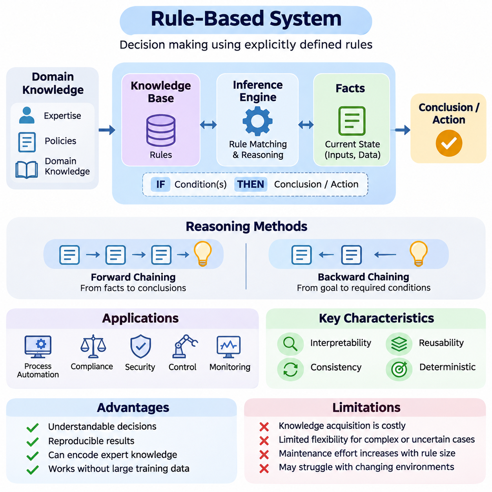{width="7.268055555555556in" height="7.268055555555556in"}

Rule-based systems represent one of the foundational approaches to artificial intelligence, enabling computers to make decisions through explicitly defined knowledge and logical conditions. Rather than learning behavior entirely from statistical patterns, these systems apply predefined rules to available facts. Their primary objective is to transform human expertise, organizational policies, and domain knowledge into consistent, executable reasoning procedures.

The fundamental principle of a rule-based system is the separation of knowledge from the mechanism that processes it. Knowledge is expressed through rules describing relationships between conditions and conclusions, while an inference engine determines which rules apply to a particular situation. This separation allows developers and domain experts to modify decision logic without redesigning the entire computational system.

A typical rule follows an IF--THEN structure, where the IF component specifies conditions and the THEN component defines a conclusion or action. For example, a monitoring system may contain the rule: IF temperature exceeds a defined threshold AND cooling is inactive, THEN generate an overheating warning. Such rules provide an understandable representation of operational knowledge and support deterministic decision-making.

Rule-based reasoning relies on facts representing the current state of a problem. Facts may originate from databases, sensors, user inputs, software applications, or previously derived conclusions. The system evaluates these facts against stored rules to identify applicable conditions. As new information becomes available, additional rules may become relevant, allowing reasoning to proceed through multiple interconnected decisions.

The knowledge base serves as the central repository of domain-specific rules and supporting information. It may contain operational policies, classification criteria, diagnostic relationships, constraints, and decision procedures. The quality of a rule-based system depends heavily on the completeness, correctness, and consistency of this knowledge, because its conclusions are constrained by the information explicitly represented.

An inference engine provides the computational mechanism that connects facts with rules. It evaluates logical conditions, identifies applicable rules, and executes reasoning procedures to produce conclusions. Depending on the system architecture, inference may involve deriving additional facts, selecting actions, or answering specific queries. The engine therefore transforms static knowledge into an operational decision-making capability.

Two fundamental reasoning approaches are forward chaining and backward chaining. Forward chaining begins with known facts and repeatedly applies relevant rules to derive new conclusions. Backward chaining begins with a desired conclusion and examines which conditions must be satisfied to establish it. These approaches support different reasoning requirements, including event-driven monitoring, diagnosis, verification, and goal-directed problem solving.

Rule-based systems belong to the broader tradition of symbolic artificial intelligence, where concepts and relationships are represented through explicit symbols. Symbolic representations make logical relationships accessible to human inspection and formal analysis. Unlike purely statistical models, conventional rule systems generally do not require large training datasets, although they require sufficient domain knowledge and carefully constructed reasoning procedures.

Historically, rule-based systems became prominent through expert systems designed to reproduce specialized human decision-making. Early applications included medical consultation, equipment diagnosis, chemical analysis, and configuration management. Systems such as MYCIN demonstrated how domain-specific rules could support complex diagnostic reasoning, while later platforms expanded rule processing into commercial and industrial applications.

The development of expert systems established an important distinction between domain knowledge and general-purpose reasoning software. A reusable inference engine could support different applications when supplied with appropriate rules and facts. This architectural principle encouraged the creation of expert-system shells and rule-engine frameworks, reducing the effort required to construct specialized knowledge-driven applications.

Modern rule-based systems extend beyond traditional expert systems into business process automation, regulatory compliance, cybersecurity, industrial control, and intelligent monitoring. Organizations use explicit rules to implement eligibility criteria, transaction validation, operational constraints, and exception handling. Their value is particularly significant when decisions must follow documented requirements and produce understandable explanations.

A major advantage of rule-based reasoning is interpretability. Because decisions originate from identifiable conditions and rules, developers can often reconstruct the sequence of reasoning that produced a conclusion. This traceability supports debugging, auditing, regulatory review, and communication with domain experts. However, understandable individual rules do not automatically guarantee that complex interactions between many rules remain easy to explain.

Consistency is another important characteristic of rule-based systems. When identical facts are evaluated under the same rule set and execution semantics, the system can produce reproducible results. This behavior is valuable in environments where standardized decisions are essential. Nevertheless, conflicting rules, incomplete information, changing facts, and execution priorities must be managed carefully to preserve predictable outcomes.

Rule-based systems also face significant limitations when operating in uncertain or rapidly changing environments. Explicit rules cannot automatically capture every possible situation, and manually maintaining extensive knowledge bases can become expensive. Unanticipated combinations of conditions may produce missing or inappropriate conclusions. These difficulties are commonly associated with knowledge acquisition, knowledge maintenance, and the scalability of symbolic reasoning.

Uncertainty presents an additional challenge because real-world information is frequently incomplete, ambiguous, or unreliable. Traditional Boolean rules evaluate conditions as true or false, but practical systems may require confidence values, probabilistic reasoning, or fuzzy logic. Such extensions allow rule-based architectures to represent uncertainty more flexibly, although they introduce additional complexity into inference and interpretation.

As rule collections grow, multiple rules may become applicable simultaneously. This situation creates a need for conflict resolution, which determines the order or priority of rule execution. Strategies may consider rule specificity, assigned priorities, recency of supporting facts, or application-defined policies. Appropriate conflict resolution is essential because different execution sequences can influence intermediate states and, in some architectures, final decisions.

Efficient rule execution is another central engineering concern. A naive inference engine may repeatedly evaluate every rule against every available fact, creating unnecessary computational overhead. More advanced implementations use structured matching techniques, indexing, and incremental evaluation to reduce repeated work. Algorithms such as RETE demonstrate how shared conditions and cached intermediate matches can improve production-rule processing efficiency.

Rule-based systems differ fundamentally from machine learning systems in how knowledge is acquired and represented. Machine learning models infer patterns from training data, whereas conventional rule systems encode relationships explicitly through human-defined logic. Rule systems often provide stronger direct traceability, while learning-based approaches can adapt to complex statistical relationships that are difficult to describe using handcrafted conditions.

These differences make hybrid architectures particularly valuable. A machine learning model may detect objects, estimate risk, or classify events, while a rule engine evaluates the resulting predictions against operational policies. For example, an autonomous robot may use neural perception to identify obstacles and symbolic rules to enforce restricted-area access conditions. The combination supports perception-driven decisions constrained by explicit knowledge.

Integration with ontologies and knowledge graphs further expands the capabilities of rule-based reasoning. Ontologies define concepts, properties, and relationships, while knowledge graphs organize interconnected entities and facts. Rules can operate over these representations to derive relationships, detect inconsistencies, or enforce domain constraints. Such integration provides a foundation for knowledge-aware applications requiring structured semantic interpretation.

In industrial environments, rule-based systems are particularly useful for safety supervision, equipment diagnostics, workflow coordination, and operational compliance. A manufacturing system may evaluate machine status, maintenance history, and production constraints before authorizing an operation. Explicit rules can provide an auditable decision layer, although safety-critical applications additionally require validated control mechanisms and appropriate engineering safeguards.

The continuing relevance of rule-based systems reflects their ability to convert explicit knowledge into repeatable computational decisions. Their effectiveness depends on sound knowledge representation, reliable inference, controlled rule execution, and systematic validation. Understanding these foundations prepares developers to examine production rules, chaining strategies, inference architectures, expert systems, optimization methods, and hybrid intelligent systems.

규칙 기반 시스템(Rule-based systems)은 인공지능의 근본적인 접근 방식 중 하나로, 명시적으로 정의된 지식과 논리적 조건을 통해 컴퓨터가 의사결정을 내릴 수 있도록 합니다. 이러한 시스템은 순전히 통계적 패턴으로부터 동작을 학습하는 대신, 사용 가능한 사실(facts)에 미리 정의된 규칙을 적용합니다. 주요 목적은 인간의 전문 지식, 조직의 정책 및 도메인 지식을 일관되고 실행 가능한 추론 절차로 변환하는 것입니다.

규칙 기반 시스템의 핵심 원칙은 지식과 이를 처리하는 메커니즘을 분리하는 것입니다. 지식은 조건과 결론 사이의 관계를 설명하는 규칙을 통해 표현되며, 추론 엔진(inference engine)은 특정 상황에 어떤 규칙이 적용되는지 결정합니다. 이러한 분리를 통해 개발자와 도메인 전문가는 전체 계산 시스템을 재설계하지 않고도 의사결정 논리를 수정할 수 있습니다.

전형적인 규칙은 IF--THEN 구조를 따르며, IF 부분은 조건을 지정하고 THEN 부분은 결론이나 동작을 정의합니다. 예를 들어 모니터링 시스템에는 다음과 같은 규칙이 포함될 수 있습니다: IF 온도가 정의된 임계값을 초과하고 AND 냉각 기능이 비활성화되어 있으면, THEN 과열 경고를 발생시킨다. 이러한 규칙은 운영 지식을 이해하기 쉽게 표현하며 결정론적(deterministic) 의사결정을 지원합니다.

규칙 기반 추론은 문제의 현재 상태를 나타내는 사실에 의존합니다. 사실은 데이터베이스, 센서, 사용자 입력, 소프트웨어 애플리케이션 또는 이전에 도출된 결론에서 발생할 수 있습니다. 시스템은 이러한 사실을 저장된 규칙과 비교·평가하여 적용 가능한 조건을 식별합니다. 새로운 정보가 제공됨에 따라 추가적인 규칙이 관련성을 갖게 될 수 있으며, 이를 통해 추론이 상호 연결된 여러 의사결정을 거쳐 진행될 수 있습니다.

지식베이스(knowledge base)는 도메인 특화 규칙과 이를 뒷받침하는 정보의 중앙 저장소 역할을 합니다. 여기에는 운영 정책, 분류 기준, 진단 관계, 제약 조건 및 의사결정 절차가 포함될 수 있습니다. 규칙 기반 시스템의 품질은 완성도, 정확성 및 일관성에 크게 의존하는데, 시스템의 결론이 명시적으로 표현된 정보에 의해 제약받기 때문입니다.

추론 엔진은 사실과 규칙을 연결하는 계산 메커니즘을 제공합니다. 논리적 조건을 평가하고, 적용 가능한 규칙을 식별하며, 추론 절차를 실행하여 결론을 도출합니다. 시스템 아키텍처에 따라 추론에는 추가 사실 도출, 동작 선택 또는 특정 질의에 대한 응답이 포함될 수 있습니다. 따라서 추론 엔진은 정적인 지식을 작동 가능한 의사결정 능력으로 변환합니다.

두 가지 기본적인 추론 방식은 순방향 체이닝(forward chaining)과 역방향 체이닝(backward chaining)입니다. 순방향 체이닝은 알려진 사실에서 시작하여 관련된 규칙을 반복적으로 적용하여 새로운 결론을 도출합니다. 역방향 체이닝은 원하는 결론에서 시작하여 해당 결론을 성립시키기 위해 어떤 조건이 충족되어야 하는지 조사합니다. 이러한 접근 방식은 이벤트 기반 모니터링, 진단, 검증 및 목표 지향적 문제 해결을 포함한 다양한 추론 요구 사항을 지원합니다.

규칙 기반 시스템은 개념과 관계가 명시적인 기호를 통해 표현되는 상징적 인공지능(symbolic artificial intelligence)의 광범위한 전통에 속합니다. 상징적 표현은 논리적 관계를 인간의 검사와 형식적 분석이 가능하도록 만듭니다. 순수한 통계 모델과 달리, 전통적인 규칙 시스템은 일반적으로 대규모 학습 데이터셋을 필요로 하지 않지만, 충분한 도메인 지식과 주의 깊게 구성된 추론 절차가 필요합니다.

역사적으로 규칙 기반 시스템은 전문화된 인간의 의사결정을 재현하기 위해 설계된 전문가 시스템(expert systems)을 통해 주목받게 되었습니다. 초기 응용 분야에는 의료 자문, 장비 진단, 화학 분석 및 구성 관리가 포함되었습니다. MYCIN과 같은 시스템은 도메인 특화 규칙이 어떻게 복잡한 진단 추론을 지원할 수 있는지 보여주었으며, 이후의 플랫폼들은 규칙 처리를 상업 및 산업 응용 분야로 확장했습니다.

전문가 시스템의 발전은 도메인 지식과 범용 추론 소프트웨어 간의 중요한 구분을 확립했습니다. 재사용 가능한 추론 엔진은 적절한 규칙과 사실이 제공되면 서로 다른 응용 프로그램을 지원할 수 있었습니다. 이러한 아키텍처 원칙은 전문가 시스템 쉘(expert-system shells)과 규칙 엔진 프레임워크의 창출을 촉진하여, 특화된 지식 기반 응용 프로그램을 구축하는 데 필요한 노력을 줄여주었습니다.

현대의 규칙 기반 시스템은 전통적인 전문가 시스템을 넘어 비즈니스 프로세스 자동화, 규제 준수, 사이버 보안, 산업 제어 및 지능형 모니터링으로 확장되고 있습니다. 조직은 명시적 규칙을 사용하여 자격 기준, 거래 검증, 운영 제약 조건 및 예외 처리를 구현합니다. 의사결정이 문서화된 요구 사항을 따라야 하고 이해할 수 있는 설명을 생성해야 할 때 이러한 시스템의 가치는 특히 중요합니다.

규칙 기반 추론의 주요 장점은 해석 가능성(interpretability)입니다. 의사결정이 식별 가능한 조건과 규칙에서 비롯되기 때문에, 개발자는 결론을 도출한 추론 단계를 재구성할 수 있는 경우가 많습니다. 이러한 추적 가능성은 디버깅, 감사, 규제 검토 및 도메인 전문가와의 커뮤니케이션을 지원합니다. 그러나 개별 규칙을 이해하기 쉽다고 해서 여러 규칙 간의 복잡한 상호작용이 자동으로 설명하기 쉬워지는 것은 아닙니다.

일관성(consistency)은 규칙 기반 시스템의 또 다른 중요한 특징입니다. 동일한 사실이 동일한 규칙 세트와 실행 의미론(execution semantics) 하에서 평가될 때, 시스템은 재현 가능한 결과를 생성할 수 있습니다. 이러한 동작은 표준화된 의사결정이 필수적인 환경에서 유용합니다. 그럼에도 불구하고 예측 가능한 결과를 유지하려면 충돌하는 규칙, 불완전한 정보, 변화하는 사실 및 실행 우선순위를 주의 깊게 관리해야 합니다.

규칙 기반 시스템은 불확실하거나 급변하는 환경에서 작동할 때 심각한 한계에 직면하기도 합니다. 명시적 규칙이 가능한 모든 상황을 자동으로 포착할 수는 없으며, 광범위한 지식베이스를 수동으로 유지 관리하는 것은 비용이 많이 들 수 있습니다. 예상치 못한 조건의 조합으로 인해 누락되거나 부적절한 결론이 생성될 수 있습니다. 이러한 어려움은 일반적으로 지식 획득(knowledge acquisition), 지식 유지 관리(knowledge maintenance) 및 상징적 추론의 확장성(scalability) 문제와 관련이 있습니다.

불확실성(uncertainty)은 실제 정보가 불완전하고 모호하거나 신뢰할 수 없는 경우가 많기 때문에 추가적인 과제를 제시합니다. 전통적인 부울(Boolean) 규칙은 조건을 참 또는 거짓으로 평가하지만, 실용적인 시스템에는 신뢰도 값, 확률적 추론 또는 퍼지 논리(fuzzy logic)가 필요할 수 있습니다. 이러한 확장을 통해 규칙 기반 아키텍처는 불확실성을 보다 유연하게 표현할 수 있지만, 추론과 해석에 추가적인 복잡성을 초래합니다.

규칙 수집이 커짐에 따라 여러 규칙이 동시에 적용 가능해질 수 있습니다. 이러한 상황은 규칙 실행의 순서나 우선순위를 결정하는 충돌 해결(conflict resolution)의 필요성을 발생시킵니다. 전략에는 규칙의 구체성(specificity), 할당된 우선순위, 지원 사실의 최신성 또는 애플리케이션 정의 정책이 고려될 수 있습니다. 실행 순서가 다르면 중간 상태와 일부 아키텍처에서는 최종 결정에 영향을 미칠 수 있으므로 적절한 충돌 해결이 필수적입니다.

효율적인 규칙 실행은 또 다른 핵심적인 엔지니어링 관심사입니다. 단순한 추론 엔진은 모든 사실에 대해 모든 규칙을 반복적으로 평가하여 불필요한 계산 오버헤드를 발생시킬 수 있습니다. 더 고급 구현에서는 구조화된 매칭 기술, 인덱싱 및 점진적 평가(incremental evaluation)를 사용하여 반복적인 작업을 줄입니다. RETE와 같은 알고리즘은 공유 조건과 캐시된 중간 매치를 통해 프로덕션 규칙(production-rule) 처리 효율성을 어떻게 향상시킬 수 있는지 보여줍니다.

규칙 기반 시스템은 지식이 획득되고 표현되는 방식에서 머신러닝 시스템과 근본적으로 다릅니다. 머신러닝 모델은 학습 데이터로부터 패턴을 추론하는 반면, 전통적인 규칙 시스템은 인간이 정의한 논리를 통해 관계를 명시적으로 인코딩합니다. 규칙 시스템은 더 강력한 직접적 추적 가능성을 제공하는 경우가 많은 반면, 학습 기반 접근 방식은 수작업 조건으로 설명하기 어려운 복잡한 통계적 관계에 적응할 수 있습니다.

이러한 차이점으로 인해 하이브리드 아키텍처가 특히 유용해집니다. 머신러닝 모델은 물체를 감지하거나 위험을 추정하거나 이벤트를 분류할 수 있으며, 규칙 엔진은 결과 예측을 운영 정책에 따라 평가합니다. 예를 들어 자율주행 로봇은 신경망 지각(neural perception)을 사용하여 장애물을 식별하고, 상징적 규칙을 사용하여 제한 구역 접근 조건을 시행할 수 있습니다. 이러한 결합은 명시적 지식에 의해 제약받는 지각 기반 의사결정을 지원합니다.

온톨로지(ontologies) 및 지식 그래프(knowledge graphs)와의 통합은 규칙 기반 추론의 기능을 더욱 확장합니다. 온톨로지는 개념, 속성 및 관계를 정의하고, 지식 그래프는 상호 연결된 엔티티와 사실을 조직화합니다. 규칙은 이러한 표현 위에서 작동하여 관계를 도출하거나, 불일치를 감지하거나, 도메인 제약 조건을 시행할 수 있습니다. 이러한 통합은 구조화된 의미적 해석이 필요한 지식 인식(knowledge-aware) 애플리케이션의 기반을 제공합니다.

산업 환경에서 규칙 기반 시스템은 안전 감독, 장비 진단, 워크플로 조정 및 운영 준수(operational compliance)에 특히 유용합니다. 제조 시스템은 작업을 승인하기 전에 장비 상태, 유지보수 이력 및 생산 제약 조건을 평가할 수 있습니다. 명시적 규칙은 감사 가능한 의사결정 계층을 제공할 수 있지만, 안전이 중요한 응용 분야에서는 검증된 제어 메커니즘과 적절한 엔지니어링 안전장치가 추가로 필요합니다.

규칙 기반 시스템이 지속적으로 유용한 이유는 명시적 지식을 반복 가능한 계산 결정으로 변환하는 능력 때문입니다. 이들의 유효성은 건전한 지식 표현, 신뢰할 수 있는 추론, 통제된 규칙 실행 및 체계적인 검증에 달려 있습니다. 이러한 기초를 이해하면 개발자가 프로덕션 규칙, 체이닝 전략, 추론 아키텍처, 전문가 시스템, 최적화 방법 및 하이브리드 지능형 시스템을 검토할 수 있는 준비를 갖추게 됩니다.

## 04.02 Production Rules

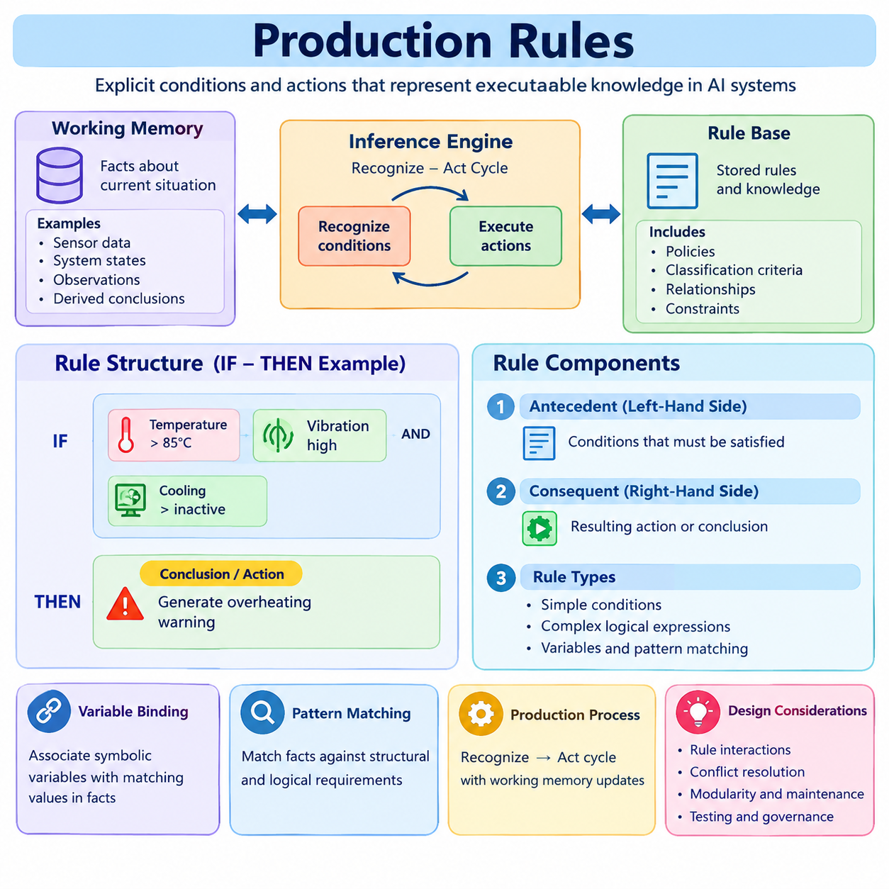{width="7.268055555555556in" height="7.268055555555556in"}

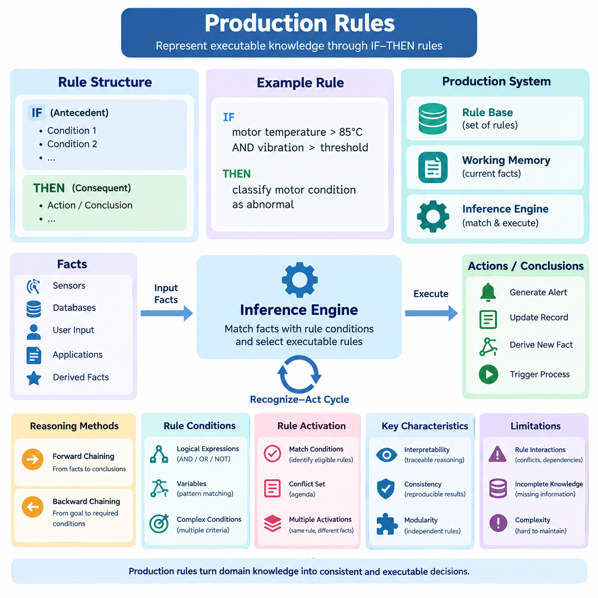{width="7.268055555555556in" height="7.268055555555556in"}

Production rules are a fundamental mechanism for representing executable knowledge in rule-based artificial intelligence systems. They express relationships between conditions and conclusions through explicit logical statements, commonly organized as IF--THEN rules. This representation enables an inference engine to examine available facts, recognize relevant situations, and perform predefined actions or derive new knowledge according to established decision policies.

A production rule consists of two principal components: an antecedent and a consequent. The antecedent, also called the left-hand side, specifies conditions that must be satisfied before the rule becomes applicable. The consequent, or right-hand side, describes the resulting action or conclusion. This separation provides a structured method for converting domain expertise into executable reasoning procedures.

For example, an industrial monitoring system may contain the rule: IF motor temperature exceeds 85 degrees Celsius AND vibration exceeds the permitted threshold, THEN classify the motor condition as abnormal. The rule does not independently measure temperature or vibration. Instead, it evaluates facts supplied by sensors or monitoring software and produces a conclusion when the specified conditions are satisfied.

Production rules operate within a production system consisting of a rule base, working memory, and an inference engine. The rule base stores available rules, while working memory contains facts describing the current environment. The inference engine compares these facts with rule conditions and determines which rules can execute. Together, these components form a dynamic mechanism for knowledge-driven decision-making.

Working memory plays an essential role because production rules evaluate information that may change during execution. Facts can represent object properties, system states, observations, or previously inferred conclusions. When a rule executes, it may add, modify, or retract facts, depending on the system\'s semantics. These changes can activate additional rules and create a sequence of interconnected reasoning operations.

The execution of production rules commonly follows a recognize--act cycle. During recognition, the inference engine identifies rules whose conditions match the current facts. During action, it selects and executes an applicable rule or group of rules. The resulting changes to working memory initiate another evaluation cycle. This process continues until a termination condition is reached or no further executable rules remain.

A rule becomes activated when its conditions match the relevant facts under the matching semantics of the engine. The collection of eligible rule activations is often called the conflict set or agenda. An activation may include a particular rule together with the facts that satisfy its conditions. This distinction matters because the same rule can match multiple combinations of facts and produce several independent activations.

Production rules can contain simple conditions or complex logical expressions. Multiple conditions may be connected through conjunction, disjunction, or negation, depending on the rule language. Variables and pattern matching allow rules to operate over different objects without requiring separate definitions for every instance. These mechanisms make production rules suitable for representing reusable relationships across large collections of structured facts.

Variable binding enables a rule to associate symbolic variables with matching values in working memory. For example, a maintenance rule may identify any machine whose operating temperature exceeds its configured limit. The variable representing the machine becomes bound to a particular equipment instance during matching. The consequent can then reference that instance when generating an alert or updating its maintenance status.

Pattern matching is therefore central to production-rule execution. The inference engine must determine whether available facts satisfy the structural and logical requirements of each rule. Matching may involve equality comparisons, numerical thresholds, object relationships, and temporal conditions. Efficient implementations avoid unnecessary repeated evaluations by organizing conditions and retaining intermediate matching results.

Production rules can produce different categories of consequences. Some derive new facts, such as assigning a diagnostic classification to an observed condition. Others initiate operational actions, including generating notifications, updating records, or requesting external services. Separating logical conclusions from side-effecting actions is important because external operations may require authorization, transaction handling, and additional safety controls.

An important distinction exists between declarative and procedural interpretations of production rules. Declarative rules emphasize logical relationships between conditions and conclusions, while procedural rules specify actions to execute when conditions hold. Many practical production systems combine these interpretations. Their behavior depends not only on rule content but also on execution order, working-memory updates, and conflict resolution policies.

Production rules support modular knowledge representation because individual rules can be developed and maintained separately. A diagnostic rule can be modified without rewriting unrelated classification or reporting logic. This modularity improves maintainability when domain requirements evolve. However, independently defined rules may interact indirectly through shared facts, creating dependencies that require systematic testing.

Rule interactions become especially important when multiple rules modify the same facts or produce contradictory conclusions. One rule may classify equipment as operational while another identifies a maintenance condition. Without appropriate priorities or consistency constraints, the system may generate incompatible results. Conflict resolution strategies and explicit knowledge-validation procedures help manage these situations.

Production-rule engines frequently employ priorities, specificity measures, and recency-based strategies to determine execution order. A highly specific rule may receive preference over a general rule, while a safety-related rule may be assigned explicit precedence. The exact strategy depends on the application and inference engine. Execution order must be documented when it can influence externally visible decisions.

Repeated rule execution introduces another challenge. If a rule continuously reproduces the same fact or alternates system states with another rule, inference may fail to terminate. Production systems therefore require mechanisms such as refraction, duplicate-fact control, execution limits, or explicit state-transition constraints. These safeguards help prevent redundant activations and unintended reasoning cycles.

Production rules are particularly effective in expert systems because they allow specialized knowledge to be expressed in a form that domain experts can inspect. Medical consultation, equipment troubleshooting, configuration management, and financial compliance are established application areas. Each application translates domain-specific relationships into conditions and consequences that an inference engine can evaluate systematically.

In robotics, production rules can coordinate symbolic decisions based on information supplied by perception and planning components. A mobile robot may apply a rule that prohibits entering a restricted zone without authorization. Another rule may request human supervision when a critical sensor becomes unavailable. Such rules provide explicit operational constraints, although real-time safety functions require independently validated enforcement mechanisms.

Modern production-rule frameworks support increasingly complex enterprise applications. CLIPS provides a language and environment for rule-based programming, while Drools supports business rules and decision automation within Java-oriented ecosystems. These platforms offer mechanisms for fact management, pattern matching, and rule execution, allowing developers to implement substantial knowledge bases without constructing every inference component independently.

The RETE algorithm is a major development in efficient production-rule matching. Rather than reevaluating every condition from the beginning after each working-memory change, RETE organizes shared tests and retains partial matches. This approach can substantially reduce repeated computation when many rules share conditions. Its memory requirements and performance characteristics nevertheless depend on rule structure and fact distributions.

Production rules also provide opportunities for explanation and auditing. An inference engine can record which facts satisfied a rule, which activation was selected, and which conclusion followed. Such execution traces help developers investigate unexpected decisions and allow domain experts to evaluate reasoning behavior. Comprehensive explanations additionally require information about rule priorities, suppressed activations, and relevant missing facts.

Despite their advantages, production rules become difficult to manage when knowledge bases contain thousands of interacting conditions. Rule duplication, inconsistent terminology, hidden dependencies, and changing requirements can reduce reliability. Effective engineering therefore requires naming conventions, version control, automated tests, rule coverage analysis, and systematic review of interactions between related rules.

Production rules remain valuable within hybrid artificial intelligence architectures. Machine learning models can transform unstructured observations into structured facts, while production rules apply explicit policies and domain constraints. Knowledge graphs and ontologies can provide additional semantic context for matching. This combination allows statistical perception and symbolic decision-making to contribute complementary capabilities within a unified system.

The effectiveness of production rules ultimately depends on the quality of their conditions, the correctness of their consequences, and the reliability of their execution environment. Well-designed rules provide modularity, transparency, and predictable reasoning under clearly defined semantics. Understanding their structure and operational behavior establishes the foundation for studying chaining methods, inference engines, conflict resolution, and advanced rule-based architectures.

생산 규칙(Production Rules)은 규칙 기반 인공지능 시스템(Rule-Based Artificial Intelligence Systems)에서 실행 가능한 지식(Executable Knowledge)을 표현하는 핵심 메커니즘이다. 생산 규칙은 일반적으로 IF--THEN 규칙 형태로 구성되며, 명시적인 논리 문장(Logical Statements)을 통해 조건과 결론 사이의 관계를 표현한다. 이러한 표현 방식은 추론 엔진(Inference Engine)이 이용 가능한 사실(Facts)을 검토하고 관련 상황을 인식하며, 사전에 정의된 의사결정 정책(Decision Policies)에 따라 동작을 수행하거나 새로운 지식을 도출하도록 한다.

생산 규칙(Production Rule)은 전건(Antecedent)과 후건(Consequent)이라는 두 가지 주요 구성 요소로 이루어진다. 좌변(Left-Hand Side)이라고도 하는 전건은 규칙이 적용되기 위해 충족되어야 하는 조건을 정의한다. 우변(Right-Hand Side)이라고도 하는 후건은 조건이 충족되었을 때 수행할 동작이나 도출할 결론을 설명한다. 이러한 분리 구조는 도메인 전문 지식(Domain Expertise)을 실행 가능한 추론 절차(Reasoning Procedures)로 변환하는 체계적인 방법을 제공한다.

예를 들어, 산업용 모니터링 시스템(Industrial Monitoring System)에는 모터 온도가 섭씨 85도를 초과하고 진동이 허용 임계값(Threshold)을 초과하면 모터 상태를 비정상(Abnormal)으로 분류한다는 규칙이 포함될 수 있다. 이 규칙 자체가 온도나 진동을 직접 측정하는 것은 아니다. 대신 센서(Sensors) 또는 모니터링 소프트웨어(Monitoring Software)에서 제공한 사실을 평가하고, 지정된 조건이 충족되면 해당 결론을 생성한다.

생산 규칙은 규칙 기반 저장소(Rule Base), 작업 기억(Working Memory), 추론 엔진(Inference Engine)으로 구성된 생산 시스템(Production System) 내에서 동작한다. 규칙 기반 저장소는 사용 가능한 규칙을 보관하고, 작업 기억은 현재 환경을 설명하는 사실을 유지한다. 추론 엔진은 이러한 사실을 규칙의 조건과 비교하여 실행 가능한 규칙을 결정한다. 이 구성 요소들은 함께 지식 기반 의사결정(Knowledge-Driven Decision-Making)을 수행하는 동적 메커니즘을 형성한다.

작업 기억(Working Memory)은 실행 과정에서 변경될 수 있는 정보를 생산 규칙이 평가하기 때문에 중요한 역할을 한다. 사실(Facts)은 객체 속성(Object Properties), 시스템 상태(System States), 관측 결과(Observations), 이전에 추론된 결론을 나타낼 수 있다. 규칙이 실행되면 시스템의 의미론(Semantics)에 따라 사실을 추가하거나 수정하거나 철회할 수 있다. 이러한 변경은 추가 규칙을 활성화하고 상호 연결된 추론 작업의 연속적인 실행을 유도할 수 있다.

생산 규칙의 실행은 일반적으로 인식--동작 주기(Recognize--Act Cycle)를 따른다. 인식 단계(Recognition Phase)에서 추론 엔진은 현재 사실과 조건이 일치하는 규칙을 식별한다. 동작 단계(Action Phase)에서는 적용 가능한 규칙 또는 규칙 집합을 선택하여 실행한다. 그 결과 작업 기억이 변경되면 새로운 평가 주기가 시작된다. 이 과정은 종료 조건(Termination Condition)이 충족되거나 더 이상 실행 가능한 규칙이 존재하지 않을 때까지 계속된다.

규칙은 해당 조건이 추론 엔진의 매칭 의미론(Matching Semantics)에 따라 관련 사실과 일치할 때 활성화(Activation)된다. 실행 가능한 규칙 활성화의 집합은 일반적으로 충돌 집합(Conflict Set) 또는 실행 대기 목록(Agenda)이라고 한다. 하나의 활성화는 특정 규칙과 그 조건을 충족하는 사실들의 조합을 포함할 수 있다. 동일한 규칙이 여러 사실 조합과 일치하여 독립적인 활성화를 여러 개 생성할 수 있으므로 이러한 구분은 중요하다.

생산 규칙(Production Rules)은 단순한 조건뿐 아니라 복잡한 논리 표현식(Logical Expressions)도 포함할 수 있다. 규칙 언어(Rule Language)에 따라 여러 조건을 논리곱(Conjunction), 논리합(Disjunction), 부정(Negation)으로 연결할 수 있다. 변수(Variables)와 패턴 매칭(Pattern Matching)을 사용하면 모든 개별 객체에 대해 별도의 규칙을 정의하지 않고도 다양한 객체에 규칙을 적용할 수 있다. 이러한 메커니즘은 대규모 구조화된 사실 집합에서 재사용 가능한 관계를 표현하는 데 적합하다.

변수 바인딩(Variable Binding)은 규칙이 기호 변수(Symbolic Variables)를 작업 기억의 일치하는 값과 연결하도록 한다. 예를 들어, 유지보수 규칙(Maintenance Rule)은 작동 온도가 설정된 한계를 초과하는 모든 장비를 식별할 수 있다. 장비를 나타내는 변수는 매칭 과정에서 특정 장비 인스턴스(Equipment Instance)에 바인딩된다. 이후 후건(Consequent)은 경고를 생성하거나 유지보수 상태를 갱신할 때 해당 인스턴스를 참조할 수 있다.

따라서 패턴 매칭(Pattern Matching)은 생산 규칙 실행의 핵심 요소이다. 추론 엔진(Inference Engine)은 이용 가능한 사실이 각 규칙의 구조적 요구사항과 논리적 요구사항을 충족하는지 판단해야 한다. 매칭에는 동등성 비교(Equality Comparison), 수치 임계값(Numerical Thresholds), 객체 관계(Object Relationships), 시간적 조건(Temporal Conditions)이 포함될 수 있다. 효율적인 구현에서는 조건을 체계적으로 구성하고 중간 매칭 결과를 유지하여 불필요한 반복 평가를 줄인다.

생산 규칙은 다양한 유형의 결과(Consequences)를 생성할 수 있다. 일부 규칙은 관측된 상태에 진단 분류(Diagnostic Classification)를 부여하는 것처럼 새로운 사실을 도출한다. 다른 규칙은 알림 생성, 기록 갱신, 외부 서비스 요청과 같은 운영 동작(Operational Actions)을 시작한다. 논리적 결론(Logical Conclusions)과 부수 효과를 발생시키는 동작(Side-Effecting Actions)을 분리하는 것은 중요하다. 외부 작업에는 권한 부여, 트랜잭션 처리(Transaction Handling), 추가적인 안전 제어(Safety Controls)가 필요할 수 있기 때문이다.

생산 규칙의 선언적 해석(Declarative Interpretation)과 절차적 해석(Procedural Interpretation) 사이에는 중요한 차이가 있다. 선언적 규칙(Declarative Rules)은 조건과 결론 사이의 논리적 관계를 강조하는 반면, 절차적 규칙(Procedural Rules)은 조건이 충족되었을 때 실행할 동작을 지정한다. 많은 실제 생산 시스템은 이러한 두 가지 해석을 결합한다. 시스템의 동작은 규칙 내용뿐 아니라 실행 순서, 작업 기억의 갱신, 충돌 해결 정책(Conflict Resolution Policies)에 의해서도 결정된다.

생산 규칙은 개별 규칙을 독립적으로 개발하고 유지보수할 수 있으므로 모듈형 지식 표현(Modular Knowledge Representation)을 지원한다. 진단 규칙(Diagnostic Rule)은 관련 없는 분류 규칙이나 보고 로직(Reporting Logic)을 다시 작성하지 않고도 수정할 수 있다. 이러한 모듈성(Modularity)은 도메인 요구사항이 변화할 때 유지보수성을 향상시킨다. 그러나 독립적으로 정의된 규칙들도 공유된 사실을 통해 간접적으로 상호작용할 수 있으므로 체계적인 테스트가 필요한 의존 관계(Dependencies)가 발생할 수 있다.

여러 규칙이 동일한 사실을 수정하거나 서로 모순되는 결론을 생성할 때 규칙 간 상호작용(Rule Interactions)은 특히 중요해진다. 하나의 규칙은 장비를 정상 작동 상태로 분류하지만 다른 규칙은 유지보수가 필요한 상태로 판단할 수 있다. 적절한 우선순위(Priorities)나 일관성 제약조건(Consistency Constraints)이 없으면 시스템은 양립할 수 없는 결과를 생성할 수 있다. 충돌 해결 전략(Conflict Resolution Strategies)과 명시적인 지식 검증 절차(Knowledge Validation Procedures)는 이러한 상황을 관리하는 데 도움이 된다.

생산 규칙 엔진(Production Rule Engines)은 실행 순서를 결정하기 위해 우선순위(Priorities), 구체성 척도(Specificity Measures), 최신성 기반 전략(Recency-Based Strategies)을 자주 사용한다. 매우 구체적인 규칙은 일반적인 규칙보다 우선 적용될 수 있으며, 안전 관련 규칙에는 명시적인 우선권(Precedence)이 부여될 수 있다. 정확한 전략은 응용 분야와 추론 엔진에 따라 달라진다. 실행 순서가 외부에서 관찰할 수 있는 의사결정에 영향을 미칠 경우 해당 순서를 문서화해야 한다.

반복적인 규칙 실행(Repeated Rule Execution)은 또 다른 문제를 발생시킨다. 하나의 규칙이 동일한 사실을 계속 생성하거나 다른 규칙과 번갈아 시스템 상태를 변경하면 추론 과정이 종료되지 않을 수 있다. 따라서 생산 시스템에는 재발화 방지(Refraction), 중복 사실 제어(Duplicate-Fact Control), 실행 제한(Execution Limits), 명시적인 상태 전이 제약조건(State-Transition Constraints)과 같은 메커니즘이 필요하다. 이러한 보호 장치는 중복 활성화와 의도하지 않은 추론 순환(Reasoning Cycles)을 방지하는 데 도움이 된다.

생산 규칙은 전문 지식을 도메인 전문가(Domain Experts)가 검토할 수 있는 형태로 표현할 수 있으므로 전문가 시스템(Expert Systems)에서 특히 효과적이다. 의료 상담(Medical Consultation), 장비 문제 해결(Equipment Troubleshooting), 구성 관리(Configuration Management), 금융 규정 준수(Financial Compliance)는 대표적인 응용 분야이다. 각 응용 시스템은 도메인별 관계를 조건과 결과로 변환하여 추론 엔진이 체계적으로 평가할 수 있도록 한다.

로보틱스(Robotics)에서 생산 규칙은 인식(Perception) 및 계획(Planning) 구성 요소가 제공하는 정보를 바탕으로 기호적 의사결정(Symbolic Decision-Making)을 조정할 수 있다. 이동 로봇(Mobile Robot)은 승인 없이 제한 구역(Restricted Zone)에 진입하지 못하도록 하는 규칙을 적용할 수 있다. 또한 핵심 센서가 사용할 수 없는 상태가 되면 인간의 감독(Human Supervision)을 요청할 수 있다. 이러한 규칙은 명시적인 운영 제약조건을 제공하지만, 실시간 안전 기능에는 독립적으로 검증된 강제 적용 메커니즘(Enforcement Mechanisms)이 필요하다.

현대적인 생산 규칙 프레임워크(Production Rule Frameworks)는 점점 더 복잡한 기업용 응용 시스템(Enterprise Applications)을 지원한다. CLIPS는 규칙 기반 프로그래밍(Rule-Based Programming)을 위한 언어와 실행 환경을 제공하며, Drools는 Java 중심 생태계(Java-Oriented Ecosystems)에서 비즈니스 규칙(Business Rules)과 의사결정 자동화(Decision Automation)를 지원한다. 이러한 플랫폼은 사실 관리(Fact Management), 패턴 매칭(Pattern Matching), 규칙 실행(Rule Execution) 기능을 제공하여 개발자가 모든 추론 구성 요소를 직접 구현하지 않고도 대규모 지식 기반 시스템을 구축할 수 있도록 한다.

RETE 알고리즘(RETE Algorithm)은 효율적인 생산 규칙 매칭(Production Rule Matching)에서 중요한 발전이다. 작업 기억이 변경될 때마다 모든 조건을 처음부터 다시 평가하는 대신, RETE는 공유된 조건 검사를 구조화하고 부분 매칭 결과(Partial Matches)를 유지한다. 이러한 접근 방식은 여러 규칙이 조건을 공유할 때 반복 계산을 상당히 줄일 수 있다. 그러나 메모리 요구량(Memory Requirements)과 성능 특성(Performance Characteristics)은 규칙 구조와 사실의 분포에 따라 달라진다.

생산 규칙은 설명 가능성(Explainability)과 감사 가능성(Auditability)도 제공한다. 추론 엔진은 어떤 사실이 규칙의 조건을 충족했는지, 어떤 활성화가 선택되었는지, 어떤 결론이 도출되었는지를 기록할 수 있다. 이러한 실행 추적(Execution Traces)은 개발자가 예상하지 못한 결정을 조사하고 도메인 전문가가 추론 동작을 평가하는 데 도움이 된다. 포괄적인 설명을 위해서는 규칙 우선순위, 실행되지 않은 활성화(Suppressed Activations), 관련된 누락 사실(Missing Facts)에 대한 정보도 필요하다.

이러한 장점에도 불구하고 지식 기반(Knowledge Bases)에 수천 개의 상호작용하는 조건이 포함되면 생산 규칙을 관리하기 어려워질 수 있다. 규칙 중복(Rule Duplication), 일관되지 않은 용어(Inconsistent Terminology), 숨겨진 의존 관계(Hidden Dependencies), 변화하는 요구사항은 시스템의 신뢰성을 저하시킬 수 있다. 따라서 효과적인 엔지니어링을 위해서는 명명 규칙(Naming Conventions), 버전 관리(Version Control), 자동화된 테스트(Automated Tests), 규칙 커버리지 분석(Rule Coverage Analysis), 관련 규칙 간 상호작용에 대한 체계적인 검토가 필요하다.

생산 규칙은 하이브리드 인공지능 아키텍처(Hybrid Artificial Intelligence Architectures)에서도 중요한 가치를 유지한다. 머신러닝 모델(Machine Learning Models)은 비정형 관측 정보(Unstructured Observations)를 구조화된 사실(Structured Facts)로 변환할 수 있으며, 생산 규칙은 이러한 사실에 명시적인 정책과 도메인 제약조건(Domain Constraints)을 적용한다. 지식 그래프(Knowledge Graphs)와 온톨로지(Ontologies)는 매칭에 필요한 추가적인 의미적 맥락(Semantic Context)을 제공할 수 있다. 이러한 결합은 통계적 인식(Statistical Perception)과 기호적 의사결정이 통합 시스템 내에서 상호보완적인 기능을 수행하도록 한다.

궁극적으로 생산 규칙의 효과는 조건의 품질, 결과의 정확성, 실행 환경의 신뢰성에 따라 결정된다. 잘 설계된 규칙은 명확하게 정의된 의미론(Semantics) 아래에서 모듈성(Modularity), 투명성(Transparency), 예측 가능한 추론(Predictable Reasoning)을 제공한다. 생산 규칙의 구조와 운영 동작을 이해하는 것은 연쇄 추론 방법(Chaining Methods), 추론 엔진(Inference Engines), 충돌 해결(Conflict Resolution), 고급 규칙 기반 아키텍처(Advanced Rule-Based Architectures)를 학습하기 위한 기초가 된다.

## 04.03 Forward vs Backward Chaining

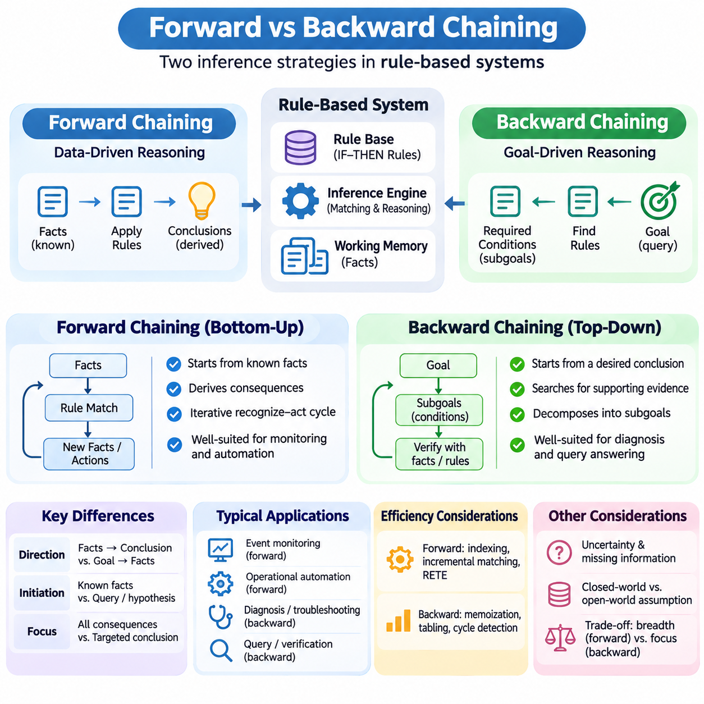{width="7.268055555555556in" height="7.268055555555556in"}

Forward chaining and backward chaining are two fundamental inference strategies used in rule-based artificial intelligence systems. Both apply logical rules to facts, but they differ in the direction of reasoning and the conditions that initiate inference. Forward chaining begins with available information and derives consequences, whereas backward chaining begins with a desired conclusion and searches for evidence that supports it.

Forward chaining is commonly described as data-driven reasoning because its execution is initiated by known facts or changes in working memory. The inference engine examines rules whose conditions match available information and derives additional facts or actions. Newly established conclusions may activate further rules, creating a sequence of reasoning steps that continues until no additional rules apply or a specified termination condition is satisfied.

Consider an industrial monitoring system that receives temperature, vibration, and operating-state measurements. A rule may classify a motor as overheated when its temperature exceeds a specified threshold. Another rule may identify an equipment fault when overheating occurs together with excessive vibration. Forward chaining progressively derives these conclusions from sensor observations without requiring a predefined diagnostic question.

The forward-chaining process typically follows a recognize--act cycle in which applicable rules are identified, selected, and executed. The inference engine maintains a collection of eligible rule activations and determines which should execute according to conflict resolution policies. Each execution may modify working memory, potentially activating additional rules. This iterative process enables dynamic reasoning over continuously changing information.

Backward chaining follows a different strategy known as goal-driven reasoning. Instead of evaluating every potentially applicable rule, the inference engine begins with a particular hypothesis or query. It searches for rules capable of establishing the desired conclusion and examines whether their conditions can be satisfied. When a required condition is not already known, the engine may treat that condition as a new subgoal.

For example, a maintenance expert system may investigate whether a particular motor requires immediate inspection. The engine first identifies rules whose conclusions indicate an inspection requirement. It then examines supporting conditions, such as abnormal temperature, excessive vibration, or critical operating status. Each condition may be verified against available facts or established through additional rules.

Backward chaining often constructs a logical dependency structure in which a primary goal is decomposed into smaller subgoals. These subgoals are evaluated recursively until they match known facts, succeed through applicable rules, or cannot be established. The reasoning process may explore alternative rules when an attempted proof fails. This structure is particularly suitable for diagnostic systems and query-oriented knowledge applications.

The central distinction between the two strategies concerns the direction of inference. Forward chaining proceeds from premises toward conclusions, exploring consequences supported by existing facts. Backward chaining proceeds from a proposed conclusion toward the premises required to establish it. Although both strategies may use the same logical knowledge base, their execution paths and computational requirements can differ substantially.

Forward chaining is particularly effective when a system must react to incoming information and identify all relevant consequences. Event monitoring, operational automation, transaction processing, and industrial supervision frequently exhibit this requirement. The system does not need to know in advance which conclusions will become important. Instead, it continuously evaluates the implications of observed changes.

Backward chaining is generally more appropriate when the system must answer a specific question or verify a particular hypothesis. Medical diagnosis, technical troubleshooting, configuration validation, and logical query processing can benefit from this approach. By concentrating on rules relevant to the requested goal, backward chaining may avoid evaluating large portions of the knowledge base that do not contribute to the current inquiry.

The efficiency of forward chaining depends on the number of facts, applicable rules, and interactions among rule conditions. A naive implementation may repeatedly examine rules even when relevant information has not changed. Advanced production-rule engines use indexing, incremental matching, and algorithms such as RETE to reduce redundant evaluations. These techniques improve performance in systems with extensive rule collections and frequently updated working memory.

Backward-chaining efficiency depends on goal structure, rule dependencies, and the order in which alternatives are explored. Recursive reasoning may revisit identical subgoals or encounter cyclic dependencies. Techniques such as memoization, tabling, goal indexing, and cycle detection can reduce repeated computation and prevent uncontrolled recursion. Their effectiveness depends on the logical language and inference semantics employed.

The treatment of uncertainty and missing information also influences both strategies. In classical logical reasoning, a conclusion is established only when sufficient premises support it under the selected semantics. Failure to derive a conclusion does not necessarily establish that the conclusion is false. This distinction is especially important in systems operating under open-world assumptions or incomplete knowledge.

Some rule engines employ closed-world assumptions, under which certain facts not established by the knowledge base are treated as false. Other systems preserve unknown states or use three-valued logic to distinguish true, false, and undetermined propositions. Forward and backward chaining can operate under different assumptions, but these choices affect the interpretation of missing evidence and the validity of conclusions.

Conflict resolution is particularly visible in forward-chaining production systems because several rules may become executable simultaneously. The engine may prioritize rules according to specificity, recency, explicit importance, or application-defined policies. Backward chaining instead commonly emphasizes goal selection and the order of alternative proofs, although procedural implementations may also apply priorities and search-control strategies.

Termination behavior represents another important engineering consideration. Forward chaining may continue indefinitely when rules repeatedly modify facts or generate new activations. Backward chaining may fail to terminate when recursive dependencies produce unbounded proof searches. Practical inference engines therefore require appropriate stopping conditions, duplicate detection, recursion management, and safeguards against unintended reasoning cycles.

The two strategies also differ in how explanations are constructed. Forward chaining can record a derivation history showing which observations activated particular rules and which conclusions followed. Backward chaining can produce a proof trace identifying the conditions required to establish a requested goal. Both forms of explanation support debugging, auditing, and expert review when the underlying inference semantics are clearly documented.

In robotics, forward chaining can process events such as obstacle detection, battery warnings, and equipment status changes. These observations may activate rules that update mission conditions or request operational responses. Backward chaining can evaluate whether a planned action is permissible by examining authorization, environmental conditions, and resource availability. Both strategies can contribute to a structured decision-support architecture.

A hybrid inference architecture may combine forward and backward chaining within the same knowledge-driven system. Forward chaining can maintain derived facts as observations arrive, while backward chaining evaluates specific questions using the accumulated knowledge. Such integration can reduce repeated reasoning and improve responsiveness, provided that fact updates, rule dependencies, and consistency requirements are managed carefully.

The relationship between chaining strategies and knowledge representation is equally important. Production rules provide executable condition--consequence relationships, while ontologies define conceptual structures and knowledge graphs represent interconnected entities. Forward chaining can materialize additional relationships from existing facts, whereas backward chaining can answer queries by proving relationships without necessarily storing every derived conclusion.

Selecting an inference strategy requires consideration of application objectives, data availability, computational resources, and expected query patterns. Forward chaining is often preferable when many consequences must be maintained after frequent data changes. Backward chaining is often preferable when relatively few goals are queried from a large knowledge base. Neither strategy is universally superior, and practical performance depends on implementation details.

In large-scale systems, forward chaining may increase storage requirements because derived facts are materialized and maintained. Backward chaining can reduce materialization costs but may introduce repeated computation when identical queries occur frequently. Incremental maintenance, caching, selective materialization, and query optimization can balance these tradeoffs according to workload characteristics and consistency requirements.

Forward and backward chaining ultimately represent complementary methods for transforming explicit knowledge into logical conclusions. Their differences arise from inference direction, activation mechanisms, computational behavior, and operational objectives. Understanding these characteristics enables developers to select suitable reasoning strategies and establish a foundation for inference engine architecture, conflict resolution, expert systems, and hybrid symbolic intelligence.

전방향 연쇄 추론(Forward Chaining)과 역방향 연쇄 추론(Backward Chaining)은 규칙 기반 인공지능 시스템(Rule-Based Artificial Intelligence Systems)에서 사용되는 두 가지 기본적인 추론 전략(Inference Strategies)이다. 두 방법 모두 논리 규칙(Logical Rules)을 사실(Facts)에 적용하지만, 추론의 진행 방향과 추론을 시작하는 조건에서 차이가 있다. 전방향 연쇄 추론은 이용 가능한 정보에서 시작하여 결과를 도출하는 반면, 역방향 연쇄 추론은 원하는 결론에서 시작하여 이를 뒷받침하는 증거를 탐색한다.

전방향 연쇄 추론(Forward Chaining)은 알려진 사실이나 작업 기억(Working Memory)의 변화에 의해 실행이 시작되므로 일반적으로 데이터 주도 추론(Data-Driven Reasoning)이라고 설명한다. 추론 엔진(Inference Engine)은 이용 가능한 정보와 조건이 일치하는 규칙을 검사하고 추가적인 사실이나 동작을 도출한다. 새롭게 확립된 결론은 추가 규칙을 활성화할 수 있으며, 이러한 추론 과정은 더 이상 적용 가능한 규칙이 없거나 지정된 종료 조건(Termination Condition)이 충족될 때까지 계속된다.

온도, 진동, 작동 상태 측정값을 수신하는 산업용 모니터링 시스템(Industrial Monitoring System)을 생각해 볼 수 있다. 하나의 규칙은 모터 온도가 지정된 임계값(Threshold)을 초과하면 과열 상태(Overheated State)로 분류할 수 있다. 또 다른 규칙은 과열과 과도한 진동이 동시에 발생하면 장비 고장(Equipment Fault)을 식별할 수 있다. 전방향 연쇄 추론은 사전에 정의된 진단 질문 없이도 센서 관측값(Sensor Observations)으로부터 이러한 결론을 단계적으로 도출한다.

전방향 연쇄 추론 과정은 일반적으로 적용 가능한 규칙을 식별하고 선택하여 실행하는 인식--동작 주기(Recognize--Act Cycle)를 따른다. 추론 엔진(Inference Engine)은 실행 가능한 규칙 활성화(Rule Activations)의 집합을 유지하고 충돌 해결 정책(Conflict Resolution Policies)에 따라 실행할 규칙을 결정한다. 각 규칙의 실행은 작업 기억을 변경할 수 있으며, 그 결과 추가 규칙이 활성화될 수 있다. 이러한 반복 과정은 지속적으로 변화하는 정보를 대상으로 동적 추론(Dynamic Reasoning)을 가능하게 한다.

역방향 연쇄 추론(Backward Chaining)은 목표 주도 추론(Goal-Driven Reasoning)이라는 다른 전략을 따른다. 모든 잠재적인 적용 가능 규칙을 평가하는 대신, 추론 엔진은 특정 가설(Hypothesis)이나 질의(Query)에서 시작한다. 원하는 결론을 확립할 수 있는 규칙을 탐색하고 해당 규칙의 조건이 충족될 수 있는지 검사한다. 필요한 조건이 이미 알려져 있지 않다면 추론 엔진은 그 조건을 새로운 하위 목표(Subgoal)로 취급할 수 있다.

예를 들어, 유지보수 전문가 시스템(Maintenance Expert System)은 특정 모터에 즉각적인 점검이 필요한지 조사할 수 있다. 추론 엔진은 먼저 점검 필요성을 나타내는 결론을 가진 규칙을 식별한다. 이후 비정상 온도(Abnormal Temperature), 과도한 진동(Excessive Vibration), 중요 작동 상태(Critical Operating Status)와 같은 지원 조건을 검사한다. 각 조건은 이용 가능한 사실과 비교하여 검증하거나 추가 규칙을 통해 확립할 수 있다.

역방향 연쇄 추론은 주목표(Primary Goal)를 더 작은 하위 목표(Subgoals)로 분해하는 논리적 의존 구조(Logical Dependency Structure)를 형성하는 경우가 많다. 이러한 하위 목표는 알려진 사실과 일치하거나 적용 가능한 규칙을 통해 성공적으로 입증되거나 확립할 수 없다고 판단될 때까지 재귀적으로 평가된다. 시도한 증명(Proof)이 실패하면 추론 과정은 대체 규칙을 탐색할 수 있다. 이러한 구조는 진단 시스템(Diagnostic Systems)과 질의 중심 지식 응용 시스템(Query-Oriented Knowledge Applications)에 특히 적합하다.

두 전략의 핵심적인 차이는 추론 방향(Direction of Inference)에 있다. 전방향 연쇄 추론은 전제(Premises)에서 결론(Conclusions)으로 진행하면서 기존 사실이 뒷받침하는 결과를 탐색한다. 역방향 연쇄 추론은 제안된 결론에서 이를 확립하는 데 필요한 전제로 진행한다. 두 전략이 동일한 논리 지식 기반(Logical Knowledge Base)을 사용하더라도 실행 경로(Execution Paths)와 계산 요구사항(Computational Requirements)은 상당히 다를 수 있다.

전방향 연쇄 추론은 시스템이 입력되는 정보에 반응하고 관련된 모든 결과를 식별해야 할 때 특히 효과적이다. 이벤트 모니터링(Event Monitoring), 운영 자동화(Operational Automation), 트랜잭션 처리(Transaction Processing), 산업 감독(Industrial Supervision)은 이러한 요구사항을 자주 가진다. 시스템은 어떤 결론이 중요해질지 미리 알 필요가 없다. 대신 관측된 변화가 가지는 의미와 결과를 지속적으로 평가한다.

역방향 연쇄 추론은 일반적으로 시스템이 특정 질문에 답하거나 특정 가설을 검증해야 할 때 더 적합하다. 의료 진단(Medical Diagnosis), 기술적 문제 해결(Technical Troubleshooting), 구성 검증(Configuration Validation), 논리 질의 처리(Logical Query Processing)는 이러한 접근 방식의 이점을 얻을 수 있다. 요청된 목표와 관련된 규칙에 집중함으로써 역방향 연쇄 추론은 현재 질의에 기여하지 않는 지식 기반의 상당 부분을 평가하지 않을 수 있다.

전방향 연쇄 추론의 효율성(Efficiency)은 사실의 수, 적용 가능한 규칙의 수, 규칙 조건 사이의 상호작용에 따라 달라진다. 단순 구현(Naive Implementation)은 관련 정보가 변경되지 않았더라도 규칙을 반복적으로 검사할 수 있다. 고급 생산 규칙 엔진(Production Rule Engines)은 인덱싱(Indexing), 증분 매칭(Incremental Matching), RETE와 같은 알고리즘을 사용하여 중복 평가를 줄인다. 이러한 기술은 광범위한 규칙 집합과 빈번하게 갱신되는 작업 기억을 가진 시스템의 성능을 향상시킨다.

역방향 연쇄 추론의 효율성은 목표 구조(Goal Structure), 규칙 의존 관계(Rule Dependencies), 대체 경로를 탐색하는 순서에 따라 달라진다. 재귀적 추론(Recursive Reasoning)은 동일한 하위 목표를 반복해서 방문하거나 순환 의존 관계(Cyclic Dependencies)에 직면할 수 있다. 메모이제이션(Memoization), 테이블링(Tabling), 목표 인덱싱(Goal Indexing), 순환 탐지(Cycle Detection)와 같은 기술은 반복 계산을 줄이고 제어되지 않는 재귀를 방지할 수 있다. 이러한 기술의 효과는 사용되는 논리 언어(Logical Language)와 추론 의미론(Inference Semantics)에 따라 달라진다.

불확실성(Uncertainty)과 누락된 정보(Missing Information)를 처리하는 방식도 두 전략에 영향을 미친다. 고전 논리 추론(Classical Logical Reasoning)에서는 선택된 의미론에 따라 충분한 전제가 결론을 뒷받침할 때만 결론이 확립된다. 결론을 도출하지 못했다고 해서 반드시 해당 결론이 거짓이라는 의미는 아니다. 이러한 구분은 열린 세계 가정(Open-World Assumptions)이나 불완전한 지식(Incomplete Knowledge) 아래에서 작동하는 시스템에서 특히 중요하다.

일부 규칙 엔진(Rule Engines)은 지식 기반에서 확립되지 않은 특정 사실을 거짓으로 취급하는 닫힌 세계 가정(Closed-World Assumptions)을 사용한다. 다른 시스템은 미확정 상태(Unknown States)를 유지하거나 참(True), 거짓(False), 미결정(Undetermined) 명제를 구분하기 위해 삼치 논리(Three-Valued Logic)를 사용한다. 전방향 연쇄 추론과 역방향 연쇄 추론은 서로 다른 가정 아래에서 동작할 수 있지만, 이러한 선택은 누락된 증거의 해석과 결론의 타당성(Validity)에 영향을 미친다.

충돌 해결(Conflict Resolution)은 여러 규칙이 동시에 실행 가능해질 수 있으므로 전방향 연쇄 추론 생산 시스템에서 특히 두드러진다. 추론 엔진은 구체성(Specificity), 최신성(Recency), 명시적인 중요도(Explicit Importance), 응용 시스템에서 정의한 정책에 따라 규칙의 우선순위를 결정할 수 있다. 반면 역방향 연쇄 추론은 일반적으로 목표 선택(Goal Selection)과 대체 증명 경로(Alternative Proofs)의 탐색 순서를 강조하지만, 절차적 구현에서는 우선순위와 탐색 제어 전략(Search-Control Strategies)을 적용할 수도 있다.

종료 동작(Termination Behavior)은 또 다른 중요한 엔지니어링 고려사항이다. 전방향 연쇄 추론은 규칙이 사실을 반복적으로 수정하거나 새로운 활성화를 계속 생성하면 무한히 실행될 수 있다. 역방향 연쇄 추론은 재귀적 의존 관계가 무한한 증명 탐색(Unbounded Proof Searches)을 생성할 때 종료되지 않을 수 있다. 따라서 실제 추론 엔진에는 적절한 종료 조건(Stopping Conditions), 중복 탐지(Duplicate Detection), 재귀 관리(Recursion Management), 의도하지 않은 추론 순환을 방지하기 위한 보호 장치가 필요하다.

두 전략은 설명(Explanations)을 구성하는 방식에서도 차이가 있다. 전방향 연쇄 추론은 어떤 관측값이 특정 규칙을 활성화했고 어떤 결론이 뒤따랐는지를 보여주는 도출 이력(Derivation History)을 기록할 수 있다. 역방향 연쇄 추론은 요청된 목표를 확립하는 데 필요한 조건을 식별하는 증명 추적(Proof Trace)을 생성할 수 있다. 두 형태의 설명은 기본 추론 의미론이 명확하게 문서화되어 있을 때 디버깅(Debugging), 감사(Auditing), 전문가 검토(Expert Review)를 지원한다.

로보틱스(Robotics)에서 전방향 연쇄 추론은 장애물 감지(Obstacle Detection), 배터리 경고(Battery Warnings), 장비 상태 변화(Equipment Status Changes)와 같은 이벤트를 처리할 수 있다. 이러한 관측값은 임무 조건(Mission Conditions)을 갱신하거나 운영 대응을 요청하는 규칙을 활성화할 수 있다. 역방향 연쇄 추론은 승인(Authorization), 환경 조건(Environmental Conditions), 자원 가용성(Resource Availability)을 검사하여 계획된 동작이 허용되는지 평가할 수 있다. 두 전략 모두 구조화된 의사결정 지원 아키텍처(Decision-Support Architecture)에 기여할 수 있다.

하이브리드 추론 아키텍처(Hybrid Inference Architecture)는 동일한 지식 기반 시스템 내에서 전방향 연쇄 추론과 역방향 연쇄 추론을 결합할 수 있다. 전방향 연쇄 추론은 관측값이 입력될 때 도출된 사실을 유지하고, 역방향 연쇄 추론은 축적된 지식을 사용하여 특정 질문을 평가할 수 있다. 이러한 통합은 사실 갱신(Fact Updates), 규칙 의존 관계(Rule Dependencies), 일관성 요구사항(Consistency Requirements)이 적절하게 관리된다면 반복적인 추론을 줄이고 응답성(Responsiveness)을 향상시킬 수 있다.

연쇄 추론 전략(Chaining Strategies)과 지식 표현(Knowledge Representation)의 관계도 중요하다. 생산 규칙(Production Rules)은 실행 가능한 조건--결과 관계(Condition--Consequence Relationships)를 제공하며, 온톨로지(Ontologies)는 개념 구조(Conceptual Structures)를 정의하고 지식 그래프(Knowledge Graphs)는 상호 연결된 개체(Entities)를 표현한다. 전방향 연쇄 추론은 기존 사실에서 추가 관계를 구체화(Materialization)할 수 있으며, 역방향 연쇄 추론은 모든 도출된 결론을 반드시 저장하지 않고도 관계를 증명하여 질의에 응답할 수 있다.

추론 전략을 선택하려면 응용 시스템의 목표(Application Objectives), 데이터 가용성(Data Availability), 계산 자원(Computational Resources), 예상 질의 패턴(Expected Query Patterns)을 고려해야 한다. 전방향 연쇄 추론은 빈번한 데이터 변경 이후 여러 결과를 유지해야 할 때 유리한 경우가 많다. 역방향 연쇄 추론은 대규모 지식 기반에서 상대적으로 적은 수의 목표를 질의할 때 유리한 경우가 많다. 어느 전략도 보편적으로 우월하지 않으며, 실제 성능은 구현 세부사항에 따라 달라진다.

대규모 시스템(Large-Scale Systems)에서 전방향 연쇄 추론은 도출된 사실을 구체화하고 유지하므로 저장 공간 요구량(Storage Requirements)을 증가시킬 수 있다. 역방향 연쇄 추론은 구체화 비용(Materialization Costs)을 줄일 수 있지만, 동일한 질의가 자주 발생하면 반복 계산이 증가할 수 있다. 증분 유지보수(Incremental Maintenance), 캐싱(Caching), 선택적 구체화(Selective Materialization), 질의 최적화(Query Optimization)는 작업 부하 특성(Workload Characteristics)과 일관성 요구사항에 따라 이러한 상충관계(Tradeoffs)의 균형을 조정할 수 있다.

궁극적으로 전방향 연쇄 추론과 역방향 연쇄 추론은 명시적인 지식(Explicit Knowledge)을 논리적 결론(Logical Conclusions)으로 변환하는 상호보완적인 방법이다. 두 방법의 차이는 추론 방향(Inference Direction), 활성화 메커니즘(Activation Mechanisms), 계산 동작(Computational Behavior), 운영 목표(Operational Objectives)에서 발생한다. 이러한 특성을 이해하면 개발자는 적절한 추론 전략을 선택하고 추론 엔진 아키텍처(Inference Engine Architecture), 충돌 해결(Conflict Resolution), 전문가 시스템(Expert Systems), 하이브리드 기호 지능(Hybrid Symbolic Intelligence)을 위한 기반을 확립할 수 있다.

## 04.04 Inference Engine Architecture

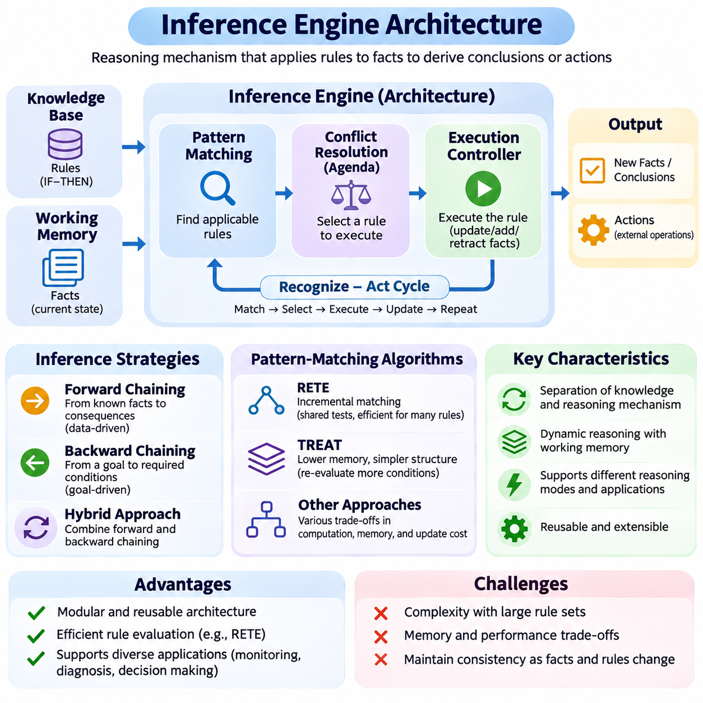{width="7.268055555555556in" height="7.268055555555556in"}

An inference engine is the central reasoning component of a rule-based artificial intelligence system, responsible for transforming stored knowledge and available facts into logical conclusions or executable actions. Its architecture defines how rules are represented, matched, selected, and executed. By separating reasoning mechanisms from domain-specific knowledge, inference engines provide reusable computational foundations for expert systems and intelligent decision-making applications.

A typical inference engine architecture consists of a knowledge base, working memory, pattern-matching mechanism, conflict resolution component, and execution controller. The knowledge base stores logical rules describing relationships between conditions and consequences. Working memory maintains facts representing the current problem state. The remaining components coordinate rule evaluation and determine how reasoning progresses through successive inference cycles.

The knowledge base serves as the persistent repository of domain-specific reasoning rules. These rules commonly follow an IF--THEN structure, where conditions define applicability and consequences specify conclusions or actions. Knowledge engineers organize rules according to application requirements, operational policies, and logical dependencies. Separating this repository from the inference mechanism allows knowledge to evolve without requiring fundamental changes to the engine.

Working memory represents the dynamic information available during reasoning. It may contain sensor observations, user inputs, database records, intermediate conclusions, and current operational states. Unlike the relatively stable knowledge base, working memory changes as new information arrives or rules execute. Its organization directly influences matching efficiency, consistency management, and the ability to trace how conclusions were derived.

The pattern-matching component determines which rules are applicable to the facts currently stored in working memory. It evaluates logical conditions, compares attributes, and establishes variable bindings between rule patterns and factual instances. Matching may involve numerical comparisons, relational constraints, and combinations of multiple conditions. Efficient matching is essential because large rule bases can otherwise require substantial repeated computation.

When several rules satisfy their conditions simultaneously, the inference engine creates a collection of eligible activations commonly called the agenda or conflict set. Each activation identifies a rule and the facts supporting its applicability. The conflict resolution component determines which activation should execute next. Selection strategies may consider explicit priorities, rule specificity, fact recency, or application-defined execution policies.

The execution controller coordinates the transition from rule selection to rule application. Depending on the rule semantics, executing a rule may derive new facts, modify existing information, retract obsolete facts, or request external operations. These changes can alter which rules remain applicable. The controller therefore manages the iterative relationship between rule execution, working-memory updates, and subsequent matching operations.

Many production-rule inference engines operate through a recognize--act cycle. During recognition, the engine identifies applicable rule activations and resolves competing candidates. During action, it executes the selected activation and updates the system state. The cycle repeats until no eligible activation remains, a designated goal is achieved, or an explicit termination condition is reached. This architecture supports dynamic and incremental reasoning.

Forward-chaining inference engines initiate reasoning from known facts and propagate their consequences through applicable rules. New observations or working-memory updates can trigger additional derivations. This architecture is well suited to event monitoring, industrial automation, and systems that must continuously maintain conclusions. Its efficiency depends on incremental matching, agenda management, and mechanisms that prevent unnecessary repeated rule execution.

Backward-chaining inference engines organize reasoning around specific goals or queries. A goal manager identifies rules capable of establishing a requested conclusion and recursively evaluates their supporting conditions. The engine may maintain a goal stack, variable bindings, and alternative proof paths. This architecture is especially useful for diagnostic systems, logical query processing, and applications requiring targeted verification rather than broad consequence generation.

Some inference architectures combine forward and backward chaining to support both event-driven and goal-directed reasoning. Forward chaining can maintain frequently needed conclusions as facts change, while backward chaining evaluates specific questions using the available knowledge. Hybrid execution requires coordination between stored derivations and query-time proofs. Consistency becomes particularly important when previously established conclusions depend on facts that have subsequently changed.

Efficient inference engines frequently employ specialized matching algorithms rather than evaluating every rule from the beginning. The RETE algorithm organizes rule conditions into a network of shared tests and intermediate matches. When facts change, only affected portions of the matching network need reevaluation. This approach can improve performance substantially, although cached partial matches may increase memory consumption.

Alternative matching architectures use different tradeoffs between computation, memory, and update frequency. RETE-derived approaches emphasize incremental reuse, while algorithms such as TREAT reduce certain intermediate storage requirements by recomputing joins when necessary. The appropriate design depends on the number of rules, fact distributions, update patterns, and available computational resources. No matching algorithm provides universally optimal performance.

Fact management is another essential architectural responsibility. The engine must distinguish newly asserted facts from previously derived conclusions and determine how changes propagate through dependent rules. Truth maintenance mechanisms can track justifications for inferred facts and retract conclusions when their supporting evidence becomes invalid. These capabilities are especially valuable in dynamic environments where observations and operational conditions frequently change.

Rule execution must also account for termination and repeated activation. Without appropriate controls, rules may continuously reproduce identical conclusions or create cyclic state transitions. Engines can employ refraction, activation histories, duplicate detection, and explicit execution limits to reduce these risks. Recursive reasoning architectures may additionally require cycle detection or tabling to avoid repeatedly exploring identical goals.

An explanation subsystem improves the transparency of inference by recording which rules were activated, which facts satisfied their conditions, and how conclusions were produced. Such information supports debugging, auditing, and expert validation. Explanation mechanisms may construct derivation traces or goal-oriented proof histories. Their reliability depends on accurate recording of inference events and the semantics governing rule execution.

Practical inference engines often include interfaces connecting the reasoning core with databases, sensors, applications, and user-facing services. An input adapter converts external observations into structured facts, while an output interface communicates conclusions or authorized actions. This separation prevents domain-specific integration details from becoming embedded in reasoning algorithms and supports reuse across different deployment environments.

In enterprise applications, inference engines may operate as independent decision services within larger software architectures. External applications submit facts or decision requests, and the engine evaluates applicable rules before returning results. Transaction management, concurrency control, access authorization, and versioned rule deployment become important operational concerns. These mechanisms help preserve reliable behavior when multiple services interact with shared decision logic.

Industrial and robotic applications introduce additional architectural constraints related to latency, reliability, and safety. An inference engine may evaluate equipment conditions, mission restrictions, or maintenance requirements using structured observations. However, rule execution latency can vary with fact changes and rule interactions. Safety-critical control therefore requires independently validated enforcement mechanisms and clearly defined timing guarantees.

Scalability depends on the interaction between rule complexity, working-memory size, matching efficiency, and execution frequency. Large systems may benefit from partitioned rule sets, selective fact subscriptions, caching, and incremental evaluation. Distributed architectures can separate reasoning workloads, but shared-state synchronization and consistency introduce additional challenges. Performance engineering must therefore consider both computational throughput and correctness.

Testing and validation are fundamental to inference engine engineering. Developers must verify rule applicability, conflict resolution behavior, fact propagation, termination conditions, and expected conclusions. Unit tests can examine individual rules, while integration tests evaluate interactions across the complete reasoning system. Execution traces and regression testing help identify unintended behavioral changes when knowledge bases or engine implementations are updated.

Modern inference engines increasingly interact with knowledge graphs, ontologies, and machine learning models. Structured semantic representations can supply facts and relationships, while learning-based components can generate predictions that become inputs to symbolic reasoning. The inference engine then applies explicit policies or logical constraints to these inputs. Such integration supports hybrid intelligent systems combining statistical perception with interpretable decision logic.

The architecture of an inference engine ultimately determines how effectively explicit knowledge becomes reliable computational behavior. Knowledge storage, working-memory management, pattern matching, conflict resolution, execution control, and explanation mechanisms must operate coherently. Understanding these architectural relationships provides the foundation for implementing scalable rule engines, evaluating reasoning performance, and developing dependable knowledge-driven artificial intelligence systems.

추론 엔진(Inference Engine)은 규칙 기반 인공지능 시스템(Rule-Based Artificial Intelligence System)의 핵심 추론 구성 요소로, 저장된 지식과 이용 가능한 사실을 논리적 결론(Logical Conclusions) 또는 실행 가능한 동작(Executable Actions)으로 변환하는 역할을 담당한다. 추론 엔진의 아키텍처(Architecture)는 규칙을 표현하고, 매칭하고, 선택하고, 실행하는 방법을 정의한다. 추론 메커니즘(Reasoning Mechanisms)을 도메인별 지식(Domain-Specific Knowledge)과 분리함으로써 전문가 시스템(Expert Systems)과 지능형 의사결정 응용 시스템(Intelligent Decision-Making Applications)에 재사용 가능한 계산 기반을 제공한다.

일반적인 추론 엔진 아키텍처(Inference Engine Architecture)는 지식 기반(Knowledge Base), 작업 기억(Working Memory), 패턴 매칭 메커니즘(Pattern-Matching Mechanism), 충돌 해결 구성 요소(Conflict Resolution Component), 실행 제어기(Execution Controller)로 구성된다. 지식 기반은 조건과 결과 사이의 관계를 설명하는 논리 규칙(Logical Rules)을 저장한다. 작업 기억은 현재 문제 상태(Current Problem State)를 나타내는 사실(Facts)을 유지한다. 나머지 구성 요소들은 규칙 평가를 조정하고 연속적인 추론 주기(Inference Cycles)를 통해 추론이 진행되는 방식을 결정한다.

지식 기반(Knowledge Base)은 도메인별 추론 규칙(Domain-Specific Reasoning Rules)을 영구적으로 저장하는 저장소 역할을 한다. 이러한 규칙은 일반적으로 IF--THEN 구조를 따르며, 조건(Conditions)은 적용 가능성을 정의하고 결과(Consequences)는 결론이나 동작을 지정한다. 지식 엔지니어(Knowledge Engineers)는 응용 시스템의 요구사항, 운영 정책(Operational Policies), 논리적 의존 관계(Logical Dependencies)에 따라 규칙을 구성한다. 이 저장소를 추론 메커니즘과 분리하면 엔진의 근본적인 변경 없이도 지식을 발전시킬 수 있다.

작업 기억(Working Memory)은 추론 과정에서 이용할 수 있는 동적 정보(Dynamic Information)를 나타낸다. 여기에는 센서 관측값(Sensor Observations), 사용자 입력(User Inputs), 데이터베이스 기록(Database Records), 중간 결론(Intermediate Conclusions), 현재 운영 상태(Current Operational States)가 포함될 수 있다. 상대적으로 안정적인 지식 기반과 달리 작업 기억은 새로운 정보가 입력되거나 규칙이 실행될 때 변경된다. 작업 기억의 구성 방식은 매칭 효율성(Matching Efficiency), 일관성 관리(Consistency Management), 결론 도출 과정의 추적 가능성(Traceability)에 직접적인 영향을 미친다.

패턴 매칭 구성 요소(Pattern-Matching Component)는 현재 작업 기억에 저장된 사실에 어떤 규칙을 적용할 수 있는지 판단한다. 이 구성 요소는 논리 조건(Logical Conditions)을 평가하고 속성(Attributes)을 비교하며 규칙 패턴(Rule Patterns)과 사실 인스턴스(Factual Instances) 사이의 변수 바인딩(Variable Bindings)을 설정한다. 매칭에는 수치 비교(Numerical Comparisons), 관계형 제약조건(Relational Constraints), 여러 조건의 조합이 포함될 수 있다. 대규모 규칙 기반에서는 상당한 반복 계산이 발생할 수 있으므로 효율적인 매칭이 필수적이다.

여러 규칙이 동시에 조건을 충족하면 추론 엔진은 일반적으로 실행 대기 목록(Agenda) 또는 충돌 집합(Conflict Set)이라고 하는 실행 가능한 활성화(Eligible Activations)의 집합을 생성한다. 각 활성화는 규칙과 해당 규칙의 적용 가능성을 뒷받침하는 사실을 식별한다. 충돌 해결 구성 요소(Conflict Resolution Component)는 다음에 실행할 활성화를 결정한다. 선택 전략(Selection Strategies)은 명시적인 우선순위(Explicit Priorities), 규칙의 구체성(Rule Specificity), 사실의 최신성(Fact Recency), 응용 시스템에서 정의한 실행 정책(Execution Policies)을 고려할 수 있다.

실행 제어기(Execution Controller)는 규칙 선택에서 규칙 적용으로 이어지는 전환 과정을 조정한다. 규칙의 의미론(Rule Semantics)에 따라 규칙 실행은 새로운 사실을 도출하거나, 기존 정보를 수정하거나, 오래된 사실을 철회하거나, 외부 작업을 요청할 수 있다. 이러한 변경은 적용 가능한 규칙의 집합을 변화시킬 수 있다. 따라서 실행 제어기는 규칙 실행, 작업 기억 갱신(Working-Memory Updates), 후속 매칭 작업(Subsequent Matching Operations) 사이의 반복적인 관계를 관리한다.

많은 생산 규칙 추론 엔진(Production-Rule Inference Engines)은 인식--동작 주기(Recognize--Act Cycle)를 통해 작동한다. 인식 단계(Recognition)에서 엔진은 적용 가능한 규칙 활성화를 식별하고 경쟁하는 후보를 조정한다. 동작 단계(Action)에서는 선택된 활성화를 실행하고 시스템 상태(System State)를 갱신한다. 이 주기는 실행 가능한 활성화가 더 이상 존재하지 않거나, 지정된 목표가 달성되거나, 명시적인 종료 조건(Termination Condition)에 도달할 때까지 반복된다. 이러한 아키텍처는 동적 추론(Dynamic Reasoning)과 증분 추론(Incremental Reasoning)을 지원한다.

전방향 연쇄 추론 엔진(Forward-Chaining Inference Engines)은 알려진 사실에서 추론을 시작하고 적용 가능한 규칙을 통해 그 결과를 전파한다. 새로운 관측값이나 작업 기억의 갱신은 추가적인 도출을 유발할 수 있다. 이러한 아키텍처는 이벤트 모니터링(Event Monitoring), 산업 자동화(Industrial Automation), 결론을 지속적으로 유지해야 하는 시스템에 적합하다. 효율성은 증분 매칭(Incremental Matching), 실행 대기 목록 관리(Agenda Management), 불필요한 규칙 반복 실행을 방지하는 메커니즘에 따라 달라진다.

역방향 연쇄 추론 엔진(Backward-Chaining Inference Engines)은 특정 목표(Goals)나 질의(Queries)를 중심으로 추론을 구성한다. 목표 관리자(Goal Manager)는 요청된 결론을 확립할 수 있는 규칙을 식별하고 해당 규칙을 뒷받침하는 조건을 재귀적으로 평가한다. 엔진은 목표 스택(Goal Stack), 변수 바인딩(Variable Bindings), 대체 증명 경로(Alternative Proof Paths)를 유지할 수 있다. 이러한 아키텍처는 광범위한 결과 도출보다 특정 목표에 대한 검증이 필요한 진단 시스템(Diagnostic Systems), 논리 질의 처리(Logical Query Processing), 응용 시스템에 특히 유용하다.

일부 추론 아키텍처(Inference Architectures)는 전방향 연쇄 추론과 역방향 연쇄 추론을 결합하여 이벤트 주도 추론(Event-Driven Reasoning)과 목표 지향 추론(Goal-Directed Reasoning)을 모두 지원한다. 전방향 연쇄 추론은 사실이 변경될 때 자주 필요한 결론을 유지할 수 있으며, 역방향 연쇄 추론은 이용 가능한 지식을 사용하여 특정 질문을 평가한다. 하이브리드 실행(Hybrid Execution)에는 저장된 도출 결과(Stored Derivations)와 질의 시점의 증명(Query-Time Proofs) 사이의 조정이 필요하다. 특히 이전에 확립된 결론이 이후 변경된 사실에 의존하는 경우 일관성(Consistency)이 중요해진다.

효율적인 추론 엔진은 모든 규칙을 처음부터 평가하는 대신 특수한 매칭 알고리즘(Matching Algorithms)을 사용하는 경우가 많다. RETE 알고리즘(RETE Algorithm)은 규칙 조건을 공유된 검사(Shared Tests)와 중간 매칭 결과(Intermediate Matches)의 네트워크로 구성한다. 사실이 변경되면 매칭 네트워크(Matching Network)에서 영향을 받는 부분만 다시 평가하면 된다. 이러한 접근 방식은 성능을 크게 향상시킬 수 있지만, 캐시된 부분 매칭 결과(Cached Partial Matches)는 메모리 소비량(Memory Consumption)을 증가시킬 수 있다.

대체 매칭 아키텍처(Alternative Matching Architectures)는 계산량(Computation), 메모리(Memory), 갱신 빈도(Update Frequency) 사이에서 서로 다른 상충관계(Tradeoffs)를 가진다. RETE 기반 접근 방식(RETE-Derived Approaches)은 증분 재사용(Incremental Reuse)을 강조하는 반면, TREAT와 같은 알고리즘은 필요할 때 조인(Join)을 다시 계산하여 특정 중간 저장 요구사항(Intermediate Storage Requirements)을 줄인다. 적절한 설계는 규칙의 수, 사실의 분포(Fact Distributions), 갱신 패턴(Update Patterns), 이용 가능한 계산 자원(Computational Resources)에 따라 결정된다. 모든 상황에서 최적의 성능을 제공하는 단일 매칭 알고리즘은 존재하지 않는다.

사실 관리(Fact Management)는 또 다른 필수적인 아키텍처 책임이다. 엔진은 새롭게 주장된 사실(Asserted Facts)과 이전에 도출된 결론(Derived Conclusions)을 구분하고, 변경 사항이 의존 관계에 있는 규칙으로 어떻게 전파되는지 결정해야 한다. 진리 유지 메커니즘(Truth Maintenance Mechanisms)은 추론된 사실의 정당화 근거(Justifications)를 추적하고 이를 뒷받침하는 증거가 유효하지 않게 되면 결론을 철회할 수 있다. 이러한 기능은 관측값과 운영 조건이 빈번하게 변화하는 동적 환경(Dynamic Environments)에서 특히 중요하다.

규칙 실행은 종료 조건(Termination)과 반복 활성화(Repeated Activation)도 고려해야 한다. 적절한 제어 장치가 없으면 규칙이 동일한 결론을 지속적으로 생성하거나 순환적인 상태 전이(Cyclic State Transitions)를 일으킬 수 있다. 추론 엔진은 이러한 위험을 줄이기 위해 재발화 방지(Refraction), 활성화 이력(Activation Histories), 중복 탐지(Duplicate Detection), 명시적인 실행 제한(Execution Limits)을 사용할 수 있다. 재귀적 추론 아키텍처(Recursive Reasoning Architectures)는 동일한 목표를 반복적으로 탐색하지 않도록 순환 탐지(Cycle Detection)나 테이블링(Tabling)이 추가로 필요할 수 있다.

설명 하위 시스템(Explanation Subsystem)은 어떤 규칙이 활성화되었는지, 어떤 사실이 조건을 충족했는지, 결론이 어떻게 생성되었는지를 기록하여 추론의 투명성(Transparency)을 향상시킨다. 이러한 정보는 디버깅(Debugging), 감사(Auditing), 전문가 검증(Expert Validation)을 지원한다. 설명 메커니즘(Explanation Mechanisms)은 도출 추적(Derivation Traces)이나 목표 지향 증명 이력(Goal-Oriented Proof Histories)을 구성할 수 있다. 신뢰성은 추론 이벤트(Inference Events)의 정확한 기록과 규칙 실행을 지배하는 의미론에 따라 달라진다.

실제 추론 엔진에는 추론 핵심부(Reasoning Core)를 데이터베이스(Databases), 센서(Sensors), 응용 프로그램(Applications), 사용자 대상 서비스(User-Facing Services)와 연결하는 인터페이스(Interfaces)가 포함되는 경우가 많다. 입력 어댑터(Input Adapter)는 외부 관측값을 구조화된 사실(Structured Facts)로 변환하고, 출력 인터페이스(Output Interface)는 결론이나 승인된 동작(Authorized Actions)을 전달한다. 이러한 분리는 도메인별 통합 세부사항(Domain-Specific Integration Details)이 추론 알고리즘에 직접 포함되는 것을 방지하고 다양한 배포 환경(Deployment Environments)에서 재사용을 지원한다.

기업용 응용 시스템(Enterprise Applications)에서 추론 엔진은 더 큰 소프트웨어 아키텍처 내의 독립적인 의사결정 서비스(Decision Services)로 작동할 수 있다. 외부 응용 프로그램은 사실이나 의사결정 요청(Decision Requests)을 제출하고, 엔진은 적용 가능한 규칙을 평가한 후 결과를 반환한다. 트랜잭션 관리(Transaction Management), 동시성 제어(Concurrency Control), 접근 권한 부여(Access Authorization), 버전이 관리되는 규칙 배포(Versioned Rule Deployment)는 중요한 운영 고려사항이 된다. 이러한 메커니즘은 여러 서비스가 공유된 의사결정 로직(Shared Decision Logic)과 상호작용할 때 신뢰할 수 있는 동작을 유지하는 데 도움이 된다.

산업 및 로보틱스 응용 시스템(Industrial and Robotic Applications)에서는 지연시간(Latency), 신뢰성(Reliability), 안전성(Safety)과 관련된 추가적인 아키텍처 제약조건(Architectural Constraints)이 발생한다. 추론 엔진은 구조화된 관측값을 사용하여 장비 상태, 임무 제한사항(Mission Restrictions), 유지보수 요구사항을 평가할 수 있다. 그러나 규칙 실행 지연시간(Rule Execution Latency)은 사실의 변경과 규칙 간 상호작용에 따라 달라질 수 있다. 따라서 안전 필수 제어(Safety-Critical Control)에는 독립적으로 검증된 강제 적용 메커니즘(Enforcement Mechanisms)과 명확하게 정의된 시간 보장(Timing Guarantees)이 필요하다.

확장성(Scalability)은 규칙의 복잡성(Rule Complexity), 작업 기억의 크기(Working-Memory Size), 매칭 효율성(Matching Efficiency), 실행 빈도(Execution Frequency) 사이의 상호작용에 따라 결정된다. 대규모 시스템은 분할된 규칙 집합(Partitioned Rule Sets), 선택적 사실 구독(Selective Fact Subscriptions), 캐싱(Caching), 증분 평가(Incremental Evaluation)를 통해 이점을 얻을 수 있다. 분산 아키텍처(Distributed Architectures)는 추론 작업 부하(Reasoning Workloads)를 분리할 수 있지만, 공유 상태 동기화(Shared-State Synchronization)와 일관성 문제를 추가로 발생시킨다. 따라서 성능 엔지니어링(Performance Engineering)은 계산 처리량(Computational Throughput)과 정확성(Correctness)을 모두 고려해야 한다.

테스트(Testing)와 검증(Validation)은 추론 엔진 엔지니어링(Inference Engine Engineering)의 기본 요소이다. 개발자는 규칙 적용 가능성(Rule Applicability), 충돌 해결 동작(Conflict Resolution Behavior), 사실 전파(Fact Propagation), 종료 조건(Termination Conditions), 예상 결론(Expected Conclusions)을 검증해야 한다. 단위 테스트(Unit Tests)는 개별 규칙을 검사하고, 통합 테스트(Integration Tests)는 전체 추론 시스템에 걸친 상호작용을 평가한다. 실행 추적(Execution Traces)과 회귀 테스트(Regression Testing)는 지식 기반이나 엔진 구현이 갱신될 때 의도하지 않은 동작 변화를 식별하는 데 도움이 된다.

현대적인 추론 엔진은 지식 그래프(Knowledge Graphs), 온톨로지(Ontologies), 머신러닝 모델(Machine Learning Models)과 점점 더 긴밀하게 상호작용하고 있다. 구조화된 의미 표현(Structured Semantic Representations)은 사실과 관계를 제공할 수 있으며, 학습 기반 구성 요소(Learning-Based Components)는 기호적 추론(Symbolic Reasoning)의 입력이 되는 예측 결과를 생성할 수 있다. 이후 추론 엔진은 이러한 입력에 명시적인 정책(Explicit Policies)이나 논리적 제약조건(Logical Constraints)을 적용한다. 이러한 통합은 통계적 인식(Statistical Perception)과 해석 가능한 의사결정 로직(Interpretable Decision Logic)을 결합한 하이브리드 지능형 시스템(Hybrid Intelligent Systems)을 지원한다.

궁극적으로 추론 엔진의 아키텍처(Inference Engine Architecture)는 명시적인 지식(Explicit Knowledge)이 얼마나 효과적으로 신뢰할 수 있는 계산 동작(Reliable Computational Behavior)으로 변환되는지를 결정한다. 지식 저장(Knowledge Storage), 작업 기억 관리(Working-Memory Management), 패턴 매칭(Pattern Matching), 충돌 해결(Conflict Resolution), 실행 제어(Execution Control), 설명 메커니즘(Explanation Mechanisms)은 일관되게 작동해야 한다. 이러한 아키텍처 관계를 이해하는 것은 확장 가능한 규칙 엔진(Scalable Rule Engines)을 구현하고, 추론 성능(Reasoning Performance)을 평가하며, 신뢰할 수 있는 지식 기반 인공지능 시스템(Knowledge-Driven Artificial Intelligence Systems)을 개발하기 위한 기초가 된다.

## 04.05 Conflict Resolution Strategies

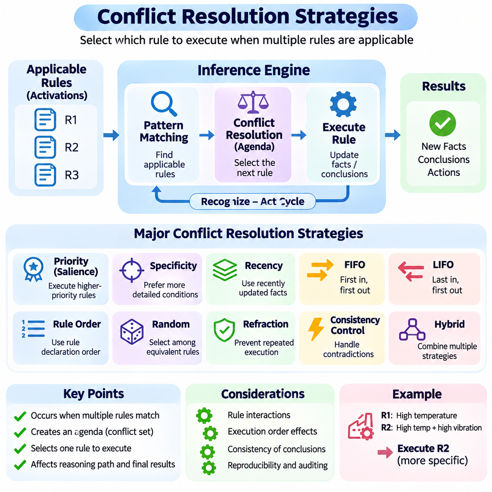{width="7.268055555555556in" height="7.268055555555556in"}

Conflict resolution strategies are essential components of rule-based inference engines because multiple rules may become applicable to the same collection of facts. When several conditions are satisfied simultaneously, the system must determine which rule should execute first. Conflict resolution establishes an execution policy that coordinates competing rule activations, maintains predictable reasoning behavior, and supports consistent decision-making across complex knowledge bases.

In a production-rule system, the inference engine identifies applicable rules through pattern matching and places their activations into an agenda or conflict set. Each activation represents a particular rule together with the facts satisfying its conditions. The conflict resolution mechanism examines these activations and selects the next candidate for execution. Its decisions can influence intermediate conclusions, working-memory changes, and subsequent rule applicability.

Conflict resolution is necessary because rule execution may change the facts used by other rules. One rule may introduce a new conclusion, another may modify an existing state, and a third may retract information that previously supported an activation. Consequently, executing the same applicable rules in different orders can produce different reasoning paths. In systems with procedural actions or nonmonotonic updates, execution order may also influence final outcomes.

Priority-based conflict resolution assigns explicit importance values to rules and selects activations according to their relative priorities. A rule handling a critical equipment fault may receive higher priority than a routine maintenance notification. This strategy provides direct control over execution order and is relatively easy to understand. However, excessive reliance on manually assigned priorities can create difficult dependencies as rule collections expand.

Many rule engines support priority attributes such as salience, allowing developers to influence agenda ordering. Higher-salience rules generally receive preference over lower-salience rules, although exact behavior depends on the engine. Salience can separate urgent responses from ordinary processing and organize phases of reasoning. Nevertheless, priority values should not replace explicit logical conditions or carefully designed operational constraints.

Specificity-based conflict resolution prefers rules containing more restrictive or detailed conditions. For example, a rule addressing high temperature, excessive vibration, and abnormal current may receive preference over a general temperature-warning rule. The underlying assumption is that more specific knowledge can provide a more appropriate response to a specialized situation. Specificity measures must be defined carefully because rule complexity does not always indicate greater importance.

Recency-based strategies consider the age or update order of facts supporting each activation. Rules matching recently asserted or modified facts may receive preference over rules relying on older information. This approach can be useful in monitoring environments where recent observations reflect changing operational conditions. However, recency alone does not guarantee correctness, especially when older facts remain authoritative or newer observations are unreliable.

Some inference engines use a first-in, first-out policy to execute activations in the order they entered the agenda. Others employ last-in, first-out ordering, giving preference to more recently created activations. These policies are straightforward to implement and can provide predictable behavior under stable activation semantics. Their suitability depends on whether the application benefits from chronological fairness or immediate processing of newly triggered reasoning paths.

Rule ordering can also serve as a conflict resolution mechanism when the engine uses the position of rules in a knowledge base as a selection criterion. Earlier or later declarations may receive preference according to implementation-specific semantics. Although this strategy is simple, it creates dependencies between source-code organization and execution behavior. Such dependencies can become difficult to maintain when rules are frequently added, reorganized, or generated automatically.

Random selection represents another possible conflict resolution strategy. When multiple activations have equivalent priority, the engine may choose among them randomly or through a randomized scheduling policy. This can help explore alternative execution paths in simulations or experimental reasoning systems. However, randomized execution complicates reproducibility and auditing unless the random seed, activation set, and selection decisions are recorded.

Refraction is an important mechanism for preventing repeated execution of the same rule activation without relevant changes. A production system may remember that a particular rule has already fired for a specific combination of facts. The engine can then suppress equivalent activations until its execution semantics permit reconsideration. Refraction reduces redundant reasoning and helps prevent infinite loops caused by rules repeatedly producing unchanged conclusions.

Conflict resolution must distinguish between competing activations and logically contradictory conclusions. Two rules may both be applicable without producing incompatible results, while contradictory conclusions may arise even when rules execute at different times. Agenda scheduling determines execution order, but logical inconsistency requires additional mechanisms such as integrity constraints, contradiction detection, or explicit policies for reconciling conflicting knowledge.

An industrial example illustrates the importance of coordinated rule execution. A monitoring system may simultaneously detect overheating, abnormal vibration, and a scheduled maintenance condition. One rule requests immediate shutdown, another generates a diagnostic alert, and another recommends routine inspection. A well-designed policy can prioritize critical protective actions while preserving diagnostic information and preventing lower-priority operations from interfering.

Safety-related conflict resolution requires particular care because rule priority alone cannot guarantee safe system behavior. A high-priority shutdown rule may still execute too late if matching or scheduling delays exceed operational limits. Safety-critical applications therefore require validated control mechanisms, bounded response times, and independent protective functions where appropriate. The inference engine should support safety supervision without becoming an unverified substitute for essential safeguards.

Complex inference engines frequently combine multiple conflict resolution criteria into a hierarchical selection policy. Explicit priority may be evaluated first, followed by specificity, recency, and a deterministic tie-breaking rule. Such combinations provide flexibility while preserving predictable execution. The complete ordering policy should be documented because interactions between criteria can produce behavior that is difficult to infer from individual rules.

Agenda groups and rule activation groups provide additional mechanisms for organizing execution. An agenda group can restrict attention to a selected collection of rules, supporting staged reasoning or workflow-specific processing. An activation group may enforce mutual exclusion by allowing only one activation from a designated group to execute. These mechanisms help structure large rule bases, although their exact semantics vary across rule-engine implementations.

Conflict resolution also interacts with forward and backward chaining. Forward-chaining engines commonly maintain agendas containing multiple eligible activations, making scheduling policies central to execution. Backward-chaining systems generally focus on goal selection, alternative proof paths, and the order in which supporting conditions are explored. Both approaches require search-control decisions, but the meaning of competition differs according to their inference architectures.

The performance of conflict resolution depends on agenda size, activation frequency, and the complexity of selection criteria. Repeatedly sorting large activation collections may introduce unnecessary computational overhead. Efficient engines can use priority queues, indexed activation structures, and incremental agenda updates. These optimizations reduce scheduling costs while preserving the execution semantics required by the application.

Dynamic rule environments introduce further challenges because facts, priorities, and rule definitions may change during execution. An activation that was valid when inserted into the agenda may become invalid after another rule modifies working memory. The engine must therefore maintain activation consistency and remove or update obsolete matches. Correct agenda maintenance is essential for avoiding actions based on outdated or unsupported conditions.

Fairness and starvation are additional considerations in long-running inference systems. A continuously arriving stream of high-priority activations may prevent lower-priority rules from executing indefinitely. Depending on application requirements, engines may employ aging policies, execution quotas, or scheduled processing windows. Such mechanisms must be balanced against urgency requirements, particularly when critical rules cannot safely be delayed.

Explainability benefits from recording why one activation was selected over competing alternatives. An execution trace can include applicable rules, supporting facts, priority values, specificity comparisons, and tie-breaking decisions. These records help developers investigate unexpected behavior and allow domain experts to verify operational policies. Transparent conflict resolution is especially valuable in regulated environments and systems requiring auditable decisions.

Testing conflict resolution requires more than verifying individual rule conditions. Developers must evaluate simultaneous activations, contradictory actions, repeated firing, fact retraction, priority changes, and termination behavior. Regression tests should examine whether rule additions alter previously established execution sequences. Simulation and systematic exploration of alternative activation orders can reveal hidden dependencies and unexpected interactions.

Conflict resolution strategies ultimately determine how a rule-based system coordinates multiple valid reasoning opportunities. Their effectiveness depends on alignment with domain requirements, clearly defined execution semantics, efficient agenda management, and systematic validation. Understanding priority, specificity, recency, refraction, and combined scheduling policies provides a foundation for building predictable inference engines and reliable expert systems.

충돌 해결 전략(Conflict Resolution Strategies)은 여러 규칙이 동일한 사실 집합(Fact Collection)에 동시에 적용될 수 있기 때문에 규칙 기반 추론 엔진(Rule-Based Inference Engines)의 필수 구성 요소이다. 여러 조건이 동시에 충족되면 시스템은 어떤 규칙을 먼저 실행할지 결정해야 한다. 충돌 해결(Conflict Resolution)은 경쟁하는 규칙 활성화(Rule Activations)를 조정하고, 예측 가능한 추론 동작(Predictable Reasoning Behavior)을 유지하며, 복잡한 지식 기반(Knowledge Bases)에서 일관된 의사결정(Consistent Decision-Making)을 지원하는 실행 정책(Execution Policy)을 수립한다.

생산 규칙 시스템(Production-Rule System)에서 추론 엔진(Inference Engine)은 패턴 매칭(Pattern Matching)을 통해 적용 가능한 규칙을 식별하고, 해당 규칙의 활성화를 실행 대기 목록(Agenda) 또는 충돌 집합(Conflict Set)에 배치한다. 각 활성화는 특정 규칙과 그 조건을 충족하는 사실을 함께 나타낸다. 충돌 해결 메커니즘(Conflict Resolution Mechanism)은 이러한 활성화를 검사하고 다음 실행 대상을 선택한다. 이러한 결정은 중간 결론(Intermediate Conclusions), 작업 기억의 변경(Working-Memory Changes), 후속 규칙의 적용 가능성(Subsequent Rule Applicability)에 영향을 미칠 수 있다.

충돌 해결이 필요한 이유는 규칙 실행이 다른 규칙에서 사용하는 사실을 변경할 수 있기 때문이다. 하나의 규칙은 새로운 결론을 도입하고, 다른 규칙은 기존 상태를 수정하며, 또 다른 규칙은 이전에 활성화를 뒷받침했던 정보를 철회할 수 있다. 따라서 동일한 적용 가능 규칙을 서로 다른 순서로 실행하면 상이한 추론 경로(Reasoning Paths)가 생성될 수 있다. 절차적 동작(Procedural Actions)이나 비단조적 갱신(Nonmonotonic Updates)이 존재하는 시스템에서는 실행 순서가 최종 결과에도 영향을 미칠 수 있다.

우선순위 기반 충돌 해결(Priority-Based Conflict Resolution)은 규칙에 명시적인 중요도 값(Importance Values)을 할당하고 상대적인 우선순위(Relative Priorities)에 따라 활성화를 선택한다. 심각한 장비 고장(Critical Equipment Fault)을 처리하는 규칙은 일상적인 유지보수 알림(Routine Maintenance Notification)보다 높은 우선순위를 받을 수 있다. 이 전략은 실행 순서를 직접 제어할 수 있으며 이해하기도 비교적 쉽다. 그러나 수동으로 지정한 우선순위에 지나치게 의존하면 규칙 집합이 확장될수록 관리하기 어려운 의존 관계(Dependencies)가 발생할 수 있다.

많은 규칙 엔진(Rule Engines)은 현저도(Salience)와 같은 우선순위 속성(Priority Attributes)을 지원하여 개발자가 실행 대기 목록의 정렬 순서(Agenda Ordering)에 영향을 줄 수 있도록 한다. 일반적으로 현저도가 높은 규칙은 낮은 규칙보다 우선적으로 실행되지만, 정확한 동작은 엔진에 따라 달라진다. 현저도는 긴급 대응(Urgent Responses)과 일반 처리(Ordinary Processing)를 구분하고 추론 단계(Reasoning Phases)를 구성하는 데 사용할 수 있다. 그러나 우선순위 값이 명시적인 논리 조건이나 신중하게 설계된 운영 제약조건(Operational Constraints)을 대체해서는 안 된다.

구체성 기반 충돌 해결(Specificity-Based Conflict Resolution)은 더 제한적이거나 상세한 조건을 포함하는 규칙을 우선한다. 예를 들어, 고온(High Temperature), 과도한 진동(Excessive Vibration), 비정상 전류(Abnormal Current)를 모두 다루는 규칙은 일반적인 온도 경고 규칙보다 우선될 수 있다. 이러한 접근 방식은 더 구체적인 지식이 특수한 상황에 더욱 적절한 대응을 제공할 수 있다는 가정에 기반한다. 그러나 규칙의 복잡성이 항상 더 높은 중요도를 의미하지는 않으므로 구체성 척도(Specificity Measures)를 신중하게 정의해야 한다.

최신성 기반 전략(Recency-Based Strategies)은 각 활성화를 뒷받침하는 사실의 생성 시점이나 갱신 순서(Update Order)를 고려한다. 최근에 추가되거나 수정된 사실과 일치하는 규칙은 오래된 정보에 의존하는 규칙보다 우선될 수 있다. 이러한 접근 방식은 최근 관측값(Recent Observations)이 변화하는 운영 조건을 반영하는 모니터링 환경(Monitoring Environments)에서 유용할 수 있다. 그러나 오래된 사실이 여전히 권위 있는 정보이거나 새로운 관측값의 신뢰성이 낮은 경우에는 최신성만으로 정확성을 보장할 수 없다.

일부 추론 엔진은 활성화가 실행 대기 목록에 들어온 순서대로 실행하는 선입선출 정책(First-In, First-Out Policy)을 사용한다. 다른 엔진은 가장 최근에 생성된 활성화를 우선하는 후입선출 방식(Last-In, First-Out Ordering)을 적용한다. 이러한 정책은 구현하기 쉽고 안정적인 활성화 의미론(Activation Semantics) 아래에서 예측 가능한 동작을 제공할 수 있다. 적합성은 응용 시스템이 시간 순서에 따른 공정성(Chronological Fairness)을 중시하는지, 새롭게 활성화된 추론 경로를 즉시 처리하는 것을 중시하는지에 따라 달라진다.

규칙 순서(Rule Ordering)도 추론 엔진이 지식 기반 내 규칙의 위치를 선택 기준으로 사용하는 경우 충돌 해결 메커니즘으로 작동할 수 있다. 구현별 의미론(Implementation-Specific Semantics)에 따라 먼저 선언된 규칙이나 나중에 선언된 규칙이 우선될 수 있다. 이러한 전략은 단순하지만 소스 코드 구성(Source-Code Organization)과 실행 동작(Execution Behavior) 사이에 의존 관계를 형성한다. 규칙을 자주 추가하거나 재구성하거나 자동 생성하는 경우 이러한 의존 관계는 유지보수를 어렵게 만들 수 있다.

무작위 선택(Random Selection)은 또 다른 충돌 해결 전략이다. 여러 활성화가 동일한 우선순위를 가지면 추론 엔진은 무작위 또는 무작위화된 스케줄링 정책(Randomized Scheduling Policy)을 통해 실행 대상을 선택할 수 있다. 이는 시뮬레이션(Simulations)이나 실험적 추론 시스템(Experimental Reasoning Systems)에서 대체 실행 경로(Alternative Execution Paths)를 탐색하는 데 도움이 될 수 있다. 그러나 난수 시드(Random Seed), 활성화 집합(Activation Set), 선택 결정(Selection Decisions)을 기록하지 않으면 재현성(Reproducibility)과 감사 가능성(Auditability)이 저하된다.

재발화 방지(Refraction)는 관련된 변경 없이 동일한 규칙 활성화가 반복 실행되는 것을 방지하는 중요한 메커니즘이다. 생산 시스템(Production System)은 특정 사실 조합에 대해 어떤 규칙이 이미 실행되었는지 기억할 수 있다. 이후 추론 엔진은 실행 의미론(Execution Semantics)이 재평가를 허용할 때까지 동일한 활성화를 억제할 수 있다. 재발화 방지는 중복 추론(Redundant Reasoning)을 줄이고 규칙이 변경되지 않은 결론을 반복적으로 생성하여 발생하는 무한 루프(Infinite Loops)를 방지하는 데 도움이 된다.

충돌 해결은 경쟁하는 활성화(Competing Activations)와 논리적으로 모순되는 결론(Logically Contradictory Conclusions)을 구분해야 한다. 두 규칙이 모두 적용 가능하더라도 서로 양립할 수 없는 결과를 생성하지 않을 수 있으며, 반대로 규칙이 서로 다른 시점에 실행되더라도 모순된 결론이 발생할 수 있다. 실행 대기 목록 스케줄링(Agenda Scheduling)은 실행 순서를 결정하지만, 논리적 불일치(Logical Inconsistency)를 해결하려면 무결성 제약조건(Integrity Constraints), 모순 탐지(Contradiction Detection), 충돌하는 지식을 조정하는 명시적인 정책이 추가로 필요하다.

산업용 사례(Industrial Example)는 조정된 규칙 실행(Coordinated Rule Execution)의 중요성을 보여준다. 모니터링 시스템은 과열(Overheating), 비정상 진동(Abnormal Vibration), 예정된 유지보수 상태(Scheduled Maintenance Condition)를 동시에 감지할 수 있다. 하나의 규칙은 즉각적인 정지(Immediate Shutdown)를 요청하고, 다른 규칙은 진단 경고(Diagnostic Alert)를 생성하며, 또 다른 규칙은 정기 점검(Routine Inspection)을 권고한다. 잘 설계된 정책은 진단 정보를 보존하면서 중요한 보호 동작(Protective Actions)을 우선하고 낮은 우선순위의 작업이 이를 방해하지 않도록 할 수 있다.

안전 관련 충돌 해결(Safety-Related Conflict Resolution)은 규칙 우선순위만으로 시스템의 안전한 동작을 보장할 수 없으므로 특별한 주의가 필요하다. 우선순위가 높은 정지 규칙이라도 매칭이나 스케줄링 지연(Matching or Scheduling Delays)이 운영상 허용 한계를 초과하면 너무 늦게 실행될 수 있다. 따라서 안전 필수 응용 시스템(Safety-Critical Applications)에는 검증된 제어 메커니즘(Validated Control Mechanisms), 제한된 응답시간(Bounded Response Times), 필요한 경우 독립적인 보호 기능(Independent Protective Functions)이 요구된다. 추론 엔진은 필수 안전장치를 검증되지 않은 방식으로 대체하지 않으면서 안전 감독(Safety Supervision)을 지원해야 한다.

복잡한 추론 엔진(Inference Engines)은 여러 충돌 해결 기준을 계층적 선택 정책(Hierarchical Selection Policy)으로 결합하는 경우가 많다. 명시적인 우선순위(Explicit Priority)를 먼저 평가한 다음 구체성(Specificity), 최신성(Recency), 결정론적 동률 해소 규칙(Deterministic Tie-Breaking Rule)을 순차적으로 적용할 수 있다. 이러한 조합은 예측 가능한 실행을 유지하면서 유연성을 제공한다. 기준 사이의 상호작용으로 인해 개별 규칙만으로는 이해하기 어려운 동작이 발생할 수 있으므로 전체 정렬 정책(Ordering Policy)을 문서화해야 한다.

실행 대기 그룹(Agenda Groups)과 규칙 활성화 그룹(Rule Activation Groups)은 실행을 구성하기 위한 추가적인 메커니즘을 제공한다. 실행 대기 그룹은 선택된 규칙 집합에만 주의를 집중하도록 제한하여 단계별 추론(Staged Reasoning)이나 워크플로별 처리(Workflow-Specific Processing)를 지원할 수 있다. 활성화 그룹(Activation Group)은 지정된 그룹에서 하나의 활성화만 실행하도록 허용하여 상호 배제(Mutual Exclusion)를 강제할 수 있다. 이러한 메커니즘은 대규모 규칙 기반을 구조화하는 데 도움이 되지만 정확한 의미론은 규칙 엔진 구현에 따라 달라진다.

충돌 해결은 전방향 연쇄 추론(Forward Chaining) 및 역방향 연쇄 추론(Backward Chaining)과도 상호작용한다. 전방향 연쇄 추론 엔진은 일반적으로 여러 실행 가능한 활성화를 포함하는 실행 대기 목록을 유지하므로 스케줄링 정책(Scheduling Policies)이 실행의 핵심 요소가 된다. 역방향 연쇄 추론 시스템은 일반적으로 목표 선택(Goal Selection), 대체 증명 경로(Alternative Proof Paths), 지원 조건을 탐색하는 순서에 집중한다. 두 접근 방식 모두 탐색 제어 결정(Search-Control Decisions)이 필요하지만 경쟁의 의미는 각 추론 아키텍처에 따라 달라진다.

충돌 해결의 성능(Performance)은 실행 대기 목록의 크기(Agenda Size), 활성화 빈도(Activation Frequency), 선택 기준의 복잡성(Complexity of Selection Criteria)에 따라 달라진다. 대규모 활성화 집합을 반복적으로 정렬하면 불필요한 계산 오버헤드(Computational Overhead)가 발생할 수 있다. 효율적인 엔진은 우선순위 큐(Priority Queues), 인덱싱된 활성화 구조(Indexed Activation Structures), 증분 실행 대기 목록 갱신(Incremental Agenda Updates)을 사용할 수 있다. 이러한 최적화는 응용 시스템에 필요한 실행 의미론을 유지하면서 스케줄링 비용(Scheduling Costs)을 줄인다.

동적 규칙 환경(Dynamic Rule Environments)은 실행 중에 사실, 우선순위, 규칙 정의가 변경될 수 있으므로 추가적인 문제를 발생시킨다. 실행 대기 목록에 삽입될 당시에는 유효했던 활성화가 다른 규칙이 작업 기억을 수정한 후에는 무효가 될 수 있다. 따라서 추론 엔진은 활성화 일관성(Activation Consistency)을 유지하고 오래된 매칭 결과(Obsolete Matches)를 제거하거나 갱신해야 한다. 정확한 실행 대기 목록 유지관리(Agenda Maintenance)는 오래되었거나 근거가 없는 조건에 기반한 동작을 방지하는 데 필수적이다.

공정성(Fairness)과 기아 상태(Starvation)는 장시간 실행되는 추론 시스템(Long-Running Inference Systems)에서 추가적으로 고려해야 할 사항이다. 높은 우선순위의 활성화가 지속적으로 유입되면 낮은 우선순위의 규칙이 무기한 실행되지 못할 수 있다. 응용 시스템의 요구사항에 따라 엔진은 에이징 정책(Aging Policies), 실행 할당량(Execution Quotas), 예약된 처리 시간대(Scheduled Processing Windows)를 사용할 수 있다. 이러한 메커니즘은 특히 중요한 규칙을 안전하게 지연시킬 수 없는 경우 긴급성 요구사항(Urgency Requirements)과 균형을 이루어야 한다.

설명 가능성(Explainability)은 경쟁하는 대안 중에서 특정 활성화가 선택된 이유를 기록함으로써 향상된다. 실행 추적(Execution Trace)에는 적용 가능한 규칙(Applicable Rules), 지원 사실(Supporting Facts), 우선순위 값(Priority Values), 구체성 비교(Specificity Comparisons), 동률 해소 결정(Tie-Breaking Decisions)이 포함될 수 있다. 이러한 기록은 개발자가 예상하지 못한 동작을 조사하고 도메인 전문가(Domain Experts)가 운영 정책을 검증하는 데 도움이 된다. 투명한 충돌 해결(Transparent Conflict Resolution)은 규제 환경(Regulated Environments)과 감사 가능한 의사결정(Auditable Decisions)이 필요한 시스템에서 특히 중요하다.

충돌 해결 테스트(Conflict Resolution Testing)는 개별 규칙 조건을 검증하는 것만으로 충분하지 않다. 개발자는 동시 활성화(Simultaneous Activations), 모순되는 동작(Contradictory Actions), 반복 실행(Repeated Firing), 사실 철회(Fact Retraction), 우선순위 변경(Priority Changes), 종료 동작(Termination Behavior)을 평가해야 한다. 회귀 테스트(Regression Tests)는 규칙 추가가 이전에 확립된 실행 순서(Execution Sequences)를 변경하는지 검사해야 한다. 시뮬레이션(Simulation)과 대체 활성화 순서의 체계적인 탐색(Systematic Exploration)은 숨겨진 의존 관계(Hidden Dependencies)와 예상하지 못한 상호작용을 발견할 수 있다.

궁극적으로 충돌 해결 전략(Conflict Resolution Strategies)은 규칙 기반 시스템이 여러 유효한 추론 기회(Reasoning Opportunities)를 어떻게 조정하는지 결정한다. 그 효과는 도메인 요구사항(Domain Requirements)과의 정합성, 명확하게 정의된 실행 의미론(Execution Semantics), 효율적인 실행 대기 목록 관리(Agenda Management), 체계적인 검증(Systematic Validation)에 따라 달라진다. 우선순위(Priority), 구체성(Specificity), 최신성(Recency), 재발화 방지(Refraction), 복합 스케줄링 정책(Combined Scheduling Policies)을 이해하는 것은 예측 가능한 추론 엔진(Predictable Inference Engines)과 신뢰할 수 있는 전문가 시스템(Reliable Expert Systems)을 구축하기 위한 기초가 된다.

## 04.06 Expert Systems

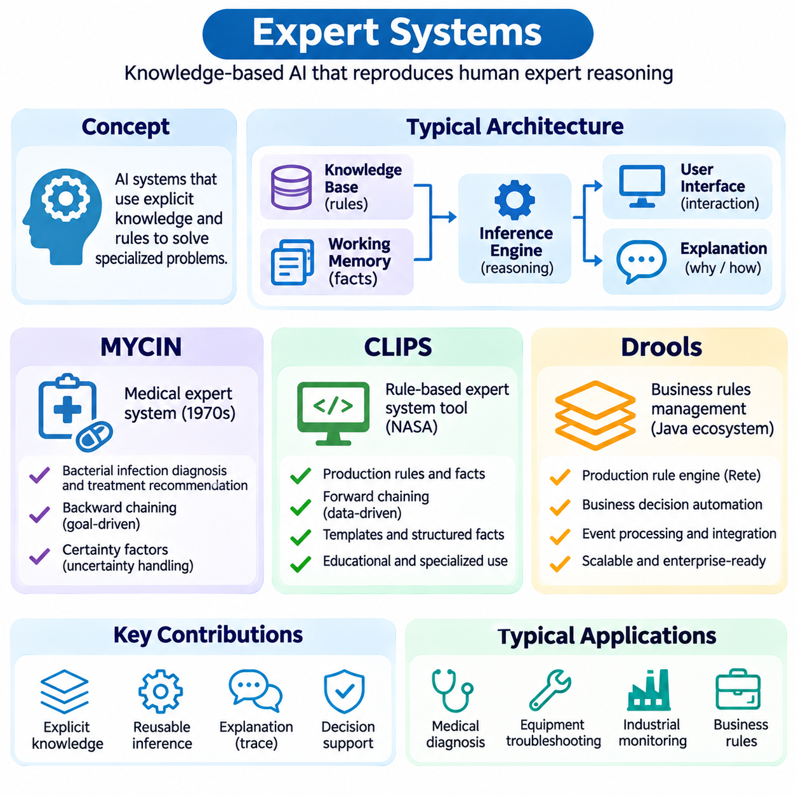{width="7.268055555555556in" height="7.268055555555556in"}

Expert systems are knowledge-based artificial intelligence applications designed to reproduce selected aspects of human expert reasoning within specialized domains. They combine explicit domain knowledge with inference mechanisms to evaluate facts, derive conclusions, and recommend actions. Their development established important principles of symbolic AI, including separation of knowledge from reasoning procedures, explanation facilities, and systematic decision support.

A conventional expert system contains a knowledge base, an inference engine, working memory, and an interface for interacting with users or external applications. The knowledge base stores domain-specific rules, while the inference engine applies those rules to available facts. Working memory maintains the current problem state. Additional components may provide explanations, knowledge acquisition tools, and mechanisms for validating the consistency of conclusions.

Expert systems became prominent during the development of symbolic artificial intelligence because they offered a practical method for encoding specialized human knowledge. Rather than requiring a program to enumerate every possible decision path, developers could represent expertise through modular rules. This approach supported medical consultation, equipment diagnosis, configuration management, and industrial troubleshooting, although maintaining large knowledge bases introduced significant engineering challenges.

MYCIN was an influential early expert system developed at Stanford University during the 1970s. It was designed to assist with diagnosing certain serious bacterial infections and recommending antimicrobial treatment. MYCIN demonstrated how specialized medical knowledge could be represented through production rules and evaluated using goal-directed inference. Its significance lies primarily in its contributions to expert-system architecture and reasoning under uncertainty.

MYCIN used backward chaining to investigate diagnostic hypotheses by examining the conditions required to support particular conclusions. The system could request additional patient information when necessary and evaluate alternative explanations using its rule base. This goal-directed process concentrated reasoning on questions relevant to the current consultation. It also demonstrated how a rule-based system could interactively gather evidence rather than relying exclusively on predefined inputs.

A distinctive feature of MYCIN was its use of certainty factors to represent degrees of belief associated with conclusions. These values allowed rules to express uncertain evidence without requiring a complete probabilistic model. Certainty-factor combination procedures supported reasoning from multiple observations, although their interpretation differed from formal probability theory. This approach became an important historical example of uncertainty management in symbolic systems.

MYCIN also incorporated explanation capabilities that allowed users to investigate why questions were being asked and how conclusions were reached. By tracing rule applications and supporting evidence, the system could expose portions of its reasoning process. These facilities helped establish explanation as a central requirement for knowledge-based applications. However, understandable reasoning traces do not independently establish the clinical validity of recommendations.

Although MYCIN demonstrated promising performance in research evaluations, it was not adopted for routine clinical deployment. Practical barriers included integration with clinical workflows, responsibility for decisions, and limitations of the operating environment. Its lasting influence extended beyond medicine through the development of reusable expert-system shells, particularly EMYCIN, which separated general inference mechanisms from application-specific medical knowledge.

CLIPS, the C Language Integrated Production System, was developed at NASA as a tool for constructing expert systems and other rule-based applications. It provides a programming environment centered on production rules, facts, and inference mechanisms. CLIPS supports knowledge representation through rules and structured data while allowing developers to implement reasoning behavior without building an inference engine from the beginning.

The CLIPS execution model is primarily based on forward chaining. Facts are asserted into working memory, and rules whose conditions match those facts become eligible for execution. An agenda manages applicable activations, while conflict resolution strategies determine execution order. Rule actions can modify working memory, triggering further inference. This architecture is particularly appropriate for classification, monitoring, configuration, and procedural decision automation.

CLIPS supports structured fact representations, including templates that define named attributes and their values. Rules can match these structures using variables, constraints, and logical conditions. This enables reusable knowledge representations across multiple objects and situations. CLIPS also provides procedural programming capabilities, allowing symbolic reasoning to interact with calculations, control structures, and application-specific operations.

An important strength of CLIPS is its relatively clear separation between knowledge representation and inference execution. Developers can organize domain expertise into rule modules, inspect facts, and examine rule activations during debugging. Its established rule-processing mechanisms make it useful for educational demonstrations and specialized embedded applications. Nevertheless, integration requirements and system complexity must be evaluated for each deployment.

Drools is an open-source business rules management and decision automation technology associated with the Java ecosystem. It enables developers to externalize decision logic from conventional application code and represent policies through executable rules. Drools is frequently used in enterprise environments where business requirements change independently of core software functionality and where consistent application of decision policies is important.

The Drools rule engine supports declarative rule definitions, structured facts, and pattern matching over application data. Rules commonly express conditions involving Java objects and corresponding actions when those conditions are satisfied. The engine evaluates applicable rules and manages their execution according to its agenda semantics. This design allows business policies to be maintained separately from much of the surrounding application logic.

Drools incorporates optimized rule-matching techniques derived from production-system research, including RETE-related approaches and its Phreak execution algorithm. These mechanisms reduce unnecessary repeated evaluation and support complex relationships among facts. Performance nevertheless depends on rule structure, data volume, update patterns, and execution configuration. Effective engineering requires benchmarking representative workloads rather than assuming that optimization is automatic.

Drools also supports decision modeling capabilities through its broader ecosystem, including integration with Decision Model and Notation, or DMN, in supported configurations. Decision tables and structured decision models can make certain business policies easier to maintain than large collections of handwritten rules. Such approaches are useful for eligibility assessment, pricing policies, regulatory checks, and workflow decisions requiring transparent organizational governance.

The architectural differences between MYCIN, CLIPS, and Drools reflect distinct stages in the evolution of expert systems. MYCIN emphasized specialized medical reasoning, uncertainty representation, and interactive explanation. CLIPS established a reusable production-rule programming environment with forward-chaining execution. Drools extended rule-based reasoning into enterprise software integration and business decision management, demonstrating the continuing adaptability of symbolic inference.

Their inference strategies also illustrate different operational requirements. MYCIN used backward chaining to evaluate specific diagnostic goals, whereas CLIPS and conventional Drools rule execution emphasize forward-chaining production rules. Goal-directed reasoning can reduce exploration when questions are narrowly defined. Data-driven reasoning can respond to changing facts and maintain multiple consequences, although scheduling and fact-management complexity may increase.

Knowledge acquisition remains a central challenge across expert-system architectures. Domain experts may express knowledge through informal explanations, exceptions, and context-dependent judgments that are difficult to convert into precise rules. Knowledge engineers must identify relevant concepts, resolve ambiguous terminology, and validate logical relationships. Poorly specified rules can produce incorrect conclusions regardless of the sophistication of the inference engine.

Verification and validation are equally important because a functioning rule engine does not guarantee that its knowledge is correct. Developers must test individual rules, interactions among rules, contradictory conclusions, and unexpected input conditions. Domain experts should review whether recommendations remain appropriate under realistic operating circumstances. Traceable execution histories and regression tests help identify unintended changes when knowledge bases evolve.

Modern expert systems increasingly operate alongside databases, knowledge graphs, ontologies, and machine learning models. Learning-based components can transform unstructured observations into structured facts, while symbolic rules apply explicit policies and domain constraints. This combination is valuable when decisions require both statistical interpretation and auditable reasoning. However, uncertainty in model predictions must be handled explicitly rather than treated as unquestionable factual evidence.

In industrial and robotic applications, expert-system techniques can support equipment diagnosis, maintenance recommendations, operational policy enforcement, and mission supervision. A rule engine may combine sensor states, equipment histories, and authorization conditions to recommend actions. Such systems provide interpretable decision support, but safety-critical control requires independently validated safeguards and clearly defined responsibility for execution.

The historical and practical contributions of MYCIN, CLIPS, and Drools demonstrate the enduring importance of explicit knowledge representation. Their architectures illustrate how inference strategies, rule management, uncertainty handling, and software integration evolve according to application requirements. Understanding these systems provides a foundation for implementing rule engines, evaluating expert-system limitations, and designing reliable hybrid knowledge-based AI applications.

전문가 시스템(Expert Systems)은 전문 분야에서 인간 전문가의 추론(Human Expert Reasoning) 중 특정 측면을 재현하도록 설계된 지식 기반 인공지능 응용 시스템(Knowledge-Based Artificial Intelligence Applications)이다. 전문가 시스템은 명시적인 도메인 지식(Explicit Domain Knowledge)과 추론 메커니즘(Inference Mechanisms)을 결합하여 사실을 평가하고, 결론을 도출하며, 동작을 권고한다. 이러한 시스템의 발전은 지식과 추론 절차의 분리(Separation of Knowledge from Reasoning Procedures), 설명 기능(Explanation Facilities), 체계적인 의사결정 지원(Systematic Decision Support)을 포함한 기호적 인공지능(Symbolic AI)의 중요한 원칙을 확립하였다.

전통적인 전문가 시스템(Conventional Expert System)은 지식 기반(Knowledge Base), 추론 엔진(Inference Engine), 작업 기억(Working Memory), 사용자 또는 외부 응용 프로그램과 상호작용하기 위한 인터페이스(Interface)로 구성된다. 지식 기반은 도메인별 규칙(Domain-Specific Rules)을 저장하고, 추론 엔진은 이러한 규칙을 이용 가능한 사실에 적용한다. 작업 기억은 현재 문제 상태(Current Problem State)를 유지한다. 추가 구성 요소로는 설명 기능, 지식 획득 도구(Knowledge Acquisition Tools), 결론의 일관성을 검증하는 메커니즘이 포함될 수 있다.

전문가 시스템은 전문적인 인간 지식을 부호화(Encoding)하는 실용적인 방법을 제공했기 때문에 기호적 인공지능(Symbolic Artificial Intelligence)의 발전 과정에서 주목받았다. 개발자는 가능한 모든 의사결정 경로(Decision Paths)를 프로그램에 일일이 열거하는 대신 모듈형 규칙(Modular Rules)을 통해 전문 지식을 표현할 수 있었다. 이러한 접근 방식은 의료 상담(Medical Consultation), 장비 진단(Equipment Diagnosis), 구성 관리(Configuration Management), 산업 설비 문제 해결(Industrial Troubleshooting)을 지원했지만, 대규모 지식 기반을 유지보수하는 과정에서 상당한 엔지니어링 문제가 발생하였다.

MYCIN은 1970년대 스탠퍼드 대학교(Stanford University)에서 개발된 영향력 있는 초기 전문가 시스템(Early Expert System)이다. 이 시스템은 특정 중증 세균 감염(Serious Bacterial Infections)의 진단과 항균제 치료(Antimicrobial Treatment) 권고를 지원하도록 설계되었다. MYCIN은 전문 의료 지식을 생산 규칙(Production Rules)으로 표현하고 목표 지향 추론(Goal-Directed Inference)을 통해 평가하는 방법을 보여주었다. MYCIN의 주요 의의는 전문가 시스템 아키텍처(Expert-System Architecture)와 불확실성 하의 추론(Reasoning Under Uncertainty)에 기여했다는 점에 있다.

MYCIN은 역방향 연쇄 추론(Backward Chaining)을 사용하여 특정 결론을 뒷받침하는 데 필요한 조건을 검사함으로써 진단 가설(Diagnostic Hypotheses)을 조사하였다. 시스템은 필요한 경우 추가 환자 정보(Patient Information)를 요청하고 규칙 기반을 사용하여 대체 설명(Alternative Explanations)을 평가할 수 있었다. 이러한 목표 지향 과정은 현재 상담과 관련된 질문에 추론을 집중시켰다. 또한 규칙 기반 시스템이 사전에 정의된 입력에만 의존하지 않고 상호작용을 통해 증거를 수집할 수 있음을 보여주었다.

MYCIN의 특징적인 기능은 결론과 관련된 믿음의 정도(Degrees of Belief)를 표현하기 위해 확신도 계수(Certainty Factors)를 사용했다는 점이다. 이러한 값은 완전한 확률 모델(Probabilistic Model)을 요구하지 않으면서 규칙이 불확실한 증거(Uncertain Evidence)를 표현할 수 있도록 하였다. 확신도 계수 결합 절차(Certainty-Factor Combination Procedures)는 여러 관측값으로부터 추론하는 과정을 지원했지만, 그 해석은 형식적 확률 이론(Formal Probability Theory)과 달랐다. 이러한 접근 방식은 기호적 시스템에서 불확실성을 관리한 중요한 역사적 사례가 되었다.

MYCIN은 사용자가 질문이 제시된 이유와 결론에 도달한 과정을 조사할 수 있도록 하는 설명 기능(Explanation Capabilities)도 포함하였다. 규칙 적용(Rule Applications)과 이를 뒷받침하는 증거를 추적함으로써 시스템은 추론 과정의 일부를 드러낼 수 있었다. 이러한 기능은 설명(Explanation)을 지식 기반 응용 시스템(Knowledge-Based Applications)의 핵심 요구사항으로 확립하는 데 기여하였다. 그러나 이해하기 쉬운 추론 추적(Reasoning Traces)이 권고 사항의 임상적 타당성(Clinical Validity)을 독립적으로 입증하는 것은 아니다.

MYCIN은 연구 평가(Research Evaluations)에서 유망한 성능을 보여주었지만 일상적인 임상 환경(Routine Clinical Deployment)에는 도입되지 않았다. 실제 적용을 가로막는 요인에는 임상 업무 흐름(Clinical Workflows)과의 통합, 의사결정 책임(Responsibility for Decisions), 운영 환경의 한계(Limitations of the Operating Environment)가 포함되었다. MYCIN의 지속적인 영향은 의료 분야를 넘어 재사용 가능한 전문가 시스템 셸(Expert-System Shells), 특히 일반적인 추론 메커니즘을 응용 분야별 의료 지식과 분리한 EMYCIN의 개발로 확장되었다.

CLIPS는 C 언어 통합 생산 시스템(C Language Integrated Production System)의 약자로, 전문가 시스템과 기타 규칙 기반 응용 시스템을 구축하기 위한 도구로 미국 항공우주국(NASA)에서 개발되었다. CLIPS는 생산 규칙(Production Rules), 사실(Facts), 추론 메커니즘(Inference Mechanisms)을 중심으로 구성된 프로그래밍 환경(Programming Environment)을 제공한다. CLIPS는 규칙과 구조화된 데이터(Structured Data)를 통한 지식 표현(Knowledge Representation)을 지원하며, 개발자가 추론 엔진을 처음부터 구축하지 않고도 추론 동작을 구현할 수 있도록 한다.

CLIPS의 실행 모델(Execution Model)은 주로 전방향 연쇄 추론(Forward Chaining)에 기반한다. 사실은 작업 기억(Working Memory)에 등록되며, 해당 사실과 조건이 일치하는 규칙은 실행 가능한 상태가 된다. 실행 대기 목록(Agenda)은 적용 가능한 활성화(Applicable Activations)를 관리하고, 충돌 해결 전략(Conflict Resolution Strategies)은 실행 순서를 결정한다. 규칙 동작(Rule Actions)은 작업 기억을 수정하여 추가적인 추론을 유발할 수 있다. 이러한 아키텍처는 분류(Classification), 모니터링(Monitoring), 구성(Configuration), 절차적 의사결정 자동화(Procedural Decision Automation)에 특히 적합하다.

CLIPS는 이름이 지정된 속성(Named Attributes)과 그 값을 정의하는 템플릿(Templates)을 포함하여 구조화된 사실 표현(Structured Fact Representations)을 지원한다. 규칙은 변수(Variables), 제약조건(Constraints), 논리 조건(Logical Conditions)을 사용하여 이러한 구조를 매칭할 수 있다. 이를 통해 여러 객체와 상황에 걸쳐 재사용 가능한 지식 표현을 구현할 수 있다. CLIPS는 절차적 프로그래밍 기능(Procedural Programming Capabilities)도 제공하므로 기호적 추론(Symbolic Reasoning)을 계산, 제어 구조(Control Structures), 응용 분야별 작업(Application-Specific Operations)과 연계할 수 있다.

CLIPS의 중요한 장점은 지식 표현(Knowledge Representation)과 추론 실행(Inference Execution) 사이의 비교적 명확한 분리이다. 개발자는 도메인 전문 지식(Domain Expertise)을 규칙 모듈(Rule Modules)로 구성하고, 사실을 검사하며, 디버깅(Debugging) 과정에서 규칙 활성화를 확인할 수 있다. 확립된 규칙 처리 메커니즘(Rule-Processing Mechanisms)은 교육용 시연(Educational Demonstrations)과 특수 임베디드 응용 시스템(Specialized Embedded Applications)에 유용하다. 그러나 각 배포 환경에서는 통합 요구사항(Integration Requirements)과 시스템 복잡성(System Complexity)을 평가해야 한다.

Drools는 Java 생태계(Java Ecosystem)와 연관된 오픈소스 비즈니스 규칙 관리 및 의사결정 자동화 기술(Open-Source Business Rules Management and Decision Automation Technology)이다. 개발자는 Drools를 사용하여 의사결정 로직(Decision Logic)을 일반적인 응용 프로그램 코드(Conventional Application Code)에서 분리하고 실행 가능한 규칙(Executable Rules)을 통해 정책을 표현할 수 있다. Drools는 비즈니스 요구사항(Business Requirements)이 핵심 소프트웨어 기능과 독립적으로 변경되고 의사결정 정책의 일관된 적용이 중요한 기업 환경(Enterprise Environments)에서 자주 사용된다.

Drools 규칙 엔진(Rule Engine)은 선언적 규칙 정의(Declarative Rule Definitions), 구조화된 사실(Structured Facts), 응용 프로그램 데이터(Application Data)에 대한 패턴 매칭(Pattern Matching)을 지원한다. 규칙은 일반적으로 Java 객체(Java Objects)와 관련된 조건 및 해당 조건이 충족되었을 때 수행할 동작을 표현한다. 엔진은 적용 가능한 규칙을 평가하고 실행 대기 목록 의미론(Agenda Semantics)에 따라 실행을 관리한다. 이러한 설계는 비즈니스 정책(Business Policies)을 주변 응용 프로그램 로직의 상당 부분과 분리하여 유지보수할 수 있도록 한다.

Drools는 RETE 관련 접근 방식(RETE-Related Approaches)과 Phreak 실행 알고리즘(Phreak Execution Algorithm)을 포함하여 생산 시스템 연구(Production-System Research)에서 발전한 최적화된 규칙 매칭 기술(Optimized Rule-Matching Techniques)을 통합한다. 이러한 메커니즘은 불필요한 반복 평가를 줄이고 사실 사이의 복잡한 관계를 지원한다. 그러나 성능은 규칙 구조(Rule Structure), 데이터 규모(Data Volume), 갱신 패턴(Update Patterns), 실행 구성(Execution Configuration)에 따라 달라진다. 효과적인 엔지니어링을 위해서는 최적화가 자동으로 이루어진다고 가정하기보다 대표적인 작업 부하(Representative Workloads)를 벤치마킹(Benchmarking)해야 한다.

Drools는 지원되는 구성에서 의사결정 모델 및 표기법(Decision Model and Notation, DMN)과의 통합을 포함하여 더 넓은 생태계를 통한 의사결정 모델링 기능(Decision Modeling Capabilities)도 지원한다. 의사결정 테이블(Decision Tables)과 구조화된 의사결정 모델(Structured Decision Models)은 특정 비즈니스 정책을 대규모 수작업 규칙 집합보다 쉽게 유지보수하도록 할 수 있다. 이러한 접근 방식은 적격성 평가(Eligibility Assessment), 가격 정책(Pricing Policies), 규제 점검(Regulatory Checks), 투명한 조직 거버넌스(Organizational Governance)가 필요한 업무 흐름 의사결정(Workflow Decisions)에 유용하다.

MYCIN, CLIPS, Drools의 아키텍처 차이(Architectural Differences)는 전문가 시스템 발전의 서로 다른 단계를 반영한다. MYCIN은 전문 의료 추론(Specialized Medical Reasoning), 불확실성 표현(Uncertainty Representation), 상호작용형 설명(Interactive Explanation)을 강조하였다. CLIPS는 전방향 연쇄 추론 실행(Forward-Chaining Execution)을 갖춘 재사용 가능한 생산 규칙 프로그래밍 환경(Production-Rule Programming Environment)을 확립하였다. Drools는 규칙 기반 추론을 기업용 소프트웨어 통합(Enterprise Software Integration)과 비즈니스 의사결정 관리(Business Decision Management)로 확장하여 기호적 추론의 지속적인 적응 가능성을 보여주었다.

이러한 시스템의 추론 전략(Inference Strategies)은 서로 다른 운영 요구사항(Operational Requirements)도 보여준다. MYCIN은 특정 진단 목표(Diagnostic Goals)를 평가하기 위해 역방향 연쇄 추론(Backward Chaining)을 사용한 반면, CLIPS와 일반적인 Drools 규칙 실행은 전방향 연쇄 추론 생산 규칙(Forward-Chaining Production Rules)을 강조한다. 목표 지향 추론(Goal-Directed Reasoning)은 질문이 명확하게 한정된 경우 탐색 범위를 줄일 수 있다. 데이터 주도 추론(Data-Driven Reasoning)은 변화하는 사실에 반응하고 여러 결과를 유지할 수 있지만, 스케줄링(Scheduling)과 사실 관리(Fact Management)의 복잡성이 증가할 수 있다.

지식 획득(Knowledge Acquisition)은 전문가 시스템 아키텍처 전반에서 여전히 핵심적인 과제이다. 도메인 전문가(Domain Experts)는 전문 지식을 비공식적인 설명(Informal Explanations), 예외(Exceptions), 맥락 의존적 판단(Context-Dependent Judgments)을 통해 표현할 수 있으며, 이를 정밀한 규칙으로 변환하기는 어렵다. 지식 엔지니어(Knowledge Engineers)는 관련 개념을 식별하고, 모호한 용어(Ambiguous Terminology)를 해결하며, 논리적 관계(Logical Relationships)를 검증해야 한다. 추론 엔진이 아무리 정교하더라도 잘못 정의된 규칙(Poorly Specified Rules)은 부정확한 결론을 생성할 수 있다.

검증(Verification)과 타당성 확인(Validation)도 중요하다. 규칙 엔진이 정상적으로 작동한다는 사실만으로 해당 엔진의 지식이 정확하다는 것이 보장되지는 않기 때문이다. 개발자는 개별 규칙, 규칙 간 상호작용(Rule Interactions), 모순되는 결론(Contradictory Conclusions), 예상하지 못한 입력 조건(Unexpected Input Conditions)을 테스트해야 한다. 도메인 전문가는 현실적인 운영 환경(Realistic Operating Circumstances)에서 권고 사항이 여전히 적절한지 검토해야 한다. 추적 가능한 실행 이력(Traceable Execution Histories)과 회귀 테스트(Regression Tests)는 지식 기반이 발전하는 과정에서 의도하지 않은 변경을 식별하는 데 도움이 된다.

현대적인 전문가 시스템은 데이터베이스(Databases), 지식 그래프(Knowledge Graphs), 온톨로지(Ontologies), 머신러닝 모델(Machine Learning Models)과 함께 작동하는 경우가 증가하고 있다. 학습 기반 구성 요소(Learning-Based Components)는 비정형 관측값(Unstructured Observations)을 구조화된 사실(Structured Facts)로 변환하고, 기호적 규칙(Symbolic Rules)은 명시적인 정책(Explicit Policies)과 도메인 제약조건(Domain Constraints)을 적용할 수 있다. 이러한 결합은 통계적 해석(Statistical Interpretation)과 감사 가능한 추론(Auditable Reasoning)이 모두 필요한 의사결정에서 유용하다. 그러나 모델 예측의 불확실성(Uncertainty in Model Predictions)은 의심의 여지가 없는 사실로 취급하지 않고 명시적으로 처리해야 한다.

산업 및 로보틱스 응용 시스템(Industrial and Robotic Applications)에서 전문가 시스템 기술(Expert-System Techniques)은 장비 진단(Equipment Diagnosis), 유지보수 권고(Maintenance Recommendations), 운영 정책 시행(Operational Policy Enforcement), 임무 감독(Mission Supervision)을 지원할 수 있다. 규칙 엔진은 센서 상태(Sensor States), 장비 이력(Equipment Histories), 승인 조건(Authorization Conditions)을 결합하여 동작을 권고할 수 있다. 이러한 시스템은 해석 가능한 의사결정 지원(Interpretable Decision Support)을 제공하지만, 안전 필수 제어(Safety-Critical Control)에는 독립적으로 검증된 안전장치(Independently Validated Safeguards)와 명확하게 정의된 실행 책임(Responsibility for Execution)이 필요하다.

MYCIN, CLIPS, Drools의 역사적·실용적 기여(Historical and Practical Contributions)는 명시적인 지식 표현(Explicit Knowledge Representation)의 지속적인 중요성을 보여준다. 이들의 아키텍처는 응용 시스템의 요구사항에 따라 추론 전략(Inference Strategies), 규칙 관리(Rule Management), 불확실성 처리(Uncertainty Handling), 소프트웨어 통합(Software Integration)이 어떻게 발전하는지를 설명한다. 이러한 시스템을 이해하는 것은 규칙 엔진(Rule Engines)을 구현하고, 전문가 시스템의 한계(Expert-System Limitations)를 평가하며, 신뢰할 수 있는 하이브리드 지식 기반 인공지능 응용 시스템(Hybrid Knowledge-Based AI Applications)을 설계하기 위한 기초가 된다.

## 04.07 Rule Engine Implementation

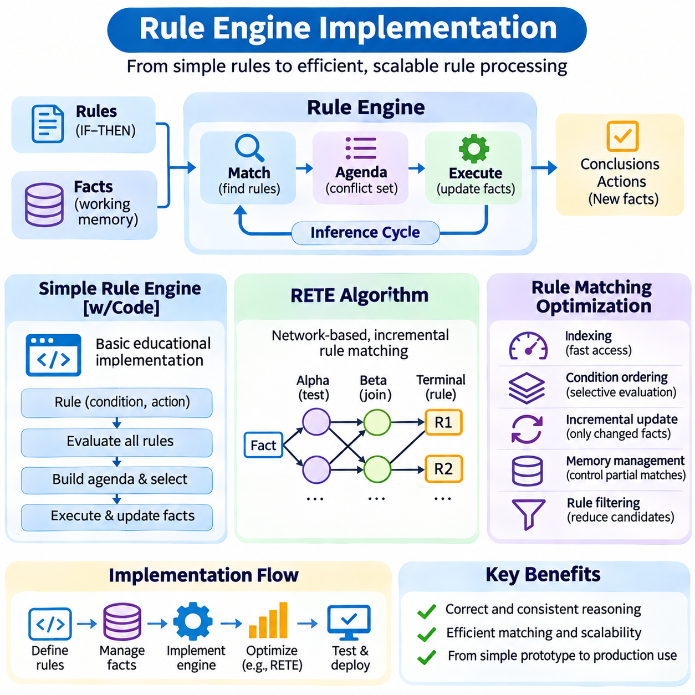{width="7.268055555555556in" height="7.268055555555556in"}

Rule engine implementation transforms declarative knowledge into executable reasoning through a combination of fact storage, condition evaluation, activation scheduling, and rule execution. A practical implementation must determine how rules are represented, how facts are matched against conditions, and how conclusions modify system state. These responsibilities form the foundation of both simple educational rule engines and optimized production systems.

A simple rule engine can be constructed using a collection of IF--THEN rules and a working memory containing structured facts. Each rule defines a condition that determines applicability and an action that executes when the condition is satisfied. The inference engine repeatedly examines available rules, evaluates their conditions, and applies selected actions. This design provides a transparent starting point for understanding symbolic reasoning.

In a Python implementation, facts may be represented using dictionaries, objects, or structured records, while rules may be implemented as functions or declarative data structures. A condition function evaluates relevant facts and returns whether a rule is applicable. An action function produces a conclusion or requests a state change. Separating conditions from actions improves testability and reduces dependencies between knowledge representation and execution logic.

The simplest execution strategy evaluates every rule against the current working memory during each inference cycle. Applicable rules are collected into an agenda, and a conflict resolution policy determines execution order. After a rule executes, the engine updates working memory and begins another evaluation cycle. Although straightforward, this approach becomes computationally expensive when many rules repeatedly inspect unchanged facts.

Fact management is an essential responsibility even in small implementations. The engine must support inserting, updating, retrieving, and retracting facts while maintaining consistent representations. Each fact should have a clearly defined identity or matching key to distinguish updates from duplicates. Without such controls, repeated rule execution may generate redundant conclusions, inconsistent states, or uncontrolled growth of working memory.

A basic rule engine also requires termination mechanisms. Rules that continuously assert identical facts or alternate between conflicting states can create infinite execution cycles. Duplicate detection, activation histories, execution limits, and explicit stopping conditions help prevent these failures. For deterministic behavior, the engine should define how competing activations are ordered and whether previously executed rule--fact combinations may execute again.

Rule conditions often involve multiple facts rather than a single Boolean expression. For example, an equipment diagnostic rule may require high temperature, excessive vibration, and an active operating state. The engine must identify fact combinations satisfying all conditions and preserve variable bindings across those combinations. This requirement introduces relational matching operations that become increasingly expensive as working memory grows.

The computational limitations of naive matching motivated the development of specialized production-rule algorithms. Instead of reevaluating every condition after each change, optimized engines retain information about previous matches. Incremental evaluation processes only the consequences of inserted, modified, or removed facts. This principle is central to RETE and related algorithms, which organize rule matching into reusable computational structures.

The RETE algorithm represents rule conditions as a network of interconnected matching nodes. Incoming facts pass through tests that determine whether they satisfy relevant constraints. Shared conditions can be evaluated once and reused by multiple rules. Intermediate matches are stored and combined as additional conditions become satisfied. This network-based organization reduces redundant computation across inference cycles.

Alpha nodes perform tests involving individual facts, such as checking object types, attribute values, or numerical thresholds. Facts satisfying these conditions may be stored in alpha memories for reuse. When multiple rules require identical tests, shared alpha structures can reduce duplicated work. The effectiveness of this sharing depends on the representation of rule conditions and the ability to identify equivalent predicates.

Beta nodes combine partial matches from multiple conditions, often using join operations over shared variables. For example, a rule may match a machine fact with a maintenance record referring to the same equipment identifier. Beta memories retain intermediate combinations so that later fact changes do not require complete recomputation. These structures are powerful but can consume substantial memory when many combinations satisfy broad conditions.

Terminal nodes represent complete matches for particular rules. When all required conditions are satisfied, the matching network produces an activation associated with the corresponding rule and supporting facts. The activation enters an agenda where execution priorities and conflict resolution strategies determine scheduling. This separation between matching and execution allows the engine to manage reasoning independently of the rule-selection policy.

Incremental updates are a defining characteristic of RETE-based processing. When a new fact is asserted, the engine propagates its effects through relevant network nodes and creates newly supported matches. When a fact is retracted, dependent partial matches and activations must be invalidated. Correct propagation is essential because stale matches can cause rules to execute using information that is no longer valid.

RETE improves matching efficiency by exchanging additional memory consumption for reduced repeated computation. Its advantages are particularly significant when rules share conditions and facts change incrementally. However, broad joins and large intermediate memories can create substantial overhead. Therefore, RETE should not be assumed superior for every workload, especially when rule collections are small or working memory is frequently replaced.

Rule matching optimization begins with reducing unnecessary condition evaluations. Selective predicates should be applied early when their placement can reduce the number of candidate matches. Attribute indexing can accelerate equality and range comparisons, while hash-based joins can improve matching between related facts. These techniques reduce the number of combinations examined without changing the intended logical meaning of rules.

Condition ordering is another important optimization technique. A rule containing several predicates may be evaluated more efficiently when restrictive conditions eliminate irrelevant candidates before expensive joins occur. However, reordering must preserve logical semantics, variable dependencies, and the behavior of negation or procedural conditions. An optimization that changes rule meaning is not a valid performance improvement.

Rule indexing organizes conditions according to attributes, fact types, or commonly queried values. Instead of scanning every rule when a fact changes, the engine identifies rules potentially affected by the updated information. This approach is especially useful when knowledge bases contain many unrelated rule categories. Efficient indexing requires balancing lookup speed against memory overhead and the cost of maintaining indexes during updates.

Caching and memoization can further reduce repeated reasoning by preserving previously computed condition results or derived conclusions. Cached information must be invalidated when supporting facts change, otherwise the engine may return outdated results. Dependency tracking and truth maintenance mechanisms can identify which conclusions rely on modified evidence. These capabilities are essential for reliable incremental reasoning in dynamic applications.

Optimization must also consider agenda management and rule execution overhead. Efficient priority queues can reduce the cost of selecting activations, while duplicate suppression prevents repeated scheduling of equivalent rule--fact combinations. Batching compatible fact updates may reduce unnecessary intermediate evaluations. However, batching can delay observable conclusions, making latency requirements important when choosing execution strategies.

Performance evaluation should measure matching latency, inference throughput, memory consumption, activation counts, and the cost of fact insertion or retraction. Benchmarks should include realistic rule structures and representative fact distributions. A small synthetic example may not reveal expensive joins, memory growth, or activation storms. Comparing naive matching with RETE-based execution helps identify when architectural complexity produces measurable benefits.

Testing a rule engine requires verifying both logical correctness and operational behavior. Developers should examine rule applicability, variable binding, conflict resolution, fact updates, duplicate handling, and termination. Differential testing can compare optimized matching results against a simpler reference implementation. Regression tests are particularly important because changes to indexing or network sharing may introduce subtle matching errors.

In industrial and robotic systems, rule engines may process equipment states, diagnostic observations, operational restrictions, and mission conditions. Optimized matching can support frequent updates from structured sensor data, while explicit rules preserve interpretable decision logic. Nevertheless, computational efficiency does not independently guarantee bounded response times. Safety-critical functions require validated timing behavior and appropriate independent safeguards.

A well-designed rule engine balances implementation simplicity, matching efficiency, memory requirements, and correctness. Simple engines provide accessible foundations for understanding inference cycles, while RETE introduces incremental matching and reusable condition networks. Rule matching optimization extends these principles through indexing, selective evaluation, caching, and efficient scheduling. Together, these techniques support scalable and dependable knowledge-driven reasoning systems.

규칙 엔진 구현(Rule Engine Implementation)은 사실 저장(Fact Storage), 조건 평가(Condition Evaluation), 활성화 스케줄링(Activation Scheduling), 규칙 실행(Rule Execution)을 결합하여 선언적 지식(Declarative Knowledge)을 실행 가능한 추론(Executable Reasoning)으로 변환한다. 실제 구현에서는 규칙을 어떻게 표현하고, 사실을 조건과 어떻게 매칭하며, 결론이 시스템 상태(System State)를 어떻게 변경하는지 결정해야 한다. 이러한 책임은 단순한 교육용 규칙 엔진(Simple Educational Rule Engines)과 최적화된 생산 시스템(Optimized Production Systems) 모두의 기반을 형성한다.

단순 규칙 엔진(Simple Rule Engine)은 IF--THEN 규칙 집합과 구조화된 사실(Structured Facts)을 포함하는 작업 기억(Working Memory)을 사용하여 구축할 수 있다. 각 규칙은 적용 가능성을 결정하는 조건(Condition)과 해당 조건이 충족되었을 때 실행되는 동작(Action)을 정의한다. 추론 엔진(Inference Engine)은 이용 가능한 규칙을 반복적으로 검사하고 조건을 평가한 다음 선택된 동작을 적용한다. 이러한 설계는 기호적 추론(Symbolic Reasoning)을 이해하기 위한 투명하고 기본적인 출발점을 제공한다.

Python 구현(Python Implementation)에서는 사실을 딕셔너리(Dictionaries), 객체(Objects), 구조화된 레코드(Structured Records)로 표현할 수 있으며, 규칙은 함수(Functions)나 선언적 데이터 구조(Declarative Data Structures)로 구현할 수 있다. 조건 함수(Condition Function)는 관련 사실을 평가하여 규칙의 적용 가능 여부를 반환한다. 동작 함수(Action Function)는 결론을 생성하거나 상태 변경(State Change)을 요청한다. 조건과 동작을 분리하면 테스트 용이성(Testability)이 향상되고 지식 표현(Knowledge Representation)과 실행 로직(Execution Logic) 사이의 의존 관계가 줄어든다.

가장 단순한 실행 전략(Execution Strategy)은 각 추론 주기(Inference Cycle)마다 현재 작업 기억에 대해 모든 규칙을 평가한다. 적용 가능한 규칙은 실행 대기 목록(Agenda)에 수집되고, 충돌 해결 정책(Conflict Resolution Policy)이 실행 순서를 결정한다. 규칙이 실행된 후 엔진은 작업 기억을 갱신하고 새로운 평가 주기를 시작한다. 이러한 접근 방식은 이해하기 쉽지만 많은 규칙이 변경되지 않은 사실을 반복적으로 검사할 경우 계산 비용(Computational Cost)이 증가한다.

사실 관리(Fact Management)는 소규모 구현에서도 필수적인 책임이다. 엔진은 일관된 표현(Consistent Representations)을 유지하면서 사실의 삽입(Insertion), 갱신(Update), 조회(Retrieval), 철회(Retraction)를 지원해야 한다. 각 사실에는 갱신과 중복을 구분할 수 있도록 명확하게 정의된 식별자(Identity) 또는 매칭 키(Matching Key)가 있어야 한다. 이러한 제어가 없으면 반복적인 규칙 실행으로 인해 중복 결론(Redundant Conclusions), 불일치 상태(Inconsistent States), 작업 기억의 제어되지 않는 증가가 발생할 수 있다.

기본 규칙 엔진(Basic Rule Engine)에도 종료 메커니즘(Termination Mechanisms)이 필요하다. 동일한 사실을 지속적으로 등록하거나 충돌하는 상태 사이를 반복적으로 전환하는 규칙은 무한 실행 주기(Infinite Execution Cycles)를 생성할 수 있다. 중복 탐지(Duplicate Detection), 활성화 이력(Activation Histories), 실행 제한(Execution Limits), 명시적인 종료 조건(Explicit Stopping Conditions)은 이러한 오류를 방지하는 데 도움이 된다. 결정론적 동작(Deterministic Behavior)을 위해 엔진은 경쟁하는 활성화의 정렬 방식과 이전에 실행된 규칙--사실 조합의 재실행 허용 여부를 정의해야 한다.

규칙 조건(Rule Conditions)은 단일 불리언 표현식(Boolean Expression)이 아니라 여러 사실을 포함하는 경우가 많다. 예를 들어, 장비 진단 규칙(Equipment Diagnostic Rule)은 높은 온도(High Temperature), 과도한 진동(Excessive Vibration), 활성 작동 상태(Active Operating State)를 동시에 요구할 수 있다. 엔진은 모든 조건을 충족하는 사실 조합(Fact Combinations)을 식별하고 해당 조합 전체에서 변수 바인딩(Variable Bindings)을 유지해야 한다. 이러한 요구사항은 작업 기억이 증가할수록 계산 비용이 높아지는 관계형 매칭 연산(Relational Matching Operations)을 도입한다.

단순 매칭(Naive Matching)의 계산상 한계(Computational Limitations)는 특수한 생산 규칙 알고리즘(Production-Rule Algorithms)의 개발을 촉진하였다. 최적화된 엔진은 변경이 발생할 때마다 모든 조건을 다시 평가하는 대신 이전 매칭 결과(Previous Matches)에 대한 정보를 유지한다. 증분 평가(Incremental Evaluation)는 사실의 삽입, 수정, 삭제로 인해 발생하는 영향만 처리한다. 이러한 원칙은 규칙 매칭을 재사용 가능한 계산 구조(Reusable Computational Structures)로 구성하는 RETE 및 관련 알고리즘의 핵심이다.

RETE 알고리즘(RETE Algorithm)은 규칙 조건을 상호 연결된 매칭 노드(Matching Nodes)의 네트워크로 표현한다. 입력되는 사실은 관련 제약조건(Constraints)을 충족하는지 판단하는 검사를 통과한다. 공유된 조건(Shared Conditions)은 한 번 평가한 후 여러 규칙에서 재사용할 수 있다. 중간 매칭 결과(Intermediate Matches)는 저장되며 추가 조건이 충족되면 결합된다. 이러한 네트워크 기반 구성(Network-Based Organization)은 추론 주기 사이에서 발생하는 중복 계산(Redundant Computation)을 줄인다.

알파 노드(Alpha Nodes)는 객체 유형(Object Types), 속성값(Attribute Values), 수치 임계값(Numerical Thresholds) 확인과 같이 개별 사실에 대한 검사를 수행한다. 이러한 조건을 충족하는 사실은 재사용을 위해 알파 메모리(Alpha Memories)에 저장될 수 있다. 여러 규칙이 동일한 검사를 요구하면 공유된 알파 구조(Shared Alpha Structures)를 통해 중복 작업을 줄일 수 있다. 이러한 공유의 효과는 규칙 조건의 표현 방식과 동등한 술어(Equivalent Predicates)를 식별하는 능력에 따라 달라진다.

베타 노드(Beta Nodes)는 여러 조건에서 생성된 부분 매칭 결과(Partial Matches)를 결합하며, 일반적으로 공유 변수(Shared Variables)에 대한 조인 연산(Join Operations)을 사용한다. 예를 들어, 하나의 규칙은 장비 사실(Machine Fact)과 동일한 장비 식별자(Equipment Identifier)를 참조하는 유지보수 기록(Maintenance Record)을 매칭할 수 있다. 베타 메모리(Beta Memories)는 중간 조합(Intermediate Combinations)을 유지하여 이후 사실이 변경되더라도 전체를 다시 계산하지 않도록 한다. 이러한 구조는 강력하지만 광범위한 조건을 충족하는 조합이 많으면 상당한 메모리를 소비할 수 있다.

터미널 노드(Terminal Nodes)는 특정 규칙에 대한 완전한 매칭(Complete Matches)을 나타낸다. 필요한 모든 조건이 충족되면 매칭 네트워크(Matching Network)는 해당 규칙과 이를 뒷받침하는 사실에 연결된 활성화(Activation)를 생성한다. 활성화는 실행 대기 목록(Agenda)에 들어가며, 실행 우선순위(Execution Priorities)와 충돌 해결 전략(Conflict Resolution Strategies)이 스케줄링을 결정한다. 매칭과 실행의 분리는 엔진이 규칙 선택 정책(Rule-Selection Policy)과 독립적으로 추론을 관리할 수 있도록 한다.

증분 갱신(Incremental Updates)은 RETE 기반 처리(RETE-Based Processing)의 핵심적인 특징이다. 새로운 사실이 등록되면 엔진은 관련 네트워크 노드에 그 영향을 전파하고 새롭게 지원되는 매칭 결과를 생성한다. 사실이 철회되면 해당 사실에 의존하는 부분 매칭 결과와 활성화를 무효화해야 한다. 정확한 전파(Correct Propagation)는 필수적이다. 오래된 매칭 결과(Stale Matches)가 남아 있으면 더 이상 유효하지 않은 정보를 사용하여 규칙이 실행될 수 있기 때문이다.

RETE는 반복 계산(Reduced Repeated Computation)을 줄이는 대신 추가적인 메모리 소비(Additional Memory Consumption)를 허용함으로써 매칭 효율성(Matching Efficiency)을 향상시킨다. 여러 규칙이 조건을 공유하고 사실이 증분적으로 변경될 때 그 장점이 특히 크다. 그러나 광범위한 조인(Broad Joins)과 대규모 중간 메모리(Large Intermediate Memories)는 상당한 오버헤드(Overhead)를 발생시킬 수 있다. 따라서 규칙 집합이 작거나 작업 기억이 자주 전체 교체되는 경우를 포함하여 모든 작업 부하에서 RETE가 우수하다고 가정해서는 안 된다.

규칙 매칭 최적화(Rule Matching Optimization)는 불필요한 조건 평가(Unnecessary Condition Evaluations)를 줄이는 것에서 시작한다. 선택성이 높은 술어(Selective Predicates)는 배치 순서를 조정하여 후보 매칭 수를 줄일 수 있을 때 먼저 적용하는 것이 좋다. 속성 인덱싱(Attribute Indexing)은 동등성 비교(Equality Comparisons)와 범위 비교(Range Comparisons)를 가속화할 수 있으며, 해시 기반 조인(Hash-Based Joins)은 관련 사실 사이의 매칭을 개선할 수 있다. 이러한 기술은 규칙의 의도된 논리적 의미(Logical Meaning)를 변경하지 않으면서 검사해야 하는 조합의 수를 줄인다.

조건 순서(Condition Ordering)는 또 다른 중요한 최적화 기술이다. 여러 술어(Predicates)를 포함하는 규칙은 제한적인 조건이 비용이 높은 조인 이전에 관련 없는 후보를 제거하도록 배치할 때 더 효율적으로 평가될 수 있다. 그러나 순서 변경은 논리적 의미론(Logical Semantics), 변수 의존 관계(Variable Dependencies), 부정(Negation) 또는 절차적 조건(Procedural Conditions)의 동작을 보존해야 한다. 규칙의 의미를 변경하는 최적화는 유효한 성능 개선(Performance Improvement)이 아니다.

규칙 인덱싱(Rule Indexing)은 속성(Attributes), 사실 유형(Fact Types), 자주 질의되는 값(Commonly Queried Values)에 따라 조건을 구성한다. 사실이 변경될 때 모든 규칙을 검사하는 대신 엔진은 갱신된 정보의 영향을 받을 가능성이 있는 규칙을 식별한다. 이러한 접근 방식은 지식 기반에 서로 관련 없는 규칙 범주(Rule Categories)가 많이 포함된 경우 특히 유용하다. 효율적인 인덱싱은 조회 속도(Lookup Speed), 메모리 오버헤드(Memory Overhead), 갱신 과정에서 인덱스를 유지하는 비용 사이의 균형을 요구한다.

캐싱(Caching)과 메모이제이션(Memoization)은 이전에 계산된 조건 결과(Condition Results)나 도출된 결론(Derived Conclusions)을 보존하여 반복적인 추론을 더욱 줄일 수 있다. 캐시된 정보는 이를 뒷받침하는 사실이 변경되면 무효화해야 하며, 그렇지 않으면 엔진이 오래된 결과(Outdated Results)를 반환할 수 있다. 의존 관계 추적(Dependency Tracking)과 진리 유지 메커니즘(Truth Maintenance Mechanisms)은 어떤 결론이 수정된 증거에 의존하는지 식별할 수 있다. 이러한 기능은 동적 응용 시스템(Dynamic Applications)에서 신뢰할 수 있는 증분 추론(Incremental Reasoning)을 구현하는 데 필수적이다.

최적화는 실행 대기 목록 관리(Agenda Management)와 규칙 실행 오버헤드(Rule Execution Overhead)도 고려해야 한다. 효율적인 우선순위 큐(Priority Queues)는 활성화 선택 비용을 줄일 수 있으며, 중복 억제(Duplicate Suppression)는 동등한 규칙--사실 조합의 반복적인 스케줄링을 방지한다. 서로 호환되는 사실 갱신을 일괄 처리(Batching)하면 불필요한 중간 평가를 줄일 수 있다. 그러나 일괄 처리는 외부에서 관찰 가능한 결론의 도출을 지연시킬 수 있으므로 실행 전략을 선택할 때 지연시간 요구사항(Latency Requirements)이 중요하다.

성능 평가(Performance Evaluation)는 매칭 지연시간(Matching Latency), 추론 처리량(Inference Throughput), 메모리 소비량(Memory Consumption), 활성화 횟수(Activation Counts), 사실 삽입 또는 철회 비용(Cost of Fact Insertion or Retraction)을 측정해야 한다. 벤치마크(Benchmarks)에는 현실적인 규칙 구조(Realistic Rule Structures)와 대표적인 사실 분포(Representative Fact Distributions)가 포함되어야 한다. 소규모 합성 예제(Small Synthetic Example)는 비용이 높은 조인, 메모리 증가, 활성화 폭증(Activation Storms)을 드러내지 못할 수 있다. 단순 매칭과 RETE 기반 실행을 비교하면 아키텍처 복잡성이 측정 가능한 이점을 제공하는 시점을 식별할 수 있다.

규칙 엔진 테스트(Rule Engine Testing)는 논리적 정확성(Logical Correctness)과 운영 동작(Operational Behavior)을 모두 검증해야 한다. 개발자는 규칙 적용 가능성(Rule Applicability), 변수 바인딩(Variable Binding), 충돌 해결(Conflict Resolution), 사실 갱신(Fact Updates), 중복 처리(Duplicate Handling), 종료 동작(Termination)을 검사해야 한다. 차등 테스트(Differential Testing)는 최적화된 매칭 결과를 더 단순한 참조 구현(Reference Implementation)과 비교할 수 있다. 인덱싱이나 네트워크 공유(Network Sharing)의 변경은 미묘한 매칭 오류(Matching Errors)를 발생시킬 수 있으므로 회귀 테스트(Regression Tests)가 특히 중요하다.

산업 및 로보틱스 시스템(Industrial and Robotic Systems)에서 규칙 엔진은 장비 상태(Equipment States), 진단 관측값(Diagnostic Observations), 운영 제한사항(Operational Restrictions), 임무 조건(Mission Conditions)을 처리할 수 있다. 최적화된 매칭(Optimized Matching)은 구조화된 센서 데이터(Structured Sensor Data)의 빈번한 갱신을 지원하며, 명시적인 규칙은 해석 가능한 의사결정 로직(Interpretable Decision Logic)을 유지한다. 그러나 계산 효율성(Computational Efficiency)만으로 제한된 응답시간(Bounded Response Times)이 보장되는 것은 아니다. 안전 필수 기능(Safety-Critical Functions)에는 검증된 시간 동작(Validated Timing Behavior)과 적절한 독립 안전장치(Independent Safeguards)가 필요하다.

잘 설계된 규칙 엔진(Well-Designed Rule Engine)은 구현의 단순성(Implementation Simplicity), 매칭 효율성(Matching Efficiency), 메모리 요구사항(Memory Requirements), 정확성(Correctness) 사이의 균형을 유지한다. 단순 엔진(Simple Engines)은 추론 주기(Inference Cycles)를 이해하기 위한 접근하기 쉬운 기반을 제공하며, RETE는 증분 매칭(Incremental Matching)과 재사용 가능한 조건 네트워크(Reusable Condition Networks)를 도입한다. 규칙 매칭 최적화는 인덱싱(Indexing), 선택적 평가(Selective Evaluation), 캐싱(Caching), 효율적인 스케줄링(Efficient Scheduling)을 통해 이러한 원칙을 확장한다. 이러한 기술은 확장 가능하고 신뢰할 수 있는 지식 기반 추론 시스템(Knowledge-Driven Reasoning Systems)을 지원한다.

## 04.08 Rule Based vs ML

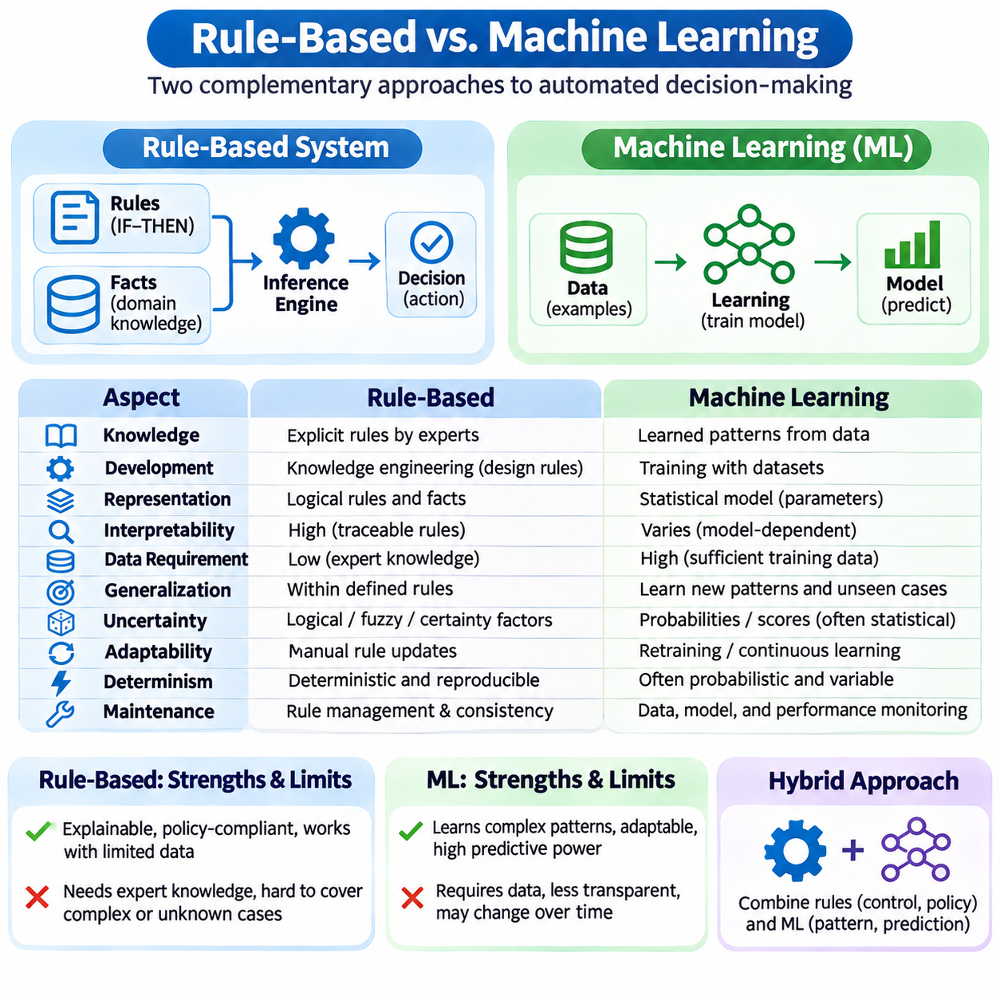{width="7.268055555555556in" height="7.268055555555556in"}

Rule-based systems and machine learning represent two major approaches to artificial intelligence that differ in how knowledge is acquired, represented, and applied. Rule-based systems use explicitly defined logical conditions and actions, while machine learning models derive statistical relationships from data. Both approaches support automated decision-making, but their effectiveness depends on problem structure, knowledge availability, uncertainty, and operational requirements.

Rule-based systems represent knowledge through human-authored rules, logical expressions, and structured facts. Their behavior follows inference procedures that determine which rules apply to a given situation. Machine learning systems instead construct predictive functions by optimizing model parameters against training data. This distinction separates explicit knowledge engineering from data-driven learning, although practical applications may combine both methods.

Knowledge acquisition is a fundamental difference between the approaches. Rule-based development requires domain experts and knowledge engineers to identify concepts, conditions, exceptions, and decision policies. Machine learning requires representative datasets, suitable learning objectives, and training procedures. Rules can be effective when expertise is well understood, whereas learning is attractive when relevant patterns are difficult to express manually.

The representation of knowledge also differs significantly. A rule-based system may express that excessive temperature combined with abnormal vibration requires equipment inspection. A machine learning model may learn a relationship between sensor measurements and failure probabilities from historical observations. The rule provides an explicit decision condition, while the learned model captures statistical associations that may be difficult to interpret directly.

Interpretability is a traditional strength of rule-based systems because their decisions can often be traced to identifiable conditions and rule activations. Developers can inspect which facts triggered a conclusion and explain the corresponding reasoning path. Machine learning interpretability varies considerably across model families. Decision trees may be relatively transparent, while large neural networks often require additional explanation techniques.

However, explicit rules do not automatically guarantee understandable or correct decisions. Large rule bases can contain complicated dependencies, overlapping conditions, and unexpected interactions. Similarly, machine learning models are not universally opaque, since interpretable architectures and constrained models can provide meaningful explanations. Explainability should therefore be evaluated at the complete system level rather than assumed from the underlying technology.

Data requirements create another important distinction. Rule-based systems can operate without extensive labeled datasets when reliable domain knowledge is available. Machine learning models generally require sufficient training examples to estimate useful relationships and generalize beyond observed cases. The amount of required data depends on model complexity, task difficulty, prior knowledge, and whether pretrained representations are available.

Generalization describes how a system handles situations not explicitly encountered during development. Machine learning models can generalize from training examples when their learned representations capture relevant patterns. Rule-based systems typically generalize through the scope of their conditions and logical relationships. They may handle unseen combinations of known facts, but entirely new concepts or unmodeled exceptions often require additional knowledge.

Uncertainty management also distinguishes these approaches. Traditional rule engines commonly evaluate conditions using discrete logical values, although probabilistic rules, fuzzy logic, and certainty factors can represent uncertainty. Machine learning models frequently produce numerical predictions, scores, or estimated probabilities. These outputs are not necessarily calibrated, and their interpretation depends on training objectives and evaluation methods.

Adaptability is often associated with machine learning because models can be retrained or updated using new observations. Rule-based systems usually require explicit modifications to their knowledge bases when policies or domain assumptions change. Nevertheless, machine learning adaptation introduces risks such as catastrophic forgetting, distribution shift, and performance regression. Rule updates also require validation because local changes can affect distant inference paths.

Computational requirements depend on the implementation and workload rather than a simple distinction between symbolic and statistical methods. Small rule engines may execute efficiently on limited hardware, while large knowledge bases can incur substantial matching costs. Machine learning training may require considerable computational resources, although optimized inference models can run efficiently on embedded devices. Both approaches benefit from profiling and targeted optimization.

Maintenance introduces different engineering challenges. Rule-based systems require version control for rules, dependency analysis, conflict resolution, and regression testing. Machine learning systems require dataset management, model versioning, monitoring, retraining, and evaluation against changing conditions. Neither approach eliminates maintenance costs. The appropriate choice depends on whether knowledge changes primarily through explicit policy revisions or evolving empirical patterns.

Determinism is another consideration for operational systems. Given identical facts, rules, engine semantics, and execution configuration, a rule-based system can produce reproducible results. Machine learning inference can also be deterministic under controlled conditions, although hardware operations and stochastic procedures may introduce variation. Reproducibility therefore depends on implementation discipline rather than exclusively on the reasoning paradigm.

Rule-based systems are especially suitable for explicit regulations, contractual requirements, operational policies, and clearly defined safety constraints. Their declarative structure supports direct inspection of requirements and controlled policy changes. Machine learning is often better suited to perception, pattern recognition, anomaly detection, and complex relationships involving high-dimensional observations. These distinctions reflect typical strengths rather than absolute boundaries.

In industrial diagnostics, a rule-based engine may detect a prohibited operating condition using fixed temperature and pressure limits. A machine learning model may estimate equipment degradation from vibration spectra and historical maintenance records. The rule provides a defined operational response, while the model identifies patterns that may precede failure. Combining both can improve decision support when their respective limitations are addressed.

Robotics provides another example of complementary capabilities. Machine learning can support object detection, semantic segmentation, terrain classification, and learned motion policies. Rule-based reasoning can enforce mission restrictions, validate operating modes, and coordinate high-level decisions. However, safety-critical control must rely on appropriately verified mechanisms, since neither explicit rules nor learned predictions automatically guarantee safe physical behavior.

Evaluation methods must reflect the differences between the approaches. Rule-based systems are commonly assessed through rule coverage, logical consistency, execution correctness, and scenario-based testing. Machine learning models are evaluated using task-specific predictive metrics, robustness tests, and generalization performance. Hybrid systems require additional evaluation of interfaces, error propagation, and conflicts between symbolic and learned components.

Failure modes also differ. Rule-based systems may fail because knowledge is incomplete, rules contradict one another, or conditions do not capture exceptional situations. Machine learning systems may fail because of biased datasets, distribution shifts, spurious correlations, or unreliable predictions. Both can produce confident but incorrect outcomes. Reliable deployment requires explicit failure analysis, uncertainty handling, and monitoring.

Scalability must be considered in terms of both computational complexity and knowledge growth. Rule engines can become difficult to maintain as rule interactions increase, even when matching algorithms such as RETE improve execution efficiency. Machine learning systems may scale through larger datasets and model capacities, but training costs and data governance challenges also increase. Architectural scalability does not necessarily imply easier maintenance.

Hybrid approaches combine the strengths of symbolic rules and statistical learning. A machine learning model may convert raw sensor signals into structured observations, which a rule engine evaluates against operational policies. Conversely, rules may constrain model outputs, select appropriate models, or trigger additional data collection. Such integration requires clear interfaces and careful treatment of prediction uncertainty to avoid propagating unsupported assumptions.

The choice between rule-based systems and machine learning should begin with the nature of the problem rather than a preference for a particular technology. Explicit and stable requirements often favor rules, while complex empirical patterns often favor learning. When applications require both perceptual intelligence and enforceable policies, hybrid architectures may be appropriate. Selection should account for accuracy, transparency, data availability, latency, maintenance, and risk.

Ultimately, rule-based reasoning and machine learning are complementary foundations of intelligent systems. Symbolic methods provide explicit knowledge structures and controllable inference, while statistical methods provide mechanisms for learning patterns from observations. Understanding their differences enables engineers to assign responsibilities appropriately, evaluate limitations systematically, and develop AI systems that balance adaptability, interpretability, and operational reliability.

규칙 기반 시스템(Rule-Based Systems)과 머신러닝(Machine Learning)은 지식을 획득하고 표현하며 적용하는 방식에서 차이를 보이는 인공지능(Artificial Intelligence)의 두 가지 주요 접근 방식이다. 규칙 기반 시스템은 명시적으로 정의된 논리 조건(Logical Conditions)과 동작(Actions)을 사용하는 반면, 머신러닝 모델은 데이터에서 통계적 관계(Statistical Relationships)를 도출한다. 두 접근 방식 모두 자동화된 의사결정(Automated Decision-Making)을 지원하지만, 그 효과는 문제 구조(Problem Structure), 지식 가용성(Knowledge Availability), 불확실성(Uncertainty), 운영 요구사항(Operational Requirements)에 따라 달라진다.

규칙 기반 시스템은 사람이 작성한 규칙(Human-Authored Rules), 논리 표현식(Logical Expressions), 구조화된 사실(Structured Facts)을 통해 지식을 표현한다. 시스템의 동작은 주어진 상황에 어떤 규칙을 적용할지 결정하는 추론 절차(Inference Procedures)를 따른다. 반면 머신러닝 시스템은 학습 데이터(Training Data)에 대해 모델 매개변수(Model Parameters)를 최적화하여 예측 함수(Predictive Functions)를 구성한다. 이러한 차이는 명시적 지식 공학(Explicit Knowledge Engineering)과 데이터 주도 학습(Data-Driven Learning)을 구분하지만, 실제 응용 시스템에서는 두 방법을 결합할 수 있다.

지식 획득(Knowledge Acquisition)은 두 접근 방식 사이의 근본적인 차이이다. 규칙 기반 개발(Rule-Based Development)에서는 도메인 전문가(Domain Experts)와 지식 엔지니어(Knowledge Engineers)가 개념, 조건, 예외, 의사결정 정책(Decision Policies)을 식별해야 한다. 머신러닝에는 대표성 있는 데이터셋(Representative Datasets), 적절한 학습 목표(Learning Objectives), 학습 절차(Training Procedures)가 필요하다. 전문 지식이 충분히 이해되어 있다면 규칙이 효과적이며, 관련 패턴을 수동으로 표현하기 어려운 경우에는 학습 기반 접근 방식이 매력적이다.

지식 표현(Knowledge Representation) 방식에도 상당한 차이가 있다. 규칙 기반 시스템은 과도한 온도(Excessive Temperature)와 비정상 진동(Abnormal Vibration)이 동시에 발생하면 장비 점검(Equipment Inspection)이 필요하다는 조건을 표현할 수 있다. 머신러닝 모델은 과거 관측값(Historical Observations)으로부터 센서 측정값(Sensor Measurements)과 고장 확률(Failure Probabilities) 사이의 관계를 학습할 수 있다. 규칙은 명시적인 의사결정 조건(Decision Condition)을 제공하는 반면, 학습된 모델은 직접 해석하기 어려울 수 있는 통계적 연관성(Statistical Associations)을 포착한다.

해석 가능성(Interpretability)은 규칙 기반 시스템의 전통적인 강점이다. 규칙 기반 시스템의 의사결정은 식별 가능한 조건과 규칙 활성화(Rule Activations)로 추적할 수 있는 경우가 많기 때문이다. 개발자는 어떤 사실이 결론을 유발했는지 검사하고 해당 추론 경로(Reasoning Path)를 설명할 수 있다. 머신러닝의 해석 가능성은 모델 계열(Model Families)에 따라 상당히 다르다. 의사결정 트리(Decision Trees)는 비교적 투명할 수 있지만, 대규모 신경망(Large Neural Networks)은 추가적인 설명 기술(Explanation Techniques)을 필요로 하는 경우가 많다.

그러나 명시적인 규칙이 이해하기 쉽거나 올바른 의사결정을 자동으로 보장하는 것은 아니다. 대규모 규칙 기반(Large Rule Bases)에는 복잡한 의존 관계(Dependencies), 중첩되는 조건(Overlapping Conditions), 예상하지 못한 상호작용(Unexpected Interactions)이 포함될 수 있다. 마찬가지로 머신러닝 모델이 모두 불투명한 것은 아니며, 해석 가능한 아키텍처(Interpretable Architectures)와 제약된 모델(Constrained Models)은 의미 있는 설명을 제공할 수 있다. 따라서 설명 가능성(Explainability)은 기반 기술만으로 가정하기보다 전체 시스템 수준(Complete System Level)에서 평가해야 한다.

데이터 요구사항(Data Requirements)은 또 다른 중요한 차이를 형성한다. 규칙 기반 시스템은 신뢰할 수 있는 도메인 지식(Reliable Domain Knowledge)이 있다면 방대한 레이블 데이터셋(Labeled Datasets) 없이도 작동할 수 있다. 머신러닝 모델은 일반적으로 유용한 관계를 추정하고 관측된 사례를 넘어 일반화(Generalization)하기 위해 충분한 학습 사례(Training Examples)가 필요하다. 필요한 데이터의 양은 모델 복잡성(Model Complexity), 작업 난이도(Task Difficulty), 사전 지식(Prior Knowledge), 사전 학습된 표현(Pretrained Representations)의 사용 가능 여부에 따라 달라진다.

일반화(Generalization)는 개발 과정에서 명시적으로 접하지 않은 상황을 시스템이 처리하는 방식을 설명한다. 머신러닝 모델은 학습된 표현(Learned Representations)이 관련 패턴을 포착할 때 학습 사례로부터 일반화할 수 있다. 규칙 기반 시스템은 일반적으로 조건과 논리적 관계(Logical Relationships)의 적용 범위를 통해 일반화한다. 알려진 사실의 새로운 조합은 처리할 수 있지만, 완전히 새로운 개념이나 모델링되지 않은 예외(Unmodeled Exceptions)는 추가적인 지식을 요구하는 경우가 많다.

불확실성 관리(Uncertainty Management)도 두 접근 방식을 구분한다. 전통적인 규칙 엔진(Rule Engines)은 일반적으로 이산적인 논리값(Discrete Logical Values)을 사용하여 조건을 평가하지만, 확률적 규칙(Probabilistic Rules), 퍼지 논리(Fuzzy Logic), 확신도 계수(Certainty Factors)를 통해 불확실성을 표현할 수도 있다. 머신러닝 모델은 수치 예측(Numerical Predictions), 점수(Scores), 추정 확률(Estimated Probabilities)을 자주 생성한다. 이러한 출력이 반드시 보정된 확률(Calibrated Probabilities)을 의미하는 것은 아니며, 해석은 학습 목표와 평가 방법에 따라 달라진다.

적응성(Adaptability)은 새로운 관측값을 사용하여 모델을 재학습(Retraining)하거나 갱신할 수 있기 때문에 머신러닝과 자주 연관된다. 규칙 기반 시스템은 정책이나 도메인 가정(Domain Assumptions)이 변경될 때 일반적으로 지식 기반을 명시적으로 수정해야 한다. 그러나 머신러닝의 적응 과정에는 치명적 망각(Catastrophic Forgetting), 분포 변화(Distribution Shift), 성능 회귀(Performance Regression)와 같은 위험이 따른다. 규칙 갱신 역시 국소적인 변경이 멀리 떨어진 추론 경로에 영향을 미칠 수 있으므로 검증이 필요하다.

계산 요구사항(Computational Requirements)은 기호적 방법(Symbolic Methods)과 통계적 방법(Statistical Methods)의 단순한 구분보다는 구현 방식과 작업 부하(Workload)에 따라 달라진다. 소규모 규칙 엔진은 제한된 하드웨어(Limited Hardware)에서도 효율적으로 실행될 수 있지만, 대규모 지식 기반은 상당한 매칭 비용(Matching Costs)을 발생시킬 수 있다. 머신러닝 학습은 많은 계산 자원(Computational Resources)을 요구할 수 있지만, 최적화된 추론 모델(Optimized Inference Models)은 임베디드 장치(Embedded Devices)에서도 효율적으로 실행될 수 있다. 두 접근 방식 모두 프로파일링(Profiling)과 목적에 맞는 최적화(Targeted Optimization)의 이점을 얻는다.

유지보수(Maintenance)는 서로 다른 엔지니어링 과제를 발생시킨다. 규칙 기반 시스템에는 규칙 버전 관리(Rule Version Control), 의존 관계 분석(Dependency Analysis), 충돌 해결(Conflict Resolution), 회귀 테스트(Regression Testing)가 필요하다. 머신러닝 시스템에는 데이터셋 관리(Dataset Management), 모델 버전 관리(Model Versioning), 모니터링(Monitoring), 재학습(Retraining), 변화하는 조건에 대한 평가가 필요하다. 어느 접근 방식도 유지보수 비용을 제거하지 못한다. 적절한 선택은 지식이 주로 명시적인 정책 개정(Policy Revisions)을 통해 변경되는지, 경험적 패턴(Empirical Patterns)의 변화를 통해 변경되는지에 따라 달라진다.

결정론(Determinism)은 운영 시스템(Operational Systems)에서 고려해야 할 또 다른 요소이다. 동일한 사실, 규칙, 엔진 의미론(Engine Semantics), 실행 구성(Execution Configuration)이 주어지면 규칙 기반 시스템은 재현 가능한 결과(Reproducible Results)를 생성할 수 있다. 머신러닝 추론(Machine Learning Inference) 역시 통제된 조건에서 결정론적으로 실행될 수 있지만, 하드웨어 연산(Hardware Operations)과 확률적 절차(Stochastic Procedures)가 변동을 유발할 수 있다. 따라서 재현성(Reproducibility)은 추론 패러다임(Reasoning Paradigm)에만 의존하는 것이 아니라 구현의 엄격성(Implementation Discipline)에 따라 달라진다.

규칙 기반 시스템은 명시적인 규정(Explicit Regulations), 계약상 요구사항(Contractual Requirements), 운영 정책(Operational Policies), 명확하게 정의된 안전 제약조건(Safety Constraints)에 특히 적합하다. 선언적 구조(Declarative Structure)는 요구사항을 직접 검사하고 정책 변경을 통제하는 데 도움이 된다. 머신러닝은 일반적으로 인식(Perception), 패턴 인식(Pattern Recognition), 이상 탐지(Anomaly Detection), 고차원 관측값(High-Dimensional Observations)과 관련된 복잡한 관계를 처리하는 데 더 적합하다. 이러한 구분은 절대적인 경계가 아니라 일반적인 강점을 나타낸다.

산업 진단(Industrial Diagnostics)에서 규칙 기반 엔진은 고정된 온도 및 압력 한계(Fixed Temperature and Pressure Limits)를 사용하여 금지된 작동 조건(Prohibited Operating Conditions)을 탐지할 수 있다. 머신러닝 모델은 진동 스펙트럼(Vibration Spectra)과 과거 유지보수 기록(Historical Maintenance Records)을 바탕으로 장비 열화(Equipment Degradation)를 추정할 수 있다. 규칙은 정의된 운영 대응(Operational Response)을 제공하는 반면, 모델은 고장 이전에 나타날 수 있는 패턴을 식별한다. 각각의 한계를 적절히 처리한다면 두 접근 방식을 결합하여 의사결정 지원(Decision Support)을 개선할 수 있다.

로보틱스(Robotics)는 상호 보완적인 역량을 보여주는 또 다른 사례이다. 머신러닝은 객체 탐지(Object Detection), 의미론적 분할(Semantic Segmentation), 지형 분류(Terrain Classification), 학습 기반 동작 정책(Learned Motion Policies)을 지원할 수 있다. 규칙 기반 추론(Rule-Based Reasoning)은 임무 제한사항(Mission Restrictions)을 시행하고, 운영 모드(Operating Modes)를 검증하며, 상위 수준 의사결정(High-Level Decisions)을 조정할 수 있다. 그러나 명시적인 규칙이나 학습된 예측만으로 물리적 동작의 안전성이 자동으로 보장되는 것은 아니므로, 안전 필수 제어(Safety-Critical Control)는 적절하게 검증된 메커니즘(Verified Mechanisms)에 의존해야 한다.

평가 방법(Evaluation Methods)은 두 접근 방식의 차이를 반영해야 한다. 규칙 기반 시스템은 일반적으로 규칙 적용 범위(Rule Coverage), 논리적 일관성(Logical Consistency), 실행 정확성(Execution Correctness), 시나리오 기반 테스트(Scenario-Based Testing)를 통해 평가한다. 머신러닝 모델은 작업별 예측 성능 지표(Task-Specific Predictive Metrics), 강건성 테스트(Robustness Tests), 일반화 성능(Generalization Performance)을 사용하여 평가한다. 하이브리드 시스템(Hybrid Systems)은 인터페이스(Interfaces), 오류 전파(Error Propagation), 기호적 구성 요소와 학습된 구성 요소 사이의 충돌에 대한 추가적인 평가가 필요하다.

실패 유형(Failure Modes)도 서로 다르다. 규칙 기반 시스템은 지식이 불완전하거나, 규칙이 서로 모순되거나, 조건이 예외적인 상황을 포착하지 못하여 실패할 수 있다. 머신러닝 시스템은 편향된 데이터셋(Biased Datasets), 분포 변화(Distribution Shifts), 허위 상관관계(Spurious Correlations), 신뢰할 수 없는 예측(Unreliable Predictions)으로 인해 실패할 수 있다. 두 시스템 모두 높은 확신을 보이면서 잘못된 결과를 생성할 수 있다. 신뢰할 수 있는 배포(Reliable Deployment)를 위해서는 명시적인 실패 분석(Failure Analysis), 불확실성 처리(Uncertainty Handling), 모니터링(Monitoring)이 필요하다.

확장성(Scalability)은 계산 복잡성(Computational Complexity)과 지식 증가(Knowledge Growth)를 모두 고려해야 한다. RETE와 같은 매칭 알고리즘(Matching Algorithms)이 실행 효율성(Execution Efficiency)을 개선하더라도 규칙 간 상호작용이 증가하면 규칙 엔진의 유지보수가 어려워질 수 있다. 머신러닝 시스템은 더 큰 데이터셋과 모델 용량(Model Capacities)을 통해 확장될 수 있지만, 학습 비용(Training Costs)과 데이터 거버넌스(Data Governance) 문제도 함께 증가한다. 아키텍처의 확장성(Architectural Scalability)이 반드시 유지보수의 용이성을 의미하지는 않는다.

하이브리드 접근 방식(Hybrid Approaches)은 기호적 규칙(Symbolic Rules)과 통계적 학습(Statistical Learning)의 강점을 결합한다. 머신러닝 모델은 원시 센서 신호(Raw Sensor Signals)를 구조화된 관측값(Structured Observations)으로 변환하고, 규칙 엔진은 이를 운영 정책(Operational Policies)에 따라 평가할 수 있다. 반대로 규칙은 모델 출력(Model Outputs)에 제약을 적용하거나 적절한 모델을 선택하거나 추가 데이터 수집을 유발할 수 있다. 이러한 통합에는 명확한 인터페이스(Clear Interfaces)와 예측 불확실성(Prediction Uncertainty)에 대한 신중한 처리가 필요하며, 이를 통해 근거 없는 가정(Unsupported Assumptions)이 전파되는 것을 방지해야 한다.

규칙 기반 시스템과 머신러닝 사이의 선택은 특정 기술에 대한 선호가 아니라 문제의 본질(Nature of the Problem)에서 출발해야 한다. 명시적이고 안정적인 요구사항(Explicit and Stable Requirements)은 일반적으로 규칙에 유리하며, 복잡한 경험적 패턴(Complex Empirical Patterns)은 학습에 유리하다. 응용 시스템에 인지 지능(Perceptual Intelligence)과 강제 가능한 정책(Enforceable Policies)이 모두 필요하다면 하이브리드 아키텍처(Hybrid Architectures)가 적합할 수 있다. 기술 선택에는 정확도(Accuracy), 투명성(Transparency), 데이터 가용성(Data Availability), 지연시간(Latency), 유지보수(Maintenance), 위험(Risk)을 고려해야 한다.

궁극적으로 규칙 기반 추론(Rule-Based Reasoning)과 머신러닝(Machine Learning)은 지능형 시스템(Intelligent Systems)을 구성하는 상호 보완적인 기반이다. 기호적 방법(Symbolic Methods)은 명시적인 지식 구조(Explicit Knowledge Structures)와 제어 가능한 추론(Controllable Inference)을 제공하는 반면, 통계적 방법(Statistical Methods)은 관측값에서 패턴을 학습하는 메커니즘을 제공한다. 두 접근 방식의 차이를 이해하면 엔지니어는 각 구성 요소의 책임을 적절하게 할당하고, 한계를 체계적으로 평가하며, 적응성(Adaptability), 해석 가능성(Interpretability), 운영 신뢰성(Operational Reliability)의 균형을 유지하는 인공지능 시스템을 개발할 수 있다.

## 04.09 Hybrid Rule Systems

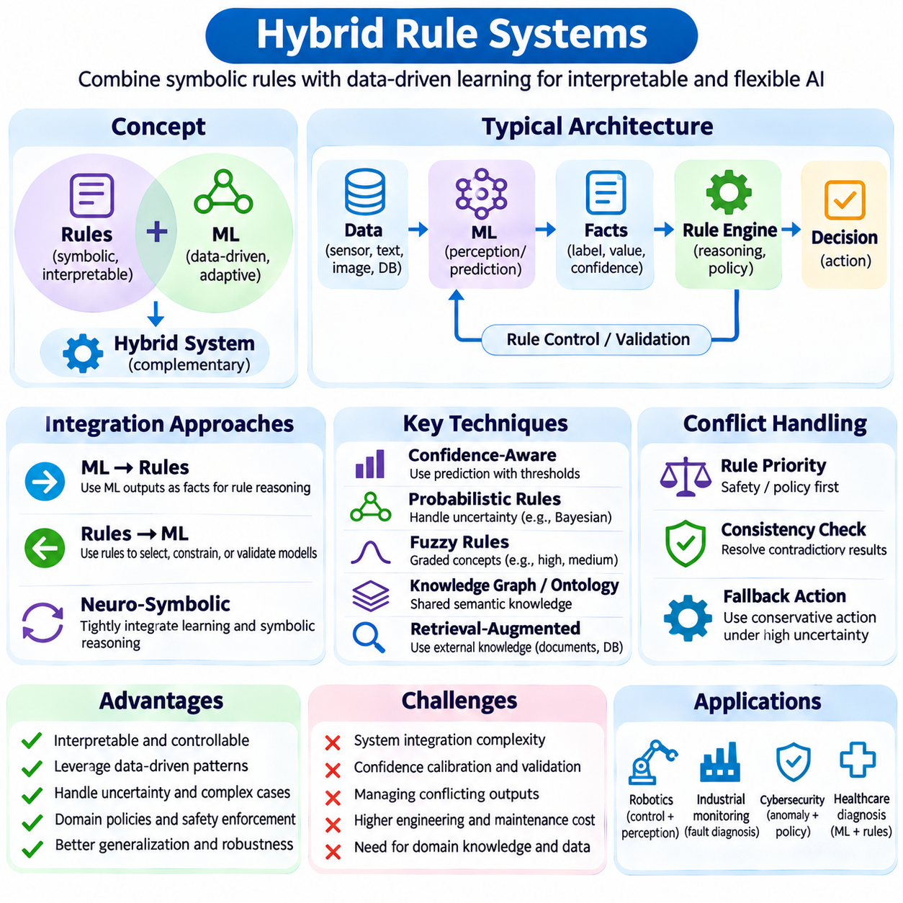{width="7.268055555555556in" height="7.268055555555556in"}

Hybrid rule systems combine explicit symbolic reasoning with statistical learning, probabilistic inference, and adaptive decision mechanisms. Their purpose is to preserve the transparency and controllability of rule-based logic while incorporating the flexibility of data-driven models. These systems are particularly valuable when applications require both interpretation of complex observations and enforcement of clearly defined operational policies.

Traditional rule engines evaluate structured facts against predefined logical conditions, whereas machine learning models infer patterns from historical data. A hybrid architecture connects these capabilities through interfaces that transform predictions into usable knowledge. The rule engine can then evaluate learned observations alongside verified facts, domain constraints, and contextual information to produce decisions that neither component could reliably support alone.

A common architecture places machine learning components before the symbolic inference engine. Neural networks may classify images, detect anomalies, recognize activities, or estimate equipment conditions. Their outputs are converted into structured facts containing labels, numerical values, timestamps, and confidence estimates. The rule engine evaluates these facts using domain-specific conditions and determines whether additional reasoning or action is required.

Another architecture uses symbolic rules to supervise machine learning behavior. Rules can select models, restrict available actions, validate outputs, or trigger additional observations when uncertainty exceeds acceptable limits. For example, a robotic system may use learned terrain classification while applying explicit restrictions on permitted operating modes. This arrangement separates statistical interpretation from operational authorization and policy enforcement.

Knowledge representation is central to successful hybrid integration. Symbolic components require consistent entities, attributes, relationships, and logical predicates, while learning components commonly produce vectors, probabilities, and continuous measurements. A semantic transformation layer maps numerical predictions into structured representations. This mapping must preserve relevant uncertainty and avoid treating estimated categories as unquestionable facts.

Confidence-aware reasoning allows hybrid systems to account for uncertainty in learned predictions. A rule may require both a classification result and a minimum confidence threshold before recommending an action. However, confidence scores are not necessarily calibrated probabilities, and thresholds must be validated against representative data. Critical decisions may require additional evidence, independent verification, or conservative fallback behavior rather than simple threshold comparisons.

Probabilistic rule systems extend conventional symbolic reasoning by associating uncertainty with facts, relationships, or logical conclusions. Bayesian networks, probabilistic logic programming, and related methods can combine structured dependencies with uncertain evidence. These approaches provide alternatives to purely Boolean inference, although their computational requirements and assumptions vary. Their usefulness depends on whether uncertainty can be represented and evaluated consistently.

Fuzzy rule systems provide another hybrid approach by combining linguistic conditions with continuous membership values. Instead of treating temperature as exclusively normal or abnormal, fuzzy membership functions can represent intermediate states. Rules may combine concepts such as moderately high temperature and increasing vibration to derive graded recommendations. Fuzzy inference is especially useful when operational categories have gradual boundaries rather than precise thresholds.

Neuro-symbolic systems integrate neural representations with symbolic knowledge and reasoning. Neural components can learn features from raw observations, while symbolic components encode relationships, constraints, and compositional structures. Integration may occur through sequential pipelines, constrained optimization, differentiable reasoning, or shared representations. These methods aim to improve generalization and structured decision-making without assuming that learned representations are inherently interpretable.

Knowledge graphs and ontologies can serve as shared semantic foundations for hybrid rule systems. A knowledge graph represents entities and relationships, while an ontology defines concepts, properties, and logical restrictions. Machine learning components may populate or update graph information, and rules can infer additional relationships or detect inconsistencies. Provenance tracking is necessary to distinguish verified knowledge from automatically extracted or predicted information.

Hybrid architectures also support retrieval-augmented reasoning. A retrieval system may locate relevant documents, database records, or knowledge graph facts before the rule engine evaluates a decision. Language models can assist with extracting candidate facts or interpreting user requests, but their outputs require validation before entering authoritative rule execution. This separation reduces the risk of unsupported generated statements being treated as established knowledge.

Conflict resolution becomes more complex when symbolic rules and learned components recommend different actions. A prediction model may identify an apparently safe condition while an explicit operational rule prohibits the corresponding action. The system must define which constraints are authoritative and how contradictory evidence is handled. Safety restrictions and mandatory policies should not be overridden solely because a statistical model produces a high confidence score.

Temporal reasoning is important in hybrid systems that process continuously changing observations. Sensor measurements, predictions, and rule conclusions may become outdated at different rates. Facts should therefore include timestamps, validity intervals, and source information where appropriate. The inference engine must invalidate stale evidence and reconsider conclusions when new observations arrive. Without temporal consistency, correct individual components can still produce incorrect combined decisions.

Feedback mechanisms allow hybrid systems to improve through operational experience. Rule-triggered outcomes can be logged and used to evaluate prediction quality, while repeated exceptions may reveal missing domain knowledge. Learning models can be retrained using validated observations, and rules can be revised through controlled knowledge engineering. These processes should remain distinguishable because statistical model updates and policy changes require different forms of approval.

An industrial predictive maintenance system illustrates the practical value of hybrid reasoning. A machine learning model may estimate bearing degradation from vibration and temperature histories, while a rule engine evaluates maintenance schedules, equipment criticality, and operating restrictions. The combined system can recommend inspection or controlled shutdown according to explicit policies. Its reliability depends on validated predictions, current facts, and appropriate operational safeguards.

In autonomous robotics, perception models can identify objects, estimate traversability, and recognize environmental conditions. A symbolic layer can evaluate mission objectives, authorization constraints, and task dependencies before selecting permissible actions. Planning components may combine learned cost estimates with explicit logical restrictions. This division of responsibilities supports interpretable supervision while allowing perception and prediction to adapt to complex environments.

Enterprise applications use hybrid rule systems to coordinate predictive analytics with business policies. Fraud detection, insurance assessment, eligibility screening, and workflow automation may combine statistical risk estimates with explicit decision rules. A model can prioritize cases requiring investigation, while rules enforce procedural requirements and documentation obligations. Governance mechanisms must ensure that learned predictions do not silently replace legally or organizationally required decision criteria.

System architecture should separate data acquisition, model inference, semantic transformation, rule evaluation, and action execution into clearly defined components. Each interface needs explicit data schemas, validation requirements, and failure-handling procedures. This modular design allows independent testing and replacement of components. However, integration complexity increases when updates, uncertainties, and dependencies cross component boundaries.

Performance optimization must consider both statistical inference latency and symbolic rule-matching costs. Neural inference may dominate computation, while large rule bases can create expensive joins and activation scheduling overhead. Caching, incremental matching, asynchronous processing, and selective model execution can improve efficiency. These optimizations must preserve required data consistency and response deadlines, especially in real-time operational environments.

Explainability requires connecting learned evidence to symbolic conclusions. A useful explanation may identify the model output, its uncertainty, the supporting observations, the rules that fired, and the policy determining the final action. Such traces help operators understand decisions and investigate failures. Nevertheless, a transparent rule trace does not explain the internal behavior of an opaque model or establish that its prediction is correct.

Verification and validation must examine individual components and their interactions. Machine learning models require robustness and generalization testing, while rule engines require logical consistency and execution testing. Integrated evaluations should include uncertain predictions, conflicting recommendations, missing observations, stale facts, and distribution shifts. Safety-critical applications additionally require validated protective mechanisms independent of unverified learned reasoning.

Governance is essential because hybrid systems combine different sources of authority. Domain experts may own policy rules, data scientists may manage predictive models, and system engineers may control execution interfaces. Versioning, provenance records, access controls, and approval procedures should identify responsibility for each change. Reproducible decision logs help distinguish failures caused by incorrect predictions, outdated rules, or integration defects.

Hybrid rule systems ultimately provide a framework for combining explicit knowledge with adaptive intelligence. Their effectiveness depends on disciplined knowledge representation, uncertainty management, conflict resolution, modular engineering, and continuous validation. By assigning statistical models to perception and prediction while retaining symbolic mechanisms for constraints and structured reasoning, engineers can develop AI applications that are flexible, interpretable, and operationally dependable.

하이브리드 규칙 시스템(Hybrid Rule Systems)은 명시적인 기호적 추론(Symbolic Reasoning)과 통계적 학습(Statistical Learning), 확률적 추론(Probabilistic Inference), 적응형 의사결정 메커니즘(Adaptive Decision Mechanisms)을 결합한다. 이러한 시스템의 목적은 규칙 기반 논리(Rule-Based Logic)의 투명성(Transparency)과 제어 가능성(Controllability)을 유지하면서 데이터 주도 모델(Data-Driven Models)의 유연성(Flexibility)을 통합하는 것이다. 하이브리드 규칙 시스템은 복잡한 관측값의 해석과 명확하게 정의된 운영 정책(Operational Policies)의 시행이 모두 필요한 응용 분야에서 특히 유용하다.

전통적인 규칙 엔진(Traditional Rule Engines)은 사전에 정의된 논리 조건(Logical Conditions)에 따라 구조화된 사실(Structured Facts)을 평가하는 반면, 머신러닝 모델(Machine Learning Models)은 과거 데이터(Historical Data)에서 패턴을 추론한다. 하이브리드 아키텍처(Hybrid Architecture)는 예측 결과를 활용 가능한 지식으로 변환하는 인터페이스(Interfaces)를 통해 이러한 기능을 연결한다. 이후 규칙 엔진은 학습된 관측값(Learned Observations)을 검증된 사실(Verified Facts), 도메인 제약조건(Domain Constraints), 맥락 정보(Contextual Information)와 함께 평가하여 어느 한 구성 요소만으로는 안정적으로 지원하기 어려운 의사결정을 수행할 수 있다.

일반적인 아키텍처는 머신러닝 구성 요소(Machine Learning Components)를 기호적 추론 엔진(Symbolic Inference Engine)의 앞단에 배치한다. 신경망(Neural Networks)은 이미지 분류(Image Classification), 이상 탐지(Anomaly Detection), 활동 인식(Activity Recognition), 장비 상태 추정(Equipment Condition Estimation)을 수행할 수 있다. 이러한 출력은 레이블(Labels), 수치값(Numerical Values), 타임스탬프(Timestamps), 신뢰도 추정값(Confidence Estimates)을 포함하는 구조화된 사실로 변환된다. 규칙 엔진은 도메인별 조건(Domain-Specific Conditions)을 사용하여 이러한 사실을 평가하고 추가적인 추론이나 동작이 필요한지 결정한다.

또 다른 아키텍처는 기호적 규칙(Symbolic Rules)을 사용하여 머신러닝 동작을 감독한다. 규칙은 모델을 선택하고, 사용 가능한 동작을 제한하며, 출력을 검증하거나, 불확실성이 허용 한계를 초과할 때 추가 관측을 유발할 수 있다. 예를 들어, 로봇 시스템(Robotic System)은 학습 기반 지형 분류(Learned Terrain Classification)를 사용하면서 허용된 운영 모드(Permitted Operating Modes)에 대한 명시적인 제한을 적용할 수 있다. 이러한 구성은 통계적 해석(Statistical Interpretation)을 운영 승인(Operational Authorization) 및 정책 시행(Policy Enforcement)과 분리한다.

지식 표현(Knowledge Representation)은 성공적인 하이브리드 통합(Hybrid Integration)의 핵심이다. 기호적 구성 요소(Symbolic Components)는 일관된 개체(Entities), 속성(Attributes), 관계(Relationships), 논리 술어(Logical Predicates)를 요구하는 반면, 학습 구성 요소(Learning Components)는 일반적으로 벡터(Vectors), 확률(Probabilities), 연속 측정값(Continuous Measurements)을 생성한다. 의미 변환 계층(Semantic Transformation Layer)은 수치 예측을 구조화된 표현(Structured Representations)으로 매핑한다. 이러한 매핑은 관련 불확실성을 보존해야 하며, 추정된 범주(Estimated Categories)를 의심의 여지가 없는 사실로 취급해서는 안 된다.

신뢰도 인식 추론(Confidence-Aware Reasoning)은 하이브리드 시스템이 학습된 예측의 불확실성을 고려할 수 있도록 한다. 규칙은 동작을 권고하기 전에 분류 결과(Classification Result)와 최소 신뢰도 임계값(Minimum Confidence Threshold)을 모두 요구할 수 있다. 그러나 신뢰도 점수(Confidence Scores)가 반드시 보정된 확률(Calibrated Probabilities)을 의미하는 것은 아니며, 임계값은 대표성 있는 데이터(Representative Data)를 통해 검증해야 한다. 중요한 의사결정에는 단순한 임계값 비교보다 추가 증거(Additional Evidence), 독립적인 검증(Independent Verification), 보수적인 대체 동작(Conservative Fallback Behavior)이 필요할 수 있다.

확률적 규칙 시스템(Probabilistic Rule Systems)은 사실, 관계 또는 논리적 결론에 불확실성을 연결하여 전통적인 기호적 추론을 확장한다. 베이지안 네트워크(Bayesian Networks), 확률적 논리 프로그래밍(Probabilistic Logic Programming), 관련 방법들은 구조화된 의존 관계(Structured Dependencies)와 불확실한 증거(Uncertain Evidence)를 결합할 수 있다. 이러한 접근 방식은 순수한 불리언 추론(Boolean Inference)의 대안을 제공하지만, 계산 요구사항(Computational Requirements)과 가정(Assumptions)은 방법에 따라 달라진다. 유용성은 불확실성을 일관되게 표현하고 평가할 수 있는지에 따라 결정된다.

퍼지 규칙 시스템(Fuzzy Rule Systems)은 언어적 조건(Linguistic Conditions)과 연속적인 소속도 값(Continuous Membership Values)을 결합하는 또 다른 하이브리드 접근 방식이다. 온도를 정상 또는 비정상으로만 구분하는 대신 퍼지 소속 함수(Fuzzy Membership Functions)를 사용하여 중간 상태(Intermediate States)를 표현할 수 있다. 규칙은 다소 높은 온도(Moderately High Temperature)와 증가하는 진동(Increasing Vibration) 같은 개념을 결합하여 단계적인 권고(Graded Recommendations)를 도출할 수 있다. 퍼지 추론(Fuzzy Inference)은 운영 범주(Operational Categories)의 경계가 명확한 임계값보다 점진적으로 변화하는 경우 특히 유용하다.

신경기호 시스템(Neuro-Symbolic Systems)은 신경망 표현(Neural Representations)을 기호적 지식(Symbolic Knowledge) 및 추론과 통합한다. 신경망 구성 요소(Neural Components)는 원시 관측값(Raw Observations)에서 특징을 학습하고, 기호적 구성 요소는 관계, 제약조건, 조합적 구조(Compositional Structures)를 부호화할 수 있다. 통합은 순차적 파이프라인(Sequential Pipelines), 제약 최적화(Constrained Optimization), 미분 가능한 추론(Differentiable Reasoning), 공유 표현(Shared Representations)을 통해 이루어질 수 있다. 이러한 방법은 학습된 표현이 본질적으로 해석 가능하다고 가정하지 않으면서 일반화(Generalization)와 구조화된 의사결정(Structured Decision-Making)을 개선하는 것을 목표로 한다.

지식 그래프(Knowledge Graphs)와 온톨로지(Ontologies)는 하이브리드 규칙 시스템을 위한 공유 의미 기반(Shared Semantic Foundations)으로 활용될 수 있다. 지식 그래프는 개체와 관계를 표현하고, 온톨로지는 개념(Concepts), 속성(Properties), 논리적 제한사항(Logical Restrictions)을 정의한다. 머신러닝 구성 요소는 그래프 정보를 생성하거나 갱신할 수 있으며, 규칙은 추가적인 관계를 추론하거나 불일치(Inconsistencies)를 탐지할 수 있다. 검증된 지식과 자동으로 추출되거나 예측된 정보를 구분하기 위해 출처 추적(Provenance Tracking)이 필요하다.

하이브리드 아키텍처는 검색 증강 추론(Retrieval-Augmented Reasoning)도 지원한다. 검색 시스템(Retrieval System)은 규칙 엔진이 의사결정을 평가하기 전에 관련 문서, 데이터베이스 기록(Database Records), 지식 그래프 사실(Knowledge Graph Facts)을 검색할 수 있다. 언어 모델(Language Models)은 후보 사실(Candidate Facts)을 추출하거나 사용자 요청(User Requests)을 해석하는 데 도움을 줄 수 있지만, 그 출력은 권위 있는 규칙 실행(Authoritative Rule Execution)에 입력되기 전에 검증되어야 한다. 이러한 분리는 근거 없는 생성 문장(Unsupported Generated Statements)이 확립된 지식으로 취급되는 위험을 줄인다.

충돌 해결(Conflict Resolution)은 기호적 규칙과 학습 구성 요소가 서로 다른 동작을 권고할 때 더욱 복잡해진다. 예측 모델(Prediction Model)은 겉보기에 안전한 상태를 식별할 수 있지만, 명시적인 운영 규칙(Explicit Operational Rule)은 해당 동작을 금지할 수 있다. 시스템은 어떤 제약조건이 권위 있는 기준(Authoritative Constraints)인지, 모순되는 증거(Contradictory Evidence)를 어떻게 처리할지 정의해야 한다. 안전 제한사항(Safety Restrictions)과 의무적 정책(Mandatory Policies)은 통계적 모델이 높은 신뢰도 점수를 생성했다는 이유만으로 무시되어서는 안 된다.

시간적 추론(Temporal Reasoning)은 지속적으로 변화하는 관측값을 처리하는 하이브리드 시스템에서 중요하다. 센서 측정값(Sensor Measurements), 예측(Predictions), 규칙 결론(Rule Conclusions)은 서로 다른 속도로 오래된 정보가 될 수 있다. 따라서 사실에는 적절한 경우 타임스탬프(Timestamps), 유효 기간(Validity Intervals), 출처 정보(Source Information)를 포함해야 한다. 추론 엔진(Inference Engine)은 오래된 증거(Stale Evidence)를 무효화하고 새로운 관측값이 도착하면 결론을 재검토해야 한다. 시간적 일관성(Temporal Consistency)이 없으면 개별 구성 요소가 올바르게 작동하더라도 결합된 의사결정은 잘못될 수 있다.

피드백 메커니즘(Feedback Mechanisms)은 하이브리드 시스템이 운영 경험(Operational Experience)을 통해 개선될 수 있도록 한다. 규칙에 의해 유발된 결과(Rule-Triggered Outcomes)는 기록되어 예측 품질(Prediction Quality)을 평가하는 데 사용될 수 있으며, 반복되는 예외(Repeated Exceptions)는 누락된 도메인 지식(Missing Domain Knowledge)을 드러낼 수 있다. 학습 모델은 검증된 관측값(Validated Observations)을 사용하여 재학습할 수 있고, 규칙은 통제된 지식 공학(Controlled Knowledge Engineering)을 통해 수정할 수 있다. 통계적 모델 갱신(Statistical Model Updates)과 정책 변경(Policy Changes)은 서로 다른 승인 절차(Approval Procedures)를 요구하므로 이러한 과정은 구분되어야 한다.

산업용 예측 유지보수 시스템(Industrial Predictive Maintenance System)은 하이브리드 추론의 실용적 가치를 보여준다. 머신러닝 모델은 진동 및 온도 이력(Vibration and Temperature Histories)을 통해 베어링 열화(Bearing Degradation)를 추정할 수 있으며, 규칙 엔진은 유지보수 일정(Maintenance Schedules), 장비 중요도(Equipment Criticality), 운영 제한사항(Operating Restrictions)을 평가한다. 결합된 시스템은 명시적인 정책에 따라 점검(Inspection)이나 통제된 정지(Controlled Shutdown)를 권고할 수 있다. 시스템의 신뢰성은 검증된 예측(Validated Predictions), 최신 사실(Current Facts), 적절한 운영 안전장치(Operational Safeguards)에 따라 달라진다.

자율 로보틱스(Autonomous Robotics)에서 인식 모델(Perception Models)은 객체를 식별하고, 주행 가능성(Traversability)을 추정하며, 환경 조건(Environmental Conditions)을 인식할 수 있다. 기호적 계층(Symbolic Layer)은 허용 가능한 동작을 선택하기 전에 임무 목표(Mission Objectives), 승인 제약조건(Authorization Constraints), 작업 의존 관계(Task Dependencies)를 평가할 수 있다. 계획 구성 요소(Planning Components)는 학습된 비용 추정값(Learned Cost Estimates)을 명시적인 논리적 제한사항(Explicit Logical Restrictions)과 결합할 수 있다. 이러한 책임 분리는 인식과 예측이 복잡한 환경에 적응하도록 하면서 해석 가능한 감독(Interpretable Supervision)을 지원한다.

기업용 응용 시스템(Enterprise Applications)은 하이브리드 규칙 시스템을 사용하여 예측 분석(Predictive Analytics)과 비즈니스 정책(Business Policies)을 조정한다. 사기 탐지(Fraud Detection), 보험 심사(Insurance Assessment), 적격성 심사(Eligibility Screening), 업무 흐름 자동화(Workflow Automation)는 통계적 위험 추정값(Statistical Risk Estimates)과 명시적인 의사결정 규칙을 결합할 수 있다. 모델은 조사가 필요한 사례의 우선순위를 정하고, 규칙은 절차적 요구사항(Procedural Requirements)과 문서화 의무(Documentation Obligations)를 시행할 수 있다. 거버넌스 메커니즘(Governance Mechanisms)은 학습된 예측이 법률이나 조직에서 요구하는 의사결정 기준을 암묵적으로 대체하지 않도록 보장해야 한다.

시스템 아키텍처(System Architecture)는 데이터 수집(Data Acquisition), 모델 추론(Model Inference), 의미 변환(Semantic Transformation), 규칙 평가(Rule Evaluation), 동작 실행(Action Execution)을 명확하게 정의된 구성 요소로 분리해야 한다. 각 인터페이스에는 명시적인 데이터 스키마(Data Schemas), 검증 요구사항(Validation Requirements), 오류 처리 절차(Failure-Handling Procedures)가 필요하다. 이러한 모듈형 설계(Modular Design)는 구성 요소의 독립적인 테스트와 교체를 가능하게 한다. 그러나 갱신, 불확실성, 의존 관계가 구성 요소의 경계를 넘나들면 통합 복잡성(Integration Complexity)이 증가한다.

성능 최적화(Performance Optimization)는 통계적 추론 지연시간(Statistical Inference Latency)과 기호적 규칙 매칭 비용(Symbolic Rule-Matching Costs)을 모두 고려해야 한다. 신경망 추론(Neural Inference)이 계산의 대부분을 차지할 수 있으며, 대규모 규칙 기반은 비용이 높은 조인(Expensive Joins)과 활성화 스케줄링 오버헤드(Activation Scheduling Overhead)를 발생시킬 수 있다. 캐싱(Caching), 증분 매칭(Incremental Matching), 비동기 처리(Asynchronous Processing), 선택적 모델 실행(Selective Model Execution)은 효율성을 개선할 수 있다. 이러한 최적화는 특히 실시간 운영 환경(Real-Time Operational Environments)에서 요구되는 데이터 일관성(Data Consistency)과 응답 기한(Response Deadlines)을 유지해야 한다.

설명 가능성(Explainability)을 확보하려면 학습된 증거(Learned Evidence)를 기호적 결론(Symbolic Conclusions)과 연결해야 한다. 유용한 설명에는 모델 출력(Model Output), 불확실성(Uncertainty), 지원 관측값(Supporting Observations), 실행된 규칙(Fired Rules), 최종 동작을 결정한 정책(Policy)이 포함될 수 있다. 이러한 추적 기록(Traces)은 운영자가 의사결정을 이해하고 오류를 조사하는 데 도움이 된다. 그러나 투명한 규칙 추적(Transparent Rule Trace)이 불투명한 모델(Opaque Model)의 내부 동작을 설명하거나 예측의 정확성을 입증하는 것은 아니다.

검증(Verification)과 타당성 확인(Validation)은 개별 구성 요소와 그 상호작용을 모두 검사해야 한다. 머신러닝 모델에는 강건성(Robustness)과 일반화 테스트(Generalization Testing)가 필요하며, 규칙 엔진에는 논리적 일관성(Logical Consistency)과 실행 테스트(Execution Testing)가 필요하다. 통합 평가(Integrated Evaluations)에는 불확실한 예측(Uncertain Predictions), 충돌하는 권고(Conflicting Recommendations), 누락된 관측값(Missing Observations), 오래된 사실(Stale Facts), 분포 변화(Distribution Shifts)가 포함되어야 한다. 안전 필수 응용 시스템(Safety-Critical Applications)에는 검증되지 않은 학습 기반 추론과 독립적으로 작동하는 검증된 보호 메커니즘(Validated Protective Mechanisms)이 추가로 필요하다.

거버넌스(Governance)는 하이브리드 시스템이 서로 다른 권한의 출처(Sources of Authority)를 결합하기 때문에 필수적이다. 도메인 전문가(Domain Experts)는 정책 규칙(Policy Rules)을 관리하고, 데이터 과학자(Data Scientists)는 예측 모델(Predictive Models)을 관리하며, 시스템 엔지니어(System Engineers)는 실행 인터페이스(Execution Interfaces)를 제어할 수 있다. 버전 관리(Versioning), 출처 기록(Provenance Records), 접근 제어(Access Controls), 승인 절차(Approval Procedures)는 각 변경에 대한 책임을 식별해야 한다. 재현 가능한 의사결정 로그(Reproducible Decision Logs)는 잘못된 예측(Incorrect Predictions), 오래된 규칙(Outdated Rules), 통합 결함(Integration Defects)으로 발생한 오류를 구분하는 데 도움이 된다.

궁극적으로 하이브리드 규칙 시스템(Hybrid Rule Systems)은 명시적인 지식(Explicit Knowledge)과 적응형 지능(Adaptive Intelligence)을 결합하기 위한 프레임워크(Framework)를 제공한다. 그 효과는 체계적인 지식 표현(Disciplined Knowledge Representation), 불확실성 관리(Uncertainty Management), 충돌 해결(Conflict Resolution), 모듈형 엔지니어링(Modular Engineering), 지속적인 검증(Continuous Validation)에 따라 달라진다. 통계적 모델(Statistical Models)에 인식(Perception)과 예측(Prediction)을 담당하게 하고, 기호적 메커니즘(Symbolic Mechanisms)에 제약조건(Constraints)과 구조화된 추론(Structured Reasoning)을 유지하도록 역할을 할당함으로써 엔지니어는 유연하고(Flexible), 해석 가능하며(Interpretable), 운영상 신뢰할 수 있는(Operationally Dependable) 인공지능 응용 시스템을 개발할 수 있다.

## 04.10 Case Study

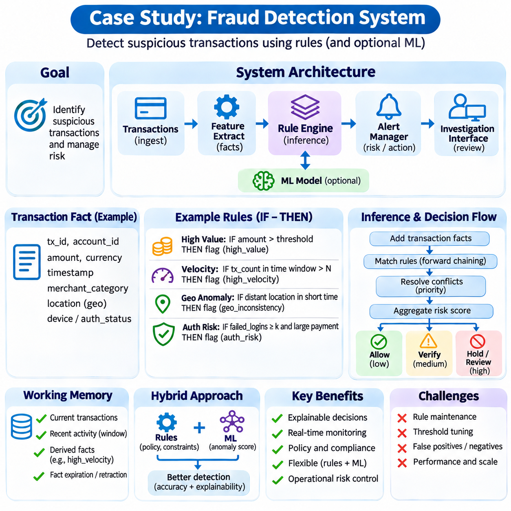{width="7.268055555555556in" height="7.268055555555556in"}

A fraud detection system provides a practical case study of how rule-based reasoning can support financial transaction monitoring and risk management. Its purpose is to identify suspicious activities by evaluating transaction characteristics, account behavior, and predefined security policies. Unlike systems that rely exclusively on statistical predictions, a rule-based approach expresses detection criteria explicitly, allowing investigators to examine why particular transactions were flagged.

The architecture typically includes transaction ingestion, data validation, feature extraction, a rule engine, an alert manager, and an investigation interface. Incoming transactions are converted into structured facts containing amounts, timestamps, account identifiers, locations, and payment methods. The inference engine evaluates these facts against established detection rules and generates alerts or recommended actions when suspicious conditions are satisfied.

A simplified implementation can represent each transaction as a structured record containing transaction identifier, account identifier, amount, currency, timestamp, merchant category, and geographical information. Additional account attributes may include historical spending patterns, authentication status, and previous security incidents. Consistent schemas are essential because incorrect field mappings or missing values can cause rules to produce misleading results.

The rule base contains explicit conditions derived from operational policies, observed fraud patterns, and regulatory requirements. A high-value transaction rule may identify payments exceeding an established threshold, while a velocity rule detects excessive transaction frequency within a specified period. Other rules may examine unusual geographic activity, repeated authentication failures, or transactions involving restricted counterparties.

A transaction velocity rule evaluates the number or cumulative value of payments within a rolling time window. For example, multiple transactions occurring within several minutes may trigger additional verification when their frequency exceeds a configured threshold. The engine must maintain recent transaction histories and update window calculations as new events arrive. Appropriate thresholds depend on customer behavior, payment channels, and operational risk tolerance.

Geographical inconsistency rules identify activity that differs from expected account behavior. Transactions originating from distant locations within an implausibly short interval may indicate account compromise or unauthorized access. However, location signals can be inaccurate, and digital payments may originate from infrastructure unrelated to the customer\'s physical position. Such rules should therefore incorporate contextual evidence rather than automatically assuming fraud.

Authentication-related rules examine failed login attempts, device changes, unusual session activity, and inconsistencies between transaction requests and established account attributes. A sequence of unsuccessful authentication attempts followed by a high-value payment may warrant additional scrutiny. Device identifiers and network information can strengthen detection, but privacy requirements and the reliability of collected signals must be considered.

The inference engine evaluates applicable rules through forward chaining, allowing new transaction facts to activate relevant detection conditions. When several rules match simultaneously, conflict resolution determines how their activations are processed. High-priority security conditions may receive preference over routine monitoring rules. The engine should distinguish between producing multiple risk indicators and executing mutually incompatible operational actions.

Risk scoring can aggregate the results of multiple rules into a combined assessment. Each triggered rule may contribute a weighted value representing its relative importance, while certain mandatory restrictions may override ordinary scoring. The resulting score can guide investigation priority or additional authentication requirements. Weight assignments and decision thresholds must be validated because arbitrary combinations can create inconsistent or misleading risk estimates.

A typical decision workflow separates monitoring, verification, investigation, and transaction intervention. Low-risk activity may proceed without additional processing, while moderate-risk cases can trigger alerts or authentication challenges. Higher-risk events may require temporary holds or human review, subject to applicable policies. The system should avoid equating a suspicious indicator with confirmed fraud because legitimate behavior can resemble known attack patterns.

Working memory maintains active transaction facts, recent account activity, and intermediate conclusions. Rules may assert derived facts such as excessive velocity, unusual device activity, or elevated risk status. These conclusions can activate additional rules that combine several warning indicators. Fact expiration and retraction mechanisms are necessary to prevent outdated observations from influencing later decisions after their validity periods have ended.

Efficient matching becomes important when the system processes large transaction streams. Naive evaluation of every rule against every transaction can create unnecessary computational overhead. RETE-based matching, attribute indexing, incremental updates, and selective condition evaluation can reduce repeated work. Time-window aggregation and indexed account histories are especially important when rules compare current transactions with recent events.

A hybrid fraud detection architecture can combine explicit rules with machine learning models. Statistical models may estimate anomaly scores or identify complex behavioral patterns, while rules enforce mandatory restrictions and operational policies. Model outputs can enter the rule engine as structured facts containing scores and uncertainty information. This integration allows adaptive pattern recognition without surrendering control over explicitly defined decision constraints.

False positives are a major operational challenge because legitimate transactions may satisfy suspicious conditions. Excessive alerts increase investigation costs, delay payments, and reduce customer trust. False negatives are equally important because undetected fraudulent activity can cause financial losses. Rule thresholds should therefore be evaluated using representative transaction distributions and realistic estimates of investigation capacity and error costs.

Evaluation requires labeled historical transactions or carefully reviewed investigation outcomes. Precision measures the proportion of flagged transactions that are confirmed fraudulent, while recall measures the proportion of known fraudulent transactions detected. False-positive rate, alert volume, detection latency, and financial loss prevented provide additional perspectives. Because fraud is often rare, accuracy alone can conceal poor detection performance.

Temporal evaluation is essential because fraud patterns and customer behavior evolve. Training and testing procedures should respect chronological ordering to avoid using future information during historical evaluation. Rule changes should be tested against later transaction periods and newly observed attack patterns. Concept drift and changing transaction volumes may require threshold recalibration, updated features, or additional rules.

Explainability is a significant advantage of explicit fraud detection rules. An alert can record the triggering rule identifiers, supporting transaction facts, threshold comparisons, and final decision policy. Investigators can use this information to understand why a transaction was flagged and determine whether further evidence is required. Explanation records should distinguish verified observations from inferred risk indicators and statistical model predictions.

Auditability requires maintaining reliable histories of rule versions, transaction inputs, activation sequences, and operational decisions. When a disputed transaction is reviewed, investigators should be able to reconstruct the policy configuration that was active at the time. Access controls, retention policies, and tamper-resistant logs support accountability. Sensitive financial and personal information must be protected throughout storage, processing, and investigation.

Security controls must also protect the fraud detection system itself. Attackers may attempt to manipulate transaction attributes, exploit predictable thresholds, or generate misleading activity to avoid detection. Rule definitions, model configurations, and decision interfaces require controlled access and monitored changes. Defense-in-depth mechanisms and independent authorization checks help prevent compromised detection components from directly enabling unauthorized transactions.

Operational deployment requires integration with payment processing, identity verification, customer notification, and investigation workflows. The rule engine must meet latency and availability requirements appropriate to the transaction channel. Monitoring should track processing delays, failed evaluations, alert backlogs, and unusual changes in rule activation rates. Failure-handling policies must specify how transactions are treated when detection services are unavailable.

Testing should cover individual rules, combined conditions, conflicting actions, duplicate events, missing attributes, and delayed transaction messages. Scenario-based tests can simulate account takeover, transaction bursts, unusual location changes, and legitimate high-value purchases. Regression testing ensures that new rules do not unintentionally alter established behavior. Controlled experiments can assess proposed threshold changes before deployment.

Governance processes determine how fraud rules are proposed, approved, deployed, and retired. Security analysts may identify emerging attack patterns, while compliance specialists define mandatory requirements and engineers implement validated logic. Version control and staged deployment reduce the risk of unintended policy changes. Periodic reviews should remove ineffective rules, investigate alert quality, and document the justification for significant decisions.

This case study demonstrates how a fraud detection system can translate explicit security knowledge into operational reasoning. Its effectiveness depends on accurate transaction data, well-defined rules, efficient inference, calibrated risk assessment, and continuous evaluation. Combining interpretable rule execution with statistical detection and controlled human oversight creates a practical foundation for scalable, auditable, and adaptable financial security systems.

사기 탐지 시스템(Fraud Detection System)은 규칙 기반 추론(Rule-Based Reasoning)이 금융 거래 모니터링(Financial Transaction Monitoring)과 위험 관리(Risk Management)를 어떻게 지원할 수 있는지 보여주는 실용적인 사례 연구(Case Study)이다. 이 시스템의 목적은 거래 특성(Transaction Characteristics), 계정 행동(Account Behavior), 사전에 정의된 보안 정책(Security Policies)을 평가하여 의심스러운 활동(Suspicious Activities)을 식별하는 것이다. 통계적 예측(Statistical Predictions)에만 의존하는 시스템과 달리 규칙 기반 접근 방식은 탐지 기준(Detection Criteria)을 명시적으로 표현하므로 조사 담당자가 특정 거래가 의심 거래로 표시된 이유를 확인할 수 있다.

일반적인 아키텍처(Architecture)는 거래 수집(Transaction Ingestion), 데이터 검증(Data Validation), 특징 추출(Feature Extraction), 규칙 엔진(Rule Engine), 경고 관리자(Alert Manager), 조사 인터페이스(Investigation Interface)로 구성된다. 입력되는 거래는 금액(Amounts), 타임스탬프(Timestamps), 계정 식별자(Account Identifiers), 위치(Locations), 결제 수단(Payment Methods)을 포함하는 구조화된 사실(Structured Facts)로 변환된다. 추론 엔진(Inference Engine)은 이러한 사실을 확립된 탐지 규칙(Detection Rules)에 따라 평가하고 의심스러운 조건이 충족되면 경고(Alerts) 또는 권고 동작(Recommended Actions)을 생성한다.

단순화된 구현(Simplified Implementation)에서는 각 거래를 거래 식별자(Transaction Identifier), 계정 식별자(Account Identifier), 금액(Amount), 통화(Currency), 타임스탬프(Timestamp), 가맹점 범주(Merchant Category), 지리적 정보(Geographical Information)를 포함하는 구조화된 레코드(Structured Record)로 표현할 수 있다. 추가적인 계정 속성(Account Attributes)에는 과거 지출 패턴(Historical Spending Patterns), 인증 상태(Authentication Status), 이전 보안 사고(Previous Security Incidents)가 포함될 수 있다. 잘못된 필드 매핑(Field Mappings)이나 누락된 값(Missing Values)은 규칙이 오해를 유발하는 결과를 생성하게 할 수 있으므로 일관된 스키마(Consistent Schemas)가 필수적이다.

규칙 기반(Rule Base)은 운영 정책(Operational Policies), 관측된 사기 패턴(Observed Fraud Patterns), 규제 요구사항(Regulatory Requirements)에서 도출된 명시적인 조건을 포함한다. 고액 거래 규칙(High-Value Transaction Rule)은 설정된 임계값(Established Threshold)을 초과하는 결제를 식별할 수 있으며, 거래 빈도 규칙(Velocity Rule)은 지정된 기간 내 과도한 거래 빈도를 탐지한다. 다른 규칙은 비정상적인 지리적 활동(Unusual Geographic Activity), 반복적인 인증 실패(Repeated Authentication Failures), 제한 대상 거래 상대방(Restricted Counterparties)과 관련된 거래를 검사할 수 있다.

거래 빈도 규칙(Transaction Velocity Rule)은 이동 시간 창(Rolling Time Window) 내 결제 횟수 또는 누적 금액(Cumulative Value)을 평가한다. 예를 들어, 몇 분 이내에 여러 거래가 발생하고 그 빈도가 설정된 임계값(Configured Threshold)을 초과하면 추가 인증(Additional Verification)이 요구될 수 있다. 엔진은 최근 거래 이력(Recent Transaction Histories)을 유지하고 새로운 이벤트가 도착할 때마다 시간 창 계산(Window Calculations)을 갱신해야 한다. 적절한 임계값은 고객 행동(Customer Behavior), 결제 채널(Payment Channels), 운영 위험 허용 수준(Operational Risk Tolerance)에 따라 달라진다.

지리적 불일치 규칙(Geographical Inconsistency Rules)은 예상되는 계정 행동(Expected Account Behavior)과 다른 활동을 식별한다. 현실적으로 이동하기 어려울 만큼 짧은 시간 간격으로 멀리 떨어진 위치에서 거래가 발생하면 계정 침해(Account Compromise) 또는 무단 접근(Unauthorized Access)을 나타낼 수 있다. 그러나 위치 신호(Location Signals)는 부정확할 수 있으며, 디지털 결제(Digital Payments)는 고객의 실제 물리적 위치와 무관한 인프라에서 발생할 수도 있다. 따라서 이러한 규칙은 사기를 자동으로 단정하기보다 맥락적 증거(Contextual Evidence)를 함께 고려해야 한다.

인증 관련 규칙(Authentication-Related Rules)은 로그인 실패(Failed Login Attempts), 장치 변경(Device Changes), 비정상적인 세션 활동(Unusual Session Activity), 거래 요청과 기존 계정 속성 사이의 불일치를 검사한다. 여러 차례 인증에 실패한 후 고액 결제(High-Value Payment)가 발생하면 추가 조사가 필요할 수 있다. 장치 식별자(Device Identifiers)와 네트워크 정보(Network Information)는 탐지 성능을 강화할 수 있지만, 개인정보 보호 요구사항(Privacy Requirements)과 수집된 신호의 신뢰성(Reliability)을 고려해야 한다.

추론 엔진(Inference Engine)은 전방향 연쇄 추론(Forward Chaining)을 통해 적용 가능한 규칙을 평가하며, 새로운 거래 사실(Transaction Facts)이 관련 탐지 조건(Detection Conditions)을 활성화하도록 한다. 여러 규칙이 동시에 일치하면 충돌 해결(Conflict Resolution)이 활성화 처리 순서를 결정한다. 우선순위가 높은 보안 조건(High-Priority Security Conditions)은 일반적인 모니터링 규칙보다 우선될 수 있다. 엔진은 여러 위험 지표(Risk Indicators)를 생성하는 것과 서로 양립할 수 없는 운영 동작(Operational Actions)을 실행하는 것을 구분해야 한다.

위험 점수화(Risk Scoring)는 여러 규칙의 결과를 결합된 평가(Combined Assessment)로 집계할 수 있다. 활성화된 각 규칙은 상대적 중요도(Relative Importance)를 나타내는 가중치 값(Weighted Value)을 기여할 수 있으며, 특정 의무적 제한사항(Mandatory Restrictions)은 일반적인 점수 계산보다 우선할 수 있다. 결과 점수는 조사 우선순위(Investigation Priority) 또는 추가 인증 요구사항(Additional Authentication Requirements)을 결정하는 데 활용할 수 있다. 임의적인 가중치 조합(Arbitrary Combinations)은 일관성이 없거나 오해를 유발하는 위험 추정값(Risk Estimates)을 생성할 수 있으므로 가중치와 의사결정 임계값(Decision Thresholds)을 검증해야 한다.

일반적인 의사결정 업무 흐름(Decision Workflow)은 모니터링(Monitoring), 검증(Verification), 조사(Investigation), 거래 개입(Transaction Intervention)을 구분한다. 위험도가 낮은 활동(Low-Risk Activity)은 추가 처리 없이 진행될 수 있으며, 중간 위험 사례(Moderate-Risk Cases)는 경고 또는 인증 요청(Authentication Challenges)을 유발할 수 있다. 위험도가 높은 이벤트(Higher-Risk Events)는 적용 가능한 정책에 따라 일시적인 거래 보류(Temporary Holds) 또는 사람의 검토(Human Review)가 필요할 수 있다. 합법적인 행동(Legitimate Behavior)도 알려진 공격 패턴(Attack Patterns)과 유사할 수 있으므로 의심 지표를 확정된 사기(Confirmed Fraud)와 동일하게 취급해서는 안 된다.

작업 기억(Working Memory)은 활성 거래 사실(Active Transaction Facts), 최근 계정 활동(Recent Account Activity), 중간 결론(Intermediate Conclusions)을 유지한다. 규칙은 과도한 거래 빈도(Excessive Velocity), 비정상적인 장치 활동(Unusual Device Activity), 상승된 위험 상태(Elevated Risk Status)와 같은 파생 사실(Derived Facts)을 등록할 수 있다. 이러한 결론은 여러 경고 지표(Warning Indicators)를 결합하는 추가 규칙을 활성화할 수 있다. 유효 기간(Validity Periods)이 종료된 오래된 관측값이 이후 의사결정에 영향을 미치지 않도록 사실 만료(Fact Expiration) 및 철회 메커니즘(Retraction Mechanisms)이 필요하다.

시스템이 대규모 거래 스트림(Large Transaction Streams)을 처리할 때 효율적인 매칭(Efficient Matching)이 중요해진다. 모든 거래에 대해 모든 규칙을 평가하는 단순한 방식(Naive Evaluation)은 불필요한 계산 오버헤드(Computational Overhead)를 발생시킬 수 있다. RETE 기반 매칭(RETE-Based Matching), 속성 인덱싱(Attribute Indexing), 증분 갱신(Incremental Updates), 선택적 조건 평가(Selective Condition Evaluation)는 반복 작업을 줄일 수 있다. 시간 창 집계(Time-Window Aggregation)와 인덱싱된 계정 이력(Indexed Account Histories)은 현재 거래를 최근 이벤트와 비교하는 규칙에서 특히 중요하다.

하이브리드 사기 탐지 아키텍처(Hybrid Fraud Detection Architecture)는 명시적인 규칙(Explicit Rules)과 머신러닝 모델(Machine Learning Models)을 결합할 수 있다. 통계적 모델(Statistical Models)은 이상 점수(Anomaly Scores)를 추정하거나 복잡한 행동 패턴(Behavioral Patterns)을 식별할 수 있으며, 규칙은 의무적 제한사항(Mandatory Restrictions)과 운영 정책(Operational Policies)을 시행한다. 모델 출력(Model Outputs)은 점수와 불확실성 정보(Uncertainty Information)를 포함하는 구조화된 사실로 규칙 엔진에 입력될 수 있다. 이러한 통합은 명시적으로 정의된 의사결정 제약조건(Decision Constraints)에 대한 통제권을 유지하면서 적응형 패턴 인식(Adaptive Pattern Recognition)을 가능하게 한다.

오탐(False Positives)은 정상 거래(Legitimate Transactions)가 의심 조건을 충족할 수 있기 때문에 주요 운영 과제이다. 과도한 경고(Excessive Alerts)는 조사 비용(Investigation Costs)을 증가시키고 결제를 지연시키며 고객 신뢰(Customer Trust)를 저하시킨다. 미탐(False Negatives) 역시 중요하다. 탐지되지 않은 사기 활동(Undetected Fraudulent Activity)은 금융 손실(Financial Losses)을 초래할 수 있기 때문이다. 따라서 규칙 임계값(Rule Thresholds)은 대표성 있는 거래 분포(Representative Transaction Distributions)와 현실적인 조사 처리 능력(Investigation Capacity) 및 오류 비용(Error Costs) 추정값을 사용하여 평가해야 한다.

평가(Evaluation)에는 레이블이 지정된 과거 거래(Labeled Historical Transactions) 또는 신중하게 검토된 조사 결과(Investigation Outcomes)가 필요하다. 정밀도(Precision)는 의심 거래로 표시된 거래 중 실제 사기로 확인된 거래의 비율을 측정하며, 재현율(Recall)은 알려진 사기 거래 중 탐지된 거래의 비율을 측정한다. 오탐률(False-Positive Rate), 경고 발생량(Alert Volume), 탐지 지연시간(Detection Latency), 예방된 금융 손실(Financial Loss Prevented)은 추가적인 평가 관점을 제공한다. 사기 거래는 발생 빈도가 낮은 경우가 많으므로 정확도(Accuracy)만으로 평가하면 낮은 탐지 성능이 드러나지 않을 수 있다.

사기 패턴(Fraud Patterns)과 고객 행동(Customer Behavior)은 지속적으로 변화하므로 시간적 평가(Temporal Evaluation)가 필수적이다. 학습 및 테스트 절차(Training and Testing Procedures)는 과거 데이터를 평가할 때 미래 정보(Future Information)를 사용하지 않도록 시간 순서(Chronological Ordering)를 준수해야 한다. 규칙 변경(Rule Changes)은 이후 거래 기간(Later Transaction Periods)과 새롭게 관측된 공격 패턴(Newly Observed Attack Patterns)을 대상으로 테스트해야 한다. 개념 드리프트(Concept Drift)와 거래량 변화(Changing Transaction Volumes)는 임계값 재보정(Threshold Recalibration), 특징 갱신(Updated Features), 추가 규칙(Additional Rules)을 요구할 수 있다.

설명 가능성(Explainability)은 명시적인 사기 탐지 규칙(Explicit Fraud Detection Rules)의 중요한 장점이다. 경고는 해당 경고를 유발한 규칙 식별자(Rule Identifiers), 근거가 되는 거래 사실(Supporting Transaction Facts), 임계값 비교(Threshold Comparisons), 최종 의사결정 정책(Final Decision Policy)을 기록할 수 있다. 조사 담당자는 이러한 정보를 사용하여 거래가 의심 거래로 표시된 이유를 이해하고 추가 증거가 필요한지 판단할 수 있다. 설명 기록(Explanation Records)은 검증된 관측값(Verified Observations)을 추론된 위험 지표(Inferred Risk Indicators) 및 통계적 모델 예측(Statistical Model Predictions)과 구분해야 한다.

감사 가능성(Auditability)을 확보하려면 규칙 버전(Rule Versions), 거래 입력(Transaction Inputs), 활성화 순서(Activation Sequences), 운영 결정(Operational Decisions)에 대한 신뢰할 수 있는 이력(Reliable Histories)을 유지해야 한다. 분쟁 거래(Disputed Transaction)를 검토할 때 조사 담당자는 해당 시점에 활성화되어 있던 정책 구성(Policy Configuration)을 재구성할 수 있어야 한다. 접근 제어(Access Controls), 보존 정책(Retention Policies), 변조 방지 로그(Tamper-Resistant Logs)는 책임성(Accountability)을 지원한다. 민감한 금융 정보(Sensitive Financial Information)와 개인정보(Personal Information)는 저장, 처리, 조사 전 과정에서 보호되어야 한다.

보안 제어(Security Controls)는 사기 탐지 시스템 자체도 보호해야 한다. 공격자는 탐지를 회피하기 위해 거래 속성(Transaction Attributes)을 조작하거나 예측 가능한 임계값(Predictable Thresholds)을 악용하거나 오해를 유발하는 활동(Misleading Activity)을 생성할 수 있다. 규칙 정의(Rule Definitions), 모델 구성(Model Configurations), 의사결정 인터페이스(Decision Interfaces)에는 통제된 접근(Controlled Access)과 변경 모니터링(Monitored Changes)이 필요하다. 심층 방어 메커니즘(Defense-in-Depth Mechanisms)과 독립적인 승인 검사(Independent Authorization Checks)는 침해된 탐지 구성 요소(Compromised Detection Components)가 무단 거래(Unauthorized Transactions)를 직접 허용하지 못하도록 하는 데 도움이 된다.

운영 배포(Operational Deployment)에는 결제 처리(Payment Processing), 신원 확인(Identity Verification), 고객 알림(Customer Notification), 조사 업무 흐름(Investigation Workflows)과의 통합이 필요하다. 규칙 엔진은 거래 채널(Transaction Channel)에 적합한 지연시간(Latency) 및 가용성(Availability) 요구사항을 충족해야 한다. 모니터링은 처리 지연(Processing Delays), 평가 실패(Failed Evaluations), 경고 적체(Alert Backlogs), 규칙 활성화 비율(Rule Activation Rates)의 비정상적인 변화를 추적해야 한다. 오류 처리 정책(Failure-Handling Policies)은 탐지 서비스(Detection Services)를 사용할 수 없을 때 거래를 어떻게 처리할지 명시해야 한다.

테스트(Testing)는 개별 규칙(Individual Rules), 결합된 조건(Combined Conditions), 충돌하는 동작(Conflicting Actions), 중복 이벤트(Duplicate Events), 누락된 속성(Missing Attributes), 지연된 거래 메시지(Delayed Transaction Messages)를 포함해야 한다. 시나리오 기반 테스트(Scenario-Based Tests)는 계정 탈취(Account Takeover), 거래 급증(Transaction Bursts), 비정상적인 위치 변경(Unusual Location Changes), 정상적인 고액 구매(Legitimate High-Value Purchases)를 시뮬레이션할 수 있다. 회귀 테스트(Regression Testing)는 새로운 규칙이 기존 동작을 의도하지 않게 변경하지 않도록 보장한다. 통제된 실험(Controlled Experiments)은 배포 전에 제안된 임계값 변경(Proposed Threshold Changes)을 평가할 수 있다.

거버넌스 프로세스(Governance Processes)는 사기 탐지 규칙을 어떻게 제안하고 승인하며 배포하고 폐기할지 결정한다. 보안 분석가(Security Analysts)는 새로운 공격 패턴(Emerging Attack Patterns)을 식별하고, 규정 준수 전문가(Compliance Specialists)는 의무적 요구사항(Mandatory Requirements)을 정의하며, 엔지니어는 검증된 로직(Validated Logic)을 구현할 수 있다. 버전 관리(Version Control)와 단계적 배포(Staged Deployment)는 의도하지 않은 정책 변경(Unintended Policy Changes)의 위험을 줄인다. 정기적인 검토(Periodic Reviews)는 효과가 낮은 규칙을 제거하고 경고 품질(Alert Quality)을 조사하며 중요한 의사결정의 근거(Justification)를 문서화해야 한다.

이 사례 연구(Case Study)는 사기 탐지 시스템(Fraud Detection System)이 명시적인 보안 지식(Explicit Security Knowledge)을 운영 가능한 추론(Operational Reasoning)으로 변환하는 방법을 보여준다. 그 효과는 정확한 거래 데이터(Accurate Transaction Data), 명확하게 정의된 규칙(Well-Defined Rules), 효율적인 추론(Efficient Inference), 보정된 위험 평가(Calibrated Risk Assessment), 지속적인 평가(Continuous Evaluation)에 따라 달라진다. 해석 가능한 규칙 실행(Interpretable Rule Execution)을 통계적 탐지(Statistical Detection) 및 통제된 인간 감독(Controlled Human Oversight)과 결합하면 확장 가능하고(Scalable), 감사 가능하며(Auditable), 적응 가능한(Adaptable) 금융 보안 시스템(Financial Security Systems)을 구축하기 위한 실용적인 기반을 마련할 수 있다.
