**Volume 02. Knowledge Representation**

# 04. Rule Based Systems

## 04.01 Introduction to Rule Systems

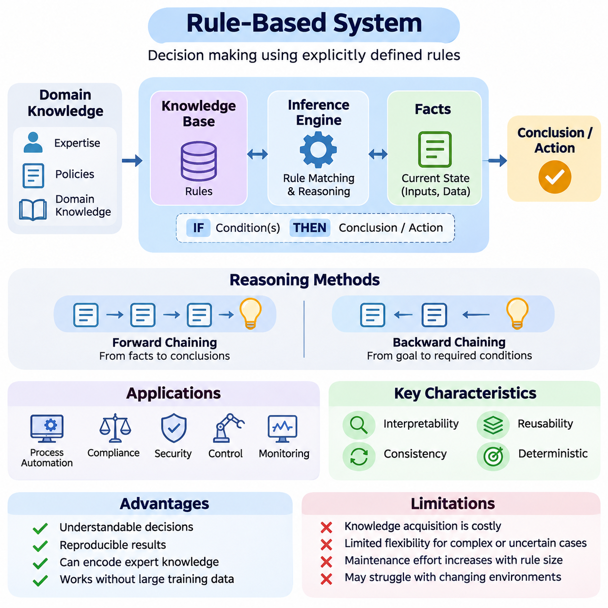{width="7.268055555555556in" height="7.268055555555556in"}

Rule-based systems represent one of the foundational approaches to artificial intelligence, enabling computers to make decisions through explicitly defined knowledge and logical conditions. Rather than learning behavior entirely from statistical patterns, these systems apply predefined rules to available facts. Their primary objective is to transform human expertise, organizational policies, and domain knowledge into consistent, executable reasoning procedures.

The fundamental principle of a rule-based system is the separation of knowledge from the mechanism that processes it. Knowledge is expressed through rules describing relationships between conditions and conclusions, while an inference engine determines which rules apply to a particular situation. This separation allows developers and domain experts to modify decision logic without redesigning the entire computational system.

A typical rule follows an IF--THEN structure, where the IF component specifies conditions and the THEN component defines a conclusion or action. For example, a monitoring system may contain the rule: IF temperature exceeds a defined threshold AND cooling is inactive, THEN generate an overheating warning. Such rules provide an understandable representation of operational knowledge and support deterministic decision-making.

Rule-based reasoning relies on facts representing the current state of a problem. Facts may originate from databases, sensors, user inputs, software applications, or previously derived conclusions. The system evaluates these facts against stored rules to identify applicable conditions. As new information becomes available, additional rules may become relevant, allowing reasoning to proceed through multiple interconnected decisions.

The knowledge base serves as the central repository of domain-specific rules and supporting information. It may contain operational policies, classification criteria, diagnostic relationships, constraints, and decision procedures. The quality of a rule-based system depends heavily on the completeness, correctness, and consistency of this knowledge, because its conclusions are constrained by the information explicitly represented.

An inference engine provides the computational mechanism that connects facts with rules. It evaluates logical conditions, identifies applicable rules, and executes reasoning procedures to produce conclusions. Depending on the system architecture, inference may involve deriving additional facts, selecting actions, or answering specific queries. The engine therefore transforms static knowledge into an operational decision-making capability.

Two fundamental reasoning approaches are forward chaining and backward chaining. Forward chaining begins with known facts and repeatedly applies relevant rules to derive new conclusions. Backward chaining begins with a desired conclusion and examines which conditions must be satisfied to establish it. These approaches support different reasoning requirements, including event-driven monitoring, diagnosis, verification, and goal-directed problem solving.

Rule-based systems belong to the broader tradition of symbolic artificial intelligence, where concepts and relationships are represented through explicit symbols. Symbolic representations make logical relationships accessible to human inspection and formal analysis. Unlike purely statistical models, conventional rule systems generally do not require large training datasets, although they require sufficient domain knowledge and carefully constructed reasoning procedures.

Historically, rule-based systems became prominent through expert systems designed to reproduce specialized human decision-making. Early applications included medical consultation, equipment diagnosis, chemical analysis, and configuration management. Systems such as MYCIN demonstrated how domain-specific rules could support complex diagnostic reasoning, while later platforms expanded rule processing into commercial and industrial applications.

The development of expert systems established an important distinction between domain knowledge and general-purpose reasoning software. A reusable inference engine could support different applications when supplied with appropriate rules and facts. This architectural principle encouraged the creation of expert-system shells and rule-engine frameworks, reducing the effort required to construct specialized knowledge-driven applications.

Modern rule-based systems extend beyond traditional expert systems into business process automation, regulatory compliance, cybersecurity, industrial control, and intelligent monitoring. Organizations use explicit rules to implement eligibility criteria, transaction validation, operational constraints, and exception handling. Their value is particularly significant when decisions must follow documented requirements and produce understandable explanations.

A major advantage of rule-based reasoning is interpretability. Because decisions originate from identifiable conditions and rules, developers can often reconstruct the sequence of reasoning that produced a conclusion. This traceability supports debugging, auditing, regulatory review, and communication with domain experts. However, understandable individual rules do not automatically guarantee that complex interactions between many rules remain easy to explain.

Consistency is another important characteristic of rule-based systems. When identical facts are evaluated under the same rule set and execution semantics, the system can produce reproducible results. This behavior is valuable in environments where standardized decisions are essential. Nevertheless, conflicting rules, incomplete information, changing facts, and execution priorities must be managed carefully to preserve predictable outcomes.

Rule-based systems also face significant limitations when operating in uncertain or rapidly changing environments. Explicit rules cannot automatically capture every possible situation, and manually maintaining extensive knowledge bases can become expensive. Unanticipated combinations of conditions may produce missing or inappropriate conclusions. These difficulties are commonly associated with knowledge acquisition, knowledge maintenance, and the scalability of symbolic reasoning.

Uncertainty presents an additional challenge because real-world information is frequently incomplete, ambiguous, or unreliable. Traditional Boolean rules evaluate conditions as true or false, but practical systems may require confidence values, probabilistic reasoning, or fuzzy logic. Such extensions allow rule-based architectures to represent uncertainty more flexibly, although they introduce additional complexity into inference and interpretation.

As rule collections grow, multiple rules may become applicable simultaneously. This situation creates a need for conflict resolution, which determines the order or priority of rule execution. Strategies may consider rule specificity, assigned priorities, recency of supporting facts, or application-defined policies. Appropriate conflict resolution is essential because different execution sequences can influence intermediate states and, in some architectures, final decisions.

Efficient rule execution is another central engineering concern. A naive inference engine may repeatedly evaluate every rule against every available fact, creating unnecessary computational overhead. More advanced implementations use structured matching techniques, indexing, and incremental evaluation to reduce repeated work. Algorithms such as RETE demonstrate how shared conditions and cached intermediate matches can improve production-rule processing efficiency.

Rule-based systems differ fundamentally from machine learning systems in how knowledge is acquired and represented. Machine learning models infer patterns from training data, whereas conventional rule systems encode relationships explicitly through human-defined logic. Rule systems often provide stronger direct traceability, while learning-based approaches can adapt to complex statistical relationships that are difficult to describe using handcrafted conditions.

These differences make hybrid architectures particularly valuable. A machine learning model may detect objects, estimate risk, or classify events, while a rule engine evaluates the resulting predictions against operational policies. For example, an autonomous robot may use neural perception to identify obstacles and symbolic rules to enforce restricted-area access conditions. The combination supports perception-driven decisions constrained by explicit knowledge.

Integration with ontologies and knowledge graphs further expands the capabilities of rule-based reasoning. Ontologies define concepts, properties, and relationships, while knowledge graphs organize interconnected entities and facts. Rules can operate over these representations to derive relationships, detect inconsistencies, or enforce domain constraints. Such integration provides a foundation for knowledge-aware applications requiring structured semantic interpretation.

In industrial environments, rule-based systems are particularly useful for safety supervision, equipment diagnostics, workflow coordination, and operational compliance. A manufacturing system may evaluate machine status, maintenance history, and production constraints before authorizing an operation. Explicit rules can provide an auditable decision layer, although safety-critical applications additionally require validated control mechanisms and appropriate engineering safeguards.

The continuing relevance of rule-based systems reflects their ability to convert explicit knowledge into repeatable computational decisions. Their effectiveness depends on sound knowledge representation, reliable inference, controlled rule execution, and systematic validation. Understanding these foundations prepares developers to examine production rules, chaining strategies, inference architectures, expert systems, optimization methods, and hybrid intelligent systems.

## 04.02 Production Rules

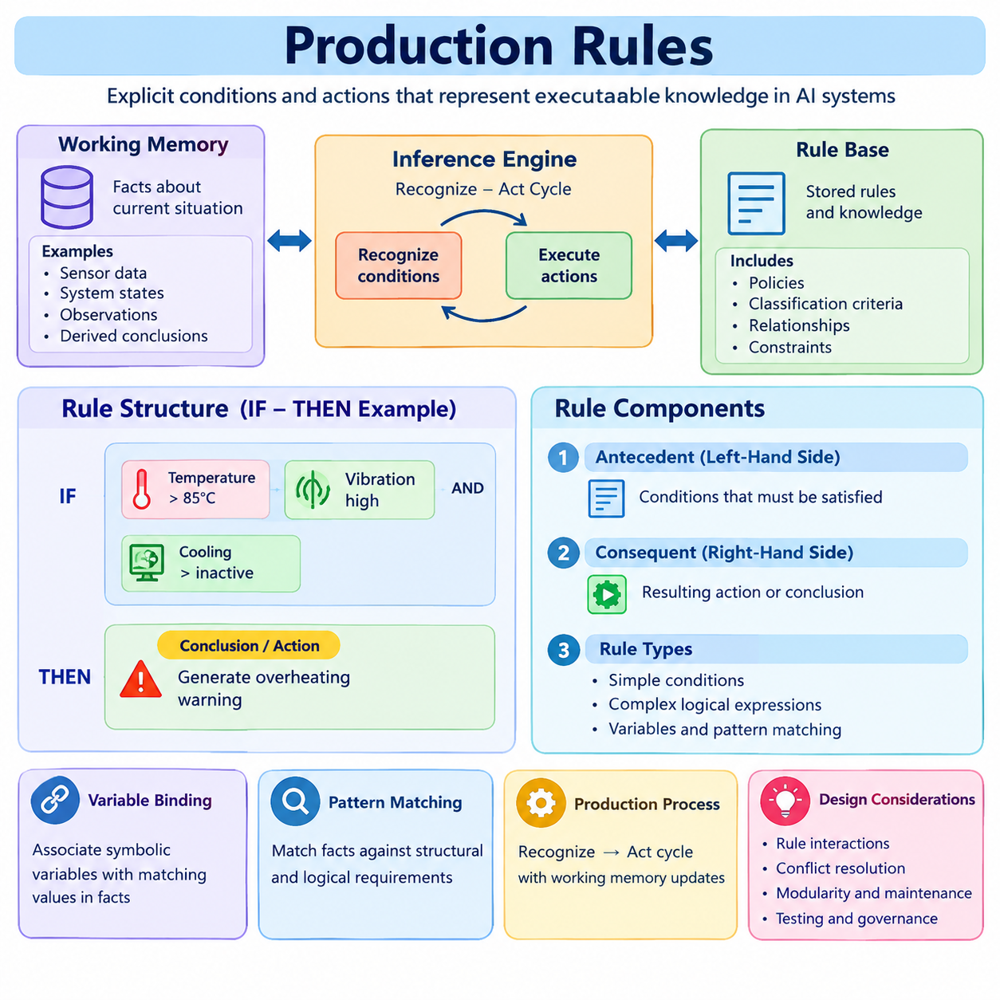{width="7.268055555555556in" height="7.268055555555556in"}

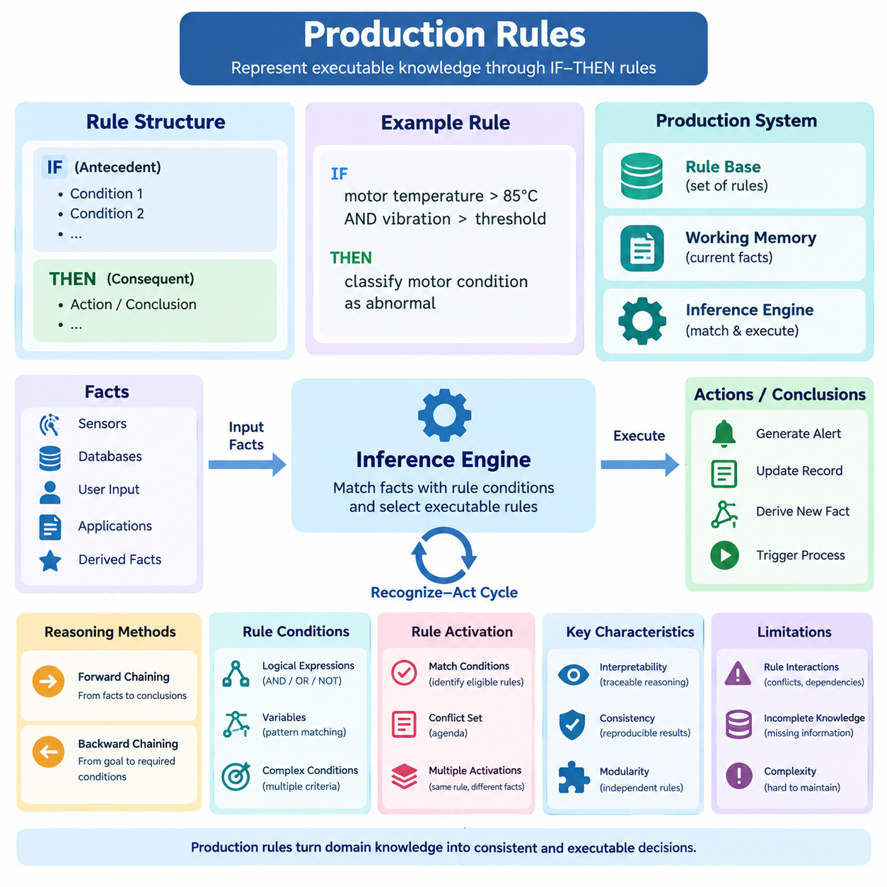{width="7.268055555555556in" height="7.268055555555556in"}

Production rules are a fundamental mechanism for representing executable knowledge in rule-based artificial intelligence systems. They express relationships between conditions and conclusions through explicit logical statements, commonly organized as IF--THEN rules. This representation enables an inference engine to examine available facts, recognize relevant situations, and perform predefined actions or derive new knowledge according to established decision policies.

A production rule consists of two principal components: an antecedent and a consequent. The antecedent, also called the left-hand side, specifies conditions that must be satisfied before the rule becomes applicable. The consequent, or right-hand side, describes the resulting action or conclusion. This separation provides a structured method for converting domain expertise into executable reasoning procedures.

For example, an industrial monitoring system may contain the rule: IF motor temperature exceeds 85 degrees Celsius AND vibration exceeds the permitted threshold, THEN classify the motor condition as abnormal. The rule does not independently measure temperature or vibration. Instead, it evaluates facts supplied by sensors or monitoring software and produces a conclusion when the specified conditions are satisfied.

Production rules operate within a production system consisting of a rule base, working memory, and an inference engine. The rule base stores available rules, while working memory contains facts describing the current environment. The inference engine compares these facts with rule conditions and determines which rules can execute. Together, these components form a dynamic mechanism for knowledge-driven decision-making.

Working memory plays an essential role because production rules evaluate information that may change during execution. Facts can represent object properties, system states, observations, or previously inferred conclusions. When a rule executes, it may add, modify, or retract facts, depending on the system\'s semantics. These changes can activate additional rules and create a sequence of interconnected reasoning operations.

The execution of production rules commonly follows a recognize--act cycle. During recognition, the inference engine identifies rules whose conditions match the current facts. During action, it selects and executes an applicable rule or group of rules. The resulting changes to working memory initiate another evaluation cycle. This process continues until a termination condition is reached or no further executable rules remain.

A rule becomes activated when its conditions match the relevant facts under the matching semantics of the engine. The collection of eligible rule activations is often called the conflict set or agenda. An activation may include a particular rule together with the facts that satisfy its conditions. This distinction matters because the same rule can match multiple combinations of facts and produce several independent activations.

Production rules can contain simple conditions or complex logical expressions. Multiple conditions may be connected through conjunction, disjunction, or negation, depending on the rule language. Variables and pattern matching allow rules to operate over different objects without requiring separate definitions for every instance. These mechanisms make production rules suitable for representing reusable relationships across large collections of structured facts.

Variable binding enables a rule to associate symbolic variables with matching values in working memory. For example, a maintenance rule may identify any machine whose operating temperature exceeds its configured limit. The variable representing the machine becomes bound to a particular equipment instance during matching. The consequent can then reference that instance when generating an alert or updating its maintenance status.

Pattern matching is therefore central to production-rule execution. The inference engine must determine whether available facts satisfy the structural and logical requirements of each rule. Matching may involve equality comparisons, numerical thresholds, object relationships, and temporal conditions. Efficient implementations avoid unnecessary repeated evaluations by organizing conditions and retaining intermediate matching results.

Production rules can produce different categories of consequences. Some derive new facts, such as assigning a diagnostic classification to an observed condition. Others initiate operational actions, including generating notifications, updating records, or requesting external services. Separating logical conclusions from side-effecting actions is important because external operations may require authorization, transaction handling, and additional safety controls.

An important distinction exists between declarative and procedural interpretations of production rules. Declarative rules emphasize logical relationships between conditions and conclusions, while procedural rules specify actions to execute when conditions hold. Many practical production systems combine these interpretations. Their behavior depends not only on rule content but also on execution order, working-memory updates, and conflict resolution policies.

Production rules support modular knowledge representation because individual rules can be developed and maintained separately. A diagnostic rule can be modified without rewriting unrelated classification or reporting logic. This modularity improves maintainability when domain requirements evolve. However, independently defined rules may interact indirectly through shared facts, creating dependencies that require systematic testing.

Rule interactions become especially important when multiple rules modify the same facts or produce contradictory conclusions. One rule may classify equipment as operational while another identifies a maintenance condition. Without appropriate priorities or consistency constraints, the system may generate incompatible results. Conflict resolution strategies and explicit knowledge-validation procedures help manage these situations.

Production-rule engines frequently employ priorities, specificity measures, and recency-based strategies to determine execution order. A highly specific rule may receive preference over a general rule, while a safety-related rule may be assigned explicit precedence. The exact strategy depends on the application and inference engine. Execution order must be documented when it can influence externally visible decisions.

Repeated rule execution introduces another challenge. If a rule continuously reproduces the same fact or alternates system states with another rule, inference may fail to terminate. Production systems therefore require mechanisms such as refraction, duplicate-fact control, execution limits, or explicit state-transition constraints. These safeguards help prevent redundant activations and unintended reasoning cycles.

Production rules are particularly effective in expert systems because they allow specialized knowledge to be expressed in a form that domain experts can inspect. Medical consultation, equipment troubleshooting, configuration management, and financial compliance are established application areas. Each application translates domain-specific relationships into conditions and consequences that an inference engine can evaluate systematically.

In robotics, production rules can coordinate symbolic decisions based on information supplied by perception and planning components. A mobile robot may apply a rule that prohibits entering a restricted zone without authorization. Another rule may request human supervision when a critical sensor becomes unavailable. Such rules provide explicit operational constraints, although real-time safety functions require independently validated enforcement mechanisms.

Modern production-rule frameworks support increasingly complex enterprise applications. CLIPS provides a language and environment for rule-based programming, while Drools supports business rules and decision automation within Java-oriented ecosystems. These platforms offer mechanisms for fact management, pattern matching, and rule execution, allowing developers to implement substantial knowledge bases without constructing every inference component independently.

The RETE algorithm is a major development in efficient production-rule matching. Rather than reevaluating every condition from the beginning after each working-memory change, RETE organizes shared tests and retains partial matches. This approach can substantially reduce repeated computation when many rules share conditions. Its memory requirements and performance characteristics nevertheless depend on rule structure and fact distributions.

Production rules also provide opportunities for explanation and auditing. An inference engine can record which facts satisfied a rule, which activation was selected, and which conclusion followed. Such execution traces help developers investigate unexpected decisions and allow domain experts to evaluate reasoning behavior. Comprehensive explanations additionally require information about rule priorities, suppressed activations, and relevant missing facts.

Despite their advantages, production rules become difficult to manage when knowledge bases contain thousands of interacting conditions. Rule duplication, inconsistent terminology, hidden dependencies, and changing requirements can reduce reliability. Effective engineering therefore requires naming conventions, version control, automated tests, rule coverage analysis, and systematic review of interactions between related rules.

Production rules remain valuable within hybrid artificial intelligence architectures. Machine learning models can transform unstructured observations into structured facts, while production rules apply explicit policies and domain constraints. Knowledge graphs and ontologies can provide additional semantic context for matching. This combination allows statistical perception and symbolic decision-making to contribute complementary capabilities within a unified system.

The effectiveness of production rules ultimately depends on the quality of their conditions, the correctness of their consequences, and the reliability of their execution environment. Well-designed rules provide modularity, transparency, and predictable reasoning under clearly defined semantics. Understanding their structure and operational behavior establishes the foundation for studying chaining methods, inference engines, conflict resolution, and advanced rule-based architectures.

## 04.03 Forward vs Backward Chaining

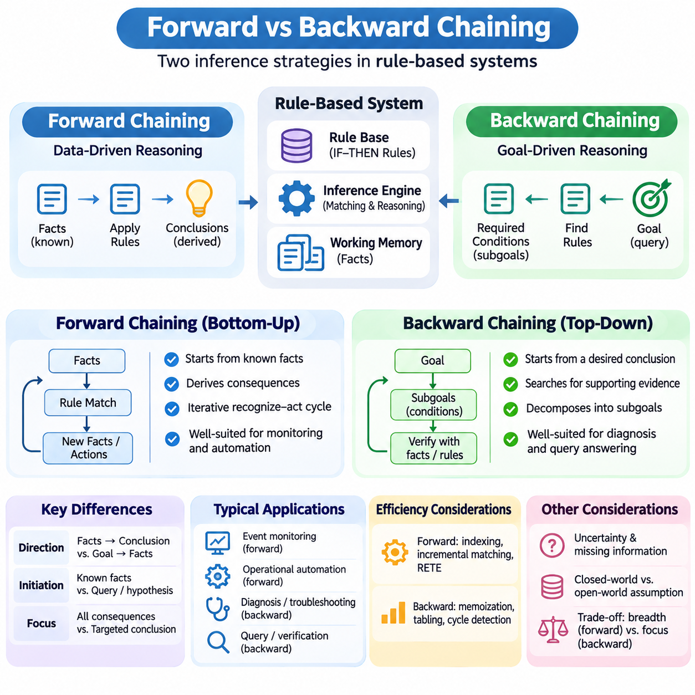{width="7.268055555555556in" height="7.268055555555556in"}

Forward chaining and backward chaining are two fundamental inference strategies used in rule-based artificial intelligence systems. Both apply logical rules to facts, but they differ in the direction of reasoning and the conditions that initiate inference. Forward chaining begins with available information and derives consequences, whereas backward chaining begins with a desired conclusion and searches for evidence that supports it.

Forward chaining is commonly described as data-driven reasoning because its execution is initiated by known facts or changes in working memory. The inference engine examines rules whose conditions match available information and derives additional facts or actions. Newly established conclusions may activate further rules, creating a sequence of reasoning steps that continues until no additional rules apply or a specified termination condition is satisfied.

Consider an industrial monitoring system that receives temperature, vibration, and operating-state measurements. A rule may classify a motor as overheated when its temperature exceeds a specified threshold. Another rule may identify an equipment fault when overheating occurs together with excessive vibration. Forward chaining progressively derives these conclusions from sensor observations without requiring a predefined diagnostic question.

The forward-chaining process typically follows a recognize--act cycle in which applicable rules are identified, selected, and executed. The inference engine maintains a collection of eligible rule activations and determines which should execute according to conflict resolution policies. Each execution may modify working memory, potentially activating additional rules. This iterative process enables dynamic reasoning over continuously changing information.

Backward chaining follows a different strategy known as goal-driven reasoning. Instead of evaluating every potentially applicable rule, the inference engine begins with a particular hypothesis or query. It searches for rules capable of establishing the desired conclusion and examines whether their conditions can be satisfied. When a required condition is not already known, the engine may treat that condition as a new subgoal.

For example, a maintenance expert system may investigate whether a particular motor requires immediate inspection. The engine first identifies rules whose conclusions indicate an inspection requirement. It then examines supporting conditions, such as abnormal temperature, excessive vibration, or critical operating status. Each condition may be verified against available facts or established through additional rules.

Backward chaining often constructs a logical dependency structure in which a primary goal is decomposed into smaller subgoals. These subgoals are evaluated recursively until they match known facts, succeed through applicable rules, or cannot be established. The reasoning process may explore alternative rules when an attempted proof fails. This structure is particularly suitable for diagnostic systems and query-oriented knowledge applications.

The central distinction between the two strategies concerns the direction of inference. Forward chaining proceeds from premises toward conclusions, exploring consequences supported by existing facts. Backward chaining proceeds from a proposed conclusion toward the premises required to establish it. Although both strategies may use the same logical knowledge base, their execution paths and computational requirements can differ substantially.

Forward chaining is particularly effective when a system must react to incoming information and identify all relevant consequences. Event monitoring, operational automation, transaction processing, and industrial supervision frequently exhibit this requirement. The system does not need to know in advance which conclusions will become important. Instead, it continuously evaluates the implications of observed changes.

Backward chaining is generally more appropriate when the system must answer a specific question or verify a particular hypothesis. Medical diagnosis, technical troubleshooting, configuration validation, and logical query processing can benefit from this approach. By concentrating on rules relevant to the requested goal, backward chaining may avoid evaluating large portions of the knowledge base that do not contribute to the current inquiry.

The efficiency of forward chaining depends on the number of facts, applicable rules, and interactions among rule conditions. A naive implementation may repeatedly examine rules even when relevant information has not changed. Advanced production-rule engines use indexing, incremental matching, and algorithms such as RETE to reduce redundant evaluations. These techniques improve performance in systems with extensive rule collections and frequently updated working memory.

Backward-chaining efficiency depends on goal structure, rule dependencies, and the order in which alternatives are explored. Recursive reasoning may revisit identical subgoals or encounter cyclic dependencies. Techniques such as memoization, tabling, goal indexing, and cycle detection can reduce repeated computation and prevent uncontrolled recursion. Their effectiveness depends on the logical language and inference semantics employed.

The treatment of uncertainty and missing information also influences both strategies. In classical logical reasoning, a conclusion is established only when sufficient premises support it under the selected semantics. Failure to derive a conclusion does not necessarily establish that the conclusion is false. This distinction is especially important in systems operating under open-world assumptions or incomplete knowledge.

Some rule engines employ closed-world assumptions, under which certain facts not established by the knowledge base are treated as false. Other systems preserve unknown states or use three-valued logic to distinguish true, false, and undetermined propositions. Forward and backward chaining can operate under different assumptions, but these choices affect the interpretation of missing evidence and the validity of conclusions.

Conflict resolution is particularly visible in forward-chaining production systems because several rules may become executable simultaneously. The engine may prioritize rules according to specificity, recency, explicit importance, or application-defined policies. Backward chaining instead commonly emphasizes goal selection and the order of alternative proofs, although procedural implementations may also apply priorities and search-control strategies.

Termination behavior represents another important engineering consideration. Forward chaining may continue indefinitely when rules repeatedly modify facts or generate new activations. Backward chaining may fail to terminate when recursive dependencies produce unbounded proof searches. Practical inference engines therefore require appropriate stopping conditions, duplicate detection, recursion management, and safeguards against unintended reasoning cycles.

The two strategies also differ in how explanations are constructed. Forward chaining can record a derivation history showing which observations activated particular rules and which conclusions followed. Backward chaining can produce a proof trace identifying the conditions required to establish a requested goal. Both forms of explanation support debugging, auditing, and expert review when the underlying inference semantics are clearly documented.

In robotics, forward chaining can process events such as obstacle detection, battery warnings, and equipment status changes. These observations may activate rules that update mission conditions or request operational responses. Backward chaining can evaluate whether a planned action is permissible by examining authorization, environmental conditions, and resource availability. Both strategies can contribute to a structured decision-support architecture.

A hybrid inference architecture may combine forward and backward chaining within the same knowledge-driven system. Forward chaining can maintain derived facts as observations arrive, while backward chaining evaluates specific questions using the accumulated knowledge. Such integration can reduce repeated reasoning and improve responsiveness, provided that fact updates, rule dependencies, and consistency requirements are managed carefully.

The relationship between chaining strategies and knowledge representation is equally important. Production rules provide executable condition--consequence relationships, while ontologies define conceptual structures and knowledge graphs represent interconnected entities. Forward chaining can materialize additional relationships from existing facts, whereas backward chaining can answer queries by proving relationships without necessarily storing every derived conclusion.

Selecting an inference strategy requires consideration of application objectives, data availability, computational resources, and expected query patterns. Forward chaining is often preferable when many consequences must be maintained after frequent data changes. Backward chaining is often preferable when relatively few goals are queried from a large knowledge base. Neither strategy is universally superior, and practical performance depends on implementation details.

In large-scale systems, forward chaining may increase storage requirements because derived facts are materialized and maintained. Backward chaining can reduce materialization costs but may introduce repeated computation when identical queries occur frequently. Incremental maintenance, caching, selective materialization, and query optimization can balance these tradeoffs according to workload characteristics and consistency requirements.

Forward and backward chaining ultimately represent complementary methods for transforming explicit knowledge into logical conclusions. Their differences arise from inference direction, activation mechanisms, computational behavior, and operational objectives. Understanding these characteristics enables developers to select suitable reasoning strategies and establish a foundation for inference engine architecture, conflict resolution, expert systems, and hybrid symbolic intelligence.

## 04.04 Inference Engine Architecture

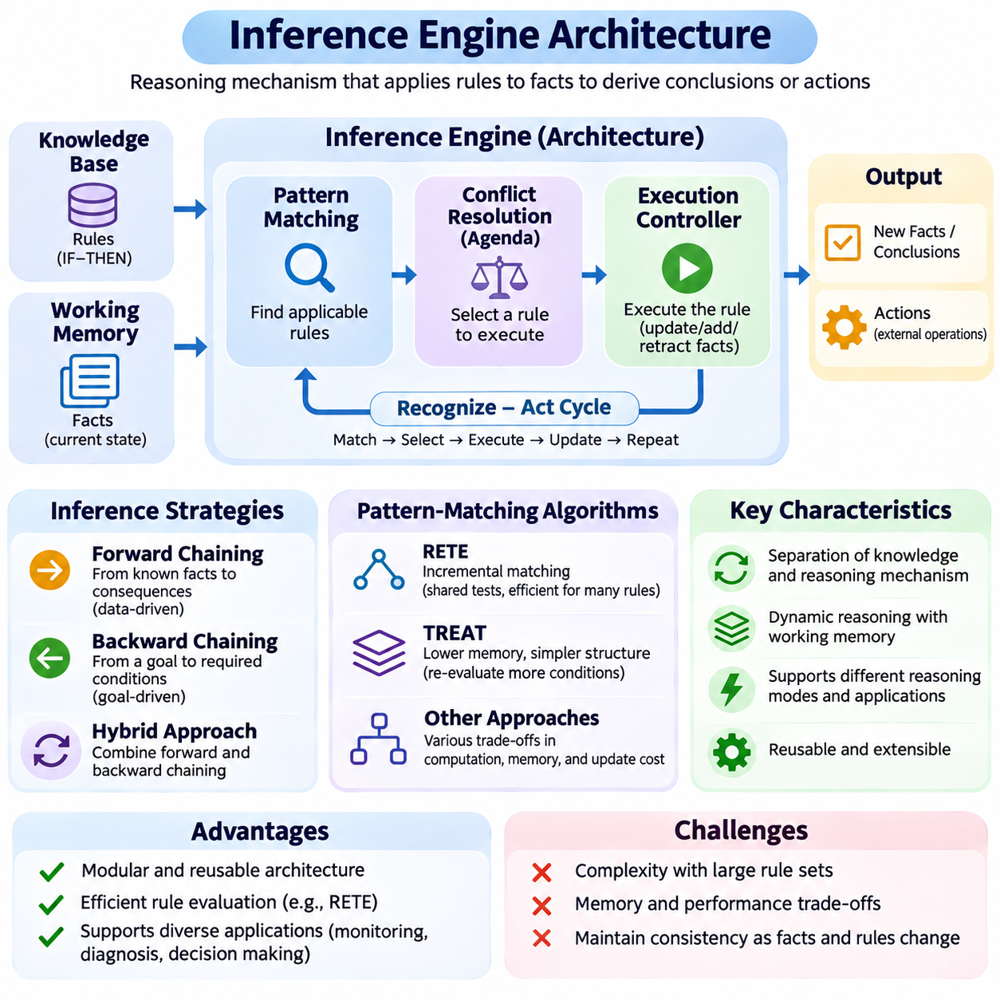{width="7.268055555555556in" height="7.268055555555556in"}

An inference engine is the central reasoning component of a rule-based artificial intelligence system, responsible for transforming stored knowledge and available facts into logical conclusions or executable actions. Its architecture defines how rules are represented, matched, selected, and executed. By separating reasoning mechanisms from domain-specific knowledge, inference engines provide reusable computational foundations for expert systems and intelligent decision-making applications.

A typical inference engine architecture consists of a knowledge base, working memory, pattern-matching mechanism, conflict resolution component, and execution controller. The knowledge base stores logical rules describing relationships between conditions and consequences. Working memory maintains facts representing the current problem state. The remaining components coordinate rule evaluation and determine how reasoning progresses through successive inference cycles.

The knowledge base serves as the persistent repository of domain-specific reasoning rules. These rules commonly follow an IF--THEN structure, where conditions define applicability and consequences specify conclusions or actions. Knowledge engineers organize rules according to application requirements, operational policies, and logical dependencies. Separating this repository from the inference mechanism allows knowledge to evolve without requiring fundamental changes to the engine.

Working memory represents the dynamic information available during reasoning. It may contain sensor observations, user inputs, database records, intermediate conclusions, and current operational states. Unlike the relatively stable knowledge base, working memory changes as new information arrives or rules execute. Its organization directly influences matching efficiency, consistency management, and the ability to trace how conclusions were derived.

The pattern-matching component determines which rules are applicable to the facts currently stored in working memory. It evaluates logical conditions, compares attributes, and establishes variable bindings between rule patterns and factual instances. Matching may involve numerical comparisons, relational constraints, and combinations of multiple conditions. Efficient matching is essential because large rule bases can otherwise require substantial repeated computation.

When several rules satisfy their conditions simultaneously, the inference engine creates a collection of eligible activations commonly called the agenda or conflict set. Each activation identifies a rule and the facts supporting its applicability. The conflict resolution component determines which activation should execute next. Selection strategies may consider explicit priorities, rule specificity, fact recency, or application-defined execution policies.

The execution controller coordinates the transition from rule selection to rule application. Depending on the rule semantics, executing a rule may derive new facts, modify existing information, retract obsolete facts, or request external operations. These changes can alter which rules remain applicable. The controller therefore manages the iterative relationship between rule execution, working-memory updates, and subsequent matching operations.

Many production-rule inference engines operate through a recognize--act cycle. During recognition, the engine identifies applicable rule activations and resolves competing candidates. During action, it executes the selected activation and updates the system state. The cycle repeats until no eligible activation remains, a designated goal is achieved, or an explicit termination condition is reached. This architecture supports dynamic and incremental reasoning.

Forward-chaining inference engines initiate reasoning from known facts and propagate their consequences through applicable rules. New observations or working-memory updates can trigger additional derivations. This architecture is well suited to event monitoring, industrial automation, and systems that must continuously maintain conclusions. Its efficiency depends on incremental matching, agenda management, and mechanisms that prevent unnecessary repeated rule execution.

Backward-chaining inference engines organize reasoning around specific goals or queries. A goal manager identifies rules capable of establishing a requested conclusion and recursively evaluates their supporting conditions. The engine may maintain a goal stack, variable bindings, and alternative proof paths. This architecture is especially useful for diagnostic systems, logical query processing, and applications requiring targeted verification rather than broad consequence generation.

Some inference architectures combine forward and backward chaining to support both event-driven and goal-directed reasoning. Forward chaining can maintain frequently needed conclusions as facts change, while backward chaining evaluates specific questions using the available knowledge. Hybrid execution requires coordination between stored derivations and query-time proofs. Consistency becomes particularly important when previously established conclusions depend on facts that have subsequently changed.

Efficient inference engines frequently employ specialized matching algorithms rather than evaluating every rule from the beginning. The RETE algorithm organizes rule conditions into a network of shared tests and intermediate matches. When facts change, only affected portions of the matching network need reevaluation. This approach can improve performance substantially, although cached partial matches may increase memory consumption.

Alternative matching architectures use different tradeoffs between computation, memory, and update frequency. RETE-derived approaches emphasize incremental reuse, while algorithms such as TREAT reduce certain intermediate storage requirements by recomputing joins when necessary. The appropriate design depends on the number of rules, fact distributions, update patterns, and available computational resources. No matching algorithm provides universally optimal performance.

Fact management is another essential architectural responsibility. The engine must distinguish newly asserted facts from previously derived conclusions and determine how changes propagate through dependent rules. Truth maintenance mechanisms can track justifications for inferred facts and retract conclusions when their supporting evidence becomes invalid. These capabilities are especially valuable in dynamic environments where observations and operational conditions frequently change.

Rule execution must also account for termination and repeated activation. Without appropriate controls, rules may continuously reproduce identical conclusions or create cyclic state transitions. Engines can employ refraction, activation histories, duplicate detection, and explicit execution limits to reduce these risks. Recursive reasoning architectures may additionally require cycle detection or tabling to avoid repeatedly exploring identical goals.

An explanation subsystem improves the transparency of inference by recording which rules were activated, which facts satisfied their conditions, and how conclusions were produced. Such information supports debugging, auditing, and expert validation. Explanation mechanisms may construct derivation traces or goal-oriented proof histories. Their reliability depends on accurate recording of inference events and the semantics governing rule execution.

Practical inference engines often include interfaces connecting the reasoning core with databases, sensors, applications, and user-facing services. An input adapter converts external observations into structured facts, while an output interface communicates conclusions or authorized actions. This separation prevents domain-specific integration details from becoming embedded in reasoning algorithms and supports reuse across different deployment environments.

In enterprise applications, inference engines may operate as independent decision services within larger software architectures. External applications submit facts or decision requests, and the engine evaluates applicable rules before returning results. Transaction management, concurrency control, access authorization, and versioned rule deployment become important operational concerns. These mechanisms help preserve reliable behavior when multiple services interact with shared decision logic.

Industrial and robotic applications introduce additional architectural constraints related to latency, reliability, and safety. An inference engine may evaluate equipment conditions, mission restrictions, or maintenance requirements using structured observations. However, rule execution latency can vary with fact changes and rule interactions. Safety-critical control therefore requires independently validated enforcement mechanisms and clearly defined timing guarantees.

Scalability depends on the interaction between rule complexity, working-memory size, matching efficiency, and execution frequency. Large systems may benefit from partitioned rule sets, selective fact subscriptions, caching, and incremental evaluation. Distributed architectures can separate reasoning workloads, but shared-state synchronization and consistency introduce additional challenges. Performance engineering must therefore consider both computational throughput and correctness.

Testing and validation are fundamental to inference engine engineering. Developers must verify rule applicability, conflict resolution behavior, fact propagation, termination conditions, and expected conclusions. Unit tests can examine individual rules, while integration tests evaluate interactions across the complete reasoning system. Execution traces and regression testing help identify unintended behavioral changes when knowledge bases or engine implementations are updated.

Modern inference engines increasingly interact with knowledge graphs, ontologies, and machine learning models. Structured semantic representations can supply facts and relationships, while learning-based components can generate predictions that become inputs to symbolic reasoning. The inference engine then applies explicit policies or logical constraints to these inputs. Such integration supports hybrid intelligent systems combining statistical perception with interpretable decision logic.

The architecture of an inference engine ultimately determines how effectively explicit knowledge becomes reliable computational behavior. Knowledge storage, working-memory management, pattern matching, conflict resolution, execution control, and explanation mechanisms must operate coherently. Understanding these architectural relationships provides the foundation for implementing scalable rule engines, evaluating reasoning performance, and developing dependable knowledge-driven artificial intelligence systems.

## 04.05 Conflict Resolution Strategies

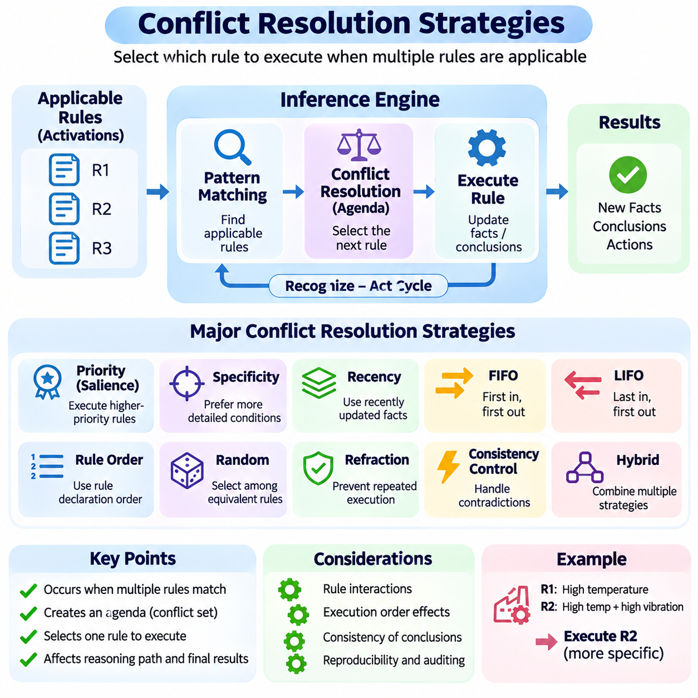{width="7.268055555555556in" height="7.268055555555556in"}

Conflict resolution strategies are essential components of rule-based inference engines because multiple rules may become applicable to the same collection of facts. When several conditions are satisfied simultaneously, the system must determine which rule should execute first. Conflict resolution establishes an execution policy that coordinates competing rule activations, maintains predictable reasoning behavior, and supports consistent decision-making across complex knowledge bases.

In a production-rule system, the inference engine identifies applicable rules through pattern matching and places their activations into an agenda or conflict set. Each activation represents a particular rule together with the facts satisfying its conditions. The conflict resolution mechanism examines these activations and selects the next candidate for execution. Its decisions can influence intermediate conclusions, working-memory changes, and subsequent rule applicability.

Conflict resolution is necessary because rule execution may change the facts used by other rules. One rule may introduce a new conclusion, another may modify an existing state, and a third may retract information that previously supported an activation. Consequently, executing the same applicable rules in different orders can produce different reasoning paths. In systems with procedural actions or nonmonotonic updates, execution order may also influence final outcomes.

Priority-based conflict resolution assigns explicit importance values to rules and selects activations according to their relative priorities. A rule handling a critical equipment fault may receive higher priority than a routine maintenance notification. This strategy provides direct control over execution order and is relatively easy to understand. However, excessive reliance on manually assigned priorities can create difficult dependencies as rule collections expand.

Many rule engines support priority attributes such as salience, allowing developers to influence agenda ordering. Higher-salience rules generally receive preference over lower-salience rules, although exact behavior depends on the engine. Salience can separate urgent responses from ordinary processing and organize phases of reasoning. Nevertheless, priority values should not replace explicit logical conditions or carefully designed operational constraints.

Specificity-based conflict resolution prefers rules containing more restrictive or detailed conditions. For example, a rule addressing high temperature, excessive vibration, and abnormal current may receive preference over a general temperature-warning rule. The underlying assumption is that more specific knowledge can provide a more appropriate response to a specialized situation. Specificity measures must be defined carefully because rule complexity does not always indicate greater importance.

Recency-based strategies consider the age or update order of facts supporting each activation. Rules matching recently asserted or modified facts may receive preference over rules relying on older information. This approach can be useful in monitoring environments where recent observations reflect changing operational conditions. However, recency alone does not guarantee correctness, especially when older facts remain authoritative or newer observations are unreliable.

Some inference engines use a first-in, first-out policy to execute activations in the order they entered the agenda. Others employ last-in, first-out ordering, giving preference to more recently created activations. These policies are straightforward to implement and can provide predictable behavior under stable activation semantics. Their suitability depends on whether the application benefits from chronological fairness or immediate processing of newly triggered reasoning paths.

Rule ordering can also serve as a conflict resolution mechanism when the engine uses the position of rules in a knowledge base as a selection criterion. Earlier or later declarations may receive preference according to implementation-specific semantics. Although this strategy is simple, it creates dependencies between source-code organization and execution behavior. Such dependencies can become difficult to maintain when rules are frequently added, reorganized, or generated automatically.

Random selection represents another possible conflict resolution strategy. When multiple activations have equivalent priority, the engine may choose among them randomly or through a randomized scheduling policy. This can help explore alternative execution paths in simulations or experimental reasoning systems. However, randomized execution complicates reproducibility and auditing unless the random seed, activation set, and selection decisions are recorded.

Refraction is an important mechanism for preventing repeated execution of the same rule activation without relevant changes. A production system may remember that a particular rule has already fired for a specific combination of facts. The engine can then suppress equivalent activations until its execution semantics permit reconsideration. Refraction reduces redundant reasoning and helps prevent infinite loops caused by rules repeatedly producing unchanged conclusions.

Conflict resolution must distinguish between competing activations and logically contradictory conclusions. Two rules may both be applicable without producing incompatible results, while contradictory conclusions may arise even when rules execute at different times. Agenda scheduling determines execution order, but logical inconsistency requires additional mechanisms such as integrity constraints, contradiction detection, or explicit policies for reconciling conflicting knowledge.

An industrial example illustrates the importance of coordinated rule execution. A monitoring system may simultaneously detect overheating, abnormal vibration, and a scheduled maintenance condition. One rule requests immediate shutdown, another generates a diagnostic alert, and another recommends routine inspection. A well-designed policy can prioritize critical protective actions while preserving diagnostic information and preventing lower-priority operations from interfering.

Safety-related conflict resolution requires particular care because rule priority alone cannot guarantee safe system behavior. A high-priority shutdown rule may still execute too late if matching or scheduling delays exceed operational limits. Safety-critical applications therefore require validated control mechanisms, bounded response times, and independent protective functions where appropriate. The inference engine should support safety supervision without becoming an unverified substitute for essential safeguards.

Complex inference engines frequently combine multiple conflict resolution criteria into a hierarchical selection policy. Explicit priority may be evaluated first, followed by specificity, recency, and a deterministic tie-breaking rule. Such combinations provide flexibility while preserving predictable execution. The complete ordering policy should be documented because interactions between criteria can produce behavior that is difficult to infer from individual rules.

Agenda groups and rule activation groups provide additional mechanisms for organizing execution. An agenda group can restrict attention to a selected collection of rules, supporting staged reasoning or workflow-specific processing. An activation group may enforce mutual exclusion by allowing only one activation from a designated group to execute. These mechanisms help structure large rule bases, although their exact semantics vary across rule-engine implementations.

Conflict resolution also interacts with forward and backward chaining. Forward-chaining engines commonly maintain agendas containing multiple eligible activations, making scheduling policies central to execution. Backward-chaining systems generally focus on goal selection, alternative proof paths, and the order in which supporting conditions are explored. Both approaches require search-control decisions, but the meaning of competition differs according to their inference architectures.

The performance of conflict resolution depends on agenda size, activation frequency, and the complexity of selection criteria. Repeatedly sorting large activation collections may introduce unnecessary computational overhead. Efficient engines can use priority queues, indexed activation structures, and incremental agenda updates. These optimizations reduce scheduling costs while preserving the execution semantics required by the application.

Dynamic rule environments introduce further challenges because facts, priorities, and rule definitions may change during execution. An activation that was valid when inserted into the agenda may become invalid after another rule modifies working memory. The engine must therefore maintain activation consistency and remove or update obsolete matches. Correct agenda maintenance is essential for avoiding actions based on outdated or unsupported conditions.

Fairness and starvation are additional considerations in long-running inference systems. A continuously arriving stream of high-priority activations may prevent lower-priority rules from executing indefinitely. Depending on application requirements, engines may employ aging policies, execution quotas, or scheduled processing windows. Such mechanisms must be balanced against urgency requirements, particularly when critical rules cannot safely be delayed.

Explainability benefits from recording why one activation was selected over competing alternatives. An execution trace can include applicable rules, supporting facts, priority values, specificity comparisons, and tie-breaking decisions. These records help developers investigate unexpected behavior and allow domain experts to verify operational policies. Transparent conflict resolution is especially valuable in regulated environments and systems requiring auditable decisions.

Testing conflict resolution requires more than verifying individual rule conditions. Developers must evaluate simultaneous activations, contradictory actions, repeated firing, fact retraction, priority changes, and termination behavior. Regression tests should examine whether rule additions alter previously established execution sequences. Simulation and systematic exploration of alternative activation orders can reveal hidden dependencies and unexpected interactions.

Conflict resolution strategies ultimately determine how a rule-based system coordinates multiple valid reasoning opportunities. Their effectiveness depends on alignment with domain requirements, clearly defined execution semantics, efficient agenda management, and systematic validation. Understanding priority, specificity, recency, refraction, and combined scheduling policies provides a foundation for building predictable inference engines and reliable expert systems.

## 04.06 Expert Systems

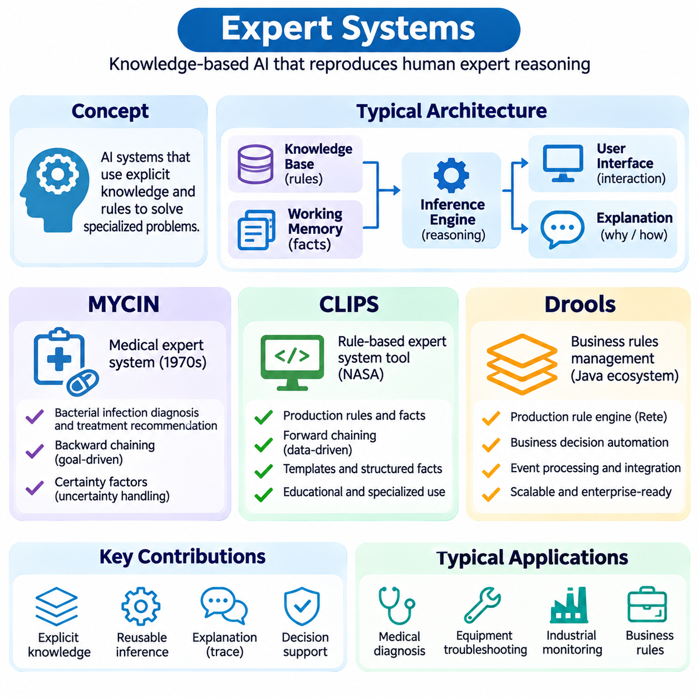{width="7.268055555555556in" height="7.268055555555556in"}

Expert systems are knowledge-based artificial intelligence applications designed to reproduce selected aspects of human expert reasoning within specialized domains. They combine explicit domain knowledge with inference mechanisms to evaluate facts, derive conclusions, and recommend actions. Their development established important principles of symbolic AI, including separation of knowledge from reasoning procedures, explanation facilities, and systematic decision support.

A conventional expert system contains a knowledge base, an inference engine, working memory, and an interface for interacting with users or external applications. The knowledge base stores domain-specific rules, while the inference engine applies those rules to available facts. Working memory maintains the current problem state. Additional components may provide explanations, knowledge acquisition tools, and mechanisms for validating the consistency of conclusions.

Expert systems became prominent during the development of symbolic artificial intelligence because they offered a practical method for encoding specialized human knowledge. Rather than requiring a program to enumerate every possible decision path, developers could represent expertise through modular rules. This approach supported medical consultation, equipment diagnosis, configuration management, and industrial troubleshooting, although maintaining large knowledge bases introduced significant engineering challenges.

MYCIN was an influential early expert system developed at Stanford University during the 1970s. It was designed to assist with diagnosing certain serious bacterial infections and recommending antimicrobial treatment. MYCIN demonstrated how specialized medical knowledge could be represented through production rules and evaluated using goal-directed inference. Its significance lies primarily in its contributions to expert-system architecture and reasoning under uncertainty.

MYCIN used backward chaining to investigate diagnostic hypotheses by examining the conditions required to support particular conclusions. The system could request additional patient information when necessary and evaluate alternative explanations using its rule base. This goal-directed process concentrated reasoning on questions relevant to the current consultation. It also demonstrated how a rule-based system could interactively gather evidence rather than relying exclusively on predefined inputs.

A distinctive feature of MYCIN was its use of certainty factors to represent degrees of belief associated with conclusions. These values allowed rules to express uncertain evidence without requiring a complete probabilistic model. Certainty-factor combination procedures supported reasoning from multiple observations, although their interpretation differed from formal probability theory. This approach became an important historical example of uncertainty management in symbolic systems.

MYCIN also incorporated explanation capabilities that allowed users to investigate why questions were being asked and how conclusions were reached. By tracing rule applications and supporting evidence, the system could expose portions of its reasoning process. These facilities helped establish explanation as a central requirement for knowledge-based applications. However, understandable reasoning traces do not independently establish the clinical validity of recommendations.

Although MYCIN demonstrated promising performance in research evaluations, it was not adopted for routine clinical deployment. Practical barriers included integration with clinical workflows, responsibility for decisions, and limitations of the operating environment. Its lasting influence extended beyond medicine through the development of reusable expert-system shells, particularly EMYCIN, which separated general inference mechanisms from application-specific medical knowledge.

CLIPS, the C Language Integrated Production System, was developed at NASA as a tool for constructing expert systems and other rule-based applications. It provides a programming environment centered on production rules, facts, and inference mechanisms. CLIPS supports knowledge representation through rules and structured data while allowing developers to implement reasoning behavior without building an inference engine from the beginning.

The CLIPS execution model is primarily based on forward chaining. Facts are asserted into working memory, and rules whose conditions match those facts become eligible for execution. An agenda manages applicable activations, while conflict resolution strategies determine execution order. Rule actions can modify working memory, triggering further inference. This architecture is particularly appropriate for classification, monitoring, configuration, and procedural decision automation.

CLIPS supports structured fact representations, including templates that define named attributes and their values. Rules can match these structures using variables, constraints, and logical conditions. This enables reusable knowledge representations across multiple objects and situations. CLIPS also provides procedural programming capabilities, allowing symbolic reasoning to interact with calculations, control structures, and application-specific operations.

An important strength of CLIPS is its relatively clear separation between knowledge representation and inference execution. Developers can organize domain expertise into rule modules, inspect facts, and examine rule activations during debugging. Its established rule-processing mechanisms make it useful for educational demonstrations and specialized embedded applications. Nevertheless, integration requirements and system complexity must be evaluated for each deployment.

Drools is an open-source business rules management and decision automation technology associated with the Java ecosystem. It enables developers to externalize decision logic from conventional application code and represent policies through executable rules. Drools is frequently used in enterprise environments where business requirements change independently of core software functionality and where consistent application of decision policies is important.

The Drools rule engine supports declarative rule definitions, structured facts, and pattern matching over application data. Rules commonly express conditions involving Java objects and corresponding actions when those conditions are satisfied. The engine evaluates applicable rules and manages their execution according to its agenda semantics. This design allows business policies to be maintained separately from much of the surrounding application logic.

Drools incorporates optimized rule-matching techniques derived from production-system research, including RETE-related approaches and its Phreak execution algorithm. These mechanisms reduce unnecessary repeated evaluation and support complex relationships among facts. Performance nevertheless depends on rule structure, data volume, update patterns, and execution configuration. Effective engineering requires benchmarking representative workloads rather than assuming that optimization is automatic.

Drools also supports decision modeling capabilities through its broader ecosystem, including integration with Decision Model and Notation, or DMN, in supported configurations. Decision tables and structured decision models can make certain business policies easier to maintain than large collections of handwritten rules. Such approaches are useful for eligibility assessment, pricing policies, regulatory checks, and workflow decisions requiring transparent organizational governance.

The architectural differences between MYCIN, CLIPS, and Drools reflect distinct stages in the evolution of expert systems. MYCIN emphasized specialized medical reasoning, uncertainty representation, and interactive explanation. CLIPS established a reusable production-rule programming environment with forward-chaining execution. Drools extended rule-based reasoning into enterprise software integration and business decision management, demonstrating the continuing adaptability of symbolic inference.

Their inference strategies also illustrate different operational requirements. MYCIN used backward chaining to evaluate specific diagnostic goals, whereas CLIPS and conventional Drools rule execution emphasize forward-chaining production rules. Goal-directed reasoning can reduce exploration when questions are narrowly defined. Data-driven reasoning can respond to changing facts and maintain multiple consequences, although scheduling and fact-management complexity may increase.

Knowledge acquisition remains a central challenge across expert-system architectures. Domain experts may express knowledge through informal explanations, exceptions, and context-dependent judgments that are difficult to convert into precise rules. Knowledge engineers must identify relevant concepts, resolve ambiguous terminology, and validate logical relationships. Poorly specified rules can produce incorrect conclusions regardless of the sophistication of the inference engine.

Verification and validation are equally important because a functioning rule engine does not guarantee that its knowledge is correct. Developers must test individual rules, interactions among rules, contradictory conclusions, and unexpected input conditions. Domain experts should review whether recommendations remain appropriate under realistic operating circumstances. Traceable execution histories and regression tests help identify unintended changes when knowledge bases evolve.

Modern expert systems increasingly operate alongside databases, knowledge graphs, ontologies, and machine learning models. Learning-based components can transform unstructured observations into structured facts, while symbolic rules apply explicit policies and domain constraints. This combination is valuable when decisions require both statistical interpretation and auditable reasoning. However, uncertainty in model predictions must be handled explicitly rather than treated as unquestionable factual evidence.

In industrial and robotic applications, expert-system techniques can support equipment diagnosis, maintenance recommendations, operational policy enforcement, and mission supervision. A rule engine may combine sensor states, equipment histories, and authorization conditions to recommend actions. Such systems provide interpretable decision support, but safety-critical control requires independently validated safeguards and clearly defined responsibility for execution.

The historical and practical contributions of MYCIN, CLIPS, and Drools demonstrate the enduring importance of explicit knowledge representation. Their architectures illustrate how inference strategies, rule management, uncertainty handling, and software integration evolve according to application requirements. Understanding these systems provides a foundation for implementing rule engines, evaluating expert-system limitations, and designing reliable hybrid knowledge-based AI applications.

## 04.07 Rule Engine Implementation

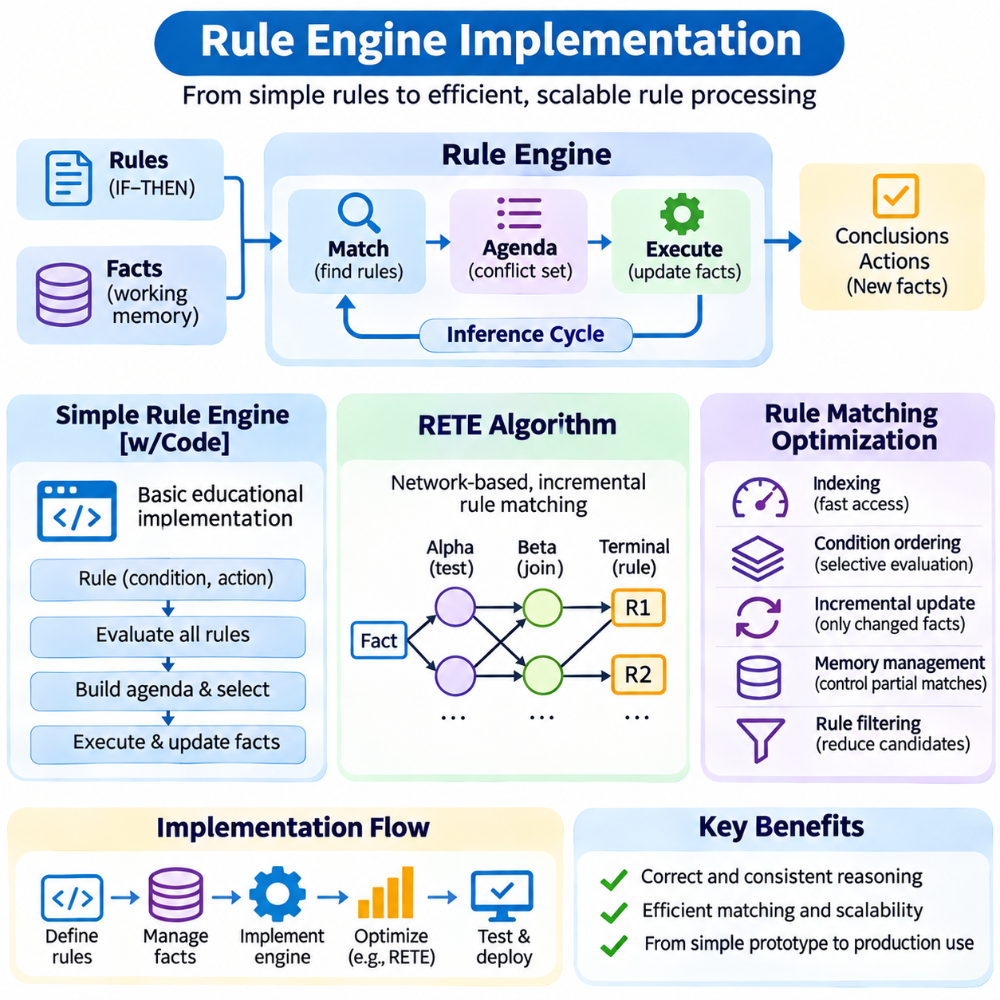{width="7.268055555555556in" height="7.268055555555556in"}

Rule engine implementation transforms declarative knowledge into executable reasoning through a combination of fact storage, condition evaluation, activation scheduling, and rule execution. A practical implementation must determine how rules are represented, how facts are matched against conditions, and how conclusions modify system state. These responsibilities form the foundation of both simple educational rule engines and optimized production systems.

A simple rule engine can be constructed using a collection of IF--THEN rules and a working memory containing structured facts. Each rule defines a condition that determines applicability and an action that executes when the condition is satisfied. The inference engine repeatedly examines available rules, evaluates their conditions, and applies selected actions. This design provides a transparent starting point for understanding symbolic reasoning.

In a Python implementation, facts may be represented using dictionaries, objects, or structured records, while rules may be implemented as functions or declarative data structures. A condition function evaluates relevant facts and returns whether a rule is applicable. An action function produces a conclusion or requests a state change. Separating conditions from actions improves testability and reduces dependencies between knowledge representation and execution logic.

The simplest execution strategy evaluates every rule against the current working memory during each inference cycle. Applicable rules are collected into an agenda, and a conflict resolution policy determines execution order. After a rule executes, the engine updates working memory and begins another evaluation cycle. Although straightforward, this approach becomes computationally expensive when many rules repeatedly inspect unchanged facts.

Fact management is an essential responsibility even in small implementations. The engine must support inserting, updating, retrieving, and retracting facts while maintaining consistent representations. Each fact should have a clearly defined identity or matching key to distinguish updates from duplicates. Without such controls, repeated rule execution may generate redundant conclusions, inconsistent states, or uncontrolled growth of working memory.

A basic rule engine also requires termination mechanisms. Rules that continuously assert identical facts or alternate between conflicting states can create infinite execution cycles. Duplicate detection, activation histories, execution limits, and explicit stopping conditions help prevent these failures. For deterministic behavior, the engine should define how competing activations are ordered and whether previously executed rule--fact combinations may execute again.

Rule conditions often involve multiple facts rather than a single Boolean expression. For example, an equipment diagnostic rule may require high temperature, excessive vibration, and an active operating state. The engine must identify fact combinations satisfying all conditions and preserve variable bindings across those combinations. This requirement introduces relational matching operations that become increasingly expensive as working memory grows.

The computational limitations of naive matching motivated the development of specialized production-rule algorithms. Instead of reevaluating every condition after each change, optimized engines retain information about previous matches. Incremental evaluation processes only the consequences of inserted, modified, or removed facts. This principle is central to RETE and related algorithms, which organize rule matching into reusable computational structures.

The RETE algorithm represents rule conditions as a network of interconnected matching nodes. Incoming facts pass through tests that determine whether they satisfy relevant constraints. Shared conditions can be evaluated once and reused by multiple rules. Intermediate matches are stored and combined as additional conditions become satisfied. This network-based organization reduces redundant computation across inference cycles.

Alpha nodes perform tests involving individual facts, such as checking object types, attribute values, or numerical thresholds. Facts satisfying these conditions may be stored in alpha memories for reuse. When multiple rules require identical tests, shared alpha structures can reduce duplicated work. The effectiveness of this sharing depends on the representation of rule conditions and the ability to identify equivalent predicates.

Beta nodes combine partial matches from multiple conditions, often using join operations over shared variables. For example, a rule may match a machine fact with a maintenance record referring to the same equipment identifier. Beta memories retain intermediate combinations so that later fact changes do not require complete recomputation. These structures are powerful but can consume substantial memory when many combinations satisfy broad conditions.

Terminal nodes represent complete matches for particular rules. When all required conditions are satisfied, the matching network produces an activation associated with the corresponding rule and supporting facts. The activation enters an agenda where execution priorities and conflict resolution strategies determine scheduling. This separation between matching and execution allows the engine to manage reasoning independently of the rule-selection policy.

Incremental updates are a defining characteristic of RETE-based processing. When a new fact is asserted, the engine propagates its effects through relevant network nodes and creates newly supported matches. When a fact is retracted, dependent partial matches and activations must be invalidated. Correct propagation is essential because stale matches can cause rules to execute using information that is no longer valid.

RETE improves matching efficiency by exchanging additional memory consumption for reduced repeated computation. Its advantages are particularly significant when rules share conditions and facts change incrementally. However, broad joins and large intermediate memories can create substantial overhead. Therefore, RETE should not be assumed superior for every workload, especially when rule collections are small or working memory is frequently replaced.

Rule matching optimization begins with reducing unnecessary condition evaluations. Selective predicates should be applied early when their placement can reduce the number of candidate matches. Attribute indexing can accelerate equality and range comparisons, while hash-based joins can improve matching between related facts. These techniques reduce the number of combinations examined without changing the intended logical meaning of rules.

Condition ordering is another important optimization technique. A rule containing several predicates may be evaluated more efficiently when restrictive conditions eliminate irrelevant candidates before expensive joins occur. However, reordering must preserve logical semantics, variable dependencies, and the behavior of negation or procedural conditions. An optimization that changes rule meaning is not a valid performance improvement.

Rule indexing organizes conditions according to attributes, fact types, or commonly queried values. Instead of scanning every rule when a fact changes, the engine identifies rules potentially affected by the updated information. This approach is especially useful when knowledge bases contain many unrelated rule categories. Efficient indexing requires balancing lookup speed against memory overhead and the cost of maintaining indexes during updates.

Caching and memoization can further reduce repeated reasoning by preserving previously computed condition results or derived conclusions. Cached information must be invalidated when supporting facts change, otherwise the engine may return outdated results. Dependency tracking and truth maintenance mechanisms can identify which conclusions rely on modified evidence. These capabilities are essential for reliable incremental reasoning in dynamic applications.

Optimization must also consider agenda management and rule execution overhead. Efficient priority queues can reduce the cost of selecting activations, while duplicate suppression prevents repeated scheduling of equivalent rule--fact combinations. Batching compatible fact updates may reduce unnecessary intermediate evaluations. However, batching can delay observable conclusions, making latency requirements important when choosing execution strategies.

Performance evaluation should measure matching latency, inference throughput, memory consumption, activation counts, and the cost of fact insertion or retraction. Benchmarks should include realistic rule structures and representative fact distributions. A small synthetic example may not reveal expensive joins, memory growth, or activation storms. Comparing naive matching with RETE-based execution helps identify when architectural complexity produces measurable benefits.

Testing a rule engine requires verifying both logical correctness and operational behavior. Developers should examine rule applicability, variable binding, conflict resolution, fact updates, duplicate handling, and termination. Differential testing can compare optimized matching results against a simpler reference implementation. Regression tests are particularly important because changes to indexing or network sharing may introduce subtle matching errors.

In industrial and robotic systems, rule engines may process equipment states, diagnostic observations, operational restrictions, and mission conditions. Optimized matching can support frequent updates from structured sensor data, while explicit rules preserve interpretable decision logic. Nevertheless, computational efficiency does not independently guarantee bounded response times. Safety-critical functions require validated timing behavior and appropriate independent safeguards.

A well-designed rule engine balances implementation simplicity, matching efficiency, memory requirements, and correctness. Simple engines provide accessible foundations for understanding inference cycles, while RETE introduces incremental matching and reusable condition networks. Rule matching optimization extends these principles through indexing, selective evaluation, caching, and efficient scheduling. Together, these techniques support scalable and dependable knowledge-driven reasoning systems.

## 04.08 Rule Based vs ML

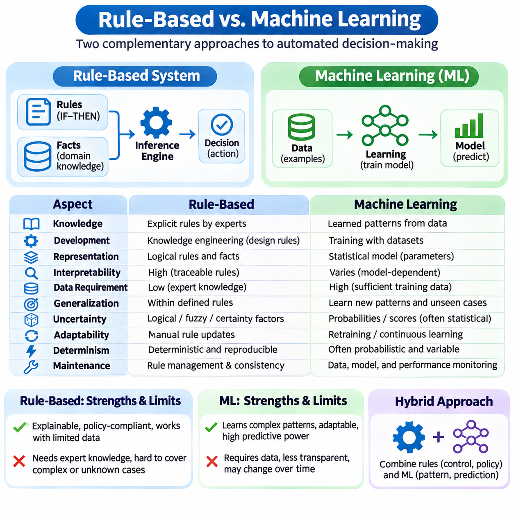{width="7.268055555555556in" height="7.268055555555556in"}

Rule-based systems and machine learning represent two major approaches to artificial intelligence that differ in how knowledge is acquired, represented, and applied. Rule-based systems use explicitly defined logical conditions and actions, while machine learning models derive statistical relationships from data. Both approaches support automated decision-making, but their effectiveness depends on problem structure, knowledge availability, uncertainty, and operational requirements.

Rule-based systems represent knowledge through human-authored rules, logical expressions, and structured facts. Their behavior follows inference procedures that determine which rules apply to a given situation. Machine learning systems instead construct predictive functions by optimizing model parameters against training data. This distinction separates explicit knowledge engineering from data-driven learning, although practical applications may combine both methods.

Knowledge acquisition is a fundamental difference between the approaches. Rule-based development requires domain experts and knowledge engineers to identify concepts, conditions, exceptions, and decision policies. Machine learning requires representative datasets, suitable learning objectives, and training procedures. Rules can be effective when expertise is well understood, whereas learning is attractive when relevant patterns are difficult to express manually.

The representation of knowledge also differs significantly. A rule-based system may express that excessive temperature combined with abnormal vibration requires equipment inspection. A machine learning model may learn a relationship between sensor measurements and failure probabilities from historical observations. The rule provides an explicit decision condition, while the learned model captures statistical associations that may be difficult to interpret directly.

Interpretability is a traditional strength of rule-based systems because their decisions can often be traced to identifiable conditions and rule activations. Developers can inspect which facts triggered a conclusion and explain the corresponding reasoning path. Machine learning interpretability varies considerably across model families. Decision trees may be relatively transparent, while large neural networks often require additional explanation techniques.

However, explicit rules do not automatically guarantee understandable or correct decisions. Large rule bases can contain complicated dependencies, overlapping conditions, and unexpected interactions. Similarly, machine learning models are not universally opaque, since interpretable architectures and constrained models can provide meaningful explanations. Explainability should therefore be evaluated at the complete system level rather than assumed from the underlying technology.

Data requirements create another important distinction. Rule-based systems can operate without extensive labeled datasets when reliable domain knowledge is available. Machine learning models generally require sufficient training examples to estimate useful relationships and generalize beyond observed cases. The amount of required data depends on model complexity, task difficulty, prior knowledge, and whether pretrained representations are available.

Generalization describes how a system handles situations not explicitly encountered during development. Machine learning models can generalize from training examples when their learned representations capture relevant patterns. Rule-based systems typically generalize through the scope of their conditions and logical relationships. They may handle unseen combinations of known facts, but entirely new concepts or unmodeled exceptions often require additional knowledge.

Uncertainty management also distinguishes these approaches. Traditional rule engines commonly evaluate conditions using discrete logical values, although probabilistic rules, fuzzy logic, and certainty factors can represent uncertainty. Machine learning models frequently produce numerical predictions, scores, or estimated probabilities. These outputs are not necessarily calibrated, and their interpretation depends on training objectives and evaluation methods.

Adaptability is often associated with machine learning because models can be retrained or updated using new observations. Rule-based systems usually require explicit modifications to their knowledge bases when policies or domain assumptions change. Nevertheless, machine learning adaptation introduces risks such as catastrophic forgetting, distribution shift, and performance regression. Rule updates also require validation because local changes can affect distant inference paths.

Computational requirements depend on the implementation and workload rather than a simple distinction between symbolic and statistical methods. Small rule engines may execute efficiently on limited hardware, while large knowledge bases can incur substantial matching costs. Machine learning training may require considerable computational resources, although optimized inference models can run efficiently on embedded devices. Both approaches benefit from profiling and targeted optimization.

Maintenance introduces different engineering challenges. Rule-based systems require version control for rules, dependency analysis, conflict resolution, and regression testing. Machine learning systems require dataset management, model versioning, monitoring, retraining, and evaluation against changing conditions. Neither approach eliminates maintenance costs. The appropriate choice depends on whether knowledge changes primarily through explicit policy revisions or evolving empirical patterns.

Determinism is another consideration for operational systems. Given identical facts, rules, engine semantics, and execution configuration, a rule-based system can produce reproducible results. Machine learning inference can also be deterministic under controlled conditions, although hardware operations and stochastic procedures may introduce variation. Reproducibility therefore depends on implementation discipline rather than exclusively on the reasoning paradigm.

Rule-based systems are especially suitable for explicit regulations, contractual requirements, operational policies, and clearly defined safety constraints. Their declarative structure supports direct inspection of requirements and controlled policy changes. Machine learning is often better suited to perception, pattern recognition, anomaly detection, and complex relationships involving high-dimensional observations. These distinctions reflect typical strengths rather than absolute boundaries.

In industrial diagnostics, a rule-based engine may detect a prohibited operating condition using fixed temperature and pressure limits. A machine learning model may estimate equipment degradation from vibration spectra and historical maintenance records. The rule provides a defined operational response, while the model identifies patterns that may precede failure. Combining both can improve decision support when their respective limitations are addressed.

Robotics provides another example of complementary capabilities. Machine learning can support object detection, semantic segmentation, terrain classification, and learned motion policies. Rule-based reasoning can enforce mission restrictions, validate operating modes, and coordinate high-level decisions. However, safety-critical control must rely on appropriately verified mechanisms, since neither explicit rules nor learned predictions automatically guarantee safe physical behavior.

Evaluation methods must reflect the differences between the approaches. Rule-based systems are commonly assessed through rule coverage, logical consistency, execution correctness, and scenario-based testing. Machine learning models are evaluated using task-specific predictive metrics, robustness tests, and generalization performance. Hybrid systems require additional evaluation of interfaces, error propagation, and conflicts between symbolic and learned components.

Failure modes also differ. Rule-based systems may fail because knowledge is incomplete, rules contradict one another, or conditions do not capture exceptional situations. Machine learning systems may fail because of biased datasets, distribution shifts, spurious correlations, or unreliable predictions. Both can produce confident but incorrect outcomes. Reliable deployment requires explicit failure analysis, uncertainty handling, and monitoring.

Scalability must be considered in terms of both computational complexity and knowledge growth. Rule engines can become difficult to maintain as rule interactions increase, even when matching algorithms such as RETE improve execution efficiency. Machine learning systems may scale through larger datasets and model capacities, but training costs and data governance challenges also increase. Architectural scalability does not necessarily imply easier maintenance.

Hybrid approaches combine the strengths of symbolic rules and statistical learning. A machine learning model may convert raw sensor signals into structured observations, which a rule engine evaluates against operational policies. Conversely, rules may constrain model outputs, select appropriate models, or trigger additional data collection. Such integration requires clear interfaces and careful treatment of prediction uncertainty to avoid propagating unsupported assumptions.

The choice between rule-based systems and machine learning should begin with the nature of the problem rather than a preference for a particular technology. Explicit and stable requirements often favor rules, while complex empirical patterns often favor learning. When applications require both perceptual intelligence and enforceable policies, hybrid architectures may be appropriate. Selection should account for accuracy, transparency, data availability, latency, maintenance, and risk.

Ultimately, rule-based reasoning and machine learning are complementary foundations of intelligent systems. Symbolic methods provide explicit knowledge structures and controllable inference, while statistical methods provide mechanisms for learning patterns from observations. Understanding their differences enables engineers to assign responsibilities appropriately, evaluate limitations systematically, and develop AI systems that balance adaptability, interpretability, and operational reliability.

## 04.09 Hybrid Rule Systems

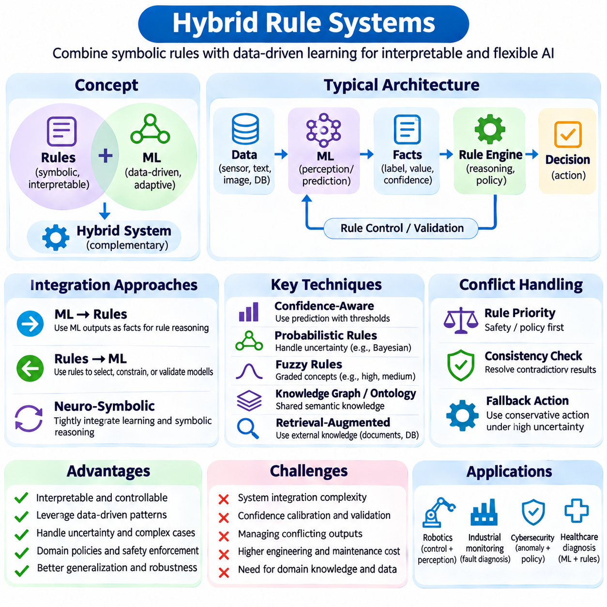{width="7.268055555555556in" height="7.268055555555556in"}

Hybrid rule systems combine explicit symbolic reasoning with statistical learning, probabilistic inference, and adaptive decision mechanisms. Their purpose is to preserve the transparency and controllability of rule-based logic while incorporating the flexibility of data-driven models. These systems are particularly valuable when applications require both interpretation of complex observations and enforcement of clearly defined operational policies.

Traditional rule engines evaluate structured facts against predefined logical conditions, whereas machine learning models infer patterns from historical data. A hybrid architecture connects these capabilities through interfaces that transform predictions into usable knowledge. The rule engine can then evaluate learned observations alongside verified facts, domain constraints, and contextual information to produce decisions that neither component could reliably support alone.

A common architecture places machine learning components before the symbolic inference engine. Neural networks may classify images, detect anomalies, recognize activities, or estimate equipment conditions. Their outputs are converted into structured facts containing labels, numerical values, timestamps, and confidence estimates. The rule engine evaluates these facts using domain-specific conditions and determines whether additional reasoning or action is required.

Another architecture uses symbolic rules to supervise machine learning behavior. Rules can select models, restrict available actions, validate outputs, or trigger additional observations when uncertainty exceeds acceptable limits. For example, a robotic system may use learned terrain classification while applying explicit restrictions on permitted operating modes. This arrangement separates statistical interpretation from operational authorization and policy enforcement.

Knowledge representation is central to successful hybrid integration. Symbolic components require consistent entities, attributes, relationships, and logical predicates, while learning components commonly produce vectors, probabilities, and continuous measurements. A semantic transformation layer maps numerical predictions into structured representations. This mapping must preserve relevant uncertainty and avoid treating estimated categories as unquestionable facts.

Confidence-aware reasoning allows hybrid systems to account for uncertainty in learned predictions. A rule may require both a classification result and a minimum confidence threshold before recommending an action. However, confidence scores are not necessarily calibrated probabilities, and thresholds must be validated against representative data. Critical decisions may require additional evidence, independent verification, or conservative fallback behavior rather than simple threshold comparisons.

Probabilistic rule systems extend conventional symbolic reasoning by associating uncertainty with facts, relationships, or logical conclusions. Bayesian networks, probabilistic logic programming, and related methods can combine structured dependencies with uncertain evidence. These approaches provide alternatives to purely Boolean inference, although their computational requirements and assumptions vary. Their usefulness depends on whether uncertainty can be represented and evaluated consistently.

Fuzzy rule systems provide another hybrid approach by combining linguistic conditions with continuous membership values. Instead of treating temperature as exclusively normal or abnormal, fuzzy membership functions can represent intermediate states. Rules may combine concepts such as moderately high temperature and increasing vibration to derive graded recommendations. Fuzzy inference is especially useful when operational categories have gradual boundaries rather than precise thresholds.

Neuro-symbolic systems integrate neural representations with symbolic knowledge and reasoning. Neural components can learn features from raw observations, while symbolic components encode relationships, constraints, and compositional structures. Integration may occur through sequential pipelines, constrained optimization, differentiable reasoning, or shared representations. These methods aim to improve generalization and structured decision-making without assuming that learned representations are inherently interpretable.

Knowledge graphs and ontologies can serve as shared semantic foundations for hybrid rule systems. A knowledge graph represents entities and relationships, while an ontology defines concepts, properties, and logical restrictions. Machine learning components may populate or update graph information, and rules can infer additional relationships or detect inconsistencies. Provenance tracking is necessary to distinguish verified knowledge from automatically extracted or predicted information.

Hybrid architectures also support retrieval-augmented reasoning. A retrieval system may locate relevant documents, database records, or knowledge graph facts before the rule engine evaluates a decision. Language models can assist with extracting candidate facts or interpreting user requests, but their outputs require validation before entering authoritative rule execution. This separation reduces the risk of unsupported generated statements being treated as established knowledge.

Conflict resolution becomes more complex when symbolic rules and learned components recommend different actions. A prediction model may identify an apparently safe condition while an explicit operational rule prohibits the corresponding action. The system must define which constraints are authoritative and how contradictory evidence is handled. Safety restrictions and mandatory policies should not be overridden solely because a statistical model produces a high confidence score.

Temporal reasoning is important in hybrid systems that process continuously changing observations. Sensor measurements, predictions, and rule conclusions may become outdated at different rates. Facts should therefore include timestamps, validity intervals, and source information where appropriate. The inference engine must invalidate stale evidence and reconsider conclusions when new observations arrive. Without temporal consistency, correct individual components can still produce incorrect combined decisions.

Feedback mechanisms allow hybrid systems to improve through operational experience. Rule-triggered outcomes can be logged and used to evaluate prediction quality, while repeated exceptions may reveal missing domain knowledge. Learning models can be retrained using validated observations, and rules can be revised through controlled knowledge engineering. These processes should remain distinguishable because statistical model updates and policy changes require different forms of approval.

An industrial predictive maintenance system illustrates the practical value of hybrid reasoning. A machine learning model may estimate bearing degradation from vibration and temperature histories, while a rule engine evaluates maintenance schedules, equipment criticality, and operating restrictions. The combined system can recommend inspection or controlled shutdown according to explicit policies. Its reliability depends on validated predictions, current facts, and appropriate operational safeguards.

In autonomous robotics, perception models can identify objects, estimate traversability, and recognize environmental conditions. A symbolic layer can evaluate mission objectives, authorization constraints, and task dependencies before selecting permissible actions. Planning components may combine learned cost estimates with explicit logical restrictions. This division of responsibilities supports interpretable supervision while allowing perception and prediction to adapt to complex environments.

Enterprise applications use hybrid rule systems to coordinate predictive analytics with business policies. Fraud detection, insurance assessment, eligibility screening, and workflow automation may combine statistical risk estimates with explicit decision rules. A model can prioritize cases requiring investigation, while rules enforce procedural requirements and documentation obligations. Governance mechanisms must ensure that learned predictions do not silently replace legally or organizationally required decision criteria.

System architecture should separate data acquisition, model inference, semantic transformation, rule evaluation, and action execution into clearly defined components. Each interface needs explicit data schemas, validation requirements, and failure-handling procedures. This modular design allows independent testing and replacement of components. However, integration complexity increases when updates, uncertainties, and dependencies cross component boundaries.

Performance optimization must consider both statistical inference latency and symbolic rule-matching costs. Neural inference may dominate computation, while large rule bases can create expensive joins and activation scheduling overhead. Caching, incremental matching, asynchronous processing, and selective model execution can improve efficiency. These optimizations must preserve required data consistency and response deadlines, especially in real-time operational environments.

Explainability requires connecting learned evidence to symbolic conclusions. A useful explanation may identify the model output, its uncertainty, the supporting observations, the rules that fired, and the policy determining the final action. Such traces help operators understand decisions and investigate failures. Nevertheless, a transparent rule trace does not explain the internal behavior of an opaque model or establish that its prediction is correct.

Verification and validation must examine individual components and their interactions. Machine learning models require robustness and generalization testing, while rule engines require logical consistency and execution testing. Integrated evaluations should include uncertain predictions, conflicting recommendations, missing observations, stale facts, and distribution shifts. Safety-critical applications additionally require validated protective mechanisms independent of unverified learned reasoning.

Governance is essential because hybrid systems combine different sources of authority. Domain experts may own policy rules, data scientists may manage predictive models, and system engineers may control execution interfaces. Versioning, provenance records, access controls, and approval procedures should identify responsibility for each change. Reproducible decision logs help distinguish failures caused by incorrect predictions, outdated rules, or integration defects.

Hybrid rule systems ultimately provide a framework for combining explicit knowledge with adaptive intelligence. Their effectiveness depends on disciplined knowledge representation, uncertainty management, conflict resolution, modular engineering, and continuous validation. By assigning statistical models to perception and prediction while retaining symbolic mechanisms for constraints and structured reasoning, engineers can develop AI applications that are flexible, interpretable, and operationally dependable.

## 04.10 Case Study

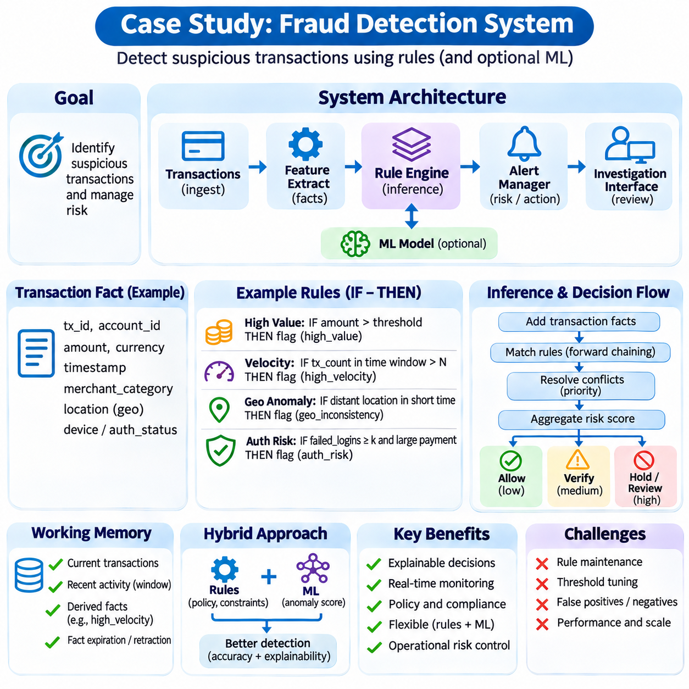{width="7.268055555555556in" height="7.268055555555556in"}

A fraud detection system provides a practical case study of how rule-based reasoning can support financial transaction monitoring and risk management. Its purpose is to identify suspicious activities by evaluating transaction characteristics, account behavior, and predefined security policies. Unlike systems that rely exclusively on statistical predictions, a rule-based approach expresses detection criteria explicitly, allowing investigators to examine why particular transactions were flagged.

The architecture typically includes transaction ingestion, data validation, feature extraction, a rule engine, an alert manager, and an investigation interface. Incoming transactions are converted into structured facts containing amounts, timestamps, account identifiers, locations, and payment methods. The inference engine evaluates these facts against established detection rules and generates alerts or recommended actions when suspicious conditions are satisfied.

A simplified implementation can represent each transaction as a structured record containing transaction identifier, account identifier, amount, currency, timestamp, merchant category, and geographical information. Additional account attributes may include historical spending patterns, authentication status, and previous security incidents. Consistent schemas are essential because incorrect field mappings or missing values can cause rules to produce misleading results.

The rule base contains explicit conditions derived from operational policies, observed fraud patterns, and regulatory requirements. A high-value transaction rule may identify payments exceeding an established threshold, while a velocity rule detects excessive transaction frequency within a specified period. Other rules may examine unusual geographic activity, repeated authentication failures, or transactions involving restricted counterparties.

A transaction velocity rule evaluates the number or cumulative value of payments within a rolling time window. For example, multiple transactions occurring within several minutes may trigger additional verification when their frequency exceeds a configured threshold. The engine must maintain recent transaction histories and update window calculations as new events arrive. Appropriate thresholds depend on customer behavior, payment channels, and operational risk tolerance.

Geographical inconsistency rules identify activity that differs from expected account behavior. Transactions originating from distant locations within an implausibly short interval may indicate account compromise or unauthorized access. However, location signals can be inaccurate, and digital payments may originate from infrastructure unrelated to the customer\'s physical position. Such rules should therefore incorporate contextual evidence rather than automatically assuming fraud.

Authentication-related rules examine failed login attempts, device changes, unusual session activity, and inconsistencies between transaction requests and established account attributes. A sequence of unsuccessful authentication attempts followed by a high-value payment may warrant additional scrutiny. Device identifiers and network information can strengthen detection, but privacy requirements and the reliability of collected signals must be considered.

The inference engine evaluates applicable rules through forward chaining, allowing new transaction facts to activate relevant detection conditions. When several rules match simultaneously, conflict resolution determines how their activations are processed. High-priority security conditions may receive preference over routine monitoring rules. The engine should distinguish between producing multiple risk indicators and executing mutually incompatible operational actions.

Risk scoring can aggregate the results of multiple rules into a combined assessment. Each triggered rule may contribute a weighted value representing its relative importance, while certain mandatory restrictions may override ordinary scoring. The resulting score can guide investigation priority or additional authentication requirements. Weight assignments and decision thresholds must be validated because arbitrary combinations can create inconsistent or misleading risk estimates.

A typical decision workflow separates monitoring, verification, investigation, and transaction intervention. Low-risk activity may proceed without additional processing, while moderate-risk cases can trigger alerts or authentication challenges. Higher-risk events may require temporary holds or human review, subject to applicable policies. The system should avoid equating a suspicious indicator with confirmed fraud because legitimate behavior can resemble known attack patterns.

Working memory maintains active transaction facts, recent account activity, and intermediate conclusions. Rules may assert derived facts such as excessive velocity, unusual device activity, or elevated risk status. These conclusions can activate additional rules that combine several warning indicators. Fact expiration and retraction mechanisms are necessary to prevent outdated observations from influencing later decisions after their validity periods have ended.

Efficient matching becomes important when the system processes large transaction streams. Naive evaluation of every rule against every transaction can create unnecessary computational overhead. RETE-based matching, attribute indexing, incremental updates, and selective condition evaluation can reduce repeated work. Time-window aggregation and indexed account histories are especially important when rules compare current transactions with recent events.

A hybrid fraud detection architecture can combine explicit rules with machine learning models. Statistical models may estimate anomaly scores or identify complex behavioral patterns, while rules enforce mandatory restrictions and operational policies. Model outputs can enter the rule engine as structured facts containing scores and uncertainty information. This integration allows adaptive pattern recognition without surrendering control over explicitly defined decision constraints.

False positives are a major operational challenge because legitimate transactions may satisfy suspicious conditions. Excessive alerts increase investigation costs, delay payments, and reduce customer trust. False negatives are equally important because undetected fraudulent activity can cause financial losses. Rule thresholds should therefore be evaluated using representative transaction distributions and realistic estimates of investigation capacity and error costs.

Evaluation requires labeled historical transactions or carefully reviewed investigation outcomes. Precision measures the proportion of flagged transactions that are confirmed fraudulent, while recall measures the proportion of known fraudulent transactions detected. False-positive rate, alert volume, detection latency, and financial loss prevented provide additional perspectives. Because fraud is often rare, accuracy alone can conceal poor detection performance.

Temporal evaluation is essential because fraud patterns and customer behavior evolve. Training and testing procedures should respect chronological ordering to avoid using future information during historical evaluation. Rule changes should be tested against later transaction periods and newly observed attack patterns. Concept drift and changing transaction volumes may require threshold recalibration, updated features, or additional rules.

Explainability is a significant advantage of explicit fraud detection rules. An alert can record the triggering rule identifiers, supporting transaction facts, threshold comparisons, and final decision policy. Investigators can use this information to understand why a transaction was flagged and determine whether further evidence is required. Explanation records should distinguish verified observations from inferred risk indicators and statistical model predictions.

Auditability requires maintaining reliable histories of rule versions, transaction inputs, activation sequences, and operational decisions. When a disputed transaction is reviewed, investigators should be able to reconstruct the policy configuration that was active at the time. Access controls, retention policies, and tamper-resistant logs support accountability. Sensitive financial and personal information must be protected throughout storage, processing, and investigation.

Security controls must also protect the fraud detection system itself. Attackers may attempt to manipulate transaction attributes, exploit predictable thresholds, or generate misleading activity to avoid detection. Rule definitions, model configurations, and decision interfaces require controlled access and monitored changes. Defense-in-depth mechanisms and independent authorization checks help prevent compromised detection components from directly enabling unauthorized transactions.

Operational deployment requires integration with payment processing, identity verification, customer notification, and investigation workflows. The rule engine must meet latency and availability requirements appropriate to the transaction channel. Monitoring should track processing delays, failed evaluations, alert backlogs, and unusual changes in rule activation rates. Failure-handling policies must specify how transactions are treated when detection services are unavailable.

Testing should cover individual rules, combined conditions, conflicting actions, duplicate events, missing attributes, and delayed transaction messages. Scenario-based tests can simulate account takeover, transaction bursts, unusual location changes, and legitimate high-value purchases. Regression testing ensures that new rules do not unintentionally alter established behavior. Controlled experiments can assess proposed threshold changes before deployment.

Governance processes determine how fraud rules are proposed, approved, deployed, and retired. Security analysts may identify emerging attack patterns, while compliance specialists define mandatory requirements and engineers implement validated logic. Version control and staged deployment reduce the risk of unintended policy changes. Periodic reviews should remove ineffective rules, investigate alert quality, and document the justification for significant decisions.

This case study demonstrates how a fraud detection system can translate explicit security knowledge into operational reasoning. Its effectiveness depends on accurate transaction data, well-defined rules, efficient inference, calibrated risk assessment, and continuous evaluation. Combining interpretable rule execution with statistical detection and controlled human oversight creates a practical foundation for scalable, auditable, and adaptable financial security systems.
