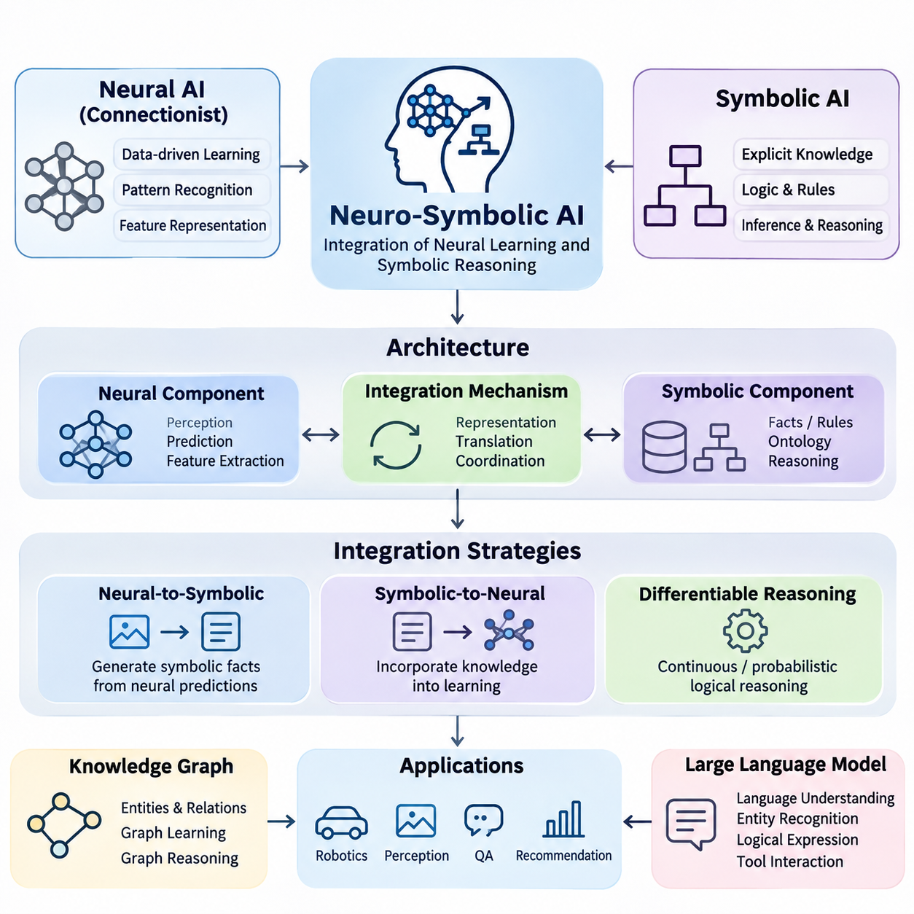
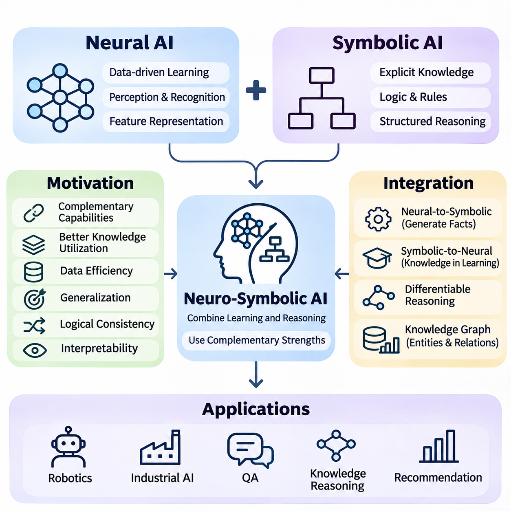
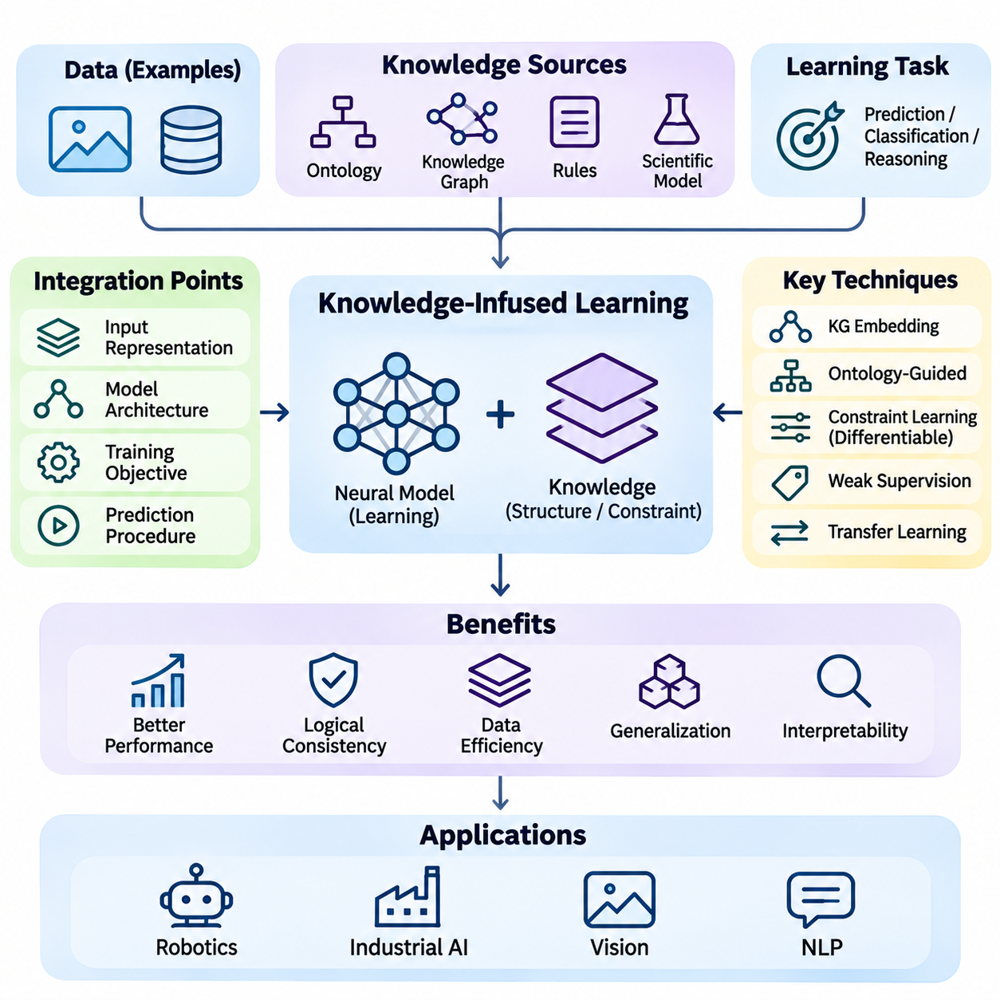
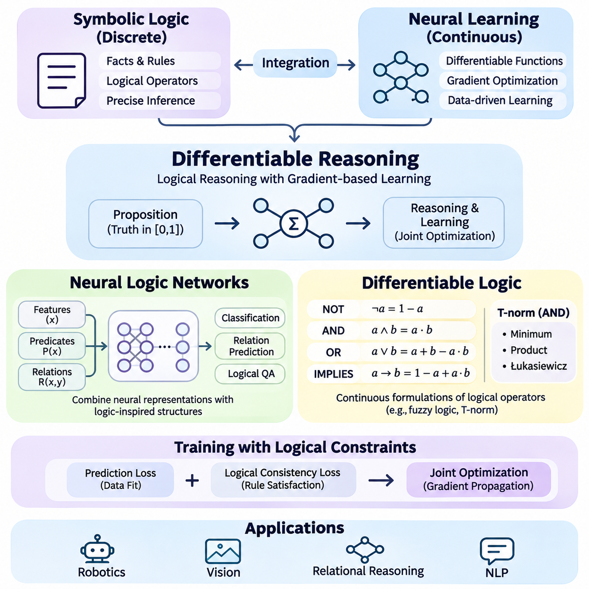
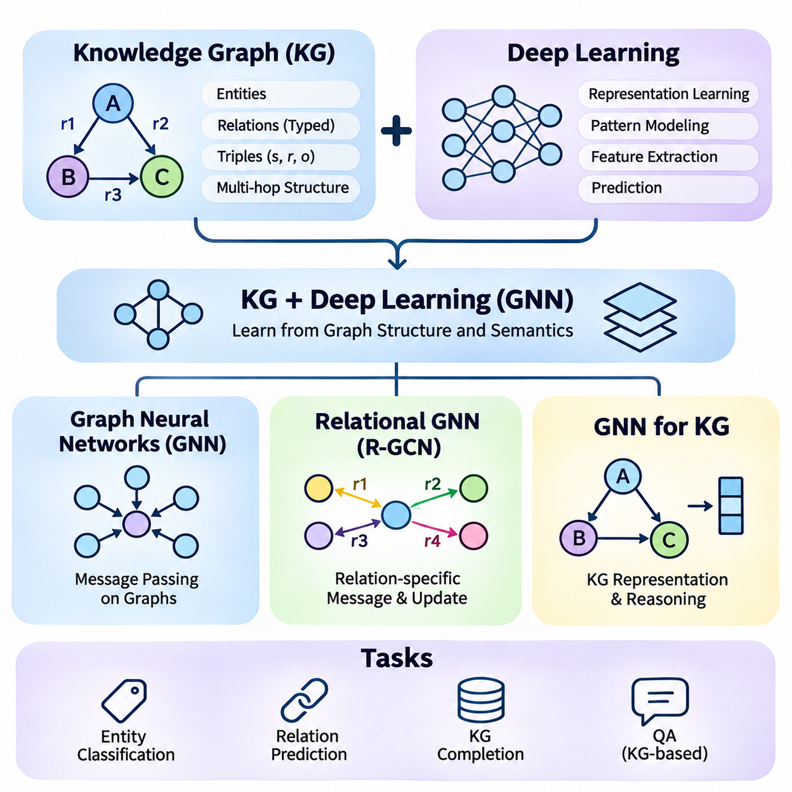
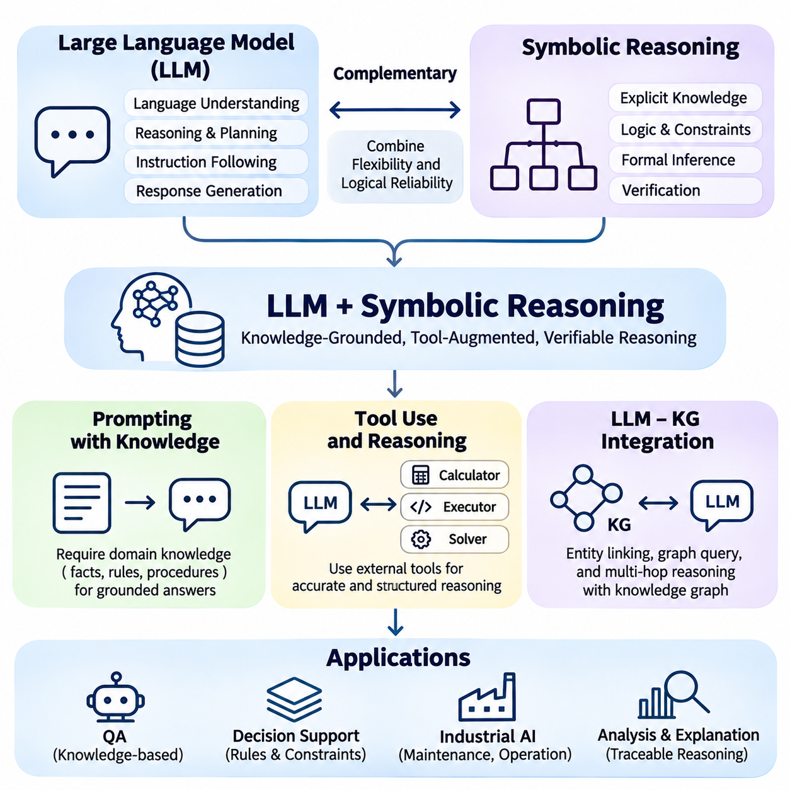
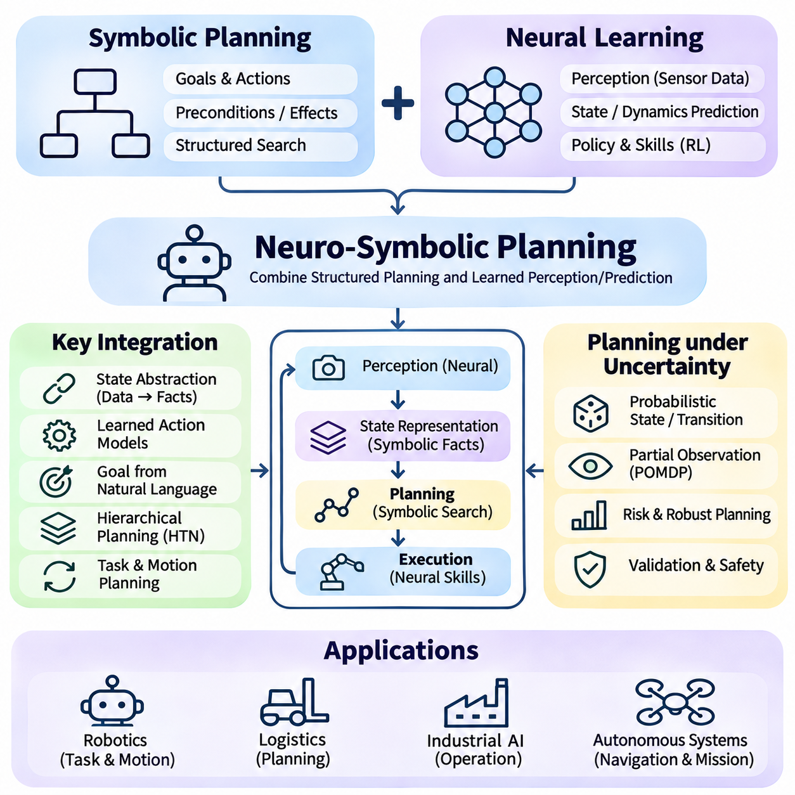
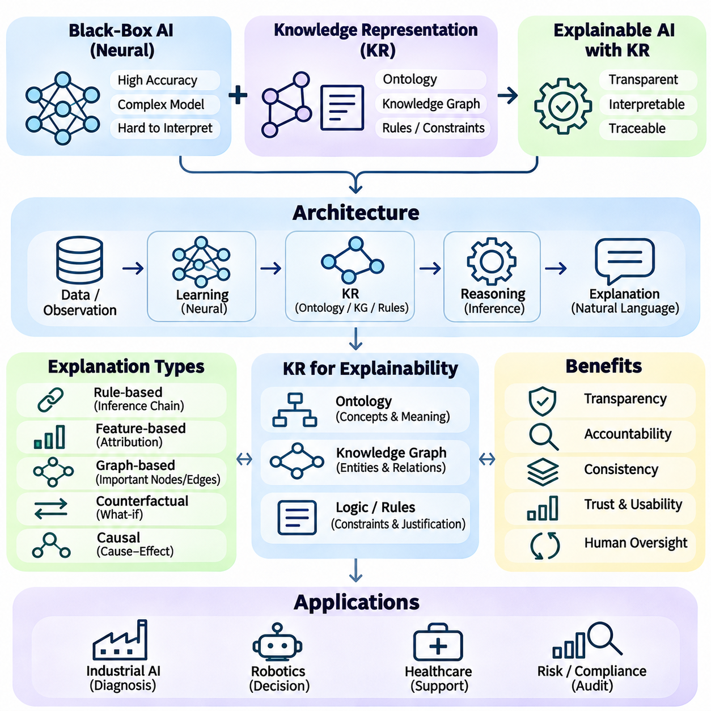
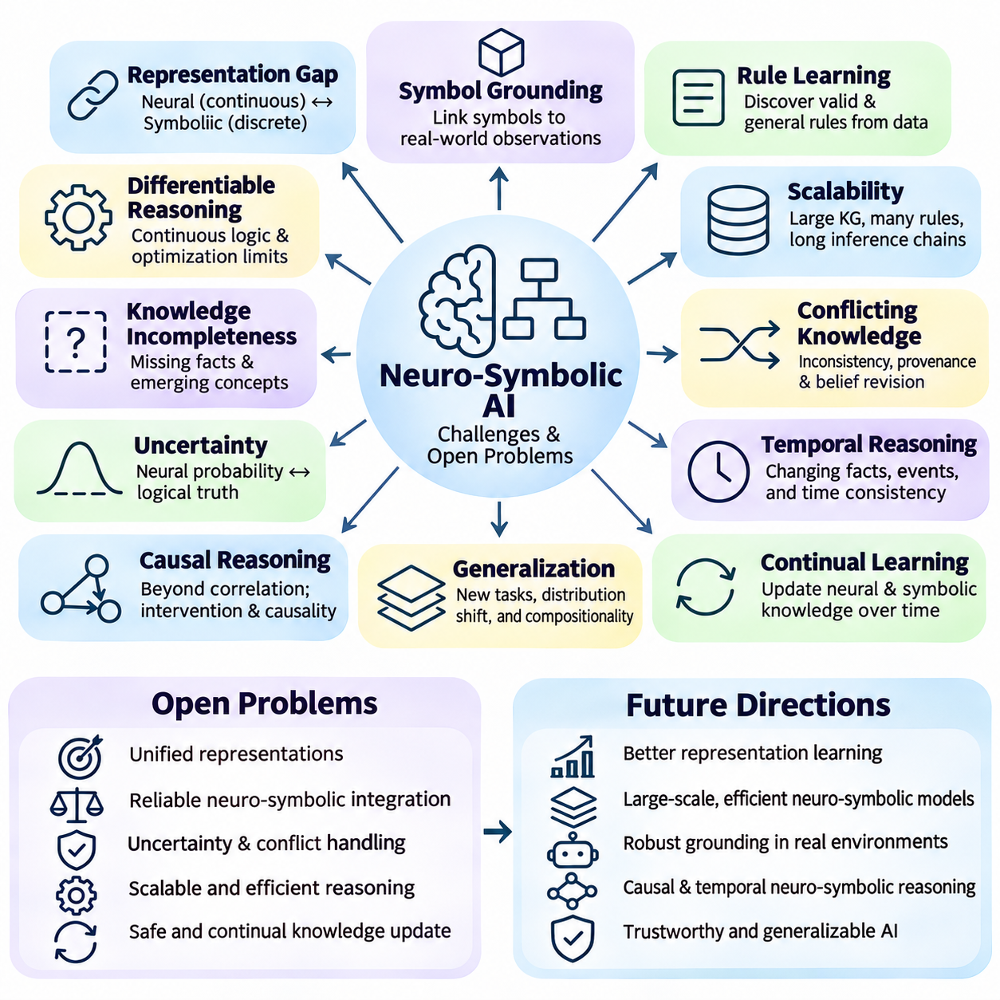
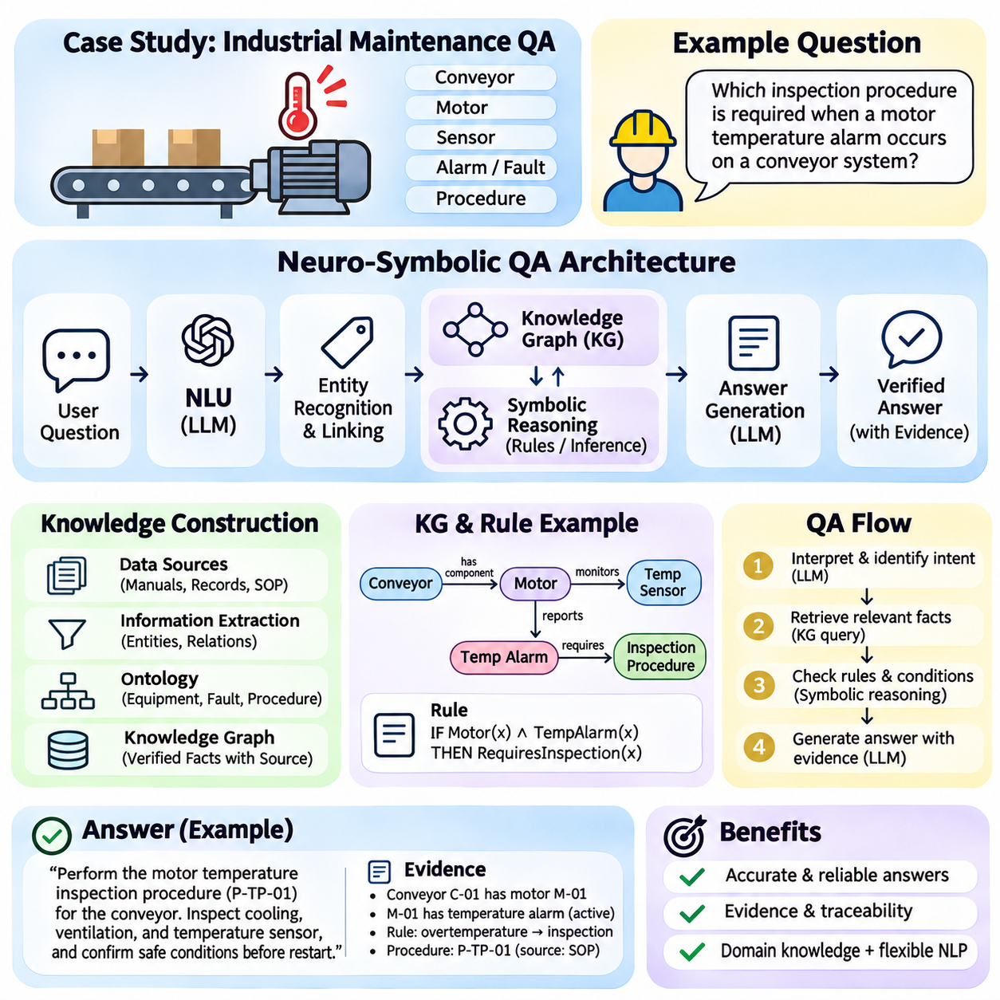

**Volume 02. Knowledge Representation**

# 05. Neuro Symbolic AI

## 05.01 Introduction to Neuro Symbolic

{width="7.268055555555556in" height="7.268055555555556in"}

Neuro-symbolic artificial intelligence is an approach that integrates neural learning with symbolic knowledge representation and reasoning. It combines the ability of neural networks to recognize patterns in complex data with the ability of symbolic systems to represent concepts, relationships, constraints, and logical rules. The objective is to develop intelligent systems that can learn from experience while performing structured and interpretable reasoning.

Traditional artificial intelligence developed along two major research directions. Symbolic AI emphasized explicit knowledge, formal logic, and rule-based inference, while connectionist AI focused on learning distributed representations from data. These approaches evolved with different strengths and limitations. Neuro-symbolic AI seeks to establish computational connections between them rather than treating learning and reasoning as independent processes.

Symbolic AI represents knowledge through discrete structures such as predicates, logical formulas, ontologies, production rules, and knowledge graphs. These representations allow systems to express relationships and derive conclusions using defined inference procedures. For example, a rule stating that every autonomous robot requires a safety controller can support logical conclusions about individual robots when their classifications are known.

Neural AI processes information through interconnected computational units whose parameters are adjusted during training. Neural networks can extract useful representations from images, language, audio, sensor measurements, and other high-dimensional inputs. Their strength lies in learning complex statistical relationships without requiring every feature to be manually specified. However, learned representations do not automatically provide explicit logical guarantees.

The fundamental motivation for neuro-symbolic integration is that perception and reasoning require different but complementary capabilities. A neural model may identify objects in a camera image, while a symbolic component determines whether their relationships violate operational constraints. Combining these functions allows an intelligent system to connect uncertain observations with structured knowledge and use both sources when making decisions.

A typical neuro-symbolic architecture contains a neural processing component, a symbolic knowledge component, and an integration mechanism. The neural component extracts features, predicts concepts, or estimates relationships. The symbolic component maintains facts, rules, and domain constraints. The integration mechanism translates information between representations or coordinates learning and inference across the components.

The interface between neural and symbolic representations is a central engineering challenge. Neural systems commonly produce continuous vectors, probabilities, or confidence scores, whereas symbolic systems operate on discrete entities and logical expressions. Converting uncertain predictions into symbolic assertions can introduce errors. Effective integration therefore requires explicit mechanisms for uncertainty management, semantic alignment, and consistency checking.

One integration strategy uses neural networks to generate symbolic facts that are subsequently processed by a conventional reasoning engine. An image recognition model might identify a pedestrian, a vehicle, and a crossing area. These observations can be transformed into predicates describing detected entities and spatial relationships. A symbolic inference engine can then evaluate traffic rules or safety constraints using the generated facts.

Another strategy incorporates symbolic knowledge into the neural learning process. Logical relationships, domain constraints, or ontology structures can influence model training through additional objectives or architectural restrictions. This approach encourages predictions to satisfy selected knowledge requirements while retaining the flexibility of statistical learning. The effectiveness of such constraints depends on their correctness, coverage, and mathematical formulation.

Differentiable reasoning represents an important direction in neuro-symbolic research. Conventional logical operations are often discrete and unsuitable for direct gradient-based optimization. Differentiable approaches introduce continuous approximations or probabilistic interpretations of logical operations. These mechanisms allow learning algorithms to optimize parameters using reasoning-related objectives, although approximate reasoning may not preserve classical logical semantics.

Knowledge graphs provide another foundation for connecting neural learning and symbolic representations. A knowledge graph describes entities and their relationships using structured connections. Neural models can learn embeddings from these structures, while graph-based reasoning can exploit explicit relational information. This combination supports applications such as entity classification, relation prediction, question answering, and knowledge-aware recommendation.

Graph neural networks extend this integration by learning representations through information exchange between connected entities. Their message-passing mechanisms aggregate features from neighboring nodes according to graph structure. Relational graph neural networks can additionally distinguish different relationship types. Although graph neural networks are not inherently symbolic reasoners, they can participate in neuro-symbolic architectures when connected to explicit knowledge and inference mechanisms.

Large language models introduce additional opportunities for neuro-symbolic integration. They can interpret natural language, identify entities, generate candidate logical expressions, and interact with external knowledge systems. Symbolic engines can complement these capabilities through structured queries, rule evaluation, and constraint validation. This arrangement can improve the traceability of selected reasoning operations without guaranteeing that every generated conclusion is correct.

Neuro-symbolic reasoning can also support planning and decision-making. A neural component may estimate environmental conditions, recognize relevant objects, or predict action outcomes. A symbolic planner can then use these observations together with predefined actions, goals, and constraints. This architecture is particularly relevant when intelligent agents must operate in changing environments while respecting explicit operational requirements.

In robotics, neuro-symbolic AI can connect visual perception, semantic mapping, task planning, and safety reasoning. A mobile robot may detect a blocked corridor through its perception system and represent the observation as a symbolic environmental fact. A planning component can evaluate alternative routes while considering restricted areas, task priorities, and operational rules. Reliable execution still requires continuous validation against sensor observations.

Industrial AI provides another practical application domain. Neural networks can detect equipment anomalies from vibration signals, images, or time-series measurements. Symbolic knowledge can represent maintenance procedures, equipment dependencies, and operating constraints. Integrating these components enables systems to relate statistical anomaly predictions to engineering knowledge and generate recommendations that can be examined against documented procedures.

Explainability is frequently identified as a potential advantage of neuro-symbolic systems. Explicit rules, knowledge graph paths, and inference records can provide understandable descriptions of certain decisions. However, the presence of symbolic components does not make the entire system transparent. Neural predictions may remain difficult to interpret, and explanations must accurately reflect the computational process rather than merely provide plausible narratives.

Neuro-symbolic systems must also address uncertainty and incomplete knowledge. Real-world observations are often noisy, ambiguous, or contradictory, while symbolic knowledge bases may omit relevant relationships. Probabilistic logic, confidence-aware inference, and uncertainty propagation can help bridge these differences. A robust architecture should distinguish observed evidence, learned predictions, inferred conclusions, and assumptions introduced by the knowledge model.

The distinction between learning and reasoning is important when evaluating neuro-symbolic architectures. Learning adjusts representations or parameters based on examples and feedback, whereas reasoning derives conclusions from available information under specified inference rules. Integrated systems may perform these operations sequentially, iteratively, or jointly. Their design determines whether knowledge influences training, inference, planning, or multiple stages.

Evaluation requires more than measuring predictive accuracy. A neuro-symbolic system should also be examined for logical consistency, reasoning correctness, robustness, generalization, computational efficiency, and explanation fidelity. Tests should determine whether symbolic constraints improve performance under distribution shifts and whether incorrect neural predictions propagate into downstream inference. Comparisons with neural-only and symbolic-only baselines are especially informative.

Several limitations remain significant. Constructing reliable knowledge bases can require extensive domain expertise, while mapping neural representations to symbolic concepts may introduce semantic ambiguity. Differentiable reasoning can become computationally expensive, and strict logical constraints may conflict with noisy observations. Maintaining knowledge consistency during continuous learning presents additional challenges for systems deployed in dynamic environments.

Neuro-symbolic AI should therefore be understood as a family of integration methods rather than a single algorithm or universally superior architecture. Different applications require different balances between statistical learning, explicit knowledge, logical inference, and computational resources. The most appropriate design depends on the structure of the problem, the availability of domain knowledge, the consequences of errors, and the required degree of interpretability.

Within knowledge representation, neuro-symbolic AI extends the roles of logic, ontologies, knowledge graphs, and rule-based systems into learning-based environments. These symbolic foundations provide structured concepts and inference mechanisms that can interact with neural models. Understanding this relationship establishes the basis for studying knowledge-infused learning, differentiable reasoning, graph-based integration, language-model reasoning, and neuro-symbolic planning.

## 05.02 Why Combine Symbolic and Neural

{width="7.268055555555556in" height="7.268055555555556in"}

Symbolic artificial intelligence and neural artificial intelligence address different aspects of intelligent computation. Symbolic systems emphasize explicit knowledge representation, logical relationships, and structured inference, while neural systems learn statistical patterns from data. Combining these approaches creates opportunities to develop systems that can recognize complex information, reason about its meaning, and make decisions under defined constraints.

Symbolic AI is particularly effective when knowledge can be expressed through facts, rules, ontologies, and logical formulas. Such representations support consistent reasoning within their formal assumptions and allow conclusions to be traced through explicit inference steps. However, symbolic systems often struggle to acquire knowledge automatically from unstructured data, especially when observations contain ambiguity, noise, or incomplete information.

Neural AI addresses many perceptual and learning challenges through parameterized models trained on examples. Deep neural networks can extract representations from images, speech, text, and sensor measurements without requiring manually specified rules for every pattern. Nevertheless, strong predictive performance does not necessarily imply logical consistency, reliable compositional reasoning, or compliance with explicit domain constraints.

The motivation for combining these paradigms arises from their complementary strengths and weaknesses. Neural models can transform complex observations into meaningful representations, while symbolic mechanisms can organize those representations into structured knowledge. Their integration allows systems to connect learned evidence with formal relationships, enabling reasoning processes that would be difficult to implement using either approach independently.

One important benefit is improved knowledge utilization. Conventional neural networks primarily acquire information through training data and optimization, although pretrained models may encode substantial implicit knowledge. Symbolic components provide an additional channel through which domain expertise can be represented explicitly. This knowledge can guide predictions, restrict possible outputs, or support reasoning when training examples are insufficient.

Data efficiency is another motivation for neuro-symbolic integration. Neural models frequently require substantial training data to learn complex relationships reliably. Symbolic knowledge can introduce useful constraints or relational structures that reduce the need to discover every dependency from examples. Such improvements are not automatic, but appropriately designed knowledge constraints may help models generalize when labeled data is limited.

Generalization beyond observed training examples remains a major challenge in machine learning. Neural networks can perform well on familiar distributions while failing when objects, relationships, or conditions change. Symbolic representations can support compositional reasoning by expressing reusable concepts and rules. Combining learned representations with these structures may improve performance on novel combinations of previously encountered elements.

Logical consistency provides another reason to combine neural and symbolic approaches. A neural classifier may produce predictions that individually appear plausible but collectively violate known relationships. For example, an industrial monitoring system might classify a machine as operating normally while simultaneously predicting mutually incompatible operating states. Symbolic constraints can identify such inconsistencies and support corrective processing.

Interpretability is particularly important in applications where decisions must be reviewed or justified. Neural networks often encode information in distributed numerical representations that are difficult to interpret directly. Symbolic systems can provide explicit reasoning paths through facts, rules, and relationships. Neuro-symbolic architectures can therefore expose selected decision mechanisms, although explanations must be validated against the actual computational process.

The integration of perception and reasoning is especially valuable in robotics. Neural perception systems can detect objects, estimate positions, and recognize environmental conditions from sensor data. Symbolic reasoning systems can interpret these observations according to task requirements, spatial relationships, and safety rules. This combination enables robots to connect low-level sensory information with higher-level operational decisions.

Consider an autonomous mobile robot navigating an industrial facility. A neural model may identify workers, forklifts, obstacles, and restricted zones through camera and LiDAR observations. A symbolic system can represent access permissions, traffic priorities, and task constraints. Integrating these components allows the robot to evaluate possible actions using both environmental evidence and predefined operational knowledge.

Knowledge graphs offer a practical foundation for combining learned representations with structured relationships. They represent entities and connections explicitly, while neural models can learn embeddings that capture statistical regularities in graph structures. Combining these representations supports relation prediction, entity classification, and knowledge-aware inference. The resulting system can use both observed graph facts and learned relational patterns.

Neuro-symbolic integration also provides mechanisms for incorporating domain knowledge into model training. Logical rules and relational constraints can be transformed into additional learning objectives or architectural restrictions. These mechanisms encourage neural predictions to satisfy selected knowledge requirements. Differentiable reasoning techniques further allow some reasoning-related objectives to participate in gradient-based optimization.

Uncertainty management represents another important motivation. Neural networks often produce confidence scores or probability estimates, whereas classical symbolic logic typically operates with discrete truth assignments. Real-world applications require systems to reason about uncertain observations without treating every prediction as an unquestionable fact. Probabilistic logic and uncertainty-aware integration mechanisms can help connect statistical evidence with structured inference.

Large language models demonstrate both the potential and the limitations of neural reasoning. They can generate fluent explanations, interpret instructions, and solve many reasoning problems, but may also produce unsupported statements or inconsistent conclusions. Symbolic tools, knowledge graphs, and formal validators can provide external structures for checking selected claims and calculations. Their effectiveness depends on accurate tool use and reliable knowledge sources.

Planning systems can also benefit from combining learned predictions with symbolic action models. Neural components may estimate action outcomes or recognize changing environmental conditions, while symbolic planners represent goals, preconditions, and effects. This separation supports structured evaluation of candidate plans while allowing environmental models to adapt through learning. It is particularly useful when operational constraints must remain explicit.

Industrial applications illustrate the value of integrating statistical detection with engineering knowledge. Neural models can identify abnormal vibration patterns, visual defects, or unusual process measurements. Symbolic representations can describe equipment dependencies, maintenance rules, and acceptable operating conditions. Their combination can connect detected anomalies to possible causes and recommended procedures, subject to validation against actual equipment behavior.

Safety requirements provide a further motivation for hybrid architectures. Neural predictions alone may not enforce every operational restriction, particularly under unfamiliar conditions. Symbolic components can represent explicit prohibitions, permissions, and logical dependencies. However, symbolic validation cannot compensate for missing observations or incorrect rules, so safety-critical systems still require independent safeguards, monitoring, and systematic verification.

The combination also introduces important engineering tradeoffs. Neural and symbolic components use different representations, computational mechanisms, and assumptions about uncertainty. Translating continuous predictions into discrete concepts can cause information loss, while maintaining large knowledge bases can become expensive. Integration mechanisms must balance reasoning complexity, computational latency, semantic consistency, and adaptability to changing environments.

Not every application benefits equally from neuro-symbolic integration. Purely neural solutions may be sufficient when predictive accuracy is the primary requirement and explicit reasoning adds little value. Symbolic solutions may be preferable when the environment is well defined and knowledge can be represented completely through rules. Hybrid approaches become especially attractive when complex perception, structured reasoning, and explicit constraints must operate together.

Evaluating the benefits of integration requires comparisons against neural-only and symbolic-only baselines. Relevant measurements include predictive accuracy, logical consistency, sample efficiency, robustness, reasoning correctness, and computational cost. Researchers must also determine whether observed improvements arise from symbolic knowledge itself, additional model capacity, or differences in training procedures. Controlled experiments are essential for establishing meaningful advantages.

Ultimately, the purpose of combining symbolic and neural AI is not to replace one paradigm with another, but to connect complementary computational capabilities. Neural learning provides adaptable representations of complex observations, while symbolic reasoning provides explicit structures for organizing knowledge and evaluating relationships. Their integration establishes a foundation for knowledge-infused learning, differentiable reasoning, neuro-symbolic planning, and more accountable intelligent systems.

## 05.03 Knowledge Infused Learning

{width="7.268055555555556in" height="7.268055555555556in"}

Knowledge-infused learning is an approach to artificial intelligence that incorporates structured domain knowledge into the learning process of neural models. Instead of relying exclusively on statistical patterns extracted from training data, it uses facts, relationships, rules, ontologies, and knowledge graphs to guide representation learning and prediction. The objective is to develop models that combine data-driven adaptability with knowledge-based consistency.

Conventional machine learning systems primarily acquire knowledge through examples and optimization. Although neural networks can discover complex statistical dependencies, they may overlook relationships that are obvious to domain experts. Knowledge-infused learning addresses this limitation by introducing external information that describes relevant concepts, constraints, and dependencies, allowing models to exploit knowledge that may not be sufficiently represented in training datasets.

The knowledge incorporated into learning systems can originate from several sources. Domain ontologies define concepts, categories, and semantic relationships, while knowledge graphs represent entities and their connections. Logical rules describe constraints and implications, and scientific models express established relationships between variables. These knowledge sources provide different forms of structure that can influence how neural networks learn and interpret information.

A fundamental design decision concerns where knowledge enters the machine learning pipeline. Knowledge can be incorporated into input representations, model architectures, training objectives, or prediction procedures. Each integration point provides different capabilities and introduces different engineering requirements. Selecting an appropriate mechanism depends on the knowledge format, learning task, available supervision, and required degree of logical consistency.

Knowledge-enhanced input representations enrich training examples with additional semantic information. For instance, an object recognition system may receive visual features together with attributes derived from an ontology. These attributes can describe object categories, functional relationships, or contextual properties. The neural model learns from both observed data and structured knowledge, potentially improving its ability to distinguish semantically related concepts.

Knowledge graph embeddings provide another mechanism for integrating structured information into neural learning. Entities and relationships are mapped into continuous vector spaces that capture selected relational patterns. These embeddings can be combined with visual, textual, or numerical features to support downstream predictions. Their usefulness depends on the quality of graph construction, embedding objectives, and alignment between graph entities and observed data.

Knowledge can also influence neural network architecture. Models may incorporate relational structures, hierarchical dependencies, or domain-specific connectivity patterns into their computational design. Graph neural networks, for example, use graph connections to determine how information is exchanged between entities. Such architectural choices introduce inductive biases that can improve learning when the encoded relationships accurately reflect the target problem.

Training objectives provide a flexible mechanism for knowledge infusion. A conventional loss function measures prediction errors against labeled examples, while additional terms can penalize violations of domain constraints. The resulting optimization process balances empirical performance with selected knowledge requirements. Constraint weights must be chosen carefully because excessive penalties can reduce adaptability or create conflicts with uncertain observations.

Logical constraints can be incorporated through differentiable approximations of symbolic expressions. A rule describing an implication between two concepts may be transformed into a continuous penalty that depends on model predictions. Gradient-based optimization can then encourage predictions that satisfy the rule. However, differentiable approximations do not necessarily preserve the exact semantics of classical logic, particularly when truth values are uncertain.

Semantic regularization is closely related to constraint-based learning. It encourages neural representations or predictions to remain compatible with specified semantic relationships. For example, a classification model may be discouraged from assigning incompatible labels to the same object. Such regularization can improve consistency when the encoded relationships are valid, although incorrect or overly restrictive constraints may introduce systematic prediction errors.

Ontology-guided learning uses formally organized concepts to influence neural representations and predictions. Taxonomic relationships can describe superclass and subclass structures, while object properties specify relationships between entities. A model can use these structures to recognize hierarchical dependencies or restrict candidate classifications. Ontological knowledge is particularly useful when prediction categories have meaningful semantic relationships.

Weak supervision provides another opportunity for knowledge-infused learning. Domain rules can generate approximate labels for examples that lack direct human annotation. These labels may expand training coverage while reducing manual labeling requirements. Because rule-generated labels can contain errors, practical systems must estimate their reliability and manage disagreements between labeling functions rather than treating every generated label as ground truth.

Knowledge infusion can also support transfer learning across related domains. Shared concepts, relationships, and constraints may remain useful even when data distributions change. A model trained in one industrial environment might reuse equipment classifications or operational relationships in another facility. Successful transfer still requires checking whether the underlying knowledge remains valid and whether domain-specific differences affect its interpretation.

In natural language processing, external knowledge can help models interpret entities, relationships, and contextual meanings. Entity linking connects textual mentions to structured knowledge resources, while knowledge-aware representations incorporate relational information into language understanding. These methods can support question answering, information extraction, and document classification, particularly when relevant domain facts are difficult to infer from text alone.

Large language models can incorporate external knowledge through several mechanisms, including knowledge-aware training, retrieval, and structured tool interactions. Training-time knowledge infusion modifies learned behavior, whereas retrieval-based approaches provide information during inference without necessarily changing model parameters. Distinguishing these mechanisms is important because their effects on knowledge retention, updating, and factual reliability differ substantially.

Robotics illustrates the practical value of knowledge-infused learning. Neural perception models can identify objects and estimate environmental conditions, while structured knowledge describes object functions, spatial relationships, and task constraints. Incorporating this information can improve semantic interpretation and task-related predictions. For example, a robot may learn that certain equipment categories imply specific handling requirements or restricted interactions.

Industrial monitoring systems can similarly combine sensor measurements with engineering knowledge. Neural networks may learn patterns associated with vibration anomalies, temperature changes, or equipment degradation. Maintenance ontologies and dependency graphs can provide information about component relationships and operating conditions. Knowledge infusion can help models distinguish plausible failure patterns from predictions that contradict established equipment characteristics.

Uncertainty is a central consideration when combining external knowledge with neural learning. Knowledge bases may contain incomplete, outdated, or conflicting statements, while neural predictions may be poorly calibrated. Treating every knowledge assertion as an absolute constraint can reduce robustness. Confidence-weighted constraints, probabilistic representations, and mechanisms for identifying inconsistent knowledge can help manage these limitations.

Knowledge quality directly influences learning outcomes. Incorrect relationships, ambiguous entity definitions, and inconsistent ontologies can propagate errors into neural predictions. Effective systems therefore require knowledge validation, provenance tracking, and controlled updates. Knowledge engineering should be treated as an ongoing component of the machine learning lifecycle rather than a one-time preparation activity.

Evaluation must determine whether external knowledge produces measurable benefits beyond conventional learning. Relevant criteria include predictive accuracy, sample efficiency, generalization, logical consistency, calibration, and computational overhead. Controlled experiments should compare models with and without knowledge infusion while maintaining comparable training conditions. Additional tests can examine sensitivity to incomplete or deliberately corrupted knowledge.

Knowledge-infused learning also introduces computational and architectural tradeoffs. Large knowledge graphs increase storage and retrieval requirements, while complex logical constraints can make optimization more expensive. Knowledge integration may require entity alignment, graph preprocessing, or specialized training procedures. Engineers must balance these costs against improvements in accuracy, reliability, interpretability, and adaptation.

The broader significance of knowledge-infused learning lies in connecting explicit human knowledge with statistical representation learning. Neural models provide flexibility in processing complex observations, while structured knowledge supplies reusable relationships and domain constraints. Their integration establishes a foundation for more advanced neuro-symbolic techniques, including differentiable reasoning, knowledge graph learning, and systems that coordinate learning with explicit logical inference.

## 05.04 Differentiable Reasoning

{width="7.268055555555556in" height="7.268055555555556in"}

Differentiable reasoning is a neuro-symbolic approach that integrates logical inference with gradient-based learning. Traditional symbolic reasoning operates on discrete truth values and formal rules, while neural networks optimize continuous parameters through differentiable functions. Differentiable reasoning connects these mechanisms by representing selected logical operations in forms that can participate in neural computation and optimization.

Classical logic evaluates propositions using discrete truth assignments, typically true or false. Logical operators such as conjunction, disjunction, negation, and implication determine how propositions combine into valid expressions. Although these operations support precise inference, their discrete nature makes direct gradient-based optimization difficult. Differentiable reasoning addresses this limitation through continuous or probabilistic approximations.

The central idea is to associate logical propositions with numerical truth values, often represented within the interval from zero to one. These values may describe degrees of satisfaction, confidence, or probabilistic belief, depending on the chosen framework. Logical connectives are implemented using mathematical functions that operate on continuous inputs, allowing reasoning-related computations to interact with neural learning procedures.

Neural logic networks are architectures designed to combine neural representations with logic-inspired computational structures. They may represent predicates, logical relationships, and rule dependencies through differentiable operations. Unlike conventional neural networks that learn unrestricted feature transformations, neural logic networks can incorporate explicit relational patterns into their architecture, enabling learning processes to exploit structured logical knowledge.

A neural logic network typically receives numerical features or learned representations associated with entities and relationships. Intermediate components evaluate candidate predicates or combine existing relational information into more complex expressions. The resulting representations can support classification, relation prediction, or logical query answering. Model parameters are optimized using training objectives that reflect prediction accuracy and, when specified, logical consistency.

Neural Logic Machines provide an example of architectures that perform relational reasoning through learned logical transformations. They organize information according to predicate arity and apply neural operations to construct increasingly complex relational features. By sharing learned transformations across entities, these models can support reasoning over different numbers of objects, although their generalization depends on training conditions and architectural limitations.

Predicate learning is an important component of neural logic networks. A predicate describes a property of an entity or a relationship between multiple entities. Neural models can estimate predicate truth values from images, text, sensor measurements, or structured attributes. These estimated values become inputs to subsequent reasoning operations, allowing systems to connect uncertain perceptual evidence with relational inference.

For example, a robotic perception system may estimate whether an object is movable, whether a passage is blocked, and whether a target location is accessible. A neural logic network can combine these predictions with learned relational dependencies to estimate whether a particular action is feasible. The resulting decision reflects both perceptual information and structured relationships, although its correctness depends on the reliability of the underlying predictions.

Differentiable logic provides mathematical mechanisms for representing logical connectives using continuous functions. In fuzzy logic, conjunction can be modeled through a minimum operator or a product-based formulation, depending on the selected semantics. Disjunction and implication also admit different continuous interpretations. These alternatives produce different optimization behavior and must be selected according to the intended reasoning framework.

T-norm fuzzy logic uses triangular norms to generalize logical conjunction to continuous truth values. Common choices include the minimum, product, and Łukasiewicz formulations. Each defines a different relationship between input truth values and the resulting conjunction. Their mathematical properties influence gradient propagation, numerical stability, and the interpretation of partially satisfied logical expressions.

Differentiable implication allows logical dependencies to influence neural optimization. Consider a rule stating that every authorized robot must satisfy a required safety condition. A continuous implication function can evaluate the degree to which predicted authorization and safety values satisfy this relationship. Violations can contribute to a training penalty, encouraging model parameters to produce predictions that better respect the specified rule.

Logical constraints are frequently incorporated through additional loss terms. A prediction loss measures disagreement with labeled observations, while a logical consistency loss measures violations of selected rules. The combined objective allows optimization to balance empirical evidence against symbolic requirements. Constraint weighting is important because excessively strong logical penalties may suppress valid observations when the knowledge base is incomplete or incorrect.

Gradient propagation enables reasoning-related objectives to influence earlier neural computations. When logical operators are differentiable or admit suitable subgradients, automatic differentiation can calculate how changes in model parameters affect constraint satisfaction. These gradients can update feature extractors, predicate estimators, or relational components. However, some formulations produce vanishing gradients or nondifferentiable regions that complicate training.

Logical Tensor Networks illustrate an approach that combines first-order logic with differentiable numerical representations. Predicates and functions are grounded using neural or tensor-based operations, while logical formulas receive continuous satisfaction values. Training seeks to improve the satisfaction of selected formulas alongside task-specific objectives. This approach provides a mechanism for connecting symbolic knowledge with representation learning.

Differentiable reasoning can also incorporate rule-based inference through soft matching mechanisms. Traditional rule engines require exact matching between facts and rule conditions, whereas neural approaches may use learned similarity measures or continuous predicate values. This permits approximate reasoning when observations are uncertain or representations are incomplete. Nevertheless, soft matching can introduce ambiguity that would not occur in exact symbolic inference.

Recursive reasoning introduces additional complexity. Logical rules may depend on conclusions derived from earlier inference steps, requiring repeated application of relational transformations. Differentiable systems can approximate this process through iterative computation or recurrent architectures. Their effectiveness depends on controlling computational depth, maintaining stable gradients, and preventing errors from accumulating across reasoning steps.

Knowledge graphs provide a useful environment for differentiable reasoning because they explicitly represent entities and relationships. Neural models can estimate missing relations, while differentiable logical constraints encourage compatibility with known graph structures. For example, relational composition rules may connect multiple edges into inferred relationships. Such methods combine statistical link prediction with selected forms of logical structure.

Differentiable reasoning has applications in visual question answering, relational classification, robotics, and scientific knowledge modeling. A system can transform perceptual observations into predicate estimates and evaluate relationships required by a question or task. This approach is particularly useful when successful predictions depend on interactions between multiple entities rather than isolated feature recognition.

Despite its advantages, differentiable reasoning does not automatically provide the guarantees associated with formal theorem proving. Continuous truth values may represent approximate satisfaction rather than classical logical validity. Neural predicate estimates can be incorrect, and optimization may converge to solutions that violate some constraints. Formal verification or exact symbolic inference may therefore remain necessary when strict correctness is required.

Computational scalability is another major challenge. Relational reasoning can require evaluating many combinations of entities, especially when predicates involve multiple arguments. Increasing the number of objects, rules, or reasoning steps may substantially increase memory consumption and computation time. Practical architectures use techniques such as relation sampling, restricted predicate arity, sparse computation, and selective rule evaluation to manage complexity.

Evaluation should examine predictive accuracy, logical consistency, relational generalization, computational efficiency, and robustness to uncertain inputs. Comparisons with conventional neural networks and exact symbolic reasoners help identify the benefits and limitations of differentiable integration. Experiments should also test whether models generalize to new entity combinations, larger relational structures, and previously unseen reasoning problems.

Differentiable reasoning establishes an important connection between symbolic knowledge representation and neural optimization. Neural logic networks provide architectures for learning relational computations, while differentiable logic supplies mathematical operators for expressing continuous logical constraints. Together, these methods support systems that learn from data while incorporating structured reasoning objectives, forming a foundation for more advanced neuro-symbolic intelligence.

## 05.05 KG and Deep Learning

{width="7.268055555555556in" height="7.268055555555556in"}

Knowledge graphs and deep learning represent complementary approaches to organizing and processing complex information. Knowledge graphs explicitly describe entities, relationships, and semantic structures, while deep learning models discover statistical patterns through trainable representations. Their integration enables intelligent systems to combine relational knowledge with adaptive learning, supporting predictions that depend on both observed features and structured connections.

A knowledge graph typically represents information as triples consisting of a subject, predicate, and object. These triples form a directed, labeled graph in which entities are connected through meaningful relationships. Unlike conventional feature tables, knowledge graphs preserve relational context and support multi-hop connections. Deep learning methods can exploit this structure to learn representations that reflect both individual entity properties and broader graph relationships.

Graph neural networks are deep learning architectures designed to process graph-structured data. Rather than assuming that observations occupy a regular grid or sequence, they operate on nodes connected by edges. Each node maintains a learned representation that can be updated using information from neighboring nodes. This architecture allows neural computation to incorporate graph topology, making it suitable for knowledge graphs, social networks, molecular structures, and relational databases.

Message passing is a fundamental mechanism in many graph neural networks. During each computational layer, nodes receive messages derived from neighboring representations and associated edge information. These messages are aggregated and combined with the node\'s existing state to produce an updated embedding. Repeated message-passing layers allow information to propagate across increasingly distant graph neighborhoods, although deeper propagation can introduce computational and representation challenges.

Graph convolutional networks provide an influential example of graph-based representation learning. They combine neighboring node features through normalized aggregation operations and trainable transformations. This process encourages connected nodes to exchange useful information while preserving selected structural characteristics. Graph convolutional networks are effective in many node classification tasks, but conventional formulations may not adequately distinguish multiple semantic relationship types.

Graph attention networks introduce attention mechanisms into neighborhood aggregation. Instead of assigning identical importance to all neighboring nodes, they learn coefficients that determine the relative contribution of different connections. Attention can help models emphasize informative neighbors and reduce the influence of less relevant information. However, learned attention weights should not automatically be interpreted as faithful explanations of model decisions.

Knowledge graphs differ from many ordinary graphs because their edges represent distinct semantic relations. A connection describing ownership has a different meaning from one describing location, dependency, or membership. Standard graph neural networks may lose important information if these relation types are ignored. Relational graph neural networks address this limitation by explicitly incorporating edge labels into message passing and representation updates.

Relational graph convolutional networks, commonly called R-GCNs, extend graph convolution to multi-relational structures. They apply relation-specific transformations when aggregating information from neighboring entities. This enables models to distinguish the effects of different predicates while learning shared entity representations. Such architectures are particularly useful for entity classification and link prediction in knowledge graphs containing numerous relationship categories.

A relational graph neural network can update an entity representation by combining messages received through different relation types. Each relation contributes information according to its learned transformation, and the resulting messages are aggregated with normalization and self-node information. This process captures both local graph structure and semantic distinctions between edges. Multiple layers enable the model to represent more complex relational dependencies.

Parameter efficiency becomes important when knowledge graphs contain hundreds or thousands of relation types. Assigning an independent transformation matrix to every relation can substantially increase memory requirements and overfitting risks. R-GCN architectures address this challenge through techniques such as basis decomposition and block-diagonal decomposition. These methods reduce parameter counts by sharing or restricting relation-specific transformations.

Graph neural networks for knowledge graphs commonly support entity classification, relation prediction, and knowledge graph completion. Entity classification assigns semantic categories to graph nodes using their attributes and relational neighborhoods. Relation prediction estimates whether a specified relationship exists between two entities. Knowledge graph completion extends this process by identifying plausible missing triples that are not explicitly recorded in the graph.

Knowledge graph embeddings provide another foundation for relational learning. Models such as TransE, DistMult, and ComplEx represent entities and relations as continuous vectors or related numerical structures. They score candidate triples according to learned compatibility functions. Graph neural networks can complement these methods by constructing entity embeddings from graph neighborhoods, allowing structural information to influence subsequent triple scoring.

Link prediction with graph neural networks typically involves an encoder and a scoring component. The encoder generates entity representations using graph structure and available features, while the scoring function evaluates candidate subject-relation-object combinations. Training encourages observed positive triples to receive higher scores than selected negative examples. The effectiveness of this approach depends on negative sampling, graph coverage, and the suitability of the scoring model.

Relational reasoning can extend beyond direct connections through multi-hop graph structures. For example, an equipment component may belong to a subsystem that is installed within a particular machine. A graph neural network can propagate information across these relationships and learn representations reflecting indirect dependencies. However, ordinary message passing does not necessarily reproduce exact logical path reasoning or guarantee correct conclusions from symbolic rules.

Heterogeneous graph neural networks provide additional flexibility when graphs contain multiple node categories and edge types. Different entity classes may require specialized feature transformations or relation-aware aggregation mechanisms. For example, an industrial knowledge graph may contain machines, sensors, maintenance procedures, and production tasks. Heterogeneous architectures can preserve these distinctions while learning representations across interconnected operational domains.

Integrating ontologies with graph neural networks can improve semantic consistency. Ontologies define class hierarchies, property constraints, and relationships that describe the intended meaning of graph elements. These structures can guide feature construction, model architecture, or training objectives. Nevertheless, neural predictions do not automatically satisfy ontology axioms, so explicit constraint enforcement or symbolic validation may still be required.

Knowledge graph learning must also address incomplete and noisy information. Missing relationships can limit message propagation, while incorrect triples may introduce misleading signals into learned representations. Models can incorporate confidence scores, attention mechanisms, or uncertainty-aware objectives to reduce sensitivity to unreliable graph content. Data quality assessment and provenance tracking remain essential because learned representations can amplify systematic knowledge errors.

Scalability presents a major engineering challenge for graph neural networks. Large knowledge graphs may contain millions of entities and relationships, making full-graph computation expensive. Neighbor sampling, mini-batch training, sparse matrix operations, and distributed graph processing can reduce resource requirements. The appropriate strategy depends on graph density, relation diversity, available hardware, and the latency requirements of downstream applications.

Oversmoothing and oversquashing are important limitations of deep message-passing architectures. Oversmoothing occurs when repeated aggregation makes node representations increasingly similar, reducing their discriminative power. Oversquashing occurs when information from large graph neighborhoods must pass through limited-capacity representations or structural bottlenecks. Architectural modifications, residual connections, and selective information propagation can help mitigate these effects.

In robotics, knowledge graph neural networks can represent relationships among robots, objects, locations, and operational tasks. Learned graph representations may support semantic mapping, task allocation, and context-aware decision support. Relational models can connect sensor-derived observations with structured operational knowledge. Their practical effectiveness depends on timely graph updates, reliable perception, and compatibility with real-time control requirements.

Industrial AI provides another application area for knowledge graph learning. Equipment dependencies, production sequences, sensor associations, and maintenance histories can be represented as interconnected entities. Relational graph neural networks may identify patterns associated with equipment failures or process anomalies. Combining graph-based predictions with engineering constraints can improve diagnostic support, although safety-critical decisions require additional verification.

Evaluation of graph neural networks for knowledge graphs should consider both predictive performance and relational reasoning quality. Entity classification can use accuracy or F1 scores, while link prediction commonly uses mean reciprocal rank and Hits\\@K. Experiments must carefully separate training and evaluation triples to avoid information leakage. Comparisons should also examine scalability, robustness, relation-specific behavior, and generalization to unseen entities.

The integration of knowledge graphs and deep learning establishes a practical foundation for neuro-symbolic intelligence. Graph neural networks learn from structural connectivity, relational architectures preserve semantic edge distinctions, and knowledge graph prediction models estimate missing information. Together, these methods connect explicit relational knowledge with adaptive neural representations, enabling systems to exploit graph structure while recognizing the continuing need for logical validation and knowledge governance.

## 05.06 LLM and Symbolic Reasoning

{width="7.268055555555556in" height="7.268055555555556in"}

Large language models and symbolic reasoning represent complementary approaches to intelligent information processing. Large language models learn statistical relationships from extensive text collections, while symbolic systems represent knowledge through explicit facts, rules, and logical structures. Their integration enables systems to combine natural language understanding with structured inference, supporting applications that require contextual interpretation and verifiable reasoning.

Large language models can interpret instructions, generate explanations, and identify relationships expressed in natural language. However, their generated responses may contain unsupported claims, inconsistent reasoning, or incorrect calculations. Symbolic reasoning systems provide explicit mechanisms for representing constraints and evaluating logical relationships. Combining these capabilities can improve reliability when appropriate external knowledge and verification mechanisms are available.

Prompting with knowledge introduces relevant facts, definitions, and relationships into the context provided to a language model. Instead of relying entirely on information encoded in model parameters, the system supplies selected external knowledge alongside the user request. This knowledge may originate from documents, ontologies, structured databases, or knowledge graphs. Effective prompting helps the model interpret questions within a defined domain.

Knowledge-grounded prompting can include explicit rules that describe how information should be interpreted. For example, an industrial assistant may receive equipment specifications, operational restrictions, and maintenance procedures before answering a technical question. The model can use this context to generate responses consistent with the supplied information. However, including rules in a prompt does not guarantee that the model will follow them correctly.

Retrieval-augmented generation provides a systematic approach to supplying external knowledge during inference. A retrieval component identifies relevant documents or structured records, and the language model uses the retrieved content to construct an answer. Retrieval can reduce dependence on potentially outdated internal knowledge and support source attribution. Its effectiveness depends on retrieval quality, document relevance, and faithful interpretation of the evidence.

Knowledge graphs provide a structured alternative to purely document-based retrieval. A graph can explicitly represent entities, relationships, categories, and dependencies that may be difficult to identify from isolated text passages. When a question concerns connected facts, graph traversal can retrieve relevant relational structures. These structures can then be converted into model-readable context, supporting answers that depend on multiple related entities.

Prompt construction requires careful selection of knowledge. Excessive context can increase computational cost, introduce irrelevant information, and reduce attention to important constraints. Insufficient context may omit facts required for correct reasoning. Knowledge selection mechanisms therefore consider relevance, source reliability, temporal validity, and available context capacity. Structured formatting can further help distinguish evidence from instructions.

Tool use extends language models beyond text generation by allowing interaction with external computational systems. A model may invoke calculators, database queries, search services, knowledge graph interfaces, or symbolic reasoning engines. These tools perform operations that are difficult to guarantee through language generation alone. The model interprets the task, selects an appropriate tool, and incorporates the returned results into its response.

Tool-augmented reasoning commonly separates natural language interpretation from formal computation. A language model can translate a user question into a structured query or logical expression, while a specialized engine evaluates that representation. The resulting answer is returned to the language model for explanation. This division of responsibilities combines flexible language understanding with the precision of dedicated computational procedures.

Symbolic solvers provide particularly useful capabilities for tasks involving constraints and formal relationships. Satisfiability solvers, theorem provers, and constraint programming systems can evaluate mathematical or logical conditions under defined assumptions. A language model may construct candidate problem representations and request solver execution. However, correctness depends on whether the generated formal representation accurately captures the original problem.

Tool orchestration introduces a sequence of decisions about which operations to perform and how to interpret their outputs. A language model may retrieve facts, execute calculations, validate intermediate results, and formulate a final explanation. Such workflows require explicit tool interfaces, input validation, and error handling. Without these safeguards, incorrect tool selection or malformed arguments can undermine otherwise reliable external computation.

Reasoning traces can support debugging and auditing when they record observable operations and evidence. Systems may preserve tool calls, retrieved facts, query results, and validation outcomes as structured execution records. These records provide more dependable evidence of computational behavior than an unrestricted natural language explanation generated afterward. Nevertheless, they do not automatically establish that every intermediate interpretation was correct.

Integration between large language models and knowledge graphs often begins with entity recognition and entity linking. The language model identifies references to relevant people, objects, concepts, or locations within a question. Entity linking maps these references to corresponding graph identifiers. Accurate linking is essential because ambiguous names or incorrect entity matches can cause subsequent graph queries to retrieve unrelated information.

Once relevant entities are identified, the system can retrieve connected relationships through graph queries. Query languages such as SPARQL and Cypher provide mechanisms for selecting entities, filtering properties, and traversing relational paths. A language model may translate natural language requests into candidate queries. Schema awareness and query validation are necessary because syntactically valid queries can still represent incorrect interpretations of user intent.

Graph-based question answering can require multi-hop reasoning across several relationships. For example, a question about equipment maintenance may require identifying a machine, locating its components, and retrieving procedures associated with a particular failure condition. A knowledge graph can represent these dependencies explicitly. The language model then synthesizes the retrieved relationships into an explanation without needing to infer every connection from unstructured text.

Knowledge graph integration can also support knowledge completion and graph maintenance. Language models may extract candidate entities and relationships from technical documents or operational reports. These candidates can be compared against existing graph structures and reviewed before insertion. Because language models can generate incorrect relationships, automated extraction should include entity resolution, provenance tracking, confidence assessment, and validation procedures.

Hybrid architectures may combine vector retrieval with symbolic graph traversal. Vector search identifies semantically related documents or entities, while graph queries recover explicit relationships and constraints. The combined evidence can provide broader contextual coverage and more precise relational information. Such systems must reconcile duplicated facts, inconsistent sources, and differences between semantic similarity and logically supported relationships.

Robotics provides a practical example of language models interacting with symbolic knowledge. A robot assistant may interpret natural language instructions and consult a knowledge graph containing objects, locations, task dependencies, and operational restrictions. A symbolic planner can evaluate candidate actions against predefined conditions. The language model supports communication and task interpretation, while specialized components handle planning and execution constraints.

Industrial AI systems can use similar architectures to support maintenance and operational decisions. A language model interprets technician questions, retrieves equipment relationships, and invokes diagnostic or calculation tools. Symbolic rules can check whether recommended procedures satisfy documented restrictions. This integration can improve technical assistance, but safety-critical recommendations still require authoritative data and independent verification.

Security and reliability are essential when language models interact with external knowledge and tools. Retrieved documents may contain malicious instructions, while generated queries may request unauthorized operations. Systems should separate trusted instructions from untrusted content and enforce access controls at tool boundaries. Read-only queries, permission checks, execution limits, and audit logging help reduce operational risks.

Evaluation must examine both language quality and symbolic correctness. Relevant measurements include factual accuracy, query execution success, entity linking accuracy, constraint satisfaction, tool selection reliability, and evidence attribution. End-to-end testing should also measure latency, computational cost, and recovery from tool failures. Comparisons with language-only and symbolic-only baselines help identify the actual benefits of integration.

The integration of large language models with symbolic reasoning establishes a foundation for knowledge-aware intelligent agents. Knowledge-grounded prompting supplies relevant context, tool-augmented reasoning delegates formal operations to specialized systems, and knowledge graph integration connects language understanding with structured relationships. Together, these mechanisms support more traceable and adaptable reasoning while preserving the need for validation, governance, and explicit correctness checks.

## 05.07 Neuro Symbolic Planning

{width="7.268055555555556in" height="7.268055555555556in"}

Neuro-symbolic planning integrates neural learning with symbolic planning to support intelligent decision-making in complex environments. Symbolic planning represents goals, actions, preconditions, and effects through explicit structures, while neural models learn patterns from observations and experience. Their integration enables systems to combine structured action reasoning with adaptive perception, prediction, and decision support.

Traditional symbolic planning assumes that relevant states and actions can be represented through formal descriptions. Planning algorithms search for action sequences that transform an initial state into a desired goal state. These methods provide clear representations of action dependencies and constraints, but their effectiveness depends on accurate domain models. Constructing and maintaining such models can be difficult in dynamic environments.

Neural approaches address some limitations of symbolic planning by learning representations and predictions from data. Neural networks can estimate environmental states, predict action outcomes, and identify useful behavioral patterns. Reinforcement learning can discover policies through interaction with an environment. However, learned policies may struggle with explicit logical constraints, long planning horizons, and unfamiliar task combinations.

The central motivation for neuro-symbolic planning is to combine the structural advantages of symbolic reasoning with the adaptability of neural learning. Symbolic components organize goals and action relationships, while neural components estimate uncertain properties of the environment. This division allows a planning system to use learned information without abandoning explicit task structure, although integration introduces additional modeling challenges.

A neuro-symbolic planner commonly includes perception, state representation, action modeling, planning, and execution components. Neural perception transforms sensor observations into object detections, spatial estimates, or semantic attributes. Symbolic state representations organize these outputs into facts and relationships. A planning engine evaluates possible actions, while execution feedback updates the system\'s understanding of the environment.

State abstraction is essential for connecting continuous observations with symbolic planning. Images, point clouds, and numerical sensor measurements must be transformed into meaningful planning variables. For example, a robot may convert visual observations into predicates describing object locations, accessibility, and obstacle presence. Incorrect abstraction can cause planning failures even when the symbolic search algorithm operates correctly.

Symbolic action models describe how actions change the environment. In classical planning, actions commonly contain preconditions that must hold before execution and effects that describe resulting state changes. Languages such as the Planning Domain Definition Language provide standardized representations of these structures. Neural models can complement action descriptions by estimating uncertain preconditions or predicting effects that are difficult to specify manually.

Learning action models from experience is an important application of neural methods. A system can observe state transitions and infer relationships between actions and outcomes. Neural networks may estimate transition probabilities, action feasibility, or continuous effects. These predictions can support symbolic planning when complete domain models are unavailable, but learned dynamics require validation before being used in safety-critical decisions.

Goal representation provides another integration opportunity. Symbolic goals specify desired conditions through explicit predicates or logical expressions. Neural language models can interpret natural language instructions and propose structured goal representations. For example, a request to deliver equipment to a designated area can be translated into object-location relationships. Validation is necessary to ensure that the formal goal accurately reflects user intent.

Hierarchical planning organizes complex tasks into multiple levels of abstraction. High-level symbolic plans describe objectives and task dependencies, while lower-level controllers implement concrete actions. Neural policies can execute navigation, manipulation, or interaction skills associated with symbolic operators. This architecture supports reusable behavioral components and reduces the need to represent every motor command within the symbolic planning system.

Hierarchical Task Network planning provides a structured method for decomposing complex tasks. Abstract tasks are refined into smaller subtasks according to predefined methods and constraints. Neural models may help select decomposition methods, estimate task durations, or evaluate environmental conditions. The resulting system combines explicit procedural knowledge with learned estimates, although decomposition validity remains dependent on the task model.

Task and motion planning illustrates the interaction between discrete reasoning and continuous control. Symbolic planning determines which objects to manipulate and which actions should occur, while motion planning evaluates geometric feasibility and collision avoidance. Neural models can estimate grasp poses, object properties, or motion costs. Coordination between these components is necessary because a logically valid action sequence may be physically impossible.

Planning under uncertainty requires reasoning about incomplete observations and unpredictable outcomes. Neural perception can provide probabilistic estimates of environmental conditions, while probabilistic planning methods represent uncertain transitions and observations. Partially observable Markov decision processes offer one formal framework for these problems. Neuro-symbolic systems may combine learned observation models with structured state and action representations.

Neural heuristics can improve the efficiency of symbolic search. Instead of evaluating candidate states using only manually designed heuristics, a planner can use learned functions to estimate remaining costs or promising actions. These estimates may guide search toward useful regions of the planning space. However, learned heuristics do not automatically preserve the optimality guarantees associated with admissible heuristic functions.

Constraint integration is particularly important in planning applications with operational restrictions. Symbolic rules can express forbidden actions, resource limitations, precedence requirements, and safety conditions. Neural models provide estimates used to evaluate candidate plans, while symbolic validators check selected constraints. This separation supports explicit policy enforcement, although incorrect state estimates or incomplete rules can still produce unsafe decisions.

Neuro-symbolic planning can also incorporate knowledge graphs as structured sources of task information. Knowledge graphs represent objects, locations, capabilities, dependencies, and semantic relationships. A planner may query these structures to identify applicable actions or required resources. Neural graph models can estimate missing relationships, but predicted facts should be distinguished from verified knowledge when constructing executable plans.

Large language models extend neuro-symbolic planning by translating instructions into task descriptions and suggesting candidate action sequences. They can help identify relevant objects, infer task decomposition, and explain planning results. Nevertheless, generated plans may violate preconditions or overlook physical constraints. Symbolic planners and execution monitors are therefore important for checking feasibility before actions are performed.

Robotic manipulation provides a practical example of neuro-symbolic planning. A robot may receive an instruction to retrieve a component, inspect it, and place it in an assembly station. Neural perception identifies the component and estimates its pose, while symbolic planning determines task order and required conditions. Motion planners and controllers execute the selected actions, and feedback supports replanning when observations differ from expectations.

Autonomous mobile robots can use similar methods for navigation and logistics. A symbolic planner represents delivery goals, access permissions, charging requirements, and task priorities. Neural models estimate traversability, obstacle behavior, and travel costs. Combining these capabilities supports route and task planning under changing conditions. Real-time safety mechanisms remain necessary because high-level planning cannot replace collision avoidance and emergency control.

Industrial automation offers additional applications involving production scheduling, equipment operation, and maintenance procedures. Symbolic models can represent process dependencies and resource constraints, while neural predictors estimate processing times, equipment conditions, and failure risks. Their integration supports adaptive operational planning. Practical deployment requires coordination with control systems, validated procedures, and clearly defined authority boundaries.

Execution monitoring closes the loop between planning and real-world behavior. After an action is performed, the system compares observed outcomes with expected symbolic effects. Neural components interpret new sensor data, while symbolic components determine whether the current plan remains valid. Unexpected events may trigger state correction, recovery actions, or replanning. This feedback process is essential in environments where initial assumptions can become outdated.

Evaluation of neuro-symbolic planning should examine goal completion, plan validity, execution success, computational efficiency, and robustness to uncertainty. Additional measurements include constraint violations, recovery performance, and generalization to unfamiliar tasks. Comparisons with neural-only and symbolic-only systems help identify integration benefits. Testing should distinguish simulated planning success from verified performance in physical environments.

Neuro-symbolic planning connects explicit goal-directed reasoning with learned environmental understanding and adaptive action execution. Neural components contribute perception, prediction, and reusable control skills, while symbolic components provide structured goals, action dependencies, and constraints. Their integration establishes a foundation for intelligent agents capable of coordinating learning and planning, provided that uncertainty, verification, and execution safety are systematically managed.

## 05.08 Explainable AI with KR

{width="7.268055555555556in" height="7.268055555555556in"}

Explainable artificial intelligence seeks to make the behavior and decisions of intelligent systems understandable to human users. Knowledge representation provides a structured foundation for explanations by describing entities, relationships, rules, and constraints explicitly. Integrating knowledge representation with machine learning enables systems to connect predictions with interpretable concepts, supporting transparency, accountability, and informed human oversight.

Neural networks often produce accurate predictions through complex numerical transformations that are difficult to interpret directly. Their internal representations may encode useful patterns without expressing them as understandable facts or logical relationships. Knowledge representation can bridge this gap by connecting learned features to domain concepts. However, an explanation expressed through symbolic knowledge is not necessarily a faithful account of the model\'s actual computation.

Explainability and interpretability are related but distinct concepts. Interpretability concerns how readily humans can understand a model\'s internal mechanisms, while explainability concerns the ability to provide meaningful accounts of its behavior. Symbolic models may be interpretable by design because their rules are explicit. Neural models often require additional explanation methods, although transparency alone does not guarantee correctness or practical usefulness.

Knowledge graphs provide an effective structure for organizing explanatory information. Entities represent relevant objects or concepts, while labeled relationships describe dependencies, classifications, and interactions. When a system produces a prediction, associated graph paths can provide contextual evidence. For example, an equipment diagnosis may reference component dependencies, sensor observations, and known failure relationships stored within an industrial knowledge graph.

Ontologies strengthen explanations by defining the meaning of concepts and their relationships. Class hierarchies, property restrictions, and logical axioms establish a consistent vocabulary for interpreting system outputs. An explanation can therefore reference formally defined categories rather than ambiguous labels. Ontological reasoning may also reveal inconsistencies, although incomplete or incorrect ontologies can introduce misleading interpretations.

Rule-based explanations describe conclusions through explicit inference steps. A system may apply logical rules to observed facts and record which premises support each conclusion. Such records can produce traceable justification chains that users can inspect. Inference engines using forward or backward chaining can expose relevant derivations, provided that rule execution and supporting evidence are recorded accurately.

Deductive explanations differ from statistical explanations in their underlying guarantees. A valid logical derivation establishes that a conclusion follows from specified premises under the chosen formal semantics. A neural prediction instead reflects learned statistical relationships and may involve uncertainty. Neuro-symbolic explanations should preserve this distinction, avoiding claims of logical certainty when conclusions depend on estimated or unverified information.

Post-hoc explanation methods attempt to interpret predictions after a model has produced them. Feature attribution, local surrogate models, and example-based explanations can identify influential inputs or approximate decision boundaries. Knowledge representation can organize these findings into domain-relevant descriptions. Nevertheless, post-hoc explanations may be incomplete or unstable, and their fidelity must be evaluated rather than assumed.

Concept-based explanations connect model behavior to human-understandable attributes. Instead of describing a prediction solely through numerical features, the system may reference concepts such as component wear, abnormal temperature, or restricted access. Ontologies and knowledge graphs can define these concepts and their relationships. Reliable concept explanations require evidence that the model genuinely uses the identified concepts.

Graph-based explanations can identify relational structures associated with a prediction. In knowledge graph neural networks, an explanation method may select influential nodes, edges, or subgraphs. These structures can help users understand which relationships contributed to an output. However, graph attention weights or selected subgraphs do not automatically provide causal explanations, and alternative graph configurations may produce similar predictions.

Counterfactual explanations describe how a decision might change under modified conditions. For example, a maintenance recommendation could differ if a sensor measurement remained within an acceptable range. Knowledge representation can constrain hypothetical changes to logically and physically plausible states. Counterfactual validity requires checking that modified facts respect domain rules and that the underlying model responds as claimed.

Causal explanations require stronger assumptions than ordinary relational explanations. A knowledge graph may encode associations between equipment faults and sensor anomalies without establishing causal direction. Causal models explicitly represent assumptions about interventions and dependencies. Combining causal reasoning with symbolic knowledge can support deeper explanations, but observational correlations alone cannot justify claims about cause and effect.

Explanation generation can combine symbolic evidence with natural language models. A reasoning engine may produce verified facts, rule applications, or graph paths, while a language model converts these records into readable descriptions. This approach can improve accessibility for nontechnical users. However, generated explanations must remain grounded in recorded evidence because fluent language can conceal unsupported reasoning.

Provenance tracking is essential for trustworthy knowledge-based explanations. Each fact or relationship should ideally retain information about its origin, collection time, transformation history, and verification status. Explanations can then distinguish direct observations from inferred relationships and external assertions. Provenance also supports auditing when knowledge changes or contradictory evidence becomes available.

Uncertainty communication is another important requirement. Predictions may depend on noisy sensors, incomplete knowledge graphs, probabilistic estimates, or conflicting sources. Explanations should communicate relevant uncertainty instead of presenting every conclusion as established fact. Confidence scores require calibration, and uncertainty arising from missing knowledge should be distinguished from variability inherent in observed processes.

Different users require different levels of explanatory detail. Engineers may need sensor evidence, model assumptions, and rule traces, while operators may prefer concise descriptions of operational implications. Knowledge representation can support layered explanations by linking high-level concepts to detailed supporting facts. Personalization should change the presentation of evidence without altering its underlying meaning or concealing material limitations.

In robotics, explainable AI can clarify why an autonomous system selected a particular task or route. A robot may explain that a corridor was avoided because a mapped restriction prohibited entry or because an obstacle was detected. Symbolic task models and knowledge graphs can expose these constraints. The explanation should distinguish verified planning conditions from uncertain perception and avoid claiming reasons unsupported by execution records.

Industrial AI offers applications in predictive maintenance, fault diagnosis, and process optimization. A diagnostic system may connect an anomaly prediction to sensor readings, equipment dependencies, and documented maintenance rules. Such explanations help technicians evaluate recommendations and investigate alternatives. Safety-critical decisions nevertheless require independent checks because a coherent explanation does not establish that the diagnosis is correct.

Evaluation of explainable AI must extend beyond whether explanations appear understandable. Faithfulness measures whether explanations reflect actual model behavior, while comprehensibility concerns human understanding. Other criteria include factual consistency, stability, completeness, usefulness, and computational cost. Human-centered studies can assess whether explanations improve decision quality rather than merely increasing user confidence.

Explanation systems face challenges when symbolic knowledge is incomplete or neural representations do not align with defined concepts. Incorrect rules, outdated graph relationships, and unreliable concept mappings can generate convincing but misleading explanations. Maintaining consistency between models and knowledge bases therefore requires version control, validation, and continuous monitoring. Explanation quality can degrade when the underlying environment changes.

Governance and accountability depend on preserving the distinction between evidence, inference, and explanation. Systems should record which observations were available, which rules were applied, and which model outputs influenced a decision. Access controls may be necessary when explanations contain sensitive information. Auditable records allow reviewers to investigate failures and identify whether problems originated in data, knowledge, models, or execution.

Explainable AI with knowledge representation connects machine learning outputs to explicit concepts, relationships, and reasoning structures. Knowledge graphs provide contextual evidence, ontologies define semantic meaning, and symbolic rules support traceable derivations. Combined with neural models, these mechanisms can improve understanding and oversight, provided that explanation fidelity, uncertainty, provenance, and logical validity are systematically evaluated.

## 05.09 Challenges and Open Problems

{width="7.268055555555556in" height="7.268055555555556in"}

Neuro-symbolic artificial intelligence faces fundamental challenges in combining statistical learning with formal knowledge representation and logical reasoning. Neural networks operate through continuous numerical representations, while symbolic systems manipulate discrete concepts, rules, and relationships. Integrating these paradigms requires mechanisms that preserve semantic meaning while supporting adaptive learning, computational efficiency, and reliable inference.

The representation gap between neural and symbolic systems remains a central research problem. Neural embeddings encode information in distributed numerical structures, whereas symbolic knowledge uses explicit entities and logical expressions. Translating between these representations can lose important distinctions or introduce ambiguity. Developing mappings that preserve identity, relationships, and logical constraints remains essential for dependable integration.

Symbol grounding presents another major challenge. Symbols must correspond to meaningful objects, events, properties, or actions in the external environment. Neural perception can associate sensor observations with symbolic concepts, but uncertain classifications and changing conditions may produce incorrect assignments. Robust grounding requires continuous verification, temporal consistency, and mechanisms for correcting symbolic states when new evidence becomes available.

Learning symbolic rules from data is difficult because statistical regularities do not necessarily represent valid logical relationships. Neural models may identify correlations that appear consistent across training examples but fail under unfamiliar conditions. Rule induction methods must distinguish genuine structural relationships from accidental patterns. Evaluating learned rules requires testing logical consistency, generalization, and compatibility with established domain knowledge.

Differentiable reasoning attempts to integrate logical operations into gradient-based optimization. Continuous approximations of conjunction, disjunction, implication, and quantification enable neural models to incorporate logical structures during training. However, differentiable operators may not preserve all properties of classical logic. Approximation errors, gradient instability, and computational complexity can limit their reliability in demanding reasoning applications.

Scalability becomes particularly challenging when reasoning involves large knowledge graphs, extensive rule sets, or long inference chains. Symbolic search can experience combinatorial growth, while neural graph processing may require substantial memory and computation. Hybrid architectures must balance the cost of knowledge retrieval, neural inference, and logical validation. Efficient indexing, selective reasoning, and distributed execution remain important research directions.

Knowledge incompleteness creates difficulties for both neural and symbolic components. Knowledge graphs may omit relevant relationships, while ontologies may lack concepts needed to represent emerging situations. Neural models can estimate missing information, but predictions should not automatically become accepted facts. Systems need explicit distinctions between observed knowledge, inferred conclusions, hypothetical assumptions, and uncertain predictions.

Conflicting knowledge introduces additional complexity. Different sources may provide incompatible facts, outdated relationships, or contradictory rules. Classical logical systems can become inconsistent when conflicting premises are introduced, depending on the chosen reasoning framework. Neuro-symbolic architectures therefore require conflict detection, provenance tracking, belief revision, and policies for resolving disagreements without silently discarding important evidence.

Uncertainty representation remains an open problem because neural probabilities and symbolic truth conditions are not directly interchangeable. Neural confidence scores may be poorly calibrated, while classical logic often assumes precise truth assignments. Probabilistic logic and uncertainty-aware reasoning provide partial solutions, but combining statistical uncertainty with logical dependencies remains difficult. Reliable systems must communicate uncertainty without overstating conclusions.

Temporal reasoning is essential for environments where facts and relationships change over time. A robot may observe that an object occupies one location before it is moved elsewhere, while an industrial system may encounter changing equipment conditions. Static knowledge representations can become outdated quickly. Integrating temporal logic, event models, and learned state estimation is necessary for maintaining consistent knowledge across evolving situations.

Causal reasoning presents challenges beyond ordinary pattern recognition and relational inference. Neural networks may learn associations without identifying the mechanisms responsible for observed outcomes. Knowledge graphs can describe dependencies, but relational edges do not automatically establish causality. Neuro-symbolic systems need explicit causal assumptions, intervention models, and experimental evidence when making claims about causes or predicting intervention effects.

Generalization to unfamiliar tasks and environments remains a major limitation. Neural models can fail under distribution shifts, while symbolic rules may depend on assumptions that no longer hold. Hybrid systems must adapt learned representations without violating established constraints. Compositional generalization, systematic reasoning, and transfer across domains remain important objectives, particularly when training data covers only a limited range of situations.

Continual learning introduces the challenge of updating neural parameters and symbolic knowledge together. Neural adaptation may cause catastrophic forgetting, while modifications to rules or ontologies can invalidate previous conclusions. Maintaining consistency across these components requires coordinated updates and regression testing. Systems must also determine when new observations justify revising existing knowledge rather than merely adding uncertain hypotheses.

Explainability remains difficult even when symbolic components are included. A system may generate a logical explanation that is understandable but does not faithfully represent the neural model\'s actual decision process. Conversely, numerical feature attributions may lack meaningful domain interpretation. Faithful neuro-symbolic explanations require traceable evidence, verified rule applications, and careful separation between observed behavior and post-hoc justification.

Formal verification offers opportunities for improving reliability, but verifying an entire neuro-symbolic system is challenging. Symbolic planners and rule engines may support logical correctness checks, while neural components introduce approximation and uncertainty. Verification methods must account for perception errors, incomplete models, and changing environments. Component-level guarantees do not automatically establish end-to-end safety or correctness.

Adversarial robustness and security are increasingly important as neuro-symbolic systems interact with external data and tools. Malicious inputs may manipulate neural predictions, while corrupted knowledge graphs or injected instructions may influence symbolic reasoning. Attackers can exploit weaknesses at the interfaces between components. Defensive architectures require input validation, access controls, provenance checks, and monitoring across the complete reasoning pipeline.

Data quality and knowledge acquisition create substantial engineering burdens. Constructing reliable ontologies, annotating relational datasets, and maintaining knowledge graphs often require specialized expertise. Automated extraction can reduce manual effort but may introduce systematic errors. Effective knowledge governance must address schema evolution, entity resolution, version control, and verification of newly acquired facts and relationships.

Benchmarking neuro-symbolic intelligence remains difficult because different architectures emphasize different capabilities. Some systems prioritize logical consistency, while others focus on prediction accuracy, reasoning efficiency, or task completion. Evaluation should distinguish memorization from systematic generalization and measure performance under incomplete or conflicting knowledge. Standardized benchmarks must also consider reproducibility, computational resources, and real-world deployment conditions.

Large language models introduce additional opportunities and risks for neuro-symbolic integration. They can translate natural language into symbolic queries, generate candidate rules, and coordinate external reasoning tools. However, they may produce invalid formal expressions, unsupported facts, or incorrect interpretations of tool results. Reliable integration requires schema validation, constrained execution, evidence grounding, and independent checking of generated reasoning artifacts.

Robotics and autonomous systems expose the practical consequences of these unresolved problems. Perception errors can corrupt symbolic states, incorrect task models can produce infeasible plans, and delayed updates can invalidate operational assumptions. Neuro-symbolic controllers must coordinate discrete planning with continuous physical dynamics. Real-time monitoring, safe fallback behavior, and validated control boundaries are essential for dependable deployment.

Industrial applications face similar difficulties involving legacy systems, heterogeneous data, operational constraints, and safety requirements. Knowledge graphs may combine engineering specifications with sensor streams and maintenance records that differ in reliability and update frequency. Neural predictions must be reconciled with established procedures and physical constraints. Deployment therefore requires integration testing, auditability, and clearly assigned decision authority.

Resource efficiency is another open engineering problem, particularly for edge devices and distributed systems. Neural inference, graph retrieval, and symbolic search compete for processing capacity, memory, and energy. Excessive communication between components can increase latency and reduce responsiveness. Adaptive computation, model compression, caching, and selective reasoning may improve efficiency, but their effects on correctness must be evaluated.

Human oversight and governance remain necessary because neuro-symbolic systems can produce convincing explanations without guaranteeing valid conclusions. Developers must establish responsibility for knowledge updates, model changes, and operational decisions. Audit records should distinguish observed evidence, learned predictions, symbolic deductions, and executed actions. Transparent governance supports investigation of failures and controlled improvement of deployed systems.

Future research must move beyond combining neural and symbolic modules toward architectures with well-defined semantics and measurable guarantees. Promising directions include uncertainty-aware logic, grounded concept learning, verified tool use, compositional reasoning, and continual knowledge revision. Progress depends on evaluating integrated systems under realistic conditions rather than relying solely on isolated benchmarks or demonstrations.

The long-term challenge of neuro-symbolic artificial intelligence is to achieve adaptive learning without sacrificing the precision and accountability of explicit reasoning. Neural methods contribute perception, representation learning, and predictive flexibility, while symbolic methods provide structured knowledge, constraints, and logical inference. Successful integration requires rigorous attention to grounding, scalability, uncertainty, verification, and the relationship between learned predictions and justified conclusions.

## 05.10 Case Study

{width="7.268055555555556in" height="7.268055555555556in"}

A neuro-symbolic question answering system combines neural language understanding with structured knowledge representation and symbolic reasoning. Its objective is to answer natural language questions using explicit facts, relationships, and logical rules rather than relying exclusively on statistical text generation. This case study examines an architecture that integrates language models, knowledge graphs, query execution, and evidence-based answer generation.

The system is designed for an industrial maintenance environment containing machines, components, sensors, failure events, and maintenance procedures. Users may ask which components are associated with an alarm, whether a machine can resume operation, or which inspection procedure applies to a detected fault. These questions require semantic interpretation, relational retrieval, and verification against operational constraints.

A representative question asks, "Which inspection procedure is required when a motor temperature alarm occurs on a conveyor system?" Answering requires identifying the conveyor, locating its motor, interpreting the temperature alarm, and finding the associated inspection rule. A language model alone may generate a plausible procedure, but a neuro-symbolic system retrieves documented relationships and checks applicable conditions before responding.

The proposed architecture contains a natural language interface, entity recognition module, knowledge graph, symbolic reasoning engine, and response generator. A neural language model interprets user questions and identifies relevant concepts. The knowledge graph stores domain facts, while the reasoning engine evaluates logical relationships. A response generator converts verified results into understandable explanations supported by retrieved evidence.

Knowledge acquisition begins with equipment manuals, maintenance records, engineering specifications, and operational procedures. Information extraction models identify candidate entities and relationships from these sources. Domain experts review important facts before they are inserted into the knowledge graph. Each accepted relationship should retain source references, validity information, and verification status to support subsequent auditing.

The knowledge graph represents equipment and operational information as entities connected through typed relationships. A conveyor may contain a motor, the motor may have a temperature sensor, and the sensor may report an alarm condition. Maintenance procedures can be linked to equipment types and fault categories. These explicit connections allow the system to retrieve relevant information without depending entirely on semantic similarity.

An ontology defines the conceptual structure of the maintenance domain. Classes may include Equipment, Component, Sensor, Alarm, Fault, and Procedure. Properties describe relationships such as hasComponent, monitors, indicatesFault, and requiresInspection. Class hierarchies and property constraints help maintain semantic consistency. However, ontology validation must be distinguished from confirming that recorded operational facts are correct.

The question processing pipeline begins by identifying the user\'s intent and relevant entities. A neural model may classify the request as procedure retrieval and recognize references to conveyor equipment, motor temperature, and alarms. Entity linking then maps these expressions to identifiers in the knowledge graph. Ambiguous references require clarification or additional context because incorrect entity matches can invalidate subsequent reasoning.

Natural language interpretation is followed by structured query generation. The system translates recognized entities and relationships into a query compatible with the graph database. SPARQL can retrieve RDF triples, while Cypher can traverse a property graph stored in Neo4j. Generated queries must be checked against the graph schema, access permissions, and expected result structure before execution.

A typical graph query identifies motors belonging to the specified conveyor and retrieves sensors associated with those motors. It then searches for alarm conditions and maintenance procedures connected through documented relationships. Multi-hop traversal allows the system to combine facts distributed across several graph connections. Query results provide candidate evidence but do not automatically establish that every recommended action is operationally valid.

Symbolic reasoning evaluates rules that connect retrieved facts to required conclusions. For example, a domain rule may specify that an active motor overtemperature alarm requires inspection before restart. The inference engine checks whether the relevant equipment, alarm state, and rule conditions are satisfied. A valid deduction follows from the encoded premises, but the conclusion remains dependent on their accuracy and completeness.

Operational rules may include exceptions and additional preconditions. A maintenance procedure could require equipment isolation, authorized personnel, or confirmation that a hazardous condition has been removed. These requirements should be represented explicitly rather than inferred from general language patterns. When required facts are unavailable, the system should report insufficient evidence instead of assuming that safety conditions are satisfied.

Neural and symbolic components cooperate during answer construction. The neural model interprets the question and explains the result, while graph retrieval and rule execution establish the supporting evidence. The response can identify the applicable procedure, relevant equipment relationships, and conditions that must be checked. This separation reduces unsupported generation but does not eliminate errors introduced by incorrect retrieval or formalization.

An evidence-grounded answer should distinguish documented requirements from inferred conclusions and model-generated suggestions. The system may state that a particular inspection is required because a verified rule applies to an observed alarm condition. It should also identify the supporting manual or maintenance record when available. If the graph lacks a required relationship, the response should communicate that limitation without inventing missing facts.

Provenance tracking supports explanation and accountability throughout the workflow. Retrieved facts can retain document identifiers, timestamps, equipment identifiers, and verification records. The reasoning engine can record which rules were applied and which premises supported each conclusion. These execution records provide a traceable basis for explanations and help engineers investigate incorrect answers or outdated operational knowledge.

Uncertainty handling is necessary because industrial observations are not always reliable. Sensor readings may be noisy, alarm classifications may be uncertain, and maintenance records may contain outdated information. Neural confidence estimates should not be treated as logical truth values without appropriate interpretation. The system can distinguish confirmed observations, probabilistic predictions, and unresolved conditions when presenting its answer.

A practical implementation can use a language model for question interpretation, Neo4j for property graph storage, and Cypher for relationship retrieval. A separate rule engine can evaluate operational constraints, while an application service coordinates the components. Alternative implementations may use RDF, OWL, SPARQL, and compatible reasoning tools. The architecture should remain modular so that individual components can be tested independently.

The system also requires controlled knowledge updates. New maintenance reports may introduce additional fault relationships, revised procedures, or equipment modifications. Automated extraction can propose graph updates, but important changes should undergo schema validation and domain review. Versioning ensures that historical answers can be interpreted against the knowledge and rules available when they were generated.

Evaluation begins with a dataset of representative maintenance questions and verified reference answers. Questions should cover direct fact retrieval, multi-hop relationships, rule-based conclusions, ambiguous references, and missing information. Each example should include expected supporting evidence where possible. Separating development and evaluation cases helps measure generalization rather than simple memorization of recurring question patterns.

Performance metrics should assess entity linking accuracy, graph query correctness, answer accuracy, evidence attribution, and logical consistency. Rule-based questions can additionally measure constraint satisfaction and unsupported conclusion rates. End-to-end latency and computational cost determine whether the system is practical for operational use. Human evaluation can examine explanation clarity and usefulness without substituting perceived plausibility for correctness.

Baseline comparisons help establish the contribution of neuro-symbolic integration. A language-only system can be compared with retrieval-augmented generation, graph-based retrieval, and the complete hybrid architecture. Controlled experiments should determine whether symbolic validation reduces unsupported answers and whether structured retrieval improves multi-hop reasoning. Improvements must be demonstrated empirically rather than assumed from architectural complexity.

Deployment requires authentication, authorization, query restrictions, and protection against malicious instructions embedded in retrieved documents. The language model should not directly execute unrestricted database modifications or operational commands. Read-only retrieval and validated tool interfaces reduce risks. Any action affecting physical equipment requires separate authorization, safety interlocks, and established operational control procedures.

The case study demonstrates how neuro-symbolic question answering connects natural language interaction with explicit domain knowledge and verifiable inference. Neural models provide flexible interpretation and explanation, knowledge graphs organize relational evidence, and symbolic rules evaluate documented conditions. The resulting system can improve traceability and technical decision support when knowledge quality, uncertainty, security, and operational validation are systematically managed.
