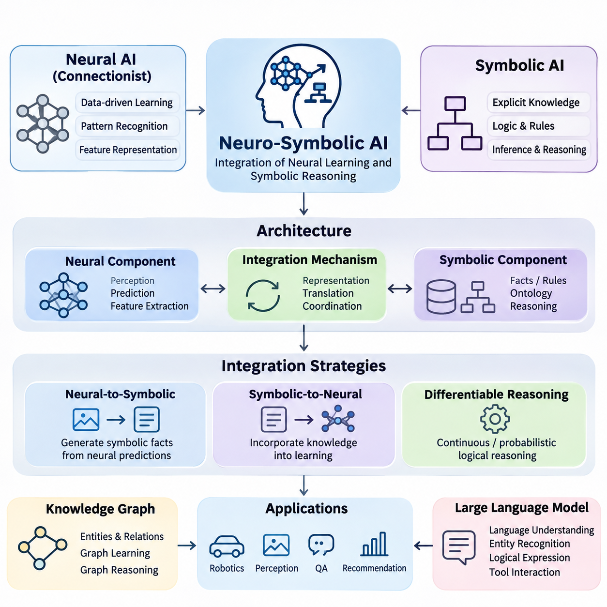
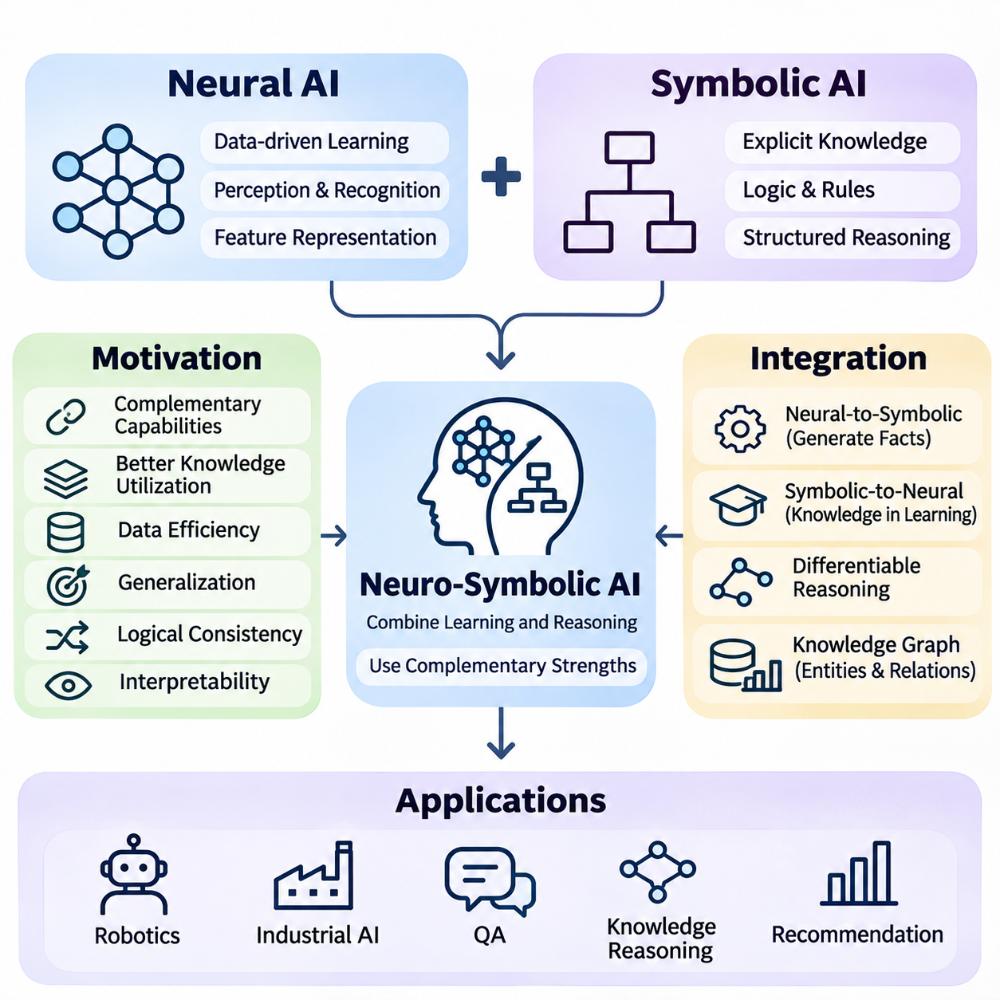
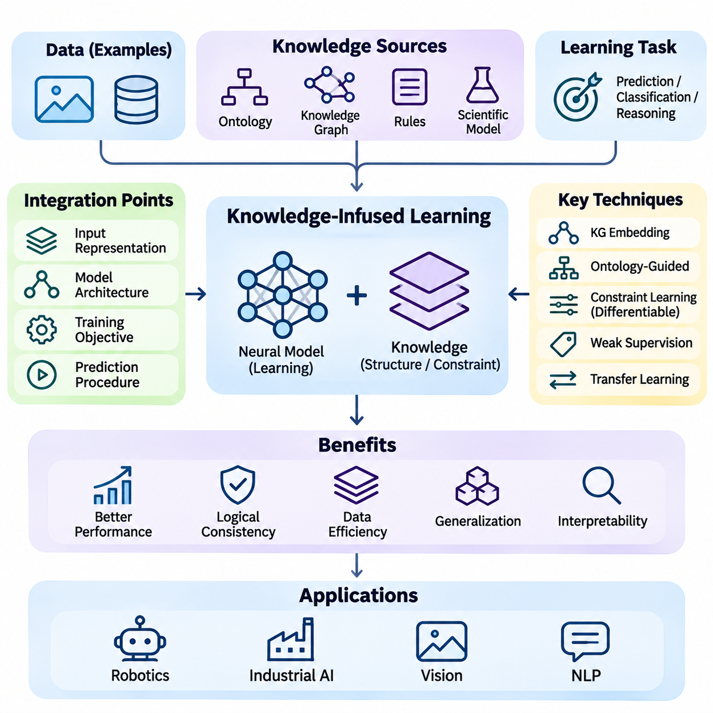
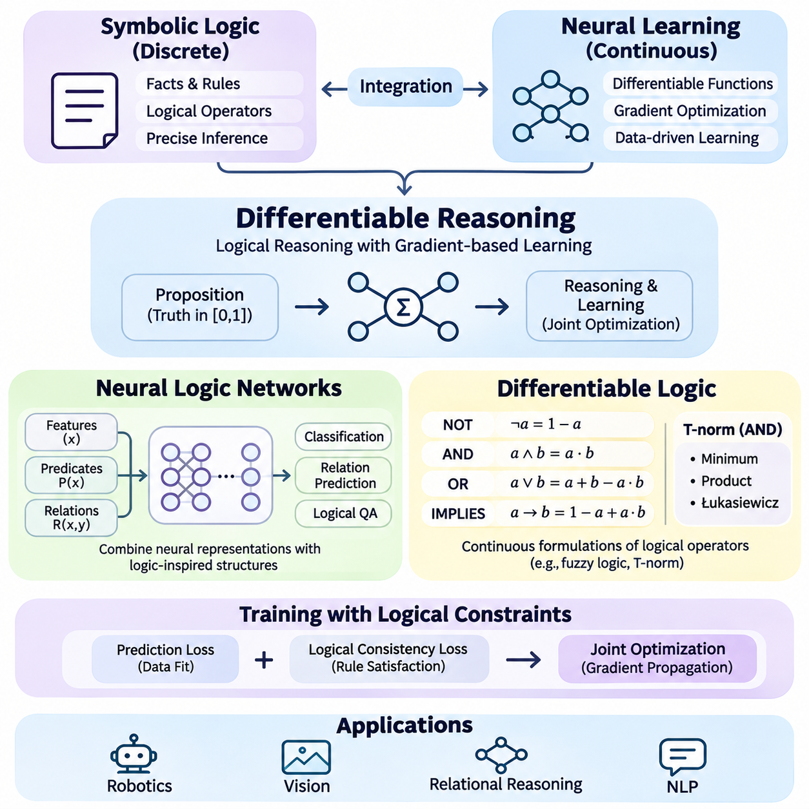
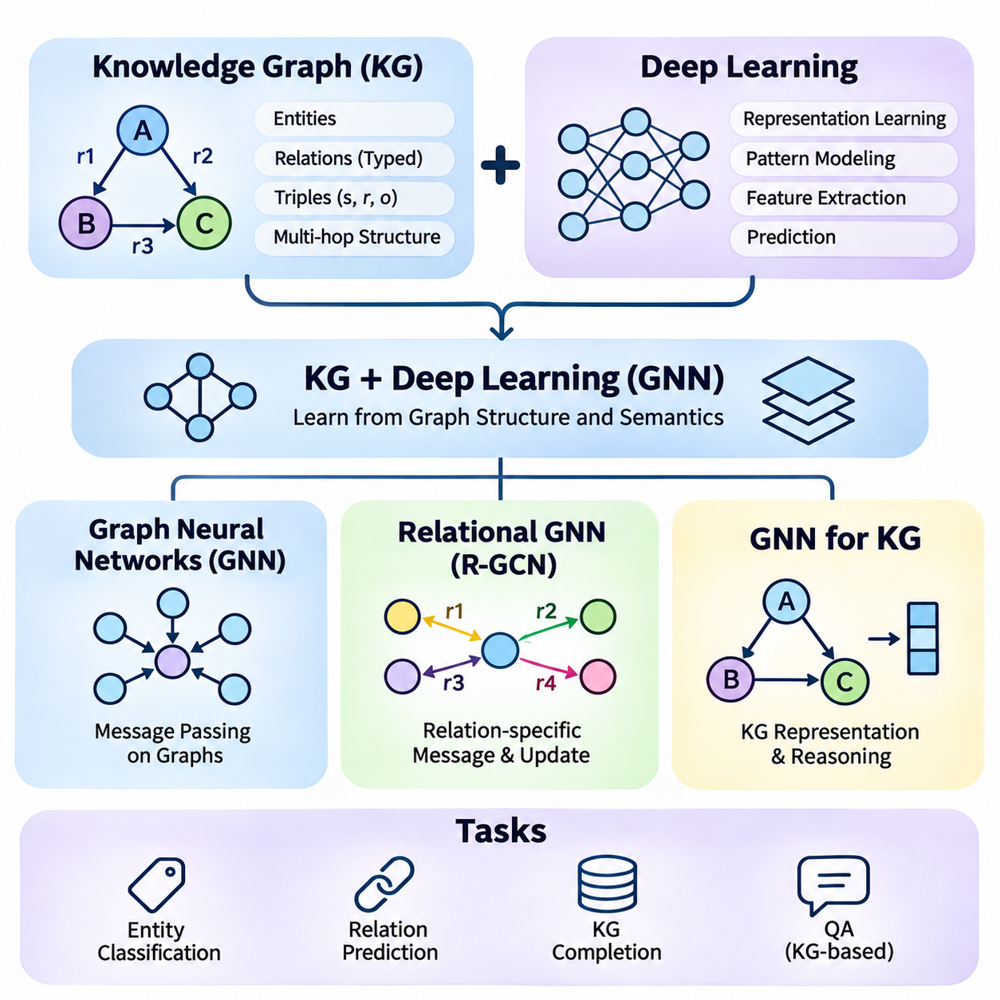
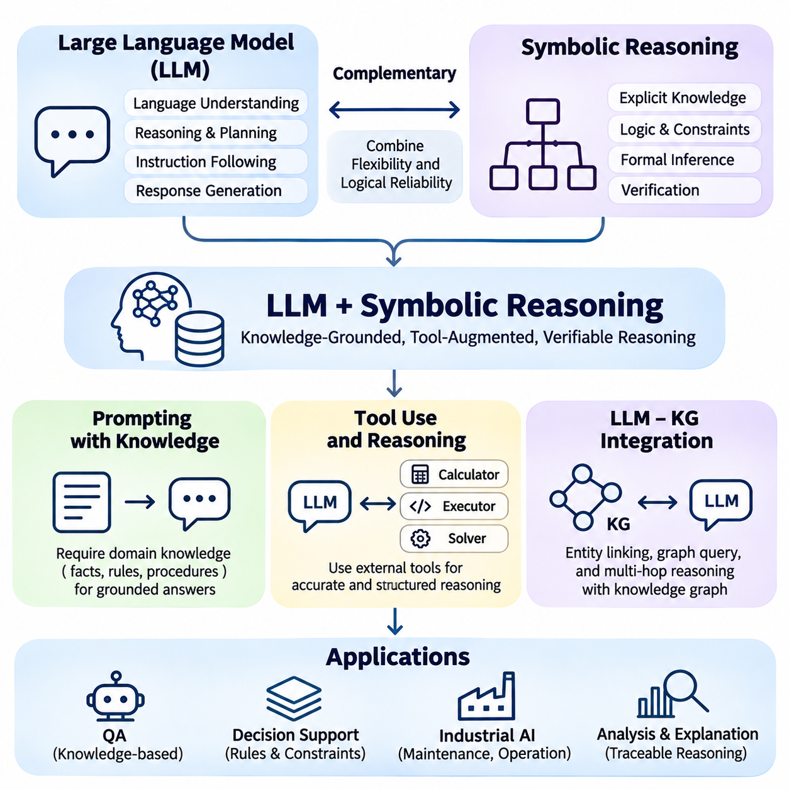
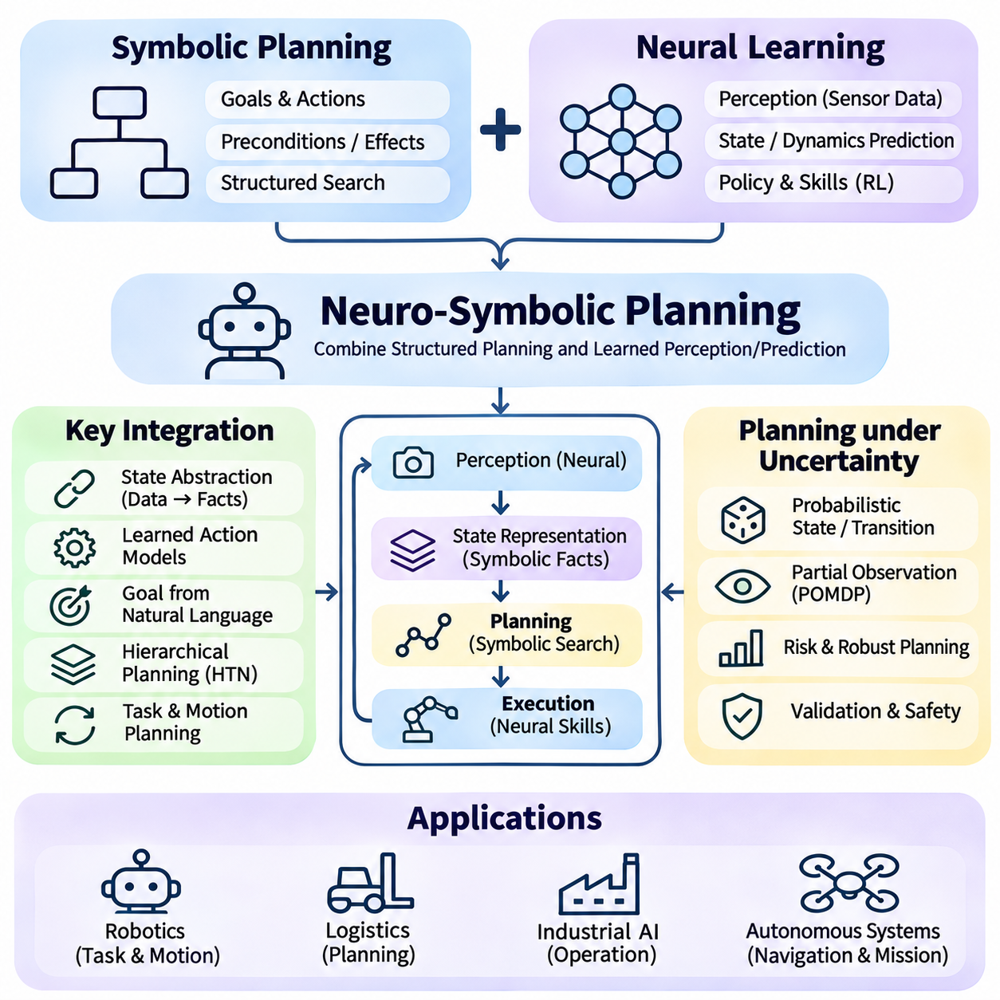
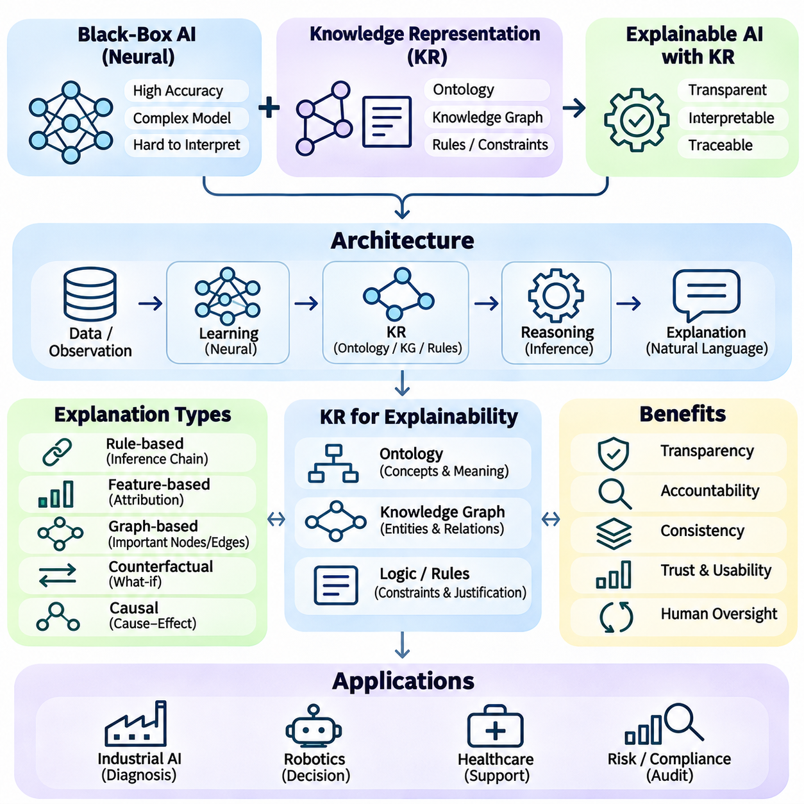
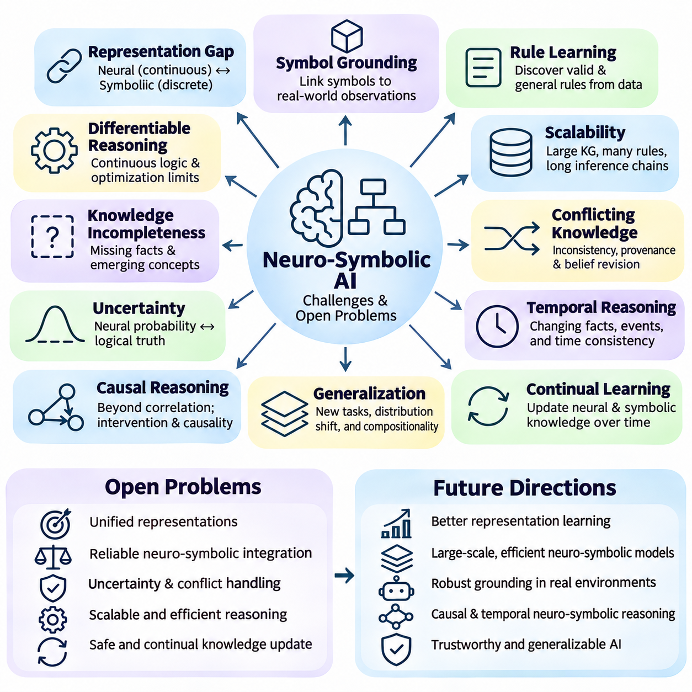
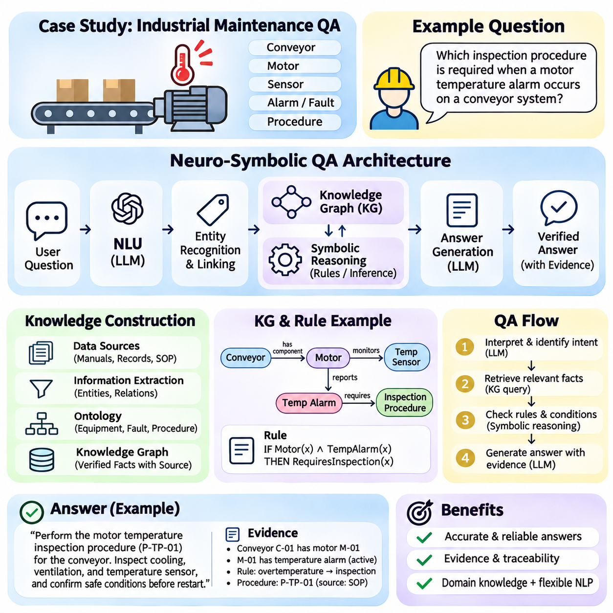

**Volume 02. Knowledge Representation**

# 05. Neuro Symbolic AI

## 05.01 Introduction to Neuro Symbolic

{width="7.268055555555556in" height="7.268055555555556in"}

신경-상징적 인공지능(Neuro-symbolic artificial intelligence)은 신경망 학습(neural learning)과 상징적 지식 표현 및 추론(symbolic knowledge representation and reasoning)을 통합하는 접근 방식입니다. 이는 복잡한 데이터에서 패턴을 인식하는 신경망의 능력과 개념, 관계, 제약 조건 및 논리적 규칙을 표현하는 상징적 시스템의 능력을 결합합니다. 목표는 구조화되고 해석 가능한 추론을 수행하면서 경험으로부터 배울 수 있는 지능형 시스템을 개발하는 것입니다.

전통적인 인공지능은 두 가지 주요 연구 방향을 따라 발전했습니다. 상징적 AI(Symbolic AI)는 명시적 지식, 형식 논리, 규칙 기반 추론을 강조한 반면, 연결주의 AI(connectionist AI)는 데이터로부터 분산 표현(distributed representations)을 학습하는 데 집중했습니다. 이러한 접근 방식들은 서로 다른 강점과 한계를 지니며 진화했습니다. 신경-상징적 AI는 학습과 추론을 독립적인 프로세스로 다루기보다는 이들 사이에 계산적 연결을 확립하고자 합니다.

상징적 AI는 술어(predicates), 논리식, 온톨로지(ontologies), 생성 규칙(production rules), 지식 그래프(knowledge graphs)와 같은 이산적 구조를 통해 지식을 표현합니다. 이러한 표현을 통해 시스템은 정의된 추론 절차를 사용하여 관계를 표현하고 결론을 도출할 수 있습니다. 예를 들어, 모든 자율주행 로봇에 안전 컨트롤러가 필요하다는 규칙은 개별 로봇의 분류가 알려졌을 때 해당 로봇에 대한 논리적 결론을 뒷받침할 수 있습니다.

신경망 AI(Neural AI)는 학습 과정에서 파라미터가 조정되는 상호 연결된 계산 단위를 통해 정보를 처리합니다. 신경망은 이미지, 언어, 오디오, 센서 측정값 및 기타 고차원 입력에서 유용한 표현을 추출할 수 있습니다. 신경망의 강점은 모든 특성을 수동으로 지정할 필요 없이 복잡한 통계적 관계를 학습하는 데 있습니다. 그러나 학습된 표현이 명시적인 논리적 보장을 자동으로 제공하지는 않습니다.

신경-상징적 통합의 근본적인 동기는 인지와 추론에 서로 다르지만 상호보완적인 능력이 필요하다는 점입니다. 신경망 모델이 카메라 이미지에서 물체를 식별하는 동안, 상징적 구성 요소는 이들의 관계가 운영 제약 조건을 위반하는지 여부를 결정할 수 있습니다. 이러한 기능들을 결합하면 지능형 시스템이 불확실한 관찰을 구조화된 지식과 연결하고 의사결정을 내릴 때 두 출처를 모두 활용할 수 있게 됩니다.

전형적인 신경-상징적 아키텍처는 신경 처리 구성 요소, 상징적 지식 구성 요소, 그리고 통합 메커니즘을 포함합니다. 신경 구성 요소는 특성을 추출하거나, 개념을 예측하거나, 관계를 추정합니다. 상징적 구성 요소는 사실, 규칙 및 도메인 제약 조건을 유지합니다. 통합 메커니즘은 표현 간에 정보를 변환하거나 구성 요소 간의 학습과 추론을 조정합니다.

신경망 표현과 상징적 표현 사이의 인터페이스는 핵심적인 엔지니어링 과제입니다. 신경망 시스템은 일반적으로 연속적인 벡터, 확률 또는 신뢰도 점수를 생성하는 반면, 상징적 시스템은 이산적 엔티티와 논리식 상에서 작동합니다. 불확실한 예측을 상징적 단정(symbolic assertions)으로 변환하는 과정에서 오류가 발생할 수 있습니다. 따라서 효과적인 통합을 위해서는 불확실성 관리, 의미적 정렬(semantic alignment) 및 일관성 검사를 위한 명시적 메커니즘이 필요합니다.

한 가지 통합 전략은 신경망을 사용하여 상징적 사실을 생성한 다음, 이를 전통적인 추론 엔진으로 처리하는 것입니다. 이미지 인식 모델이 보행자, 차량, 건널목 영역을 식별할 수 있습니다. 이러한 관찰은 감지된 엔티티와 공간적 관계를 설명하는 술어로 변환될 수 있습니다. 그런 다음 상징적 추론 엔진은 생성된 사실을 사용하여 교통 규칙이나 안전 제약 조건을 평가할 수 있습니다.

또 다른 전략은 상징적 지식을 신경망 학습 과정에 편입시키는 것입니다. 논리적 관계, 도메인 제약 조건 또는 온톨로지 구조는 추가적인 목적 함수나 아키텍처상의 제약을 통해 모델 학습에 영향을 미칠 수 있습니다. 이 접근 방식은 통계적 학습의 유연성을 유지하면서 선택된 지식 요구 사항을 예측이 충족하도록 유도합니다. 이러한 제약 조건의 유효성은 정확성, 커버리지 및 수학적 정형화에 달려 있습니다.

미분 가능한 추론(Differentiable reasoning)은 신경-상징적 연구에서 중요한 방향을 나타냅니다. 전통적인 논리 연산은 흔히 이산적이며 직접적인 경사하강법 기반 최적화(gradient-based optimization)에 적합하지 않습니다. 미분 가능한 접근 방식은 논리 연산의 연속적인 근사 또는 확률적 해석을 도입합니다. 이러한 메커니즘을 통해 학습 알고리즘은 추론 관련 목적 함수를 사용하여 파라미터를 최적화할 수 있지만, 근사 추론이 고전적인 논리적 의미론(semantics)을 보존하지 못할 수도 있습니다.

지식 그래프는 신경망 학습과 상징적 표현을 연결하는 또 다른 기반을 제공합니다. 지식 그래프는 구조화된 연결을 사용하여 엔티티와 그 관계를 설명합니다. 신경망 모델은 이러한 구조로부터 임베딩(embeddings)을 학습할 수 있으며, 그래프 기반 추론은 명시적인 관계 정보를 활용할 수 있습니다. 이러한 결합은 엔티티 분류, 관계 예측, 질의응답 및 지식 인식 추천(knowledge-aware recommendation)과 같은 애플리케이션을 지원합니다.

그래프 신경망(Graph neural networks)은 연결된 엔티티 간의 정보 교환을 통해 표현을 학습함으로써 이러한 통합을 확장합니다. 이들의 메시지 전달(message-passing) 메커니즘은 그래프 구조에 따라 인접 노드의 특성을 집계합니다. 관계형 그래프 신경망(Relational graph neural networks)은 다양한 관계 유형을 추가로 구별할 수 있습니다. 그래프 신경망이 본질적으로 상징적 추론기(symbolic reasoners)는 아니지만, 명시적 지식 및 추론 메커니즘과 연결될 때 신경-상징적 아키텍처에 참여할 수 있습니다.

거대 언어 모델(Large language models)은 신경-상징적 통합을 위한 추가적인 기회를 제공합니다. 이들은 자연어를 해석하고, 엔티티를 식별하며, 후보 논리식을 생성하고, 외부 지식 시스템과 상호작용할 수 있습니다. 상징적 엔진은 구조화된 질의, 규칙 평가 및 제약 조건 검증을 통해 이러한 능력을 보완할 수 있습니다. 이러한 배치는 생성된 모든 결론이 올바름을 보장하지는 않더라도 선택된 추론 연산의 추적 가능성을 향상시킬 수 있습니다.

신경-상징적 추론은 계획 수립(planning)과 의사결정도 지원할 수 있습니다. 신경망 구성 요소가 환경 상태를 추정하거나, 관련 물체를 인식하거나, 행동 결과를 예측할 수 있습니다. 그런 다음 상징적 플래너(symbolic planner)는 이러한 관찰 결과를 미리 정의된 행동, 목표 및 제약 조건과 함께 사용할 수 있습니다. 이 아키텍처는 지능형 에이전트가 명시적인 운영 요구 사항을 준수하면서 변화하는 환경에서 작동해야 할 때 특히 유용합니다.

로봇 공학에서 신경-상징적 AI는 시각적 인지, 의미적 지도 작성(semantic mapping), 작업 계획 수립 및 안전 추론을 연결할 수 있습니다. 이동 로봇은 인지 시스템을 통해 막힌 복도를 감지하고 이 관찰을 상징적인 환경 사실로 표현할 수 있습니다. 계획 수립 구성 요소는 제한 구역, 작업 우선순위 및 운영 규칙을 고려하면서 대체 경로를 평가할 수 있습니다. 신뢰할 수 있는 실행을 위해서는 센서 관찰에 대한 지속적인 검증이 여전히 필요합니다.

산업용 AI는 또 다른 실용적인 응용 분야를 제공합니다. 신경망은 진동 신호, 이미지 또는 시계열 측정값으로부터 장비 이상을 감지할 수 있습니다. 상징적 지식은 유지보수 절차, 장비 의존성 및 운영 제약 조건을 표현할 수 있습니다. 이러한 구성 요소들을 통합하면 시스템이 통계적 이상 예측을 엔지니어링 지식과 연관시키고 문서화된 절차에 맞춰 검토할 수 있는 권장 사항을 생성할 수 있습니다.

설명 가능성(Explainability)은 신경-상징적 시스템의 잠재적 장점으로 자주 언급됩니다. 명시적 규칙, 지식 그래프 경로 및 추론 기록은 특정 결정에 대한 이해하기 쉬운 설명을 제공할 수 있습니다. 그러나 상징적 구성 요소가 존재한다고 해서 전체 시스템이 투명해지는 것은 아닙니다. 신경망의 예측은 여전히 해석하기 어려울 수 있으며, 설명은 단순히 그럴듯한 서사를 제공하는 것에 그치지 않고 계산 과정을 정확하게 반영해야 합니다.

신경-상징적 시스템은 불확실성과 불완전한 지식 문제도 해결해야 합니다. 실제 환경의 관찰은 흔히 잡음이 섞여 있거나, 모호하거나, 모순되는 반면, 상징적 지식베이스는 관련 관계를 누락할 수 있습니다. 확률적 논리(Probabilistic logic), 신뢰도 인식 추론(confidence-aware inference) 및 불확실성 전파(uncertainty propagation)는 이러한 차이를 메우는 데 도움이 될 수 있습니다. 견고한 아키텍처는 관찰된 증거, 학습된 예측, 도출된 결론 및 지식 모델에 의해 도입된 가정을 구별해야 합니다.

학습과 추론의 구별은 신경-상징적 아키텍처를 평가할 때 중요합니다. 학습은 예시와 피드백을 기반으로 표현이나 파라미터를 조정하는 반면, 추론은 지정된 추론 규칙에 따라 사용 가능한 정보로부터 결론을 도출합니다. 통합된 시스템은 이러한 연산을 순차적으로, 반복적으로 또는 결합하여 수행할 수 있습니다. 시스템의 설계에 따라 지식이 학습, 추론, 계획 수립 또는 여러 단계에 영향을 미치는지 여부가 결정됩니다.

평가에는 예측 정확도를 측정하는 것 이상의 과정이 필요합니다. 신경-상징적 시스템은 논리적 일관성, 추론 정확성, 견고성, 일반화 능력, 계산 효율성 및 설명 충실도(explanation fidelity)에 대해서도 검증되어야 합니다. 상징적 제약 조건이 분포 변화(distribution shifts) 상황에서 성능을 향상시키는지, 그리고 잘못된 신경망 예측이 하류(downstream) 추론으로 전파되는지 여부를 테스트를 통해 확인해야 합니다. 신경망 전용 및 상징적 전용 베이스라인과의 비교는 특히 유용한 정보를 제공합니다.

몇 가지 한계점이 여전히 중요하게 남아 있습니다. 신뢰할 수 있는 지식베이스를 구축하려면 광범위한 도메인 전문 지식이 필요할 수 있으며, 신경망 표현을 상징적 개념으로 매핑하는 과정에서 의미적 모호성이 발생할 수 있습니다. 미분 가능한 추론은 계산 비용이 많이 들 수 있으며, 엄격한 논리적 제약 조건이 잡음이 있는 관찰과 충돌할 수 있습니다. 동적인 환경에 배포된 시스템의 경우 지속적인 학습 동안 지식 일관성을 유지하는 것이 추가적인 과제를 제시합니다.

따라서 신경-상징적 AI는 단일 알고리즘이나 보편적으로 우수한 아키텍처라기보다는 통합 방법들의 패밀리(family of integration methods)로 이해되어야 합니다. 응용 분야마다 통계적 학습, 명시적 지식, 논리적 추론 및 계산 자원 간의 서로 다른 균형을 요구합니다. 가장 적절한 설계는 문제의 구조, 도메인 지식의 가용성, 오류의 결과 및 필요한 해석 가능성의 정도에 따라 달라집니다.

지식 표현 영역 내에서 신경-상징적 AI는 논리, 온톨로지, 지식 그래프 및 규칙 기반 시스템의 역할을 학습 기반 환경으로 확장합니다. 이러한 상징적 기반은 신경망 모델과 상호작용할 수 있는 구조화된 개념과 추론 메커니즘을 제공합니다. 이러한 관계를 이해하는 것은 지식 주입 학습(knowledge-infused learning), 미분 가능한 추론, 그래프 기반 통합, 언어 모델 추론 및 신경-상징적 계획 수립을 연구하기 위한 토대를 마련해 줍니다.

## 05.02 Why Combine Symbolic and Neural

{width="7.268055555555556in" height="7.268055555555556in"}

기호적 인공지능(Symbolic Artificial Intelligence)과 신경망 인공지능(Neural Artificial Intelligence)은 지능형 연산(Intelligent Computation)의 서로 다른 측면을 다룬다. 기호적 시스템(Symbolic Systems)은 명시적 지식 표현(Explicit Knowledge Representation), 논리적 관계(Logical Relationships), 구조화된 추론(Structured Inference)을 강조하는 반면, 신경망 시스템(Neural Systems)은 데이터로부터 통계적 패턴(Statistical Patterns)을 학습한다. 두 접근법을 결합하면 복잡한 정보를 인식하고, 그 의미를 추론하며, 정의된 제약조건(Constraints)에 따라 의사결정을 수행하는 시스템을 개발할 수 있다.

기호적 인공지능(Symbolic AI)은 지식을 사실(Facts), 규칙(Rules), 온톨로지(Ontologies), 논리식(Logical Formulas)으로 표현할 수 있을 때 특히 효과적이다. 이러한 표현은 형식적 가정(Formal Assumptions) 내에서 일관된 추론(Consistent Reasoning)을 지원하며, 명시적인 추론 단계(Inference Steps)를 통해 결론을 추적할 수 있게 한다. 그러나 기호적 시스템은 비정형 데이터(Unstructured Data)에서 지식을 자동으로 획득하는 데 어려움을 겪으며, 특히 관측값에 모호성(Ambiguity), 잡음(Noise), 불완전한 정보(Incomplete Information)가 포함된 경우 이러한 한계가 두드러진다.

신경망 인공지능(Neural AI)은 학습 사례(Training Examples)를 통해 훈련되는 매개변수화 모델(Parameterized Models)을 사용하여 다양한 인식 및 학습 문제를 해결한다. 심층 신경망(Deep Neural Networks)은 모든 패턴에 대해 수작업으로 규칙을 정의하지 않아도 이미지, 음성, 텍스트, 센서 측정값에서 표현(Representations)을 추출할 수 있다. 그러나 높은 예측 성능(Predictive Performance)이 반드시 논리적 일관성(Logical Consistency), 신뢰할 수 있는 조합적 추론(Compositional Reasoning), 명시적인 도메인 제약조건(Domain Constraints)의 준수를 의미하지는 않는다.

두 패러다임(Paradigms)을 결합하려는 동기는 각각의 상호보완적인 강점과 약점에서 비롯된다. 신경망 모델(Neural Models)은 복잡한 관측값을 의미 있는 표현으로 변환할 수 있으며, 기호적 메커니즘(Symbolic Mechanisms)은 이러한 표현을 구조화된 지식(Structured Knowledge)으로 조직할 수 있다. 두 기술을 통합하면 학습된 증거(Learned Evidence)를 형식적 관계(Formal Relationships)와 연결할 수 있으며, 어느 한 접근법만으로는 구현하기 어려운 추론 과정을 수행할 수 있다.

중요한 이점 중 하나는 지식 활용(Knowledge Utilization)의 개선이다. 기존 신경망(Neural Networks)은 주로 학습 데이터(Training Data)와 최적화(Optimization)를 통해 정보를 획득하지만, 사전 학습 모델(Pretrained Models)은 상당한 양의 암묵적 지식(Implicit Knowledge)을 포함할 수도 있다. 기호적 구성요소(Symbolic Components)는 도메인 전문지식(Domain Expertise)을 명시적으로 표현할 수 있는 추가적인 경로를 제공한다. 이러한 지식은 예측을 안내하고, 가능한 출력을 제한하며, 학습 사례가 부족할 때 추론을 지원할 수 있다.

데이터 효율성(Data Efficiency)은 신경망과 기호적 시스템을 통합하는 또 다른 동기이다. 신경망 모델은 복잡한 관계를 안정적으로 학습하기 위해 상당한 양의 학습 데이터가 필요한 경우가 많다. 기호적 지식(Symbolic Knowledge)은 유용한 제약조건이나 관계 구조(Relational Structures)를 제공하여 모든 의존관계(Dependencies)를 학습 사례에서 발견해야 하는 부담을 줄일 수 있다. 이러한 개선이 자동으로 보장되는 것은 아니지만, 적절하게 설계된 지식 제약조건(Knowledge Constraints)은 레이블 데이터(Labeled Data)가 제한된 상황에서 모델의 일반화(Generalization)를 향상시킬 수 있다.

관측된 학습 사례를 넘어서는 일반화(Generalization)는 기계학습(Machine Learning)의 주요 과제로 남아 있다. 신경망은 익숙한 데이터 분포(Data Distributions)에서는 높은 성능을 보이지만, 객체, 관계, 환경 조건이 변화하면 실패할 수 있다. 기호적 표현(Symbolic Representations)은 재사용 가능한 개념(Reusable Concepts)과 규칙을 표현하여 조합적 추론(Compositional Reasoning)을 지원한다. 학습된 표현과 이러한 구조를 결합하면 이전에 경험한 요소들이 새로운 방식으로 조합된 상황에서도 성능을 개선할 가능성이 있다.

논리적 일관성(Logical Consistency)은 신경망과 기호적 접근법을 결합해야 하는 또 다른 이유이다. 신경망 분류기(Neural Classifier)는 개별적으로는 타당해 보이지만 전체적으로는 알려진 관계를 위반하는 예측을 생성할 수 있다. 예를 들어 산업 모니터링 시스템(Industrial Monitoring System)이 장비를 정상 작동 상태로 분류하면서 동시에 서로 양립할 수 없는 작동 상태를 예측할 수 있다. 기호적 제약조건(Symbolic Constraints)은 이러한 불일치를 식별하고 수정 처리(Corrective Processing)를 지원할 수 있다.

해석 가능성(Interpretability)은 의사결정을 검토하거나 정당화해야 하는 응용 분야에서 특히 중요하다. 신경망은 정보를 직접 해석하기 어려운 분산된 수치 표현(Distributed Numerical Representations)으로 인코딩하는 경우가 많다. 기호적 시스템은 사실, 규칙, 관계를 통해 명시적인 추론 경로(Reasoning Paths)를 제공할 수 있다. 따라서 신경-기호적 아키텍처(Neuro-Symbolic Architectures)는 일부 의사결정 메커니즘(Decision Mechanisms)을 드러낼 수 있지만, 설명이 실제 계산 과정(Computational Process)을 정확하게 반영하는지는 검증해야 한다.

인식(Perception)과 추론(Reasoning)의 통합은 로보틱스(Robotics)에서 특히 유용하다. 신경망 인식 시스템(Neural Perception Systems)은 센서 데이터에서 객체를 탐지하고 위치를 추정하며 환경 조건을 인식할 수 있다. 기호적 추론 시스템(Symbolic Reasoning Systems)은 작업 요구사항(Task Requirements), 공간적 관계(Spatial Relationships), 안전 규칙(Safety Rules)에 따라 이러한 관측값을 해석할 수 있다. 이러한 결합을 통해 로봇은 저수준 감각 정보(Low-Level Sensory Information)를 고수준 운영 의사결정(High-Level Operational Decisions)과 연결할 수 있다.

산업 시설을 주행하는 자율이동로봇(Autonomous Mobile Robot)을 생각해 볼 수 있다. 신경망 모델은 카메라와 라이다(LiDAR) 관측값을 통해 작업자, 지게차, 장애물, 제한 구역(Restricted Zones)을 식별할 수 있다. 기호적 시스템은 접근 권한(Access Permissions), 교통 우선순위(Traffic Priorities), 작업 제약조건(Task Constraints)을 표현할 수 있다. 이러한 구성요소를 통합하면 로봇은 환경 증거(Environmental Evidence)와 사전에 정의된 운영 지식(Operational Knowledge)을 함께 활용하여 가능한 행동을 평가할 수 있다.

지식 그래프(Knowledge Graphs)는 학습된 표현과 구조화된 관계를 결합하기 위한 실용적인 기반을 제공한다. 지식 그래프는 개체(Entities)와 연결 관계(Connections)를 명시적으로 표현하며, 신경망 모델은 그래프 구조의 통계적 규칙성(Statistical Regularities)을 포착하는 임베딩(Embeddings)을 학습할 수 있다. 이러한 표현을 결합하면 관계 예측(Relation Prediction), 개체 분류(Entity Classification), 지식 인식 추론(Knowledge-Aware Inference)을 지원할 수 있다. 결과적으로 시스템은 관측된 그래프 사실과 학습된 관계 패턴을 모두 활용할 수 있다.

신경-기호적 통합(Neuro-Symbolic Integration)은 모델 학습(Model Training)에 도메인 지식(Domain Knowledge)을 반영하는 메커니즘도 제공한다. 논리 규칙(Logical Rules)과 관계적 제약조건(Relational Constraints)은 추가적인 학습 목적함수(Learning Objectives)나 아키텍처 제한조건(Architectural Restrictions)으로 변환될 수 있다. 이러한 메커니즘은 신경망 예측이 선택된 지식 요구사항(Knowledge Requirements)을 만족하도록 유도한다. 미분 가능한 추론(Differentiable Reasoning) 기법은 일부 추론 관련 목적함수가 경사 기반 최적화(Gradient-Based Optimization)에 참여할 수 있도록 한다.

불확실성 관리(Uncertainty Management)는 또 다른 중요한 통합 동기이다. 신경망은 신뢰도 점수(Confidence Scores)나 확률 추정값(Probability Estimates)을 생성하는 경우가 많지만, 고전적 기호 논리(Classical Symbolic Logic)는 일반적으로 이산적인 진릿값 할당(Discrete Truth Assignments)을 사용한다. 실제 응용에서는 모든 예측을 의심할 여지 없는 사실로 취급하지 않으면서 불확실한 관측값을 추론해야 한다. 확률 논리(Probabilistic Logic)와 불확실성 인식 통합 메커니즘(Uncertainty-Aware Integration Mechanisms)은 통계적 증거와 구조화된 추론을 연결하는 데 도움을 줄 수 있다.

대규모 언어 모델(Large Language Models)은 신경망 추론(Neural Reasoning)의 가능성과 한계를 동시에 보여준다. 이러한 모델은 자연스러운 설명을 생성하고, 지시사항을 해석하며, 다양한 추론 문제를 해결할 수 있지만 근거 없는 진술이나 일관성이 부족한 결론을 생성할 수도 있다. 기호적 도구(Symbolic Tools), 지식 그래프(Knowledge Graphs), 형식적 검증기(Formal Validators)는 특정 주장과 계산을 확인하기 위한 외부 구조를 제공할 수 있다. 이러한 방법의 효과는 정확한 도구 사용(Tool Use)과 신뢰할 수 있는 지식 출처(Knowledge Sources)에 달려 있다.

계획 시스템(Planning Systems) 역시 학습된 예측과 기호적 행동 모델(Symbolic Action Models)의 결합으로 이점을 얻을 수 있다. 신경망 구성요소는 행동 결과(Action Outcomes)를 추정하거나 변화하는 환경 조건을 인식할 수 있으며, 기호적 계획기(Symbolic Planners)는 목표(Goals), 사전조건(Preconditions), 효과(Effects)를 표현한다. 이러한 역할 분리는 후보 계획(Candidate Plans)의 구조화된 평가를 지원하면서 환경 모델(Environmental Models)이 학습을 통해 적응할 수 있도록 한다. 이는 운영 제약조건(Operational Constraints)을 명시적으로 유지해야 하는 상황에서 특히 유용하다.

산업 응용(Industrial Applications)은 통계적 탐지(Statistical Detection)와 공학 지식(Engineering Knowledge)을 통합하는 가치를 보여준다. 신경망 모델은 비정상적인 진동 패턴(Vibration Patterns), 시각적 결함(Visual Defects), 비정상적인 공정 측정값(Process Measurements)을 식별할 수 있다. 기호적 표현은 장비 의존관계(Equipment Dependencies), 유지보수 규칙(Maintenance Rules), 허용 가능한 작동 조건(Operating Conditions)을 기술할 수 있다. 이러한 결합은 탐지된 이상을 가능한 원인과 권장 절차에 연결할 수 있지만, 실제 장비 동작에 대한 검증이 필요하다.

안전 요구사항(Safety Requirements)은 하이브리드 아키텍처(Hybrid Architectures)를 도입하는 또 다른 동기를 제공한다. 신경망 예측만으로는 특히 익숙하지 않은 조건에서 모든 운영 제한사항(Operational Restrictions)을 강제하지 못할 수 있다. 기호적 구성요소는 명시적인 금지사항(Prohibitions), 허가사항(Permissions), 논리적 의존관계(Logical Dependencies)를 표현할 수 있다. 그러나 기호적 검증(Symbolic Validation)은 누락된 관측값이나 잘못된 규칙을 보완할 수 없으므로, 안전 필수 시스템(Safety-Critical Systems)에는 독립적인 안전장치(Safeguards), 모니터링(Monitoring), 체계적인 검증(Systematic Verification)이 여전히 필요하다.

두 접근법의 결합은 중요한 공학적 절충관계(Engineering Tradeoffs)도 발생시킨다. 신경망과 기호적 구성요소는 서로 다른 표현 방식(Representations), 계산 메커니즘(Computational Mechanisms), 불확실성에 대한 가정(Assumptions)을 사용한다. 연속적인 예측값(Continuous Predictions)을 이산적인 개념(Discrete Concepts)으로 변환하면 정보 손실(Information Loss)이 발생할 수 있으며, 대규모 지식 베이스(Knowledge Bases)를 유지하는 데 상당한 비용이 필요할 수 있다. 통합 메커니즘은 추론 복잡도(Reasoning Complexity), 계산 지연시간(Computational Latency), 의미적 일관성(Semantic Consistency), 변화하는 환경에 대한 적응성(Adaptability)의 균형을 고려해야 한다.

모든 응용 분야가 신경-기호적 통합(Neuro-Symbolic Integration)으로 동일한 이점을 얻는 것은 아니다. 예측 정확도(Predictive Accuracy)가 주요 요구사항이고 명시적 추론(Explicit Reasoning)의 추가 가치가 작다면 순수 신경망 솔루션(Purely Neural Solutions)으로 충분할 수 있다. 환경이 명확하게 정의되어 있고 지식을 규칙으로 완전하게 표현할 수 있다면 기호적 솔루션(Symbolic Solutions)이 더 적합할 수 있다. 복잡한 인식, 구조화된 추론, 명시적 제약조건이 함께 작동해야 하는 경우에는 하이브리드 접근법(Hybrid Approaches)이 특히 유용하다.

통합의 이점을 평가하려면 신경망 전용 기준 모델(Neural-Only Baselines) 및 기호적 전용 기준 모델(Symbolic-Only Baselines)과의 비교가 필요하다. 관련 평가 지표(Evaluation Metrics)에는 예측 정확도, 논리적 일관성, 표본 효율성(Sample Efficiency), 강건성(Robustness), 추론 정확성(Reasoning Correctness), 계산 비용(Computational Cost)이 포함된다. 연구자는 관측된 성능 개선이 기호적 지식 자체에서 비롯된 것인지, 추가적인 모델 용량(Model Capacity)이나 학습 절차(Training Procedures)의 차이에서 비롯된 것인지도 판단해야 한다. 의미 있는 이점을 확인하려면 통제된 실험(Controlled Experiments)이 필수적이다.

궁극적으로 기호적 인공지능과 신경망 인공지능을 결합하는 목적은 한 패러다임을 다른 패러다임으로 대체하는 것이 아니라 상호보완적인 계산 능력(Computational Capabilities)을 연결하는 데 있다. 신경망 학습(Neural Learning)은 복잡한 관측값에 대한 적응 가능한 표현(Adaptable Representations)을 제공하고, 기호적 추론(Symbolic Reasoning)은 지식을 조직하고 관계를 평가하기 위한 명시적 구조(Explicit Structures)를 제공한다. 이러한 통합은 지식 주입 학습(Knowledge-Infused Learning), 미분 가능한 추론(Differentiable Reasoning), 신경-기호적 계획(Neuro-Symbolic Planning), 그리고 책임성과 검증 가능성을 강화한 지능형 시스템(Intelligent Systems)의 기반을 형성한다.

## 05.03 Knowledge Infused Learning

{width="7.268055555555556in" height="7.268055555555556in"}

지식 주입 학습(Knowledge-Infused Learning)은 구조화된 도메인 지식(Structured Domain Knowledge)을 신경망 모델(Neural Models)의 학습 과정에 통합하는 인공지능 접근법이다. 학습 데이터에서 추출한 통계적 패턴(Statistical Patterns)에만 의존하는 대신, 사실(Facts), 관계(Relationships), 규칙(Rules), 온톨로지(Ontologies), 지식 그래프(Knowledge Graphs)를 활용하여 표현 학습(Representation Learning)과 예측(Prediction)을 안내한다. 목표는 데이터 기반 적응성(Data-Driven Adaptability)과 지식 기반 일관성(Knowledge-Based Consistency)을 결합한 모델을 개발하는 것이다.

기존 기계학습 시스템(Machine Learning Systems)은 주로 학습 사례(Training Examples)와 최적화(Optimization)를 통해 지식을 획득한다. 신경망(Neural Networks)은 복잡한 통계적 의존관계(Statistical Dependencies)를 발견할 수 있지만, 도메인 전문가(Domain Experts)에게 명백한 관계를 간과할 수 있다. 지식 주입 학습은 관련 개념(Concepts), 제약조건(Constraints), 의존관계(Dependencies)를 설명하는 외부 정보(External Information)를 도입하여 이러한 한계를 해결하고, 학습 데이터셋(Training Datasets)에 충분히 표현되지 않은 지식을 모델이 활용하도록 한다.

학습 시스템(Learning Systems)에 통합되는 지식은 여러 출처에서 얻을 수 있다. 도메인 온톨로지(Domain Ontologies)는 개념, 범주(Categories), 의미적 관계(Semantic Relationships)를 정의하며, 지식 그래프(Knowledge Graphs)는 개체(Entities)와 그 연결 관계를 표현한다. 논리 규칙(Logical Rules)은 제약조건과 함의 관계(Implications)를 설명하고, 과학적 모델(Scientific Models)은 변수 사이에 확립된 관계를 표현한다. 이러한 지식 출처는 신경망의 학습 및 정보 해석 방식에 영향을 줄 수 있는 다양한 형태의 구조를 제공한다.

기본적인 설계 결정(Design Decision)은 기계학습 파이프라인(Machine Learning Pipeline)의 어느 단계에 지식을 도입할 것인지에 관한 것이다. 지식은 입력 표현(Input Representations), 모델 아키텍처(Model Architectures), 학습 목적함수(Training Objectives), 예측 절차(Prediction Procedures)에 통합될 수 있다. 각 통합 지점(Integration Point)은 서로 다른 기능과 공학적 요구사항(Engineering Requirements)을 제공한다. 적절한 메커니즘의 선택은 지식 형식(Knowledge Format), 학습 작업(Learning Task), 사용 가능한 지도 정보(Supervision), 요구되는 논리적 일관성(Logical Consistency)의 수준에 따라 달라진다.

지식 강화 입력 표현(Knowledge-Enhanced Input Representations)은 추가적인 의미 정보(Semantic Information)를 사용하여 학습 사례를 풍부하게 만든다. 예를 들어 객체 인식 시스템(Object Recognition System)은 시각적 특징(Visual Features)과 함께 온톨로지에서 파생된 속성(Attributes)을 입력받을 수 있다. 이러한 속성은 객체 범주(Object Categories), 기능적 관계(Functional Relationships), 문맥적 특성(Contextual Properties)을 설명할 수 있다. 신경망 모델은 관측 데이터(Observed Data)와 구조화된 지식을 함께 학습하여 의미적으로 관련된 개념을 구별하는 능력을 향상시킬 수 있다.

지식 그래프 임베딩(Knowledge Graph Embeddings)은 구조화된 정보를 신경망 학습에 통합하는 또 다른 메커니즘을 제공한다. 개체와 관계는 특정 관계 패턴(Relational Patterns)을 포착하는 연속 벡터 공간(Continuous Vector Spaces)에 매핑된다. 이러한 임베딩은 시각적 특징, 텍스트 특징, 수치적 특징(Numerical Features)과 결합되어 후속 예측(Downstream Predictions)을 지원할 수 있다. 유용성은 그래프 구축(Graph Construction)의 품질, 임베딩 목적함수(Embedding Objectives), 그래프 개체와 관측 데이터 사이의 정렬(Alignment)에 따라 달라진다.

지식은 신경망 아키텍처(Neural Network Architecture)에도 영향을 줄 수 있다. 모델은 관계 구조(Relational Structures), 계층적 의존관계(Hierarchical Dependencies), 도메인별 연결 패턴(Domain-Specific Connectivity Patterns)을 계산 구조(Computational Design)에 통합할 수 있다. 예를 들어 그래프 신경망(Graph Neural Networks)은 그래프 연결 관계를 사용하여 개체 사이의 정보 교환 방식을 결정한다. 이러한 아키텍처 선택은 인코딩된 관계가 목표 문제(Target Problem)를 정확하게 반영할 때 학습을 개선할 수 있는 귀납적 편향(Inductive Biases)을 도입한다.

학습 목적함수(Training Objectives)는 지식 주입을 위한 유연한 메커니즘을 제공한다. 기존 손실함수(Loss Function)는 레이블이 지정된 학습 사례에 대한 예측 오차(Prediction Errors)를 측정하며, 추가적인 항(Terms)은 도메인 제약조건(Domain Constraints)의 위반에 벌점(Penalties)을 부여할 수 있다. 결과적으로 최적화 과정(Optimization Process)은 경험적 성능(Empirical Performance)과 선택된 지식 요구사항(Knowledge Requirements)의 균형을 조정한다. 과도한 벌점은 적응성(Adaptability)을 감소시키거나 불확실한 관측값과 충돌을 일으킬 수 있으므로 제약조건 가중치(Constraint Weights)를 신중하게 선택해야 한다.

논리적 제약조건(Logical Constraints)은 기호식(Symbolic Expressions)의 미분 가능한 근사(Differentiable Approximations)를 통해 통합될 수 있다. 두 개념 사이의 함의 관계(Implication)를 설명하는 규칙은 모델 예측에 따라 달라지는 연속적인 벌점(Continuous Penalty)으로 변환될 수 있다. 이후 경사 기반 최적화(Gradient-Based Optimization)는 해당 규칙을 만족하는 예측을 유도할 수 있다. 그러나 미분 가능한 근사는 특히 진릿값(Truth Values)이 불확실할 때 고전 논리(Classical Logic)의 정확한 의미론(Semantics)을 반드시 보존하지는 않는다.

의미적 정규화(Semantic Regularization)는 제약조건 기반 학습(Constraint-Based Learning)과 밀접하게 관련된다. 이는 신경망 표현(Neural Representations)이나 예측이 지정된 의미적 관계(Semantic Relationships)와 일치하도록 유도한다. 예를 들어 분류 모델(Classification Model)이 동일한 객체에 서로 양립할 수 없는 레이블(Incompatible Labels)을 부여하지 않도록 제한할 수 있다. 이러한 정규화는 인코딩된 관계가 유효할 때 일관성을 향상시킬 수 있지만, 잘못되거나 지나치게 제한적인 제약조건은 체계적인 예측 오류(Systematic Prediction Errors)를 유발할 수 있다.

온톨로지 기반 학습(Ontology-Guided Learning)은 형식적으로 조직된 개념을 활용하여 신경망 표현과 예측에 영향을 준다. 분류학적 관계(Taxonomic Relationships)는 상위 클래스(Superclasses)와 하위 클래스(Subclasses)의 구조를 설명하며, 객체 속성(Object Properties)은 개체 사이의 관계를 지정한다. 모델은 이러한 구조를 활용하여 계층적 의존관계(Hierarchical Dependencies)를 인식하거나 후보 분류(Candidate Classifications)를 제한할 수 있다. 온톨로지 지식(Ontological Knowledge)은 예측 범주 사이에 의미 있는 관계가 존재할 때 특히 유용하다.

약지도 학습(Weak Supervision)은 지식 주입 학습을 위한 또 다른 기회를 제공한다. 도메인 규칙(Domain Rules)은 사람이 직접 주석을 달지 않은 학습 사례에 대해 근사 레이블(Approximate Labels)을 생성할 수 있다. 이러한 레이블은 수동 레이블링(Manual Labeling) 요구사항을 줄이면서 학습 범위(Training Coverage)를 확장할 수 있다. 그러나 규칙으로 생성된 레이블에는 오류가 포함될 수 있으므로, 실제 시스템에서는 모든 생성 레이블을 정답 데이터(Ground Truth)로 취급하지 않고 신뢰성(Reliability)을 추정하며 레이블링 함수(Labeling Functions) 사이의 불일치를 관리해야 한다.

지식 주입은 관련 도메인 사이의 전이학습(Transfer Learning)도 지원할 수 있다. 공유된 개념(Shared Concepts), 관계, 제약조건은 데이터 분포(Data Distributions)가 변화하더라도 유용하게 유지될 수 있다. 한 산업 환경에서 학습된 모델은 다른 시설에서도 장비 분류(Equipment Classifications)나 운영 관계(Operational Relationships)를 재사용할 수 있다. 성공적인 전이를 위해서는 기반 지식(Underlying Knowledge)이 여전히 유효한지, 도메인별 차이(Domain-Specific Differences)가 해석에 영향을 미치는지 확인해야 한다.

자연어 처리(Natural Language Processing)에서는 외부 지식(External Knowledge)이 모델의 개체, 관계, 문맥적 의미(Contextual Meanings) 해석을 지원할 수 있다. 개체 연결(Entity Linking)은 텍스트에 등장하는 개체 언급(Textual Mentions)을 구조화된 지식 자원(Structured Knowledge Resources)에 연결하며, 지식 인식 표현(Knowledge-Aware Representations)은 관계 정보를 언어 이해(Language Understanding)에 통합한다. 이러한 방법은 관련 도메인 사실(Domain Facts)을 텍스트만으로 추론하기 어려울 때 질의응답(Question Answering), 정보 추출(Information Extraction), 문서 분류(Document Classification)를 지원할 수 있다.

대규모 언어 모델(Large Language Models)은 지식 인식 학습(Knowledge-Aware Training), 검색(Retrieval), 구조화된 도구 상호작용(Structured Tool Interactions) 등 여러 메커니즘을 통해 외부 지식을 통합할 수 있다. 학습 시점의 지식 주입(Training-Time Knowledge Infusion)은 학습된 동작(Learned Behavior)을 변경하는 반면, 검색 기반 접근법(Retrieval-Based Approaches)은 반드시 모델 매개변수(Model Parameters)를 변경하지 않고 추론 시점(Inference Time)에 정보를 제공한다. 이러한 메커니즘은 지식 보존(Knowledge Retention), 갱신(Updating), 사실적 신뢰성(Factual Reliability)에 미치는 영향이 상당히 다르므로 구별하는 것이 중요하다.

로보틱스(Robotics)는 지식 주입 학습의 실용적 가치를 보여준다. 신경망 인식 모델(Neural Perception Models)은 객체를 식별하고 환경 조건을 추정할 수 있으며, 구조화된 지식은 객체 기능(Object Functions), 공간적 관계(Spatial Relationships), 작업 제약조건(Task Constraints)을 설명한다. 이러한 정보를 통합하면 의미적 해석(Semantic Interpretation)과 작업 관련 예측(Task-Related Predictions)을 개선할 수 있다. 예를 들어 로봇은 특정 장비 범주가 구체적인 취급 요구사항(Handling Requirements)이나 제한된 상호작용(Restricted Interactions)을 의미한다는 사실을 학습할 수 있다.

산업 모니터링 시스템(Industrial Monitoring Systems)도 센서 측정값(Sensor Measurements)과 공학 지식(Engineering Knowledge)을 결합할 수 있다. 신경망은 진동 이상(Vibration Anomalies), 온도 변화(Temperature Changes), 장비 열화(Equipment Degradation)와 관련된 패턴을 학습할 수 있다. 유지보수 온톨로지(Maintenance Ontologies)와 의존관계 그래프(Dependency Graphs)는 구성요소 관계(Component Relationships)와 작동 조건(Operating Conditions)에 관한 정보를 제공한다. 지식 주입은 모델이 타당한 고장 패턴(Plausible Failure Patterns)과 확립된 장비 특성(Equipment Characteristics)에 모순되는 예측을 구별하도록 지원할 수 있다.

불확실성(Uncertainty)은 외부 지식과 신경망 학습을 결합할 때 핵심적인 고려사항이다. 지식 베이스(Knowledge Bases)에는 불완전하거나 오래되었거나 서로 충돌하는 진술이 포함될 수 있으며, 신경망 예측은 확률 보정(Calibration)이 충분하지 않을 수 있다. 모든 지식 주장을 절대적인 제약조건(Absolute Constraints)으로 취급하면 강건성(Robustness)이 감소할 수 있다. 신뢰도 가중 제약조건(Confidence-Weighted Constraints), 확률적 표현(Probabilistic Representations), 불일치 지식(Inconsistent Knowledge)을 식별하는 메커니즘은 이러한 한계를 관리하는 데 도움을 줄 수 있다.

지식 품질(Knowledge Quality)은 학습 결과(Learning Outcomes)에 직접적인 영향을 미친다. 잘못된 관계, 모호한 개체 정의(Ambiguous Entity Definitions), 일관성이 없는 온톨로지는 신경망 예측에 오류를 전파할 수 있다. 따라서 효과적인 시스템에는 지식 검증(Knowledge Validation), 출처 추적(Provenance Tracking), 통제된 갱신(Controlled Updates)이 필요하다. 지식 공학(Knowledge Engineering)은 일회성 준비 작업이 아니라 기계학습 생명주기(Machine Learning Lifecycle)의 지속적인 구성요소로 다루어야 한다.

평가(Evaluation)는 외부 지식이 기존 학습 방식(Conventional Learning)을 넘어 측정 가능한 이점을 제공하는지 판단해야 한다. 관련 기준에는 예측 정확도(Predictive Accuracy), 표본 효율성(Sample Efficiency), 일반화(Generalization), 논리적 일관성(Logical Consistency), 확률 보정(Calibration), 계산 오버헤드(Computational Overhead)가 포함된다. 통제된 실험(Controlled Experiments)은 비교 가능한 학습 조건을 유지하면서 지식 주입이 적용된 모델과 적용되지 않은 모델을 비교해야 한다. 추가적인 시험은 불완전하거나 의도적으로 손상된 지식에 대한 민감도(Sensitivity)를 분석할 수 있다.

지식 주입 학습은 계산 및 아키텍처 측면의 절충관계(Computational and Architectural Tradeoffs)도 발생시킨다. 대규모 지식 그래프(Large Knowledge Graphs)는 저장 및 검색 요구사항(Storage and Retrieval Requirements)을 증가시키며, 복잡한 논리적 제약조건은 최적화 비용(Optimization Cost)을 높일 수 있다. 지식 통합(Knowledge Integration)에는 개체 정렬(Entity Alignment), 그래프 전처리(Graph Preprocessing), 특수한 학습 절차(Specialized Training Procedures)가 필요할 수 있다. 엔지니어는 이러한 비용과 정확도, 신뢰성(Reliability), 해석 가능성(Interpretability), 적응성(Adaptation)의 개선 효과 사이에서 균형을 유지해야 한다.

지식 주입 학습의 더 넓은 의미는 명시적인 인간 지식(Explicit Human Knowledge)을 통계적 표현 학습(Statistical Representation Learning)과 연결하는 데 있다. 신경망 모델은 복잡한 관측값을 처리하는 유연성을 제공하며, 구조화된 지식(Structured Knowledge)은 재사용 가능한 관계(Reusable Relationships)와 도메인 제약조건(Domain Constraints)을 제공한다. 이러한 통합은 미분 가능한 추론(Differentiable Reasoning), 지식 그래프 학습(Knowledge Graph Learning), 학습과 명시적 논리 추론(Explicit Logical Inference)을 조정하는 시스템을 포함한 고급 신경-기호적 기법(Advanced Neuro-Symbolic Techniques)의 기반을 형성한다.

## 05.04 Differentiable Reasoning

{width="7.268055555555556in" height="7.268055555555556in"}

미분 가능한 추론(Differentiable Reasoning)은 논리적 추론(Logical Inference)과 경사 기반 학습(Gradient-Based Learning)을 통합하는 신경-기호적 접근법(Neuro-Symbolic Approach)이다. 전통적인 기호적 추론(Symbolic Reasoning)은 이산적인 진릿값(Discrete Truth Values)과 형식적 규칙(Formal Rules)을 기반으로 작동하는 반면, 신경망(Neural Networks)은 미분 가능한 함수(Differentiable Functions)를 통해 연속적인 매개변수(Continuous Parameters)를 최적화한다. 미분 가능한 추론은 특정 논리 연산을 신경망 계산(Neural Computation)과 최적화(Optimization)에 참여할 수 있는 형태로 표현하여 두 메커니즘을 연결한다.

고전 논리(Classical Logic)는 일반적으로 참(True) 또는 거짓(False)과 같은 이산적인 진릿값 할당(Discrete Truth Assignments)을 사용하여 명제(Propositions)를 평가한다. 논리 연산자(Logical Operators)인 논리곱(Conjunction), 논리합(Disjunction), 부정(Negation), 함의(Implication)는 명제들이 결합되어 유효한 논리식(Valid Logical Expressions)을 형성하는 방식을 결정한다. 이러한 연산은 정확한 추론(Precise Inference)을 지원하지만, 이산적인 특성으로 인해 직접적인 경사 기반 최적화가 어렵다. 미분 가능한 추론은 연속적 근사(Continuous Approximations) 또는 확률적 근사(Probabilistic Approximations)를 통해 이러한 한계를 해결한다.

핵심 개념은 논리적 명제(Logical Propositions)에 수치적 진릿값(Numerical Truth Values)을 연결하는 것이며, 이러한 값은 일반적으로 0에서 1 사이의 구간(Interval)으로 표현된다. 선택한 프레임워크(Framework)에 따라 이 값은 만족도(Degrees of Satisfaction), 신뢰도(Confidence), 확률적 믿음(Probabilistic Belief)을 나타낼 수 있다. 논리 연결사(Logical Connectives)는 연속적인 입력값을 처리하는 수학적 함수(Mathematical Functions)로 구현되며, 이를 통해 추론 관련 계산이 신경망 학습 절차(Neural Learning Procedures)와 상호작용할 수 있다.

신경 논리 네트워크(Neural Logic Networks)는 신경망 표현(Neural Representations)과 논리 기반 계산 구조(Logic-Inspired Computational Structures)를 결합하도록 설계된 아키텍처(Architectures)이다. 이러한 네트워크는 술어(Predicates), 논리적 관계(Logical Relationships), 규칙 의존관계(Rule Dependencies)를 미분 가능한 연산(Differentiable Operations)으로 표현할 수 있다. 제한 없는 특징 변환(Feature Transformations)을 학습하는 기존 신경망과 달리, 신경 논리 네트워크는 명시적인 관계 패턴(Relational Patterns)을 아키텍처에 통합하여 구조화된 논리 지식(Structured Logical Knowledge)을 학습 과정에서 활용할 수 있도록 한다.

신경 논리 네트워크(Neural Logic Network)는 일반적으로 개체(Entities)와 관계(Relationships)에 연결된 수치적 특징(Numerical Features)이나 학습된 표현(Learned Representations)을 입력받는다. 중간 구성요소(Intermediate Components)는 후보 술어(Candidate Predicates)를 평가하거나 기존 관계 정보를 결합하여 더욱 복잡한 논리식(Complex Expressions)을 구성한다. 결과 표현은 분류(Classification), 관계 예측(Relation Prediction), 논리적 질의응답(Logical Query Answering)을 지원할 수 있다. 모델 매개변수(Model Parameters)는 예측 정확도(Prediction Accuracy)와 필요한 경우 논리적 일관성(Logical Consistency)을 반영하는 학습 목적함수(Training Objectives)를 통해 최적화된다.

신경 논리 기계(Neural Logic Machines)는 학습된 논리 변환(Learned Logical Transformations)을 통해 관계적 추론(Relational Reasoning)을 수행하는 아키텍처의 한 사례이다. 이 모델은 술어의 항수(Predicate Arity)에 따라 정보를 조직하고 신경망 연산(Neural Operations)을 적용하여 점점 복잡한 관계 특징(Relational Features)을 생성한다. 개체 사이에서 학습된 변환을 공유함으로써 서로 다른 객체 수에 대한 추론을 지원할 수 있지만, 일반화(Generalization) 성능은 학습 조건(Training Conditions)과 아키텍처의 한계(Architectural Limitations)에 따라 달라진다.

술어 학습(Predicate Learning)은 신경 논리 네트워크의 중요한 구성요소이다. 술어(Predicate)는 개체의 속성(Property)이나 여러 개체 사이의 관계를 설명한다. 신경망 모델은 이미지, 텍스트, 센서 측정값(Sensor Measurements), 구조화된 속성(Structured Attributes)으로부터 술어의 진릿값(Truth Values)을 추정할 수 있다. 이렇게 추정된 값은 후속 추론 연산(Subsequent Reasoning Operations)의 입력으로 사용되며, 시스템이 불확실한 인식 증거(Uncertain Perceptual Evidence)를 관계적 추론(Relational Inference)과 연결하도록 한다.

예를 들어 로봇 인식 시스템(Robotic Perception System)은 객체의 이동 가능 여부(Movability), 통로의 차단 여부(Blockage), 목표 위치의 접근 가능 여부(Accessibility)를 추정할 수 있다. 신경 논리 네트워크는 이러한 예측을 학습된 관계적 의존관계(Relational Dependencies)와 결합하여 특정 행동의 실행 가능성(Action Feasibility)을 추정할 수 있다. 결과적인 의사결정(Decision)은 인식 정보(Perceptual Information)와 구조화된 관계를 모두 반영하지만, 정확성(Correctness)은 기반 예측(Underlying Predictions)의 신뢰성(Reliability)에 따라 달라진다.

미분 가능한 논리(Differentiable Logic)는 연속 함수(Continuous Functions)를 사용하여 논리 연결사(Logical Connectives)를 표현하는 수학적 메커니즘을 제공한다. 퍼지 논리(Fuzzy Logic)에서는 선택한 의미론(Semantics)에 따라 논리곱(Conjunction)을 최솟값 연산자(Minimum Operator)나 곱 기반 공식(Product-Based Formulation)으로 모델링할 수 있다. 논리합(Disjunction)과 함의(Implication) 역시 서로 다른 연속적 해석(Continuous Interpretations)을 가질 수 있다. 이러한 대안은 서로 다른 최적화 동작(Optimization Behavior)을 생성하므로 의도한 추론 프레임워크(Reasoning Framework)에 따라 선택해야 한다.

삼각 노름 퍼지 논리(T-Norm Fuzzy Logic)는 삼각 노름(Triangular Norms)을 사용하여 논리곱(Conjunction)을 연속적인 진릿값으로 일반화한다. 대표적인 방식에는 최솟값(Minimum), 곱(Product), 루카시에비치(Łukasiewicz) 공식이 포함된다. 각 방식은 입력 진릿값(Input Truth Values)과 결과 논리곱 사이의 관계를 서로 다르게 정의한다. 이러한 수학적 특성(Mathematical Properties)은 기울기 전파(Gradient Propagation), 수치적 안정성(Numerical Stability), 부분적으로 만족된 논리식(Partially Satisfied Logical Expressions)의 해석에 영향을 미친다.

미분 가능한 함의(Differentiable Implication)는 논리적 의존관계(Logical Dependencies)가 신경망 최적화(Neural Optimization)에 영향을 줄 수 있도록 한다. 모든 승인된 로봇(Authorized Robots)이 필수 안전 조건(Required Safety Condition)을 만족해야 한다는 규칙을 생각할 수 있다. 연속적 함의 함수(Continuous Implication Function)는 예측된 승인 상태(Authorization)와 안전 상태(Safety)의 값이 해당 관계를 얼마나 만족하는지 평가할 수 있다. 규칙 위반(Violations)은 학습 벌점(Training Penalty)에 반영되어 모델 매개변수가 지정된 규칙을 더 잘 준수하는 예측을 생성하도록 유도한다.

논리적 제약조건(Logical Constraints)은 추가적인 손실항(Loss Terms)을 통해 통합되는 경우가 많다. 예측 손실(Prediction Loss)은 레이블이 지정된 관측값(Labeled Observations)과 예측 사이의 불일치를 측정하며, 논리적 일관성 손실(Logical Consistency Loss)은 선택된 규칙의 위반 정도를 측정한다. 결합된 목적함수(Combined Objective)는 경험적 증거(Empirical Evidence)와 기호적 요구사항(Symbolic Requirements) 사이의 균형을 조정할 수 있도록 한다. 지식 베이스(Knowledge Base)가 불완전하거나 잘못된 경우 지나치게 강한 논리적 벌점(Logical Penalties)은 유효한 관측값을 억제할 수 있으므로 제약조건 가중치(Constraint Weighting)가 중요하다.

기울기 전파(Gradient Propagation)는 추론 관련 목적함수(Reasoning-Related Objectives)가 이전 단계의 신경망 계산(Earlier Neural Computations)에 영향을 줄 수 있도록 한다. 논리 연산자가 미분 가능하거나 적절한 부분기울기(Subgradients)를 허용하면 자동 미분(Automatic Differentiation)을 통해 모델 매개변수의 변화가 제약조건 만족도(Constraint Satisfaction)에 미치는 영향을 계산할 수 있다. 이러한 기울기는 특징 추출기(Feature Extractors), 술어 추정기(Predicate Estimators), 관계적 구성요소(Relational Components)를 갱신하는 데 사용된다. 그러나 일부 공식은 기울기 소실(Vanishing Gradients)이나 미분 불가능 영역(Nondifferentiable Regions)을 발생시켜 학습을 복잡하게 만든다.

논리 텐서 네트워크(Logical Tensor Networks)는 일차 논리(First-Order Logic)와 미분 가능한 수치 표현(Differentiable Numerical Representations)을 결합하는 접근법을 보여준다. 술어와 함수(Predicates and Functions)는 신경망 또는 텐서 기반 연산(Tensor-Based Operations)을 사용하여 구체화(Grounding)되며, 논리식(Logical Formulas)에는 연속적인 만족도(Continuous Satisfaction Values)가 부여된다. 학습은 작업별 목적함수(Task-Specific Objectives)와 함께 선택된 논리식의 만족도를 향상시키는 방향으로 진행된다. 이 접근법은 기호적 지식(Symbolic Knowledge)을 표현 학습(Representation Learning)과 연결하는 메커니즘을 제공한다.

미분 가능한 추론은 부드러운 매칭 메커니즘(Soft Matching Mechanisms)을 통해 규칙 기반 추론(Rule-Based Inference)을 통합할 수도 있다. 전통적인 규칙 엔진(Rule Engines)은 사실(Facts)과 규칙 조건(Rule Conditions) 사이의 정확한 일치(Exact Matching)를 요구하지만, 신경망 접근법은 학습된 유사도 측정(Learned Similarity Measures)이나 연속적인 술어값(Continuous Predicate Values)을 사용할 수 있다. 이를 통해 관측값이 불확실하거나 표현이 불완전할 때 근사 추론(Approximate Reasoning)이 가능해진다. 그러나 부드러운 매칭은 정확한 기호적 추론(Exact Symbolic Inference)에서는 발생하지 않는 모호성(Ambiguity)을 도입할 수 있다.

재귀적 추론(Recursive Reasoning)은 추가적인 복잡성을 발생시킨다. 논리 규칙(Logical Rules)은 이전 추론 단계에서 도출된 결론(Conclusions)에 의존할 수 있으므로 관계적 변환(Relational Transformations)을 반복적으로 적용해야 한다. 미분 가능한 시스템은 반복 계산(Iterative Computation)이나 순환 아키텍처(Recurrent Architectures)를 통해 이러한 과정을 근사할 수 있다. 효과적인 구현을 위해서는 계산 깊이(Computational Depth)를 제어하고 안정적인 기울기(Stable Gradients)를 유지하며, 추론 단계가 진행되면서 오류가 누적(Error Accumulation)되는 현상을 방지해야 한다.

지식 그래프(Knowledge Graphs)는 개체와 관계를 명시적으로 표현하므로 미분 가능한 추론에 유용한 환경을 제공한다. 신경망 모델은 누락된 관계(Missing Relations)를 추정할 수 있으며, 미분 가능한 논리적 제약조건(Differentiable Logical Constraints)은 알려진 그래프 구조(Known Graph Structures)와의 일관성을 유도할 수 있다. 예를 들어 관계 합성 규칙(Relational Composition Rules)은 여러 간선(Edges)을 연결하여 추론된 관계(Inferred Relationships)를 생성할 수 있다. 이러한 방법은 통계적 링크 예측(Statistical Link Prediction)과 특정 형태의 논리적 구조(Logical Structure)를 결합한다.

미분 가능한 추론은 시각적 질의응답(Visual Question Answering), 관계적 분류(Relational Classification), 로보틱스(Robotics), 과학 지식 모델링(Scientific Knowledge Modeling)에 적용될 수 있다. 시스템은 인식 관측값(Perceptual Observations)을 술어 추정값(Predicate Estimates)으로 변환하고 질문이나 작업에서 요구하는 관계를 평가할 수 있다. 이러한 접근법은 성공적인 예측이 개별 특징 인식(Isolated Feature Recognition)보다 여러 개체 사이의 상호작용(Interactions)에 의존하는 경우 특히 유용하다.

장점에도 불구하고 미분 가능한 추론이 형식적 정리 증명(Formal Theorem Proving)과 관련된 보장(Guarantees)을 자동으로 제공하는 것은 아니다. 연속적인 진릿값(Continuous Truth Values)은 고전적 논리 타당성(Classical Logical Validity)이 아니라 근사적인 만족도(Approximate Satisfaction)를 나타낼 수 있다. 신경망 술어 추정값(Neural Predicate Estimates)은 잘못될 수 있으며, 최적화는 일부 제약조건을 위반하는 해(Solutions)로 수렴할 수 있다. 따라서 엄격한 정확성(Strict Correctness)이 요구되는 경우 형식적 검증(Formal Verification)이나 정확한 기호적 추론(Exact Symbolic Inference)이 여전히 필요할 수 있다.

계산 확장성(Computational Scalability)은 또 다른 주요 과제이다. 관계적 추론(Relational Reasoning)은 특히 술어가 여러 인수(Arguments)를 포함할 때 많은 개체 조합(Entity Combinations)을 평가해야 할 수 있다. 객체, 규칙, 추론 단계의 수가 증가하면 메모리 사용량(Memory Consumption)과 계산 시간(Computation Time)이 크게 증가할 수 있다. 실제 아키텍처는 관계 샘플링(Relation Sampling), 제한된 술어 항수(Restricted Predicate Arity), 희소 계산(Sparse Computation), 선택적 규칙 평가(Selective Rule Evaluation) 등의 기법을 사용하여 복잡성을 관리한다.

평가(Evaluation)에서는 예측 정확도(Predictive Accuracy), 논리적 일관성(Logical Consistency), 관계적 일반화(Relational Generalization), 계산 효율성(Computational Efficiency), 불확실한 입력에 대한 강건성(Robustness)을 검토해야 한다. 기존 신경망(Conventional Neural Networks) 및 정확한 기호적 추론기(Exact Symbolic Reasoners)와의 비교는 미분 가능한 통합(Differentiable Integration)의 이점과 한계를 파악하는 데 도움이 된다. 실험에서는 모델이 새로운 개체 조합(New Entity Combinations), 더 큰 관계 구조(Larger Relational Structures), 이전에 접하지 않은 추론 문제(Unseen Reasoning Problems)로 일반화할 수 있는지도 검증해야 한다.

미분 가능한 추론(Differentiable Reasoning)은 기호적 지식 표현(Symbolic Knowledge Representation)과 신경망 최적화(Neural Optimization) 사이에 중요한 연결을 형성한다. 신경 논리 네트워크(Neural Logic Networks)는 관계적 계산(Relational Computations)을 학습하기 위한 아키텍처를 제공하며, 미분 가능한 논리(Differentiable Logic)는 연속적인 논리적 제약조건(Continuous Logical Constraints)을 표현하기 위한 수학적 연산자(Mathematical Operators)를 제공한다. 두 방법은 구조화된 추론 목적함수(Structured Reasoning Objectives)를 통합하면서 데이터로부터 학습하는 시스템을 지원하며, 더욱 발전된 신경-기호적 지능(Neuro-Symbolic Intelligence)의 기반을 형성한다.

## 05.05 KG and Deep Learning

{width="7.268055555555556in" height="7.268055555555556in"}

지식 그래프(Knowledge Graphs)와 딥러닝(Deep Learning)은 복잡한 정보를 조직하고 처리하기 위한 상호보완적인 접근법이다. 지식 그래프는 개체(Entities), 관계(Relationships), 의미적 구조(Semantic Structures)를 명시적으로 기술하는 반면, 딥러닝 모델(Deep Learning Models)은 학습 가능한 표현(Trainable Representations)을 통해 통계적 패턴(Statistical Patterns)을 발견한다. 두 기술의 통합은 지능형 시스템(Intelligent Systems)이 관계적 지식(Relational Knowledge)과 적응형 학습(Adaptive Learning)을 결합하도록 하며, 관측된 특징(Observed Features)과 구조화된 연결 관계(Structured Connections)에 모두 의존하는 예측을 지원한다.

지식 그래프(Knowledge Graph)는 일반적으로 주어(Subject), 술어(Predicate), 목적어(Object)로 구성된 트리플(Triple)을 사용하여 정보를 표현한다. 이러한 트리플은 개체들이 의미 있는 관계로 연결되는 방향성 레이블 그래프(Directed Labeled Graph)를 형성한다. 기존 특징 테이블(Feature Tables)과 달리 지식 그래프는 관계적 문맥(Relational Context)을 보존하고 다중 홉 연결(Multi-Hop Connections)을 지원한다. 딥러닝 기법은 이러한 구조를 활용하여 개별 개체의 속성(Individual Entity Properties)과 광범위한 그래프 관계(Graph Relationships)를 모두 반영하는 표현을 학습할 수 있다.

그래프 신경망(Graph Neural Networks)은 그래프 구조 데이터(Graph-Structured Data)를 처리하도록 설계된 딥러닝 아키텍처(Deep Learning Architectures)이다. 관측값이 규칙적인 격자(Grid)나 시퀀스(Sequence)에 배치된다고 가정하는 대신, 간선(Edges)으로 연결된 노드(Nodes)를 대상으로 연산한다. 각 노드는 이웃 노드(Neighboring Nodes)의 정보를 사용하여 갱신할 수 있는 학습된 표현(Learned Representation)을 유지한다. 이러한 아키텍처는 신경망 계산(Neural Computation)에 그래프 위상구조(Graph Topology)를 통합할 수 있으므로 지식 그래프, 소셜 네트워크(Social Networks), 분자 구조(Molecular Structures), 관계형 데이터베이스(Relational Databases)에 적합하다.

메시지 전달(Message Passing)은 많은 그래프 신경망의 기본 메커니즘이다. 각 계산 계층(Computational Layer)에서 노드는 이웃 노드의 표현과 관련 간선 정보(Edge Information)에서 생성된 메시지(Messages)를 수신한다. 이러한 메시지는 집계(Aggregation)된 후 노드의 기존 상태(Existing State)와 결합되어 갱신된 임베딩(Updated Embedding)을 생성한다. 메시지 전달 계층을 반복하면 정보가 점점 더 멀리 떨어진 그래프 이웃(Graph Neighborhoods)으로 전파될 수 있지만, 깊은 전파(Deep Propagation)는 계산 및 표현 측면의 문제를 발생시킬 수 있다.

그래프 합성곱 신경망(Graph Convolutional Networks)은 그래프 기반 표현 학습(Graph-Based Representation Learning)의 대표적인 사례이다. 이 모델은 정규화된 집계 연산(Normalized Aggregation Operations)과 학습 가능한 변환(Trainable Transformations)을 통해 이웃 노드의 특징을 결합한다. 이러한 과정은 선택된 구조적 특성(Structural Characteristics)을 유지하면서 연결된 노드들이 유용한 정보를 교환하도록 유도한다. 그래프 합성곱 신경망은 다양한 노드 분류(Node Classification) 작업에서 효과적이지만, 기존 공식은 여러 의미적 관계 유형(Semantic Relationship Types)을 충분히 구별하지 못할 수 있다.

그래프 어텐션 신경망(Graph Attention Networks)은 이웃 정보 집계(Neighborhood Aggregation)에 어텐션 메커니즘(Attention Mechanisms)을 도입한다. 모든 이웃 노드에 동일한 중요도를 부여하는 대신, 서로 다른 연결 관계의 상대적 기여도(Relative Contribution)를 결정하는 계수(Coefficients)를 학습한다. 어텐션은 모델이 정보량이 많은 이웃(Informative Neighbors)을 강조하고 관련성이 낮은 정보의 영향을 줄이는 데 도움을 줄 수 있다. 그러나 학습된 어텐션 가중치(Attention Weights)를 모델 의사결정(Model Decisions)에 대한 충실한 설명(Faithful Explanations)으로 자동 해석해서는 안 된다.

지식 그래프는 간선이 서로 다른 의미적 관계(Semantic Relations)를 나타낸다는 점에서 일반적인 그래프와 차이가 있다. 소유권(Ownership)을 설명하는 연결 관계는 위치(Location), 의존관계(Dependency), 소속 관계(Membership)를 설명하는 연결 관계와 다른 의미를 가진다. 표준 그래프 신경망(Standard Graph Neural Networks)은 이러한 관계 유형(Relation Types)을 무시하면 중요한 정보를 잃을 수 있다. 관계형 그래프 신경망(Relational Graph Neural Networks)은 메시지 전달과 표현 갱신(Representation Updates)에 간선 레이블(Edge Labels)을 명시적으로 통합하여 이러한 한계를 해결한다.

일반적으로 R-GCN이라고 부르는 관계형 그래프 합성곱 신경망(Relational Graph Convolutional Networks)은 그래프 합성곱(Graph Convolution)을 다중 관계 구조(Multi-Relational Structures)로 확장한다. 이 모델은 이웃 개체의 정보를 집계할 때 관계별 변환(Relation-Specific Transformations)을 적용한다. 이를 통해 공유된 개체 표현(Shared Entity Representations)을 학습하면서 서로 다른 술어(Predicates)의 영향을 구별할 수 있다. 이러한 아키텍처는 다양한 관계 범주(Relationship Categories)를 포함하는 지식 그래프에서 개체 분류(Entity Classification)와 링크 예측(Link Prediction)에 특히 유용하다.

관계형 그래프 신경망(Relational Graph Neural Network)은 서로 다른 관계 유형을 통해 수신한 메시지를 결합하여 개체 표현(Entity Representation)을 갱신할 수 있다. 각 관계는 학습된 변환(Learned Transformation)에 따라 정보를 제공하며, 결과 메시지는 정규화(Normalization) 및 자기 노드 정보(Self-Node Information)와 함께 집계된다. 이 과정은 지역 그래프 구조(Local Graph Structure)와 간선 사이의 의미적 차이(Semantic Distinctions)를 모두 포착한다. 여러 계층을 사용하면 모델이 더욱 복잡한 관계적 의존관계(Relational Dependencies)를 표현할 수 있다.

지식 그래프에 수백 또는 수천 개의 관계 유형이 포함되면 매개변수 효율성(Parameter Efficiency)이 중요해진다. 모든 관계에 독립적인 변환 행렬(Transformation Matrix)을 할당하면 메모리 요구사항(Memory Requirements)과 과적합 위험(Overfitting Risks)이 크게 증가할 수 있다. R-GCN 아키텍처는 기저 분해(Basis Decomposition)와 블록 대각 분해(Block-Diagonal Decomposition) 등의 기법으로 이러한 문제를 해결한다. 이러한 방법은 관계별 변환을 공유하거나 제한하여 매개변수 수(Parameter Counts)를 줄인다.

지식 그래프를 위한 그래프 신경망은 일반적으로 개체 분류(Entity Classification), 관계 예측(Relation Prediction), 지식 그래프 완성(Knowledge Graph Completion)을 지원한다. 개체 분류는 노드의 속성(Attributes)과 관계적 이웃(Relational Neighborhoods)을 활용하여 그래프 노드에 의미적 범주(Semantic Categories)를 할당한다. 관계 예측은 두 개체 사이에 특정 관계가 존재하는지를 추정한다. 지식 그래프 완성은 그래프에 명시적으로 기록되지 않은 타당한 누락 트리플(Missing Triples)을 식별하는 과정으로 이를 확장한다.

지식 그래프 임베딩(Knowledge Graph Embeddings)은 관계적 학습(Relational Learning)을 위한 또 다른 기반을 제공한다. TransE, DistMult, ComplEx와 같은 모델은 개체와 관계를 연속 벡터(Continuous Vectors) 또는 관련 수치 구조(Numerical Structures)로 표현한다. 이러한 모델은 학습된 적합성 함수(Compatibility Functions)에 따라 후보 트리플(Candidate Triples)에 점수를 부여한다. 그래프 신경망은 그래프 이웃(Graph Neighborhoods)으로부터 개체 임베딩(Entity Embeddings)을 구성하여 구조적 정보(Structural Information)가 후속 트리플 점수 계산(Triple Scoring)에 영향을 주도록 함으로써 이러한 방법을 보완할 수 있다.

그래프 신경망을 이용한 링크 예측(Link Prediction)은 일반적으로 인코더(Encoder)와 점수 계산 구성요소(Scoring Component)로 이루어진다. 인코더는 그래프 구조와 사용 가능한 특징을 활용하여 개체 표현을 생성하고, 점수 함수(Scoring Function)는 후보 주어-관계-목적어 조합(Subject-Relation-Object Combinations)을 평가한다. 학습 과정에서는 관측된 양성 트리플(Positive Triples)이 선택된 음성 사례(Negative Examples)보다 높은 점수를 받도록 유도한다. 이러한 접근법의 효과는 음성 샘플링(Negative Sampling), 그래프 포괄 범위(Graph Coverage), 점수 모델(Scoring Model)의 적합성에 따라 달라진다.

관계적 추론(Relational Reasoning)은 다중 홉 그래프 구조(Multi-Hop Graph Structures)를 통해 직접적인 연결 관계를 넘어 확장될 수 있다. 예를 들어 장비 구성요소(Equipment Component)는 특정 기계(Machine)에 설치된 하위 시스템(Subsystem)에 속할 수 있다. 그래프 신경망은 이러한 관계를 따라 정보를 전파하고 간접적인 의존관계(Indirect Dependencies)를 반영하는 표현을 학습할 수 있다. 그러나 일반적인 메시지 전달(Message Passing)이 정확한 논리적 경로 추론(Exact Logical Path Reasoning)을 반드시 재현하거나 기호 규칙(Symbolic Rules)에 따른 올바른 결론을 보장하는 것은 아니다.

이종 그래프 신경망(Heterogeneous Graph Neural Networks)은 그래프에 여러 노드 범주(Node Categories)와 간선 유형(Edge Types)이 포함된 경우 추가적인 유연성을 제공한다. 서로 다른 개체 클래스(Entity Classes)에는 특화된 특징 변환(Feature Transformations)이나 관계 인식 집계 메커니즘(Relation-Aware Aggregation Mechanisms)이 필요할 수 있다. 예를 들어 산업 지식 그래프(Industrial Knowledge Graph)는 기계, 센서, 유지보수 절차(Maintenance Procedures), 생산 작업(Production Tasks)을 포함할 수 있다. 이종 아키텍처(Heterogeneous Architectures)는 이러한 차이를 유지하면서 상호 연결된 운영 도메인(Operational Domains)에 걸친 표현을 학습할 수 있다.

온톨로지(Ontologies)와 그래프 신경망을 통합하면 의미적 일관성(Semantic Consistency)을 향상시킬 수 있다. 온톨로지는 클래스 계층구조(Class Hierarchies), 속성 제약조건(Property Constraints), 그래프 요소의 의도된 의미(Intended Meaning)를 설명하는 관계를 정의한다. 이러한 구조는 특징 구성(Feature Construction), 모델 아키텍처(Model Architecture), 학습 목적함수(Training Objectives)를 안내할 수 있다. 그러나 신경망 예측이 온톨로지 공리(Ontology Axioms)를 자동으로 만족하는 것은 아니므로 명시적인 제약조건 강제(Constraint Enforcement)나 기호적 검증(Symbolic Validation)이 여전히 필요할 수 있다.

지식 그래프 학습(Knowledge Graph Learning)은 불완전하고 잡음이 포함된 정보(Incomplete and Noisy Information)도 처리해야 한다. 누락된 관계(Missing Relationships)는 메시지 전파(Message Propagation)를 제한할 수 있으며, 잘못된 트리플(Incorrect Triples)은 학습된 표현에 오해를 유발하는 신호(Misleading Signals)를 도입할 수 있다. 모델은 신뢰도 점수(Confidence Scores), 어텐션 메커니즘(Attention Mechanisms), 불확실성 인식 목적함수(Uncertainty-Aware Objectives)를 통합하여 신뢰할 수 없는 그래프 내용에 대한 민감도를 줄일 수 있다. 학습된 표현이 체계적인 지식 오류(Systematic Knowledge Errors)를 증폭할 수 있으므로 데이터 품질 평가(Data Quality Assessment)와 출처 추적(Provenance Tracking)은 여전히 필수적이다.

확장성(Scalability)은 그래프 신경망의 주요 공학적 과제이다. 대규모 지식 그래프(Large Knowledge Graphs)는 수백만 개의 개체와 관계를 포함할 수 있으므로 전체 그래프 계산(Full-Graph Computation)에 많은 비용이 필요하다. 이웃 샘플링(Neighbor Sampling), 미니배치 학습(Mini-Batch Training), 희소 행렬 연산(Sparse Matrix Operations), 분산 그래프 처리(Distributed Graph Processing)는 자원 요구사항(Resource Requirements)을 줄일 수 있다. 적절한 전략은 그래프 밀도(Graph Density), 관계 다양성(Relation Diversity), 사용 가능한 하드웨어(Available Hardware), 후속 응용(Downstream Applications)의 지연시간 요구사항(Latency Requirements)에 따라 달라진다.

과도한 평활화(Oversmoothing)와 과도한 압축(Oversquashing)은 깊은 메시지 전달 아키텍처(Deep Message-Passing Architectures)의 중요한 한계이다. 과도한 평활화는 반복적인 집계로 인해 노드 표현(Node Representations)이 점점 유사해지면서 구별 능력(Discriminative Power)이 감소하는 현상이다. 과도한 압축은 넓은 그래프 이웃의 정보가 제한된 용량의 표현(Limited-Capacity Representations)이나 구조적 병목(Structural Bottlenecks)을 통과해야 할 때 발생한다. 아키텍처 수정(Architectural Modifications), 잔차 연결(Residual Connections), 선택적 정보 전파(Selective Information Propagation)는 이러한 영향을 완화하는 데 도움을 줄 수 있다.

로보틱스(Robotics)에서 지식 그래프 신경망(Knowledge Graph Neural Networks)은 로봇, 객체, 위치, 운영 작업(Operational Tasks) 사이의 관계를 표현할 수 있다. 학습된 그래프 표현(Learned Graph Representations)은 의미적 매핑(Semantic Mapping), 작업 할당(Task Allocation), 문맥 인식 의사결정 지원(Context-Aware Decision Support)에 활용될 수 있다. 관계형 모델(Relational Models)은 센서에서 파생된 관측값(Sensor-Derived Observations)을 구조화된 운영 지식(Structured Operational Knowledge)과 연결할 수 있다. 실제 효과는 적시의 그래프 갱신(Timely Graph Updates), 신뢰할 수 있는 인식(Reliable Perception), 실시간 제어 요구사항(Real-Time Control Requirements)과의 호환성에 따라 달라진다.

산업 인공지능(Industrial AI)은 지식 그래프 학습의 또 다른 응용 분야이다. 장비 의존관계(Equipment Dependencies), 생산 순서(Production Sequences), 센서 연관관계(Sensor Associations), 유지보수 이력(Maintenance Histories)은 상호 연결된 개체로 표현될 수 있다. 관계형 그래프 신경망(Relational Graph Neural Networks)은 장비 고장(Equipment Failures)이나 공정 이상(Process Anomalies)과 관련된 패턴을 식별할 수 있다. 그래프 기반 예측(Graph-Based Predictions)을 공학적 제약조건(Engineering Constraints)과 결합하면 진단 지원(Diagnostic Support)을 개선할 수 있지만, 안전 필수 의사결정(Safety-Critical Decisions)에는 추가적인 검증(Verification)이 필요하다.

지식 그래프용 그래프 신경망의 평가(Evaluation)에서는 예측 성능(Predictive Performance)과 관계적 추론 품질(Relational Reasoning Quality)을 모두 고려해야 한다. 개체 분류에는 정확도(Accuracy)나 F1 점수(F1 Scores)를 사용할 수 있으며, 링크 예측에는 평균 역순위(Mean Reciprocal Rank, MRR)와 상위 K개 적중률(Hits\\@K)이 일반적으로 사용된다. 실험에서는 정보 누출(Information Leakage)을 방지하기 위해 학습 트리플(Training Triples)과 평가 트리플(Evaluation Triples)을 신중하게 분리해야 한다. 또한 확장성(Scalability), 강건성(Robustness), 관계별 동작(Relation-Specific Behavior), 미관측 개체(Unseen Entities)에 대한 일반화(Generalization)를 검토해야 한다.

지식 그래프와 딥러닝의 통합은 신경-기호적 지능(Neuro-Symbolic Intelligence)을 위한 실용적인 기반을 형성한다. 그래프 신경망은 구조적 연결성(Structural Connectivity)으로부터 학습하고, 관계형 아키텍처(Relational Architectures)는 의미적 간선 구분(Semantic Edge Distinctions)을 보존하며, 지식 그래프 예측 모델(Knowledge Graph Prediction Models)은 누락된 정보를 추정한다. 이러한 방법은 명시적인 관계적 지식(Explicit Relational Knowledge)을 적응형 신경망 표현(Adaptive Neural Representations)과 연결하여 시스템이 그래프 구조를 활용하도록 하면서도 논리적 검증(Logical Validation)과 지식 거버넌스(Knowledge Governance)의 지속적인 필요성을 인식하도록 한다.

## 05.06 LLM and Symbolic Reasoning

{width="7.268055555555556in" height="7.268055555555556in"}

대규모 언어 모델(Large Language Models)과 기호적 추론(Symbolic Reasoning)은 지능형 정보 처리(Intelligent Information Processing)를 위한 상호보완적인 접근법이다. 대규모 언어 모델은 방대한 텍스트 데이터에서 통계적 관계(Statistical Relationships)를 학습하는 반면, 기호적 시스템(Symbolic Systems)은 명시적인 사실(Facts), 규칙(Rules), 논리적 구조(Logical Structures)를 통해 지식을 표현한다. 두 기술의 통합은 자연어 이해(Natural Language Understanding)와 구조화된 추론(Structured Inference)을 결합하여 문맥적 해석(Contextual Interpretation)과 검증 가능한 추론(Verifiable Reasoning)이 필요한 응용 분야를 지원한다.

대규모 언어 모델(Large Language Models)은 지시사항(Instructions)을 해석하고 설명을 생성하며 자연어로 표현된 관계를 식별할 수 있다. 그러나 생성된 응답에는 근거 없는 주장(Unsupported Claims), 일관성이 부족한 추론(Inconsistent Reasoning), 잘못된 계산(Incorrect Calculations)이 포함될 수 있다. 기호적 추론 시스템(Symbolic Reasoning Systems)은 제약조건(Constraints)을 표현하고 논리적 관계(Logical Relationships)를 평가하기 위한 명시적인 메커니즘을 제공한다. 이러한 기능을 결합하면 적절한 외부 지식(External Knowledge)과 검증 메커니즘(Verification Mechanisms)이 제공되는 경우 신뢰성(Reliability)을 향상시킬 수 있다.

지식 기반 프롬프팅(Prompting with Knowledge)은 관련 사실, 정의(Definitions), 관계를 언어 모델(Language Model)에 제공하는 문맥(Context)에 도입하는 방법이다. 모델 매개변수(Model Parameters)에 인코딩된 정보에 전적으로 의존하는 대신, 시스템은 사용자 요청(User Request)과 함께 선택된 외부 지식을 제공한다. 이러한 지식은 문서(Documents), 온톨로지(Ontologies), 구조화된 데이터베이스(Structured Databases), 지식 그래프(Knowledge Graphs)에서 얻을 수 있다. 효과적인 프롬프팅(Effective Prompting)은 모델이 정의된 도메인(Domain) 내에서 질문을 해석하도록 지원한다.

지식에 근거한 프롬프팅(Knowledge-Grounded Prompting)에는 정보를 해석하는 방법을 설명하는 명시적 규칙(Explicit Rules)이 포함될 수 있다. 예를 들어 산업용 어시스턴트(Industrial Assistant)는 기술적 질문에 답하기 전에 장비 사양(Equipment Specifications), 운영 제한사항(Operational Restrictions), 유지보수 절차(Maintenance Procedures)를 제공받을 수 있다. 모델은 이러한 문맥을 활용하여 제공된 정보와 일치하는 응답을 생성할 수 있다. 그러나 프롬프트(Prompt)에 규칙을 포함한다고 해서 모델이 해당 규칙을 정확하게 따르는 것이 보장되지는 않는다.

검색 증강 생성(Retrieval-Augmented Generation, RAG)은 추론 과정(Inference)에서 외부 지식을 제공하기 위한 체계적인 접근법이다. 검색 구성요소(Retrieval Component)는 관련 문서나 구조화된 레코드(Structured Records)를 식별하고, 언어 모델은 검색된 내용을 사용하여 답변을 구성한다. 검색은 오래되었을 가능성이 있는 내부 지식(Internal Knowledge)에 대한 의존도를 줄이고 출처 표시(Source Attribution)를 지원할 수 있다. 효과는 검색 품질(Retrieval Quality), 문서 관련성(Document Relevance), 증거(Evidence)에 대한 충실한 해석(Faithful Interpretation)에 따라 달라진다.

지식 그래프(Knowledge Graphs)는 순수한 문서 기반 검색(Document-Based Retrieval)을 대체하거나 보완할 수 있는 구조화된 방법을 제공한다. 그래프는 개체(Entities), 관계(Relationships), 범주(Categories), 의존관계(Dependencies)를 명시적으로 표현할 수 있으며, 이러한 정보는 분리된 텍스트 구절(Text Passages)에서 식별하기 어려울 수 있다. 질문이 서로 연결된 사실(Connected Facts)에 관한 경우 그래프 탐색(Graph Traversal)을 통해 관련 관계 구조(Relational Structures)를 검색할 수 있다. 이후 이러한 구조를 모델이 읽을 수 있는 문맥(Model-Readable Context)으로 변환하여 여러 관련 개체에 의존하는 답변을 지원할 수 있다.

프롬프트 구성(Prompt Construction)에는 신중한 지식 선택(Knowledge Selection)이 필요하다. 과도한 문맥(Excessive Context)은 계산 비용(Computational Cost)을 증가시키고 관련 없는 정보를 도입하며 중요한 제약조건에 대한 주의(Attention)를 감소시킬 수 있다. 반대로 불충분한 문맥(Insufficient Context)은 올바른 추론에 필요한 사실을 누락할 수 있다. 따라서 지식 선택 메커니즘(Knowledge Selection Mechanisms)은 관련성(Relevance), 출처 신뢰성(Source Reliability), 시간적 유효성(Temporal Validity), 사용 가능한 문맥 용량(Context Capacity)을 고려한다. 구조화된 형식(Structured Formatting)은 증거와 지시사항을 구별하는 데 추가적인 도움을 줄 수 있다.

도구 사용(Tool Use)은 언어 모델이 외부 계산 시스템(External Computational Systems)과 상호작용하도록 하여 텍스트 생성(Text Generation)을 넘어 기능을 확장한다. 모델은 계산기(Calculators), 데이터베이스 질의(Database Queries), 검색 서비스(Search Services), 지식 그래프 인터페이스(Knowledge Graph Interfaces), 기호적 추론 엔진(Symbolic Reasoning Engines)을 호출할 수 있다. 이러한 도구는 언어 생성만으로 정확성을 보장하기 어려운 연산을 수행한다. 모델은 작업을 해석하고 적절한 도구를 선택한 다음 반환된 결과를 응답에 통합한다.

도구 증강 추론(Tool-Augmented Reasoning)은 일반적으로 자연어 해석(Natural Language Interpretation)과 형식적 계산(Formal Computation)을 분리한다. 언어 모델은 사용자 질문을 구조화된 질의(Structured Query)나 논리식(Logical Expression)으로 변환하고, 전문화된 엔진(Specialized Engine)은 해당 표현을 평가할 수 있다. 결과적인 답변은 설명을 위해 언어 모델로 반환된다. 이러한 역할 분담(Division of Responsibilities)은 유연한 언어 이해(Flexible Language Understanding)와 전용 계산 절차(Dedicated Computational Procedures)의 정확성(Precision)을 결합한다.

기호적 솔버(Symbolic Solvers)는 제약조건과 형식적 관계(Formal Relationships)를 포함하는 작업에서 특히 유용한 기능을 제공한다. 만족 가능성 솔버(Satisfiability Solvers), 정리 증명기(Theorem Provers), 제약 프로그래밍 시스템(Constraint Programming Systems)은 정의된 가정(Assumptions) 아래에서 수학적 또는 논리적 조건을 평가할 수 있다. 언어 모델은 후보 문제 표현(Candidate Problem Representations)을 구성하고 솔버 실행(Solver Execution)을 요청할 수 있다. 그러나 정확성(Correctness)은 생성된 형식적 표현(Formal Representation)이 원래 문제(Original Problem)를 정확하게 반영하는지에 따라 달라진다.

도구 오케스트레이션(Tool Orchestration)은 어떤 연산을 수행하고 그 출력을 어떻게 해석할지에 관한 일련의 의사결정(Decisions)을 포함한다. 언어 모델은 사실을 검색하고, 계산을 실행하며, 중간 결과(Intermediate Results)를 검증하고, 최종 설명(Final Explanation)을 구성할 수 있다. 이러한 워크플로(Workflows)에는 명시적인 도구 인터페이스(Tool Interfaces), 입력 검증(Input Validation), 오류 처리(Error Handling)가 필요하다. 이러한 보호장치(Safeguards)가 없으면 잘못된 도구 선택(Incorrect Tool Selection)이나 형식이 잘못된 인수(Malformed Arguments)가 신뢰할 수 있는 외부 계산의 효과를 저하시킬 수 있다.

추론 추적 기록(Reasoning Traces)은 관측 가능한 연산(Observable Operations)과 증거(Evidence)를 기록할 때 디버깅(Debugging)과 감사(Auditing)를 지원할 수 있다. 시스템은 도구 호출(Tool Calls), 검색된 사실(Retrieved Facts), 질의 결과(Query Results), 검증 결과(Validation Outcomes)를 구조화된 실행 기록(Structured Execution Records)으로 보존할 수 있다. 이러한 기록은 사후에 생성된 제한 없는 자연어 설명(Unrestricted Natural Language Explanation)보다 실제 계산 동작(Computational Behavior)에 대한 신뢰할 수 있는 증거를 제공한다. 그러나 이러한 기록만으로 모든 중간 해석(Intermediate Interpretations)이 정확했음을 자동으로 입증할 수는 없다.

대규모 언어 모델과 지식 그래프의 통합(LLM-KG Integration)은 개체명 인식(Entity Recognition)과 개체 연결(Entity Linking)에서 시작되는 경우가 많다. 언어 모델은 질문에 포함된 관련 인물, 객체, 개념, 위치에 대한 언급(References)을 식별한다. 개체 연결은 이러한 언급을 해당 그래프 식별자(Graph Identifiers)에 매핑한다. 모호한 이름(Ambiguous Names)이나 잘못된 개체 매칭(Incorrect Entity Matches)은 후속 그래프 질의(Graph Queries)가 관련 없는 정보를 검색하도록 만들 수 있으므로 정확한 연결이 필수적이다.

관련 개체가 식별되면 시스템은 그래프 질의(Graph Queries)를 통해 연결된 관계를 검색할 수 있다. SPARQL과 Cypher 같은 질의 언어(Query Languages)는 개체 선택(Entity Selection), 속성 필터링(Property Filtering), 관계 경로 탐색(Relational Path Traversal)을 위한 메커니즘을 제공한다. 언어 모델은 자연어 요청(Natural Language Requests)을 후보 질의(Candidate Queries)로 변환할 수 있다. 그러나 구문적으로 유효한 질의(Syntactically Valid Queries)도 사용자 의도(User Intent)를 잘못 해석할 수 있으므로 스키마 인식(Schema Awareness)과 질의 검증(Query Validation)이 필요하다.

그래프 기반 질의응답(Graph-Based Question Answering)은 여러 관계에 걸친 다중 홉 추론(Multi-Hop Reasoning)을 요구할 수 있다. 예를 들어 장비 유지보수(Equipment Maintenance)에 관한 질문은 기계를 식별하고, 해당 구성요소를 찾으며, 특정 고장 조건(Failure Condition)과 관련된 절차를 검색해야 할 수 있다. 지식 그래프는 이러한 의존관계를 명시적으로 표현할 수 있다. 이후 언어 모델은 비정형 텍스트(Unstructured Text)에서 모든 연결 관계를 직접 추론하지 않고도 검색된 관계를 종합하여 설명을 생성한다.

지식 그래프 통합(Knowledge Graph Integration)은 지식 완성(Knowledge Completion)과 그래프 유지관리(Graph Maintenance)도 지원할 수 있다. 언어 모델은 기술 문서(Technical Documents)나 운영 보고서(Operational Reports)에서 후보 개체(Candidate Entities)와 관계를 추출할 수 있다. 이러한 후보는 기존 그래프 구조(Existing Graph Structures)와 비교한 후 삽입(Insertion) 전에 검토할 수 있다. 언어 모델은 잘못된 관계를 생성할 수 있으므로 자동 추출(Automated Extraction)에는 개체 식별 및 통합(Entity Resolution), 출처 추적(Provenance Tracking), 신뢰도 평가(Confidence Assessment), 검증 절차(Validation Procedures)가 포함되어야 한다.

하이브리드 아키텍처(Hybrid Architectures)는 벡터 검색(Vector Retrieval)과 기호적 그래프 탐색(Symbolic Graph Traversal)을 결합할 수 있다. 벡터 검색(Vector Search)은 의미적으로 관련된 문서나 개체를 식별하고, 그래프 질의(Graph Queries)는 명시적인 관계와 제약조건을 복원한다. 결합된 증거(Combined Evidence)는 더 넓은 문맥적 범위(Contextual Coverage)와 더 정확한 관계 정보를 제공할 수 있다. 이러한 시스템은 중복된 사실(Duplicated Facts), 일관성이 없는 출처(Inconsistent Sources), 의미적 유사성(Semantic Similarity)과 논리적으로 뒷받침되는 관계(Logically Supported Relationships) 사이의 차이를 조정해야 한다.

로보틱스(Robotics)는 언어 모델이 기호적 지식(Symbolic Knowledge)과 상호작용하는 실용적인 사례를 제공한다. 로봇 어시스턴트(Robot Assistant)는 자연어 지시사항(Natural Language Instructions)을 해석하고 객체, 위치, 작업 의존관계(Task Dependencies), 운영 제한사항(Operational Restrictions)을 포함하는 지식 그래프를 참조할 수 있다. 기호적 계획기(Symbolic Planner)는 사전에 정의된 조건(Predefined Conditions)에 따라 후보 행동(Candidate Actions)을 평가할 수 있다. 언어 모델은 의사소통과 작업 해석(Task Interpretation)을 지원하며, 전문화된 구성요소는 계획 및 실행 제약조건(Planning and Execution Constraints)을 처리한다.

산업 인공지능 시스템(Industrial AI Systems)은 유사한 아키텍처를 사용하여 유지보수 및 운영 의사결정(Maintenance and Operational Decisions)을 지원할 수 있다. 언어 모델은 기술자의 질문(Technician Questions)을 해석하고, 장비 관계(Equipment Relationships)를 검색하며, 진단 또는 계산 도구(Diagnostic or Calculation Tools)를 호출한다. 기호적 규칙(Symbolic Rules)은 권장 절차(Recommended Procedures)가 문서화된 제한사항(Documented Restrictions)을 만족하는지 확인할 수 있다. 이러한 통합은 기술 지원(Technical Assistance)을 개선할 수 있지만, 안전 필수 권고사항(Safety-Critical Recommendations)에는 여전히 권위 있는 데이터(Authoritative Data)와 독립적인 검증(Independent Verification)이 필요하다.

보안(Security)과 신뢰성(Reliability)은 언어 모델이 외부 지식 및 도구와 상호작용할 때 필수적이다. 검색된 문서(Retrieved Documents)에는 악의적인 지시사항(Malicious Instructions)이 포함될 수 있으며, 생성된 질의(Generated Queries)는 승인되지 않은 작업(Unauthorized Operations)을 요청할 수 있다. 시스템은 신뢰할 수 있는 지시사항(Trusted Instructions)과 신뢰할 수 없는 콘텐츠(Untrusted Content)를 분리하고 도구 경계(Tool Boundaries)에서 접근 제어(Access Controls)를 강제해야 한다. 읽기 전용 질의(Read-Only Queries), 권한 검사(Permission Checks), 실행 제한(Execution Limits), 감사 로깅(Audit Logging)은 운영 위험(Operational Risks)을 줄이는 데 도움을 준다.

평가(Evaluation)에서는 언어 품질(Language Quality)과 기호적 정확성(Symbolic Correctness)을 모두 검토해야 한다. 관련 측정 항목에는 사실 정확도(Factual Accuracy), 질의 실행 성공률(Query Execution Success), 개체 연결 정확도(Entity Linking Accuracy), 제약조건 만족도(Constraint Satisfaction), 도구 선택 신뢰성(Tool Selection Reliability), 증거 출처 표시(Evidence Attribution)가 포함된다. 종단 간 테스트(End-to-End Testing)에서는 지연시간(Latency), 계산 비용(Computational Cost), 도구 실패로부터의 복구(Recovery from Tool Failures)도 측정해야 한다. 언어 모델 전용 기준 모델(Language-Only Baselines) 및 기호적 시스템 전용 기준 모델(Symbolic-Only Baselines)과의 비교는 통합의 실제 이점을 파악하는 데 도움이 된다.

대규모 언어 모델과 기호적 추론의 통합은 지식 인식 지능형 에이전트(Knowledge-Aware Intelligent Agents)를 위한 기반을 형성한다. 지식 기반 프롬프팅(Knowledge-Grounded Prompting)은 관련 문맥을 제공하고, 도구 증강 추론(Tool-Augmented Reasoning)은 형식적 연산(Formal Operations)을 전문화된 시스템에 위임하며, 지식 그래프 통합(Knowledge Graph Integration)은 언어 이해(Language Understanding)를 구조화된 관계(Structured Relationships)와 연결한다. 이러한 메커니즘은 검증(Validation), 거버넌스(Governance), 명시적인 정확성 검사(Explicit Correctness Checks)의 필요성을 유지하면서 더욱 추적 가능하고 적응력 있는 추론(Traceable and Adaptable Reasoning)을 지원한다.

## 05.07 Neuro Symbolic Planning

{width="7.268055555555556in" height="7.268055555555556in"}

신경-기호적 계획(Neuro-Symbolic Planning)은 신경망 학습(Neural Learning)과 기호적 계획(Symbolic Planning)을 통합하여 복잡한 환경에서 지능형 의사결정(Intelligent Decision-Making)을 지원한다. 기호적 계획은 목표(Goals), 행동(Actions), 사전조건(Preconditions), 효과(Effects)를 명시적인 구조로 표현하며, 신경망 모델(Neural Models)은 관측값과 경험에서 패턴을 학습한다. 이러한 통합을 통해 시스템은 구조화된 행동 추론(Structured Action Reasoning)을 적응형 인식(Adaptive Perception), 예측(Prediction), 의사결정 지원(Decision Support)과 결합할 수 있다.

전통적인 기호적 계획(Traditional Symbolic Planning)은 관련 상태(States)와 행동을 형식적 기술(Formal Descriptions)로 표현할 수 있다고 가정한다. 계획 알고리즘(Planning Algorithms)은 초기 상태(Initial State)를 원하는 목표 상태(Goal State)로 변환하는 행동 시퀀스(Action Sequences)를 탐색한다. 이러한 방법은 행동 의존관계(Action Dependencies)와 제약조건(Constraints)을 명확하게 표현하지만, 효과는 정확한 도메인 모델(Domain Models)에 의존한다. 동적 환경(Dynamic Environments)에서는 이러한 모델을 구축하고 유지하는 일이 어려울 수 있다.

신경망 접근법(Neural Approaches)은 데이터에서 표현과 예측을 학습하여 기호적 계획의 일부 한계를 해결한다. 신경망(Neural Networks)은 환경 상태(Environmental States)를 추정하고 행동 결과(Action Outcomes)를 예측하며 유용한 행동 패턴(Behavioral Patterns)을 식별할 수 있다. 강화학습(Reinforcement Learning)은 환경과의 상호작용을 통해 정책(Policies)을 발견할 수 있다. 그러나 학습된 정책(Learned Policies)은 명시적인 논리적 제약조건(Logical Constraints), 장기 계획 범위(Long Planning Horizons), 익숙하지 않은 작업 조합(Unfamiliar Task Combinations)을 처리하는 데 어려움을 겪을 수 있다.

신경-기호적 계획의 핵심 동기는 기호적 추론(Symbolic Reasoning)의 구조적 장점(Structural Advantages)과 신경망 학습의 적응성(Adaptability)을 결합하는 것이다. 기호적 구성요소(Symbolic Components)는 목표와 행동 관계(Action Relationships)를 조직하고, 신경망 구성요소(Neural Components)는 환경의 불확실한 속성(Uncertain Properties)을 추정한다. 이러한 역할 분담을 통해 계획 시스템은 명시적인 작업 구조(Explicit Task Structure)를 유지하면서 학습된 정보를 활용할 수 있지만, 통합 과정에서 추가적인 모델링 과제(Modeling Challenges)가 발생한다.

신경-기호적 계획기(Neuro-Symbolic Planner)는 일반적으로 인식(Perception), 상태 표현(State Representation), 행동 모델링(Action Modeling), 계획(Planning), 실행(Execution) 구성요소를 포함한다. 신경망 인식(Neural Perception)은 센서 관측값(Sensor Observations)을 객체 탐지 결과(Object Detections), 공간 추정값(Spatial Estimates), 의미적 속성(Semantic Attributes)으로 변환한다. 기호적 상태 표현(Symbolic State Representations)은 이러한 출력을 사실(Facts)과 관계(Relationships)로 조직한다. 계획 엔진(Planning Engine)은 가능한 행동을 평가하고, 실행 피드백(Execution Feedback)은 시스템의 환경 이해를 갱신한다.

상태 추상화(State Abstraction)는 연속적인 관측값(Continuous Observations)을 기호적 계획과 연결하는 데 필수적이다. 이미지(Images), 포인트 클라우드(Point Clouds), 수치 센서 측정값(Numerical Sensor Measurements)은 의미 있는 계획 변수(Planning Variables)로 변환되어야 한다. 예를 들어 로봇은 시각적 관측값(Visual Observations)을 객체 위치(Object Locations), 접근 가능성(Accessibility), 장애물 존재 여부(Obstacle Presence)를 설명하는 술어(Predicates)로 변환할 수 있다. 추상화가 잘못되면 기호적 탐색 알고리즘(Symbolic Search Algorithm)이 올바르게 작동하더라도 계획 실패(Planning Failures)가 발생할 수 있다.

기호적 행동 모델(Symbolic Action Models)은 행동이 환경을 어떻게 변화시키는지 설명한다. 고전적 계획(Classical Planning)에서 행동은 일반적으로 실행 전에 만족해야 하는 사전조건(Preconditions)과 실행 후 발생하는 상태 변화(State Changes)를 설명하는 효과(Effects)를 포함한다. 계획 도메인 정의 언어(Planning Domain Definition Language, PDDL)와 같은 언어는 이러한 구조의 표준화된 표현(Standardized Representations)을 제공한다. 신경망 모델은 불확실한 사전조건을 추정하거나 수작업으로 지정하기 어려운 효과를 예측하여 행동 기술(Action Descriptions)을 보완할 수 있다.

경험으로부터 행동 모델을 학습하는 것(Action Model Learning)은 신경망 기법의 중요한 응용 분야이다. 시스템은 상태 전이(State Transitions)를 관측하고 행동과 결과 사이의 관계를 추론할 수 있다. 신경망은 전이 확률(Transition Probabilities), 행동 실행 가능성(Action Feasibility), 연속적인 효과(Continuous Effects)를 추정할 수 있다. 이러한 예측은 완전한 도메인 모델(Complete Domain Models)을 사용할 수 없을 때 기호적 계획을 지원하지만, 학습된 동역학(Learned Dynamics)은 안전 필수 의사결정(Safety-Critical Decisions)에 사용하기 전에 검증해야 한다.

목표 표현(Goal Representation)은 또 다른 통합 기회를 제공한다. 기호적 목표(Symbolic Goals)는 명시적인 술어(Predicates)나 논리식(Logical Expressions)을 통해 원하는 조건을 지정한다. 신경망 언어 모델(Neural Language Models)은 자연어 지시사항(Natural Language Instructions)을 해석하고 구조화된 목표 표현(Structured Goal Representations)을 제안할 수 있다. 예를 들어 장비를 지정된 구역으로 운반하라는 요청은 객체와 위치 사이의 관계(Object-Location Relationships)로 변환될 수 있다. 형식적 목표(Formal Goal)가 사용자 의도(User Intent)를 정확하게 반영하는지 확인하기 위해 검증(Validation)이 필요하다.

계층적 계획(Hierarchical Planning)은 복잡한 작업을 여러 추상화 수준(Abstraction Levels)으로 조직한다. 고수준 기호적 계획(High-Level Symbolic Plans)은 목표와 작업 의존관계(Task Dependencies)를 설명하고, 저수준 제어기(Lower-Level Controllers)는 구체적인 행동을 구현한다. 신경망 정책(Neural Policies)은 기호적 연산자(Symbolic Operators)와 연결된 주행(Navigation), 조작(Manipulation), 상호작용(Interaction) 기술을 실행할 수 있다. 이러한 아키텍처는 재사용 가능한 행동 구성요소(Reusable Behavioral Components)를 지원하고 모든 모터 명령(Motor Commands)을 기호적 계획 시스템에 표현해야 하는 부담을 줄인다.

계층적 작업 네트워크 계획(Hierarchical Task Network Planning, HTN Planning)은 복잡한 작업을 분해하는 구조화된 방법을 제공한다. 추상 작업(Abstract Tasks)은 사전에 정의된 방법(Methods)과 제약조건에 따라 더 작은 하위 작업(Subtasks)으로 구체화된다. 신경망 모델은 분해 방법(Decomposition Methods)을 선택하고 작업 소요시간(Task Durations)을 추정하거나 환경 조건(Environmental Conditions)을 평가하는 데 도움을 줄 수 있다. 결과 시스템은 명시적인 절차적 지식(Procedural Knowledge)과 학습된 추정값(Learned Estimates)을 결합하지만, 작업 분해의 유효성(Decomposition Validity)은 여전히 작업 모델(Task Model)에 의존한다.

작업 및 동작 계획(Task and Motion Planning, TAMP)은 이산적 추론(Discrete Reasoning)과 연속 제어(Continuous Control) 사이의 상호작용을 보여준다. 기호적 계획은 어떤 객체를 조작하고 어떤 행동을 수행해야 하는지 결정하며, 동작 계획(Motion Planning)은 기하학적 실행 가능성(Geometric Feasibility)과 충돌 회피(Collision Avoidance)를 평가한다. 신경망 모델은 파지 자세(Grasp Poses), 객체 속성(Object Properties), 동작 비용(Motion Costs)을 추정할 수 있다. 논리적으로 유효한 행동 시퀀스가 물리적으로 실행 불가능할 수 있으므로 이러한 구성요소 사이의 조정(Coordination)이 필요하다.

불확실성 하의 계획(Planning Under Uncertainty)은 불완전한 관측값(Incomplete Observations)과 예측하기 어려운 결과(Unpredictable Outcomes)에 대한 추론을 요구한다. 신경망 인식은 환경 조건에 대한 확률적 추정값(Probabilistic Estimates)을 제공할 수 있으며, 확률적 계획 방법(Probabilistic Planning Methods)은 불확실한 전이(Transitions)와 관측값을 표현한다. 부분 관측 마르코프 의사결정 과정(Partially Observable Markov Decision Processes, POMDPs)은 이러한 문제를 위한 형식적 프레임워크(Formal Framework) 중 하나이다. 신경-기호적 시스템은 학습된 관측 모델(Learned Observation Models)을 구조화된 상태 및 행동 표현(Structured State and Action Representations)과 결합할 수 있다.

신경망 휴리스틱(Neural Heuristics)은 기호적 탐색(Symbolic Search)의 효율성을 개선할 수 있다. 수작업으로 설계된 휴리스틱(Manually Designed Heuristics)만으로 후보 상태(Candidate States)를 평가하는 대신, 계획기는 학습된 함수(Learned Functions)를 사용하여 남은 비용(Remaining Costs)이나 유망한 행동(Promising Actions)을 추정할 수 있다. 이러한 추정값은 탐색 공간(Search Space)의 유용한 영역으로 탐색을 유도할 수 있다. 그러나 학습된 휴리스틱은 허용적 휴리스틱 함수(Admissible Heuristic Functions)와 관련된 최적성 보장(Optimality Guarantees)을 자동으로 유지하지는 않는다.

제약조건 통합(Constraint Integration)은 운영 제한사항(Operational Restrictions)이 있는 계획 응용 분야에서 특히 중요하다. 기호적 규칙(Symbolic Rules)은 금지된 행동(Forbidden Actions), 자원 제한(Resource Limitations), 선후관계 요구사항(Precedence Requirements), 안전 조건(Safety Conditions)을 표현할 수 있다. 신경망 모델은 후보 계획(Candidate Plans)을 평가하는 데 필요한 추정값을 제공하고, 기호적 검증기(Symbolic Validators)는 선택된 제약조건을 검사한다. 이러한 역할 분리는 명시적인 정책 집행(Explicit Policy Enforcement)을 지원하지만, 잘못된 상태 추정값(Incorrect State Estimates)이나 불완전한 규칙(Incomplete Rules)은 여전히 안전하지 않은 의사결정을 초래할 수 있다.

신경-기호적 계획은 지식 그래프(Knowledge Graphs)를 구조화된 작업 정보(Structured Task Information)의 출처로 통합할 수도 있다. 지식 그래프는 객체, 위치, 기능(Capabilities), 의존관계(Dependencies), 의미적 관계(Semantic Relationships)를 표현한다. 계획기는 이러한 구조를 질의(Query)하여 적용 가능한 행동(Applicable Actions)이나 필요한 자원(Required Resources)을 식별할 수 있다. 신경망 그래프 모델(Neural Graph Models)은 누락된 관계(Missing Relationships)를 추정할 수 있지만, 실행 가능한 계획(Executable Plans)을 구성할 때 예측된 사실(Predicted Facts)과 검증된 지식(Verified Knowledge)을 구별해야 한다.

대규모 언어 모델(Large Language Models)은 지시사항을 작업 기술(Task Descriptions)로 변환하고 후보 행동 시퀀스(Candidate Action Sequences)를 제안함으로써 신경-기호적 계획을 확장한다. 이러한 모델은 관련 객체를 식별하고 작업 분해(Task Decomposition)를 추론하며 계획 결과(Planning Results)를 설명하는 데 도움을 줄 수 있다. 그러나 생성된 계획은 사전조건(Preconditions)을 위반하거나 물리적 제약조건(Physical Constraints)을 간과할 수 있다. 따라서 행동을 수행하기 전에 실행 가능성(Feasibility)을 검사하기 위해 기호적 계획기(Symbolic Planners)와 실행 모니터(Execution Monitors)가 중요하다.

로봇 조작(Robotic Manipulation)은 신경-기호적 계획의 실용적인 사례이다. 로봇은 구성요소(Component)를 가져와 검사한 다음 조립 스테이션(Assembly Station)에 배치하라는 지시를 받을 수 있다. 신경망 인식(Neural Perception)은 구성요소를 식별하고 자세(Pose)를 추정하며, 기호적 계획은 작업 순서(Task Order)와 필요한 조건(Required Conditions)을 결정한다. 동작 계획기(Motion Planners)와 제어기(Controllers)는 선택된 행동을 실행하고, 관측값이 예상과 다를 때 피드백(Feedback)을 통해 재계획(Replanning)을 지원한다.

자율이동로봇(Autonomous Mobile Robots)은 주행 및 물류(Navigation and Logistics)에 유사한 방법을 사용할 수 있다. 기호적 계획기는 배송 목표(Delivery Goals), 접근 권한(Access Permissions), 충전 요구사항(Charging Requirements), 작업 우선순위(Task Priorities)를 표현한다. 신경망 모델은 주행 가능성(Traversability), 장애물 행동(Obstacle Behavior), 이동 비용(Travel Costs)을 추정한다. 이러한 기능을 결합하면 변화하는 조건에서 경로 및 작업 계획(Route and Task Planning)을 지원할 수 있다. 고수준 계획(High-Level Planning)은 충돌 회피(Collision Avoidance)와 비상 제어(Emergency Control)를 대체할 수 없으므로 실시간 안전 메커니즘(Real-Time Safety Mechanisms)이 여전히 필요하다.

산업 자동화(Industrial Automation)는 생산 일정 계획(Production Scheduling), 장비 운영(Equipment Operation), 유지보수 절차(Maintenance Procedures)를 포함하는 추가적인 응용 분야를 제공한다. 기호적 모델(Symbolic Models)은 공정 의존관계(Process Dependencies)와 자원 제약조건(Resource Constraints)을 표현하고, 신경망 예측기(Neural Predictors)는 처리 시간(Processing Times), 장비 상태(Equipment Conditions), 고장 위험(Failure Risks)을 추정한다. 이러한 통합은 적응형 운영 계획(Adaptive Operational Planning)을 지원한다. 실제 배포(Practical Deployment)에는 제어 시스템(Control Systems)과의 조정, 검증된 절차(Validated Procedures), 명확하게 정의된 권한 경계(Authority Boundaries)가 필요하다.

실행 모니터링(Execution Monitoring)은 계획과 실제 동작(Real-World Behavior) 사이의 피드백 루프(Feedback Loop)를 완성한다. 행동이 수행된 후 시스템은 관측된 결과(Observed Outcomes)를 예상된 기호적 효과(Expected Symbolic Effects)와 비교한다. 신경망 구성요소는 새로운 센서 데이터(New Sensor Data)를 해석하고, 기호적 구성요소는 현재 계획(Current Plan)이 여전히 유효한지 판단한다. 예상하지 못한 사건(Unexpected Events)은 상태 수정(State Correction), 복구 행동(Recovery Actions), 재계획(Replanning)을 유발할 수 있다. 이러한 피드백 과정은 초기 가정(Initial Assumptions)이 더 이상 유효하지 않을 수 있는 환경에서 필수적이다.

신경-기호적 계획의 평가(Evaluation)에서는 목표 달성(Goal Completion), 계획 유효성(Plan Validity), 실행 성공률(Execution Success), 계산 효율성(Computational Efficiency), 불확실성에 대한 강건성(Robustness to Uncertainty)을 검토해야 한다. 추가적인 측정 항목에는 제약조건 위반(Constraint Violations), 복구 성능(Recovery Performance), 익숙하지 않은 작업에 대한 일반화(Generalization to Unfamiliar Tasks)가 포함된다. 신경망 전용 시스템(Neural-Only Systems) 및 기호적 시스템 전용 시스템(Symbolic-Only Systems)과의 비교는 통합의 이점을 식별하는 데 도움을 준다. 테스트에서는 시뮬레이션 계획 성공(Simulated Planning Success)과 물리적 환경에서 검증된 성능(Verified Performance in Physical Environments)을 구별해야 한다.

신경-기호적 계획(Neuro-Symbolic Planning)은 명시적인 목표 지향 추론(Explicit Goal-Directed Reasoning)을 학습된 환경 이해(Learned Environmental Understanding) 및 적응형 행동 실행(Adaptive Action Execution)과 연결한다. 신경망 구성요소는 인식(Perception), 예측(Prediction), 재사용 가능한 제어 기술(Reusable Control Skills)을 제공하며, 기호적 구성요소는 구조화된 목표(Structured Goals), 행동 의존관계(Action Dependencies), 제약조건(Constraints)을 제공한다. 이러한 통합은 불확실성(Uncertainty), 검증(Verification), 실행 안전성(Execution Safety)을 체계적으로 관리한다는 전제하에 학습과 계획을 조정할 수 있는 지능형 에이전트(Intelligent Agents)의 기반을 형성한다.

## 05.08 Explainable AI with KR

{width="7.268055555555556in" height="7.268055555555556in"}

설명 가능한 인공지능(Explainable Artificial Intelligence, XAI)은 지능형 시스템(Intelligent Systems)의 동작과 의사결정(Decisions)을 인간 사용자가 이해할 수 있도록 하는 것을 목표로 한다. 지식 표현(Knowledge Representation, KR)은 개체(Entities), 관계(Relationships), 규칙(Rules), 제약조건(Constraints)을 명시적으로 기술함으로써 설명을 위한 구조화된 기반(Structured Foundation)을 제공한다. 지식 표현과 머신러닝(Machine Learning)을 통합하면 시스템이 예측 결과(Predictions)를 해석 가능한 개념(Interpretable Concepts)과 연결하여 투명성(Transparency), 책임성(Accountability), 인간 감독(Human Oversight)을 지원할 수 있다.

신경망(Neural Networks)은 직접 해석하기 어려운 복잡한 수치 변환(Numerical Transformations)을 통해 정확한 예측을 생성하는 경우가 많다. 신경망의 내부 표현(Internal Representations)은 유용한 패턴을 인코딩할 수 있지만, 이를 이해하기 쉬운 사실이나 논리적 관계(Logical Relationships)로 표현하지는 않을 수 있다. 지식 표현은 학습된 특징(Learned Features)을 도메인 개념(Domain Concepts)과 연결하여 이러한 간극을 줄일 수 있다. 그러나 기호적 지식(Symbolic Knowledge)을 통해 표현된 설명이 반드시 모델의 실제 계산 과정(Actual Computation)을 충실하게 반영하는 것은 아니다.

설명 가능성(Explainability)과 해석 가능성(Interpretability)은 서로 관련되어 있지만 구별되는 개념이다. 해석 가능성은 인간이 모델의 내부 메커니즘(Internal Mechanisms)을 얼마나 쉽게 이해할 수 있는지를 의미하며, 설명 가능성은 모델의 동작에 대해 의미 있는 설명(Meaningful Accounts)을 제공할 수 있는 능력을 의미한다. 기호적 모델(Symbolic Models)은 규칙이 명시적이므로 설계 자체에서 해석 가능성을 제공할 수 있다. 신경망 모델(Neural Models)은 추가적인 설명 방법(Explanation Methods)이 필요한 경우가 많지만, 투명성만으로 정확성(Correctness)이나 실질적 유용성(Practical Usefulness)이 보장되지는 않는다.

지식 그래프(Knowledge Graphs)는 설명 정보(Explanatory Information)를 조직하기 위한 효과적인 구조를 제공한다. 개체는 관련 객체나 개념을 나타내며, 레이블이 부여된 관계(Labeled Relationships)는 의존관계(Dependencies), 분류(Classifications), 상호작용(Interactions)을 설명한다. 시스템이 예측을 생성하면 관련 그래프 경로(Graph Paths)가 문맥적 증거(Contextual Evidence)를 제공할 수 있다. 예를 들어 장비 진단(Equipment Diagnosis)은 산업 지식 그래프(Industrial Knowledge Graph)에 저장된 구성요소 의존관계(Component Dependencies), 센서 관측값(Sensor Observations), 알려진 고장 관계(Known Failure Relationships)를 참조할 수 있다.

온톨로지(Ontologies)는 개념과 관계의 의미를 정의함으로써 설명을 강화한다. 클래스 계층구조(Class Hierarchies), 속성 제약조건(Property Restrictions), 논리적 공리(Logical Axioms)는 시스템 출력을 해석하기 위한 일관된 어휘 체계(Consistent Vocabulary)를 확립한다. 따라서 설명은 모호한 레이블(Ambiguous Labels) 대신 형식적으로 정의된 범주(Formally Defined Categories)를 참조할 수 있다. 온톨로지 추론(Ontological Reasoning)은 불일치(Inconsistencies)를 발견할 수도 있지만, 불완전하거나 잘못된 온톨로지는 오해를 유발하는 해석(Misleading Interpretations)을 초래할 수 있다.

규칙 기반 설명(Rule-Based Explanations)은 명시적인 추론 단계(Inference Steps)를 통해 결론을 설명한다. 시스템은 관측된 사실(Observed Facts)에 논리적 규칙(Logical Rules)을 적용하고 각 결론을 뒷받침하는 전제(Premises)를 기록할 수 있다. 이러한 기록은 사용자가 검토할 수 있는 추적 가능한 정당화 연쇄(Traceable Justification Chains)를 생성할 수 있다. 전방향 추론(Forward Chaining)이나 역방향 추론(Backward Chaining)을 사용하는 추론 엔진(Inference Engines)은 규칙 실행(Rule Execution)과 근거 증거(Supporting Evidence)가 정확하게 기록된 경우 관련 도출 과정(Derivations)을 제시할 수 있다.

연역적 설명(Deductive Explanations)은 기본적인 보장(Guarantees)의 측면에서 통계적 설명(Statistical Explanations)과 다르다. 유효한 논리적 도출(Valid Logical Derivation)은 선택된 형식 의미론(Formal Semantics) 아래에서 지정된 전제로부터 결론이 도출된다는 것을 확립한다. 반면 신경망 예측(Neural Prediction)은 학습된 통계적 관계(Learned Statistical Relationships)를 반영하며 불확실성(Uncertainty)을 포함할 수 있다. 신경-기호적 설명(Neuro-Symbolic Explanations)은 이러한 차이를 유지해야 하며, 추정되거나 검증되지 않은 정보에 의존하는 결론을 논리적으로 확실한 것으로 주장해서는 안 된다.

사후 설명 방법(Post-Hoc Explanation Methods)은 모델이 예측을 생성한 이후 해당 예측을 해석하려고 시도한다. 특징 기여도 분석(Feature Attribution), 국소 대리 모델(Local Surrogate Models), 사례 기반 설명(Example-Based Explanations)은 영향력이 큰 입력(Influential Inputs)을 식별하거나 결정 경계(Decision Boundaries)를 근사할 수 있다. 지식 표현은 이러한 결과를 도메인과 관련된 설명(Domain-Relevant Descriptions)으로 조직할 수 있다. 그러나 사후 설명은 불완전하거나 불안정할 수 있으므로 충실도(Fidelity)를 당연하게 가정하지 말고 평가해야 한다.

개념 기반 설명(Concept-Based Explanations)은 모델의 동작을 인간이 이해할 수 있는 속성(Human-Understandable Attributes)과 연결한다. 시스템은 예측을 수치적 특징(Numerical Features)만으로 설명하는 대신 구성요소 마모(Component Wear), 비정상 온도(Abnormal Temperature), 접근 제한(Restricted Access)과 같은 개념을 참조할 수 있다. 온톨로지와 지식 그래프는 이러한 개념과 관계를 정의할 수 있다. 신뢰할 수 있는 개념 설명(Reliable Concept Explanations)을 위해서는 모델이 식별된 개념을 실제로 사용한다는 증거가 필요하다.

그래프 기반 설명(Graph-Based Explanations)은 예측과 관련된 관계 구조(Relational Structures)를 식별할 수 있다. 지식 그래프 신경망(Knowledge Graph Neural Networks)에서 설명 방법은 영향력이 있는 노드(Nodes), 간선(Edges), 하위 그래프(Subgraphs)를 선택할 수 있다. 이러한 구조는 사용자가 어떤 관계가 출력에 기여했는지 이해하도록 돕는다. 그러나 그래프 어텐션 가중치(Graph Attention Weights)나 선택된 하위 그래프가 자동으로 인과적 설명(Causal Explanations)을 제공하는 것은 아니며, 서로 다른 그래프 구성(Graph Configurations)이 유사한 예측을 생성할 수도 있다.

반사실적 설명(Counterfactual Explanations)은 조건이 변경되었을 때 의사결정이 어떻게 달라질 수 있는지를 설명한다. 예를 들어 센서 측정값(Sensor Measurement)이 허용 범위(Acceptable Range) 내에 유지된다면 유지보수 권고사항(Maintenance Recommendation)이 달라질 수 있다. 지식 표현은 가상적 변경(Hypothetical Changes)을 논리적·물리적으로 타당한 상태(Logically and Physically Plausible States)로 제한할 수 있다. 반사실적 유효성(Counterfactual Validity)을 확보하려면 변경된 사실이 도메인 규칙(Domain Rules)을 준수하고 기반 모델(Underlying Model)이 설명된 방식으로 반응하는지 확인해야 한다.

인과적 설명(Causal Explanations)은 일반적인 관계적 설명(Relational Explanations)보다 강한 가정(Assumptions)을 요구한다. 지식 그래프는 장비 고장(Equipment Faults)과 센서 이상(Sensor Anomalies) 사이의 연관관계(Associations)를 인코딩할 수 있지만, 이것이 인과적 방향(Causal Direction)을 확립하는 것은 아니다. 인과 모델(Causal Models)은 개입(Interventions)과 의존관계(Dependencies)에 관한 가정을 명시적으로 표현한다. 인과적 추론(Causal Reasoning)과 기호적 지식을 결합하면 더 깊이 있는 설명을 지원할 수 있지만, 관측된 상관관계(Observational Correlations)만으로 원인과 결과(Cause and Effect)에 관한 주장을 정당화할 수는 없다.

설명 생성(Explanation Generation)은 기호적 증거(Symbolic Evidence)와 자연어 모델(Natural Language Models)을 결합할 수 있다. 추론 엔진(Reasoning Engine)은 검증된 사실(Verified Facts), 규칙 적용(Rule Applications), 그래프 경로(Graph Paths)를 생성하고, 언어 모델(Language Model)은 이러한 기록을 읽기 쉬운 설명(Readable Descriptions)으로 변환할 수 있다. 이러한 접근법은 비전문 사용자(Nontechnical Users)의 접근성(Accessibility)을 향상시킬 수 있다. 그러나 유창한 언어(Fluent Language)는 근거 없는 추론(Unsupported Reasoning)을 감출 수 있으므로 생성된 설명은 기록된 증거(Recorded Evidence)에 충실해야 한다.

출처 추적(Provenance Tracking)은 신뢰할 수 있는 지식 기반 설명(Trustworthy Knowledge-Based Explanations)을 위해 필수적이다. 각 사실이나 관계는 가능한 한 출처(Origin), 수집 시점(Collection Time), 변환 이력(Transformation History), 검증 상태(Verification Status)에 관한 정보를 유지해야 한다. 이를 통해 설명은 직접 관측(Direct Observations), 추론된 관계(Inferred Relationships), 외부 주장(External Assertions)을 구별할 수 있다. 출처 정보는 지식이 변경되거나 상충하는 증거(Contradictory Evidence)가 나타났을 때 감사(Auditing)도 지원한다.

불확실성 전달(Uncertainty Communication)은 또 다른 중요한 요구사항이다. 예측은 잡음이 포함된 센서(Noisy Sensors), 불완전한 지식 그래프(Incomplete Knowledge Graphs), 확률적 추정값(Probabilistic Estimates), 상충하는 출처(Conflicting Sources)에 의존할 수 있다. 설명은 모든 결론을 확립된 사실(Established Facts)로 제시하는 대신 관련 불확실성을 전달해야 한다. 신뢰도 점수(Confidence Scores)는 보정(Calibration)이 필요하며, 누락된 지식에서 발생하는 불확실성은 관측된 과정에 내재한 변동성(Inherent Variability)과 구별되어야 한다.

서로 다른 사용자에게는 서로 다른 수준의 설명 상세도(Explanatory Detail)가 필요하다. 엔지니어(Engineers)는 센서 증거(Sensor Evidence), 모델 가정(Model Assumptions), 규칙 추적 기록(Rule Traces)을 필요로 할 수 있으며, 운영자(Operators)는 운영상 영향(Operational Implications)에 관한 간결한 설명을 선호할 수 있다. 지식 표현은 상위 수준 개념(High-Level Concepts)을 상세한 근거 사실(Supporting Facts)과 연결하여 계층화된 설명(Layered Explanations)을 지원할 수 있다. 개인화(Personalization)는 증거의 근본적인 의미를 변경하거나 중요한 한계(Material Limitations)를 숨기지 않으면서 표현 방식만 조정해야 한다.

로보틱스(Robotics)에서 설명 가능한 인공지능은 자율 시스템(Autonomous System)이 특정 작업이나 경로를 선택한 이유를 명확하게 설명할 수 있다. 로봇은 지도에 표시된 제한사항(Mapped Restriction)이 진입을 금지했거나 장애물(Obstacle)이 감지되었기 때문에 특정 복도(Corridor)를 회피했다고 설명할 수 있다. 기호적 작업 모델(Symbolic Task Models)과 지식 그래프는 이러한 제약조건을 명시적으로 제시할 수 있다. 설명은 검증된 계획 조건(Verified Planning Conditions)과 불확실한 인식(Uncertain Perception)을 구별하고 실행 기록(Execution Records)으로 뒷받침되지 않는 이유를 주장하지 않아야 한다.

산업 인공지능(Industrial AI)은 예지보전(Predictive Maintenance), 고장 진단(Fault Diagnosis), 공정 최적화(Process Optimization) 분야에서 응용 가능성을 제공한다. 진단 시스템(Diagnostic System)은 이상 예측(Anomaly Prediction)을 센서 측정값(Sensor Readings), 장비 의존관계(Equipment Dependencies), 문서화된 유지보수 규칙(Documented Maintenance Rules)과 연결할 수 있다. 이러한 설명은 기술자가 권고사항을 평가하고 대안을 조사하는 데 도움을 준다. 그러나 일관성 있는 설명(Coherent Explanation)이 진단의 정확성을 입증하는 것은 아니므로 안전 필수 의사결정(Safety-Critical Decisions)에는 독립적인 검사(Independent Checks)가 필요하다.

설명 가능한 인공지능의 평가(Evaluation)는 설명이 이해하기 쉽게 보이는지를 확인하는 수준을 넘어야 한다. 충실성(Faithfulness)은 설명이 실제 모델 동작(Actual Model Behavior)을 반영하는지를 측정하며, 이해 용이성(Comprehensibility)은 인간의 이해(Human Understanding)와 관련된다. 다른 평가 기준에는 사실적 일관성(Factual Consistency), 안정성(Stability), 완전성(Completeness), 유용성(Usefulness), 계산 비용(Computational Cost)이 포함된다. 인간 중심 연구(Human-Centered Studies)는 설명이 단순히 사용자 신뢰(User Confidence)를 높이는 것이 아니라 의사결정 품질(Decision Quality)을 개선하는지 평가할 수 있다.

설명 시스템(Explanation Systems)은 기호적 지식이 불완전하거나 신경망 표현(Neural Representations)이 정의된 개념과 일치하지 않을 때 어려움에 직면한다. 잘못된 규칙(Incorrect Rules), 오래된 그래프 관계(Outdated Graph Relationships), 신뢰할 수 없는 개념 매핑(Unreliable Concept Mappings)은 설득력 있지만 오해를 유발하는 설명(Convincing but Misleading Explanations)을 생성할 수 있다. 따라서 모델과 지식베이스(Knowledge Bases) 사이의 일관성을 유지하려면 버전 관리(Version Control), 검증(Validation), 지속적인 모니터링(Continuous Monitoring)이 필요하다. 기반 환경(Underlying Environment)이 변화하면 설명 품질(Explanation Quality)이 저하될 수 있다.

거버넌스(Governance)와 책임성(Accountability)은 증거(Evidence), 추론(Inference), 설명(Explanation) 사이의 구분을 유지하는 데 의존한다. 시스템은 어떤 관측값(Observations)을 사용할 수 있었는지, 어떤 규칙이 적용되었는지, 어떤 모델 출력(Model Outputs)이 의사결정에 영향을 미쳤는지를 기록해야 한다. 설명에 민감한 정보(Sensitive Information)가 포함되는 경우 접근 제어(Access Controls)가 필요할 수 있다. 감사 가능한 기록(Auditable Records)을 통해 검토자는 실패 원인을 조사하고 문제가 데이터(Data), 지식(Knowledge), 모델(Models), 실행(Execution) 중 어디에서 발생했는지 식별할 수 있다.

지식 표현을 활용한 설명 가능한 인공지능(Explainable AI with Knowledge Representation)은 머신러닝 출력(Machine Learning Outputs)을 명시적인 개념(Explicit Concepts), 관계(Relationships), 추론 구조(Reasoning Structures)와 연결한다. 지식 그래프는 문맥적 증거(Contextual Evidence)를 제공하고, 온톨로지는 의미적 의미(Semantic Meaning)를 정의하며, 기호적 규칙은 추적 가능한 도출 과정(Traceable Derivations)을 지원한다. 이러한 메커니즘을 신경망 모델과 결합하면 설명의 충실성(Explanation Fidelity), 불확실성(Uncertainty), 출처 정보(Provenance), 논리적 유효성(Logical Validity)을 체계적으로 평가한다는 전제하에 시스템에 대한 이해와 감독(Oversight)을 향상시킬 수 있다.

## 05.09 Challenges and Open Problems

{width="7.268055555555556in" height="7.268055555555556in"}

신경-기호적 인공지능(Neuro-Symbolic Artificial Intelligence)은 통계적 학습(Statistical Learning)을 형식적 지식 표현(Formal Knowledge Representation) 및 논리적 추론(Logical Reasoning)과 결합하는 과정에서 근본적인 과제에 직면한다. 신경망(Neural Networks)은 연속적인 수치 표현(Continuous Numerical Representations)을 통해 작동하는 반면, 기호적 시스템(Symbolic Systems)은 이산적인 개념(Discrete Concepts), 규칙(Rules), 관계(Relationships)를 처리한다. 이러한 패러다임(Paradigms)을 통합하려면 적응형 학습(Adaptive Learning), 계산 효율성(Computational Efficiency), 신뢰할 수 있는 추론(Reliable Inference)을 지원하면서 의미적 의미(Semantic Meaning)를 보존하는 메커니즘이 필요하다.

신경망 시스템과 기호적 시스템 사이의 표현 격차(Representation Gap)는 여전히 핵심적인 연구 문제이다. 신경망 임베딩(Neural Embeddings)은 분산된 수치 구조(Distributed Numerical Structures)에 정보를 인코딩하는 반면, 기호적 지식(Symbolic Knowledge)은 명시적인 개체(Entities)와 논리식(Logical Expressions)을 사용한다. 이러한 표현 사이의 변환은 중요한 구분을 손실시키거나 모호성(Ambiguity)을 도입할 수 있다. 개체의 동일성(Identity), 관계, 논리적 제약조건(Logical Constraints)을 보존하는 매핑(Mappings)을 개발하는 것은 신뢰할 수 있는 통합을 위해 필수적이다.

기호 접지(Symbol Grounding)는 또 다른 주요 과제이다. 기호(Symbols)는 외부 환경(External Environment)의 의미 있는 객체(Objects), 사건(Events), 속성(Properties), 행동(Actions)에 대응해야 한다. 신경망 인식(Neural Perception)은 센서 관측값(Sensor Observations)을 기호적 개념(Symbolic Concepts)과 연결할 수 있지만, 불확실한 분류(Uncertain Classifications)와 변화하는 조건(Changing Conditions)은 잘못된 할당(Incorrect Assignments)을 초래할 수 있다. 강건한 접지(Robust Grounding)를 위해서는 지속적인 검증(Continuous Verification), 시간적 일관성(Temporal Consistency), 새로운 증거가 확보될 때 기호적 상태(Symbolic States)를 수정하는 메커니즘이 필요하다.

데이터로부터 기호적 규칙(Symbolic Rules)을 학습하는 것은 통계적 규칙성(Statistical Regularities)이 반드시 유효한 논리적 관계(Valid Logical Relationships)를 의미하지 않기 때문에 어렵다. 신경망 모델(Neural Models)은 학습 사례(Training Examples)에서 일관되게 나타나는 것처럼 보이지만 익숙하지 않은 조건에서 실패하는 상관관계(Correlations)를 식별할 수 있다. 규칙 귀납 방법(Rule Induction Methods)은 실제 구조적 관계(Genuine Structural Relationships)와 우연한 패턴(Accidental Patterns)을 구별해야 한다. 학습된 규칙의 평가에는 논리적 일관성(Logical Consistency), 일반화(Generalization), 기존 도메인 지식(Established Domain Knowledge)과의 호환성(Compatibility)에 대한 검사가 필요하다.

미분 가능한 추론(Differentiable Reasoning)은 논리 연산(Logical Operations)을 경사 기반 최적화(Gradient-Based Optimization)에 통합하려는 접근법이다. 논리곱(Conjunction), 논리합(Disjunction), 함의(Implication), 양화(Quantification)에 대한 연속적 근사(Continuous Approximations)를 통해 신경망 모델은 학습 과정에서 논리적 구조(Logical Structures)를 통합할 수 있다. 그러나 미분 가능한 연산자(Differentiable Operators)가 고전 논리(Classical Logic)의 모든 속성을 보존하는 것은 아니다. 근사 오차(Approximation Errors), 기울기 불안정성(Gradient Instability), 계산 복잡도(Computational Complexity)는 높은 수준의 추론이 요구되는 응용 분야에서 신뢰성을 제한할 수 있다.

확장성(Scalability)은 대규모 지식 그래프(Large Knowledge Graphs), 방대한 규칙 집합(Extensive Rule Sets), 긴 추론 연쇄(Long Inference Chains)가 포함될 때 특히 어려워진다. 기호적 탐색(Symbolic Search)은 조합적 증가(Combinatorial Growth)를 겪을 수 있으며, 신경망 그래프 처리(Neural Graph Processing)는 상당한 메모리와 계산 자원을 요구할 수 있다. 하이브리드 아키텍처(Hybrid Architectures)는 지식 검색(Knowledge Retrieval), 신경망 추론(Neural Inference), 논리적 검증(Logical Validation)의 비용 사이에서 균형을 유지해야 한다. 효율적인 인덱싱(Efficient Indexing), 선택적 추론(Selective Reasoning), 분산 실행(Distributed Execution)은 중요한 연구 방향으로 남아 있다.

지식의 불완전성(Knowledge Incompleteness)은 신경망 구성요소와 기호적 구성요소 모두에 어려움을 초래한다. 지식 그래프(Knowledge Graphs)는 관련 관계를 누락할 수 있으며, 온톨로지(Ontologies)는 새롭게 등장하는 상황을 표현하는 데 필요한 개념을 포함하지 않을 수 있다. 신경망 모델은 누락된 정보를 추정할 수 있지만, 예측 결과가 자동으로 인정된 사실(Accepted Facts)이 되어서는 안 된다. 시스템은 관측된 지식(Observed Knowledge), 추론된 결론(Inferred Conclusions), 가설적 가정(Hypothetical Assumptions), 불확실한 예측(Uncertain Predictions)을 명시적으로 구별해야 한다.

상충하는 지식(Conflicting Knowledge)은 추가적인 복잡성을 도입한다. 서로 다른 출처(Sources)는 양립할 수 없는 사실(Incompatible Facts), 오래된 관계(Outdated Relationships), 모순된 규칙(Contradictory Rules)을 제공할 수 있다. 고전 논리 시스템(Classical Logical Systems)은 선택된 추론 프레임워크(Reasoning Framework)에 따라 상충하는 전제가 도입될 때 비일관적 상태(Inconsistent State)가 될 수 있다. 따라서 신경-기호적 아키텍처에는 충돌 탐지(Conflict Detection), 출처 추적(Provenance Tracking), 신념 수정(Belief Revision), 중요한 증거를 조용히 폐기하지 않고 불일치를 해결하기 위한 정책(Policies)이 필요하다.

불확실성 표현(Uncertainty Representation)은 신경망 확률(Neural Probabilities)과 기호적 진리 조건(Symbolic Truth Conditions)을 직접적으로 교환할 수 없기 때문에 여전히 해결되지 않은 문제이다. 신경망 신뢰도 점수(Neural Confidence Scores)는 보정(Calibration)이 충분하지 않을 수 있으며, 고전 논리(Classical Logic)는 흔히 명확한 진리값 할당(Precise Truth Assignments)을 가정한다. 확률 논리(Probabilistic Logic)와 불확실성 인식 추론(Uncertainty-Aware Reasoning)은 부분적인 해결책을 제공하지만, 통계적 불확실성(Statistical Uncertainty)과 논리적 의존관계(Logical Dependencies)를 결합하는 것은 여전히 어렵다. 신뢰할 수 있는 시스템은 결론을 과장하지 않으면서 불확실성을 전달해야 한다.

시간적 추론(Temporal Reasoning)은 사실과 관계가 시간에 따라 변화하는 환경에서 필수적이다. 로봇은 객체가 다른 위치로 이동하기 전에 특정 위치에 있었다는 사실을 관측할 수 있으며, 산업 시스템은 변화하는 장비 상태(Equipment Conditions)를 경험할 수 있다. 정적 지식 표현(Static Knowledge Representations)은 빠르게 오래된 정보가 될 수 있다. 변화하는 상황 전반에서 일관된 지식을 유지하려면 시간 논리(Temporal Logic), 사건 모델(Event Models), 학습된 상태 추정(Learned State Estimation)을 통합해야 한다.

인과적 추론(Causal Reasoning)은 일반적인 패턴 인식(Pattern Recognition)과 관계적 추론(Relational Inference)을 넘어서는 과제를 제시한다. 신경망은 관측된 결과를 발생시키는 메커니즘을 식별하지 않고도 연관관계(Associations)를 학습할 수 있다. 지식 그래프는 의존관계(Dependencies)를 설명할 수 있지만, 관계형 간선(Relational Edges)이 자동으로 인과관계(Causality)를 확립하는 것은 아니다. 신경-기호적 시스템은 원인에 관한 주장을 하거나 개입 효과(Intervention Effects)를 예측할 때 명시적인 인과적 가정(Causal Assumptions), 개입 모델(Intervention Models), 실험적 증거(Experimental Evidence)를 필요로 한다.

익숙하지 않은 작업과 환경에 대한 일반화(Generalization)는 여전히 주요 한계이다. 신경망 모델은 분포 변화(Distribution Shifts) 상황에서 실패할 수 있으며, 기호적 규칙은 더 이상 유효하지 않은 가정에 의존할 수 있다. 하이브리드 시스템은 기존 제약조건을 위반하지 않으면서 학습된 표현(Learned Representations)을 적응시켜야 한다. 조합적 일반화(Compositional Generalization), 체계적 추론(Systematic Reasoning), 도메인 간 전이(Cross-Domain Transfer)는 특히 학습 데이터가 제한된 상황만을 포함할 때 중요한 목표로 남아 있다.

지속 학습(Continual Learning)은 신경망 매개변수(Neural Parameters)와 기호적 지식을 함께 갱신해야 하는 과제를 도입한다. 신경망 적응(Neural Adaptation)은 파국적 망각(Catastrophic Forgetting)을 초래할 수 있으며, 규칙이나 온톨로지의 수정은 이전 결론(Previous Conclusions)을 무효화할 수 있다. 이러한 구성요소 사이의 일관성을 유지하려면 조정된 갱신(Coordinated Updates)과 회귀 테스트(Regression Testing)가 필요하다. 또한 시스템은 새로운 관측값이 단순히 불확실한 가설(Uncertain Hypotheses)을 추가하는 수준을 넘어 기존 지식(Existing Knowledge)을 수정할 충분한 근거가 되는 시점을 판단해야 한다.

설명 가능성(Explainability)은 기호적 구성요소(Symbolic Components)가 포함된 경우에도 여전히 어렵다. 시스템은 이해하기 쉬운 논리적 설명(Logical Explanation)을 생성할 수 있지만, 그 설명이 신경망 모델의 실제 의사결정 과정(Actual Decision Process)을 충실하게 나타내지 않을 수 있다. 반대로 수치적 특징 기여도(Numerical Feature Attributions)는 의미 있는 도메인 해석(Domain Interpretation)을 제공하지 못할 수 있다. 충실한 신경-기호적 설명(Faithful Neuro-Symbolic Explanations)을 위해서는 추적 가능한 증거(Traceable Evidence), 검증된 규칙 적용(Verified Rule Applications), 관측된 동작(Observed Behavior)과 사후 정당화(Post-Hoc Justification) 사이의 신중한 구분이 필요하다.

형식 검증(Formal Verification)은 신뢰성을 향상시킬 기회를 제공하지만, 전체 신경-기호적 시스템을 검증하는 것은 어려운 과제이다. 기호적 계획기(Symbolic Planners)와 규칙 엔진(Rule Engines)은 논리적 정확성 검사(Logical Correctness Checks)를 지원할 수 있지만, 신경망 구성요소는 근사(Approximation)와 불확실성을 도입한다. 검증 방법(Verification Methods)은 인식 오류(Perception Errors), 불완전한 모델(Incomplete Models), 변화하는 환경(Changing Environments)을 고려해야 한다. 구성요소 수준의 보장(Component-Level Guarantees)이 자동으로 종단 간 안전성(End-to-End Safety)이나 정확성(Correctness)을 확립하는 것은 아니다.

적대적 공격에 대한 강건성(Adversarial Robustness)과 보안(Security)은 신경-기호적 시스템이 외부 데이터 및 도구와 상호작용하면서 점점 더 중요해지고 있다. 악의적인 입력(Malicious Inputs)은 신경망 예측(Neural Predictions)을 조작할 수 있으며, 손상된 지식 그래프(Corrupted Knowledge Graphs)나 삽입된 지시사항(Injected Instructions)은 기호적 추론에 영향을 미칠 수 있다. 공격자는 구성요소 사이의 인터페이스(Interfaces)에 존재하는 취약점을 악용할 수 있다. 방어적 아키텍처(Defensive Architectures)에는 전체 추론 파이프라인(Reasoning Pipeline)에 걸친 입력 검증(Input Validation), 접근 제어(Access Controls), 출처 검사(Provenance Checks), 모니터링(Monitoring)이 필요하다.

데이터 품질(Data Quality)과 지식 획득(Knowledge Acquisition)은 상당한 공학적 부담(Engineering Burdens)을 발생시킨다. 신뢰할 수 있는 온톨로지를 구축하고 관계형 데이터셋(Relational Datasets)에 주석을 부여하며 지식 그래프를 유지관리하는 작업에는 전문적인 지식(Specialized Expertise)이 필요한 경우가 많다. 자동 추출(Automated Extraction)은 수작업을 줄일 수 있지만 체계적인 오류(Systematic Errors)를 도입할 수 있다. 효과적인 지식 거버넌스(Knowledge Governance)는 스키마 진화(Schema Evolution), 개체 식별 및 통합(Entity Resolution), 버전 관리(Version Control), 새롭게 획득한 사실과 관계의 검증(Verification)을 다루어야 한다.

신경-기호적 지능(Neuro-Symbolic Intelligence)의 벤치마킹(Benchmarking)은 아키텍처마다 강조하는 역량이 다르기 때문에 여전히 어렵다. 일부 시스템은 논리적 일관성(Logical Consistency)을 우선시하는 반면, 다른 시스템은 예측 정확도(Prediction Accuracy), 추론 효율성(Reasoning Efficiency), 작업 완료(Task Completion)에 중점을 둔다. 평가는 암기(Memorization)와 체계적 일반화(Systematic Generalization)를 구별하고 불완전하거나 상충하는 지식 환경에서 성능을 측정해야 한다. 표준화된 벤치마크(Standardized Benchmarks)는 재현성(Reproducibility), 계산 자원(Computational Resources), 실제 배포 조건(Real-World Deployment Conditions)도 고려해야 한다.

대규모 언어 모델(Large Language Models)은 신경-기호적 통합을 위한 추가적인 기회와 위험을 도입한다. 이러한 모델은 자연어를 기호적 질의(Symbolic Queries)로 변환하고 후보 규칙(Candidate Rules)을 생성하며 외부 추론 도구(External Reasoning Tools)를 조정할 수 있다. 그러나 유효하지 않은 형식 표현(Invalid Formal Expressions), 근거 없는 사실(Unsupported Facts), 도구 결과(Tool Results)에 대한 잘못된 해석을 생성할 수 있다. 신뢰할 수 있는 통합을 위해서는 스키마 검증(Schema Validation), 제약된 실행(Constrained Execution), 증거 기반 근거 확보(Evidence Grounding), 생성된 추론 산출물(Generated Reasoning Artifacts)에 대한 독립적인 검사가 필요하다.

로보틱스(Robotics)와 자율 시스템(Autonomous Systems)은 이러한 미해결 문제(Unresolved Problems)의 실제적 결과를 드러낸다. 인식 오류(Perception Errors)는 기호적 상태(Symbolic States)를 손상시킬 수 있고, 잘못된 작업 모델(Incorrect Task Models)은 실행 불가능한 계획(Infeasible Plans)을 생성할 수 있으며, 지연된 갱신(Delayed Updates)은 운영 가정(Operational Assumptions)을 무효화할 수 있다. 신경-기호적 제어기(Neuro-Symbolic Controllers)는 이산적 계획(Discrete Planning)과 연속적인 물리 동역학(Continuous Physical Dynamics)을 조정해야 한다. 실시간 모니터링(Real-Time Monitoring), 안전한 대체 동작(Safe Fallback Behavior), 검증된 제어 경계(Validated Control Boundaries)는 신뢰할 수 있는 배포를 위해 필수적이다.

산업 응용 분야(Industrial Applications)는 레거시 시스템(Legacy Systems), 이종 데이터(Heterogeneous Data), 운영 제약조건(Operational Constraints), 안전 요구사항(Safety Requirements)과 관련된 유사한 어려움에 직면한다. 지식 그래프는 신뢰성과 갱신 주기(Update Frequency)가 서로 다른 공학 사양(Engineering Specifications), 센서 스트림(Sensor Streams), 유지보수 기록(Maintenance Records)을 결합할 수 있다. 신경망 예측은 기존 절차(Established Procedures) 및 물리적 제약조건(Physical Constraints)과 조정되어야 한다. 따라서 배포에는 통합 테스트(Integration Testing), 감사 가능성(Auditability), 명확하게 할당된 의사결정 권한(Decision Authority)이 필요하다.

자원 효율성(Resource Efficiency)은 특히 엣지 장치(Edge Devices)와 분산 시스템(Distributed Systems)에서 해결되지 않은 또 다른 공학적 문제이다. 신경망 추론(Neural Inference), 그래프 검색(Graph Retrieval), 기호적 탐색(Symbolic Search)은 처리 용량(Processing Capacity), 메모리(Memory), 에너지(Energy)를 놓고 경쟁한다. 구성요소 사이의 과도한 통신(Excessive Communication)은 지연시간(Latency)을 증가시키고 응답성(Responsiveness)을 저하시킬 수 있다. 적응형 계산(Adaptive Computation), 모델 압축(Model Compression), 캐싱(Caching), 선택적 추론(Selective Reasoning)은 효율성을 개선할 수 있지만, 정확성에 미치는 영향은 평가되어야 한다.

인간 감독(Human Oversight)과 거버넌스(Governance)는 신경-기호적 시스템이 유효한 결론을 보장하지 않으면서도 설득력 있는 설명(Convincing Explanations)을 생성할 수 있기 때문에 여전히 필요하다. 개발자는 지식 갱신(Knowledge Updates), 모델 변경(Model Changes), 운영 의사결정(Operational Decisions)에 대한 책임(Responsibility)을 확립해야 한다. 감사 기록(Audit Records)은 관측된 증거(Observed Evidence), 학습된 예측(Learned Predictions), 기호적 연역(Symbolic Deductions), 실행된 행동(Executed Actions)을 구별해야 한다. 투명한 거버넌스(Transparent Governance)는 실패 조사(Failure Investigation)와 배포된 시스템의 통제된 개선(Controlled Improvement)을 지원한다.

미래 연구(Future Research)는 신경망 모듈과 기호적 모듈을 단순히 결합하는 수준을 넘어 명확하게 정의된 의미론(Well-Defined Semantics)과 측정 가능한 보장(Measurable Guarantees)을 갖춘 아키텍처로 발전해야 한다. 유망한 연구 방향에는 불확실성 인식 논리(Uncertainty-Aware Logic), 접지된 개념 학습(Grounded Concept Learning), 검증된 도구 사용(Verified Tool Use), 조합적 추론(Compositional Reasoning), 지속적인 지식 수정(Continual Knowledge Revision)이 포함된다. 발전을 위해서는 개별 벤치마크나 시연(Demonstrations)에만 의존하지 않고 현실적인 조건(Realistic Conditions)에서 통합 시스템을 평가해야 한다.

신경-기호적 인공지능의 장기적인 과제(Long-Term Challenge)는 명시적 추론(Explicit Reasoning)의 정확성(Precision)과 책임성(Accountability)을 희생하지 않으면서 적응형 학습(Adaptive Learning)을 달성하는 것이다. 신경망 기법(Neural Methods)은 인식(Perception), 표현 학습(Representation Learning), 예측 유연성(Predictive Flexibility)을 제공하고, 기호적 기법(Symbolic Methods)은 구조화된 지식(Structured Knowledge), 제약조건(Constraints), 논리적 추론(Logical Inference)을 제공한다. 성공적인 통합을 위해서는 기호 접지(Grounding), 확장성(Scalability), 불확실성(Uncertainty), 검증(Verification), 학습된 예측과 정당화된 결론(Justified Conclusions) 사이의 관계를 엄격하게 다루어야 한다.

## 05.10 Case Study

{width="7.268055555555556in" height="7.268055555555556in"}

신경-기호적 질의응답 시스템(Neuro-Symbolic Question Answering System)은 신경망 기반 언어 이해(Neural Language Understanding)를 구조화된 지식 표현(Structured Knowledge Representation) 및 기호적 추론(Symbolic Reasoning)과 결합한다. 이 시스템의 목표는 통계적 텍스트 생성(Statistical Text Generation)에만 의존하지 않고 명시적인 사실(Facts), 관계(Relationships), 논리적 규칙(Logical Rules)을 활용하여 자연어 질문(Natural Language Questions)에 답하는 것이다. 이 사례 연구(Case Study)는 언어 모델(Language Models), 지식 그래프(Knowledge Graphs), 질의 실행(Query Execution), 증거 기반 답변 생성(Evidence-Based Answer Generation)을 통합하는 아키텍처(Architecture)를 살펴본다.

이 시스템은 기계(Machines), 구성요소(Components), 센서(Sensors), 고장 사건(Failure Events), 유지보수 절차(Maintenance Procedures)를 포함하는 산업 유지보수 환경(Industrial Maintenance Environment)을 대상으로 설계된다. 사용자는 특정 경보(Alarm)와 관련된 구성요소가 무엇인지, 기계의 운전을 재개할 수 있는지, 감지된 고장(Detected Fault)에 어떤 검사 절차(Inspection Procedure)가 적용되는지 질문할 수 있다. 이러한 질문에는 의미적 해석(Semantic Interpretation), 관계형 검색(Relational Retrieval), 운영 제약조건(Operational Constraints)에 대한 검증(Verification)이 필요하다.

대표적인 질문은 "컨베이어 시스템(Conveyor System)에서 모터 온도 경보(Motor Temperature Alarm)가 발생하면 어떤 검사 절차가 필요한가?"이다. 이에 답하려면 컨베이어를 식별하고, 해당 모터(Motor)를 찾고, 온도 경보를 해석하며, 관련 검사 규칙(Inspection Rule)을 검색해야 한다. 언어 모델만 사용하는 경우 그럴듯한 절차를 생성할 수 있지만, 신경-기호적 시스템(Neuro-Symbolic System)은 문서화된 관계(Documented Relationships)를 검색하고 적용 가능한 조건(Applicable Conditions)을 검사한 후 응답한다.

제안된 아키텍처(Proposed Architecture)는 자연어 인터페이스(Natural Language Interface), 개체 인식 모듈(Entity Recognition Module), 지식 그래프(Knowledge Graph), 기호적 추론 엔진(Symbolic Reasoning Engine), 응답 생성기(Response Generator)로 구성된다. 신경망 언어 모델(Neural Language Model)은 사용자 질문을 해석하고 관련 개념(Relevant Concepts)을 식별한다. 지식 그래프는 도메인 사실(Domain Facts)을 저장하며, 추론 엔진(Reasoning Engine)은 논리적 관계(Logical Relationships)를 평가한다. 응답 생성기는 검증된 결과(Verified Results)를 검색된 증거(Retrieved Evidence)에 근거한 이해하기 쉬운 설명으로 변환한다.

지식 획득(Knowledge Acquisition)은 장비 매뉴얼(Equipment Manuals), 유지보수 기록(Maintenance Records), 공학 사양(Engineering Specifications), 운영 절차(Operational Procedures)에서 시작된다. 정보 추출 모델(Information Extraction Models)은 이러한 출처에서 후보 개체(Candidate Entities)와 관계를 식별한다. 도메인 전문가(Domain Experts)는 중요한 사실이 지식 그래프에 삽입되기 전에 검토한다. 승인된 각 관계(Accepted Relationship)는 후속 감사(Auditing)를 지원하기 위해 출처 참조(Source References), 유효성 정보(Validity Information), 검증 상태(Verification Status)를 유지해야 한다.

지식 그래프는 장비 및 운영 정보를 유형이 지정된 관계(Typed Relationships)로 연결된 개체로 표현한다. 컨베이어는 모터를 포함할 수 있고, 모터에는 온도 센서(Temperature Sensor)가 장착될 수 있으며, 센서는 경보 상태(Alarm Condition)를 보고할 수 있다. 유지보수 절차는 장비 유형(Equipment Types) 및 고장 범주(Fault Categories)와 연결될 수 있다. 이러한 명시적인 연결 관계(Explicit Connections)를 통해 시스템은 의미적 유사성(Semantic Similarity)에 전적으로 의존하지 않고 관련 정보를 검색할 수 있다.

온톨로지(Ontology)는 유지보수 도메인(Maintenance Domain)의 개념적 구조(Conceptual Structure)를 정의한다. 클래스(Classes)에는 장비(Equipment), 구성요소(Component), 센서(Sensor), 경보(Alarm), 고장(Fault), 절차(Procedure)가 포함될 수 있다. 속성(Properties)은 hasComponent, monitors, indicatesFault, requiresInspection과 같은 관계를 설명한다. 클래스 계층구조(Class Hierarchies)와 속성 제약조건(Property Constraints)은 의미적 일관성(Semantic Consistency)을 유지하는 데 도움을 준다. 그러나 온톨로지 검증(Ontology Validation)은 기록된 운영 사실(Recorded Operational Facts)의 정확성을 확인하는 작업과 구별되어야 한다.

질문 처리 파이프라인(Question Processing Pipeline)은 사용자의 의도(User Intent)와 관련 개체(Relevant Entities)를 식별하는 과정에서 시작된다. 신경망 모델(Neural Model)은 요청을 절차 검색(Procedure Retrieval)으로 분류하고 컨베이어 장비(Conveyor Equipment), 모터 온도(Motor Temperature), 경보에 대한 언급을 인식할 수 있다. 이후 개체 연결(Entity Linking)은 이러한 표현을 지식 그래프의 식별자(Identifiers)에 매핑한다. 잘못된 개체 매칭(Entity Matches)은 후속 추론을 무효화할 수 있으므로 모호한 참조(Ambiguous References)에 대해서는 명확화(Clarification)나 추가 문맥(Additional Context)이 필요하다.

자연어 해석(Natural Language Interpretation) 다음에는 구조화된 질의 생성(Structured Query Generation)이 수행된다. 시스템은 인식된 개체와 관계를 그래프 데이터베이스(Graph Database)와 호환되는 질의(Query)로 변환한다. SPARQL은 RDF 트리플(RDF Triples)을 검색할 수 있으며, Cypher는 Neo4j에 저장된 속성 그래프(Property Graph)를 탐색할 수 있다. 생성된 질의는 실행 전에 그래프 스키마(Graph Schema), 접근 권한(Access Permissions), 예상 결과 구조(Expected Result Structure)에 따라 검사되어야 한다.

일반적인 그래프 질의(Graph Query)는 지정된 컨베이어에 속한 모터를 식별하고 해당 모터와 관련된 센서를 검색한다. 이후 문서화된 관계를 통해 연결된 경보 조건(Alarm Conditions)과 유지보수 절차를 탐색한다. 다중 홉 탐색(Multi-Hop Traversal)을 통해 시스템은 여러 그래프 연결에 분산된 사실을 결합할 수 있다. 질의 결과(Query Results)는 후보 증거(Candidate Evidence)를 제공하지만, 모든 권장 행동(Recommended Actions)이 운영상 유효하다는 사실을 자동으로 확립하지는 않는다.

기호적 추론(Symbolic Reasoning)은 검색된 사실을 필요한 결론(Required Conclusions)과 연결하는 규칙을 평가한다. 예를 들어 도메인 규칙(Domain Rule)은 활성화된 모터 과열 경보(Active Motor Overtemperature Alarm)가 발생하면 재시동(Restart) 전에 검사가 필요하다고 지정할 수 있다. 추론 엔진은 관련 장비, 경보 상태(Alarm State), 규칙 조건(Rule Conditions)이 충족되는지 검사한다. 유효한 연역(Valid Deduction)은 인코딩된 전제(Encoded Premises)에서 도출되지만, 결론은 여전히 해당 전제의 정확성과 완전성(Accuracy and Completeness)에 의존한다.

운영 규칙(Operational Rules)에는 예외사항(Exceptions)과 추가적인 사전조건(Additional Preconditions)이 포함될 수 있다. 유지보수 절차는 장비 격리(Equipment Isolation), 승인된 인력(Authorized Personnel), 위험 상태(Hazardous Condition)가 제거되었다는 확인을 요구할 수 있다. 이러한 요구사항은 일반적인 언어 패턴(General Language Patterns)에서 추론하기보다 명시적으로 표현되어야 한다. 필요한 사실을 사용할 수 없는 경우 시스템은 안전 조건(Safety Conditions)이 충족되었다고 가정하는 대신 증거 부족(Insufficient Evidence)을 보고해야 한다.

신경망 구성요소(Neural Components)와 기호적 구성요소(Symbolic Components)는 답변 구성(Answer Construction) 과정에서 협력한다. 신경망 모델은 질문을 해석하고 결과를 설명하며, 그래프 검색(Graph Retrieval)과 규칙 실행(Rule Execution)은 근거 증거(Supporting Evidence)를 확립한다. 응답에는 적용 가능한 절차(Applicable Procedure), 관련 장비 관계(Relevant Equipment Relationships), 확인해야 하는 조건이 포함될 수 있다. 이러한 역할 분리는 근거 없는 생성(Unsupported Generation)을 줄이지만, 잘못된 검색이나 형식화(Formalization)에서 발생하는 오류를 완전히 제거하지는 못한다.

증거에 근거한 답변(Evidence-Grounded Answer)은 문서화된 요구사항(Documented Requirements), 추론된 결론(Inferred Conclusions), 모델이 생성한 제안(Model-Generated Suggestions)을 구별해야 한다. 시스템은 검증된 규칙(Verified Rule)이 관측된 경보 조건(Observed Alarm Condition)에 적용되기 때문에 특정 검사가 필요하다고 설명할 수 있다. 또한 가능한 경우 근거가 되는 매뉴얼(Manual)이나 유지보수 기록을 식별해야 한다. 그래프에 필요한 관계가 누락된 경우 응답은 누락된 사실을 만들어내지 않고 해당 한계를 전달해야 한다.

출처 추적(Provenance Tracking)은 전체 워크플로(Workflow)에 걸쳐 설명 가능성(Explainability)과 책임성(Accountability)을 지원한다. 검색된 사실은 문서 식별자(Document Identifiers), 타임스탬프(Timestamps), 장비 식별자(Equipment Identifiers), 검증 기록(Verification Records)을 유지할 수 있다. 추론 엔진은 어떤 규칙이 적용되었고 어떤 전제가 각 결론을 뒷받침했는지 기록할 수 있다. 이러한 실행 기록(Execution Records)은 설명을 위한 추적 가능한 기반(Traceable Basis)을 제공하며, 엔지니어가 잘못된 답변이나 오래된 운영 지식(Outdated Operational Knowledge)을 조사하는 데 도움을 준다.

산업 환경의 관측값(Industrial Observations)이 항상 신뢰할 수 있는 것은 아니므로 불확실성 처리(Uncertainty Handling)가 필요하다. 센서 측정값(Sensor Readings)에는 잡음(Noise)이 포함될 수 있고, 경보 분류(Alarm Classifications)는 불확실할 수 있으며, 유지보수 기록에는 오래된 정보가 포함될 수 있다. 신경망 신뢰도 추정값(Neural Confidence Estimates)은 적절한 해석 없이 논리적 진리값(Logical Truth Values)으로 취급되어서는 안 된다. 시스템은 답변을 제시할 때 확인된 관측값(Confirmed Observations), 확률적 예측(Probabilistic Predictions), 미해결 조건(Unresolved Conditions)을 구별할 수 있다.

실용적인 구현(Practical Implementation)에서는 질문 해석(Question Interpretation)에 언어 모델을 사용하고, 속성 그래프 저장(Property Graph Storage)에 Neo4j를 사용하며, 관계 검색(Relationship Retrieval)에 Cypher를 사용할 수 있다. 별도의 규칙 엔진(Rule Engine)은 운영 제약조건을 평가하고, 애플리케이션 서비스(Application Service)는 구성요소들을 조정한다. 대안적인 구현(Alternative Implementations)에서는 RDF, OWL, SPARQL 및 호환 가능한 추론 도구(Compatible Reasoning Tools)를 사용할 수 있다. 개별 구성요소를 독립적으로 테스트할 수 있도록 아키텍처는 모듈식(Modular)으로 유지되어야 한다.

시스템에는 통제된 지식 갱신(Controlled Knowledge Updates)도 필요하다. 새로운 유지보수 보고서(Maintenance Reports)는 추가적인 고장 관계(Fault Relationships), 개정된 절차(Revised Procedures), 장비 변경사항(Equipment Modifications)을 도입할 수 있다. 자동 추출(Automated Extraction)은 그래프 갱신을 제안할 수 있지만, 중요한 변경사항은 스키마 검증(Schema Validation)과 도메인 검토(Domain Review)를 거쳐야 한다. 버전 관리(Versioning)는 과거 답변(Historical Answers)을 해당 답변이 생성된 시점에 사용 가능했던 지식과 규칙을 기준으로 해석할 수 있도록 보장한다.

평가(Evaluation)는 대표적인 유지보수 질문(Representative Maintenance Questions)과 검증된 참조 답변(Verified Reference Answers)으로 구성된 데이터셋(Dataset)에서 시작된다. 질문은 직접적인 사실 검색(Direct Fact Retrieval), 다중 홉 관계(Multi-Hop Relationships), 규칙 기반 결론(Rule-Based Conclusions), 모호한 참조(Ambiguous References), 누락된 정보(Missing Information)를 포함해야 한다. 가능한 경우 각 사례에는 예상되는 근거 증거(Expected Supporting Evidence)가 포함되어야 한다. 개발 사례(Development Cases)와 평가 사례(Evaluation Cases)를 분리하면 반복되는 질문 패턴을 단순히 암기하는 것이 아니라 일반화(Generalization)를 측정하는 데 도움이 된다.

성능 지표(Performance Metrics)는 개체 연결 정확도(Entity Linking Accuracy), 그래프 질의 정확성(Graph Query Correctness), 답변 정확도(Answer Accuracy), 증거 출처 표시(Evidence Attribution), 논리적 일관성(Logical Consistency)을 평가해야 한다. 규칙 기반 질문(Rule-Based Questions)에 대해서는 제약조건 만족도(Constraint Satisfaction)와 근거 없는 결론의 비율(Unsupported Conclusion Rates)을 추가로 측정할 수 있다. 종단 간 지연시간(End-to-End Latency)과 계산 비용(Computational Cost)은 시스템이 운영 환경에서 실용적인지를 결정한다. 인간 평가(Human Evaluation)는 그럴듯함(Perceived Plausibility)을 정확성의 대체 지표로 사용하지 않으면서 설명의 명확성(Explanation Clarity)과 유용성(Usefulness)을 검토할 수 있다.

기준 모델 비교(Baseline Comparisons)는 신경-기호적 통합(Neuro-Symbolic Integration)의 기여도를 확인하는 데 도움을 준다. 언어 모델 전용 시스템(Language-Only System)은 검색 증강 생성(Retrieval-Augmented Generation), 그래프 기반 검색(Graph-Based Retrieval), 완전한 하이브리드 아키텍처(Complete Hybrid Architecture)와 비교할 수 있다. 통제된 실험(Controlled Experiments)은 기호적 검증(Symbolic Validation)이 근거 없는 답변을 줄이는지, 구조화된 검색(Structured Retrieval)이 다중 홉 추론(Multi-Hop Reasoning)을 개선하는지 확인해야 한다. 성능 향상은 아키텍처의 복잡성만으로 가정해서는 안 되며 실증적으로 입증(Empirically Demonstrated)되어야 한다.

배포(Deployment)에는 인증(Authentication), 인가(Authorization), 질의 제한(Query Restrictions), 검색된 문서에 포함된 악의적인 지시사항(Malicious Instructions)에 대한 보호가 필요하다. 언어 모델이 제한 없는 데이터베이스 수정(Unrestricted Database Modifications)이나 운영 명령(Operational Commands)을 직접 실행하도록 허용해서는 안 된다. 읽기 전용 검색(Read-Only Retrieval)과 검증된 도구 인터페이스(Validated Tool Interfaces)는 위험을 줄인다. 물리적 장비(Physical Equipment)에 영향을 미치는 모든 행동에는 별도의 승인(Authorization), 안전 인터록(Safety Interlocks), 확립된 운영 제어 절차(Established Operational Control Procedures)가 필요하다.

이 사례 연구(Case Study)는 신경-기호적 질의응답(Neuro-Symbolic Question Answering)이 자연어 상호작용(Natural Language Interaction)을 명시적인 도메인 지식(Explicit Domain Knowledge) 및 검증 가능한 추론(Verifiable Inference)과 연결하는 방법을 보여준다. 신경망 모델(Neural Models)은 유연한 해석(Flexible Interpretation)과 설명(Explanation)을 제공하고, 지식 그래프는 관계적 증거(Relational Evidence)를 조직하며, 기호적 규칙(Symbolic Rules)은 문서화된 조건(Documented Conditions)을 평가한다. 이러한 시스템은 지식 품질(Knowledge Quality), 불확실성(Uncertainty), 보안(Security), 운영 검증(Operational Validation)을 체계적으로 관리할 때 추적 가능성(Traceability)과 기술적 의사결정 지원(Technical Decision Support)을 향상시킬 수 있다.
