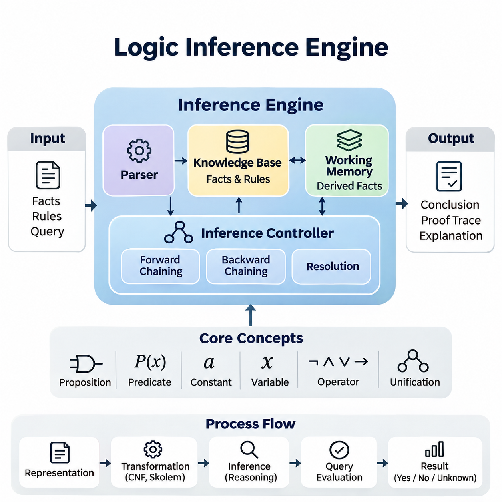
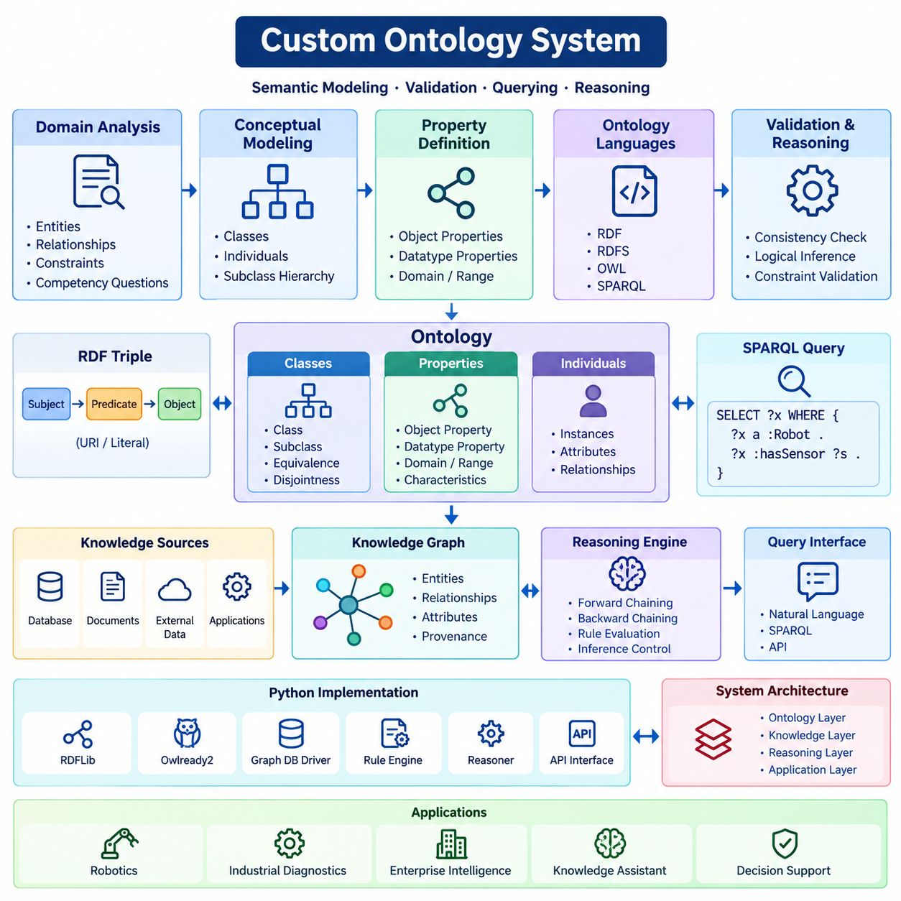
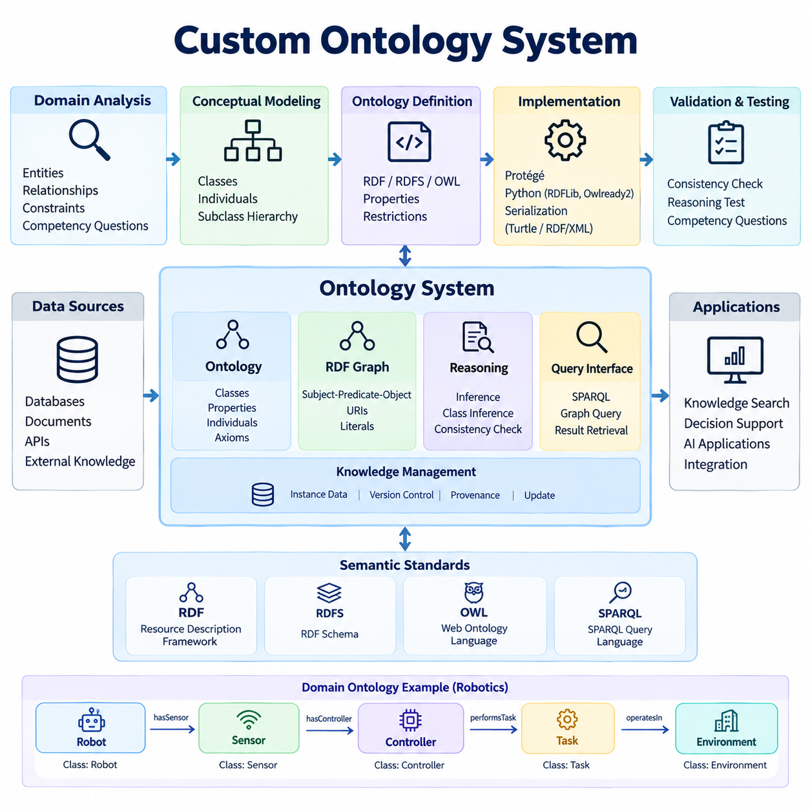
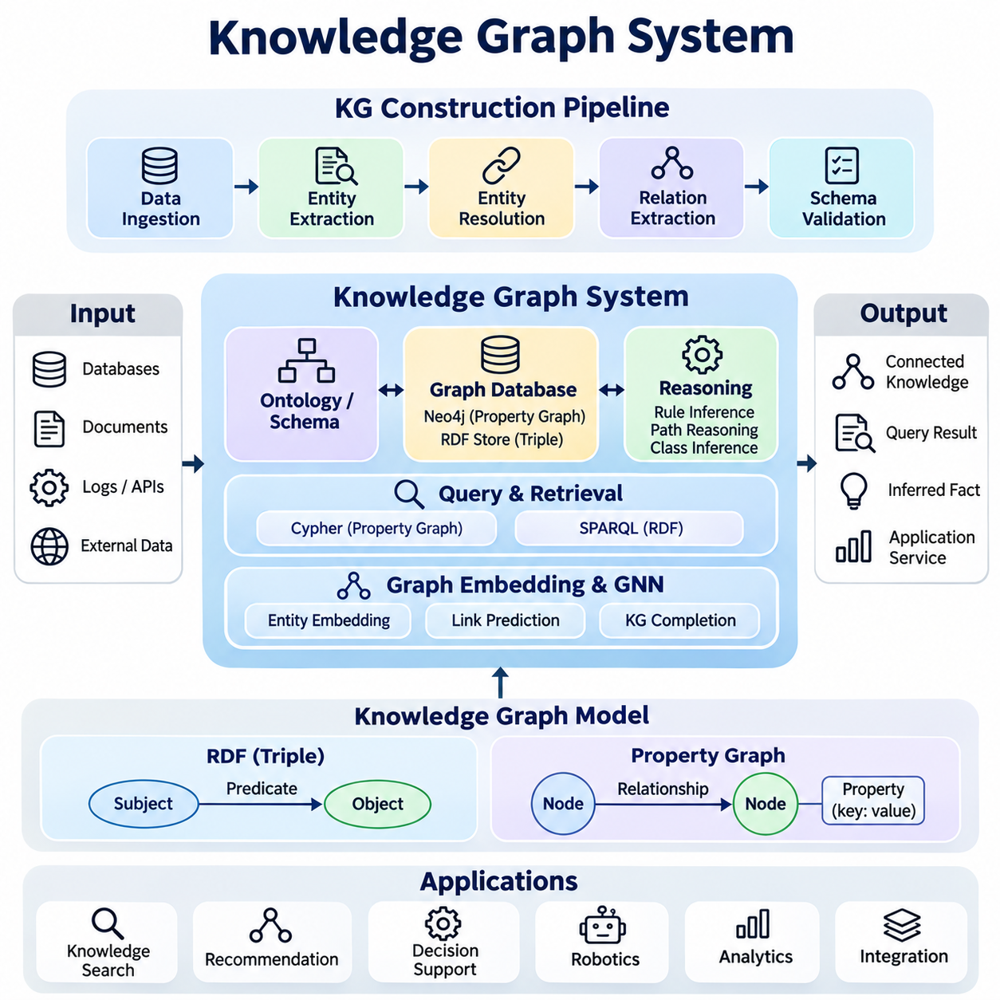
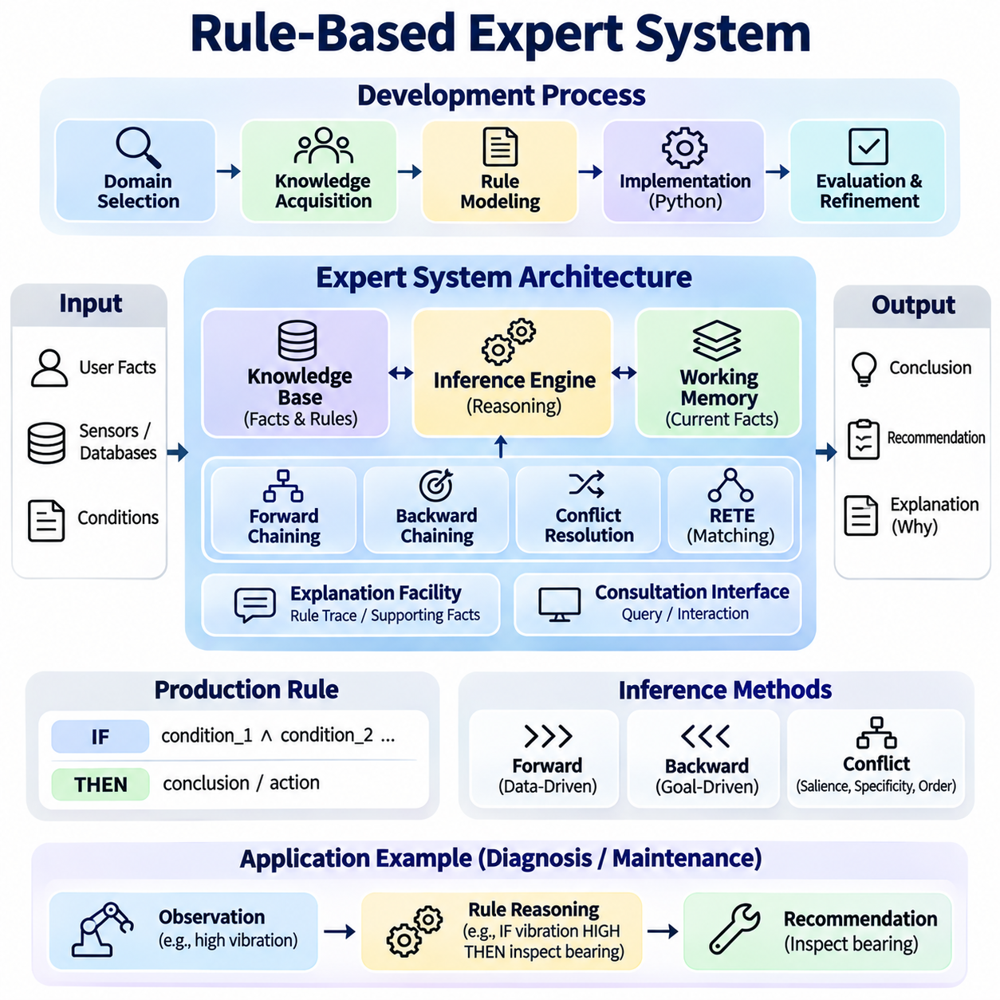
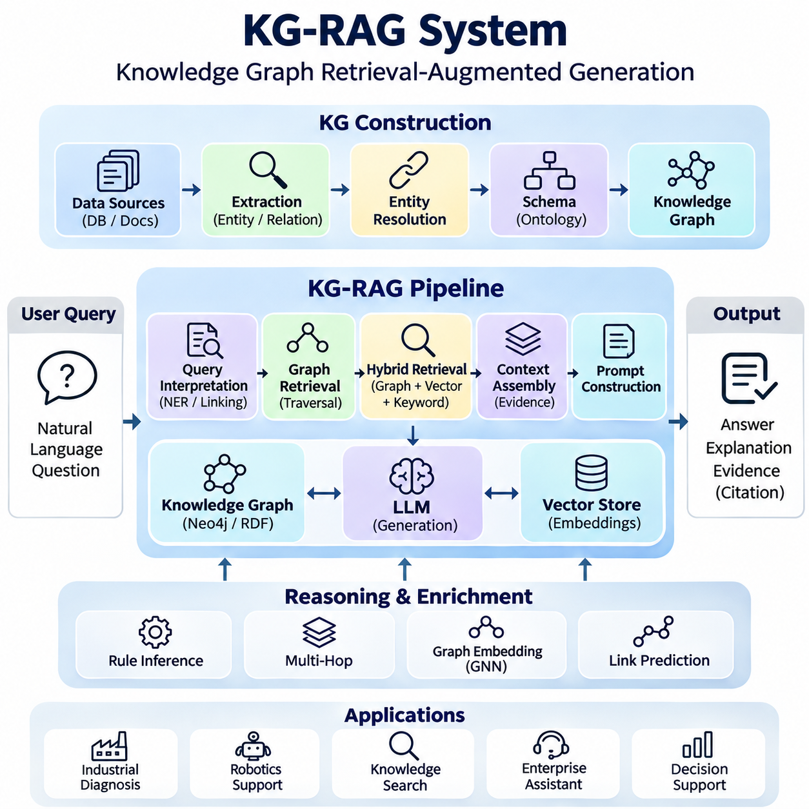
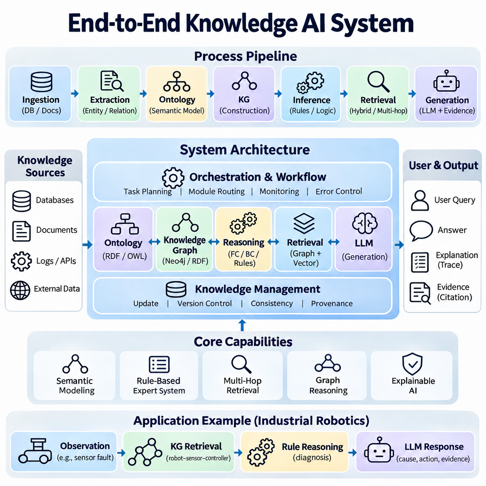

**Volume 02. Knowledge Representation**

# 06. Integrated Projects

## 06.01 Logic Inference Engine [w/Code]

{width="7.268055555555556in" height="7.268055555555556in"}

A logic inference engine is a computational system that derives new knowledge from explicitly represented facts and logical rules. It provides a practical foundation for symbolic artificial intelligence by transforming formal reasoning principles into executable operations. An integrated implementation connects knowledge representation, rule evaluation, query processing, and explanation generation within a consistent architecture.

The primary objective of this project is to construct a reusable inference engine capable of processing propositional logic and selected forms of first-order logic. The system should accept structured facts, interpret logical expressions, apply inference rules, and determine whether specified conclusions follow from available knowledge. Its design emphasizes correctness, transparency, modularity, and extensibility.

The engine architecture consists of a knowledge base, logical expression parser, inference controller, working memory, and query interface. The knowledge base stores asserted facts and logical rules, while the parser converts textual expressions into internal representations. The inference controller applies reasoning procedures, and working memory maintains intermediate conclusions generated during execution.

Knowledge representation begins with propositions, predicates, constants, variables, and logical operators. Propositional expressions describe relationships between Boolean statements, while first-order predicates express properties and relationships among entities. A structured internal representation, such as an abstract syntax tree, enables the engine to inspect expressions, validate their syntax, and perform logical transformations.

The knowledge base distinguishes explicitly asserted facts from conclusions derived through inference. Each statement should have a unique internal identity and associated metadata describing its origin, logical form, and validity status. Rules represent conditional relationships between premises and conclusions. Maintaining these distinctions supports knowledge updates, duplicate detection, provenance tracking, and reproducible reasoning.

Forward chaining provides a data-driven reasoning mechanism that repeatedly applies applicable rules to known facts. When all premises of a rule are satisfied, the engine derives its conclusion and inserts the resulting statement into working memory. This process continues until no additional conclusions can be generated or a predefined stopping condition is reached, producing a fixed point for finite rule sets.

Backward chaining provides a goal-directed alternative that begins with a query and searches for rules capable of establishing the requested conclusion. The engine recursively evaluates rule premises and attempts to match them against known facts or other derivable statements. This approach can reduce unnecessary computation when the knowledge base contains many rules unrelated to the current query.

Unification enables reasoning over first-order predicates by identifying substitutions that make two logical expressions identical. The implementation must distinguish constants, variables, and compound terms while maintaining consistent variable bindings. An occurs check prevents invalid cyclic substitutions in standard first-order unification, and systematic variable renaming avoids unintended interactions between independently defined rules.

Resolution extends the inference engine with a proof-oriented mechanism based on logical contradiction. Expressions are transformed into conjunctive normal form, and complementary literals are combined to produce resolvents. To establish a conclusion through refutation, the engine adds the negation of the target statement and attempts to derive an empty clause, indicating inconsistency under the assumed premises.

Logical transformation requires careful treatment of implication elimination, negation propagation, variable standardization, and quantifier handling. For first-order resolution, Skolemization replaces existentially quantified variables with appropriate Skolem terms while preserving satisfiability rather than full logical equivalence. These operations should be implemented as separate, testable stages to simplify debugging and verification.

The inference controller coordinates reasoning strategies according to the structure of the knowledge base and the requested operation. Forward chaining is suitable for materializing consequences from rule collections, while backward chaining supports targeted queries. Resolution can provide a more general proof procedure for supported first-order clauses, although unrestricted first-order reasoning may not terminate.

Rule evaluation must account for execution order, repeated derivations, and potentially recursive dependencies. A rule agenda can maintain pending inference operations, while a fact index accelerates predicate matching. Duplicate suppression prevents redundant insertions, and dependency tracking identifies which premises support each conclusion. These mechanisms improve efficiency without changing the intended logical semantics.

The Python implementation can organize logical terms, predicates, rules, substitutions, and inference strategies into independent modules. Immutable data structures are useful for representing expressions, while dictionaries and indexed collections support efficient fact retrieval. A common interface should allow different inference procedures to operate over compatible representations without duplicating parsing or knowledge-management functionality.

Query execution begins by validating an input expression and selecting an appropriate reasoning procedure. The engine then evaluates whether the requested statement is supported by the knowledge base. Results should distinguish established conclusions, refuted conclusions, and unresolved queries where the supported logic permits such distinctions. Failure to prove a statement must not automatically be interpreted as proof of its negation.

Explanation generation is an essential feature of an interpretable inference engine. Each derived conclusion can retain references to the rules and premises responsible for its creation. These references form a proof trace that allows users to inspect intermediate reasoning steps. A readable explanation should identify the original facts, applied rules, variable substitutions, and final conclusion without concealing relevant assumptions.

Knowledge updates introduce additional challenges because removing an asserted fact may invalidate conclusions derived from it. A truth maintenance mechanism can record dependencies and retract unsupported derived statements when premises change. Alternatively, a simpler implementation may recompute the deductive closure after updates. The appropriate strategy depends on knowledge-base size, update frequency, and performance requirements.

Non-monotonic reasoning requires special treatment because conclusions may change when new information becomes available. Default assumptions, exceptions, and negation as failure should not be mixed indiscriminately with classical logical negation. A controlled extension can introduce explicit reasoning policies for incomplete knowledge while preserving clear distinctions between classical entailment and application-specific assumptions.

Testing should begin with propositional examples involving conjunction, disjunction, implication, and contradiction. First-order tests should cover variable substitution, recursive rules, quantifier transformations, and unification failures. Reference results can be established through manual proofs or independent logic solvers. Each test should verify both the final conclusion and the validity of the intermediate reasoning process.

Performance evaluation should measure inference latency, memory consumption, rule evaluations, and the number of generated conclusions. Benchmark knowledge bases can vary in fact count, rule count, predicate arity, and dependency depth. Comparing forward chaining, backward chaining, and resolution on compatible tasks reveals differences in computational behavior, particularly when queries involve large or recursive rule collections.

A practical demonstration can use an equipment maintenance knowledge base containing machines, components, operating conditions, and diagnostic rules. The engine may infer inspection requirements from combinations of observed conditions and established maintenance policies. Users can submit diagnostic queries and examine the supporting proof traces, illustrating how symbolic reasoning produces transparent, rule-governed decisions.

Integration with ontologies and knowledge graphs provides a natural extension of the project. Ontology classes and relationships can supply structured vocabulary, while graph triples can be translated into predicates for supported inference tasks. The engine can also expose derived facts through an application interface, allowing other knowledge systems to reuse logical conclusions without directly controlling internal reasoning procedures.

Security and reliability considerations include validating untrusted expressions, limiting recursion depth, controlling execution time, and restricting resource consumption. Arbitrary user input must never be evaluated as executable Python code. Logical rules should be processed through a dedicated parser and controlled interpreter. Execution limits and structured error reporting protect the system from malformed expressions and computationally expensive queries.

The completed project should provide a functional Python inference engine, documented logical representations, reproducible test cases, and an interface for asserting facts and submitting queries. Its architecture should demonstrate how formal logic becomes an operational knowledge-processing system. The resulting foundation supports subsequent integration with ontology systems, knowledge graphs, expert systems, and neuro-symbolic AI applications.

## 06.02 Custom Ontology System [w/Code]

{width="7.268055555555556in" height="7.268055555555556in"}

{width="7.268055555555556in" height="7.268055555555556in"}

A custom ontology system provides a formal framework for representing domain knowledge through explicitly defined concepts, relationships, properties, and logical constraints. Unlike conventional databases that primarily organize stored records, an ontology describes the meaning of information and the relationships governing its interpretation. This project develops a reusable ontology system that supports semantic modeling, validation, querying, and automated reasoning.

The primary objective is to construct a domain-specific ontology using established Semantic Web technologies, including RDF, RDFS, OWL, and SPARQL. The system should represent domain entities consistently, express hierarchical relationships, and support logical inference over structured knowledge. A practical implementation combines ontology engineering principles with Python-based development and standardized semantic data formats.

Ontology development begins with domain analysis and requirements definition. Developers identify the entities, relationships, constraints, and questions that the system must support. Competency questions provide a practical method for defining expected functionality, such as identifying equipment associated with a particular process or determining which components satisfy specified operational requirements.

Conceptual modeling establishes the classes and categories used to describe domain entities. Classes represent general concepts, while individuals represent specific instances belonging to those classes. Subclass relationships organize concepts into taxonomic hierarchies, allowing specialized entities to inherit applicable characteristics from broader categories. Careful classification improves consistency and supports automated knowledge interpretation.

Properties describe relationships between entities or associate entities with literal values. Object properties connect individuals, while datatype properties represent attributes such as temperature, weight, identification numbers, or operating speed. Domain and range declarations provide semantic information about property usage, enabling reasoning engines to infer additional class memberships from asserted relationships.

The Resource Description Framework represents knowledge through subject-predicate-object triples. Each triple expresses a statement about a resource, forming a graph of interconnected information. Uniform Resource Identifiers provide stable references to entities and properties, while literals represent textual or numerical values. RDF enables knowledge exchange across applications without requiring identical internal database structures.

RDF Schema extends basic RDF representations with vocabulary for classes, subclasses, properties, and hierarchical relationships. Through RDFS entailment, a system can infer class membership and inherited property relationships. For example, if an autonomous robot belongs to a subclass of mobile robots, the system can infer its membership in the broader mobile robot category.

The Web Ontology Language provides richer modeling capabilities through description logic constructs. OWL supports class equivalence, disjointness, property characteristics, restrictions, and logical combinations of concepts. These expressions allow developers to describe complex domain constraints while enabling compatible reasoning engines to infer implicit relationships and detect logical inconsistencies.

Ontology design must distinguish logical constraints from conventional data validation rules. In OWL, domain and range declarations generally support inference rather than rejecting invalid records. Similarly, the open-world assumption means that missing information does not automatically imply falsity. Explicit validation requirements can therefore be implemented separately using SHACL or application-level validation procedures.

A custom ontology for robotics can represent robots, sensors, actuators, controllers, environments, and operational tasks. A mobile robot may contain multiple sensors, operate within designated environments, and perform assigned missions. Relationships such as hasSensor, performsTask, and operatesIn establish semantic connections between entities, supporting structured queries and knowledge-based applications.

The ontology construction workflow begins with a conceptual model and progresses toward machine-readable definitions. Protégé provides an environment for creating classes, properties, individuals, and logical axioms. Developers can inspect class hierarchies, configure restrictions, and evaluate reasoning results before exporting the ontology into standard serialization formats such as Turtle or RDF/XML.

Python integration can be implemented using RDFLib and Owlready2. RDFLib supports RDF graph construction, serialization, parsing, and SPARQL query execution. Owlready2 provides Python interfaces for defining OWL classes, properties, and individuals, with support for invoking compatible reasoning engines. These libraries enable ontology functionality to become part of a larger software application.

The system architecture separates ontology definitions, instance data, reasoning services, and application interfaces. Ontology definitions establish the semantic vocabulary, while instance data describes actual domain objects. Reasoning services derive additional knowledge from logical axioms, and application interfaces expose querying and management operations. This separation simplifies maintenance and supports independent component evolution.

Semantic querying is performed using SPARQL, which retrieves information through graph pattern matching. Queries can identify entities belonging to particular classes, discover relationships between resources, and filter results according to property values. Aggregation and optional graph patterns support more complex information retrieval, allowing applications to access interconnected knowledge through standardized query expressions.

Automated reasoning expands the usefulness of the ontology by deriving implicit relationships from explicit assertions. A description logic reasoner can classify individuals, determine subclass relationships, and identify unsatisfiable classes. Reasoning results depend on the supported OWL profile and selected inference engine, making compatibility and computational complexity important implementation considerations.

Ontology alignment becomes necessary when integrating knowledge from multiple systems. Different ontologies may use distinct names, hierarchies, or modeling conventions for equivalent concepts. Alignment mechanisms can establish correspondences through equivalent classes, equivalent properties, and carefully defined mappings. These mappings require semantic verification because superficially similar concepts may represent different meanings.

Ontology evaluation examines logical consistency, conceptual completeness, structural coherence, and suitability for intended applications. Competency questions provide functional acceptance criteria, while automated reasoners help detect contradictory definitions. Structural inspection can identify disconnected concepts, redundant relationships, and inappropriate restrictions. Domain expert review remains important for verifying semantic correctness.

Version management is essential because ontology modifications can affect existing applications and inferred conclusions. Changes to class hierarchies, property definitions, or logical restrictions may alter query results and reasoning behavior. A controlled development process should maintain ontology versions, migration documentation, regression tests, and compatibility policies for dependent knowledge systems.

Performance evaluation should consider ontology size, reasoning complexity, query latency, and memory consumption. Experiments can vary the number of classes, individuals, properties, and logical restrictions. Comparing query execution before and after materializing inferred relationships reveals potential performance tradeoffs. Reasoning benchmarks should distinguish ontology loading time from classification and query processing.

A practical demonstration can model an industrial robotics environment containing autonomous mobile robots, navigation sensors, charging stations, and transportation tasks. The ontology can describe equipment capabilities, operational dependencies, and resource classifications. Users may query which robots possess required sensor configurations or which resources belong to particular operational categories.

The custom ontology system can subsequently integrate with knowledge graphs, rule-based expert systems, and neuro-symbolic AI architectures. Ontology definitions provide semantic consistency, while knowledge graphs store interconnected instances and relationships. External reasoning modules can apply additional rules, and language models can use ontology-grounded information to support more structured knowledge retrieval.

The completed project should deliver a documented domain ontology, reusable Python implementation, sample instance datasets, SPARQL queries, reasoning demonstrations, and validation tests. Its design should emphasize semantic interoperability, maintainability, and logical correctness. The resulting system establishes a structured knowledge foundation for intelligent applications requiring explicit meaning, automated inference, and reliable information integration.

## 06.03 Knowledge Graph System [w/Code]

{width="7.268055555555556in" height="7.268055555555556in"}

A knowledge graph system provides a structured environment for representing, storing, querying, and reasoning over interconnected information. It organizes knowledge as entities and relationships rather than isolated records, enabling applications to discover meaningful connections across heterogeneous data sources. This project develops an integrated knowledge graph platform that combines graph construction, semantic modeling, database management, and intelligent retrieval.

The primary objective is to implement a reusable knowledge graph system capable of transforming raw information into structured entities and relationships. The system should support automated extraction, entity resolution, graph storage, semantic querying, and knowledge enrichment. Its architecture integrates techniques from natural language processing, ontology engineering, graph databases, and symbolic reasoning to create a consistent knowledge management environment.

Knowledge graph construction begins with identifying relevant data sources and defining the target domain. Structured databases, documents, application logs, and external datasets may contain information suitable for graph representation. A data ingestion pipeline collects these sources and converts their contents into standardized intermediate records. Source metadata and provenance identifiers are preserved to support traceability and subsequent validation.

Entity extraction identifies meaningful objects such as organizations, products, machines, locations, and operational events. Named entity recognition can process unstructured text, while schema mappings extract entities from structured records. Each extracted entity receives a type and candidate identifier. Normalization procedures standardize names, attributes, and formats before the entities are incorporated into the graph.

Entity resolution determines whether different references correspond to the same real-world object. Matching techniques may compare identifiers, textual similarity, contextual attributes, and existing graph relationships. Duplicate entities can be consolidated when sufficient evidence supports equivalence. Ambiguous matches should remain separate until additional verification prevents incorrect merging and preserves graph integrity.

Relation extraction identifies meaningful connections between entities. Relationships may be obtained directly from database fields, extracted from textual statements, or generated through validated domain rules. Each relationship should specify its source entity, relation type, and target entity. Confidence scores and provenance metadata can accompany extracted relationships, allowing downstream applications to distinguish verified facts from uncertain predictions.

The graph schema defines entity categories, relationship types, properties, and structural expectations. Ontology concepts can provide a semantic foundation through classes, subclasses, and property definitions. Schema consistency ensures that relationships follow intended meanings and that equivalent concepts are represented uniformly. Validation procedures detect missing identifiers, incompatible relationships, and malformed attribute values.

Knowledge graphs commonly use either the Resource Description Framework or the labeled property graph model. RDF represents statements as subject-predicate-object triples and supports standardized semantic reasoning. Property graphs represent nodes and relationships with associated properties. The selection depends on interoperability requirements, query capabilities, reasoning needs, and the characteristics of the target application.

Graph storage requires a database capable of efficiently managing interconnected entities and relationships. Neo4j provides a labeled property graph implementation with support for graph traversal and Cypher queries. RDF-oriented systems use triple stores and SPARQL interfaces. A storage abstraction layer can separate application logic from database-specific operations, although differences between graph models require explicit handling.

Cypher enables expressive querying of property graphs through patterns describing nodes and relationships. Applications can retrieve connected components, identify dependency chains, and filter entities according to attributes. Traversal queries reveal indirect relationships that may be cumbersome to express through repeated relational joins. Query parameters and appropriate indexes improve execution efficiency and operational security.

SPARQL provides standardized querying for RDF knowledge graphs. Graph patterns identify matching triples, while filters, aggregations, and optional clauses support more complex retrieval operations. Property paths enable navigation across connected relationships. When ontology reasoning is available, queries may retrieve inferred knowledge in addition to explicitly stored statements, depending on the configured entailment regime.

Knowledge graph reasoning derives additional relationships from existing facts and domain rules. Rule-based inference can identify transitive dependencies, inherited classifications, or relationships implied by established conditions. Path-based reasoning examines sequences of connected entities to identify relevant associations. Inferred relationships should retain derivation metadata so that users can distinguish original assertions from computed conclusions.

Graph embedding methods represent entities and relationships as numerical vectors suitable for machine learning. Models such as TransE, TransH, and ComplEx learn relational patterns from observed triples. These representations support link prediction, entity similarity, and knowledge graph completion. Predicted relationships remain hypotheses until validated because embedding scores do not establish logical truth.

Graph neural networks extend knowledge graph analysis by learning representations through neighborhood aggregation. Relational graph convolutional networks can incorporate different relationship types when computing entity embeddings. These models support classification, recommendation, and relational prediction. Their effectiveness depends on graph structure, training data quality, and the availability of reliable evaluation labels.

The system architecture separates data ingestion, entity processing, graph construction, storage, reasoning, and query services. Each component communicates through defined interfaces and standardized data representations. Python can coordinate extraction pipelines, graph transformations, and database interactions. Modular organization allows individual components to be tested, replaced, or optimized without rebuilding the entire platform.

Knowledge updating requires mechanisms for inserting, modifying, and removing graph information while preserving consistency. Incremental updates should identify affected entities and relationships rather than rebuilding the complete graph unnecessarily. Provenance tracking records the origin and modification history of assertions. When source facts change, dependent inferred relationships may require invalidation or recomputation.

Graph quality assessment examines completeness, consistency, accuracy, duplication, and relationship coverage. Validation can compare extracted entities against reference datasets and inspect whether relationships satisfy domain constraints. Entity resolution precision and recall provide useful measures of matching performance. Manual review remains important for detecting semantic errors that cannot be identified through structural validation alone.

Performance evaluation should measure ingestion throughput, graph construction time, query latency, storage consumption, and reasoning overhead. Benchmark datasets can vary in entity count, relationship density, and graph connectivity. Traversal depth and query selectivity influence computational cost. Experiments should compare indexed and non-indexed queries while recording hardware configurations and database settings.

A practical demonstration can construct an industrial robotics knowledge graph containing robots, sensors, controllers, tasks, and operating environments. Relationships describe equipment configurations, task assignments, component dependencies, and operational capabilities. Users can query which robots contain particular sensors or identify equipment affected by a component failure, demonstrating relationship-oriented information retrieval.

Integration with retrieval-augmented generation allows language models to access structured knowledge before producing responses. A graph retrieval component can identify relevant entities, traverse relationships, and assemble evidence for a user query. The retrieved information provides contextual grounding, while provenance records support verification. Generated responses should distinguish graph-supported facts from model-generated interpretations.

Security considerations include access control, query authorization, data provenance, and protection against malicious input. Parameterized database queries reduce injection risks, while role-based permissions restrict access to sensitive entities and relationships. Audit logs record graph modifications and important retrieval operations. Resource limits help prevent expensive graph traversals from degrading system availability.

The completed project should deliver a functional knowledge graph database, Python construction pipeline, entity resolution module, graph query interface, reasoning capabilities, and reproducible evaluation procedures. Documentation should explain the schema, data sources, extraction assumptions, and operational requirements. The resulting platform establishes a reusable foundation for semantic search, intelligent reasoning, expert systems, and knowledge-grounded AI applications.

## 06.04 Rule Based Expert System [w/Code]

{width="7.268055555555556in" height="7.268055555555556in"}

A rule-based expert system is an artificial intelligence application that reproduces specialized decision-making through explicitly defined knowledge and inference rules. Instead of learning decisions directly from statistical patterns, it applies structured reasoning to known facts and domain expertise. This project develops an integrated expert system that combines knowledge acquisition, production rules, inference mechanisms, explanation generation, and decision support.

The primary objective is to construct a reusable expert system capable of evaluating conditions, deriving conclusions, and recommending actions within a defined domain. The system should support knowledge representation, rule execution, conflict resolution, and interactive consultation. Its implementation emphasizes transparency, logical consistency, maintainability, and the ability to explain how individual recommendations were produced.

Expert system development begins with domain selection and knowledge acquisition. Domain specialists provide operational policies, diagnostic procedures, decision criteria, and exception conditions. These sources are transformed into formal rules that can be evaluated computationally. Knowledge acquisition should also identify uncertainty, conflicting expertise, and situations where available information is insufficient to support a reliable conclusion.

The knowledge base stores domain facts, production rules, and supporting metadata. Facts describe observed conditions or established properties, while rules express relationships between conditions and conclusions. A production rule typically follows an IF-THEN structure, where the antecedent specifies required conditions and the consequent defines an inference or action. This separation enables knowledge modification without changing the inference engine.

Working memory maintains facts relevant to the current consultation or operational situation. Initial facts may originate from user input, sensors, databases, or external applications. As reasoning proceeds, newly derived facts are added to working memory and become available for subsequent rule evaluations. Distinguishing asserted facts from inferred conclusions supports traceability, controlled updates, and explanation generation.

The inference engine evaluates rules against working memory and determines which conclusions can be derived. Its operation involves matching rule conditions, identifying applicable rules, selecting execution candidates, and updating the knowledge state. The engine must prevent unnecessary repeated execution while preserving intended logical behavior. A modular design allows alternative inference strategies to share a common knowledge representation.

Forward chaining implements data-driven reasoning by starting with available facts and repeatedly applying rules whose conditions are satisfied. Each successful rule application may produce additional facts or trigger controlled actions. The process continues until no new conclusions are available or a defined objective is achieved. This approach is particularly suitable for monitoring systems, automated classification, and event-driven decision support.

Backward chaining implements goal-directed reasoning by beginning with a proposed conclusion and determining whether available facts can establish it. The system identifies rules capable of supporting the goal and recursively evaluates their conditions. When required information is unavailable, the consultation interface may request additional input. This strategy is useful for diagnostic applications where specific hypotheses must be investigated.

Conflict resolution becomes necessary when multiple rules are simultaneously applicable. A conflict set contains eligible rule activations, and an execution strategy determines which activation receives priority. Common approaches consider rule salience, condition specificity, activation recency, and predefined execution order. Deterministic conflict resolution improves reproducibility, while explicit priority policies help prevent contradictory operational actions.

Efficient rule matching is essential when the knowledge base contains numerous interconnected rules. A naive implementation repeatedly evaluates every rule against all available facts, creating unnecessary computational overhead. The RETE algorithm reduces repeated matching by retaining partial results across evaluations. Its network structure shares common conditions and updates affected matches when working memory changes.

The expert system architecture separates the knowledge base, inference engine, working memory, explanation facility, and consultation interface. The knowledge base defines domain expertise, while the inference engine controls reasoning. Working memory maintains current information, and the explanation facility records supporting evidence. The consultation interface enables users or external applications to submit observations and retrieve conclusions.

Python provides a practical environment for implementing the system through structured classes, rule objects, and configurable inference procedures. Facts can be represented using immutable records, while rule conditions are evaluated through controlled predicate matching. A dedicated rule interpreter should process domain expressions without executing arbitrary user-provided code. This architecture supports unit testing and integration with external services.

Established expert system frameworks provide useful architectural references. CLIPS supports production-rule programming and efficient pattern matching, while Drools provides rule management capabilities for Java-based applications. MYCIN illustrates the historical application of rule-based reasoning to medical consultation. Comparing these systems reveals different approaches to rule representation, execution control, and uncertainty management.

Explanation generation distinguishes expert systems from opaque decision mechanisms. Each conclusion should retain references to the facts and rules that contributed to its derivation. The explanation facility can reconstruct a reasoning trace showing which conditions were satisfied and why particular rules were activated. Users should also be able to inspect unresolved conditions and understand why alternative conclusions were not established.

Uncertainty handling becomes important when observations are incomplete, noisy, or ambiguous. A rule-based system may incorporate certainty factors, probability estimates, or fuzzy membership values, provided their interpretation is explicitly defined. These mechanisms should not be treated as interchangeable because they represent different uncertainty models. Confidence propagation requires carefully specified combination rules and domain validation.

Knowledge maintenance involves updating rules as domain requirements, operating procedures, and regulations evolve. Version control should record rule modifications, authorship, approval status, and effective dates. Regression testing verifies that changes do not unintentionally alter established decisions. Dependency analysis can identify conclusions affected by modified rules, supporting controlled deployment and knowledge-base governance.

A practical demonstration can implement an industrial equipment diagnostic expert system. The knowledge base may describe motor temperature, vibration levels, electrical conditions, and maintenance requirements. Rules can associate combinations of observed symptoms with possible equipment faults and recommended inspections. The system should distinguish diagnostic hypotheses from confirmed failures and require appropriate evidence before issuing operational recommendations.

The consultation workflow begins when a user submits equipment observations or selects a diagnostic objective. The system validates the input, updates working memory, and invokes the selected inference strategy. Applicable rules generate conclusions, while unresolved conditions may trigger additional questions. The final response presents supported findings, recommended next steps, and an explanation of the reasoning process.

Evaluation should measure diagnostic accuracy, rule coverage, inference latency, memory consumption, and explanation completeness. Reference cases prepared by domain specialists provide expected conclusions for testing. Additional scenarios should include missing information, conflicting observations, recursive dependencies, and contradictory rules. Comparing results against validated reference decisions helps identify knowledge gaps and implementation defects.

Performance experiments can vary the number of facts, rules, and simultaneously applicable conditions. Measurements should distinguish rule matching time, conflict resolution overhead, and total consultation latency. Comparing naive matching with RETE-based execution reveals scalability differences under changing workloads. Benchmark results should document execution environments and maintain consistent test conditions.

Integration with ontologies and knowledge graphs can improve semantic consistency and knowledge reuse. Ontologies define shared concepts and relationships, while knowledge graphs provide interconnected factual information. The expert system can retrieve relevant graph facts and apply domain-specific production rules. Such integration requires explicit mappings between semantic representations and executable rule conditions.

Hybrid architectures can combine rule-based reasoning with machine learning models. Statistical models may identify patterns or estimate uncertain observations, while symbolic rules enforce operational policies and logical constraints. Model predictions should be treated as evidence with documented confidence rather than unquestioned facts. This separation preserves interpretability while allowing the system to incorporate learned information.

Security and operational reliability require controlled rule execution, access permissions, input validation, and audit logging. Rules that recommend physical actions should be separated from mechanisms that execute those actions. High-impact decisions may require human approval or independent safety checks. Execution limits and conflict detection help prevent infinite rule cycles and inconsistent system behavior.

The completed project should deliver a functional Python expert system, documented production rules, configurable inference strategies, an interactive consultation interface, and reproducible evaluation cases. Its implementation should demonstrate transparent decision-making, reliable rule execution, and maintainable domain knowledge. The resulting system provides a foundation for industrial diagnostics, decision support, automated monitoring, and integrated knowledge-based AI applications.

## 06.05 KG RAG System [w/Code]

{width="7.268055555555556in" height="7.268055555555556in"}

A knowledge graph retrieval-augmented generation system combines structured knowledge representation with large language models to produce responses grounded in explicit entities and relationships. Unlike conventional retrieval systems that primarily search text passages, KG-RAG uses graph connections to identify relevant facts and contextual dependencies. This project develops an integrated architecture for graph construction, semantic retrieval, reasoning, and evidence-grounded answer generation.

The primary objective is to implement a reusable KG-RAG platform that connects a knowledge graph database with a language model through a controlled retrieval pipeline. The system should support entity recognition, query interpretation, graph traversal, context assembly, and response generation. Its design emphasizes factual grounding, explainability, retrieval accuracy, and the separation of verified knowledge from model-generated interpretations.

KG-RAG development begins with selecting a domain and identifying authoritative knowledge sources. Structured databases, technical documents, operational records, and domain ontologies may provide relevant information. A data ingestion pipeline extracts entities, relationships, attributes, and source references. Each graph assertion should preserve provenance metadata so that retrieved facts can be traced to their originating documents or records.

Knowledge graph construction transforms extracted information into connected entities and relationships. Entity resolution merges references that reliably identify the same object, while relation extraction identifies meaningful associations. A graph schema defines permitted entity categories and relationship types. Validation procedures detect malformed assertions, unsupported links, and inconsistent identifiers before information becomes available for retrieval.

The graph database provides persistent storage and efficient access to interconnected knowledge. Neo4j can manage labeled property graphs through Cypher, while RDF triple stores support SPARQL and ontology-oriented representations. Database selection depends on semantic requirements, traversal patterns, and interoperability constraints. Indexing frequently referenced identifiers improves entity lookup and reduces unnecessary graph exploration.

The retrieval workflow begins when a user submits a natural language question. A query interpretation module identifies the intended information need, relevant entities, relationship constraints, and possible reasoning requirements. Named entity recognition and entity linking connect expressions in the question to graph identifiers. Ambiguous references may require clarification or confidence-based candidate selection before retrieval proceeds.

Graph retrieval identifies relevant subgraphs rather than relying exclusively on document similarity. Starting from recognized entities, the system explores relationships that may explain dependencies, classifications, or operational connections. Traversal depth, relationship filters, and relevance constraints control the search space. These restrictions prevent unrelated graph regions from overwhelming the context supplied to the language model.

Hybrid retrieval combines graph traversal with semantic vector search and conventional keyword matching. Vector embeddings help identify conceptually related passages even when exact terminology differs, while graph queries recover explicit relationships. Keyword retrieval preserves precise identifiers and technical expressions. A ranking component combines candidate evidence according to relevance, provenance quality, and the requirements of the user question.

Multi-hop retrieval supports questions that require reasoning across several connected relationships. For example, identifying equipment affected by a sensor failure may require traversing sensor ownership, subsystem dependencies, and operational assignments. The retrieval engine follows validated relationship paths and records the evidence associated with each step. Path relevance and traversal limits help control computational complexity.

Context assembly converts retrieved graph information into a representation suitable for language model processing. Relevant entities, relationship paths, source passages, and attribute values are organized into a compact evidence package. Redundant facts are removed, while important dependencies remain intact. The assembled context should preserve entity identifiers and source references to prevent confusion between similarly named objects.

Prompt construction defines how the language model should use retrieved evidence. Instructions can require the model to distinguish supported facts from assumptions, identify missing information, and avoid unsupported conclusions. Structured context sections improve consistency when combining graph facts and source documents. The prompt should treat retrieved content as evidence rather than executable instructions or authoritative behavioral commands.

Answer generation uses the assembled evidence to produce a coherent natural language response. The model may summarize graph relationships, explain dependency chains, or describe operational implications supported by retrieved facts. Generated statements should remain consistent with the supplied evidence. When the graph lacks sufficient information, the system should acknowledge the limitation rather than fabricate missing relationships.

Evidence attribution connects generated claims to their supporting graph assertions or source documents. Provenance identifiers enable users to inspect the origin of important facts, while relationship paths explain how indirect conclusions were obtained. Citation generation should reference actual retrieved evidence rather than invented sources. This capability improves auditability and supports human verification of generated answers.

Graph reasoning can enrich retrieval by deriving relationships that are not explicitly stored. Ontology reasoning may infer class membership, while rule-based reasoning can identify transitive dependencies or domain-specific implications. Inferred assertions should retain their derivation paths and supporting premises. The retrieval system must distinguish direct observations from inferred conclusions to preserve transparency.

Graph embeddings and graph neural networks can improve candidate ranking and relationship prediction. Embedding models represent entities and relations in vector spaces, enabling similarity calculations and potential link discovery. Predicted connections may expand retrieval candidates but should not automatically become verified facts. Confidence thresholds and evidence validation are necessary before speculative relationships influence final answers.

The system architecture separates ingestion, graph storage, query interpretation, retrieval orchestration, context construction, and language model inference. Python services can coordinate graph database drivers, embedding models, vector indexes, and model APIs. Modular interfaces allow retrieval strategies to evolve independently. Logging and configuration management support reproducibility, debugging, and controlled deployment.

Knowledge updates require synchronization between source documents, graph assertions, and associated vector indexes. When a document changes, affected entities and relationships should be identified and updated incrementally. Deleted or superseded assertions must not remain available as current evidence. Version tracking and provenance-aware invalidation help prevent outdated knowledge from contaminating generated responses.

Evaluation should examine retrieval precision, recall, answer faithfulness, citation correctness, and end-to-end response quality. Benchmark questions can test direct entity lookup, relationship traversal, multi-hop reasoning, and incomplete-information handling. Human evaluation can assess whether answers accurately reflect domain knowledge. Automated metrics should be interpreted alongside evidence inspection rather than treated as definitive proof of correctness.

Performance benchmarking measures graph query latency, vector retrieval time, context construction overhead, and language model generation latency. Experiments should vary graph size, traversal depth, retrieved context length, and concurrent request volume. Caching repeated entity lookups may reduce processing costs. Performance comparisons should report hardware resources, database configurations, and model settings.

A practical demonstration can implement KG-RAG for industrial robotics maintenance. The graph may connect robots, sensors, controllers, maintenance records, and operating tasks. A user could ask which robots are affected by a failed controller or which components require inspection after an abnormal vibration event. The system retrieves relevant dependency paths and produces an evidence-grounded explanation.

Security requirements include access-controlled graph retrieval, prompt injection resistance, sensitive information filtering, and audit logging. Retrieved documents must not override system instructions or authorization policies. Database queries should use validated parameters and restricted permissions. High-impact operational recommendations should remain subject to independent verification and appropriate human approval.

The completed project should provide a functioning knowledge graph, retrieval pipeline, language model interface, evidence attribution mechanism, and reproducible evaluation suite. Documentation should describe graph schemas, retrieval policies, reasoning assumptions, and deployment requirements. The resulting KG-RAG platform establishes a foundation for enterprise knowledge assistants, technical decision support, robotics diagnostics, and explainable knowledge-grounded AI systems.

## 06.06 End to End Knowledge AI System [w/Code]

{width="7.268055555555556in" height="7.268055555555556in"}

An end-to-end knowledge AI system integrates symbolic reasoning, ontologies, knowledge graphs, rule-based inference, and language models into a unified intelligent architecture. Rather than treating knowledge storage, retrieval, and reasoning as independent functions, the system coordinates them through a consistent processing pipeline. This project develops a complete platform that transforms heterogeneous information into structured knowledge and produces explainable, evidence-grounded decisions.

The primary objective is to implement a reusable knowledge AI platform supporting data ingestion, semantic modeling, knowledge graph construction, logical inference, intelligent retrieval, and response generation. The system should combine deterministic reasoning with probabilistic language understanding while preserving clear boundaries between verified facts and generated interpretations. Modularity, traceability, interoperability, and operational reliability guide the overall design.

System development begins with domain analysis and requirements engineering. Developers identify relevant entities, relationships, decision rules, information sources, and expected user interactions. Competency questions define the knowledge queries the platform must answer, while operational scenarios establish performance and reliability requirements. These specifications guide ontology design, graph construction, inference strategies, and evaluation procedures.

The data ingestion layer collects structured databases, technical documents, application records, and external knowledge resources. Extraction pipelines identify entities, attributes, relationships, and source references. Normalization procedures standardize identifiers and terminology across heterogeneous inputs. Provenance metadata records where each assertion originated, enabling verification, auditing, and controlled knowledge updates.

The ontology layer establishes a shared semantic model describing domain classes, properties, constraints, and conceptual relationships. RDF, RDFS, and OWL can represent formal definitions and support compatible reasoning procedures. Ontology validation examines logical consistency and semantic coherence, while additional constraint languages can enforce application-specific data requirements. This layer provides the conceptual foundation for knowledge integration.

The knowledge graph layer organizes validated entities and relationships into an interconnected representation. Graph databases such as Neo4j support labeled property graphs, while RDF triple stores provide standards-based semantic storage. Entity resolution identifies equivalent references, and relationship validation checks graph integrity. Indexes and query interfaces enable efficient navigation across dependencies, classifications, and operational connections.

The symbolic reasoning layer derives conclusions from explicitly represented facts and logical rules. Forward chaining propagates newly established information, while backward chaining evaluates whether particular goals can be supported. Unification and rule matching connect variable-based expressions with available knowledge. Reasoning traces record supporting premises and rule applications so that conclusions remain inspectable and reproducible.

A rule-based expert system provides domain-specific decision logic through production rules and working memory. Rules evaluate operational conditions, identify diagnostic hypotheses, and recommend appropriate actions. Conflict resolution policies determine execution priority when several rules apply simultaneously. The expert system should distinguish advisory conclusions from executable commands, especially when decisions affect physical equipment or safety.

The retrieval layer connects structured knowledge with natural language interaction. Entity linking maps user questions to graph identifiers, while graph traversal retrieves relevant relationships and supporting facts. Hybrid retrieval combines graph queries, vector similarity, and keyword matching to improve coverage. Multi-hop retrieval supports questions requiring evidence from several connected entities without relying exclusively on language model inference.

The language model layer interprets user requests and generates coherent explanations from retrieved evidence. Prompt construction supplies structured facts, relationship paths, source references, and applicable reasoning results. Generated responses should identify uncertainty and avoid unsupported claims. The language model acts as an interface for knowledge interpretation rather than an unrestricted authority over stored facts or operational policies.

An orchestration layer coordinates the complete processing workflow from user input to final response. It determines which retrieval tools, reasoning modules, and validation procedures are required for each request. Intermediate results pass through standardized interfaces with explicit status and error information. Workflow control prevents unnecessary computation and allows failed operations to be retried or safely terminated.

Knowledge consistency requires synchronization between ontologies, graph records, inference results, and retrieval indexes. When source information changes, affected assertions must be updated and dependent conclusions reconsidered. Version identifiers distinguish current knowledge from historical records. Incremental processing reduces rebuilding costs, while provenance-aware invalidation prevents obsolete information from influencing subsequent decisions.

The implementation can use Python services to integrate RDFLib, Owlready2, Neo4j drivers, rule engines, embedding models, and language model interfaces. Individual components should expose well-defined application programming interfaces and maintain independent configuration settings. Containerized deployment can improve reproducibility across development and production environments. Automated tests verify component behavior and integration contracts.

A practical industrial robotics demonstration can connect robots, sensors, controllers, maintenance records, and operational tasks within a unified knowledge environment. The ontology defines equipment categories, while the graph stores actual configurations and dependencies. Diagnostic rules interpret abnormal observations, and retrieval services assemble relevant evidence. The language model then explains possible faults and recommended inspections.

For example, a user may ask which autonomous robots could be affected by an overheating motor controller. The system identifies the controller, retrieves connected robots and operational dependencies, and evaluates applicable diagnostic rules. Supporting maintenance records provide additional context. The final response distinguishes observed conditions, inferred risks, and recommended verification steps while preserving evidence references.

System evaluation must examine semantic correctness, graph completeness, reasoning accuracy, retrieval relevance, and answer faithfulness. Reference scenarios prepared by domain experts establish expected outcomes. Tests should include ambiguous entities, missing information, contradictory assertions, and multi-step reasoning tasks. Evaluators must verify both the correctness of final answers and the validity of intermediate reasoning paths.

Performance benchmarking measures ingestion throughput, graph query latency, inference execution time, retrieval overhead, and language model response latency. Experiments should vary knowledge base size, relationship density, concurrent requests, and context length. Component-level measurements identify bottlenecks, while end-to-end tests reveal interactions between subsystems. Results should document hardware resources and configuration parameters.

Explainability is a fundamental requirement because users must understand how the system reaches important conclusions. Each response should connect relevant claims to source assertions, graph paths, or rule derivations. An explanation service can distinguish directly observed facts from inferred relationships and model-generated summaries. Unsupported conclusions should be withheld or explicitly marked as uncertain rather than presented as verified knowledge.

Security architecture must enforce authentication, authorization, input validation, and access-controlled knowledge retrieval. Sensitive information should remain protected throughout ingestion, storage, inference, and response generation. Retrieved documents must not override trusted system instructions. Audit logs record important data changes and decisions, while human approval remains necessary for high-impact operational actions.

Operational monitoring tracks data quality, query failures, reasoning inconsistencies, model behavior, and resource consumption. Observability mechanisms correlate requests across ingestion, graph retrieval, inference, and generation services. Regression tests detect unexpected changes after ontology revisions or rule updates. Continuous evaluation helps maintain reliability as knowledge sources, application requirements, and deployed models evolve.

The completed project should deliver an integrated knowledge AI platform, documented ontology, populated knowledge graph, executable inference rules, retrieval services, language model interface, and reproducible evaluation suite. Its architecture should demonstrate transparent knowledge processing, reliable integration, and controlled decision support. The resulting system provides a foundation for enterprise intelligence, industrial diagnostics, autonomous robotics, and explainable AI applications.
