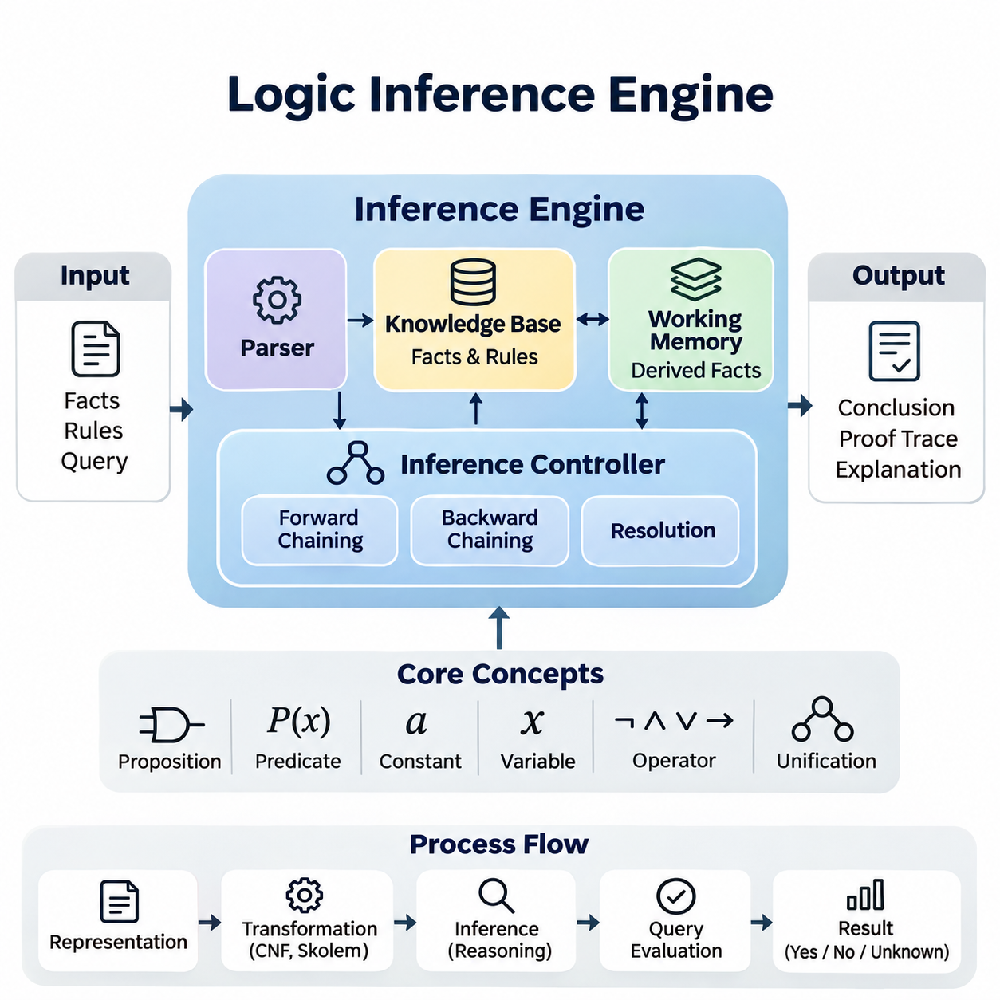
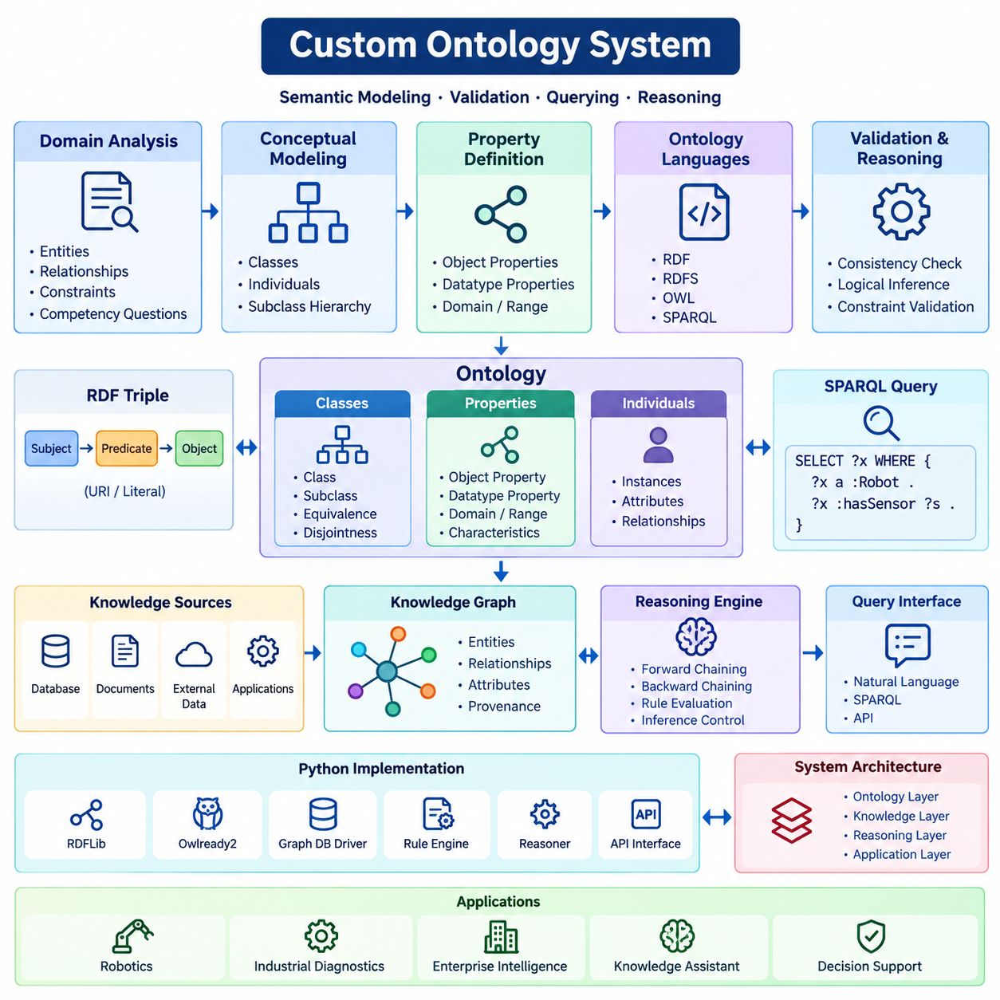
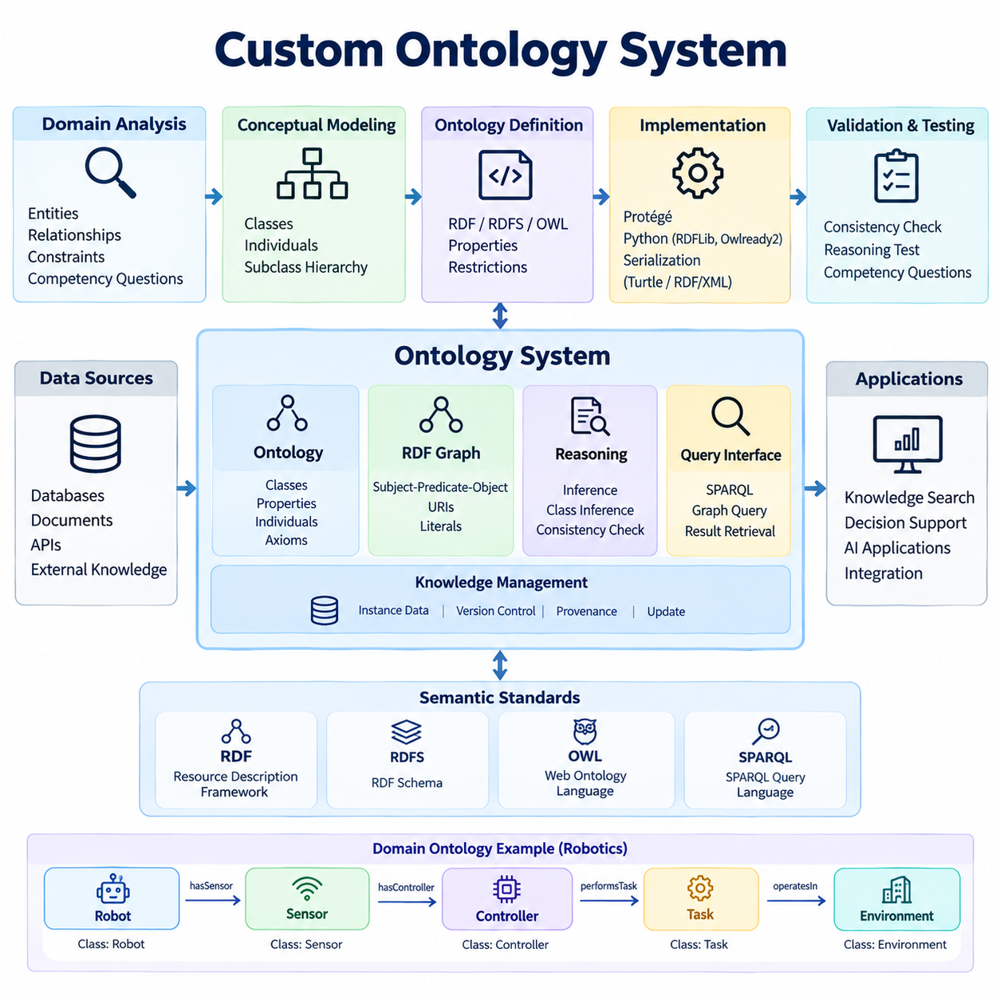
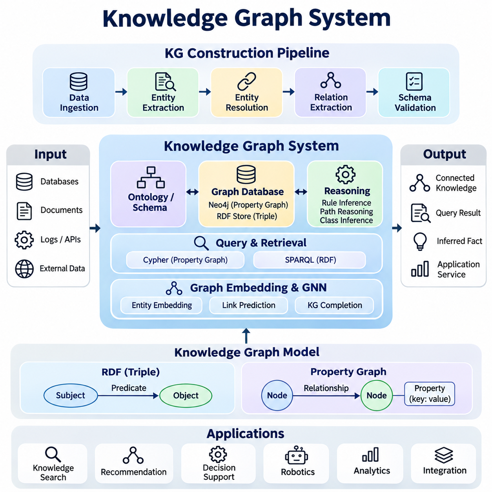
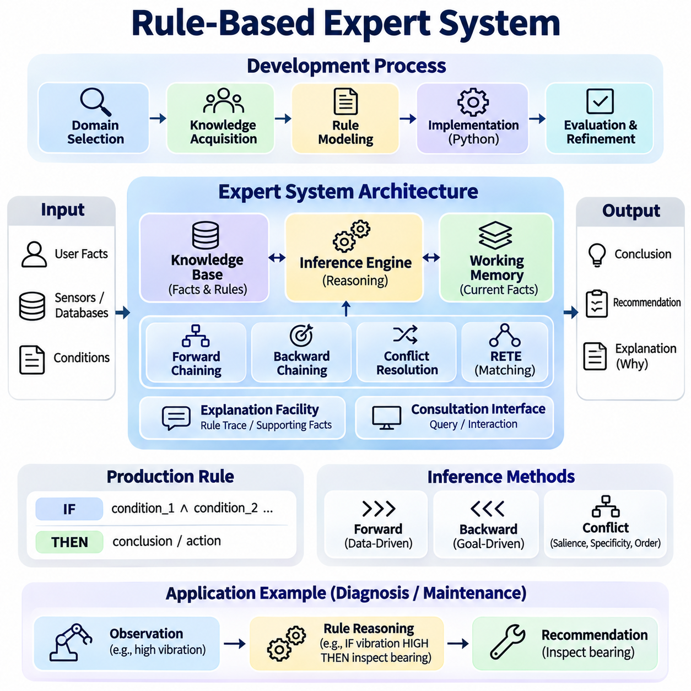
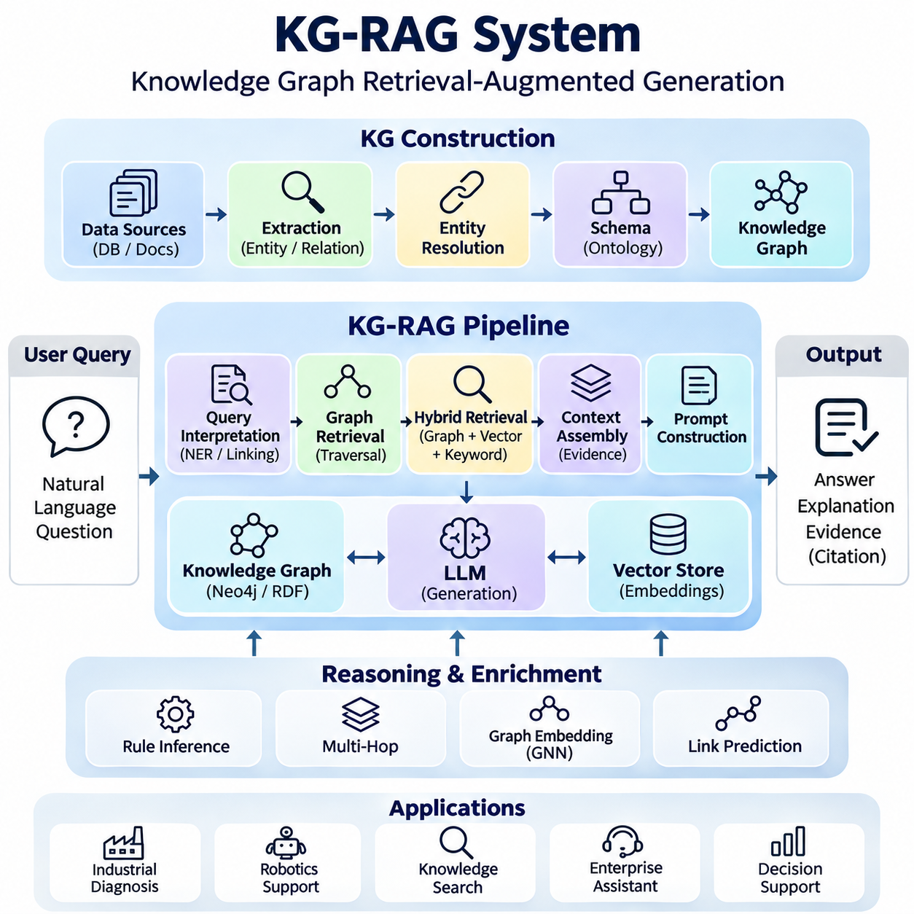
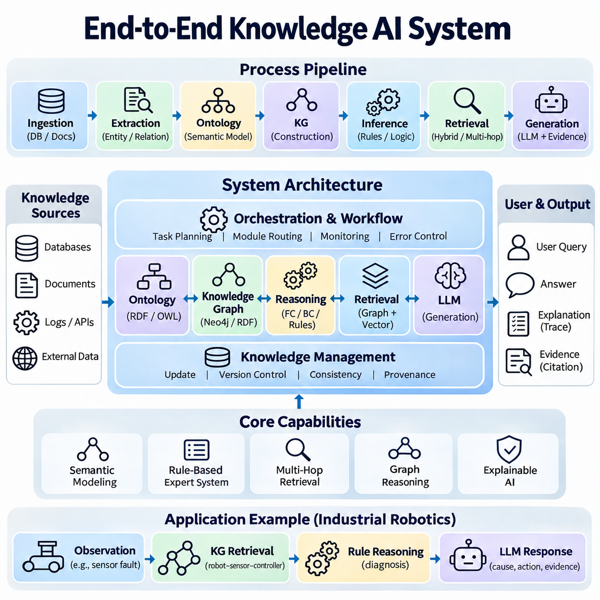

**Volume 02. Knowledge Representation**

# 06. Integrated Projects

## 06.01 Logic Inference Engine [w/Code]

{width="7.268055555555556in" height="7.268055555555556in"}

논리 추론 엔진(Logic Inference Engine)은 명시적으로 표현된 사실(Fact)과 논리 규칙(Logical Rule)으로부터 새로운 지식을 도출하는 계산 시스템(Computational System)이다. 논리 추론 엔진은 형식적 추론 원리(Formal Reasoning Principle)를 실행 가능한 연산(Executable Operation)으로 변환하여 기호적 인공지능(Symbolic Artificial Intelligence)을 위한 실용적인 기반을 제공한다. 통합 구현(Integrated Implementation)은 지식 표현(Knowledge Representation), 규칙 평가(Rule Evaluation), 질의 처리(Query Processing), 설명 생성(Explanation Generation)을 일관된 아키텍처(Architecture)로 연결한다.

본 프로젝트의 주요 목표는 명제 논리(Propositional Logic)와 일부 형태의 일차 논리(First-Order Logic)를 처리할 수 있는 재사용 가능한 추론 엔진(Inference Engine)을 구축하는 것이다. 시스템은 구조화된 사실(Structured Fact)을 입력받고, 논리 표현식(Logical Expression)을 해석하며, 추론 규칙(Inference Rule)을 적용하고, 지정된 결론이 사용 가능한 지식으로부터 논리적으로 도출되는지 판단해야 한다. 시스템 설계는 정확성(Correctness), 투명성(Transparency), 모듈성(Modularity), 확장성(Extensibility)을 강조한다.

추론 엔진 아키텍처(Inference Engine Architecture)는 지식 베이스(Knowledge Base), 논리 표현식 파서(Logical Expression Parser), 추론 제어기(Inference Controller), 작업 메모리(Working Memory), 질의 인터페이스(Query Interface)로 구성된다. 지식 베이스는 명시적으로 선언된 사실(Asserted Fact)과 논리 규칙을 저장하며, 파서(Parser)는 텍스트 표현식을 내부 표현(Internal Representation)으로 변환한다. 추론 제어기는 추론 절차(Reasoning Procedure)를 적용하고, 작업 메모리는 실행 중 생성되는 중간 결론(Intermediate Conclusion)을 유지한다.

지식 표현(Knowledge Representation)은 명제(Proposition), 술어(Predicate), 상수(Constant), 변수(Variable), 논리 연산자(Logical Operator)에서 시작한다. 명제 표현식(Propositional Expression)은 불리언 명제(Boolean Statement) 사이의 관계를 설명하며, 일차 술어(First-Order Predicate)는 개체(Entity)의 속성과 개체 간 관계를 표현한다. 추상 구문 트리(Abstract Syntax Tree)와 같은 구조화된 내부 표현은 엔진이 표현식을 검사하고, 구문(Syntax)을 검증하며, 논리적 변환(Logical Transformation)을 수행할 수 있도록 한다.

지식 베이스(Knowledge Base)는 명시적으로 선언된 사실과 추론을 통해 도출된 결론(Derived Conclusion)을 구분한다. 각 명제(Statement)는 고유한 내부 식별자(Internal Identity)와 출처(Origin), 논리적 형식(Logical Form), 유효성 상태(Validity Status)를 설명하는 메타데이터(Metadata)를 가져야 한다. 규칙은 전제(Premise)와 결론(Conclusion) 사이의 조건부 관계(Conditional Relationship)를 표현한다. 이러한 구분을 유지하면 지식 업데이트(Knowledge Update), 중복 탐지(Duplicate Detection), 출처 추적(Provenance Tracking), 재현 가능한 추론(Reproducible Reasoning)을 지원할 수 있다.

전방향 추론(Forward Chaining)은 알려진 사실에 적용 가능한 규칙을 반복적으로 적용하는 데이터 주도 추론(Data-Driven Reasoning) 메커니즘을 제공한다. 규칙의 모든 전제가 충족되면 엔진은 해당 결론을 도출하고 결과 명제를 작업 메모리에 삽입한다. 이 과정은 추가적인 결론을 생성할 수 없거나 사전에 정의된 종료 조건(Stopping Condition)에 도달할 때까지 계속되며, 유한한 규칙 집합(Finite Rule Set)에 대해 고정점(Fixed Point)을 형성한다.

후방향 추론(Backward Chaining)은 질의(Query)에서 시작하여 요청된 결론을 입증할 수 있는 규칙을 탐색하는 목표 지향 추론(Goal-Directed Reasoning) 방식을 제공한다. 엔진은 규칙의 전제를 재귀적으로 평가하고, 이를 알려진 사실이나 추가적으로 도출 가능한 명제와 매칭하려고 시도한다. 이 접근 방식은 지식 베이스에 현재 질의와 관련 없는 규칙이 많이 포함되어 있을 때 불필요한 계산을 줄일 수 있다.

단일화(Unification)는 두 논리 표현식을 동일하게 만드는 치환(Substitution)을 식별함으로써 일차 술어에 대한 추론을 가능하게 한다. 구현에서는 일관된 변수 바인딩(Variable Binding)을 유지하면서 상수(Constant), 변수(Variable), 복합 항(Compound Term)을 구분해야 한다. 발생 검사(Occurs Check)는 표준 일차 단일화(Standard First-Order Unification)에서 유효하지 않은 순환 치환(Cyclic Substitution)을 방지하며, 체계적인 변수 이름 변경(Variable Renaming)은 독립적으로 정의된 규칙 사이의 의도하지 않은 상호작용을 방지한다.

해결법(Resolution)은 논리적 모순(Logical Contradiction)에 기반한 증명 지향 메커니즘(Proof-Oriented Mechanism)을 통해 추론 엔진을 확장한다. 표현식은 논리곱 정규형(Conjunctive Normal Form, CNF)으로 변환되며, 상보 리터럴(Complementary Literal)을 결합하여 해결절(Resolvent)을 생성한다. 귀류법(Refutation)을 통해 결론을 입증하려면 엔진은 목표 명제의 부정(Negation)을 추가하고 공절(Empty Clause)을 도출하려고 시도한다. 공절이 도출되면 가정된 전제하에서 모순이 존재함을 의미한다.

논리적 변환(Logical Transformation)에서는 함의 제거(Implication Elimination), 부정 전파(Negation Propagation), 변수 표준화(Variable Standardization), 한정자 처리(Quantifier Handling)를 신중하게 다루어야 한다. 일차 논리 해결법(First-Order Resolution)에서 스콜렘화(Skolemization)는 존재 한정 변수(Existentially Quantified Variable)를 적절한 스콜렘 항(Skolem Term)으로 대체하며, 완전한 논리적 동등성(Logical Equivalence)이 아니라 충족 가능성(Satisfiability)을 보존한다. 이러한 연산은 디버깅(Debugging)과 검증(Verification)을 단순화하기 위해 독립적으로 테스트할 수 있는 단계로 구현해야 한다.

추론 제어기(Inference Controller)는 지식 베이스의 구조와 요청된 작업에 따라 추론 전략(Reasoning Strategy)을 조정한다. 전방향 추론은 규칙 집합(Rule Collection)으로부터 논리적 귀결(Consequence)을 구체화(Materialization)하는 데 적합하며, 후방향 추론은 특정 목표에 대한 질의(Targeted Query)를 지원한다. 해결법은 지원되는 일차 논리 절(First-Order Clause)에 대해 더욱 일반적인 증명 절차(Proof Procedure)를 제공할 수 있지만, 제한 없는 일차 논리 추론(Unrestricted First-Order Reasoning)은 종료되지 않을 수 있다.

규칙 평가(Rule Evaluation)에서는 실행 순서(Execution Order), 반복적인 도출(Repeated Derivation), 잠재적인 재귀적 의존성(Recursive Dependency)을 고려해야 한다. 규칙 실행 대기열(Rule Agenda)은 대기 중인 추론 연산(Inference Operation)을 관리할 수 있으며, 사실 인덱스(Fact Index)는 술어 매칭(Predicate Matching)을 가속한다. 중복 억제(Duplicate Suppression)는 불필요한 삽입을 방지하고, 의존성 추적(Dependency Tracking)은 각 결론을 뒷받침하는 전제를 식별한다. 이러한 메커니즘은 의도된 논리적 의미(Logical Semantics)를 변경하지 않으면서 효율성을 향상시킨다.

파이썬 구현(Python Implementation)은 논리 항(Logical Term), 술어(Predicate), 규칙(Rule), 치환(Substitution), 추론 전략(Inference Strategy)을 독립적인 모듈(Module)로 구성할 수 있다. 불변 데이터 구조(Immutable Data Structure)는 표현식을 나타내는 데 유용하며, 딕셔너리(Dictionary)와 인덱스 기반 컬렉션(Indexed Collection)은 효율적인 사실 검색(Fact Retrieval)을 지원한다. 공통 인터페이스(Common Interface)는 서로 다른 추론 절차가 파싱(Parsing)이나 지식 관리(Knowledge Management) 기능을 중복 구현하지 않고 호환 가능한 표현을 대상으로 작동하도록 해야 한다.

질의 실행(Query Execution)은 입력 표현식(Input Expression)을 검증하고 적절한 추론 절차를 선택하는 것에서 시작한다. 이후 엔진은 요청된 명제가 지식 베이스에 의해 뒷받침되는지 평가한다. 결과는 지원되는 논리 체계가 이러한 구분을 허용하는 경우 입증된 결론(Established Conclusion), 반증된 결론(Refuted Conclusion), 해결되지 않은 질의(Unresolved Query)를 구분해야 한다. 명제를 증명하지 못했다는 사실을 해당 명제의 부정이 증명되었다는 의미로 자동 해석해서는 안 된다.

설명 생성(Explanation Generation)은 해석 가능한 추론 엔진(Interpretable Inference Engine)의 필수 기능이다. 도출된 각 결론은 생성에 기여한 규칙과 전제에 대한 참조를 유지할 수 있다. 이러한 참조는 사용자가 중간 추론 단계(Intermediate Reasoning Step)를 검토할 수 있는 증명 추적(Proof Trace)을 형성한다. 이해하기 쉬운 설명은 관련 가정(Assumption)을 숨기지 않으면서 원래의 사실, 적용된 규칙, 변수 치환(Variable Substitution), 최종 결론을 식별해야 한다.

지식 업데이트(Knowledge Update)는 명시적으로 선언된 사실을 제거하면 해당 사실로부터 도출된 결론이 무효화될 수 있기 때문에 추가적인 문제를 발생시킨다. 진리 유지 메커니즘(Truth Maintenance Mechanism)은 의존성을 기록하고 전제가 변경되었을 때 더 이상 뒷받침되지 않는 파생 명제(Derived Statement)를 철회할 수 있다. 또는 더 단순한 구현에서는 업데이트 이후 연역적 폐포(Deductive Closure)를 다시 계산할 수 있다. 적절한 전략은 지식 베이스 크기, 업데이트 빈도(Update Frequency), 성능 요구사항(Performance Requirement)에 따라 달라진다.

비단조 추론(Non-Monotonic Reasoning)은 새로운 정보가 추가되면 기존 결론이 변경될 수 있으므로 특별한 처리가 필요하다. 기본 가정(Default Assumption), 예외(Exception), 실패에 의한 부정(Negation as Failure)을 고전 논리적 부정(Classical Logical Negation)과 무분별하게 혼합해서는 안 된다. 제어된 확장(Controlled Extension)은 고전적 논리적 함의(Classical Entailment)와 애플리케이션 특화 가정(Application-Specific Assumption) 사이의 명확한 구분을 유지하면서 불완전한 지식(Incomplete Knowledge)에 대한 명시적인 추론 정책(Reasoning Policy)을 도입할 수 있다.

테스트(Testing)는 논리곱(Conjunction), 논리합(Disjunction), 함의(Implication), 모순(Contradiction)을 포함하는 명제 논리 예제(Propositional Example)에서 시작해야 한다. 일차 논리 테스트(First-Order Test)는 변수 치환(Variable Substitution), 재귀 규칙(Recursive Rule), 한정자 변환(Quantifier Transformation), 단일화 실패(Unification Failure)를 포함해야 한다. 기준 결과(Reference Result)는 수작업 증명(Manual Proof)이나 독립적인 논리 솔버(Independent Logic Solver)를 통해 설정할 수 있다. 각 테스트는 최종 결론뿐 아니라 중간 추론 과정의 타당성도 검증해야 한다.

성능 평가(Performance Evaluation)에서는 추론 지연시간(Inference Latency), 메모리 사용량(Memory Consumption), 규칙 평가 횟수(Rule Evaluation Count), 생성된 결론의 수(Number of Generated Conclusions)를 측정해야 한다. 벤치마크 지식 베이스(Benchmark Knowledge Base)는 사실 수(Fact Count), 규칙 수(Rule Count), 술어 항수(Predicate Arity), 의존성 깊이(Dependency Depth)를 다양하게 설정할 수 있다. 호환 가능한 작업에서 전방향 추론, 후방향 추론, 해결법을 비교하면 특히 대규모 또는 재귀적 규칙 집합과 관련된 질의에서 계산 동작(Computational Behavior)의 차이를 확인할 수 있다.

실용적인 시연(Practical Demonstration)에서는 기계(Machine), 구성요소(Component), 운영 조건(Operating Condition), 진단 규칙(Diagnostic Rule)을 포함하는 장비 유지보수 지식 베이스(Equipment Maintenance Knowledge Base)를 사용할 수 있다. 엔진은 관찰된 조건과 확립된 유지보수 정책(Maintenance Policy)의 조합으로부터 점검 요구사항(Inspection Requirement)을 추론할 수 있다. 사용자는 진단 질의(Diagnostic Query)를 제출하고 이를 뒷받침하는 증명 추적을 검토할 수 있으며, 이를 통해 기호적 추론이 투명하고 규칙에 의해 통제되는 의사결정(Rule-Governed Decision)을 생성하는 방식을 확인할 수 있다.

온톨로지(Ontology) 및 지식 그래프(Knowledge Graph)와의 통합은 본 프로젝트의 자연스러운 확장 방향을 제공한다. 온톨로지 클래스(Ontology Class)와 관계는 구조화된 어휘(Structured Vocabulary)를 제공할 수 있으며, 그래프 트리플(Graph Triple)은 지원되는 추론 작업을 위해 술어로 변환될 수 있다. 또한 엔진은 애플리케이션 인터페이스(Application Interface)를 통해 도출된 사실(Derived Fact)을 제공하여 다른 지식 시스템이 내부 추론 절차를 직접 제어하지 않고도 논리적 결론(Logical Conclusion)을 재사용할 수 있도록 한다.

보안(Security)과 신뢰성(Reliability) 측면에서는 신뢰할 수 없는 표현식(Untrusted Expression)의 검증, 재귀 깊이 제한(Recursion Depth Limit), 실행 시간 제어(Execution Time Control), 자원 소비 제한(Resource Consumption Restriction)을 고려해야 한다. 임의의 사용자 입력(Arbitrary User Input)을 실행 가능한 파이썬 코드(Executable Python Code)로 평가해서는 안 된다. 논리 규칙은 전용 파서(Dedicated Parser)와 제어된 해석기(Controlled Interpreter)를 통해 처리해야 한다. 실행 제한(Execution Limit)과 구조화된 오류 보고(Structured Error Reporting)는 잘못된 표현식(Malformed Expression)과 계산 비용이 높은 질의(Computationally Expensive Query)로부터 시스템을 보호한다.

완성된 프로젝트는 기능적인 파이썬 추론 엔진(Functional Python Inference Engine), 문서화된 논리 표현(Logical Representation), 재현 가능한 테스트 사례(Reproducible Test Case), 사실 선언과 질의 제출을 위한 인터페이스를 제공해야 한다. 시스템 아키텍처는 형식 논리(Formal Logic)가 실제로 작동하는 지식 처리 시스템(Operational Knowledge-Processing System)으로 전환되는 방식을 입증해야 한다. 최종적으로 구축된 기반은 온톨로지 시스템(Ontology System), 지식 그래프(Knowledge Graph), 전문가 시스템(Expert System), 신경-기호 인공지능 애플리케이션(Neuro-Symbolic AI Application)과의 후속 통합을 지원한다.

## 06.02 Custom Ontology System [w/Code]

{width="7.268055555555556in" height="7.268055555555556in"}

{width="7.268055555555556in" height="7.268055555555556in"}

사용자 정의 온톨로지 시스템(Custom Ontology System)은 명시적으로 정의된 개념(Concept), 관계(Relationship), 속성(Property), 논리적 제약조건(Logical Constraint)을 통해 도메인 지식(Domain Knowledge)을 표현하는 형식적 프레임워크(Formal Framework)를 제공한다. 주로 저장된 레코드(Record)를 구성하는 기존 데이터베이스(Database)와 달리, 온톨로지(Ontology)는 정보의 의미와 해석을 지배하는 관계를 정의한다. 본 프로젝트는 의미 모델링(Semantic Modeling), 검증(Validation), 질의(Query), 자동 추론(Automated Reasoning)을 지원하는 재사용 가능한 온톨로지 시스템을 개발한다.

본 프로젝트의 주요 목표는 RDF, RDFS, OWL, SPARQL을 포함한 표준 시맨틱 웹 기술(Semantic Web Technologies)을 활용하여 도메인 특화 온톨로지(Domain-Specific Ontology)를 구축하는 것이다. 시스템은 도메인 개체(Domain Entity)를 일관되게 표현하고, 계층적 관계(Hierarchical Relationship)를 정의하며, 구조화된 지식에 대한 논리적 추론(Logical Inference)을 지원해야 한다. 실제 구현에서는 온톨로지 공학(Ontology Engineering) 원칙과 파이썬 기반 개발(Python-Based Development), 표준 의미 데이터 형식(Standardized Semantic Data Format)을 결합한다.

온톨로지 개발(Ontology Development)은 도메인 분석(Domain Analysis)과 요구사항 정의(Requirements Definition)에서 시작한다. 개발자는 시스템이 지원해야 할 개체(Entity), 관계(Relationship), 제약조건(Constraint), 질의(Question)를 식별한다. 역량 질문(Competency Question)은 특정 공정과 연관된 장비를 식별하거나 지정된 운영 요구사항을 충족하는 구성요소를 결정하는 등 예상 기능을 정의하는 실용적인 방법을 제공한다.

개념 모델링(Conceptual Modeling)은 도메인 개체를 설명하는 클래스(Class)와 범주(Category)를 설정한다. 클래스는 일반적인 개념을 나타내며, 개체 인스턴스(Individual)는 해당 클래스에 속하는 특정 대상을 표현한다. 하위 클래스 관계(Subclass Relationship)는 개념을 분류 계층(Taxonomic Hierarchy)으로 구성하여 특수한 개체가 상위 범주의 적용 가능한 특성을 상속하도록 한다. 체계적인 분류는 일관성을 향상시키고 자동화된 지식 해석(Knowledge Interpretation)을 지원한다.

속성(Property)은 개체 간의 관계를 설명하거나 개체에 리터럴 값(Literal Value)을 연결한다. 객체 속성(Object Property)은 개체 인스턴스(Individual)를 연결하며, 데이터 유형 속성(Datatype Property)은 온도(Temperature), 무게(Weight), 식별 번호(Identification Number), 운행 속도(Operating Speed)와 같은 속성값을 표현한다. 도메인 및 범위 선언(Domain and Range Declaration)은 속성 사용에 관한 의미 정보를 제공하여 추론 엔진(Reasoning Engine)이 명시된 관계로부터 추가적인 클래스 소속 관계(Class Membership)를 추론하도록 한다.

자원 기술 프레임워크(Resource Description Framework, RDF)는 주어-술어-목적어 트리플(Subject-Predicate-Object Triple)을 통해 지식을 표현한다. 각 트리플은 자원(Resource)에 관한 명제를 나타내며, 상호 연결된 정보의 그래프(Graph)를 형성한다. 통일 자원 식별자(Uniform Resource Identifier, URI)는 개체와 속성에 대한 안정적인 참조를 제공하고, 리터럴(Literal)은 텍스트 또는 수치 값을 표현한다. RDF는 애플리케이션 간 내부 데이터베이스 구조가 동일하지 않더라도 지식을 교환할 수 있도록 한다.

RDF 스키마(RDF Schema, RDFS)는 클래스, 하위 클래스, 속성, 계층적 관계를 정의하는 어휘(Vocabulary)를 제공하여 기본 RDF 표현을 확장한다. RDFS 함의(RDFS Entailment)를 통해 시스템은 클래스 소속 관계와 상속된 속성 관계를 추론할 수 있다. 예를 들어 자율주행 로봇(Autonomous Robot)이 이동 로봇(Mobile Robot)의 하위 클래스에 속한다면, 시스템은 해당 로봇이 더 넓은 이동 로봇 범주에도 속한다는 사실을 추론할 수 있다.

웹 온톨로지 언어(Web Ontology Language, OWL)는 기술 논리(Description Logic) 구성요소를 통해 더욱 풍부한 모델링 기능을 제공한다. OWL은 클래스 동등성(Class Equivalence), 상호 배타성(Disjointness), 속성 특성(Property Characteristic), 제약(Restriction), 개념의 논리적 조합(Logical Combination)을 지원한다. 이러한 표현은 개발자가 복잡한 도메인 제약조건을 정의하도록 하며, 호환 가능한 추론 엔진이 암묵적 관계를 추론하고 논리적 불일치(Logical Inconsistency)를 탐지하도록 한다.

온톨로지 설계(Ontology Design)에서는 논리적 제약조건(Logical Constraint)과 일반적인 데이터 검증 규칙(Data Validation Rule)을 구분해야 한다. OWL에서 도메인 및 범위 선언은 일반적으로 잘못된 레코드를 거부하기보다 추론을 지원한다. 또한 개방 세계 가정(Open-World Assumption)은 정보가 존재하지 않는다는 이유만으로 해당 명제가 거짓이라고 판단하지 않는다. 따라서 명시적인 검증 요구사항은 SHACL 또는 애플리케이션 수준 검증(Application-Level Validation)을 통해 별도로 구현할 수 있다.

로보틱스(Robotics)를 위한 사용자 정의 온톨로지는 로봇(Robot), 센서(Sensor), 액추에이터(Actuator), 제어기(Controller), 환경(Environment), 운영 작업(Operational Task)을 표현할 수 있다. 이동 로봇은 여러 센서를 장착하고 지정된 환경에서 작동하며 할당된 임무를 수행할 수 있다. hasSensor, performsTask, operatesIn과 같은 관계는 개체 간 의미적 연결(Semantic Connection)을 설정하여 구조화된 질의와 지식 기반 애플리케이션(Knowledge-Based Application)을 지원한다.

온톨로지 구축 작업 흐름(Ontology Construction Workflow)은 개념 모델(Conceptual Model)에서 시작하여 기계 판독 가능한 정의(Machine-Readable Definition)로 발전한다. 프로테제(Protégé)는 클래스, 속성, 개체 인스턴스, 논리적 공리(Logical Axiom)를 생성하는 환경을 제공한다. 개발자는 온톨로지를 Turtle 또는 RDF/XML과 같은 표준 직렬화 형식(Serialization Format)으로 내보내기 전에 클래스 계층을 검토하고 제약조건을 설정하며 추론 결과를 평가할 수 있다.

파이썬 통합(Python Integration)은 RDFLib와 Owlready2를 활용하여 구현할 수 있다. RDFLib는 RDF 그래프 생성(Graph Construction), 직렬화(Serialization), 파싱(Parsing), SPARQL 질의 실행(Query Execution)을 지원한다. Owlready2는 OWL 클래스, 속성, 개체 인스턴스를 정의하는 파이썬 인터페이스(Python Interface)를 제공하며 호환 가능한 추론 엔진 호출을 지원한다. 이러한 라이브러리를 통해 온톨로지 기능을 대규모 소프트웨어 애플리케이션의 일부로 통합할 수 있다.

시스템 아키텍처(System Architecture)는 온톨로지 정의(Ontology Definition), 인스턴스 데이터(Instance Data), 추론 서비스(Reasoning Service), 애플리케이션 인터페이스(Application Interface)를 분리한다. 온톨로지 정의는 의미 어휘(Semantic Vocabulary)를 설정하고, 인스턴스 데이터는 실제 도메인 객체를 설명한다. 추론 서비스는 논리적 공리로부터 추가 지식을 도출하며, 애플리케이션 인터페이스는 질의 및 관리 기능을 제공한다. 이러한 분리는 유지보수를 단순화하고 구성요소의 독립적인 발전을 지원한다.

의미 기반 질의(Semantic Querying)는 그래프 패턴 매칭(Graph Pattern Matching)을 통해 정보를 검색하는 SPARQL을 사용하여 수행된다. 질의는 특정 클래스에 속하는 개체를 식별하고, 자원 간 관계를 탐색하며, 속성값에 따라 결과를 필터링할 수 있다. 집계(Aggregation)와 선택적 그래프 패턴(Optional Graph Pattern)은 더욱 복잡한 정보 검색을 지원하여 애플리케이션이 표준화된 질의 표현을 통해 상호 연결된 지식에 접근하도록 한다.

자동 추론(Automated Reasoning)은 명시적인 사실로부터 암묵적인 관계를 도출하여 온톨로지의 활용성을 확장한다. 기술 논리 추론기(Description Logic Reasoner)는 개체를 분류하고, 하위 클래스 관계를 결정하며, 충족 불가능한 클래스(Unsatisfiable Class)를 식별할 수 있다. 추론 결과는 지원되는 OWL 프로파일(OWL Profile)과 선택한 추론 엔진에 따라 달라지므로 호환성과 계산 복잡도(Computational Complexity)는 중요한 구현 고려사항이다.

온톨로지 정렬(Ontology Alignment)은 여러 시스템의 지식을 통합할 때 필요하다. 서로 다른 온톨로지는 동일한 개념에 대해 상이한 이름, 계층 구조, 모델링 규칙을 사용할 수 있다. 정렬 메커니즘(Alignment Mechanism)은 동등 클래스(Equivalent Class), 동등 속성(Equivalent Property), 신중하게 정의된 매핑(Mapping)을 통해 대응 관계를 설정할 수 있다. 표면적으로 유사한 개념이 서로 다른 의미를 나타낼 수 있으므로 이러한 매핑에는 의미적 검증(Semantic Verification)이 필요하다.

온톨로지 평가(Ontology Evaluation)는 논리적 일관성(Logical Consistency), 개념적 완전성(Conceptual Completeness), 구조적 정합성(Structural Coherence), 의도된 애플리케이션에 대한 적합성을 검토한다. 역량 질문은 기능적 인수 기준(Functional Acceptance Criteria)을 제공하며, 자동 추론기는 모순된 정의를 탐지하는 데 도움을 준다. 구조 검사는 연결되지 않은 개념, 중복 관계, 부적절한 제약조건을 식별할 수 있으며, 의미적 정확성을 검증하기 위해서는 도메인 전문가 검토(Domain Expert Review)가 중요하다.

버전 관리(Version Management)는 온톨로지 변경이 기존 애플리케이션과 추론 결과에 영향을 줄 수 있기 때문에 필수적이다. 클래스 계층, 속성 정의, 논리적 제약조건의 변경은 질의 결과와 추론 동작을 변화시킬 수 있다. 체계적인 개발 프로세스(Development Process)는 온톨로지 버전, 마이그레이션 문서(Migration Documentation), 회귀 테스트(Regression Test), 종속 지식 시스템을 위한 호환성 정책(Compatibility Policy)을 유지해야 한다.

성능 평가(Performance Evaluation)에서는 온톨로지 크기(Ontology Size), 추론 복잡도(Reasoning Complexity), 질의 지연시간(Query Latency), 메모리 사용량(Memory Consumption)을 고려해야 한다. 실험에서는 클래스, 개체 인스턴스, 속성, 논리적 제약조건의 수를 변화시킬 수 있다. 추론된 관계를 구체화(Materialization)하기 전후의 질의 실행을 비교하면 성능 절충관계(Performance Tradeoff)를 파악할 수 있다. 추론 벤치마크(Reasoning Benchmark)는 온톨로지 로딩 시간과 분류 및 질의 처리 시간을 구분해야 한다.

실용적인 시연(Practical Demonstration)에서는 자율이동로봇(Autonomous Mobile Robot), 내비게이션 센서(Navigation Sensor), 충전소(Charging Station), 운송 작업(Transportation Task)을 포함하는 산업용 로보틱스 환경(Industrial Robotics Environment)을 모델링할 수 있다. 온톨로지는 장비의 기능(Capability), 운영 의존성(Operational Dependency), 자원 분류(Resource Classification)를 설명할 수 있다. 사용자는 필요한 센서 구성을 갖춘 로봇이나 특정 운영 범주에 속하는 자원을 질의할 수 있다.

사용자 정의 온톨로지 시스템은 이후 지식 그래프(Knowledge Graph), 규칙 기반 전문가 시스템(Rule-Based Expert System), 신경-기호 인공지능 아키텍처(Neuro-Symbolic AI Architecture)와 통합할 수 있다. 온톨로지 정의는 의미적 일관성(Semantic Consistency)을 제공하고, 지식 그래프는 상호 연결된 인스턴스와 관계를 저장한다. 외부 추론 모듈(External Reasoning Module)은 추가 규칙을 적용할 수 있으며, 언어 모델(Language Model)은 온톨로지에 기반한 정보를 활용하여 더욱 구조화된 지식 검색을 지원할 수 있다.

완성된 프로젝트는 문서화된 도메인 온톨로지(Domain Ontology), 재사용 가능한 파이썬 구현(Python Implementation), 예제 인스턴스 데이터셋(Sample Instance Dataset), SPARQL 질의, 추론 시연(Reasoning Demonstration), 검증 테스트(Validation Test)를 제공해야 한다. 시스템 설계는 의미적 상호운용성(Semantic Interoperability), 유지보수성(Maintainability), 논리적 정확성(Logical Correctness)을 강조해야 한다. 최종 시스템은 명시적인 의미, 자동 추론, 신뢰할 수 있는 정보 통합이 필요한 지능형 애플리케이션(Intelligent Application)을 위한 구조화된 지식 기반(Structured Knowledge Foundation)을 확립한다.

## 06.03 Knowledge Graph System [w/Code]

{width="7.268055555555556in" height="7.268055555555556in"}

지식 그래프 시스템(Knowledge Graph System)은 상호 연결된 정보를 표현하고, 저장하고, 질의하며, 추론하기 위한 구조화된 환경을 제공한다. 지식 그래프는 분리된 레코드(Record)가 아닌 개체(Entity)와 관계(Relationship)를 중심으로 지식을 구성하여, 서로 다른 데이터 소스에 존재하는 의미 있는 연결을 발견할 수 있도록 한다. 본 프로젝트는 그래프 구축(Graph Construction), 의미 모델링(Semantic Modeling), 데이터베이스 관리(Database Management), 지능형 검색(Intelligent Retrieval)을 결합한 통합 지식 그래프 플랫폼을 개발한다.

본 프로젝트의 주요 목표는 원시 정보(Raw Information)를 구조화된 개체와 관계로 변환할 수 있는 재사용 가능한 지식 그래프 시스템을 구현하는 것이다. 시스템은 자동 추출(Automated Extraction), 개체 식별(Entity Resolution), 그래프 저장(Graph Storage), 의미 기반 질의(Semantic Querying), 지식 확장(Knowledge Enrichment)을 지원해야 한다. 시스템 아키텍처는 자연어 처리(Natural Language Processing), 온톨로지 공학(Ontology Engineering), 그래프 데이터베이스(Graph Database), 기호적 추론(Symbolic Reasoning) 기술을 통합하여 일관된 지식 관리 환경을 구축한다.

지식 그래프 구축(Knowledge Graph Construction)은 관련 데이터 소스를 식별하고 대상 도메인을 정의하는 것에서 시작한다. 구조화된 데이터베이스(Structured Database), 문서(Document), 애플리케이션 로그(Application Log), 외부 데이터셋(External Dataset)은 그래프 표현에 적합한 정보를 포함할 수 있다. 데이터 수집 파이프라인(Data Ingestion Pipeline)은 이러한 소스를 수집하고 내용을 표준화된 중간 레코드(Intermediate Record)로 변환한다. 추적 가능성과 후속 검증을 지원하기 위해 소스 메타데이터(Source Metadata)와 출처 식별자(Provenance Identifier)를 보존한다.

개체 추출(Entity Extraction)은 조직(Organization), 제품(Product), 기계(Machine), 위치(Location), 운영 이벤트(Operational Event)와 같은 의미 있는 대상을 식별한다. 개체명 인식(Named Entity Recognition)은 비정형 텍스트를 처리할 수 있으며, 스키마 매핑(Schema Mapping)은 구조화된 레코드에서 개체를 추출할 수 있다. 추출된 각 개체에는 유형(Type)과 후보 식별자(Candidate Identifier)가 할당된다. 개체가 그래프에 통합되기 전에 정규화 절차(Normalization Procedure)를 통해 이름, 속성, 형식을 표준화한다.

개체 식별(Entity Resolution)은 서로 다른 참조가 동일한 실제 객체를 나타내는지 결정하는 과정이다. 매칭 기법(Matching Technique)은 식별자, 텍스트 유사도(Textual Similarity), 문맥적 속성(Contextual Attribute), 기존 그래프 관계를 비교할 수 있다. 충분한 근거가 동등성을 뒷받침하는 경우 중복 개체(Duplicate Entity)를 통합할 수 있다. 모호한 매칭은 추가 검증이 이루어질 때까지 분리된 상태로 유지하여 잘못된 병합을 방지하고 그래프 무결성(Graph Integrity)을 보존해야 한다.

관계 추출(Relation Extraction)은 개체 간의 의미 있는 연결을 식별한다. 관계는 데이터베이스 필드에서 직접 가져오거나, 텍스트에서 추출하거나, 검증된 도메인 규칙(Domain Rule)을 통해 생성할 수 있다. 각 관계는 출발 개체(Source Entity), 관계 유형(Relation Type), 대상 개체(Target Entity)를 명시해야 한다. 추출된 관계에는 신뢰도 점수(Confidence Score)와 출처 메타데이터(Provenance Metadata)를 포함할 수 있으며, 이를 통해 후속 애플리케이션은 검증된 사실과 불확실한 예측을 구분할 수 있다.

그래프 스키마(Graph Schema)는 개체 범주(Entity Category), 관계 유형(Relationship Type), 속성(Property), 구조적 기대사항(Structural Expectation)을 정의한다. 온톨로지 개념(Ontology Concept)은 클래스(Class), 하위 클래스(Subclass), 속성 정의(Property Definition)를 통해 의미적 기반을 제공할 수 있다. 스키마 일관성(Schema Consistency)은 관계가 의도된 의미를 따르고 동등한 개념이 일관되게 표현되도록 보장한다. 검증 절차(Validation Procedure)는 누락된 식별자, 호환되지 않는 관계, 잘못된 속성값을 탐지한다.

지식 그래프는 일반적으로 자원 기술 프레임워크(Resource Description Framework, RDF) 또는 레이블 속성 그래프(Labeled Property Graph) 모델을 사용한다. RDF는 주어-술어-목적어 트리플(Subject-Predicate-Object Triple)로 명제를 표현하고 표준화된 의미 추론(Semantic Reasoning)을 지원한다. 속성 그래프(Property Graph)는 노드(Node)와 관계(Relationship)에 속성을 연결하여 표현한다. 모델 선택은 상호운용성 요구사항(Interoperability Requirement), 질의 기능(Query Capability), 추론 요구사항(Reasoning Requirement), 대상 애플리케이션의 특성에 따라 결정된다.

그래프 저장(Graph Storage)에는 상호 연결된 개체와 관계를 효율적으로 관리할 수 있는 데이터베이스가 필요하다. Neo4j는 그래프 탐색(Graph Traversal)과 Cypher 질의를 지원하는 레이블 속성 그래프 구현을 제공한다. RDF 중심 시스템은 트리플 스토어(Triple Store)와 SPARQL 인터페이스를 사용한다. 저장소 추상화 계층(Storage Abstraction Layer)은 애플리케이션 로직과 데이터베이스별 작업을 분리할 수 있지만, 그래프 모델 간 차이를 명시적으로 처리해야 한다.

Cypher는 노드와 관계를 설명하는 패턴을 통해 속성 그래프에 대한 표현력 있는 질의를 지원한다. 애플리케이션은 연결된 구성요소(Connected Component)를 검색하고, 의존성 체인(Dependency Chain)을 식별하며, 속성에 따라 개체를 필터링할 수 있다. 그래프 탐색 질의(Graph Traversal Query)는 반복적인 관계형 조인(Relational Join)으로 표현하기 어려운 간접 관계를 발견할 수 있다. 질의 매개변수(Query Parameter)와 적절한 인덱스(Index)는 실행 효율성과 운영 보안을 향상시킨다.

SPARQL은 RDF 지식 그래프를 위한 표준화된 질의 기능을 제공한다. 그래프 패턴(Graph Pattern)은 일치하는 트리플을 식별하며, 필터(Filter), 집계(Aggregation), 선택적 절(Optional Clause)은 더욱 복잡한 검색 작업을 지원한다. 속성 경로(Property Path)는 연결된 관계를 따라 탐색할 수 있도록 한다. 온톨로지 추론(Ontology Reasoning)이 제공되는 경우, 설정된 함의 체계(Entailment Regime)에 따라 질의는 명시적으로 저장된 명제뿐 아니라 추론된 지식도 검색할 수 있다.

지식 그래프 추론(Knowledge Graph Reasoning)은 기존 사실과 도메인 규칙으로부터 추가적인 관계를 도출한다. 규칙 기반 추론(Rule-Based Inference)은 추이적 의존성(Transitive Dependency), 상속된 분류(Inherited Classification), 확립된 조건으로부터 도출되는 관계를 식별할 수 있다. 경로 기반 추론(Path-Based Reasoning)은 관련 연결을 식별하기 위해 연결된 개체들의 연속적인 경로를 분석한다. 추론된 관계는 사용자가 원래의 주장과 계산된 결론을 구분할 수 있도록 도출 메타데이터(Derivation Metadata)를 보존해야 한다.

그래프 임베딩(Graph Embedding) 기법은 개체와 관계를 기계학습에 적합한 수치 벡터(Numerical Vector)로 표현한다. TransE, TransH, ComplEx와 같은 모델은 관찰된 트리플로부터 관계 패턴(Relational Pattern)을 학습한다. 이러한 표현은 링크 예측(Link Prediction), 개체 유사도(Entity Similarity), 지식 그래프 완성(Knowledge Graph Completion)을 지원한다. 임베딩 점수(Embedding Score)는 논리적 진실을 입증하지 않으므로 예측된 관계는 검증될 때까지 가설로 취급해야 한다.

그래프 신경망(Graph Neural Network)은 이웃 정보 집계(Neighborhood Aggregation)를 통해 표현을 학습함으로써 지식 그래프 분석을 확장한다. 관계형 그래프 합성곱 신경망(Relational Graph Convolutional Network)은 개체 임베딩을 계산할 때 서로 다른 관계 유형을 반영할 수 있다. 이러한 모델은 분류(Classification), 추천(Recommendation), 관계 예측(Relational Prediction)을 지원한다. 모델의 효과는 그래프 구조, 학습 데이터 품질, 신뢰할 수 있는 평가 레이블의 확보 여부에 따라 달라진다.

시스템 아키텍처(System Architecture)는 데이터 수집(Data Ingestion), 개체 처리(Entity Processing), 그래프 구축(Graph Construction), 저장(Storage), 추론(Reasoning), 질의 서비스(Query Service)를 분리한다. 각 구성요소는 정의된 인터페이스와 표준화된 데이터 표현을 통해 통신한다. 파이썬(Python)은 추출 파이프라인, 그래프 변환(Graph Transformation), 데이터베이스 상호작용(Database Interaction)을 조정할 수 있다. 모듈식 구성(Modular Organization)은 전체 플랫폼을 다시 구축하지 않고도 개별 구성요소를 테스트하거나 교체하거나 최적화할 수 있도록 한다.

지식 업데이트(Knowledge Updating)는 일관성을 유지하면서 그래프 정보를 삽입, 수정, 삭제하는 메커니즘을 필요로 한다. 점진적 업데이트(Incremental Update)는 전체 그래프를 불필요하게 재구축하는 대신 영향을 받는 개체와 관계를 식별해야 한다. 출처 추적(Provenance Tracking)은 명제의 출처와 수정 이력을 기록한다. 원본 사실이 변경되면 이에 종속된 추론 관계( Inferred Relationship)는 무효화하거나 재계산해야 할 수 있다.

그래프 품질 평가(Graph Quality Assessment)는 완전성(Completeness), 일관성(Consistency), 정확성(Accuracy), 중복성(Duplication), 관계 범위(Relationship Coverage)를 검토한다. 검증 과정에서는 추출된 개체를 기준 데이터셋(Reference Dataset)과 비교하고 관계가 도메인 제약조건을 충족하는지 검사할 수 있다. 개체 식별(Entity Resolution)의 정밀도(Precision)와 재현율(Recall)은 매칭 성능을 측정하는 데 유용한 지표다. 구조적 검증만으로 탐지할 수 없는 의미적 오류를 발견하기 위해서는 수동 검토(Manual Review)가 여전히 중요하다.

성능 평가(Performance Evaluation)는 데이터 수집 처리량(Ingestion Throughput), 그래프 구축 시간(Graph Construction Time), 질의 지연시간(Query Latency), 저장 공간 사용량(Storage Consumption), 추론 오버헤드(Reasoning Overhead)를 측정해야 한다. 벤치마크 데이터셋(Benchmark Dataset)은 개체 수, 관계 밀도(Relationship Density), 그래프 연결성(Graph Connectivity)을 다양하게 설정할 수 있다. 탐색 깊이(Traversal Depth)와 질의 선택도(Query Selectivity)는 계산 비용에 영향을 준다. 실험에서는 인덱스가 적용된 질의와 적용되지 않은 질의를 비교하고 하드웨어 구성과 데이터베이스 설정을 기록해야 한다.

실용적인 시연(Practical Demonstration)에서는 로봇, 센서, 제어기, 작업, 운영 환경을 포함하는 산업용 로보틱스 지식 그래프(Industrial Robotics Knowledge Graph)를 구축할 수 있다. 관계는 장비 구성(Equipment Configuration), 작업 할당(Task Assignment), 구성요소 의존성(Component Dependency), 운영 능력(Operational Capability)을 설명한다. 사용자는 특정 센서를 포함하는 로봇을 검색하거나 구성요소 고장(Component Failure)의 영향을 받는 장비를 식별할 수 있으며, 이를 통해 관계 중심 정보 검색(Relationship-Oriented Information Retrieval)을 시연할 수 있다.

검색 증강 생성(Retrieval-Augmented Generation, RAG)과 통합하면 언어 모델(Language Model)이 응답을 생성하기 전에 구조화된 지식에 접근할 수 있다. 그래프 검색 구성요소(Graph Retrieval Component)는 사용자 질의와 관련된 개체를 식별하고, 관계를 탐색하며, 근거 정보를 구성할 수 있다. 검색된 정보는 문맥적 기반(Contextual Grounding)을 제공하며, 출처 기록(Provenance Record)은 검증을 지원한다. 생성된 응답은 그래프가 뒷받침하는 사실과 모델이 생성한 해석을 구분해야 한다.

보안 고려사항(Security Considerations)에는 접근 제어(Access Control), 질의 권한 부여(Query Authorization), 데이터 출처(Data Provenance), 악의적인 입력(Malicious Input)으로부터의 보호가 포함된다. 매개변수화된 데이터베이스 질의(Parameterized Database Query)는 인젝션 공격(Injection Attack)의 위험을 줄이며, 역할 기반 권한(Role-Based Permission)은 민감한 개체와 관계에 대한 접근을 제한한다. 감사 로그(Audit Log)는 그래프 수정과 주요 검색 작업을 기록한다. 자원 제한(Resource Limit)은 과도한 그래프 탐색으로 시스템 가용성이 저하되는 것을 방지한다.

완성된 프로젝트는 기능적인 지식 그래프 데이터베이스(Knowledge Graph Database), 파이썬 구축 파이프라인(Python Construction Pipeline), 개체 식별 모듈(Entity Resolution Module), 그래프 질의 인터페이스(Graph Query Interface), 추론 기능(Reasoning Capability), 재현 가능한 평가 절차(Reproducible Evaluation Procedure)를 제공해야 한다. 문서에는 스키마(Schema), 데이터 소스(Data Source), 추출 가정(Extraction Assumption), 운영 요구사항(Operational Requirement)이 설명되어야 한다. 최종 플랫폼은 의미 검색(Semantic Search), 지능형 추론(Intelligent Reasoning), 전문가 시스템(Expert System), 지식 기반 인공지능 애플리케이션(Knowledge-Grounded AI Application)을 위한 재사용 가능한 기반을 확립한다.

## 06.04 Rule Based Expert System [w/Code]

{width="7.268055555555556in" height="7.268055555555556in"}

규칙 기반 전문가 시스템(Rule-Based Expert System)은 명시적으로 정의된 지식(Knowledge)과 추론 규칙(Inference Rule)을 통해 전문적인 의사결정(Specialized Decision-Making)을 재현하는 인공지능 애플리케이션(Artificial Intelligence Application)이다. 통계적 패턴(Statistical Pattern)에서 직접 의사결정을 학습하는 대신, 알려진 사실과 도메인 전문지식(Domain Expertise)에 구조화된 추론(Structured Reasoning)을 적용한다. 본 프로젝트는 지식 획득(Knowledge Acquisition), 생성 규칙(Production Rule), 추론 메커니즘(Inference Mechanism), 설명 생성(Explanation Generation), 의사결정 지원(Decision Support)을 결합한 통합 전문가 시스템을 개발한다.

본 프로젝트의 주요 목표는 정의된 도메인 내에서 조건을 평가하고, 결론을 도출하며, 조치를 권고할 수 있는 재사용 가능한 전문가 시스템을 구축하는 것이다. 시스템은 지식 표현(Knowledge Representation), 규칙 실행(Rule Execution), 충돌 해결(Conflict Resolution), 대화형 상담(Interactive Consultation)을 지원해야 한다. 구현에서는 투명성(Transparency), 논리적 일관성(Logical Consistency), 유지보수성(Maintainability), 개별 권고사항이 어떻게 생성되었는지 설명할 수 있는 능력을 강조한다.

전문가 시스템 개발(Expert System Development)은 도메인 선정(Domain Selection)과 지식 획득(Knowledge Acquisition)에서 시작한다. 도메인 전문가(Domain Specialist)는 운영 정책(Operational Policy), 진단 절차(Diagnostic Procedure), 의사결정 기준(Decision Criteria), 예외 조건(Exception Condition)을 제공한다. 이러한 정보는 컴퓨터가 평가할 수 있는 형식적 규칙(Formal Rule)으로 변환된다. 지식 획득 과정에서는 불확실성(Uncertainty), 상충하는 전문지식(Conflicting Expertise), 신뢰할 수 있는 결론을 뒷받침하기에 정보가 부족한 상황도 식별해야 한다.

지식 베이스(Knowledge Base)는 도메인 사실(Domain Fact), 생성 규칙(Production Rule), 관련 메타데이터(Metadata)를 저장한다. 사실은 관찰된 조건이나 확립된 속성을 설명하며, 규칙은 조건과 결론 사이의 관계를 표현한다. 생성 규칙은 일반적으로 IF-THEN 구조를 따르며, 전건(Antecedent)은 필요한 조건을 지정하고 후건(Consequent)은 추론 또는 동작을 정의한다. 이러한 분리는 추론 엔진(Inference Engine)을 변경하지 않고도 지식을 수정할 수 있도록 한다.

작업 메모리(Working Memory)는 현재 상담 또는 운영 상황과 관련된 사실을 유지한다. 초기 사실은 사용자 입력(User Input), 센서(Sensor), 데이터베이스(Database), 외부 애플리케이션(External Application)에서 제공될 수 있다. 추론이 진행되면서 새롭게 도출된 사실은 작업 메모리에 추가되고 이후 규칙 평가에 활용된다. 명시적으로 입력된 사실(Asserted Fact)과 추론된 결론(Inferred Conclusion)을 구분하면 추적 가능성(Traceability), 제어된 업데이트(Controlled Update), 설명 생성(Explanation Generation)을 지원할 수 있다.

추론 엔진(Inference Engine)은 작업 메모리에 저장된 사실을 기준으로 규칙을 평가하고 도출 가능한 결론을 결정한다. 엔진의 작동 과정에는 규칙 조건 매칭(Rule Condition Matching), 적용 가능한 규칙 식별(Applicable Rule Identification), 실행 후보 선택(Execution Candidate Selection), 지식 상태 업데이트(Knowledge State Update)가 포함된다. 추론 엔진은 의도된 논리적 동작을 유지하면서 불필요한 반복 실행을 방지해야 한다. 모듈식 설계(Modular Design)는 서로 다른 추론 전략이 공통 지식 표현을 공유하도록 한다.

전방향 추론(Forward Chaining)은 사용 가능한 사실에서 시작하여 조건을 만족하는 규칙을 반복적으로 적용하는 데이터 주도 추론(Data-Driven Reasoning)을 구현한다. 규칙이 성공적으로 적용되면 추가 사실을 생성하거나 제어된 동작(Controlled Action)을 실행할 수 있다. 이 과정은 새로운 결론이 더 이상 도출되지 않거나 정의된 목표에 도달할 때까지 계속된다. 이러한 접근 방식은 모니터링 시스템(Monitoring System), 자동 분류(Automated Classification), 이벤트 기반 의사결정 지원(Event-Driven Decision Support)에 특히 적합하다.

후방향 추론(Backward Chaining)은 제안된 결론에서 시작하여 사용 가능한 사실로 해당 결론을 입증할 수 있는지 판단하는 목표 지향 추론(Goal-Directed Reasoning)을 구현한다. 시스템은 목표를 뒷받침할 수 있는 규칙을 식별하고 해당 규칙의 조건을 재귀적으로 평가한다. 필요한 정보가 없는 경우 상담 인터페이스(Consultation Interface)는 추가 입력을 요청할 수 있다. 이 전략은 특정 가설(Hypothesis)을 조사해야 하는 진단 애플리케이션(Diagnostic Application)에 유용하다.

여러 규칙을 동시에 적용할 수 있는 경우 충돌 해결(Conflict Resolution)이 필요하다. 충돌 집합(Conflict Set)은 실행 가능한 규칙 활성화(Rule Activation)를 포함하며, 실행 전략(Execution Strategy)은 어떤 활성화에 우선순위를 부여할지 결정한다. 일반적인 접근 방식은 규칙 우선순위(Rule Salience), 조건 구체성(Condition Specificity), 활성화 최신성(Activation Recency), 사전 정의된 실행 순서(Predefined Execution Order)를 고려한다. 결정론적 충돌 해결(Deterministic Conflict Resolution)은 재현성을 높이며, 명시적인 우선순위 정책(Priority Policy)은 상충하는 운영 동작을 방지하는 데 도움을 준다.

지식 베이스에 상호 연결된 규칙이 많이 포함되어 있다면 효율적인 규칙 매칭(Rule Matching)이 필수적이다. 단순 구현(Naive Implementation)은 모든 규칙을 사용 가능한 모든 사실과 반복적으로 비교하므로 불필요한 계산 오버헤드(Computational Overhead)가 발생한다. RETE 알고리즘(RETE Algorithm)은 평가 과정에서 부분 매칭 결과(Partial Matching Result)를 유지하여 반복적인 매칭을 줄인다. RETE 네트워크 구조(Network Structure)는 공통 조건을 공유하고 작업 메모리가 변경될 때 영향을 받는 매칭 결과를 갱신한다.

전문가 시스템 아키텍처(Expert System Architecture)는 지식 베이스(Knowledge Base), 추론 엔진(Inference Engine), 작업 메모리(Working Memory), 설명 기능(Explanation Facility), 상담 인터페이스(Consultation Interface)를 분리한다. 지식 베이스는 도메인 전문지식을 정의하고 추론 엔진은 추론 과정을 제어한다. 작업 메모리는 현재 정보를 유지하며 설명 기능은 결론을 뒷받침하는 근거를 기록한다. 상담 인터페이스는 사용자 또는 외부 애플리케이션이 관찰 정보를 제출하고 결론을 검색하도록 한다.

파이썬(Python)은 구조화된 클래스(Structured Class), 규칙 객체(Rule Object), 설정 가능한 추론 절차(Configurable Inference Procedure)를 통해 시스템을 구현하기 위한 실용적인 환경을 제공한다. 사실은 불변 레코드(Immutable Record)로 표현할 수 있으며, 규칙 조건은 제어된 술어 매칭(Controlled Predicate Matching)을 통해 평가할 수 있다. 전용 규칙 해석기(Dedicated Rule Interpreter)는 사용자가 제공한 임의의 코드를 실행하지 않고 도메인 표현식을 처리해야 한다. 이러한 아키텍처는 단위 테스트(Unit Testing)와 외부 서비스 통합(External Service Integration)을 지원한다.

기존 전문가 시스템 프레임워크(Expert System Framework)는 유용한 아키텍처 참고 사례를 제공한다. CLIPS는 생성 규칙 프로그래밍(Production-Rule Programming)과 효율적인 패턴 매칭(Pattern Matching)을 지원하며, Drools는 자바 기반 애플리케이션(Java-Based Application)을 위한 규칙 관리 기능(Rule Management Capability)을 제공한다. MYCIN은 의료 상담(Medical Consultation)에 규칙 기반 추론을 적용한 역사적 사례를 보여준다. 이러한 시스템을 비교하면 규칙 표현, 실행 제어, 불확실성 관리에 대한 다양한 접근 방식을 이해할 수 있다.

설명 생성(Explanation Generation)은 전문가 시스템을 불투명한 의사결정 메커니즘(Opaque Decision Mechanism)과 구별하는 중요한 특성이다. 각 결론은 도출 과정에 기여한 사실과 규칙에 대한 참조를 유지해야 한다. 설명 기능(Explanation Facility)은 어떤 조건이 충족되었고 특정 규칙이 왜 활성화되었는지 보여주는 추론 추적(Reasoning Trace)을 재구성할 수 있다. 사용자는 해결되지 않은 조건을 확인하고 대안적 결론(Alternative Conclusion)이 왜 입증되지 않았는지도 이해할 수 있어야 한다.

불확실성 처리(Uncertainty Handling)는 관찰 정보가 불완전하거나 잡음이 포함되거나 모호할 때 중요해진다. 규칙 기반 시스템은 해석 방법이 명시적으로 정의되어 있다면 확신도 계수(Certainty Factor), 확률 추정(Probability Estimate), 퍼지 소속도(Fuzzy Membership Value)를 통합할 수 있다. 이러한 메커니즘은 서로 다른 불확실성 모델(Uncertainty Model)을 나타내므로 동일한 것으로 취급해서는 안 된다. 신뢰도 전파(Confidence Propagation)에는 신중하게 정의된 결합 규칙(Combination Rule)과 도메인 검증(Domain Validation)이 필요하다.

지식 유지보수(Knowledge Maintenance)는 도메인 요구사항, 운영 절차, 규정이 변화함에 따라 규칙을 업데이트하는 과정을 포함한다. 버전 관리(Version Control)는 규칙 수정 사항, 작성자 정보(Authorship), 승인 상태(Approval Status), 적용 날짜(Effective Date)를 기록해야 한다. 회귀 테스트(Regression Testing)는 변경으로 인해 기존 의사결정이 의도하지 않게 달라지지 않았는지 검증한다. 의존성 분석(Dependency Analysis)은 수정된 규칙의 영향을 받는 결론을 식별하여 제어된 배포(Controlled Deployment)와 지식 베이스 거버넌스(Knowledge-Base Governance)를 지원한다.

실용적인 시연(Practical Demonstration)에서는 산업 장비 진단 전문가 시스템(Industrial Equipment Diagnostic Expert System)을 구현할 수 있다. 지식 베이스는 모터 온도(Motor Temperature), 진동 수준(Vibration Level), 전기적 상태(Electrical Condition), 유지보수 요구사항(Maintenance Requirement)을 설명할 수 있다. 규칙은 관찰된 증상의 조합을 가능한 장비 고장(Possible Equipment Fault) 및 권장 점검(Recommended Inspection)과 연결할 수 있다. 시스템은 진단 가설(Diagnostic Hypothesis)과 확인된 고장(Confirmed Failure)을 구분하고, 운영 권고사항을 제시하기 전에 적절한 근거를 요구해야 한다.

상담 작업 흐름(Consultation Workflow)은 사용자가 장비 관찰 정보(Equipment Observation)를 제출하거나 진단 목표(Diagnostic Objective)를 선택하면서 시작된다. 시스템은 입력을 검증하고 작업 메모리를 갱신한 후 선택된 추론 전략(Inference Strategy)을 실행한다. 적용 가능한 규칙은 결론을 생성하며, 해결되지 않은 조건은 추가 질문을 유발할 수 있다. 최종 응답은 근거가 뒷받침된 결과(Supported Finding), 권장 후속 조치(Recommended Next Step), 추론 과정에 대한 설명을 제공한다.

평가(Evaluation)에서는 진단 정확도(Diagnostic Accuracy), 규칙 적용 범위(Rule Coverage), 추론 지연시간(Inference Latency), 메모리 사용량(Memory Consumption), 설명 완전성(Explanation Completeness)을 측정해야 한다. 도메인 전문가가 준비한 기준 사례(Reference Case)는 테스트에서 예상 결론을 제공한다. 추가 시나리오에는 누락된 정보(Missing Information), 상충하는 관찰(Conflicting Observation), 재귀적 의존성(Recursive Dependency), 모순된 규칙(Contradictory Rule)이 포함되어야 한다. 검증된 기준 의사결정(Validated Reference Decision)과 결과를 비교하면 지식의 공백과 구현 결함을 식별하는 데 도움이 된다.

성능 실험(Performance Experiment)에서는 사실, 규칙, 동시에 적용 가능한 조건의 수를 변화시킬 수 있다. 측정 과정에서는 규칙 매칭 시간(Rule Matching Time), 충돌 해결 오버헤드(Conflict Resolution Overhead), 전체 상담 지연시간(Total Consultation Latency)을 구분해야 한다. 단순 매칭(Naive Matching)과 RETE 기반 실행(RETE-Based Execution)을 비교하면 변화하는 작업 부하(Workload)에서 확장성 차이를 확인할 수 있다. 벤치마크 결과(Benchmark Result)는 실행 환경(Execution Environment)을 문서화하고 일관된 테스트 조건을 유지해야 한다.

온톨로지(Ontology) 및 지식 그래프(Knowledge Graph)와의 통합은 의미적 일관성(Semantic Consistency)과 지식 재사용성(Knowledge Reusability)을 향상시킬 수 있다. 온톨로지는 공유 개념과 관계를 정의하며, 지식 그래프는 상호 연결된 사실 정보를 제공한다. 전문가 시스템은 관련 그래프 사실(Graph Fact)을 검색하고 도메인 특화 생성 규칙(Domain-Specific Production Rule)을 적용할 수 있다. 이러한 통합에는 의미 표현(Semantic Representation)과 실행 가능한 규칙 조건(Executable Rule Condition) 사이의 명시적인 매핑이 필요하다.

하이브리드 아키텍처(Hybrid Architecture)는 규칙 기반 추론(Rule-Based Reasoning)과 기계학습 모델(Machine Learning Model)을 결합할 수 있다. 통계 모델(Statistical Model)은 패턴을 식별하거나 불확실한 관찰을 추정할 수 있으며, 기호적 규칙(Symbolic Rule)은 운영 정책과 논리적 제약조건을 강제할 수 있다. 모델 예측(Model Prediction)은 의심할 여지 없는 사실이 아니라 문서화된 신뢰도를 가진 근거로 취급해야 한다. 이러한 분리는 학습된 정보를 시스템에 통합하면서도 해석 가능성(Interpretability)을 유지한다.

보안(Security)과 운영 신뢰성(Operational Reliability)을 확보하려면 제어된 규칙 실행(Controlled Rule Execution), 접근 권한(Access Permission), 입력 검증(Input Validation), 감사 로깅(Audit Logging)이 필요하다. 물리적 동작을 권고하는 규칙은 해당 동작을 실제로 실행하는 메커니즘과 분리해야 한다. 영향도가 높은 의사결정(High-Impact Decision)에는 사람의 승인(Human Approval)이나 독립적인 안전 점검(Independent Safety Check)이 필요할 수 있다. 실행 제한(Execution Limit)과 충돌 탐지(Conflict Detection)는 무한 규칙 순환(Infinite Rule Cycle)과 일관되지 않은 시스템 동작을 방지하는 데 도움이 된다.

완성된 프로젝트는 기능적인 파이썬 전문가 시스템(Python Expert System), 문서화된 생성 규칙(Production Rule), 설정 가능한 추론 전략(Configurable Inference Strategy), 대화형 상담 인터페이스(Interactive Consultation Interface), 재현 가능한 평가 사례(Reproducible Evaluation Case)를 제공해야 한다. 구현에서는 투명한 의사결정(Transparent Decision-Making), 신뢰할 수 있는 규칙 실행(Reliable Rule Execution), 유지보수 가능한 도메인 지식(Maintainable Domain Knowledge)을 입증해야 한다. 최종 시스템은 산업 진단(Industrial Diagnostics), 의사결정 지원(Decision Support), 자동 모니터링(Automated Monitoring), 통합 지식 기반 인공지능 애플리케이션(Integrated Knowledge-Based AI Application)을 위한 기반을 제공한다.

## 06.05 KG RAG System [w/Code]

{width="7.268055555555556in" height="7.268055555555556in"}

지식 그래프 검색 증강 생성 시스템(Knowledge Graph Retrieval-Augmented Generation System, KG-RAG)은 구조화된 지식 표현(Structured Knowledge Representation)과 대규모 언어 모델(Large Language Model, LLM)을 결합하여 명시적인 개체(Entity)와 관계(Relationship)에 근거한 응답을 생성한다. 주로 텍스트 구절을 검색하는 기존 검색 시스템과 달리, KG-RAG는 그래프 연결(Graph Connection)을 활용하여 관련 사실과 문맥적 의존성(Contextual Dependency)을 식별한다. 본 프로젝트는 그래프 구축(Graph Construction), 의미 검색(Semantic Retrieval), 추론(Reasoning), 근거 기반 응답 생성(Evidence-Grounded Answer Generation)을 위한 통합 아키텍처를 개발한다.

본 프로젝트의 주요 목표는 제어된 검색 파이프라인(Controlled Retrieval Pipeline)을 통해 지식 그래프 데이터베이스(Knowledge Graph Database)와 언어 모델(Language Model)을 연결하는 재사용 가능한 KG-RAG 플랫폼을 구현하는 것이다. 시스템은 개체 인식(Entity Recognition), 질의 해석(Query Interpretation), 그래프 탐색(Graph Traversal), 문맥 구성(Context Assembly), 응답 생성(Response Generation)을 지원해야 한다. 설계에서는 사실적 근거 확보(Factual Grounding), 설명 가능성(Explainability), 검색 정확도(Retrieval Accuracy), 검증된 지식과 모델이 생성한 해석의 분리를 강조한다.

KG-RAG 개발은 도메인(Domain)을 선정하고 신뢰할 수 있는 지식 소스(Authoritative Knowledge Source)를 식별하는 것에서 시작한다. 구조화된 데이터베이스(Structured Database), 기술 문서(Technical Document), 운영 기록(Operational Record), 도메인 온톨로지(Domain Ontology)는 관련 정보를 제공할 수 있다. 데이터 수집 파이프라인(Data Ingestion Pipeline)은 개체, 관계, 속성(Attribute), 출처 참조(Source Reference)를 추출한다. 검색된 사실을 원본 문서나 기록까지 추적할 수 있도록 각 그래프 명제(Graph Assertion)는 출처 메타데이터(Provenance Metadata)를 보존해야 한다.

지식 그래프 구축(Knowledge Graph Construction)은 추출된 정보를 연결된 개체와 관계로 변환한다. 개체 식별(Entity Resolution)은 동일한 객체를 신뢰성 있게 식별하는 참조를 병합하며, 관계 추출(Relation Extraction)은 의미 있는 연관성을 식별한다. 그래프 스키마(Graph Schema)는 허용되는 개체 범주(Entity Category)와 관계 유형(Relationship Type)을 정의한다. 검증 절차(Validation Procedure)는 정보가 검색에 활용되기 전에 잘못 구성된 명제(Malformed Assertion), 근거가 없는 연결(Unsupported Link), 일관되지 않은 식별자(Inconsistent Identifier)를 탐지한다.

그래프 데이터베이스(Graph Database)는 상호 연결된 지식에 대한 영구 저장(Persistent Storage)과 효율적인 접근을 제공한다. Neo4j는 Cypher를 통해 레이블 속성 그래프(Labeled Property Graph)를 관리할 수 있으며, RDF 트리플 스토어(RDF Triple Store)는 SPARQL과 온톨로지 중심 표현(Ontology-Oriented Representation)을 지원한다. 데이터베이스 선택은 의미적 요구사항(Semantic Requirement), 탐색 패턴(Traversal Pattern), 상호운용성 제약조건(Interoperability Constraint)에 따라 결정된다. 자주 참조되는 식별자에 인덱스(Index)를 적용하면 개체 조회(Entity Lookup) 성능이 향상되고 불필요한 그래프 탐색이 감소한다.

검색 작업 흐름(Retrieval Workflow)은 사용자가 자연어 질문(Natural Language Question)을 제출하면서 시작된다. 질의 해석 모듈(Query Interpretation Module)은 의도된 정보 요구사항(Information Need), 관련 개체, 관계 제약조건(Relationship Constraint), 가능한 추론 요구사항(Reasoning Requirement)을 식별한다. 개체명 인식(Named Entity Recognition)과 개체 연결(Entity Linking)은 질문에 포함된 표현을 그래프 식별자(Graph Identifier)와 연결한다. 모호한 참조(Ambiguous Reference)는 검색을 진행하기 전에 추가 확인이나 신뢰도 기반 후보 선택(Confidence-Based Candidate Selection)이 필요할 수 있다.

그래프 검색(Graph Retrieval)은 문서 유사도(Document Similarity)에만 의존하지 않고 관련 하위 그래프(Relevant Subgraph)를 식별한다. 시스템은 인식된 개체에서 출발하여 의존성(Dependency), 분류(Classification), 운영 연결(Operational Connection)을 설명할 수 있는 관계를 탐색한다. 탐색 깊이(Traversal Depth), 관계 필터(Relationship Filter), 관련성 제약조건(Relevance Constraint)은 검색 공간(Search Space)을 제어한다. 이러한 제한은 관련 없는 그래프 영역이 언어 모델에 제공되는 문맥을 과도하게 차지하는 것을 방지한다.

하이브리드 검색(Hybrid Retrieval)은 그래프 탐색(Graph Traversal), 의미 기반 벡터 검색(Semantic Vector Search), 기존 키워드 매칭(Keyword Matching)을 결합한다. 벡터 임베딩(Vector Embedding)은 정확한 용어가 다르더라도 개념적으로 관련된 구절을 식별하는 데 도움을 주며, 그래프 질의(Graph Query)는 명시적인 관계를 검색한다. 키워드 검색(Keyword Retrieval)은 정확한 식별자와 기술적 표현을 보존한다. 순위화 구성요소(Ranking Component)는 관련성(Relevance), 출처 품질(Provenance Quality), 사용자 질문의 요구사항에 따라 후보 근거를 결합한다.

다중 홉 검색(Multi-Hop Retrieval)은 여러 개의 연결된 관계에 걸친 추론이 필요한 질문을 지원한다. 예를 들어 센서 고장(Sensor Failure)의 영향을 받는 장비를 식별하려면 센서 소유 관계(Sensor Ownership), 하위 시스템 의존성(Subsystem Dependency), 운영 작업 할당(Operational Assignment)을 순차적으로 탐색해야 할 수 있다. 검색 엔진(Retrieval Engine)은 검증된 관계 경로(Relationship Path)를 따라 이동하면서 각 단계와 관련된 근거를 기록한다. 경로 관련성(Path Relevance)과 탐색 제한(Traversal Limit)은 계산 복잡도(Computational Complexity)를 제어하는 데 도움을 준다.

문맥 구성(Context Assembly)은 검색된 그래프 정보를 언어 모델 처리에 적합한 표현으로 변환한다. 관련 개체, 관계 경로, 출처 문서 구절(Source Passage), 속성값(Attribute Value)은 간결한 근거 묶음(Evidence Package)으로 구성된다. 중복된 사실은 제거하되 중요한 의존성은 유지한다. 구성된 문맥은 이름이 유사한 객체 사이의 혼동을 방지하기 위해 개체 식별자(Entity Identifier)와 출처 참조(Source Reference)를 보존해야 한다.

프롬프트 구성(Prompt Construction)은 언어 모델이 검색된 근거를 어떻게 사용해야 하는지 정의한다. 지시사항(Instruction)은 모델이 근거가 뒷받침하는 사실과 가정(Assumption)을 구분하고, 누락된 정보를 식별하며, 근거 없는 결론을 피하도록 요구할 수 있다. 구조화된 문맥 구역(Structured Context Section)은 그래프 사실과 원본 문서를 결합할 때 일관성을 향상시킨다. 프롬프트는 검색된 내용을 실행 가능한 명령이나 권위 있는 행동 지침이 아니라 근거 자료(Evidence)로 취급해야 한다.

응답 생성(Answer Generation)은 구성된 근거를 사용하여 일관된 자연어 응답(Natural Language Response)을 생성한다. 모델은 그래프 관계를 요약하고, 의존성 체인(Dependency Chain)을 설명하거나, 검색된 사실이 뒷받침하는 운영상 의미(Operational Implication)를 기술할 수 있다. 생성된 명제는 제공된 근거와 일치해야 한다. 그래프에 충분한 정보가 없는 경우 시스템은 누락된 관계를 만들어내는 대신 정보의 한계를 명시해야 한다.

근거 귀속(Evidence Attribution)은 생성된 주장(Generated Claim)을 이를 뒷받침하는 그래프 명제(Graph Assertion) 또는 원본 문서(Source Document)와 연결한다. 출처 식별자(Provenance Identifier)는 사용자가 중요한 사실의 출처를 확인할 수 있도록 하며, 관계 경로(Relationship Path)는 간접적인 결론이 어떻게 도출되었는지 설명한다. 인용 생성(Citation Generation)은 존재하지 않는 출처가 아니라 실제 검색된 근거를 참조해야 한다. 이러한 기능은 감사 가능성(Auditability)을 향상시키고 생성된 응답에 대한 사람의 검증(Human Verification)을 지원한다.

그래프 추론(Graph Reasoning)은 명시적으로 저장되지 않은 관계를 도출하여 검색 기능을 강화할 수 있다. 온톨로지 추론(Ontology Reasoning)은 클래스 소속 관계(Class Membership)를 추론할 수 있으며, 규칙 기반 추론(Rule-Based Reasoning)은 추이적 의존성(Transitive Dependency)이나 도메인 특화 함의(Domain-Specific Implication)를 식별할 수 있다. 추론된 명제(Inferred Assertion)는 도출 경로(Derivation Path)와 이를 뒷받침하는 전제(Supporting Premise)를 보존해야 한다. 검색 시스템은 투명성을 유지하기 위해 직접 관찰된 사실과 추론된 결론을 구분해야 한다.

그래프 임베딩(Graph Embedding)과 그래프 신경망(Graph Neural Network)은 후보 순위화(Candidate Ranking)와 관계 예측(Relationship Prediction)을 향상시킬 수 있다. 임베딩 모델(Embedding Model)은 개체와 관계를 벡터 공간(Vector Space)에 표현하여 유사도 계산(Similarity Calculation)과 잠재적인 연결 발견(Potential Link Discovery)을 가능하게 한다. 예측된 연결(Predicted Connection)은 검색 후보를 확장할 수 있지만 자동으로 검증된 사실이 되어서는 안 된다. 추측성 관계(Speculative Relationship)가 최종 응답에 영향을 미치기 전에 신뢰도 임계값(Confidence Threshold)과 근거 검증(Evidence Validation)이 필요하다.

시스템 아키텍처(System Architecture)는 데이터 수집(Ingestion), 그래프 저장(Graph Storage), 질의 해석(Query Interpretation), 검색 오케스트레이션(Retrieval Orchestration), 문맥 구성(Context Construction), 언어 모델 추론(Language Model Inference)을 분리한다. 파이썬 서비스(Python Service)는 그래프 데이터베이스 드라이버(Graph Database Driver), 임베딩 모델(Embedding Model), 벡터 인덱스(Vector Index), 모델 API를 조정할 수 있다. 모듈식 인터페이스(Modular Interface)는 검색 전략을 독립적으로 발전시킬 수 있도록 한다. 로깅(Logging)과 설정 관리(Configuration Management)는 재현성(Reproducibility), 디버깅(Debugging), 제어된 배포(Controlled Deployment)를 지원한다.

지식 업데이트(Knowledge Update)는 원본 문서(Source Document), 그래프 명제(Graph Assertion), 관련 벡터 인덱스(Vector Index) 사이의 동기화(Synchronization)를 필요로 한다. 문서가 변경되면 영향을 받는 개체와 관계를 식별하여 점진적으로 업데이트해야 한다. 삭제되거나 대체된 명제(Deleted or Superseded Assertion)는 현재 유효한 근거로 계속 제공되어서는 안 된다. 버전 추적(Version Tracking)과 출처 인식 무효화(Provenance-Aware Invalidation)는 오래된 지식(Outdated Knowledge)이 생성된 응답을 오염시키는 것을 방지하는 데 도움을 준다.

평가(Evaluation)에서는 검색 정밀도(Retrieval Precision), 재현율(Recall), 응답 충실도(Answer Faithfulness), 인용 정확성(Citation Correctness), 종단 간 응답 품질(End-to-End Response Quality)을 검토해야 한다. 벤치마크 질문(Benchmark Question)은 직접 개체 조회(Direct Entity Lookup), 관계 탐색(Relationship Traversal), 다중 홉 추론(Multi-Hop Reasoning), 불완전한 정보 처리(Incomplete-Information Handling)를 테스트할 수 있다. 사람에 의한 평가(Human Evaluation)는 응답이 도메인 지식을 정확하게 반영하는지 판단할 수 있다. 자동화된 평가 지표(Automated Metric)는 정확성에 대한 결정적인 증거로 취급하기보다 근거 검토(Evidence Inspection)와 함께 해석해야 한다.

성능 벤치마킹(Performance Benchmarking)은 그래프 질의 지연시간(Graph Query Latency), 벡터 검색 시간(Vector Retrieval Time), 문맥 구성 오버헤드(Context Construction Overhead), 언어 모델 생성 지연시간(Language Model Generation Latency)을 측정한다. 실험에서는 그래프 크기(Graph Size), 탐색 깊이(Traversal Depth), 검색된 문맥 길이(Retrieved Context Length), 동시 요청량(Concurrent Request Volume)을 변화시켜야 한다. 반복적인 개체 조회에 캐싱(Caching)을 적용하면 처리 비용을 줄일 수 있다. 성능 비교에서는 하드웨어 자원(Hardware Resource), 데이터베이스 설정(Database Configuration), 모델 설정(Model Setting)을 보고해야 한다.

실용적인 시연(Practical Demonstration)에서는 산업용 로보틱스 유지보수(Industrial Robotics Maintenance)를 위한 KG-RAG를 구현할 수 있다. 그래프는 로봇(Robot), 센서(Sensor), 제어기(Controller), 유지보수 기록(Maintenance Record), 운영 작업(Operating Task)을 연결할 수 있다. 사용자는 고장 난 제어기의 영향을 받는 로봇이나 비정상적인 진동 이벤트(Abnormal Vibration Event) 이후 점검이 필요한 구성요소를 질문할 수 있다. 시스템은 관련 의존성 경로(Dependency Path)를 검색하고 근거에 기반한 설명(Evidence-Grounded Explanation)을 생성한다.

보안 요구사항(Security Requirement)에는 접근 제어가 적용된 그래프 검색(Access-Controlled Graph Retrieval), 프롬프트 인젝션 저항성(Prompt Injection Resistance), 민감 정보 필터링(Sensitive Information Filtering), 감사 로깅(Audit Logging)이 포함된다. 검색된 문서는 시스템 지시사항(System Instruction)이나 권한 부여 정책(Authorization Policy)을 무효화해서는 안 된다. 데이터베이스 질의는 검증된 매개변수(Validated Parameter)와 제한된 권한(Restricted Permission)을 사용해야 한다. 영향도가 높은 운영 권고사항(High-Impact Operational Recommendation)은 독립적인 검증(Independent Verification)과 적절한 사람의 승인(Human Approval)을 거쳐야 한다.

완성된 프로젝트는 작동하는 지식 그래프(Functional Knowledge Graph), 검색 파이프라인(Retrieval Pipeline), 언어 모델 인터페이스(Language Model Interface), 근거 귀속 메커니즘(Evidence Attribution Mechanism), 재현 가능한 평가 도구 모음(Reproducible Evaluation Suite)을 제공해야 한다. 문서에는 그래프 스키마(Graph Schema), 검색 정책(Retrieval Policy), 추론 가정(Reasoning Assumption), 배포 요구사항(Deployment Requirement)을 설명해야 한다. 최종 KG-RAG 플랫폼은 기업 지식 비서(Enterprise Knowledge Assistant), 기술적 의사결정 지원(Technical Decision Support), 로보틱스 진단(Robotics Diagnostics), 설명 가능한 지식 기반 인공지능 시스템(Explainable Knowledge-Grounded AI System)을 위한 기반을 확립한다.

## 06.06 End to End Knowledge AI System [w/Code]

{width="7.268055555555556in" height="7.268055555555556in"}

종단 간 지식 인공지능 시스템(End-to-End Knowledge AI System)은 기호적 추론(Symbolic Reasoning), 온톨로지(Ontology), 지식 그래프(Knowledge Graph), 규칙 기반 추론(Rule-Based Inference), 언어 모델(Language Model)을 하나의 통합 지능형 아키텍처(Unified Intelligent Architecture)로 결합한다. 지식 저장(Knowledge Storage), 검색(Retrieval), 추론(Reasoning)을 독립적인 기능으로 취급하는 대신, 일관된 처리 파이프라인(Processing Pipeline)을 통해 이들을 조정한다. 본 프로젝트는 이기종 정보(Heterogeneous Information)를 구조화된 지식(Structured Knowledge)으로 변환하고 설명 가능하며 근거에 기반한 의사결정(Evidence-Grounded Decision)을 생성하는 완전한 플랫폼을 개발한다.

본 프로젝트의 주요 목표는 데이터 수집(Data Ingestion), 의미 모델링(Semantic Modeling), 지식 그래프 구축(Knowledge Graph Construction), 논리적 추론(Logical Inference), 지능형 검색(Intelligent Retrieval), 응답 생성(Response Generation)을 지원하는 재사용 가능한 지식 인공지능 플랫폼(Knowledge AI Platform)을 구현하는 것이다. 시스템은 검증된 사실(Verified Fact)과 생성된 해석(Generated Interpretation) 사이의 명확한 경계를 유지하면서 결정론적 추론(Deterministic Reasoning)과 확률적 언어 이해(Probabilistic Language Understanding)를 결합해야 한다. 모듈성(Modularity), 추적 가능성(Traceability), 상호운용성(Interoperability), 운영 신뢰성(Operational Reliability)은 전체 설계의 핵심 원칙이다.

시스템 개발(System Development)은 도메인 분석(Domain Analysis)과 요구사항 공학(Requirements Engineering)에서 시작한다. 개발자는 관련 개체(Entity), 관계(Relationship), 의사결정 규칙(Decision Rule), 정보 소스(Information Source), 예상 사용자 상호작용(User Interaction)을 식별한다. 역량 질문(Competency Question)은 플랫폼이 응답해야 하는 지식 질의(Knowledge Query)를 정의하며, 운영 시나리오(Operational Scenario)는 성능과 신뢰성 요구사항을 설정한다. 이러한 명세(Specification)는 온톨로지 설계, 그래프 구축, 추론 전략, 평가 절차의 기준이 된다.

데이터 수집 계층(Data Ingestion Layer)은 구조화된 데이터베이스(Structured Database), 기술 문서(Technical Document), 애플리케이션 기록(Application Record), 외부 지식 자원(External Knowledge Resource)을 수집한다. 추출 파이프라인(Extraction Pipeline)은 개체, 속성(Attribute), 관계, 출처 참조(Source Reference)를 식별한다. 정규화 절차(Normalization Procedure)는 이기종 입력 전반에 걸쳐 식별자와 용어를 표준화한다. 출처 메타데이터(Provenance Metadata)는 각 명제(Assertion)의 원래 출처를 기록하여 검증(Verification), 감사(Auditing), 제어된 지식 업데이트(Controlled Knowledge Update)를 지원한다.

온톨로지 계층(Ontology Layer)은 도메인 클래스(Domain Class), 속성(Property), 제약조건(Constraint), 개념적 관계(Conceptual Relationship)를 설명하는 공유 의미 모델(Shared Semantic Model)을 설정한다. RDF, RDFS, OWL은 형식적 정의(Formal Definition)를 표현하고 호환 가능한 추론 절차(Reasoning Procedure)를 지원할 수 있다. 온톨로지 검증(Ontology Validation)은 논리적 일관성(Logical Consistency)과 의미적 정합성(Semantic Coherence)을 검사하며, 추가적인 제약조건 언어(Constraint Language)는 애플리케이션별 데이터 요구사항을 강제할 수 있다. 이 계층은 지식 통합(Knowledge Integration)을 위한 개념적 기반을 제공한다.

지식 그래프 계층(Knowledge Graph Layer)은 검증된 개체와 관계를 상호 연결된 표현(Interconnected Representation)으로 구성한다. Neo4j와 같은 그래프 데이터베이스(Graph Database)는 레이블 속성 그래프(Labeled Property Graph)를 지원하며, RDF 트리플 스토어(RDF Triple Store)는 표준 기반 의미 저장(Standards-Based Semantic Storage)을 제공한다. 개체 식별(Entity Resolution)은 동등한 참조를 식별하고, 관계 검증(Relationship Validation)은 그래프 무결성(Graph Integrity)을 검사한다. 인덱스(Index)와 질의 인터페이스(Query Interface)는 의존성(Dependency), 분류(Classification), 운영 연결(Operational Connection)을 효율적으로 탐색할 수 있도록 한다.

기호적 추론 계층(Symbolic Reasoning Layer)은 명시적으로 표현된 사실과 논리 규칙(Logical Rule)으로부터 결론을 도출한다. 전방향 추론(Forward Chaining)은 새롭게 확립된 정보를 전파하며, 후방향 추론(Backward Chaining)은 특정 목표를 뒷받침할 수 있는지 평가한다. 단일화(Unification)와 규칙 매칭(Rule Matching)은 변수를 포함하는 표현식(Variable-Based Expression)을 사용 가능한 지식과 연결한다. 추론 추적(Reasoning Trace)은 결론을 검토하고 재현할 수 있도록 이를 뒷받침하는 전제(Supporting Premise)와 규칙 적용(Rule Application)을 기록한다.

규칙 기반 전문가 시스템(Rule-Based Expert System)은 생성 규칙(Production Rule)과 작업 메모리(Working Memory)를 통해 도메인 특화 의사결정 논리(Domain-Specific Decision Logic)를 제공한다. 규칙은 운영 조건(Operational Condition)을 평가하고 진단 가설(Diagnostic Hypothesis)을 식별하며 적절한 조치를 권고한다. 충돌 해결 정책(Conflict Resolution Policy)은 여러 규칙이 동시에 적용될 때 실행 우선순위(Execution Priority)를 결정한다. 전문가 시스템은 특히 의사결정이 물리적 장비나 안전에 영향을 미치는 경우 권고적 결론(Advisory Conclusion)과 실행 가능한 명령(Executable Command)을 구분해야 한다.

검색 계층(Retrieval Layer)은 구조화된 지식(Structured Knowledge)을 자연어 상호작용(Natural Language Interaction)과 연결한다. 개체 연결(Entity Linking)은 사용자 질문을 그래프 식별자(Graph Identifier)에 매핑하며, 그래프 탐색(Graph Traversal)은 관련 관계와 이를 뒷받침하는 사실을 검색한다. 하이브리드 검색(Hybrid Retrieval)은 그래프 질의(Graph Query), 벡터 유사도(Vector Similarity), 키워드 매칭(Keyword Matching)을 결합하여 검색 범위를 향상시킨다. 다중 홉 검색(Multi-Hop Retrieval)은 언어 모델 추론에만 의존하지 않고 여러 개의 연결된 개체에서 근거를 확보해야 하는 질문을 지원한다.

언어 모델 계층(Language Model Layer)은 사용자 요청을 해석하고 검색된 근거를 바탕으로 일관된 설명을 생성한다. 프롬프트 구성(Prompt Construction)은 구조화된 사실, 관계 경로(Relationship Path), 출처 참조(Source Reference), 적용 가능한 추론 결과(Reasoning Result)를 제공한다. 생성된 응답(Generated Response)은 불확실성(Uncertainty)을 식별하고 근거 없는 주장(Unsupported Claim)을 피해야 한다. 언어 모델은 저장된 사실이나 운영 정책에 대해 제한 없는 권한을 갖는 주체가 아니라 지식 해석(Knowledge Interpretation)을 위한 인터페이스로 작동한다.

오케스트레이션 계층(Orchestration Layer)은 사용자 입력부터 최종 응답까지 전체 처리 작업 흐름(Processing Workflow)을 조정한다. 이 계층은 각 요청에 필요한 검색 도구(Retrieval Tool), 추론 모듈(Reasoning Module), 검증 절차(Validation Procedure)를 결정한다. 중간 결과(Intermediate Result)는 명시적인 상태 정보(Status Information)와 오류 정보(Error Information)를 포함하는 표준화된 인터페이스(Standardized Interface)를 통해 전달된다. 작업 흐름 제어(Workflow Control)는 불필요한 계산을 방지하고 실패한 작업을 재시도하거나 안전하게 종료할 수 있도록 한다.

지식 일관성(Knowledge Consistency)을 유지하려면 온톨로지, 그래프 레코드(Graph Record), 추론 결과(Inference Result), 검색 인덱스(Retrieval Index) 사이의 동기화(Synchronization)가 필요하다. 원본 정보(Source Information)가 변경되면 영향을 받는 명제를 업데이트하고 이에 의존하는 결론을 재검토해야 한다. 버전 식별자(Version Identifier)는 현재 지식과 과거 기록(Historical Record)을 구분한다. 점진적 처리(Incremental Processing)는 재구축 비용(Rebuilding Cost)을 줄이며, 출처 인식 무효화(Provenance-Aware Invalidation)는 오래된 정보가 후속 의사결정에 영향을 미치는 것을 방지한다.

구현에는 파이썬 서비스(Python Service)를 활용하여 RDFLib, Owlready2, Neo4j 드라이버(Neo4j Driver), 규칙 엔진(Rule Engine), 임베딩 모델(Embedding Model), 언어 모델 인터페이스(Language Model Interface)를 통합할 수 있다. 개별 구성요소는 명확하게 정의된 애플리케이션 프로그래밍 인터페이스(Application Programming Interface, API)를 제공하고 독립적인 설정값(Configuration Setting)을 유지해야 한다. 컨테이너 기반 배포(Containerized Deployment)는 개발 환경과 운영 환경 사이의 재현성(Reproducibility)을 향상시킬 수 있다. 자동화된 테스트(Automated Test)는 구성요소의 동작과 통합 계약(Integration Contract)을 검증한다.

실용적인 산업용 로보틱스 시연(Industrial Robotics Demonstration)에서는 로봇(Robot), 센서(Sensor), 제어기(Controller), 유지보수 기록(Maintenance Record), 운영 작업(Operational Task)을 통합 지식 환경(Unified Knowledge Environment)으로 연결할 수 있다. 온톨로지는 장비 범주(Equipment Category)를 정의하고, 그래프는 실제 구성(Configuration)과 의존성(Dependency)을 저장한다. 진단 규칙(Diagnostic Rule)은 비정상적인 관찰(Abnormal Observation)을 해석하며, 검색 서비스(Retrieval Service)는 관련 근거를 구성한다. 이후 언어 모델은 가능한 고장(Possible Fault)과 권장 점검(Recommended Inspection)을 설명한다.

예를 들어 사용자는 과열된 모터 제어기(Overheating Motor Controller)의 영향을 받을 수 있는 자율주행 로봇(Autonomous Robot)이 무엇인지 질문할 수 있다. 시스템은 해당 제어기를 식별하고 연결된 로봇과 운영 의존성(Operational Dependency)을 검색한 후 적용 가능한 진단 규칙을 평가한다. 관련 유지보수 기록은 추가적인 문맥(Context)을 제공한다. 최종 응답은 근거 참조(Evidence Reference)를 보존하면서 관찰된 조건(Observed Condition), 추론된 위험(Inferred Risk), 권장 검증 단계(Recommended Verification Step)를 구분한다.

시스템 평가(System Evaluation)에서는 의미적 정확성(Semantic Correctness), 그래프 완전성(Graph Completeness), 추론 정확도(Reasoning Accuracy), 검색 관련성(Retrieval Relevance), 응답 충실도(Answer Faithfulness)를 검토해야 한다. 도메인 전문가(Domain Expert)가 준비한 기준 시나리오(Reference Scenario)는 예상 결과(Expected Outcome)를 설정한다. 테스트에는 모호한 개체(Ambiguous Entity), 누락된 정보(Missing Information), 모순된 명제(Contradictory Assertion), 다단계 추론 작업(Multi-Step Reasoning Task)이 포함되어야 한다. 평가자는 최종 응답의 정확성과 중간 추론 경로(Intermediate Reasoning Path)의 타당성을 모두 검증해야 한다.

성능 벤치마킹(Performance Benchmarking)은 데이터 수집 처리량(Ingestion Throughput), 그래프 질의 지연시간(Graph Query Latency), 추론 실행 시간(Inference Execution Time), 검색 오버헤드(Retrieval Overhead), 언어 모델 응답 지연시간(Language Model Response Latency)을 측정한다. 실험에서는 지식 베이스 크기(Knowledge Base Size), 관계 밀도(Relationship Density), 동시 요청(Concurrent Request), 문맥 길이(Context Length)를 변화시켜야 한다. 구성요소 수준 측정(Component-Level Measurement)은 병목현상(Bottleneck)을 식별하며, 종단 간 테스트(End-to-End Test)는 하위 시스템 사이의 상호작용을 드러낸다. 결과에는 하드웨어 자원(Hardware Resource)과 설정 매개변수(Configuration Parameter)를 문서화해야 한다.

설명 가능성(Explainability)은 사용자가 시스템이 중요한 결론에 도달한 과정을 이해해야 하므로 기본적인 요구사항이다. 각 응답은 관련 주장을 원본 명제(Source Assertion), 그래프 경로(Graph Path), 규칙 도출 과정(Rule Derivation)과 연결해야 한다. 설명 서비스(Explanation Service)는 직접 관찰된 사실(Directly Observed Fact), 추론된 관계(Inferred Relationship), 모델이 생성한 요약(Model-Generated Summary)을 구분할 수 있다. 근거가 없는 결론은 검증된 지식으로 제시하는 대신 생략하거나 불확실한 것으로 명시해야 한다.

보안 아키텍처(Security Architecture)는 인증(Authentication), 권한 부여(Authorization), 입력 검증(Input Validation), 접근 제어가 적용된 지식 검색(Access-Controlled Knowledge Retrieval)을 강제해야 한다. 민감 정보(Sensitive Information)는 데이터 수집, 저장, 추론, 응답 생성의 모든 과정에서 보호되어야 한다. 검색된 문서(Retrieved Document)는 신뢰할 수 있는 시스템 지시사항(Trusted System Instruction)을 무효화해서는 안 된다. 감사 로그(Audit Log)는 중요한 데이터 변경과 의사결정을 기록하며, 영향도가 높은 운영 동작(High-Impact Operational Action)에는 사람의 승인(Human Approval)이 계속 필요하다.

운영 모니터링(Operational Monitoring)은 데이터 품질(Data Quality), 질의 실패(Query Failure), 추론 불일치(Reasoning Inconsistency), 모델 동작(Model Behavior), 자원 소비(Resource Consumption)를 추적한다. 관측 가능성 메커니즘(Observability Mechanism)은 데이터 수집, 그래프 검색, 추론, 생성 서비스 전반에 걸쳐 요청을 연관시킨다. 회귀 테스트(Regression Test)는 온톨로지 개정(Ontology Revision)이나 규칙 업데이트(Rule Update) 이후 예상하지 못한 변경을 탐지한다. 지속적 평가(Continuous Evaluation)는 지식 소스, 애플리케이션 요구사항, 배포된 모델이 발전함에 따라 신뢰성을 유지하는 데 도움을 준다.

완성된 프로젝트는 통합 지식 인공지능 플랫폼(Integrated Knowledge AI Platform), 문서화된 온톨로지(Documented Ontology), 데이터가 구축된 지식 그래프(Populated Knowledge Graph), 실행 가능한 추론 규칙(Executable Inference Rule), 검색 서비스(Retrieval Service), 언어 모델 인터페이스(Language Model Interface), 재현 가능한 평가 도구 모음(Reproducible Evaluation Suite)을 제공해야 한다. 시스템 아키텍처는 투명한 지식 처리(Transparent Knowledge Processing), 신뢰할 수 있는 통합(Reliable Integration), 제어된 의사결정 지원(Controlled Decision Support)을 입증해야 한다. 최종 시스템은 기업 지능화(Enterprise Intelligence), 산업 진단(Industrial Diagnostics), 자율 로보틱스(Autonomous Robotics), 설명 가능한 인공지능 애플리케이션(Explainable AI Application)을 위한 기반을 제공한다.
